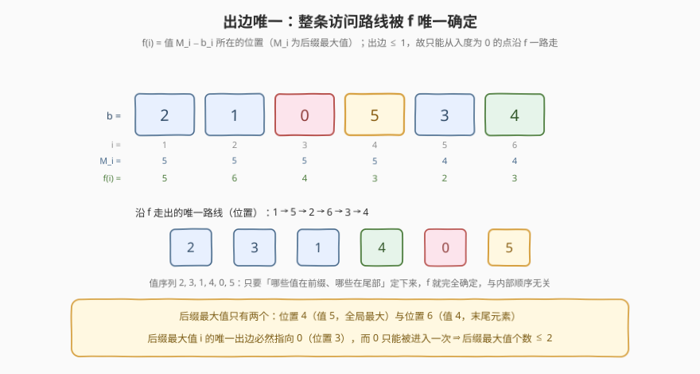
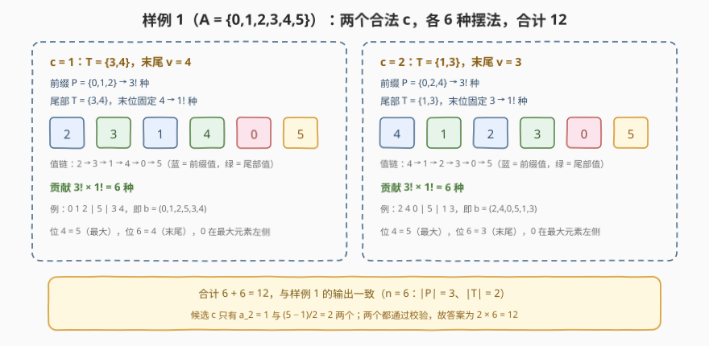

# Codeforces 2262C 周游世界 题解

## 1. 题目概述

- **标题 / 题号**：周游世界（Codeforces 2262C，英文名 Traveling the World）
- **链接**：https://codeforces.com/problemset/problem/2262/C
- **来源**：Codeforces Round 1120 (Div. 1) · Problem C（UTC 2026-09-12）
- **难度**：$\ast 2300$（1750 分）
- **限制**：时间 2 s / 内存 256 MB
- **标签**：组合数学、构造、图论、贪心、数学（官方标签：combinatorics、constructive algorithms、graphs、greedy、math）

**题意**：有 $n$ 座岛，第 $i$ 座岛的值是 $a_i$，且 $0 = a_1 < a_2 < \dots < a_n$。把值重排成 $b_1, b_2, \dots, b_n$。Bessie 若站在**位置** $i$，可以走到位置 $j$（$i \ne j$）当且仅当

$$b_i + b_j = \max(b_i, b_{i+1}, \dots, b_n) =: M_i .$$

注意右边是**从 $i$ 开始的后缀最大值**。若存在两两不同的位置序列 $p_1, \dots, p_n$，使得对每个 $1 \le i < n$ 都有 $p_i \to p_{i+1}$ 可行（即一条经过所有位置的路径），就称重排 $b$ 是**好的**。求好重排的个数，对 $10^9+7$ 取模。多测：先读 $t$，每组读 $n$ 与 $a_1, \dots, a_n$。

**约束**：

- $4 \le n \le 2 \times 10^5$，$1 \le t \le 10^4$，$\sum n \le 2 \times 10^5$
- $0 \le a_i \le 10^9$，且 $a_1 = 0$、严格递增（所有值互不相同）
- 时限 2 s：需要 $O(n \log n)$ 或更优；$n \ge 4$ 说明不必处理 $n \le 3$ 的退化情形

## 2. 示例与观察
官方样例（输入 / 输出原样）：

```text
输入
3
6
0 1 2 3 4 5
5
0 3 4 5 6
4
0 1 3 4

输出
12
0
4
```

第一组的一组解是 $b = [2,1,0,5,3,4]$：路线为 $1 \to 5 \to 2 \to 6 \to 3 \to 4$，例如 $1 \to 5$ 用了 $2 + 3 = 5 = M_1$。第二组无解。第三组 $a = \{0,1,3,4\}$ 有 $4$ 个解。

自造补充（覆盖 $n$ 偶/奇、等差数列）：

```text
输入
2
8
0 1 2 3 4 5 6 7
6
0 1 2 7 8 9

输出
96
6
```

$n = 8$ 时公差为 $1$ 和 $2$ 的两套结构各贡献 $4! \cdot 2! = 48$，共 $96$；$n = 6$ 的 $\{0,1,2,7,8,9\}$ 只有 $c = 1$ 合法，贡献 $3! \cdot 1! = 6$。

## 3. 解题思路

### 3.1 暴力思路

枚举全部 $n!$ 个重排，对每个重排建图（$O(n^2)$ 条边）再做状压 DP 或 DFS 求哈密顿路径，总代价 $O(n! \cdot n 2^n)$，$n = 2 \times 10^5$ 时毫无希望（连 $n = 10$ 都吃力）。所以必须先把「好重排」的结构刻画清楚，再按结构计数。

### 3.2 核心观察：出边唯一，整条路线被 $f$ 唯一确定



**观察 1（出边唯一）**：站在 $i$ 时能走的目标值被唯一确定，必须是 $M_i - b_i$。由于所有值互不相同，「值 $M_i - b_i$ 所在的位置」至多一个。于是把可行关系写成函数

$$f(i) = \text{位置}(M_i - b_i) \quad (b_i \ne M_i/2 \text{ 且该值存在}),$$

每个位置**至多一条**出边（$M_i - b_i = b_i$ 时是自环，等于没有出边）。因此一张重排的可行图是**函数图**：哈密顿路径若存在就只能是「从唯一入度为 $0$ 的点出发、沿着 $f$ 一路走」的那条链。**判定的全部工作就是看这条链能否覆盖 $n$ 个位置。**

**观察 2（后缀最大值至多 2 个）**：若 $b_i = M_i$（称 $i$ 是后缀最大值位置），则出边条件退化为 $b_j = 0$，即**唯一出边指向 $0$ 所在位置 $z$**。而 $z$ 在路径里只被进入一次，除链尾外每个位置都必须用掉出边，所以后缀最大值位置里至多一个不是链尾：**后缀最大值个数 $\le 2$**。位置 $n$ 永远是后缀最大值；若 $p = n$（最大元素在末尾）则只有一个后缀最大值，此时所有 $M_i = a_n$、$f(i) = $ 位置$(a_n - b_i)$ 是「互补配对」，链长最多 $2$，$n \ge 4$ 无解。故 $p < n$，且后缀最大值恰好是 $\{p, n\}$ 两个。

由此 $M_i$ 只有两个取值：$i < p$ 时 $M_i = a_n$；$i > p$ 时 $M_i = v := b_n$（末尾元素是尾部最大值）。于是

$$f(x) = \begin{cases} a_n - x, & x \text{ 在位置 } p \text{ 左侧（记集合 } P \text{）}\\ v - x, & x \text{ 在位置 } p \text{ 右侧（记集合 } T \text{）}\end{cases}\qquad f(a_n) = 0 .$$

**观察 3（$0$ 必在最大元素左侧，链尾是最大元素）**：若 $0$ 在 $p$ 右侧，则 $p$ 没有任何入边（入边要求源值为 $0$ 且 $M = a_n$），只能当链首；链首 $p \to z$ 后 $z \to$ 末尾位置 $n$，而位置 $n$ 又指回 $z$，链长 $3$，矛盾。所以 $0 \in P$，$0 \to a_n$。再看 $0$ 的入边：只能来自 $p$（$a_n - 0$）或末尾位置（$v - 0$）；而 $0$ 的出边指向 $p$，若 $p$ 之后还有路可走，$p$ 的唯一出边又是已访问的 $0$ —— 只能在此终止。故**链尾就是位置 $p$**，链的末尾一段是 $\cdots \to$ 位置 $n \to 0 \to a_n$。

### 3.3 算法流程：一个落差 $c$ 决定一切


令 $c = a_n - v = a_n - b_n > 0$（最大元素与末尾元素的落差）。从链尾倒着推，每一步的入边来源都被唯一确定：$v$ 的入边只能来自 $c$（$a_n - c = v$），$c$ 的入边只能来自 $a_n - 2c$，…… 归纳可得**整条链的值序列被 $c$ 唯一确定**：

$$a_n,\ 0,\ a_n - c,\ c,\ a_n - 2c,\ 2c,\ \dots,\ a_n - kc,\ kc,\ \dots$$

且区域固定为 $kc \in P$（$k \ge 0$）、$a_n - kc \in T$（$k \ge 1$）。链长必须是 $n$，于是得知

- 值集必须**恰好**是 $\{a_n - kc : 0 \le k \le |T|\} \cup \{kc : 0 \le k \le |P| - 1\}$，共 $n$ 个且两两不同；
- 区域大小只由 $n$ 决定：$|P| = \lfloor n/2 \rfloor$，$|T| = \lfloor (n-1)/2 \rfloor$。

**$c$ 只有两个候选**：上面集合的最小正元素既可能是 $c$（前缀侧最小），也可能是 $a_n - |T| c$（尾部侧最小），而 $a_2$ 正是整个 $A$ 的最小正元素，所以

$$a_2 = \min\bigl(c,\ a_n - |T| c\bigr) \ \Longrightarrow\ c = a_2 \quad \text{或} \quad c = \frac{a_n - a_2}{|T|} .$$

对每个候选（去重、且 $c > 0$、且能整除）生成那 $n$ 个数，排序后与 $a$ 逐项比对（顺带查重），相等即合法。**每个合法 $c$ 对应唯一的划分**（$v = a_n - c$ 唯一），摆法数也固定：$a_n$ 被钉在位置 $|P| + 1$、$v$ 被钉在位置 $n$、前缀 $|P|$ 个值任意排、尾部剩下 $|T| - 1$ 个值任意排，共 $|P|! \cdot (|T| - 1)!$ 种（与 $c$ 无关）。所以

$$\boxed{\ \text{答案} = (\text{合法 } c \text{ 的个数}) \times |P|! \times (|T| - 1)! \ }$$

### 3.4 示例演算



对 $A = \{0,1,2,3,4,5\}$（$n = 6$，$|P| = 3$、$|T| = 2$，权重 $3! \cdot 1! = 6$）：

| 候选 $c$ | 值集 $\{5-kc\} \cup \{kc\}$ | 划分 | 摆法数 |
|----------|------------------------------|------|--------|
| $c = a_2 = 1$ | $\{5,4,3\} \cup \{0,1,2\}$ | $P=\{0,1,2\}$，$T=\{3,4\}$ | $3! \cdot 1! = 6$ |
| $c = (5-1)/2 = 2$ | $\{5,3,1\} \cup \{0,2,4\}$ | $P=\{0,2,4\}$，$T=\{1,3\}$ | $3! \cdot 1! = 6$ |

候选就这两个（$|T| = 2$），合计 $6 + 6 = 12$，与样例 1 一致。$c = 1$ 对应的链是 $2 \to 3 \to 1 \to 4 \to 0 \to 5$；把前缀换成任意顺序（如 $b = [0,1,2,5,3,4]$）仍然好，因为 $f$ 只依赖「值属于哪个区域」。

## 4. 算法细节

1. **$f$ 的唯一性来自「值互不相同」**：$M_i - b_i$ 是唯一候选值，只需查它是否存在；这既是判定哈密顿路径的关键，也是计数与顺序无关的原因（内部顺序只改目标位置，不改目标值）。
2. **后缀最大值只有 $\{p, n\}$**：$p$ 是 $a_n$ 的位置，位置 $n$ 必为后缀最大值；若还有第三个，第三个的出边也要指向 $0$，但 $0$ 只能被进入一次。
3. **$|P|$ 与 $|T|$ 的公式**：链的偶位置（$a_n$、$a_n - kc$）都在尾部侧，奇位置（$kc$）都在前缀侧，去掉链首的 $a_n$（它在位置 $p$）即得 $|P| = \lfloor n/2 \rfloor$、$|T| = \lfloor (n-1)/2 \rfloor$；$n \ge 4$ 保证 $|T| \ge 1$、$|T| - 1 \ge 0$。
4. **候选枚举的两处细节**：$(a_n - a_2) \bmod |T|$ 必须为 $0$；两个候选可能相等，要去重，否则同一划分会被计两次。
5. **校验用排序比较**：生成 $n$ 个数后排序，先查相邻元素是否相等（不合法会出现重复，例如 $a_n/2$ 同时在两侧），再与 $a$ 逐项比较。生成时若出现负数直接判非法。
6. **溢出**：$c$ 可达 $10^9$、$k$ 可达 $\lfloor n/2 \rfloor \approx 10^5$，$k \cdot c$ 可达 $10^{14}$，C++ 必须用 `long long`；阶乘在模 $10^9+7$ 下预处理到 $2 \times 10^5$。
7. **多测清空**：所有数组、向量按组新建；阶乘表在循环外**只算一次**，别放进多测里重复 $O(n)$ 预处理。
8. **I/O**：$\sum n \le 2 \times 10^5$ 但 $t$ 可达 $10^4$，C++ 关同步、Python 用 `sys.stdin.buffer.read().split()` 一次读完。

## 5. 正确性证明

**引理 1（出度至多 1）**：固定重排 $b$，每个位置至多一条可用出边，因此可行图是函数图；若存在哈密顿路径，则路径上每个非终点位置的下一站都被唯一确定为 $f$。**证明**：目标值必须是 $M_i - b_i$，值互不相同故这样的位置至多一个；若 $M_i - b_i = b_i$ 则为自环，而路径要求位置两两不同，等于没有出边。∎

**引理 2（后缀最大值至多 2 个）**：后缀最大值位置的唯一出边指向 $0$ 所在位置 $z$；路径中 $z$ 只被进入一次，故这类位置里至多一个不是路径终点，即总数 $\le 2$。**证明**：$b_i = M_i$ 时 $b_i + b_j = M_i$ 迫使 $b_j = 0$，$0$ 唯一。∎

**引理 3（$p < n$ 且后缀最大值为 $\{p,n\}$）**：$n \ge 4$ 时最大元素位置 $p \ne n$。**证明**：$p = n$ 时所有 $M_i = a_n$，$f(i) = $ 位置$(a_n - b_i)$ 是互补对合的走向，链长 $\le 2 < n$；又位置 $n$ 总是后缀最大值，$p < n$ 时它和 $p$ 已是两个，再由引理 2 恰为这两个。∎

**引理 4（$0$ 在 $p$ 左侧，链尾是 $p$）**：$0$ 的位置 $z < p$，且路径终点是 $p$。**证明**：若 $z > p$，则指向 $p$ 的边不存在（要求源值 $0$ 且 $M = a_n$），$p$ 只能当链首，随后 $p \to z \to$ 位置 $n \to z$，链长 $3$，矛盾。故 $z < p$，于是 $0 \to p$。指向 $0$ 的边只能来自位置 $p$（$b_p = M_p = a_n$，目标值 $a_n - a_n = 0$）或位置 $n$（$b_n = v = M_n$，目标值 $v - v = 0$）。若 $p$ 不是终点，则 $0 \to p$ 之后 $p$ 的唯一出边指向已访问的 $0$，只能在此终止，故 $p$ 是终点，且末段必为 $v \to 0 \to a_n$。∎

**引理 5（链的值序列被 $c$ 唯一确定）**：记 $c = a_n - b_n$。则链的值序列（从终点倒推）恰为 $a_n, 0, a_n - c, c, a_n - 2c, 2c, \dots$，其中 $a_n - kc \in T$、$kc \in P$。**证明**：指向任一值 $y$ 的边，来源只能是 $x_P = a_n - y$（$P$ 侧）或 $x_T = v - y$（$T$ 侧）——因为两区域内 $\pi$ 都是对合。而 $y$ 自己的出边指向的恰好就是其中之一（$y \in P$ 时为 $x_P$，$y \in T$ 时为 $x_T$），它已在链上，故 $y$ 的前驱若存在就唯一是另一个。从已知的末段 $v \to 0 \to a_n$ 出发逐步倒推：$v$ 的另一候选是 $c = a_n - v$，$c$ 的另一候选是 $a_n - 2c$，$a_n - 2c$ 的另一候选是 $2c$，…… 归纳即得整条序列。且链长必须为 $n$，故各值两两不同、全部落在 $A$ 中。∎

**定理**：命 $S(c) = \{a_n - kc : 0 \le k \le |T|\} \cup \{kc : 0 \le k \le |P| - 1\}$，$|P| = \lfloor n/2 \rfloor$、$|T| = \lfloor (n-1)/2 \rfloor$。则 $b$ 好 $\iff$ 存在 $c > 0$ 使 $S(c) = A$（作为集合且 $n$ 个值互不相同），且好重排总数为 $(\#\{c : S(c) = A\}) \cdot |P|! \cdot (|T| - 1)!$。**证明**：必要性由引理 1–5：链长 $n$、覆盖全部位置，故值集恰为 $S(c)$ 且无重复。充分性：给定满足条件的 $c$，按「前缀放 $P$ 的值、位置 $|P|+1$ 放 $a_n$、位置 $n$ 放 $v = a_n - c$、其余尾部值任意」构造重排，则后缀最大值恰为 $\{p, n\}$，$f$ 与链 $a_n \leftarrow \cdots$ 一致（只依赖值不依赖顺序），从链的另一端（值 $(|P|-1)c$ 或 $a_n - |T|c$，其入度为 $0$）沿 $f$ 走恰好覆盖 $n$ 个位置，即得哈密顿路径。计数：$a_n$、$v$ 的位置被 $c$ 钉死，$P$、$T$ 的取值集合也被 $c$ 钉死，剩下 $|P|!$ 与 $(|T|-1)!$ 种；不同 $c$ 给出不同的 $v$，故不重不漏。∎

## 6. 复杂度分析

- **时间**：每组 $O(n \log n)$。对至多 $2$ 个候选各生成 $n$ 个数并排序（$O(n \log n)$），再一次线性比对；$\sum n \le 2 \times 10^5$ 故总体约 $2 \times 10^5 \log$ 级别，加上阶乘预处理 $O(\max n)$。
- **空间**：$O(n)$。只存 $a$、一个长度 $n$ 的临时数组与阶乘表（$2 \times 10^5$ 个 `long long`）。
- **实测**（本机 Apple clang 21 `-O2` / CPython 3.9）：$n = 2 \times 10^5$ 的等差数列（最坏情况：两个候选都合法、要排两次序）C++ 约 $0.23$ s，$t = 10^4$ 组小数据约 $0.29$ s；Python3 约 $0.13$ s。对 2 s 时限余量充足。

## 7. 参考代码

### C++17

```cpp
#include <cstdio>
#include <iostream>
#include <vector>
#include <algorithm>
using namespace std;

static const long long MOD = 1000000007LL;
static const int MAXN = 200005;
long long fact[MAXN];

int main() {
    ios::sync_with_stdio(false);
    cin.tie(nullptr);
    fact[0] = 1;
    for (int i = 1; i < MAXN; i++) fact[i] = fact[i - 1] * i % MOD;

    int t;
    cin >> t;
    while (t--) {
        int n;
        cin >> n;
        vector<long long> a(n);
        for (int i = 0; i < n; i++) cin >> a[i];

        long long mx = a[n - 1];
        int P = n / 2;          // |P|：前缀区域个数
        int Tl = (n - 1) / 2;   // |T|：尾部区域个数
        long long ways = fact[P] * fact[Tl - 1] % MOD;

        // 合法 c 至多两个：A 的最小正元素 = min(c, mx - Tl*c)
        vector<long long> cand;
        cand.push_back(a[1]);
        long long d = mx - a[1];
        if (d % Tl == 0) cand.push_back(d / Tl);

        int cnt = 0;
        for (size_t id = 0; id < cand.size(); id++) {
            long long c = cand[id];
            if (c <= 0) continue;
            bool dup = false;
            for (size_t j = 0; j < id; j++) if (cand[j] == c) dup = true;
            if (dup) continue;

            vector<long long> vals;
            vals.reserve(n);
            bool ok = true;
            for (int k = 0; k <= Tl; k++) {              // 尾部侧：mx - k*c
                long long v = mx - (long long)k * c;
                if (v < 0) { ok = false; break; }
                vals.push_back(v);
            }
            if (!ok) continue;                           // 生成出负数 ⇒ 该 c 非法
            for (int k = 0; k < P; k++) vals.push_back((long long)k * c);

            sort(vals.begin(), vals.end());
            bool good = true;
            for (int i = 1; i < n; i++) if (vals[i] == vals[i - 1]) { good = false; break; }
            if (!good) continue;                         // 出现重复值 ⇒ 该 c 非法
            for (int i = 0; i < n; i++) if (vals[i] != a[i]) { good = false; break; }
            if (good) cnt++;
        }
        cout << ways * cnt % MOD << '\n';
    }
    return 0;
}
```

### Python3

```python
import sys

MOD = 10 ** 9 + 7
MAXN = 200005


def main():
    data = sys.stdin.buffer.read().split()
    if not data:
        return
    ptr = 0
    t = int(data[ptr]); ptr += 1
    fact = [1] * MAXN
    for i in range(1, MAXN):
        fact[i] = fact[i - 1] * i % MOD

    out = []
    for _ in range(t):
        n = int(data[ptr]); ptr += 1
        a = list(map(int, data[ptr:ptr + n])); ptr += n

        mx = a[-1]
        P = n // 2               # |P|
        Tl = (n - 1) // 2        # |T|
        ways = fact[P] * fact[Tl - 1] % MOD

        cand = [a[1]]
        d = mx - a[1]
        if d % Tl == 0:
            cand.append(d // Tl)

        cnt = 0
        seen = set()
        for c in cand:
            if c <= 0 or c in seen:      # 去重：两个候选可能相同
                continue
            seen.add(c)
            vals = []
            ok = True
            for k in range(Tl + 1):
                v = mx - k * c
                if v < 0:                # 负数不可能是 a 的元素
                    ok = False
                    break
                vals.append(v)
            if not ok:
                continue
            for k in range(P):
                vals.append(k * c)
            vals.sort()
            if all(vals[i] != vals[i - 1] for i in range(1, n)) and vals == a:
                cnt += 1
        out.append(str(ways * cnt % MOD))
    sys.stdout.write("\n".join(out) + "\n")


main()
```

## 8. 边界情况与易错点

1. **$n = 4$ 的最小情形**：$|P| = 2$、$|T| = 1$，权重 $2! \cdot 0! = 2$；此时尾部的 $(|T|-1)! = 1$，不要因为 $|T| - 1 = 0$ 就漏乘或把 $0!$ 当 $0$。
2. **候选个数不是 2 个**：$(a_n - a_2)$ 不能被 $|T|$ 整除时只剩一个候选（样例 2 就是这种：$a_2 = 3$、$(6-3) \bmod 2 = 1$，只有 $c = 3$ 一个候选且非法）；两个候选相等时 $S(c)$ 必然出现重复值、该 $c$ 一定非法，代码去重只是让逻辑更干净。
3. **生成出负数**：$(|T|) \cdot c > a_n$ 时尾部侧会生成负数，必须立刻判非法，否则排序后可能「碰巧」错位相等。
4. **重复值必须查**：$a_n / 2$ 这类值会同时落在两侧（$kc = a_n - kc$），此时该 $c$ 非法；只比较「是否在 $a$ 中」而不排序查重会漏判。
5. **整除与取整**：`d % Tl == 0` 与 `d // Tl` 配套使用；$|T| \ge 1$ 由 $n \ge 4$ 保证，不必特判除零。
6. **溢出**：$k \cdot c$ 最大约 $10^{14}$，C++ 的 `int` 会炸；候选比较、集合生成一律 `long long`，Python 无此问题。
7. **多测与 I/O**：阶乘表只预处理一次；每组不要重新 `memset` 长度 $10^5$ 的全局数组，$t = 10^4$ 会白送 $10^9$ 次写。

## 9. 验证记录

- **编译环境与命令**：`clang++ -std=c++17 -O2`（本机无 GNU g++，配 `codeforces/tools/include/bits/stdc++.h` 兼容头；正文代码只用标准库，可原样提交 GNU C++17）；Python 侧为 `Python 3.9.6`。
- **官方样例**：1 / 1 通过（按 Codeforces 标准 checker 的 token 比对，忽略空白与大小写）。
- **复核状态**：audited（2026-11-19 统一回归：编译 + 官方样例；写作期的随机对拍与暴力未重跑）。

## 相关题目与扩展

- [Codeforces 2263E Traveling the World](https://codeforces.com/problemset/problem/2263/E)：本题的 Div. 2 版本（同一道题），可对照「Div1 C 常是 Div2 E」的分场惯例。
- [Codeforces 2262D PLUSworld](https://codeforces.com/problemset/problem/2262/D)：同场构造 + 图论，同样靠「先证结构、再计数」推进。
- [LeetCode 996. 平方数组的数目](https://leetcode.cn/problems/number-of-squareful-arrays/)：相邻两数满足和关系的排列计数，可用状压 DP 对照本题的「唯一出边」技巧。
- [LeetCode 2741. 特别的排列](https://leetcode.cn/problems/special-permutations/)：相邻元素整除约束下的排列计数，标准状压 DP $O(n 2^n)$，与本题的「结构计数 $O(n\log n)$」形成难度对照。

**延伸思考**：把「后缀最大值」改成「前缀最大值」，只要把排列整体左右翻转就与本题一一对应（$M'_i = $ 前缀最大值），所以答案完全不变——这是一次免费的等价变换；若把某个值改成重复值，「出边唯一」立刻失效，可行图出度可能大于 $1$，需要按重复度做容斥；若问的是**哈密顿回路**而非路径，链首与链尾之间还要一条边，条件变为链尾值 $a_n$ 与链首值 $x$ 满足 $a_n + x = $ 某个后缀最大值，答案会急剧变少（甚至几乎总是 $0$）。
