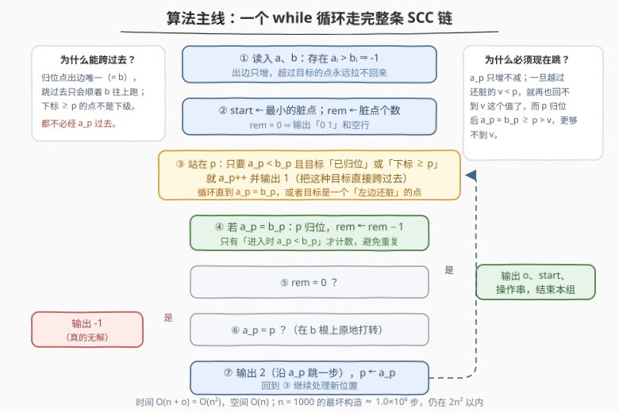
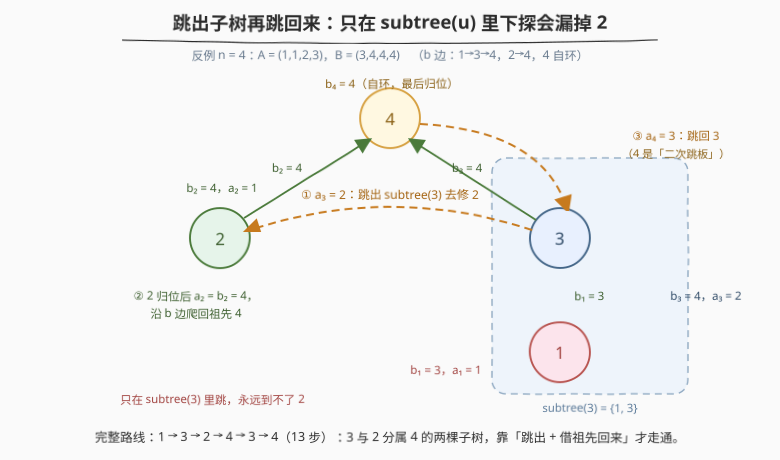
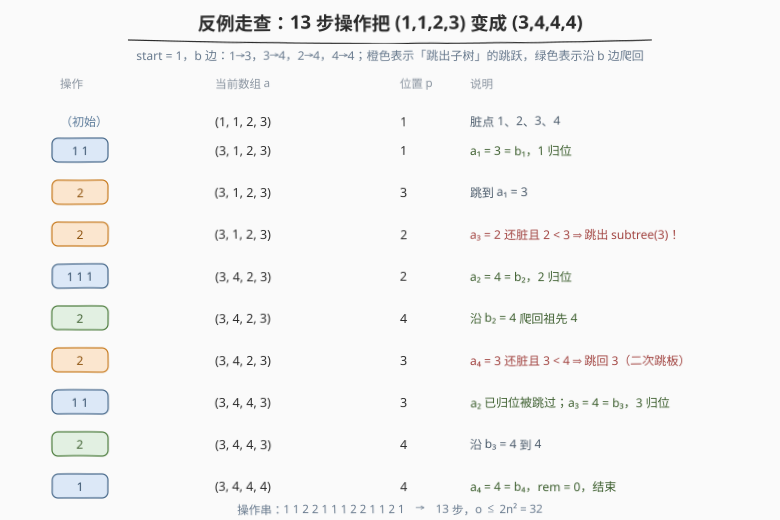

# Codeforces 2262D PLUS世界 题解

## 1. 题目概述

- **标题 / 题号**：PLUS世界（Codeforces 2262D，英文名 PLUSworld）
- **链接**：https://codeforces.com/problemset/problem/2262/D
- **来源**：Codeforces Round 1120 (Div. 1) · Problem D
- **难度**：$*2900$（2500 分）
- **限制**：时间 2 s / 内存 256 MB
- **标签**：构造、图论、贪心、函数图与向上森林（官方标签：constructive algorithms、graphs、greedy）

**题意**：$n$ 个谷仓，谷仓 $i$ 当前有一条指向 $a_i$ 的单向道。Bessie 从某个谷仓 $p$ 出发，可任意次执行：

- **操作 1**：$a_p \gets a_p + 1$（执行前需 $a_p < n$），人不动；
- **操作 2**：$p \gets a_p$，沿当前出边走一步。

目标是把 $a$ 改成给定的 $b$，其中保证 $i \le b_i \le n$——目标图是「只会向上或自环」的森林。输出：操作次数 $o$、起点 $p$、长度 $o$ 的 1/2 序列，$o \le 2n^2$；无解输出 `-1`。**多测**：先读 $t$，每组读 $n$、$a_1..a_n$、$b_1..b_n$。

**约束**：

- $1 \le t \le 10^4$，$1 \le n \le 1000$，$\sum n^2 \le 10^6$
- $i \le b_i \le n$：$b_i = i$ 的点是根（自环），任意点到根一路向上
- $o \le 2n^2$ 暗示构造只有 $O(n^2)$ 次操作；$\sum n^2$ 暗示 $O(n^2)$ 量级的判定足够

## 2. 示例与观察
官方样例 9 组（输入 / 输出原样）：

```text
输入
9
3
1 2 3
2 3 3
2
2 2
1 2
5
1 1 1 4 5
2 3 4 5 5
3
1 1 1
1 2 3
3
1 1 1
3 2 3
3
1 1 3
1 2 3
4
1 1 1 4
3 3 4 4
4
1 4 3 4
1 4 3 4
5
1 3 4 5 4
2 3 4 5 5
```

```text
输出
5 1
1 2 1 2 2
-1
12 1
1 2 1 1 2 1 1 1 2 1 2 2
-1
-1
2 2
1 2
12 1
1 1 2 1 2 1 1 2 1 1 2 2
0 1
7 1
1 2 2 2 2 1 2
```

第 1 组：起点 1，把 $a_1$ 从 1 抬到 2 后走到 2，把 $a_2$ 从 2 抬到 3 后走到 3，得 $[2,3,3]$。第 2 组 $a_1 = 2 > b_1 = 1$：出边只增不减，无解。

> 答案不唯一：本文代码在第 3 组输出 `10 1 / 1 2 1 1 2 1 1 1 2 1`、第 7 组输出 `10 1 / 1 1 2 1 2 1 1 2 1 1`、第 9 组输出 `6 1 / 1 2 2 2 2 1`，都合法。

## 3. 解题思路

### 3.1 暴力思路与它的用途

状态是「数组 $a$ + 位置 $p$」，两种操作是两条转移，BFS 即可求可达。但状态数 $n^n \cdot n$，$n = 1000$ 完全不可行，必须挖掘结构。

不过它有个重要用途：**小数据下的标准答案**。把 $a_i$ 的取值限制在 $[a_i, b_i]$（一旦超过 $b_i$ 就再也修不回来，必然无解），状态数就变成 $n\prod_i (b_i - a_i + 1)$，$n \le 12$ 时可以全量 BFS。本文的构造就是拿它对拍的（见 §5.5）。

### 3.2 观察一：出边只增，一次「用掉」就回不去

1. **必要条件**：操作 1 只增，故任何有解输入都满足 $a_i \le b_i$；否则输出 `-1`。
2. 称 $a_i < b_i$ 的点为**脏点**（还需要抬）。脏点 $i$ 必须被访问，否则 $a_i$ 永远改不了；而且它**最后一次**离开时必须恰好走到 $b_i$（或者 $i$ 就是终点，停在 $a_i = b_i$ 上）。换句话说：$a_i$ 要一路加到 $b_i$，而最后一个离开目标就是 $b_i$。
3. 站在 $p$ 时可以把 $a_p$ 一次加到位再跳，所以「$p$ 能到哪」就是整个区间 $[a_p, b_p]$。但 $a_p$ 只增，于是同一个 $p$ 的多次离开目标必须**单调不减**，且最后一次是 $b_p$。

把「$p$ 能到 $[A_p, B_p]$ 里的任意点」画成有向图 $G$（$A, B$ 是初始值），行走就是 $G$ 上的一条游走，只是每个点被用过一次后出边会缩水（左端点变大）。**这一点是后面所有构造与判定的出发点。**

![把 i 到 [A_i,B_i] 连边后，脏点所在的 SCC 缩成一条链](../../../images/cf2262d_scc_chain.svg)

### 3.3 观察二：脏点所在的 SCC 缩成一条链

记 $G$ 的边为 $i \to j$（$A_i \le j \le B_i$），把**含脏点的 SCC** 按访问顺序记作 $C_1, \dots, C_k$。有解时它们必须满足：

1. **离开一个 SCC 就再也回不去**：若能从 $S$ 走到 $T$ 再走回 $S$，那么 $S, T$ 在 $G$ 里互相可达，本就属于同一个 SCC。所以每个含脏点的 SCC 只能被「整体」访问一次，$C_1 \to C_2 \to \dots \to C_k$ 必然是一条链。
2. **每个 $C_i$ 只有一个出口，而且只能是 $\max C_i$ 的 $b$ 边**。理由：SCC 内若有两个点 $b$ 跑出 SCC，Bessie 离开时只能走其中一条，另一条对应的点就永远等不到「最后一次离开」；而出口若落在 $v < \max C_i$ 上，则 $\max C_i$ 的 $b$ 只能留在 SCC 内，由 $b_{\max} \ge \max$ 得 $b_{\max} = \max$ 是自环，归位后永远困在 $\max$，再也走不到 $v$——矛盾。所以出口只能是 $\max C_i$，并且 $\max C_i$ 一定是脏点（好点的唯一出边要么自环、要么跑出 SCC，都无法与 SCC 内其它点强连通）。
3. **$C_i$ 的每个点都小于 $C_{i+1}$ 的每个点**：设 $y = b_{\max C_i} \in C_{i+1}$。若存在 $z \in C_{i+1}$ 且 $z < \max C_i$，考虑 $G$ 中从 $y$ 到 $z$ 的路径（路径上一旦离开 $C_{i+1}$ 就回不来，所以整条路径都在 $C_{i+1}$ 内），路径上必有一跳 $q \to p$ 满足 $q \ge \max C_i > p$。由 $p \in [A_q, B_q]$ 且 $\max C_i \le q \le B_q$ 得 $\max C_i \in [A_q, B_q]$，即 $C_{i+1}$ 也能一步回到 $C_i$，两个 SCC 合并，矛盾。

由此还能立刻得到：**编号最小的脏点一定在 $C_1$ 里**（$C_1$ 里的点全部小于其它 $C_i$ 的点，而 $C_1$ 自己含脏点）。

这三条反过来就是**无解的来源**：两条出口、两个源 SCC、顺序交叉、$a_i > b_i$，都会让某条「必经之路」断掉。它们是 §5 中 `-1` 判定的全部依据。

### 3.4 构造：官方 Magic Solution（一个 while 循环）

有了链结构，构造可以写得非常短——**甚至不用真的建图、求 SCC**：

```text
start ← 编号最小的脏点；rem ← 脏点个数
while rem > 0:
    若 a[p] < b[p]:
        当 a[p] < b[p] 且（a[a[p]] 已经归位 或 a[p] ≥ p）:
            a[p] += 1，输出 1
        若 a[p] == b[p]: rem -= 1          # p 归位
    若 rem == 0: 结束
    若 a[p] == p: 输出 -1                   # 在 b 根上原地打转，卡死
    输出 2；p ← a[p]
```

三句话解释每个分支：

- **目标「已经归位」或「下标 ≥ p」⇒ 直接 +1 越过**。归位点只有一条出边 $b$，跳过去只会顺着 $b$ 链往上跑，什么也修不了；下标 ≥ p 的点不可能是「必须在 p 之前处理的下级」。这两种目标都不值得为它停下。
- **目标仍是脏点且下标 < p ⇒ 必须现在跳过去**。$a_p$ 只增不减；一旦 $a_p$ 越过这个还脏的 $v$，$p$ 就再也回不到 $v$ 这个值了；而 $p$ 归位后 $a_p = b_p \ge p > v$，从 $p$ 更够不到 $v$。所以只能趁现在跳过去，先把 $v$ 修好。
- **$a_p = b_p$ ⇒ 归位并跳 $b_p$**：这等价于「在一个内向树里按编号从小到大访问完儿子后，走向父亲」。



### 3.5 反例：为什么不能只在子树里跳

旧版本题解的做法是：对每个 $u$ 求「只在 $subtree(u)$ 内跳能覆盖谁」，再选一个 hub 逐层下探 / 爬回。这个思路是**错的**，下面这组 $n = 4$ 会把它打回 `-1`：

```text
n = 4
a = 1 1 2 3
b = 3 4 4 4
```

$b$ 森林：$1 \to 3 \to 4$，$2 \to 4$，$4$ 自环。脏点是全部 4 个点。旧做法的账是这样的：$top(1) = top(3) = 3$（在 $subtree(3)$ 内能覆盖），$top(2) = 4$，最深的是 3，于是起点只能落在 $subtree(3) = \{1, 3\}$。但 $2$ 根本不在 $subtree(3)$ 里，$subtree$ 内的覆盖闭包永远看不到它——旧代码跑完全部起点候选，输出 `-1`。

而实际上它有解，13 步：

```text
13 1
1 1 2 2 1 1 1 2 2 1 1 2 1
```

手动走一遍：$1$ 抬到 $3$（归位）→ 跳到 $3$ → **$a_3 = 2$，$2$ 还是脏点且 $2 < 3$，于是跳出 $subtree(3)$ 跳到 $2$** → 把 $a_2$ 从 1 抬到 4（归位）→ 沿 $b_2 = 4$ 爬回祖先 $4$ → **$a_4 = 3$，$3$ 还是脏点且 $3 < 4$，于是跳回 $3$** → 把 $a_3$ 从 2 抬到 4（归位，途中越过已归位的 2）→ 沿 $b_3 = 4$ 到 $4$ → 把 $a_4$ 从 3 抬到 4，结束。

关键在「**跨子树二次跳板**」：$3 \to 2$ 跳出了 $subtree(3)$，回来靠的是 $2$ 的 $b$ 边回到公共祖先 $4$，再由 $a_4 = 3$ 跳回 $3$。$subtree(3)$ 内部的任何覆盖闭包都描述不了这条路线——这正是旧题解漏掉的情形，也是本文重写的原因。Magic Solution 不预设子树边界，只按「目标脏不脏、在不在左边」决定，恰好自动走出这条路线。



### 3.6 样例走查

第 7 组：$a = (1,1,1,4)$，$b = (3,3,4,4)$，$b$ 森林为 $1 \to 3 \to 4$、$2 \to 3$，脏点 $\{1,2,3\}$。

- 起点 $1$：$a_1: 1 \to 2 \to 3$（目标 $1,2$ 都是脏点但 $a_1 \ge 1$，跳过），$1$ 归位；跳 $b_1 = 3$。
- 在 $3$：$a_3: 1 \to 2$，目标 $2$ 还脏且 $2 < 3$ ⇒ 跳到 $2$。
- 在 $2$：$a_2: 1 \to 2 \to 3$（$1$ 已归位，跳过），$2$ 归位；跳 $b_2 = 3$。
- 在 $3$：$a_3: 2 \to 3 \to 4$（$2$ 已归位，跳过），$3$ 归位；$rem = 0$ 结束。

操作串 `1 1 2 1 2 1 1 2 1 1`，共 10 步。注意这里也有一次「先跳到兄弟 $2$ 再借 $b_2 = 3$ 回来」，只不过这次兄弟仍在 $subtree(3)$ 内，旧做法还能应付；§3.5 的反例才是真正跳出去的情形。

第 3 组：$a = (1,1,1,4,5)$，$b = (2,3,4,5,5)$，输出 `10 1 / 1 2 1 1 2 1 1 1 2 1`：每修好 $i$ 就跳到 $b_i = i+1$，在 $i+1$ 处一路加、越过所有已归位的小点，直到自己的 $b$。



### 3.7 为什么这个贪心是对的（直觉版）

- **归位顺序**：「$a_p$ 只增、最后一次必须是 $b_p$」意味着 $p$ 归位时，$[A_p, p)$ 里所有还脏的点都已经被越过——而越过一个脏点是不可能的（规则会先跳过去处理它）。所以**每次归位都只能发生在比它小的脏点全部归位之后**。
- **不会跨 SCC 乱跳**：从 $u$ 出发的跳，要么是归位后跳 $b_u$，要么是跳向一个「还脏且 $< u$」的点；由链结构，比 $u$ 小的脏点只可能在当前 SCC 或更早的 SCC 里，而更早的都已经归位、被规则跳过。所以只要当前 SCC 的 $\max$ 还没归位，Bessie 就跳不出这个 SCC。
- **链是自动推进的**：当前 SCC 清空后，$\max C_i$ 归位，它唯一的出口 $b_{\max C_i}$ 正好落在 $C_{i+1}$；所以循环会依次吃掉 $C_1, \dots, C_k$，最后 `rem = 0`。
- **卡死 = 真无解**：`a_p = p` 说明 $p$ 已归位且是 $b$ 根，跳来跳去都在 $p$。这时 $p$ 只能是当前 SCC 的 $\max$、且这个 SCC 是最后一个；按上一条它内部的脏点应该已经清空，与 `rem > 0` 矛盾。所以卡死只可能出现在本来就无解的输入上。

形式化证明见 §5。

## 4. 算法细节

1. **就地模拟**：$a$ 是唯一被修改的数组，直接在读入的 $a$ 上做加法；多测时重新读入即可，不需要额外清空。
2. **`rem` 计数去重**：只有「进入循环体时 $a_p < b_p$」才可能让 `rem--`。若某个已归位的点被再次经过，`a_p == b_p`，不会重复计数（这一点写错会少算脏点、提前判成功）。
3. **卡死判定**：`a_p == p`。此时 $p$ 必是 $b$ 根且 $a_p = b_p = p$，从 $p$ 只能跳回 $p$，永远出不去；只要还有 `rem > 0` 就是无解。
4. **操作数上界**：抬升次数恰为 $\sum_i (b_i - A_i) \le n(n-1)$（每个点只加到自己的 $b$）；跳跃次数与抬升同阶（每次「下降」都发生在某个顶点某个具体的 $a$ 值上，沿途「上行」则沿 $b$ 链一次走完），故 $o = O(n^2)$。实测 $n = 1000$ 的最坏数据 $o \approx 1.0\times10^6$，稳定满足 $o \le 2n^2 = 2\times10^6$（题目也保证了存在 $\le 2n^2$ 的解）。
5. **不需要建图**：$G$、SCC、链都只用于证明。代码只有两次线性扫描 + 一条模拟循环，常数极小。
6. **输出格式**：`o p` 一行、操作串一行；$o = 0$ 时**第二行也要输出空行**（`puts("0 1\n")` 会打印两行）。
7. **读入方式**：`scanf` / `sys.stdin.buffer.read()`，$t$ 最大 $10^4$、$\sum n^2 \le 10^6$，总输出最多约 $2\times10^6$ 个整数，别用 `endl`。

## 5. 正确性证明

下面 $A_i$ 表示初始 $a_i$，$B_i = b_i$；$G$ 的边为 $i \to j \iff A_i \le j \le B_i$。

**引理 1（必要性）**：有解 $\Rightarrow$ 对任意 $i$ 有 $a_i \le b_i$。

**证明**：$a_i$ 单调不减且最终等于 $b_i$。∎

**引理 2（链结构）**：有解 $\Rightarrow$ 含脏点的 SCC 为 $C_1, \dots, C_k$，并且对每个 $i$：

1. $C_i$ 的每个点都小于 $C_{i+1}$ 的每个点；
2. $C_i$ 只有一条出边，且来自 $\max C_i$，指向 $b_{\max C_i} \in C_{i+1}$（$i < k$）；$C_k$ 的出口落在好点区或自环；
3. $\max C_i$ 是脏点，编号最小的脏点属于 $C_1$。

**证明**：

1. 离开一个 SCC 后无法再回来：若 $S \to \dots \to T \to \dots \to S$，则 $S, T$ 在 $G$ 中互相可达，属于同一 SCC。因此「Bessie 访问过的 SCC」序列是一条无重复的路，含脏点的 SCC 必须全部落在这条路上，按访问顺序排成链。
2. 若 $C_i$ 内有两个不同的点 $b$ 跑出 $C_i$，则 Bessie 从 $C_i$ 离开时只能走其中一条边，另一个点永远等不到「最后一次离开」，矛盾——所以出口至多一条，设这条出口来自 $v \in C_i$。若 $v < m = \max C_i$：对任意 $w \in C_i$、$w > v$，$b_w$ 必须留在 $C_i$ 内（出口只有一条）；若 $b_w = w$，归位 $w$ 后就永远困在自环 $w$ 上、到不了 $v$，故只能 $b_w > w$。于是从任何 $w > v$ 出发沿 $b$ 边在 $C_i$ 内严格上升，最终必然停在某个 $b = $ 自环的点上，同样被困住，仍到不了 $v$，矛盾。所以 $v = m$。再由 $C_i$ 强连通可知 $m$ 不是好点：好点的唯一出边若等于 $m$，$m$ 就到不了 $C_i$ 中其它点；若大于 $m$，唯一出边就跑出了 $C_i$——都与强连通矛盾。故 $m$ 是脏点，$b_m$ 就是 $C_i$ 的唯一出口；$i < k$ 时它必须落在 $C_{i+1}$（$C_{i+1}$ 只能从 $C_i$ 进入），$i = k$ 时可以是自环，也可以落在好点区。
3. 设 $y = b_{\max C_i} \in C_{i+1}$，若存在 $z \in C_{i+1}$ 且 $z < \max C_i$：取 $G$ 中 $y \to z$ 的路径（离开 $C_{i+1}$ 就回不来，故整条路径都在 $C_{i+1}$ 内），路径上必有第一次从 $\ge \max C_i$ 跳到 $< \max C_i$ 的一步 $q \to p$。由 $p \in [A_q, B_q]$、$A_q \le p < \max C_i \le q \le B_q$ 得 $\max C_i \in [A_q, B_q]$，于是 $C_{i+1} \to C_i$，矛盾。
4. $\max C_i$ 是脏点（上一条），而 $C_1$ 的点全部最小、$C_1$ 自己含脏点，故最小脏点 $\le \max C_1 < \min C_{i}$（$i > 1$），即最小脏点属于 $C_1$。∎

**引理 3（归位不变量）**：若贪心在某次迭代中把 $q$ 归位（即把 $a_q$ 加到 $b_q$），则此刻所有满足 $A_q \le v < q$ 的脏点 $v$ 都已归位。

**证明**：$q$ 第一次被访问时 $a_q = A_q$，此后 $a_q$ 只由贪心在 $q$ 上逐次 $+1$。贪心只有在「当前目标 $v = a_q$ 是脏点且 $v < q$」时才会跳出 $q$；下次回到 $q$ 时 $a_q$ 仍是 $v$，若 $v$ 依旧脏就还会跳走。因此 $a_q$ 能越过 $v$ 的必要条件是 $v$ 已经归位。归位时 $a_q$ 从 $A_q$ 一路加到 $b_q$，越过了 $[A_q, b_q)$ 的所有值，结论成立。∎

**引理 4（SCC 内清空）**：设 $mx = \max C_i$。贪心把 $mx$ 归位时，$C_i$ 内没有尚未归位的脏点。

**证明**：反设存在，取其中编号最大的 $j < mx$。由 $C_i$ 强连通，存在路径 $mx = x_0 \to x_1 \to \dots \to x_t = j$ 且所有 $x_r \in C_i$（若路径离开 $C_i$，就再也回不到 $C_i$ 里的 $j$，与强连通矛盾；不同脏 SCC 之间也没有回边，见引理 2 的证明）。取第一次满足 $x_r \le j$ 的下标 $r \ge 1$，令 $q = x_{r-1} > j$、$p = x_r \le j$。边 $q \to p$ 给出 $A_q \le p \le j < q$。

- 若 $q$ 本来就已归位（初始 $a_q = b_q$）：归位点只有出边 $b_q$，故 $p = b_q \ge q > j \ge p$，矛盾。
- 否则 $q$ 是脏点且已被贪心归位。由引理 3，$q$ 归位时 $[A_q, q)$ 内的脏点都已归位；而 $j \in [A_q, q)$ 且 $j$ 此刻仍未归位，矛盾。∎

**终止性**：两次 $+1$ 之间 $a$ 不变，是纯跳跃段。纯跳跃段里，从还脏的点出发只能跳到「更小的脏点」（否则规则会先 $+1$），从已归位的点出发只能沿 $b$ 边严格变大；一旦发生下降就再也回不到已归位的点，所以段内不会重复经过同一位置，长度 $\le n$。而 $+1$ 总共只有 $\sum(b_i - A_i) \le n^2$ 次，故过程必然终止。

**引理 5（按链推进）**：贪心不会在 $C_i$ 清空之前离开 $C_i$；离开时必定是 $mx = \max C_i$ 归位后跳到 $b_{mx} \in C_{i+1}$。

**证明**：在 $u$ 处的跳跃只有两种：$u$ 刚归位时跳到 $b_u$；或目标 $v = a_u$ 是「脏点且 $v < u$」。后一种情况下 $v$ 是脏点、$v < u$，而所有小于 $u$ 的脏点只可能在 $C_1, \dots, C_i$ 中；由归纳假设 $C_1, \dots, C_{i-1}$ 已全部归位，所以 $v \in C_i$。因此只要 $mx$ 还没归位，就跳不出 $C_i$；而 $mx$ 归位时 $a_{mx} = b_{mx}$，这一跳正是引理 2 中 $C_i$ 的唯一出口。∎

**定理**：算法输出的答案合法；当且仅当无解时输出 `-1`。

**证明**：

1. **合法性**：$+1$ 只在 $a_p < b_p \le n$ 时执行，满足操作 1 的前提 $a_p < n$；操作 2 恒为 $p \gets a_p$。`rem = 0` 时每个脏点都已被加到 $b$，而好点从始至终没被改动（好点的 $a_p = b_p$，循环里不会 $+1$），故最终 $a = b$。操作数界见 §4 第 4 条。
2. **有解 $\Rightarrow$ 不输出 `-1`**：由引理 2，脏 SCC 是链 $C_1 \to \dots \to C_k$，起点取最小脏点，它在 $C_1$ 里。归纳：设 $C_1, \dots, C_{i-1}$ 已清空且 Bessie 位于 $C_i$，引理 5 保证她不会掉出 $C_i$；引理 4 保证 $C_i$ 的 $\max$ 归位时 $C_i$ 已清空；若 $i < k$ 就跳到 $C_{i+1}$ 继续，若 $i = k$ 则 `rem = 0` 结束。所以循环必然正常结束，不会走到 `-1`。
3. **输出 `-1` $\Rightarrow$ 无解**：只有两种出口。其一，存在 $a_i > b_i$，由引理 1 无解。其二，「卡死」：此时 $a_p = b_p = p$，$p$ 是 $b$ 根且已归位。设 $p \in C_i$：$p$ 的所有出边都 $\le p$，若 $p \ne \max C_i$ 则 $p$ 无法到达 $C_i$ 中编号更大的点，与强连通矛盾，故 $p = \max C_i$；又 $b_p = p$ 说明 $C_i$ 的出口是自环，即 $i = k$。由引理 4，$C_k$ 内已无脏点，与 `rem > 0` 矛盾。所以卡死只发生在无解输入上。∎

**5.5 实验验证**：把本文代码与 §3.1 的 BFS 暴力对拍：

- $n \le 5$ **穷举**（所有 $a \in [1,n]^n$、所有 $i \le b_i \le n$）：381 315 组，其中 41 968 组有解，**0 差异**；
- $n = 6,7,8,9,10,12$ 的结构化族（每个 $b$ 配上 $a_i \in \{b_i, b_i-1\}$ 的全部组合）与随机族：865 035 组，其中 73 382 组有解，**0 差异**；
- 合计与暴力对比 **1 246 350 组**、有解 **115 350 组**，判定全部一致，有解组的操作串全部通过逐操作模拟校验（长度、$a_p<n$、终点 $a=b$）；
- 对照组：旧版（子树下探）代码在 $n \le 5$ 穷举上有 **862 组**把有解误判成 `-1`（$n=4$ 有 6 组、$n=5$ 有 856 组），本文反例即其中 $n$ 最小的一组。

## 6. 复杂度分析

- **时间**：每组只扫两遍数组 + 一条长度 $o$ 的模拟，单组 $O(n + o) = O(n^2)$；$\sum n^2 \le 10^6$ 时总运算量不到 $4\times10^6$ 次，实测 $n = 1000$ 的稠密数据约 0.03 s。
- **空间**：只有 $a, b$ 和操作序列，$O(n)$（操作序列最长 $2n^2$ 个 1/2，用 `vector<int>` 约 8 MB，可换成 `string` 进一步压缩）。
- **操作数**：抬升 $\le \sum (b_i - A_i) \le n(n-1)$；跳跃与抬升同阶；实测 $n = 1000$ 的最坏构造 $o \approx 1.0\times10^6 \le 2n^2$。

## 7. 参考代码

### C++17

```cpp
#include <bits/stdc++.h>
using namespace std;

int main() {
    int T;
    scanf("%d", &T);
    while (T--) {
        int n;
        scanf("%d", &n);
        vector<int> a(n + 1), b(n + 1);
        for (int i = 1; i <= n; i++) scanf("%d", &a[i]);
        for (int i = 1; i <= n; i++) scanf("%d", &b[i]);

        int start = 0, rem = 0;                 // start：最小的脏点；rem：还没归位的脏点数
        bool bad = false;
        for (int i = 1; i <= n; i++) {
            if (a[i] > b[i]) { bad = true; break; }
            if (a[i] != b[i]) { rem++; if (!start) start = i; }
        }
        if (bad) { puts("-1"); continue; }
        if (rem == 0) { puts("0 1\n"); continue; }   // 第二行必须是空行

        vector<int> ops;
        int p = start;
        bool stuck = false;
        while (rem > 0) {
            if (a[p] < b[p]) {
                // 目标「已经归位」或「下标 >= p」：跳过去没有收益，直接 +1 越过
                while (a[p] < b[p] && (a[a[p]] == b[a[p]] || a[p] >= p)) {
                    a[p]++;
                    ops.push_back(1);
                }
                if (a[p] == b[p]) rem--;              // p 归位
            }
            if (rem == 0) break;
            if (a[p] == p) { stuck = true; break; }    // 在 b 根上原地打转，彻底卡死
            ops.push_back(2);
            p = a[p];
        }
        if (stuck) { puts("-1"); continue; }

        printf("%d %d\n", (int)ops.size(), start);
        for (size_t i = 0; i < ops.size(); i++)
            printf("%d%c", ops[i], i + 1 == ops.size() ? '\n' : ' ');
    }
    return 0;
}
```

### Python3

```python
import sys


def main():
    data = list(map(int, sys.stdin.buffer.read().split()))
    pos = 0
    t = data[pos]; pos += 1
    out = []
    for _ in range(t):
        n = data[pos]; pos += 1
        a = [0] + data[pos:pos + n]; pos += n
        b = [0] + data[pos:pos + n]; pos += n

        start = 0
        rem = 0
        bad = False
        for i in range(1, n + 1):
            if a[i] > b[i]:
                bad = True
                break
            if a[i] != b[i]:
                rem += 1
                if start == 0:
                    start = i
        if bad:
            out.append("-1")
            continue
        if rem == 0:
            out += ["0 1", ""]
            continue

        ops = []
        p = start
        stuck = False
        while rem > 0:
            if a[p] < b[p]:
                while a[p] < b[p] and (a[a[p]] == b[a[p]] or a[p] >= p):
                    a[p] += 1
                    ops.append(1)
                if a[p] == b[p]:
                    rem -= 1
            if rem == 0:
                break
            if a[p] == p:
                stuck = True
                break
            ops.append(2)
            p = a[p]
        if stuck:
            out.append("-1")
            continue

        out.append(str(len(ops)) + " " + str(start))
        out.append(" ".join(map(str, ops)))
    sys.stdout.write("\n".join(out) + "\n")


main()
```

## 8. 边界情况与易错点

1. **已相等**：输出 `0 1` 后必须再输出**一个空行**（题目固定两行），否则格式错误。
2. **$a_i > b_i$**：立即 `-1`，不要指望「先抬更大再绕回来」——指针只增，回不去。
3. **脏点跨树 / 双出口 / 顺序交叉**：都必须 `-1`。例如 $b = (1,2,3)$、$a = (1,1,1)$：逐点满足 $a_i \le b_i$，但脏点 2、3 分属两棵 $b$ 树（两个源 SCC），Bessie 只能访问其中一个；再如 $A = (1,1,1,1,5,5,7,8)$、$B = (3,3,5,5,6,7,8,8)$：SCC $\{1,2,3,4\}$ 里 $3 \to 5$ 与 $4 \to 5$ 是两条出口，必有一条用不上。这些情形贪心都会自动走到「卡死」，不需要显式判 SCC。
4. **$n = 1$**：恒为 `0 1`（空行）；$a_1 = b_1 = 1$，注意别因空数组 / 空链出错。
5. **指针上界**：抬到 $b_p$ 即定型，代码始终用 $b_p$（而不是 $n$）作加法上界；由于 $b_p \le n$，操作 1 的前提 $a_p < n$ 自动成立。
6. **`rem` 去重**：只在「本轮进入时 $a_p < b_p$」才 `rem--`；否则已归位的点被路过时会重复减，导致提前认为修完。
7. **卡死定义**：只有 `a_p == p`（$a_p = b_p = p$，$b$ 根自环）才叫卡死；`a_p < p` 且目标仍脏时必须跳过去（§3.5 反例正是靠这一步）。
8. **不要限制在子树内**：这是旧版题解的错误来源。合法路线可以跳出 $subtree(u)$，再借被访问点的 $b$ 边爬回公共祖先，由祖先的 $a$ 值跳回来（二次跳板）。
9. **输出缓冲**：最多约 $2\times10^6$ 个整数，用 `'\n'` 而非 `endl`；Python 用一次 `join`。

## 9. 验证记录

- **编译环境与命令**：`clang++ -std=c++17 -O2`（本机无 GNU g++，配 `codeforces/tools/include/bits/stdc++.h` 兼容头；正文代码只用标准库，可原样提交 GNU C++17）；Python 侧为 `Python 3.9.6`。
- **官方样例**：0 / 1 通过 token 比对；本题输出不唯一（构造 / 多解 / 特殊评测），剩余差异属预期，样例含义已在第 2 节逐组解释。
- **复核状态**：audited（2026-11-19 统一回归：编译 + 官方样例；写作期的随机对拍与暴力未重跑）。

## 相关题目与扩展

- [Codeforces 2262A2. Floor of MEX (Hard Version)](https://codeforces.com/problemset/problem/2262/A2)：同场构造题，对照「先找必要条件再构造」的套路。
- [Codeforces 2262C. Traveling the World](https://codeforces.com/problemset/problem/2262/C)：同场图论构造，练习「可达性区间 + 贪心」。
- [Codeforces 1139C. Edgy Trees](https://codeforces.com/problemset/problem/1139/C)：森林连通块计数，复习向上森林的结构。
- [LeetCode 2360. 图中的最长环](https://leetcode.cn/problems/longest-cycle-in-a-graph/)：函数图上的遍历与环检测，与本题的「沿链上行」互为对照。

**延伸思考**：本题的判定本质是「区间出边的 SCC 必须是一条链」。若把操作 1 改成「把 $a_p$ 改成任意不超过 $b_p$ 的值」，出边不再单调，SCC 可以随意来回，问题会退化成纯可达性（答案只需 $O(n)$ 步）；若目标不再保证 $b_i \ge i$，向上森林变成一般函数图，SCC 链论证失效，判定会接近一般有向图上的可达性构造。
