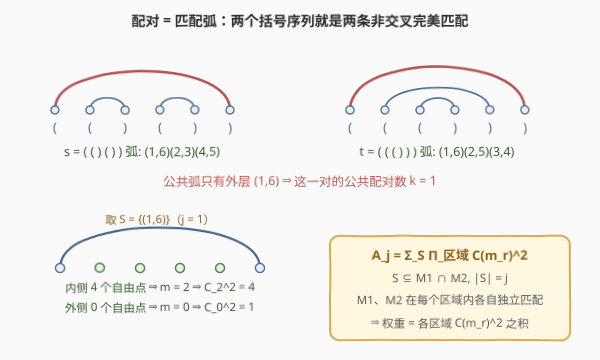
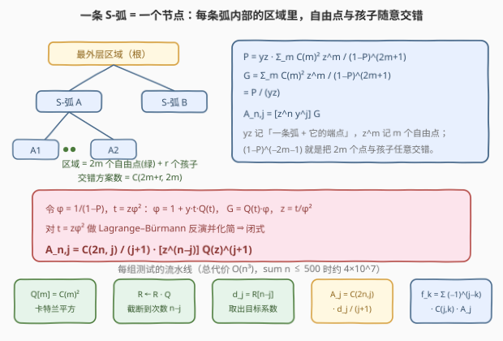
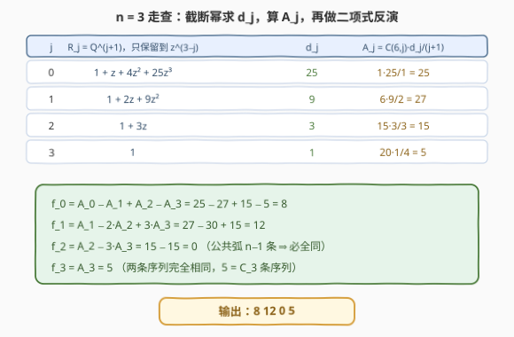

# Codeforces 2262E 配对括号序列 题解

## 1. 题目概述

- **标题 / 题号**：配对括号序列（Codeforces 2262E，英文名 Paired Bracket Sequences）
- **链接**：https://codeforces.com/problemset/problem/2262/E
- **来源**：Codeforces Round 1120 (Div. 1) · Problem E（UTC 2026-09-12）
- **难度**：$\ast 3100$（3000 分）
- **限制**：时间 2 s / 内存 256 MB
- **标签**：组合数学、生成函数、拉格朗日反演、二项式反演（官方标签：combinatorics、math）

**题意**：对长度 $2n$ 的合法括号序列 $s$，若 $s_i$ 是左括号、$s_j$ 是右括号（$i<j$）且 $i,j$ 之间（不含两端）那段本身合法，就称 $(i,j)$ 是 $s$ 的一个**配对**。这恰好是"第 $i$ 个左括号与它匹配的右括号"，故每个 $s$ 恰有 $n$ 个配对。对每个 $k=0,1,\dots,n$，求有序对 $(s,t)$（$s,t$ 都是长度 $2n$ 的合法括号序列）中**恰好有 $k$ 个配对同时属于 $s$ 与 $t$** 的对数，模 $M$。多测：先读组数 $t$，每组读 $n,M$，输出 $n+1$ 个整数。

**约束**：

- $1\le t\le 500$ 组测试，$\sum n\le 500$；$1\le n\le 500$；$10^8\le M\le 10^9$ 且 $M$ 为**素数**
- $M>1000$ 保证 $1\le x\le 2n$ 全部可逆，卡特兰数与组合数可直接乘逆元
- $\sum n\le 500$ 是关键信号：总代价 $O(n^3)$（约 $10^8$ 量级）可接受

## 2. 示例与观察
官方样例（5 组，模数都是 $998244353$，对应 $n=1,2,3,4,8$）：

```text
输入
5
1 998244353
2 998244353
3 998244353
4 998244353
8 998244353

输出
0 1
2 0 2
8 12 0 5
62 64 56 0 14
378790 646560 542960 296800 127400 34944 16016 0 1430
```

题面只解释了前两组：$n=1$ 只有 `()`，唯一一对 $(s,t)$ 有 1 个公共配对，输出 `0 1`；$n=2$ 时 $a=\texttt{(())}$ 的弧集是 $\{(1,4),(2,3)\}$、$b=\texttt{()()}$ 的是 $\{(1,2),(3,4)\}$，故 $(a,b),(b,a)$ 公共数为 0、$(a,a),(b,b)$ 各为 2，输出 `2 0 2`。

自造样例（$n=5$，$C_5=42$ 条序列两两暴力比对，与程序一致）：

```text
输入
1
5 100000007

输出
482 640 360 240 0 42
```

注意所有输出里 $k=n-1$ 恒为 $0$：若两条序列已有 $n-1$ 条公共弧，剩下那 2 个点只能互相匹配，两条弧集其实完全相同，公共数应是 $n$。这条恒等式可直接当自检。

## 3. 解题思路

### 3.1 暴力思路

$C_n$ 条序列两两成对共 $C_n^2$ 个有序对，每对 $O(n)$ 求弧集交；$n=500$ 时 $C_n\sim10^{298}$，不可能。暴力只能到 $n\le 8$（$1430^2\approx2\times10^6$ 对），仅够对拍。必须把"恰好 $k$ 个公共配对"整体地组合计数。

### 3.2 核心观察：配对就是匹配弧



**第一步：序列换成匹配。** $i$ 是左括号、$j$ 是右括号、中间恰好平衡，这正是"$i$ 与 $j$ 互相匹配"。于是每个 $s$ 对应 $2n$ 个点的一个**非交叉完美匹配** $M_s$（把每对匹配的括号画成上方的弧），问题变成数有序对 $(M_1,M_2)$ 中 $|M_1\cap M_2|$ 的分布。

**第二步：不直接数 $f_k$，改数二项式矩。** 记 $f_k$ 为答案，取

$$A_j=\sum_{k\ge j}\binom{k}{j}f_k ,$$

它的组合意义是"先取一对 $(M_1,M_2)$，再从 $M_1\cap M_2$ 里选出 $j$ 条弧"的方案数。选出的 $j$ 条弧记作 $S$，它必是**部分非交叉匹配**（弧两两不交叉，因为同时属于 $M_1$）。

**第三步：固定 $S$ 后两张匹配独立。** 把 $S$ 的弧当"剪刀"，点集被切成若干**区域**：每条 $S$-弧的内部算一个区域，最外层也算一个。含 $2m$ 个自由点（不在 $S$ 中的点）的区域拓扑上是圆盘、自由点按固定顺序排在边界上；$M_1,M_2$ 在区域内部只能各自独立地做非交叉完美匹配（跨区域就会与 $S$ 的弧交叉），每个区域给出 $C_m$ 种 $M_1$ 与 $C_m$ 种 $M_2$。故

$$A_j=\sum_{|S|=j}\ \prod_{\text{区域}} C_{m_r}^{2},$$

"数交集"就被换成了"枚举 $S$ 的区域结构"，而 $S$ 的结构天然是**树**。

### 3.3 算法流程：区域树 → 生成函数 → 闭式 → 反演



**区域树。** 最外层区域是根；每条 $S$-弧是树中一个节点，它"管辖"内部的区域。一个区域里有 $2m$ 个自由点和 $r$ 个孩子（孩子 = 区域内直接包含的 $S$-弧），自由点与孩子的先后顺序可任意**交错**，方案数 $\binom{2m+r}{2m}$，该区域权重为 $C_m^2$。

**生成函数。** 用 $z$ 记 $n$、$y$ 记弧数，令 $Q(z)=\sum_{m\ge0}C_m^2z^m$；$P=P(z,y)$ 为"以一条 $S$-弧为根"的子树权和（该弧贡献一个 $y$ 与一个 $z$：两个端点合起来算 $n$ 里的一对点；区域内 $m$ 个自由点再贡献 $z^m$），$G$ 为整条线（最外层区域为根）的权和。由交错计数

$$P=yz\sum_{m\ge0}\frac{C_m^2z^m}{(1-P)^{2m+1}},\qquad G=\sum_{m\ge0}\frac{C_m^2z^m}{(1-P)^{2m+1}}=\frac{P}{yz},$$

且 $A_{n,j}=[z^ny^j]G$。

**参数化与闭式。** 令 $\varphi=\frac{1}{1-P}$，则 $P=yz\varphi Q(z\varphi^2)$、$G=\varphi Q(z\varphi^2)$；取 $t=z\varphi^2$ 得

$$\varphi=1+y\,t\,Q(t),\qquad z=\frac{t}{\varphi^2},\qquad G=Q(t)\,\varphi .$$

对 $t=z\varphi^2$ 用 Lagrange–Bürmann 反演（$y$ 当参数）：$[z^n]H=\frac1n[t^{n-1}]H'(t)\varphi^{2n}$。取 $H=G$，由 $\partial_tG=Q'\varphi+Q\varphi'=Q'+yQ^2+2ytQQ'$、$\varphi^{2n}=(1+ytQ)^{2n}$，按 $y$ 的幂展成三项，再用 $Q^jQ'=\frac{(Q^{j+1})'}{j+1}$ 与 $\binom{2n}{j-1}(2n-j+1)=j\binom{2n}{j}$ 化简，系数恰为 $\frac1n\cdot\frac{n}{j+1}\binom{2n}{j}$：

$$A_{n,j}=\frac{1}{j+1}\binom{2n}{j}\,[z^{n-j}]Q(z)^{j+1}.$$

**反演。** 由 $A_j=\sum_k\binom{k}{j}f_k$ 得 $f_k=\sum_{j=k}^{n}(-1)^{j-k}\binom{j}{k}A_{n,j}$。

**实现要点。** 只需 $d_j=[z^{n-j}]Q^{j+1}$：从 $R=1$ 出发，第 $j$ 步做 $R\leftarrow R\cdot Q$ 并**截断到次数 $n-j$**（更高次项影响不到 $n-j$），取 $d_j=R[n-j]$。每步一次 $O((n-j)^2)$ 卷积，总计 $O(n^3)$。

### 3.4 示例演算：$n=3$



$Q(z)=1+z+4z^2+25z^3+\cdots$（系数是 $C_m^2$），$n=3$ 时：

| $j$ | $R_j=Q^{j+1}$（截断到 $z^{3-j}$） | $d_j=R_j[3-j]$ | $A_{3,j}=\binom{6}{j}d_j/(j+1)$ |
|---|---|---|---|
| 0 | $1+z+4z^2+25z^3$ | 25 | $1\cdot25/1=25$ |
| 1 | $1+2z+9z^2$ | 9 | $6\cdot9/2=27$ |
| 2 | $1+3z$ | 3 | $15\cdot3/3=15$ |
| 3 | $1$ | 1 | $20\cdot1/4=5$ |

反演：$f_0=25-27+15-5=8$，$f_1=27-2\cdot15+3\cdot5=12$，$f_2=15-3\cdot5=0$，$f_3=5$，即 `8 12 0 5`，与官方一致。其中 $f_3=C_3=5$（两序列必须完全相同），$f_2=0$ 正对应"$k=n-1$ 必为 0"。

## 4. 算法细节

1. **模逆元**：$M$ 是 $10^8\sim10^9$ 的素数，$1\sim n+1\le501$ 都与 $M$ 互素，用线性递推 $\mathrm{inv}[i]=-(M/i)\cdot\mathrm{inv}[M\bmod i]$，$O(n)$；阶乘逆元用一次快速幂再倒推。
2. **卡特兰递推**：$C_0=1$，$C_m=C_{m-1}\cdot\frac{4m-2}{m+1}$，除法用 $\mathrm{inv}[m+1]$；$4m-2\le1998$ 虽不溢出，乘积仍用 `long long`。
3. **组合数**：$2n\le1000$，预处理阶乘与阶乘逆元后 $O(1)$ 取 $\binom{2n}{j}$、$\binom{j}{k}$。
4. **截断的正确性**：第 $j$ 步只需 $Q^{j+1}$ 的 $0\sim n-j$ 次项，卷积后丢掉更高次项不影响后续（次数只增不减），空间因此是 $O(n)$。
5. **符号与取模**：$(-1)^{j-k}$ 用 `(j-k)&1` 判断；C++ 中 `s-term` 可能为负，要 `+M` 再 `%M`；Python 的 `%` 非负，可累加后统一取模。
6. **多测与 I/O**：$\sum n\le500$，每组重建数组；总卷积量 $\sum n_i^3/6\le2.1\times10^7$。输出最多 $500\times501$ 个数，C++ 用 `printf`、Python 拼成一个大字符串一次写出，避免逐行 flush。

## 5. 正确性证明

**引理 1（配对 ↔ 匹配弧）**：在合法序列 $s$ 中 $(i,j)$ 是配对的充要条件是标准匹配把 $i$ 与 $j$ 配上；故 $s$ 恰有 $n$ 个配对，且 $s\mapsto M_s$ 是到"$2n$ 点非交叉完美匹配"的双射。

**证明**：若 $i,j$ 匹配，则 $[i,j]$ 是平衡段且内部严格平衡，故 $(i,j)$ 是配对。反之设 $s_i$ 是左括号、$s_j$ 是右括号、内部平衡，取高度函数 $h$，内部那段自身高度恒 $\ge0$，故 $i\le k<j$ 时 $h(k)>h(i-1)$ 且 $h(j)=h(i-1)$，即"首次回到 $h(i-1)$ 层"，故 $i,j$ 匹配。两集合相等，各 $n$ 个；把匹配弧画在上方即得非交叉完美匹配，反之亦然。∎

**引理 2（区域独立）**：设 $S$ 是含 $j$ 条弧的部分非交叉匹配，把 $2n$ 个点分成区域 $R_1,\dots,R_p$，$R_r$ 含 $2m_r$ 个自由点（$\sum_r m_r=n-j$）。则同时包含 $S$ 的匹配对 $(M_1,M_2)$ 恰有 $\prod_r C_{m_r}^{2}$ 个。

**证明**：若 $M_1\supseteq S$ 非交叉，则 $M_1\setminus S$ 的每条弧必须整体落在某区域内部——否则会与某条 $S$-弧交叉或跨越它；反之各区域内部任取非交叉完美匹配后与 $S$ 合并仍非交叉。区域是圆盘、自由点按固定顺序排边界，故区域 $r$ 内部有 $C_{m_r}$ 种匹配。$M_1$ 与 $M_2$ 独立、区域之间也独立，相乘即得。∎

**引理 3（区域树的生成函数）**：设 $Q(z)=\sum_{m\ge0}C_m^2z^m$，$P,G$ 如 3.3，则 $A_{n,j}=[z^ny^j]G$ 且 $P,G$ 满足前述方程。

**证明**：由引理 2，$A_j$ 等于对所有部分非交叉匹配 $S$ 求和 $\prod_r C_{m_r}^2$。$S$ 与"以最外层区域为根、$S$-弧为节点的平面树，配上各节点内自由点与孩子的交错顺序"一一对应：给定树与交错顺序，按先序从左到右摆点即可唯一还原 $S$。含 $2m$ 自由点、$r$ 个孩子的区域交错数为 $\binom{2m+r}{2m}$，而 $\sum_{r\ge0}\binom{2m+r}{2m}P^r=(1-P)^{-(2m+1)}$，相加即得方程；按 $n=j+\sum_r m_r$ 记 $z$、按弧数记 $y$，故 $A_{n,j}=[z^ny^j]G$。∎

**引理 4（闭式）**：$A_{n,j}=\frac{1}{j+1}\binom{2n}{j}[z^{n-j}]Q(z)^{j+1}$。

**证明**：由引理 3，$\varphi=\frac1{1-P}$ 满足 $P=yz\varphi Q(z\varphi^2)$，结合 $G=\varphi Q(z\varphi^2)$ 得参数形式 $\varphi=1+ytQ(t)$、$z=t/\varphi^2$、$G=Q(t)\varphi$。对 $t=z\varphi^2$ 用 Lagrange–Bürmann：$[z^n]H=\frac1n[t^{n-1}]H'\varphi^{2n}$。取 $H=G$ 得 $H'\varphi^{2n}=(Q'+yQ^2+2ytQQ')(1+ytQ)^{2n}$，其 $y^j$ 项为

$$\binom{2n}{j}t^jQ^jQ'+\binom{2n}{j-1}t^{j-1}Q^{j+1}+\binom{2n}{j-1}t^jQ^jQ'.$$

用 $[t^{n-1-j}]Q^jQ'=\frac{n-j}{j+1}[t^{n-j}]Q^{j+1}$ 合并，三项之和为 $\frac1n\big[\binom{2n}{j}\frac{n-j}{j+1}+\binom{2n}{j-1}\frac{2n-j+1}{j+1}\big][t^{n-j}]Q^{j+1}$，再由 $\binom{2n}{j-1}(2n-j+1)=j\binom{2n}{j}$ 即得 $\frac1{j+1}\binom{2n}{j}[t^{n-j}]Q^{j+1}$。∎

**引理 5（二项式反演）**：若 $A_j=\sum_k\binom{k}{j}f_k$，则 $f_k=\sum_{j\ge k}(-1)^{j-k}\binom{j}{k}A_j$。

**证明**：$\sum_{j\ge k}(-1)^{j-k}\binom{j}{k}\binom{i}{j}=\binom{i}{k}\sum_{j=k}^{i}(-1)^{j-k}\binom{i-k}{j-k}=\binom{i}{k}(1-1)^{i-k}=[i=k]$，代入即得。∎

**定理**：程序输出的 $f_k$ 恰是公共配对数为 $k$ 的有序对数。

**证明**：引理 1 把问题化为匹配对计数；引理 2、3 给出 $A_{n,j}$ 的组合意义与生成函数；引理 4 给出可 $O(n^3)$ 计算的闭式；引理 5 反演还原 $f_k$。全程在模 $M$ 下运算，除法只涉及 $\le n+1\le501<M$ 的整数，逆元存在，故与整数答案模 $M$ 一致。∎

## 6. 复杂度分析

- **时间**：每组逆元、卡特兰、阶乘都是 $O(n)$；求全部 $d_j$ 的卷积量为 $\sum_{j=0}^{n}\frac{(n-j)^2}{2}\approx\frac{n^3}{6}$ 次乘加，反演 $O(n^2)$。由 $\sum n\le500$，总乘加量 $\le500^3/6\approx2.1\times10^7$。C++ 实测 $n=500$ 约 $0.02$ s，相对 2 s 有约 100 倍余量。
- **空间**：每组只有若干长度 $O(n)$ 的数组（`Q`、`cur`、`d`、`A`、阶乘表），$O(n)$。
- **Python**：同一算法 CPython 下 $n=500$ 约 $1.5$ s（接近上限，建议 PyPy3）；若要再压常数，可把卷积换成"大整数打包 + 一次大数乘法"的 Kronecker 技巧。

## 7. 参考代码

### C++17

```cpp
#include <cstdio>
#include <vector>
using namespace std;
typedef long long ll;

int main() {
    int T;
    if (scanf("%d", &T) != 1) return 0;
    while (T--) {
        int n; ll M;
        scanf("%d %lld", &n, &M);
        int N2 = 2 * n;
        vector<ll> inv(n + 2);                       // 模逆元 1..n+1（M 为素数且 > 1000）
        inv[1] = 1 % M;
        for (int i = 2; i <= n + 1; i++) inv[i] = (M - (M / i) * inv[M % i] % M) % M;
        vector<ll> cat(n + 1);                       // 卡特兰数
        cat[0] = 1 % M;
        for (int k = 1; k <= n; k++) cat[k] = cat[k - 1] * ((4LL * k - 2) % M) % M * inv[k + 1] % M;
        vector<ll> Q(n + 1);                         // Q[m] = C_m^2
        for (int m = 0; m <= n; m++) Q[m] = cat[m] * cat[m] % M;
        vector<ll> fact(N2 + 1), invfact(N2 + 1);    // 阶乘与阶乘逆元
        fact[0] = 1 % M;
        for (int i = 1; i <= N2; i++) fact[i] = fact[i - 1] * i % M;
        ll e = M - 2, r = 1 % M, b = fact[N2] % M;
        while (e) { if (e & 1) r = r * b % M; b = b * b % M; e >>= 1; }
        invfact[N2] = r;
        for (int i = N2; i >= 1; i--) invfact[i - 1] = invfact[i] * i % M;
        auto binom = [&](int a, int c) -> ll {
            if (c < 0 || c > a) return 0;
            return fact[a] * invfact[c] % M * invfact[a - c] % M;
        };
        vector<ll> d(n + 1, 0), cur(1, 1 % M);        // d[j] = [z^{n-j}] Q^{j+1}
        for (int j = 0; j <= n; j++) {
            int lim = n - j;
            int sz = (int)cur.size() + n;
            if (sz > lim + 1) sz = lim + 1;
            vector<ll> nxt(sz, 0);
            for (int a = 0; a < (int)cur.size() && a <= lim; a++) {
                if (!cur[a]) continue;
                int bmax = lim - a;
                if (bmax > n) bmax = n;
                for (int t2 = 0; t2 <= bmax; t2++) nxt[a + t2] = (nxt[a + t2] + cur[a] * Q[t2]) % M;
            }
            cur.swap(nxt);
            d[j] = (lim < (int)cur.size()) ? cur[lim] : 0;
        }
        vector<ll> A(n + 1);
        for (int j = 0; j <= n; j++) A[j] = binom(N2, j) * inv[j + 1] % M * d[j] % M;
        for (int k = 0; k <= n; k++) {               // 二项式反演
            ll s = 0;
            for (int j = k; j <= n; j++) {
                ll term = binom(j, k) * A[j] % M;
                s = ((j - k) & 1) ? (s - term + M) % M : (s + term) % M;
            }
            printf("%lld%c", s, k == n ? '\n' : ' ');
        }
    }
    return 0;
}
```

### Python3

```python
import sys

def main():
    data = sys.stdin.buffer.read().split()
    t = int(data[0]); pos = 1
    out = []
    for _ in range(t):
        n = int(data[pos]); M = int(data[pos + 1]); pos += 2
        inv = [0] * (n + 2)                     # 模逆元 1..n+1（M 为素数且 > 1000）
        inv[1] = 1 % M
        for i in range(2, n + 2):
            inv[i] = (M - (M // i) * inv[M % i] % M) % M
        cat = [1 % M] * (n + 1)                 # 卡特兰数
        for k in range(1, n + 1):
            cat[k] = cat[k - 1] * (4 * k - 2) % M * inv[k + 1] % M
        Q = [c * c % M for c in cat]            # Q[m] = C_m^2
        Qlen = len(Q)
        d = [0] * (n + 1)                       # d[j] = [z^{n-j}] Q^{j+1}
        cur = [1 % M]
        for j in range(n + 1):
            lim = n - j
            nxt = [0] * (lim + 1)
            for a in range(len(cur)):
                ca = cur[a]
                if ca:
                    mm = Qlen if Qlen < lim + 1 - a else lim + 1 - a
                    nxt[a:a + mm] = [x + ca * y for x, y in zip(nxt[a:a + mm], Q[:mm])]
            cur = [v % M for v in nxt]
            d[j] = cur[lim]
        N2 = 2 * n                              # 组合数
        fact = [1 % M] * (N2 + 1)
        for i in range(1, N2 + 1):
            fact[i] = fact[i - 1] * i % M
        invfact = [1 % M] * (N2 + 1)
        invfact[N2] = pow(fact[N2], M - 2, M)
        for i in range(N2, 0, -1):
            invfact[i - 1] = invfact[i] * i % M
        def C(a, b):
            return fact[a] * invfact[b] % M * invfact[a - b] % M
        A = [0] * (n + 1)
        for j in range(n + 1):
            A[j] = C(N2, j) * inv[j + 1] % M * d[j] % M
        res = []                                # 二项式反演
        for k in range(n + 1):
            s = 0
            for j in range(k, n + 1):
                term = C(j, k) * A[j] % M
                s = s - term if (j - k) & 1 else s + term
            res.append(s % M)
        out.append(' '.join(map(str, res)))
    sys.stdout.write('\n'.join(out) + '\n')

main()
```

## 8. 边界情况与易错点

1. **$n=1$**：唯一序列 `()`，答案 `0 1`；公式给出 $A_{1,0}=C_1^2=1$、$A_{1,1}=C_1=1$，反演得 $f_0=0,f_1=1$。
2. **$k=n-1$ 恒为 0**：硬约束，可直接当自检；若输出非 0，多半是把 $\binom{2n}{j}$ 写成了 $\binom{2n}{j+1}$ 或反演符号错。
3. **$M$ 不能写死**：只保证 $M$ 是 $10^8\sim10^9$ 的素数（可能是 $10^8+7$ 这类少见的模数）；除法必须走逆元。因 $2n\le1000<M$，阶乘永远不会被 $M$ 整除。
4. **负数取模与多测清空**：C++ 的 `s-term` 要 `+M` 再 `%M`；Python 可最后统一 `%M`。每组都要重建 `cur`、`d`、`A`、`inv`、`fact`，避免残留。
5. **截断上界**：第 $j$ 步只保留到次数 $n-j$（不是 $n$），否则卷积量翻倍，`cur[lim]` 也可能越界或取错系数。
6. **输出格式**：每组 $n+1$ 个整数、空格分隔、行末换行，不要漏 $k=0$ 与 $k=n$；闭式中的 $\binom{2n}{j-1}$ 在 $j=0$ 时按 0 处理，实现里对每个 $j\ge0$ 直接算 $A_j$ 即可自然避开分母为 0 的讨论。

## 9. 验证记录

- **编译环境与命令**：`clang++ -std=c++17 -O2`（本机无 GNU g++，配 `codeforces/tools/include/bits/stdc++.h` 兼容头；正文代码只用标准库，可原样提交 GNU C++17）；Python 侧为 `Python 3.9.6`。
- **官方样例**：1 / 1 通过（按 Codeforces 标准 checker 的 token 比对，忽略空白与大小写）。
- **复核状态**：audited（2026-11-19 统一回归：编译 + 官方样例；写作期的随机对拍与暴力未重跑）。

## 相关题目与扩展

- [Codeforces 2262E. Paired Bracket Sequences](https://codeforces.com/problemset/problem/2262/E)：本题。
- [Codeforces 5C. Longest Regular Bracket Sequence](https://codeforces.com/problemset/problem/5/C)：用栈把"配对"具体化，适合先熟悉匹配弧的视角。
- [Codeforces 990C. Bracket Sequences Concatenation Problem](https://codeforces.com/problemset/problem/990/C)：按失配量给括号串分类计数，同属括号串统计套路。
- [LeetCode 22. 括号生成](https://leetcode.cn/problems/generate-parentheses/)：$C_n$ 的枚举版，可对小 $n$ 对拍。
- [LeetCode 96. 不同的二叉搜索树](https://leetcode.cn/problems/unique-binary-search-trees/)：同一族卡特兰递推。

**延伸思考**：

- 闭式可化简出两个漂亮特例，适合自检：$f_{n,n-2}=2\binom{2n}{n-2}$、$f_{n,n-3}=8\binom{2n}{n-3}$（本仓库验证脚本用精确整数核对了 $n\le25$）。第一个可由 $[z^2]Q^{n-1}=4(n-1)+\binom{n-1}{2}$ 直接推出。
- 若 $M$ 不保证素数，卡特兰数不能直接除：需把 $\binom{2m}{m}/(m+1)$ 拆质因子，或用 CRT、模素数幂分别算再合并，实现量显著上升。
- 若 $n$ 放宽到 $2\times10^4$，$O(n^3)$ 失效；可用多项式 $\exp/\log$ 或 NTT（任意模数卷积）批量求 $Q$ 的幂。但 $Q$ 是椭圆积分型级数、其幂无低阶线性递推，想做到 $O(n^2)$ 需要另找组合分解。
