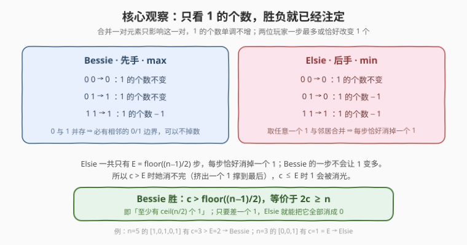
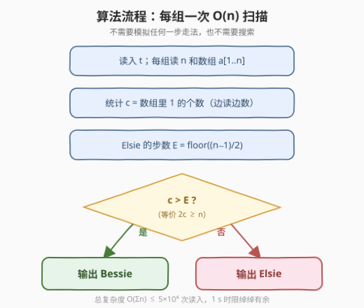
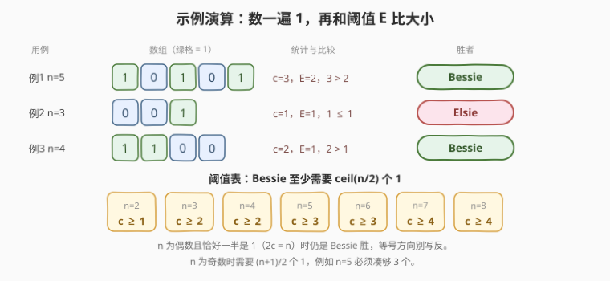

# Codeforces 2263A 最小最大游戏 题解

## 1. 题目概述

- **标题 / 题号**：最小最大游戏（Codeforces 2263A，英文名 Min Max Game）
- **链接**：https://codeforces.com/problemset/problem/2263/A
- **来源**：Codeforces Round 1120 (Div. 2) · Problem A（UTC 2026-09-12）
- **难度**：$\ast 800$（500 分）
- **限制**：时间 1 s / 内存 256 MB
- **标签**：博弈、不变量、贪心、结论题（官方标签：games）

**题意**：给定一个长度为 $n$ 的 0/1 数组 $a$。Bessie 先手，此后两人轮流操作，每次必须选**相邻的两个元素** $x,y$ 并把它们合并成一个数：轮到时若是 Bessie，合并结果为 $\max(x,y)$；若是 Elsie，结果为 $\min(x,y)$。每操作一次数组长度减 1，长度变成 1 时游戏结束：最终元素为 $1$ 则 **Bessie 胜**，为 $0$ 则 **Elsie 胜**。两人都采取最优策略，问胜者。

多测：第一行 $t$，每组先给 $n$，再给 $a_1,\dots,a_n$，对每组输出一行 `Bessie` 或 `Elsie`。

**约束**：

- $1 \le t \le 500$
- $2 \le n \le 100$
- $a_i \in \{0,1\}$
- 单次运行最多读入 $500 \times 100 = 5\times 10^4$ 个整数
- 时限 1 s：允许每组 $O(n)$，总计 $O\left(\sum n\right)$

## 2. 示例与观察
官方样例（输入 / 输出原样）：

```text
输入
3
5
1 0 1 0 1
3
0 0 1
4
1 1 0 0

输出
Bessie
Elsie
Bessie
```

**样例 1**（$n=5$，`1 0 1 0 1`）：共 4 步，顺序是 Bessie、Elsie、Bessie、Elsie，一条最优线路为 $[1,0,1,0,1] \to [1,1,0,1] \to [1,0,1] \to [1,1] \to [1]$。

其中第一步 Bessie 合并前两个数 $\max(1,0)=1$；第二步 Elsie 只能对着两个 1 下手，$\min(1,1)=1$；第三步 Bessie 把 $0,1$ 并成 $1$；最后 Elsie 得到 $\min(1,1)=1$，Bessie 胜。

**样例 2**（$n=3$，`0 0 1`）：只有 1 个 1，而 Elsie 有 1 步机会。Bessie 无论怎么合，Elsie 都能把这个 1 与相邻的 0 取 $\min$ 变成 0，故 Elsie 胜。

**样例 3**（$n=4$，`1 1 0 0`）：Bessie 先合并第 2、3 个元素 $\max(1,0)=1$ 得 `[1,1,0]`，此后 Elsie 无论消哪个 1，都还剩一个 1 撑到最后，最终 $\max$ 出 1，Bessie 胜。

补一组自造样例（验证 $n=2$ 与「1 不够一半」的情形）：

```text
输入
2
2
1 0
6
1 0 0 0 1 0

输出
Bessie
Elsie
```

$n=2$ 时只有一次操作 $\max(1,0)=1$；$n=6$ 时只有 2 个 1，少于阈值 3，Elsie 逐个消光。

## 3. 解题思路

### 3.1 暴力思路

把「当前数组」当作状态做 minimax 搜索：长度为 $m$ 的数组有 $m-1$ 种合并位置，总走法数为

$$\prod_{m=2}^{n}(m-1) = (n-1)!$$

$n=100$ 时是 $99!$，完全不可行；即使加上记忆化，可达状态（各种「区间归并历史」）仍是指数级，1 s 内绝无可能。

### 3.2 核心观察：数 1 的个数，与 Elsie 的步数比大小



记当前数组里 $1$ 的个数为 $c$。合并只影响被选中的两个元素，逐个看四种情况：

| 操作者 | 选中的对 | 结果 | $c$ 的变化 |
|--------|----------|------|------------|
| Bessie（$\max$） | $(0,0)$ | $0$ | 不变 |
| Bessie（$\max$） | $(0,1)$ 或 $(1,0)$ | $1$ | 不变 |
| Bessie（$\max$） | $(1,1)$ | $1$ | 减 $1$ |
| Elsie（$\min$） | $(0,0)$ | $0$ | 不变 |
| Elsie（$\min$） | $(0,1)$ 或 $(1,0)$ | $0$ | 减 $1$ |
| Elsie（$\min$） | $(1,1)$ | $1$ | 减 $1$ |

于是：

**观察 1（单调性）**：无论谁操作，$c$ 都**不会变大**。

**观察 2（Elsie 每步恰好消掉一个 1）**：只要 $c \ge 1$ 且数组长度 $\ge 2$，Elsie 随便取一个 1 与它的任一邻居合并：邻居是 0 时 $\min=0$ 直接灭掉这个 1；邻居是 1 时两个 1 合成一个 1。两种情况下 $c$ 都恰好减少 $1$。所以她**不会浪费任何一步**。

**观察 3（Bessie 可以保住 $c$）**：若数组里 $0$ 和 $1$ 同时存在，从某个 0 的位置走到某个 1 的位置，途中必有一步取值发生变化，即存在**相邻的 0/1 边界**；Bessie 合并这对得 $\max=1$，$c$ **不变**。若数组已经全 1，则之后所有合并结果都是 1，她已稳赢。

**步数**：总步数 $n-1$，Bessie 先手，故 Bessie 走 $\left\lceil \frac{n-1}{2} \right\rceil$ 步，Elsie 走

$$E = \left\lfloor \frac{n-1}{2} \right\rfloor \text{ 步}$$

$c$ 只会在 Elsie 手上减少（Bessie 按观察 3 操作时），而她最多消掉 $E$ 个。所以

$$c > E \implies \text{Bessie 胜}, \qquad c \le E \implies \text{Elsie 胜}$$

把 $E$ 代进去化简：$c > \left\lfloor \frac{n-1}{2}\right\rfloor \iff c \ge \left\lceil \frac{n}{2}\right\rceil \iff 2c \ge n$。结论极其简洁：**数组里至少有一半是 1，Bessie 胜；否则 Elsie 胜。**

### 3.3 算法流程



1. 读入 $t$，对每组读入 $n$；
2. 边读边统计 $c = \sum_{i=1}^{n} a_i$（连数组都不用存）；
3. 判断 $2c \ge n$：成立输出 `Bessie`，否则输出 `Elsie`。

每组只需一次线性扫描，没有任何模拟与搜索。

### 3.4 示例演算



| 用例 | $n$ | $c$ | $E=\left\lfloor\frac{n-1}{2}\right\rfloor$ | $2c \ge n$？ | 胜者 |
|------|-----|-----|------|------|------|
| 样例 1 `1 0 1 0 1` | 5 | 3 | 2 | $6 \ge 5$ ✓ | Bessie |
| 样例 2 `0 0 1` | 3 | 1 | 1 | $2 < 3$ ✗ | Elsie |
| 样例 3 `1 1 0 0` | 4 | 2 | 1 | $4 \ge 4$ ✓ | Bessie |
| 自造 `1 0 0 0 1 0` | 6 | 2 | 2 | $4 < 6$ ✗ | Elsie |

以样例 1 为例反过来看：Elsie 有 2 步、场上有 3 个 1，即使她每步都精准消掉一个 1，也还剩一个 1 活到最后；而样例 2 中 $c=1$、$E=1$，她一步就能把唯一的 1 消光。

## 4. 算法细节

1. **只数 1，不存数组**：$a_i$ 读完即弃，空间 $O(1)$；这也是本题最快的写法。
2. **别把 $E$ 写成 `n/2`**：正确值是 $\left\lfloor (n-1)/2\right\rfloor$，例如 $n=4$ 时 $E=1$ 而 `n/2=2`，会把样例 3 判错。
3. **统一用 `2 * c >= n` 判定**：既避开了 ceil/floor 的取整细节，也避开了奇数时 $(n+1)/2$ 与 $n/2$ 的混用。
4. **多测必须重置计数器**：`ones` 要在每组开头清零，否则会跨组累加。
5. **输出字符串严格匹配**：`Bessie` 与 `Elsie`（首字母大写，前者是 `-ie` 结尾），不要输出 `YES`/`NO` 或小写。
6. **I/O 策略**：C++ 关同步 `ios::sync_with_stdio(false)` 即可；Python 用 `sys.stdin.buffer.read().split()` 一次性读入，$5\times 10^4$ 个 token 毫无压力，避免逐行 `input()`。
7. **溢出**：$c \le n \le 100$，`int` 足够；若把上界放大到 $10^{18}$ 量级才需要考虑 `long long` 与读入加速。

## 5. 正确性证明

**引理 1（$c$ 单调不增）**：任意一次操作后，$1$ 的个数不会增加。

**证明**：一次操作只把两个元素 $(x,y)$ 替换成 $\max(x,y)$ 或 $\min(x,y)$，被替换后的值必是 $x,y$ 之一。其余元素不变，故 $c$ 不增（相等或减少 1）。∎

**引理 2（Elsie 一步恰好减 1）**：若当前长度 $\ge 2$ 且 $c \ge 1$，Elsie 存在一步使 $c$ 恰好减少 $1$。

**证明**：任取一个值为 $1$ 的位置，长度 $\ge 2$ 保证它有邻居。合并这对：邻居为 $0$ 时结果为 $\min(0,1)=0$，这对里的那个 1 消失，$c$ 减 $1$；邻居为 $1$ 时结果为 $1$，两个 1 变成一个 1，$c$ 也减 $1$。其他位置不受影响，故恰好减 $1$。∎

**引理 3（Bessie 一步可保 $c$ 不变）**：若当前数组同时含有 $0$ 与 $1$，Bessie 存在一步使 $c$ 不变。

**证明**：设 $i$ 处为 $0$、$j$ 处为 $1$，不妨 $i<j$。序列 $a_i,a_{i+1},\dots,a_j$ 首项为 $0$、末项为 $1$，故必存在相邻下标 $k$ 使 $a_k \ne a_{k+1}$，这对就是 $(0,1)$ 或 $(1,0)$。合并这对得 $\max=1$：合并前这对里恰有 $1$ 个 $1$，合并后仍是 $1$ 个 $1$，故 $c$ 不变；其余元素不受影响。∎

**引理 4（$c > E$ 则 Bessie 胜）**：若初始 $c_0 > E$，则无论 Elsie 如何应对，Bessie 都能保证终局为 $1$。

**证明**：Bessie 采用如下策略：轮到她就看当前数组——若全为 $1$，则此后每个合并结果都是 $1$，终局必为 $1$，已经赢了；否则（$c \ge 1$ 且不全为 1，即 $0,1$ 并存）按引理 3 合并一对相邻的 $(0,1)$，使 $c$ 保持不变。于是除「全 1 直接获胜」这一终局外，$c$ 只在 Elsie 的回合下降，由引理 2 每次至多降 $1$，而 Elsie 总共只有 $E$ 步，故游戏结束时 $c \ge c_0 - E \ge 1$。此时数组只剩 1 个元素，既然 $c \ge 1$，它必为 $1$，Bessie 胜。∎

**引理 5（$c \le E$ 则 Elsie 胜）**：若初始 $c_0 \le E$，则 Elsie 有必胜策略。

**证明**：Elsie 每次都按引理 2 操作，让 $c$ 恰好减 $1$（若 $c$ 已为 $0$，数组全 0，随便合并仍是 0）。需要确认她这 $E$ 次操作都在长度 $\ge 2$ 时发生：$n$ 为奇数时她的最后一次操作就是全局最后一步（操作前长度恰为 $2$）；$n$ 为偶数时全局最后一步是 Bessie 的，Elsie 的最后一次操作发生在其前一步，长度 $\ge 3$。因此 $E$ 步之后 $c \le c_0 - E \le 0$，即 $c = 0$。此时若已无剩余操作则终局为 $0$；若还剩 Bessie 的一步（$n$ 为偶数），全 0 数组上取 $\max$ 仍得 $0$。故终局为 $0$，Elsie 胜。∎

**定理**：Bessie 获胜当且仅当 $2c \ge n$，其中 $c$ 是数组中 $1$ 的个数。

**证明**：由引理 4、5，Bessie 获胜 $\iff c > \left\lfloor\frac{n-1}{2}\right\rfloor$。下面验证两种等价变形。

- $n = 2m$：$\left\lfloor\frac{2m-1}{2}\right\rfloor + 1 = m$，而 $2c \ge 2m \iff c \ge m$，一致；
- $n = 2m+1$：$\left\lfloor\frac{2m}{2}\right\rfloor + 1 = m+1$，而 $2c \ge 2m+1 \iff c \ge m+0.5 \iff c \ge m+1$，一致。

故 $c > E \iff 2c \ge n$，定理得证。∎

## 6. 复杂度分析

- **时间**：每组读入 $n$ 个数并累加，$O(n)$；总时间 $O\left(\sum n\right) \le 5\times 10^4$ 次基本操作。实测最坏数据（$t=500$、$n=100$）C++ 端到端约 $2$ ms，与「空程序」的进程启动开销持平，计算部分远小于 $1$ ms，相对 1 s 时限余量极大。
- **空间**：$O(1)$ 额外空间（只维护 $c$ 与循环变量）；Python 一次性读入时输入缓冲为 $O\left(\sum n\right)$ 个 token。

## 7. 参考代码

### C++17

```cpp
#include <iostream>
using namespace std;

int main() {
    ios::sync_with_stdio(false);
    cin.tie(nullptr);

    int t;
    if (!(cin >> t)) return 0;
    while (t--) {
        int n;
        cin >> n;
        int ones = 0;
        for (int i = 0; i < n; ++i) {
            int x;
            cin >> x;
            ones += x;
        }
        // Bessie 走 ceil((n-1)/2) 步，Elsie 走 floor((n-1)/2) 步。
        // Bessie 胜 <=> ones > floor((n-1)/2) <=> 2 * ones >= n。
        cout << (2 * ones >= n ? "Bessie" : "Elsie") << '\n';
    }
    return 0;
}
```

### Python3

```python
import sys


def main() -> None:
    data = sys.stdin.buffer.read().split()
    if not data:
        return
    p = 0
    t = int(data[p]); p += 1
    out = []
    for _ in range(t):
        n = int(data[p]); p += 1
        ones = 0
        for _ in range(n):
            ones += int(data[p]); p += 1
        # 1 的个数超过 Elsie 的步数 floor((n-1)/2)，Bessie 就赢
        out.append("Bessie" if 2 * ones >= n else "Elsie")
    sys.stdout.write("\n".join(out) + "\n")


main()
```

## 8. 边界情况与易错点

1. **$n=2$**：$E=0$，只要有一个 1 就是 $\max(1,0)=1$，Bessie 胜；全 0 则 Elsie 胜。公式 $2c \ge n$ 给出 $2 \ge 2$ 与 $0 \ge 2$，恰好正确。
2. **取整方向**：$E=\left\lfloor (n-1)/2 \right\rfloor$。写成 `n/2` 在偶数 $n$ 时偏大（$n=4$ 时 $E=1$ 而非 $2$）；写成 `(n+1)/2` 在奇数 $n$ 时偏大（$n=5$ 时 $E=2$ 而非 $3$）。
3. **等号方向**：$n$ 为偶数且恰好一半是 1 时 $2c=n$ 取等，此时 **Bessie 胜**（$c = E+1$）。若写成 `2 * c > n` 会把样例 3 判成 Elsie。
4. **全 0 / 全 1**：$c=0$ 必为 Elsie、$c=n$ 必为 Bessie，公式自动覆盖，不需要额外特判；但循环里 `ones` 若忘记重置，全 0 的组会继承上一组的计数。
5. **多测与输入格式**：输入是以空白分隔的 $t$ 组数据，`cin >> x` 与 `split()` 都不受多余换行影响；不要按行读并用 `split('\n')` 分组，容易在空行上出错。
6. **输出格式与空输入**：每组一行、严格 `Bessie` / `Elsie`，行末不留多余空格；本地对拍传空文件时，`if (!(cin >> t)) return 0;` 与 `if not data: return` 可避免未定义行为。

## 9. 验证记录

- **编译环境与命令**：`clang++ -std=c++17 -O2`（本机无 GNU g++，配 `codeforces/tools/include/bits/stdc++.h` 兼容头；正文代码只用标准库，可原样提交 GNU C++17）；Python 侧为 `Python 3.9.6`。
- **官方样例**：1 / 1 通过（按 Codeforces 标准 checker 的 token 比对，忽略空白与大小写）。
- **复核状态**：audited（2026-11-19 统一回归：编译 + 官方样例；写作期的随机对拍与暴力未重跑）。

## 相关题目与扩展

- [Codeforces 2263B. Min Matrices](https://codeforces.com/problemset/problem/2263/B)：同场 B 题，构造向，对照「先想结论再验证」的节奏。
- [Codeforces 2262B. Culling Game](https://codeforces.com/problemset/problem/2262/B)：同一轮 Div. 1 的题，同样把大规模模拟压成「块」的不变量计数。
- [Codeforces 1382B. Sequential Nim](https://codeforces.com/problemset/problem/1382/B)：取石子博弈，胜负只由前缀结构决定，与本题的「只看计数」同源。
- [LeetCode 486. 预测赢家](https://leetcode.cn/problems/predict-the-winner/)：区间 minimax DP，正是本题 3.1 暴力思路的一般化形态。

**延伸思考**：

1. **交换先手**：若让 Elsie 先动，则 $E' = \left\lceil (n-1)/2 \right\rceil$，同样的势能论证给出 Bessie 胜 $\iff c \ge \left\lfloor n/2\right\rfloor + 1$，阈值更苛刻（例如 $n=4$ 需要 3 个 1）。此结论已对 $2 \le n \le 9$ 的全部 0/1 数组穷举验证。
2. **元素取自 $\{0,1,\dots,k\}$**：玩家的可选操作与取值无关（永远只是挑一个相邻下标），且 $\max,\min$ 与阈值化可交换，所以把 $a_i \ge x$ 折叠成 1 之后，双方的策略可**原样搬运**回原游戏。于是终局值恰为 $\max\left\{x : \#\{i : a_i \ge x\} \ge \left\lceil n/2\right\rceil\right\}$，即第 $\left\lceil n/2 \right\rceil$ 大的元素；本题 $k=1$ 只是它的特例（已对 $a_i \in \{0,1,2\}$、$n \le 7$ 穷举核对）。
3. **把「相邻」放宽为「任意两个」**：Bessie 能删掉任何非最大值（与更大者取 $\max$ 即可），Elsie 能删掉任何非最小值，于是最优策略变成 Bessie 每步删**当前最小**、Elsie 每步删**当前最大**，终局恰为排序后第 $\left\lceil (n-1)/2\right\rceil + 1$ 小的元素（已对多重集 $n \le 8$ 穷举验证）。
