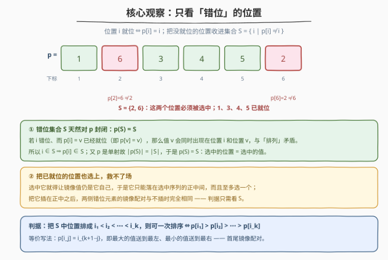
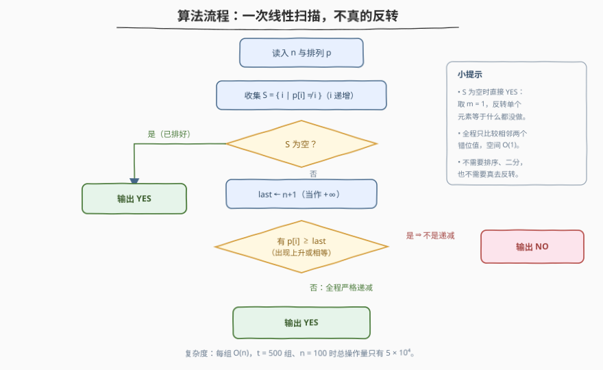
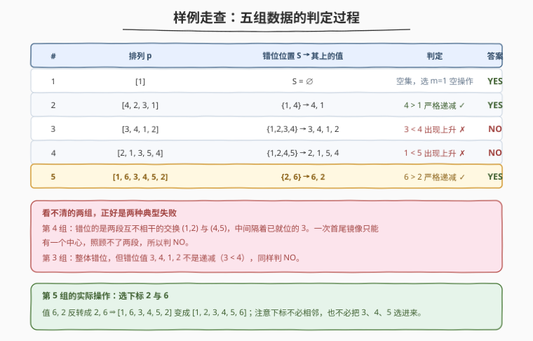

# Codeforces 2264A Rumb 需要援手 题解

## 1. 题目概述

- **标题 / 题号**：Rumb 需要援手（Codeforces 2264A，英文名 Rumb Needs a Hand）
- **链接**：https://codeforces.com/problemset/problem/2264/A
- **来源**：Codeforces Round 1121 (Div. 2) · Problem A
- **难度**：800（500 分，Div. 2 签到题）
- **限制**：时间 1 s / 内存 256 MB
- **标签**：实现、排序、双指针

**题意**：Rumb 的手臂发麻，需要把义肢的编号零件按顺序装回去。形式化地：给定长度 $n$ 的排列 $p$（$1 \sim n$ 各出现一次），**恰好执行一次**下面的操作：

- 选一个整数 $m$ 与 $m$ 个严格递增的下标 $i_1 < i_2 < \cdots < i_m$（$1 \le m \le n$）；
- 把这些**位置上的元素整体反转**：原来 $i_j$ 上的元素搬到 $i_{m-j+1}$，没被选中的元素原地不动。

选中的下标**不必连续**。例如 $p = [1,6,3,4,5,2]$ 选下标 $2,4,6$，被选中的三个数 $6,4,2$ 反转成 $2,4,6$，数组变成 $[1,2,3,4,5,6]$。

问：是否存在一种选法，使操作后 $p$ 恰为 $1,2,\ldots,n$？输出 `YES` / `NO`。

多测格式：第一行 $t$ 为组数；每组两行——第一行 $n$，第二行排列 $p_1 \ldots p_n$；每组输出一行。

**约束**：

- $1 \le t \le 500$，$1 \le n \le 100$，所有组的 $n$ 之和不超过 $5 \times 10^4$
- $p$ 是 $1 \sim n$ 的排列（无重复、无越界），因此"位置 $i$ 是否就位"可直接比较 $p[i]$ 与 $i$
- 操作必须**恰好做一次**，但 $m=1$ 时"反转一个元素"等于什么都没做，所以已经有序时答案仍应为 `YES`
- 判定只与"哪些位置没就位"有关，与数值具体大小无关；每组 $O(n)$ 足够，$O(n \log n)$ 排序也不需要

## 2. 示例与观察
官方样例（输入 / 输出原样）：

```text
输入：
5
1
1
4
4 2 3 1
4
3 4 1 2
5
2 1 3 5 4
6
1 6 3 4 5 2

输出：
YES
YES
NO
NO
YES
```

逐组要点：第 1 组选 $m=1$（反转单元素不改变数组，满足"恰好一次"）；第 2 组选下标 $1,4$，值 $4,1$ 反转成 $1,4$；第 3、4 组无解；第 5 组选下标 $2,4,6$（或 $2,3,6$、$2,5,6$）即可。详细对照见 §3.4 的演算表。

自造一组补边界（标注为自造）：

```text
输入：
3
3
3 2 1
6
2 1 4 3 6 5
7
2 3 4 5 6 7 1

输出：
YES
NO
NO
```

第一组 $[3,2,1]$ 选下标 $1,3$ 即可；第二组是三段相邻交换叠在一起，一次镜像配不了三对；第三组是循环左移一位，错位值 $2,3,4,5,6,7,1$ 出现大量上升，无解。

## 3. 解题思路

### 3.1 暴力思路

枚举全部 $2^n - 1$ 个非空下标集合，对每个集合真的执行反转、再检查是否有序：单组 $O(2^n \cdot n)$。$n \le 100$ 时是指数级天文数字，即使 $n \le 20$ 也有 $2 \times 10^7$ 量级操作，再乘 $t = 500$ 直接超时；改成枚举 $m$ 再枚举镜像配对同样组合爆炸。必须把"能否排好序"翻译成对 $p$ 的**局部约束**。

### 3.2 核心观察：只看「错位」的位置



记 $S = \{\, i \mid p[i] \ne i \,\}$ 为**错位位置**集合。设某次操作选中的下标集合为 $T$，按升序写成 $t_1 < t_2 < \cdots < t_m$。

- **必须选中 $S$**：$T$ 之外的位置元素不动，要得到有序结果只能 $p[i] = i$，所以 $S \subseteq T$。
- **首尾镜像配对**：位置 $t_j$ 最终拿到的是 $p[t_{m+1-j}]$，因此操作成功当且仅当对每个 $j$ 都有 $p[t_j] = t_{m+1-j}$。这同时说明 $p(T) = T$：选中的位置集合与选中的值集合是同一批。
- **$S$ 自动封闭**：若 $i \in S$ 而 $p[i] = v$ 已经就位（即 $p[v] = v$ 且 $v \ne i$），值 $v$ 就同时出现在位置 $i$ 与位置 $v$，与"排列"矛盾。于是 $i \in S \Rightarrow p[i] \in S$，配合单射性即 $p(S) = S$，无需额外检查。
- **已就位的位置救不了场**：选中它就要求"镜像值仍是它自己"，于是它只能落在 $T$ 的**正中心**，且至多选一个；而把它插在正中之后，两侧错位元素的镜像配对与不插时完全相同。所以可行性只由 $S$ 决定。

于是问题化为：把 $S$ 升序写成 $s_1 < s_2 < \cdots < s_k$，要求 $p[s_j] = s_{k+1-j}$。又因为 $p(S) = S$ 且值互不相同，这个镜像条件**等价于值序列严格递减**：

$$p[s_1] > p[s_2] > \cdots > p[s_k]$$

（$p(S)=S$ 时 $S$ 的最大值只能由最大的错位值取到，递减性逐项推出镜像配对。）**判据：$S = \emptyset$，或 $S$ 上的值按位置升序严格递减。**

### 3.3 算法流程



1. 读入 $n$ 与排列 $p$，按下标 $1 \sim n$ 存放。
2. 令 $last \gets n+1$，当作 $+\infty$（第一个错位值必须小于它）。
3. 依次扫描 $i = 1 \ldots n$：
   - 若 $p[i] = i$（已就位），跳过；
   - 否则若 $p[i] \ge last$，说明错位值序列出现上升或相等，判 `NO` 并结束本组；
   - 否则 $last \gets p[i]$，继续。
4. 扫完没有失败，输出 `YES`。

全程只做一次线性扫描：不排序、不二分，也不需要真的反转数组。

### 3.4 示例演算



| 组 | $p$ | 错位位置 $S$ | $S$ 上的值 | 是否严格递减 | 答案 |
|----|-----|--------------|------------|--------------|------|
| 1 | $[1]$ | $\emptyset$ | 无 | 空集直接通过 | `YES` |
| 2 | $[4,2,3,1]$ | $\{1,4\}$ | $4,1$ | $4 > 1$ ✓ | `YES` |
| 3 | $[3,4,1,2]$ | $\{1,2,3,4\}$ | $3,4,1,2$ | $3 < 4$ ✗ | `NO` |
| 4 | $[2,1,3,5,4]$ | $\{1,2,4,5\}$ | $2,1,5,4$ | $1 < 5$ ✗ | `NO` |
| 5 | $[1,6,3,4,5,2]$ | $\{2,6\}$ | $6,2$ | $6 > 2$ ✓ | `YES` |

第 5 组的实际操作：选下标 $2,6$，值 $6,2$ 反转成 $2,6$，数组由 $[1,6,3,4,5,2]$ 变为 $[1,2,3,4,5,6]$。注意 $3,4,5$ 这三个已就位的位置完全不用管。

## 4. 算法细节

1. **1-indexed 存储**：把排列放进 $p[1..n]$，"就位"判据直接写成 $p[i] = i$，与题面下标完全对齐，避免 0-indexed 下把位置当下标、下标当值的经典混淆。
2. **哨兵初值**：$last$ 必须初始化为大于 $n$ 的数（$n+1$ 或 $\infty$）。若误写成 $0$ 或 $-1$，第一个错位值与它比较时立刻判失败，结论完全反过来。
3. **比较方向**：要求严格递减，所以用 $p[i] \ge last$ 判失败。排列元素互不相同、等号本不会出现，但保留 $\ge$ 让代码在"输入不保证是排列"的变体里依然正确。
4. **多测不残留**：$p$ 用循环体内的局部 `vector` / `list` 重新构造，天然每组清空；不要用全局数组忘记重置。
5. **提前退出但读完本组**：发现上升就置标志并 `break` 出扫描循环，但本组的 $n$ 个数字必须照常读入，否则会读串下一组。
6. **不必构造下标**：题目只问可行性。若真去维护选中的下标并反转，既要额外 $O(n)$ 空间，又要处理 $m$ 奇偶等一堆边界，纯属自找麻烦。
7. **I/O**：$t \le 500$、$n \le 100$，C++ 关掉同步后 `cin` 足够快；Python 用 `sys.stdin.buffer.read().split()` 一次读完最省心。

## 5. 正确性证明

记一次操作选中的集合为 $T = \{t_1 < t_2 < \cdots < t_m\}$，称操作**成功**当且仅当结果等于 $[1,2,\ldots,n]$。

**引理 1（错位位置必须入选）**：若操作成功，则 $S \subseteq T$。

**证明**：若 $i \notin T$，位置 $i$ 的元素不动，成功要求 $p[i] = i$，即 $i \notin S$。取逆否命题得 $S \subseteq T$。∎

**引理 2（成功的等价刻画）**：操作成功 $\iff$ 对每个 $j$ 有 $p[t_j] = t_{m+1-j}$。

**证明**：位置 $t_{m+1-j}$ 收到的是原 $t_j$ 上的元素 $p[t_j]$，故对所有 $j$ 有"位置 $t_{m+1-j}$ 的值 = $p[t_j]$"。若成功则该值为 $t_{m+1-j}$，即 $p[t_j] = t_{m+1-j}$；反之若镜像条件成立，每个选中位置都拿到了正确值，未被选中的位置由引理 1 本来就有 $p[i] = i$，于是整体有序。∎

**引理 3（$S$ 封闭）**：$p(S) = S$。

**证明**：任取 $i \in S$，记 $v = p[i]$。若 $v = i$，则与 $i \in S$ 矛盾；故 $v \ne i$。若 $v \notin S$，即 $p[v] = v$，则值 $v$ 同时出现在位置 $v$（作为就位元素）与位置 $i \ne v$（作为 $p[i]$），与 $p$ 是排列矛盾。所以 $v \in S$，即 $p(S) \subseteq S$；又 $p$ 在 $S$ 上单射，$|p(S)| = |S|$，得 $p(S) = S$。∎

**引理 4（已就位的位置无用）**：若存在成功的 $T$，则 $T = S$ 也成功。

**证明**：由引理 1 有 $S \subseteq T$。任取 $c \in T \setminus S$，则 $p[c] = c$。设 $c = t_j$，由引理 2 得 $p[c] = p[t_j] = t_{m+1-j}$，于是 $t_{m+1-j} = c = t_j$，只能 $j = m+1-j$，即 $c$ 是 $T$ 的正中心（$m$ 为奇数、$j = (m+1)/2$）。正中只有一个，所以 $|T \setminus S| \le 1$。

若 $T = S$ 已证。否则 $T = S \cup \{c\}$，$c$ 在正中，$|S| = k$ 为偶数。把 $S$ 升序记为 $s_1 < \cdots < s_k$，则 $T$ 升序为 $s_1 < \cdots < s_{k/2} < c < s_{k/2+1} < \cdots < s_k$。对 $j \le k/2$，元素 $s_j$ 在 $T$ 中的序号是 $j$，其镜像序号 $m+1-j = k+2-j > k/2+1$，对应元素为 $s_{k+1-j}$。由引理 2 得 $p[s_j] = s_{k+1-j}$，这正是 $S$ 自身的镜像条件（$S$ 有 $k$ 个元素，第 $j$ 个的镜像是第 $k+1-j$ 个）。故 $T = S$ 同样满足引理 2，操作成功。∎

**引理 5（递减与镜像等价）**：若 $p(S) = S$，则"$p[s_1] > \cdots > p[s_k]$"$\iff$"$p[s_j] = s_{k+1-j}$ 对所有 $j$"。

**证明**：右推左显然：$s_{k+1-j}$ 关于 $j$ 严格递减。左推右对 $j$ 归纳：由 $p(S) = S$，值集合 $\{p[s_1],\ldots,p[s_k]\}$ 就是 $S$，而 $p[s_1]$ 是该集合的最大元，故 $p[s_1] = \max S = s_k$；删去 $s_1$ 与 $s_k$ 后剩下的 $k-2$ 项仍是 $S \setminus \{s_1, s_k\}$ 上的一一对应且严格递减，归纳即得 $p[s_j] = s_{k+1-j}$。∎

**定理**：答案为 `YES` $\iff$ $S = \emptyset$，或 $S$ 上的值按位置升序严格递减。

**证明**：

- ($\Leftarrow$) 若 $S = \emptyset$，取 $m = 1$ 与任意一个下标（例如 $1$）：反转单个元素不改变数组，$p$ 本来就等于 $[1,\ldots,n]$，满足"恰好一次"。若 $S \ne \emptyset$ 且值严格递减，由引理 3 有 $p(S) = S$，由引理 5 得镜像条件，取 $T = S$（非空、合法），由引理 2 操作成功。
- ($\Rightarrow$) 若存在成功的 $T$：当 $S = \emptyset$ 时结论已成立；否则由引理 4，$T = S$ 也成功，由引理 2 得到镜像条件，再由引理 5 推出严格递减。∎

## 6. 复杂度分析

- **时间**：每组只扫一遍排列，$O(n)$；总时间 $O(\sum n) \le 5 \times 10^4$ 次比较。没有排序、没有二分、没有枚举子集。
- **空间**：$O(n)$ 存排列（可流式读入做到 $O(1)$ 额外空间，但没必要）。
- **对照时限**：$1$ s 内可完成约 $10^8$ 次简单操作，本题最坏只有 $5 \times 10^4$ 次，余量在三个数量级以上；实测最大数据（$t = 500$、$n = 100$、每组全逆序）C++ 与 Python 均在 $0.1$ s 内（含进程启动）。

## 7. 参考代码

### C++17

```cpp
#include <iostream>
#include <vector>
using namespace std;

int main() {
    ios::sync_with_stdio(false);
    cin.tie(nullptr);

    int t;
    if (!(cin >> t)) return 0;
    while (t--) {
        int n;
        cin >> n;
        vector<int> p(n + 1);
        for (int i = 1; i <= n; ++i) cin >> p[i];

        // 只看“错位”位置 p[i] != i，要求这些位置上的值严格递减
        bool ok = true;
        int last = n + 1;                 // 上一个错位值，初值取 +∞
        for (int i = 1; i <= n; ++i) {
            if (p[i] == i) continue;      // 已就位，无需选中
            if (p[i] >= last) { ok = false; break; }
            last = p[i];
        }
        cout << (ok ? "YES" : "NO") << '\n';
    }
    return 0;
}
```

### Python3

```python
import sys


def main() -> None:
    data = sys.stdin.buffer.read().split()
    if not data:
        return
    t = int(data[0])
    pos = 1
    out = []
    for _ in range(t):
        n = int(data[pos]); pos += 1
        p = [0] + [int(x) for x in data[pos:pos + n]]
        pos += n

        ok = True
        last = n + 1                      # 上一个错位值，初值取 +∞
        for i in range(1, n + 1):
            if p[i] == i:
                continue
            if p[i] >= last:
                ok = False
                break
            last = p[i]
        out.append("YES" if ok else "NO")
    sys.stdout.write("\n".join(out) + "\n")


if __name__ == "__main__":
    main()
```

## 8. 边界情况与易错点

1. **$n = 1$**：$p = [1]$，$S = \emptyset$，输出 `YES`。别因为"必须恰好操作一次"就判 `NO`，$m=1$ 是合法选择。
2. **已经有序**：同上，选单个下标即可，答案 `YES`。这是最常见的 WA 点。
3. **完全逆序**：$[n, n-1, \ldots, 1]$，错位值从 $n$ 递减到 $1$，全选即可，`YES`。
4. **两段互不相干的交换**：$[2,1,3,5,4]$ 判 `NO`——一次首尾镜像只能有一个中心，照顾不了被已就位元素隔开的两段。
5. **首尾对称交换 vs 相邻交换**：$[4,2,3,1]$（错位 $\{1,4\}$）与 $[1,3,2,4]$（错位 $\{2,3\}$）都是 `YES`；但 $[1,4,3,2]$ 也是 `YES`（错位 $\{2,4\}$，值 $4 > 2$），别想当然按"相邻交换"分类。
6. **循环移位**：$[2,3,\ldots,n,1]$ 的错位值 $2,3,\ldots,n,1$ 出现大量上升，判 `NO`。
7. **下标与值混用**：0-indexed 存数组却写 `p[i] == i` 会整体错位一位；统一用 1-indexed。
8. **多测读串**：提前 `break` 只跳出扫描循环，本组 $n$ 个数仍要照常读完；输出统一 `YES` / `NO` 即可（题面大小写不敏感）。

## 9. 验证记录

- **编译环境与命令**：`clang++ -std=c++17 -O2`（本机无 GNU g++，配 `codeforces/tools/include/bits/stdc++.h` 兼容头；正文代码只用标准库，可原样提交 GNU C++17）；Python 侧为 `Python 3.9.6`。
- **官方样例**：1 / 1 通过（按 Codeforces 标准 checker 的 token 比对，忽略空白与大小写）。
- **复核状态**：audited（2026-11-19 统一回归：编译 + 官方样例；写作期的随机对拍与暴力未重跑）。

## 相关题目与扩展

- [Codeforces 1256B. Minimize the Permutation](https://codeforces.com/problemset/problem/1256/B)：只允许"相邻交换且每个位置至多一次"，用贪心 + 指针维护，和本题一样需要先想清"哪些位置能不动"。
- [LeetCode 581. 最短无序连续子数组](https://leetcode.cn/problems/shortest-unsorted-continuous-subarray/)：求出最左、最右错位位置，正是本题"错位集合"的连续版本。
- [LeetCode 801. 使序列递增的最小交换次数](https://leetcode.cn/problems/minimum-swaps-to-make-sequences-increasing/)：把"能不能"换成"最少几次"，DP 与本题的判定思路互为表里。

**延伸思考**：

1. 若把操作换成"反转**一段连续子数组**恰好一次"，候选区间是唯一的：设 $L$ 为最左错位位置、$R$ 为最右错位位置，则任何可行反转必须 $l = L$、$r = R$（否则已就位的位置会被破坏），于是只需反转 $p[L..R]$ 再检查是否有序，同样 $O(n)$。注意两版答案不同：$[4,2,3,1]$ 在本题是 `YES`（选下标 $1,4$），在连续版却是 `NO`（整段反转得 $[1,3,2,4]$）。
2. 若问"**有多少种**选法"，在 $S$ 本身可行的前提下答案是可数的：$k = |S|$ 为奇数时只有 $T = S$ 一种；$k$ 为偶数时，任意满足 $s_{k/2} < c < s_{k/2+1}$ 且 $p[c] = c$ 的 $c$ 都能补进正中心，故方案数为 $1 + \#\{c\}$。例如第 5 组 $S = \{2,6\}$，$c$ 可取 $3,4,5$，共 $4$ 种——题面注释里给的 $2,4,6$ 正是其中一种。
3. 若把"排成 $1..n$"换成"排成给定目标排列 $q$"：令 $S = \{\, i \mid p[i] \ne q[i] \,\}$，则可行 $\iff$ $p$ 与 $q$ 在 $S$ 上的值集合相同，且 $p[s_j] = q[s_{k+1-j}]$（$p$ 在 $S$ 上的值序列恰是 $q$ 在同一批位置上的值序列的倒序）。取 $q = [1,\ldots,n]$ 就退化成"严格递减"。例如 $q = [3,1,2]$、$p = [1,3,2]$：选下标 $1,2$，值 $1,3$ 反转成 $3,1$，正好变成 $q$。
