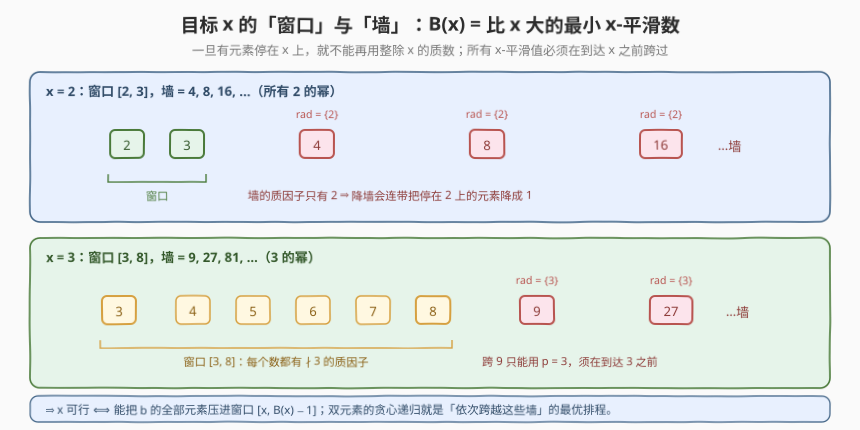
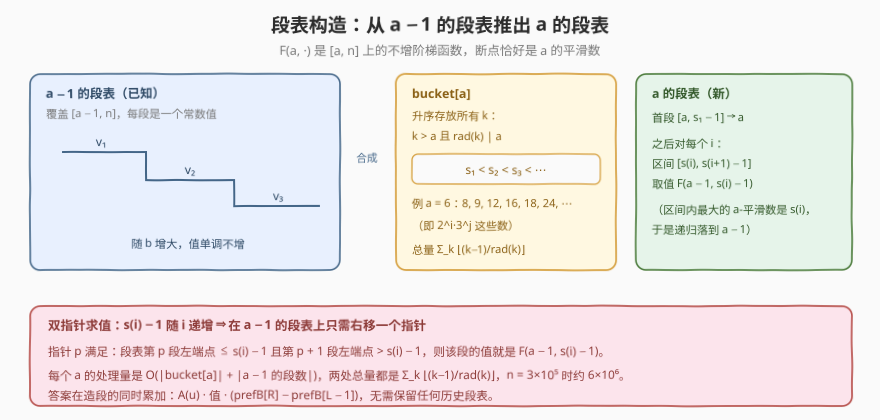
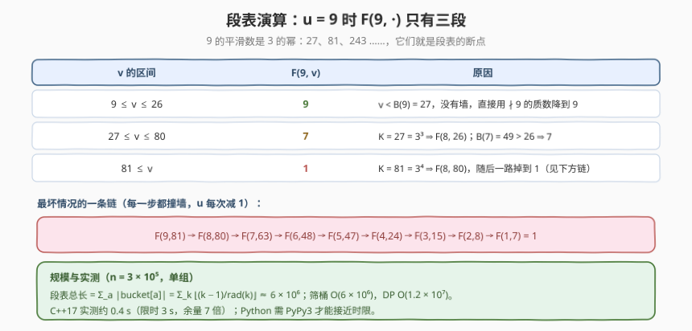

# Codeforces 2264E2 质数洪水（困难版） 题解
## 1. 题目概述

- **标题 / 题号**：质数洪水（困难版）（Codeforces 2264E2，英文名 A Prime Flood (Hard Version)）
- **链接**：https://codeforces.com/problemset/problem/2264/E2
- **来源**：Codeforces Round 1121 (Div. 2) · Problem E2
- **难度**：2700（1500 分）
- **限制**：时间 3 s / 内存 256 MB
- **标签**：暴力枚举、组合数学、动态规划、数论

**题意**：给定长度为 $n$ 的数组 $a$（$1\le a_i\le n$）。对每个**非空子序列** $b$（按下标选取，不同下标算不同），允许任意多次操作：选一个质数 $p$，把所有**当前值能被 $p$ 整除**的 $b$ 中元素同时减 $1$。设 $f(b)$ 为操作后能让 $b$ 全部相等的最大整数 $x$，求所有 $2^n-1$ 个非空子序列的 $f(b)$ 之和对 $998244353$ 取模。

多测：第一行 $t$；每组给出 $n$ 与数组，输出一行。与简单版的唯一区别是数据范围（简单版 $n\le 3000$）。

**约束**：

- $1\le t\le 10^4$，$1\le n\le 3\times10^5$，$\sum n\le 3\times10^5$
- $1\le a_i\le n$
- 目标接近 $O(n\log n)$：$O(n^2)$ 在 $n=3\times10^5$ 时是 $9\times10^{10}$，不可行

## 2. 示例

官方样例（输入 / 输出原样，两版共用）：

```text
输入：
4
1
1
4
2 4 4 4
4
2 3 4 4
6
3 6 1 1 1 1

输出：
1
37
34
72
```

补一组自造样例（标注为自造）：

```text
输入：
1
8
4 8 8 8 4 4 4 4

输出：
831
```

$c_4=5$、$c_8=3$，$f(4,4)=4$、$f(8,8)=8$、$f(4,8)=3$，故 $(2^5-1)(2^3-1)\cdot3+(2^5-1)\cdot4+(2^3-1)\cdot8=831$。

## 3. 解题思路

### 3.1 暴力思路

子序列有 $2^n-1$ 个，直接枚举不可能。简单版的做法是：先证 $f(b)$ 只由 $\min b$ 与 $\max b$ 决定，再对每对 $(u,v)$ 用 $O(1)$ 递推求 $F(u,v)$，从而 $O(n^2)$ 计数。但本题 $n=3\times10^5$，$n^2$ 仍然过大。突破口是 **$F(u,\cdot)$ 是断点全落在"平滑数"上的阶梯函数**，而这类断点只有约 $6\times10^6$ 个。

### 3.2 核心观察一：墙、窗口与双元素递归



记 $\operatorname{rad}(k)$ 为 $k$ 的不同质因子之积；称 $k$ 是 **$x$-平滑数**，若 $\operatorname{rad}(k)\mid\operatorname{rad}(x)$；称

$$B(x)=\min\{k>x:\operatorname{rad}(k)\mid\operatorname{rad}(x)\}$$

为 $x$ 的**墙**（不存在时记 $+\infty$）。

**窗口引理**：设 $x\le\min b$，则 $x$ 可达当且仅当能把 $b$ 的全部元素压进窗口 $[x,\,B(x)-1]$。

- 必要性：设 $\tau$ 是第一次有元素到达 $x$ 的时刻。此后任何操作都不能用整除 $x$ 的质数，否则停在 $x$ 上的元素会降到 $x-1$ 且永远回不来。于是 $\tau$ 之后每个 $>x$ 的元素只能靠 $\nmid x$ 的质数降到 $x$，途中不能经过任何 $k>x$ 且 $\operatorname{rad}(k)\mid\operatorname{rad}(x)$ 的值（这种值只能被整除 $x$ 的质数降），故 $\tau$ 时刻所有元素都 $<B(x)$。
- 充分性：若全部元素都在窗口内，反复取一个值 $k>x$ 的元素，由 $k<B(x)$ 知存在 $p\mid k$、$p\nmid x$，执行 $p$：停在 $x$ 的元素不受影响，其余仍 $\ge x$ 且 $\le B(x)-1$。总和每步减少，有限步后全为 $x$。

对只有两个元素 $u\le v$ 的情形，设答案为 $F(u,v)$，则

$$F(u,v)=\begin{cases}u, & v<B(u)\\ F(u-1,\,K-1), & v\ge B(u),\ K=\max\{k\le v:\operatorname{rad}(k)\mid\operatorname{rad}(u)\}\end{cases}$$

理由：$v<B(u)$ 时 $v$ 可只用 $\nmid u$ 的质数一路降到 $u$；否则 $(K,v]$ 内每个数都有 $\nmid u$ 的质因子，$v$ 先单独降到 $K$，再用 $p\mid K$（于是 $p\mid u$）把两者同时降 $1$。

再结合"删去元素只会更容易"（子集单调）与"把极值对的质数序列原样施加到整个 $b$ 上，所有元素始终被夹在 $[a_i,b_i]$ 内"（§5 引理 3），得

$$f(b)=F(\min b,\ \max b)$$

于是只需对 $u<v$ 求 $F(u,v)$ 并按 $(\min,\max)$ 分组计数。

### 3.3 核心观察二：$F(a,\cdot)$ 是断点在平滑数上的阶梯函数



固定 $a$，令 $s_1<s_2<\cdots$ 为所有 $>a$ 的 $a$-平滑数。由递归：

- $b\in[a,s_1-1]$（无墙）：$F(a,b)=a$；
- $b\in[s_i,s_{i+1}-1]$：区间内最大的 $a$-平滑数就是 $s_i$，故 $F(a,b)=F(a-1,\,s_i-1)$，与 $b$ 无关。

所以 $F(a,\cdot)$ 在 $[a,n]$ 上是不增阶梯函数，段数为 $1+\#\{k>a:\operatorname{rad}(k)\mid a\}$。把 "$a$-平滑数 $>a$" 按升序装进桶 $\text{bucket}[a]$，就得到递推：**用 $\text{bucket}[a]$ 和 $a-1$ 的段表，就能造出 $a$ 的段表**。段表用 `start[]/val[]` 两个数组存（左端点递增）；查询 $F(a-1,s_i-1)$ 时，因为 $s_i-1$ 也递增，只需一个只右移的指针。

关键规模：

$$\sum_{a\le n}\#\{k>a:\operatorname{rad}(k)\mid a\}=\sum_{k\le n}\left\lfloor\frac{k-1}{\operatorname{rad}(k)}\right\rfloor\approx5.97\times10^6\quad(n=3\times10^5)$$

与 $n\ln n$ 同量级，实测 C++ 约 $0.3$ s。

### 3.4 计数与示例演算



固定 $\min=u<\max=v$：两侧各至少选一个，中间值任选。设 $c_v$ 为值 $v$ 的出现次数、$S_v=\sum_{k\le v}c_k$，则

$$ans=\sum_{v}(2^{c_v}-1)v+\sum_{u<v}(2^{c_u}-1)(2^{c_v}-1)\,2^{\,S_{v-1}-S_u}\,F(u,v)$$

为了造段时 $O(1)$ 累加，把权重拆开：

$$A(u)=(2^{c_u}-1)2^{-S_u},\quad B(v)=(2^{c_v}-1)2^{S_{v-1}},\quad \text{prefB}[v]=\sum_{k\le v}B(k)$$

段 $[L,R]$ 值为 $x$ 时贡献 $A(u)\cdot x\cdot(\text{prefB}[R]-\text{prefB}[L-1])$，一次扫描即可求出整行。

以 $u=9$ 为例：$9$ 的平滑数是 $3$ 的幂，$\text{bucket}[9]=\{27,81,\dots\}$，于是

| $v$ 的区间 | $F(9,v)$ | 原因 |
|---|---|---|
| $9\le v\le26$ | $9$ | $v<B(9)=27$，无墙 |
| $27\le v\le80$ | $7$ | $K=27$，$F(9,v)=F(8,26)$，而 $B(7)=49>26$ |
| $81\le v$ | $1$ | $K=81$，$F(8,80)=1$（链见图中） |

## 4. 算法细节

1. **rad 筛**：对每个质数 $i$，把它所有倍数的 `rad` 乘上 $i$，$O(n\log\log n)$。
2. **桶（CSR）**：先数 `off[a]` 再前缀和得 `bstart`，回填到一维 `bdata`，避免 $3\times10^5$ 个 `vector` 的开销。枚举方式是"对每个 $k$，把所有 $\operatorname{rad}(k)$ 的倍数 $a<k$ 塞进 $\text{bucket}[a]$"——因为 $\operatorname{rad}(k)\mid\operatorname{rad}(a)\iff\operatorname{rad}(k)\mid a$。总枚举量恰为 $\sum_k\lfloor(k-1)/\operatorname{rad}(k)\rfloor$。
3. **多测共享桶**：桶只依赖值域，按所有测试的最大 $n$ 建一次；遍历时遇到 $k>n$ 就 `break`（桶升序）。
4. **段的裁剪**：段表只在 $[u,n]$ 有意义，首段与末段都要裁到 $n$；指针在每行开头重置。
5. **模运算**：$2^{-S_u}$ 用 $\text{inv2}=(MOD+1)/2$ 的幂预处理；每次乘法后立即取模。
6. **内存**：桶约 $6\times10^6$ 个 `int`（约 24 MB），其余 $O(n)$，实测峰值约 44 MB。
7. **每组只用到 $\le n$ 的下标**：`prefB/A/B` 无需整套清空，但绝不能把本组的 $n$ 与全局 `N` 混用。

## 5. 正确性证明

**引理 1（窗口引理）**：设 $x\le\min b$，$x$ 可达 $\iff$ 能把 $b$ 压进 $[x,B(x)-1]$。

**证明**：必要性——停在 $x$ 的元素不能再被整除 $x$ 的质数碰到，所以所有"$x$-平滑值"必须在第一次到达 $x$ 之前跨过；充分性由 §3.2 的显式下降过程给出。∎

**引理 2（双元素递归最优）**：$f(u,v)=F(u,v)$。

**证明**：可行性见 §3.2。最优性对 $u+v$ 归纳；第一步只有"同时降 / 只降 $v$ / 只降 $u$"三种，新状态为 $(u-1,v-1),(u,v-1),(u-1,v)$。而 $F(u,\cdot)$ 关于第二变元单调不增（对 $u$ 归纳：$b'<B(u)$ 时值为 $u$；$b<B(u)\le b'$ 时 $u\ge F(u,b')$；否则由 $K\le K'$ 与归纳假设），且 $F(u,v)\ge F(u-1,v-1),F(u-1,v)$（由 $K-1\le v$ 与单调性），故三种首步都不优于 $F(u,v)$。∎

**引理 3（多重集归约）**：$f(b)=F(\min b,\max b)$。

**证明**：上界由子集单调（同一质数序列作用在子多重集上轨迹相同）。下界：极值对贪心的第 $i$ 步质数 $p_i\mid b_{i-1}$，把该序列作用到整个 $b$ 上，归纳得第 $i$ 步后所有元素落在 $[a_i,b_i]$：值为 $b_{i-1}$ 的元素必被整除、减为 $b_i$，其余不超过 $b_i$；被降的不低于 $a_{i-1}-1\ge a_i$，未降的不低于 $a_{i-1}\ge a_i$。末态 $a_T=b_T=x$，故全部等于 $x$。∎

**引理 4（段表正确）**：每个 $a$ 的段表在 $[a,n]$ 上逐点等于 $F(a,\cdot)$。

**证明**：对 $a$ 归纳。$a=1$ 时 $B(1)=+\infty$，$F\equiv1$，与初值一致。设 $a-1$ 正确：$b<s_1$ 时 $F(a,b)=a$；$b\in[s_i,s_{i+1}-1]$ 时 $F(a,b)=F(a-1,s_i-1)$。代码正是用指针在 $a-1$ 段表上定位 $s_i-1$ 所在段并取值，故逐点正确。∎

**定理**：答案公式正确。

**证明**：由引理 3，每个子序列贡献只取决于 $(\min,\max)$；$u=v$ 的组有 $2^{c_u}-1$ 个，$u<v$ 的组有 $(2^{c_u}-1)(2^{c_v}-1)2^{S_{v-1}-S_u}$ 个（两侧必选、中间任选、区间外不选）。由引理 4，$F(u,v)$ 由段表精确给出，累加即答案。∎

## 6. 复杂度分析

- **时间**：rad 筛 $O(n\log\log n)$；建桶 $O(\sum_{k\le n}k/\operatorname{rad}(k))$，$n=3\times10^5$ 时约 $6\times10^6$ 次写入；每组段表 DP 为 $O(\sum_a(|\text{bucket}[a]|+|\text{segs}(a-1)|))$，同阶。总计约 $1.2\times10^7$ 次操作，C++ 实测 $0.3\sim0.5$ s。
- **空间**：桶约 $6\times10^6$ 个 `int`（24 MB），段表、`rad`、幂表、`prefB` 为 $O(n)$，峰值约 44 MB，限制 256 MB。

## 7. 参考代码

### C++17

```cpp
#include <iostream>
#include <vector>
#include <algorithm>
using namespace std;
const long long MOD = 998244353;

int main() {
    ios::sync_with_stdio(false); cin.tie(nullptr);
    int T; if (!(cin >> T)) return 0;
    vector<vector<int>> tests(T);
    int N = 1;
    for (int t = 0; t < T; ++t) {
        int n; cin >> n; tests[t].resize(n);
        for (int i = 0; i < n; ++i) cin >> tests[t][i];
        N = max(N, n);
    }
    vector<int> rad(N + 1, 1);                       // rad[x]：不同质因子之积
    for (int i = 2; i <= N; ++i) if (rad[i] == 1)
        for (int j = i; j <= N; j += i) rad[j] *= i;
    vector<long long> pw2(N + 1), ipw2(N + 1);
    const long long inv2 = (MOD + 1) / 2;
    pw2[0] = ipw2[0] = 1;
    for (int i = 1; i <= N; ++i) {
        pw2[i] = pw2[i - 1] * 2 % MOD;
        ipw2[i] = ipw2[i - 1] * inv2 % MOD;
    }
    // 桶（CSR）：bucket[a] = 升序的 k，满足 a < k <= N 且 rad(k) | a
    vector<int> off(N + 1, 0);
    for (int k = 2; k <= N; ++k)
        for (int a = rad[k]; a < k; a += rad[k]) ++off[a];
    vector<int> bstart(N + 2, 0);
    for (int a = 1; a <= N + 1; ++a) bstart[a] = bstart[a - 1] + (a >= 2 ? off[a - 1] : 0);
    vector<int> bdata(bstart[N + 1] + 1), pos(bstart.begin(), bstart.end() - 1);
    for (int k = 2; k <= N; ++k)
        for (int a = rad[k]; a < k; a += rad[k]) bdata[pos[a]++] = k;

    vector<long long> A(N + 1), B(N + 1), prefB(N + 1), ss, sv, ns, nv;
    for (int t = 0; t < T; ++t) {
        int n = tests[t].size();
        vector<int> cnt(n + 1, 0), S(n + 1, 0);
        for (int x : tests[t]) ++cnt[x];
        for (int v = 1; v <= n; ++v) S[v] = S[v - 1] + cnt[v];
        long long ans = 0;
        for (int v = 1; v <= n; ++v) {
            long long c = pw2[cnt[v]] - 1;
            ans = (ans + c * v) % MOD;                  // min = max = v
            A[v] = c * ipw2[S[v]] % MOD;                // 2^{-S(v)}
            B[v] = c * pw2[S[v - 1]] % MOD;             // 2^{S(v-1)}
            prefB[v] = (prefB[v - 1] + B[v]) % MOD;
        }
        if (n >= 2)                                     // u = 1：F(1, v) = 1
            ans = (ans + A[1] * ((prefB[n] - prefB[1] + MOD) % MOD)) % MOD;
        ss.assign(1, 1); sv.assign(1, 1);               // a = 1 的段表
        for (int u = 2; u <= n; ++u) {
            ns.assign(1, u); nv.assign(1, u);           // 首段 [u, s1-1] -> u
            int lo = bstart[u], hi = bstart[u + 1];
            long long s1 = (lo < hi && bdata[lo] <= n) ? bdata[lo] : (long long)n + 1;
            int L = u + 1, R = (int)min<long long>(s1 - 1, n);
            if (L <= R) ans = (ans + A[u] * u % MOD * ((prefB[R] - prefB[L - 1] + MOD) % MOD)) % MOD;
            size_t p = 0;                               // 双指针扫 a-1 的段表
            for (int i = lo; i < hi && bdata[i] <= n; ++i) {
                int k = bdata[i];
                int nxt = (i + 1 < hi && bdata[i + 1] <= n) ? bdata[i + 1] : n + 1;
                while (p + 1 < ss.size() && ss[p + 1] <= k - 1) ++p;
                long long val = sv[p];
                ns.push_back(k); nv.push_back(val);
                L = k; R = min(nxt - 1, n);
                if (L <= R) ans = (ans + A[u] * val % MOD * ((prefB[R] - prefB[L - 1] + MOD) % MOD)) % MOD;
            }
            ss.swap(ns); sv.swap(nv);
        }
        cout << ans % MOD << '\n';
    }
    return 0;
}
```

### Python3

```python
import sys
MOD = 998244353

def main():
    d = list(map(int, sys.stdin.buffer.read().split()))
    if not d:
        return
    t, pos, tests, N = d[0], 1, [], 1
    for _ in range(t):
        n = d[pos]; pos += 1
        tests.append(d[pos:pos + n]); pos += n
        N = max(N, n)
    rad = [1] * (N + 1)                       # rad[x]：不同质因子之积
    for i in range(2, N + 1):
        if rad[i] == 1:
            for j in range(i, N + 1, i):
                rad[j] *= i
    pw2 = [1] * (N + 1); ipw2 = [1] * (N + 1); inv2 = (MOD + 1) // 2
    for i in range(1, N + 1):
        pw2[i] = pw2[i - 1] * 2 % MOD
        ipw2[i] = ipw2[i - 1] * inv2 % MOD
    buckets = [[] for _ in range(N + 1)]      # bucket[a] = 升序的 k
    for k in range(2, N + 1):
        r = rad[k]
        for a in range(r, k, r):
            buckets[a].append(k)
    A = [0] * (N + 1); B = [0] * (N + 1); prefB = [0] * (N + 1); out = []
    for arr in tests:
        n = len(arr); cnt = [0] * (n + 1)
        for x in arr: cnt[x] += 1
        S = [0] * (n + 1)
        for v in range(1, n + 1): S[v] = S[v - 1] + cnt[v]
        ans = 0
        for v in range(1, n + 1):
            c = pw2[cnt[v]] - 1
            ans = (ans + c * v) % MOD
            A[v] = c * ipw2[S[v]] % MOD
            B[v] = c * pw2[S[v - 1]] % MOD
            prefB[v] = (prefB[v - 1] + B[v]) % MOD
        if n >= 2: ans = (ans + A[1] * (prefB[n] - prefB[1])) % MOD
        segs = [(1, 1)]                        # a = 1 的段表
        for u in range(2, n + 1):
            bl = buckets[u]; new = [(u, u)]    # 首段 [u, s1-1] -> u
            s1 = bl[0] if bl else n + 1
            L, R = u + 1, min(s1 - 1, n)
            if L <= R: ans = (ans + A[u] * u % MOD * (prefB[R] - prefB[L - 1])) % MOD
            p = 0
            for i, k in enumerate(bl):
                if k > n: break
                nxt = min(bl[i + 1] if i + 1 < len(bl) else n + 1, n + 1)
                while p + 1 < len(segs) and segs[p + 1][0] <= k - 1: p += 1
                val = segs[p][1]; new.append((k, val))
                L, R = k, min(nxt - 1, n)
                if L <= R: ans = (ans + A[u] * val % MOD * (prefB[R] - prefB[L - 1])) % MOD
            segs = new
        out.append(str(ans % MOD))
    sys.stdout.write("\n".join(out) + "\n")

main()
```

> ⚠️ Python 版本在 $n=3\times10^5$ 时 CPython 约 $7$ s，会超出 3 s；请用 PyPy3（约 $1.5\sim2$ s）或直接提交 C++。

## 8. 边界情况与易错点

1. **$n=1$**：直接输出 $1$；段表循环不执行，$u=1$ 的贡献要判 `n >= 2`。
2. **$a_i=1$**：$\operatorname{rad}(1)=1$、$B(1)=+\infty$、$F(1,v)=1$，必须单独初始化 `u=1` 的段表 `[1,n] -> 1`。
3. **桶里混入 $>n$ 的 $k$**：多测时桶按最大 $n$ 建，遍历必须 `if (k > n) break;`，否则段表会延伸到 $n$ 之外。
4. **下一断点越界**：`nxt` 可能 $>n$，要裁成 $n+1$，再 `R = min(nxt-1, n)`。
5. **`prefB` 下标**：段从 $L=u+1$ 或 $L=s_i$ 开始，用 `prefB[R]-prefB[L-1]`，减法后要 `+MOD` 再取模。
6. **`long long` 溢出**：$A(u)\cdot x\cdot(\text{prefB 差})$ 必须分两步取模。
7. **多测脏数据**：所有读取都 $\le$ 本组 $n$，故 `prefB` 不必清空；但若把本组 $n$ 与全局 `N` 混用就会读到上一组的残留。
8. **建桶的等价性**：$\operatorname{rad}(k)\mid\operatorname{rad}(a)\iff\operatorname{rad}(k)\mid a$，所以只需枚举 $a$ 是 $\operatorname{rad}(k)$ 的倍数。

## 相关题目与扩展

- [Codeforces 2264E1 A Prime Flood (Easy Version)](https://codeforces.com/problemset/problem/2264/E1)：$n\le3000$ 版本，$O(n^2)$ 递推即可，见同目录另一篇题解；本篇的段表就是它的"按行压缩"。
- [Codeforces 1542C Strange Function](https://codeforces.com/problemset/problem/1542/C)：同样把数按质因子结构分类后计数，可对照"平滑数 / 墙"的想法。
- [Codeforces 1154G Minimum Possible LCM](https://codeforces.com/problemset/problem/1154/G)：值域上的倍数筛预处理，与本题建桶的枚举方式一致。
- [LeetCode 264. 丑数 II](https://leetcode.cn/problems/ugly-number-ii/)：生成只由给定质数拼成的数（即本题的"平滑数"），与桶的枚举方式同源。

**延伸思考**：

1. 段表总长依赖 $\sum_k k/\operatorname{rad}(k)$；若把"减 $1$"改成"减 $d$"，墙会变成 $x+d$ 附近的平滑数，段结构是否还存在？
2. 若要求所有子序列 $f(b)^2$ 之和，只需在段贡献里把 $x$ 换成 $x^2$，结构完全不变。
3. 若 $a_i\le10^9$，桶无法按值域建；可对出现的值去重后做 $O(m^2)$（$m$ 为不同值个数），或用有序表对段做启发式合并。
