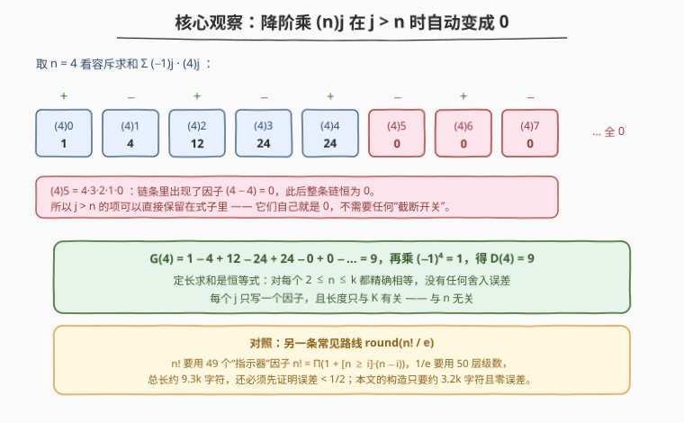
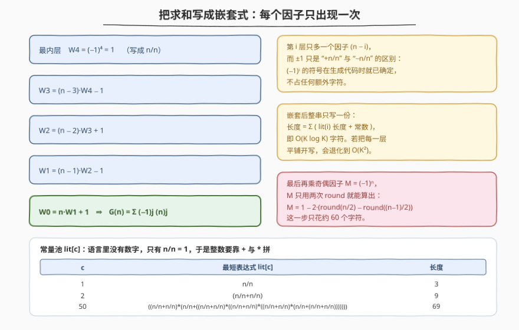
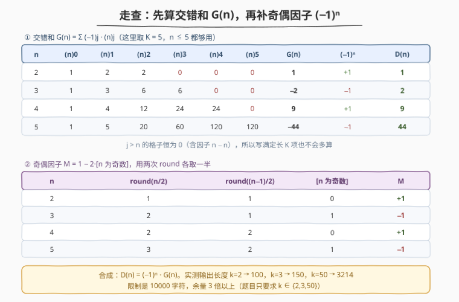

# Codeforces 2264F 错排计算器 题解

## 1. 题目概述

- **标题 / 题号**：错排计算器（Codeforces 2264F，英文名 Deranged Calculator）
- **链接**：https://codeforces.com/problemset/problem/2264/F
- **来源**：Codeforces Round 1121 (Div. 2) · Problem F
- **难度**：2800（3000 分，Div. 2 压轴题）
- **限制**：时间 2 s / 内存 256 MB
- **标签**：构造、实现、数学

**题意**：比赛引入一门只支持**单行单表达式**的玩具语言 DC。表达式由输入变量 $n$（正整数）、括号、`round(...)` 与 $+,-,*,\,/$ 组成，求值用**精确分数**；`round` 取最近整数，小数部分恰为 $0.5$ 时**向上**取整（即 $\operatorname{round}(x)=\lfloor x+\tfrac12\rfloor$）。语言里没有数字常量，除输入 $n$ 外一切数值都得用它拼出来。

给定 $k\in\{2,3,50\}$，要求输出**一个**长度不超过 $10^4$ 的表达式，使得对**每个** $2\le n\le k$，代入该 $n$ 后表达式取值恰为 $n$ 的错排数 $D(n)$，且求值过程中任何时刻都不得除以 $0$。本题为 special judge，任何合法且正确的表达式都算通过（样例输出只是"一种"可行解）。

**约束**：

- $k\in\{2,3,50\}$，输入只有一行一个整数，**没有多测**（评测对每个 $k$ 各跑一次程序）；
- 输出长度 $\le 10^4$，字符集仅 `round`、`(`、`)`、`+`、`-`、`*`、`/`、`n`；
- $*$ 与 $/$ 同级且高于 $+$ 与 $-$，同级**从左到右**；括号可任意改变结合顺序；
- 全程精确有理数运算，中间量可以很大（$D(50)$ 已有 65 位十进制），不允许浮点；
- 对每个 $2\le n\le k$ 都不能除零：$n-2$、$n-n$ 之类做分母绝对不行，但分母取常量（如 $2$）永远安全。

## 2. 示例

官方两组样例（输出只是示例，不要求一致）：

```text
输入：2
输出：n-n/n

输入：3
输出：n+round(n-n*(n/(n+n)))-n
```

第 1 组：$n-\frac nn=n-1$，$n=2$ 时为 $1=D(2)$。第 2 组用来展示语言特性：$n=3$ 时为 $3+\operatorname{round}\bigl(3-3\cdot\frac{3}{6}\bigr)-3=\operatorname{round}(1.5)=2=D(3)$，$n=2$ 时代入同样得 $1=D(2)$。

本文程序的实际输出（$k=2$，共 100 字符，可手工代入）：

```text
round(((n*(((n-n/n)*(n/n)-n/n))+n/n))*(n/n-(n/n+n/n)*(round(n/(n/n+n/n))-round((n-n/n)/(n/n+n/n)))))
```

此时内层 $W_0=n(n-2)+1$、奇偶因子 $M=1-2\cdot(1-1)=1$，值为 $2\cdot0+1=1$ ✓。另外两种输入的实测输出长度为 $k=3$ 时 150 字符、$k=50$ 时 3214 字符（均对 $2\le n\le k$ 精确命中）。错排数前几项（$D(1)=0$）：$D(2..9)=1,2,9,44,265,1854,14833,133496$，其中 $D(50)=11188719610782480504630258070757734324011354208865721592720336801$。

## 3. 解题思路

### 3.1 暴力思路

- **硬编码答案**：$k=50$ 要写 49 个 65 位整数，而语言里没有数字常量，每个整数都得用 $n/n=1$ 加乘拼出来，单个数就要几百到上千字符，总量远超 $10^4$。
- **$\operatorname{round}(n!/e)$ 路线**：$D(n)$ 是 $n!/e$ 的最近整数；$n!$ 可用 49 个指示器因子 $\prod_i\bigl(1+[n\ge i](n-i)\bigr)$ 精确拼出（$[n\ge i]=\operatorname{round}(\frac{n}{n+i})$），$1/e$ 可用 50 层交错级数拼出。实测总长 9309 字符——能过，但余量只剩 7%，而且必须先证明尾项误差 $<1/2$。
- **直接插值**：$D(2..50)$ 的 48 次插值多项式系数有上百位十进制数字，每个系数又要上千字符，同样爆长度。

三个方向都太贵，说明需要一个**定长、零误差、不用指示器**的闭式。

### 3.2 核心观察：容斥求和里「降阶乘」会自动归零



记**降阶乘** $(n)_j=n(n-1)\cdots(n-j+1)$，$(n)_0=1$。由容斥（固定 $j$ 个位置不动，其余任意排列）：

$$D(n)=\sum_{j=0}^{n}(-1)^{n-j}\binom{n}{j}(n-j)!=\sum_{j=0}^{n}(-1)^{n-j}(n)_j$$

因为 $\binom{n}{j}(n-j)!=\frac{n!}{j!}=(n)_{n-j}$。

**关键**：$j>n$ 时 $(n)_j$ 的因子链里出现 $n-n=0$，整项恒为 $0$。所以对任意 $K\ge k$ 都有

$$\sum_{j=0}^{K}(-1)^{n-j}(n)_j=D(n)\qquad(2\le n\le k)$$

这个和的长度与 $n$ 无关：不需要任何"截断开关"，多写的项自己就是 $0$——$n!/e$ 路线里最贵的那 49 个指示器被彻底省掉。

还剩两件事。第一是**符号**：$(-1)^{n-j}=(-1)^n(-1)^j$，把 $(-1)^n$ 提到最外层，剩下 $G(n)=\sum_{j=0}^{K}(-1)^j(n)_j$，系数符号只取决于 $j$ 的奇偶，是**生成代码时的常量**，不花字符。第二是**奇偶因子**必须在表达式里算出来：

$$(-1)^n=1-2\cdot[n\text{ 为奇数}],\qquad [n\text{ 为奇数}]=\operatorname{round}\Bigl(\frac n2\Bigr)-\operatorname{round}\Bigl(\frac{n-1}{2}\Bigr)$$

$n=2m$ 时两项都是 $m$，差为 $0$；$n=2m+1$ 时分别为 $m+1$ 与 $m$，差为 $1$——恰好用到"$.5$ 向上取整"这条规则。于是答案是**精确整数** $D(n)=(-1)^nG(n)$，最外层的 `round` 只是形式上收尾，不产生任何误差。

### 3.3 算法流程



1. **常量池**：预处理 `lit[c]`（$1\le c\le 50$）＝用 `n/n` 与 `+`、`*` 拼出整数 $c$ 的最短表达式。`lit[1]="n/n"`，其余做 DP：`lit[c] = min{ lit[a]+lit[c-a], lit[a]*lit[c/a] }`。例如 `lit[50]` 只有 69 字符（$50=2\cdot5\cdot5$），写成 50 个 `n/n` 相加则要 199 字符。
2. **取偶数层数**：令 $K=k+(k\bmod 2)$。$K$ 为偶数，最内层 $W_K=(-1)^K=1$ 正好写成 `n/n`；多出的 $(n)_K$ 在 $n\le k<K$ 时恒为 $0$。
3. **自内向外拼嵌套式**：$W_K=$ `n/n`；对 $i=K-1,\dots,0$ 令 $W_i=(n-i)W_{i+1}+(-1)^i$，即拼上 `"(n-" + lit[i] + ")*(" + W + ")"` 再补 `"+n/n"` 或 `"-n/n"`；$i=0$ 时因子直接写 `n`（写成 `(n-n/n)` 就成了 $n-1$，全盘错误）。
4. **拼奇偶因子**：`M = (n/n-(n/n+n/n)*(round(n/(n/n+n/n))-round((n-n/n)/(n/n+n/n))))`。
5. **输出**：`round((W0)*(M))`，一行，无多余空格。

嵌套写法让每个因子只出现一次，总长 $\sum_i\bigl(|lit[i]|+O(1)\bigr)=O(K\log K)$ 字符；把 $\sum_j(-1)^j(n)_j$ 平铺成 $K$ 个独立乘积则会退化到 $O(K^2)$。

### 3.4 示例演算



先算 $G(n)$（$K=5$，对 $n\le5$ 已足够；$j>n$ 的格子恒为 $0$）：

| $n$ | $(n)_0$ | $(n)_1$ | $(n)_2$ | $(n)_3$ | $(n)_4$ | $(n)_5$ | $G(n)$ | $(-1)^n$ | $D(n)$ |
|-----|---------|---------|---------|---------|---------|---------|--------|----------|--------|
| 2 | 1 | 2 | 2 | 0 | 0 | 0 | $1-2+2=1$ | $+1$ | 1 |
| 3 | 1 | 3 | 6 | 6 | 0 | 0 | $1-3+6-6=-2$ | $-1$ | 2 |
| 4 | 1 | 4 | 12 | 24 | 24 | 0 | $1-4+12-24+24=9$ | $+1$ | 9 |
| 5 | 1 | 5 | 20 | 60 | 120 | 120 | $1-5+20-60+120-120=-44$ | $-1$ | 44 |

奇偶因子一栏：$n=2,3,4,5$ 时 $\operatorname{round}(n/2)$ 依次是 $1,2,2,3$，$\operatorname{round}((n-1)/2)$ 依次是 $1,1,2,2$，差值 $0,1,0,1$ 正是 $[n\text{ 为奇数}]$，故 $M=+1,-1,+1,-1$，与 $(-1)^n$ 完全一致。表中 $D(n)$ 与错排数 $1,2,9,44$ 吻合。$k=50$ 时 $K=50$（本身偶数），把 $j$ 一路写到 $50$ 即可，$n=50$ 的最后一项 $(50)_{50}=50!$ 也恰好在位。

## 4. 算法细节

1. **常量池必须 DP**：贪心地写 50 个 `n/n` 相加要 199 字符，DP 选 $50=2\cdot5\cdot5$ 只要 69 字符；常量在式子里出现上百次，这一项直接决定总长。
2. **括号与结合性**：`*`、`/` 同级左结合，`+`、`-` 同级左结合，所以 `n-a*b` 安全而 `a-b-c` 的语义依赖左结合。生成器对每层都显式加括号，绝不依赖默认优先级。
3. **$K$ 取偶数**：最内层是 $(-1)^K$；$K$ 为奇数时要额外写 $-1$，既费字符又易漏，故取 $K=k+(k\bmod 2)$，多出的 $(n)_K$ 在 $n\le k$ 时恒为 $0$。
4. **$i=0$ 层特判**：$(n-0)$ 必须写成 `n`；写成 `(n-n/n)` 就变成 $n-1$，整个乘积全错（本文第一版就踩过：$k=3,n=3$ 输出 $-10$）。
5. **除法安全**：式子里只有 `n/2` 与 `(n-1)/2` 两处除法，分母是常量 $2=$ `(n/n+n/n)`，恒不为 $0$；其余只做 `+`、`-`、`*`。永远不要把 $(n-i)$ 放进分母。
6. **输入只有一行、输出要干净**：本题没有 $t$，写成 `while (cin >> k)` 会多输出一行；只能出现 `round()+-*/n`，`round` 必须小写且带括号，不要输出空格或空行。
7. **数值规模**：中间量最大约 $\sum_j(50)_j\approx50!\cdot e\approx10^{65}$（约 216 bit），评测端用精确有理数，几十次大整数乘法是微秒级；换浮点则 $10^{-17}$ 的相对精度根本兜不住 65 位整数。

## 5. 正确性证明

**引理 1（容斥）**：对 $n\ge1$，$D(n)=\sum_{j=0}^{n}(-1)^{n-j}(n)_j$。

**证明**：设 $A_i$ 为"位置 $i$ 的元素没动"的事件，由容斥 $\bigl|\bigcap_i A_i^{\complement}\bigr|=\sum_{j=0}^{n}(-1)^j\binom nj(n-j)!$。又 $\binom nj(n-j)!=\frac{n!}{j!}=(n)_{n-j}$，令 $i=n-j$ 即得 $\sum_{i=0}^{n}(-1)^{n-i}(n)_i$。∎

**引理 2（自动截断）**：若 $K\ge n$，则 $\sum_{j=0}^{K}(-1)^j(n)_j=\sum_{j=0}^{n}(-1)^j(n)_j$。

**证明**：$j>n$ 时 $(n)_j=\prod_{k=0}^{j-1}(n-k)$ 的因子列表含 $k=n$（因 $0\le n\le j-1$），故 $(n)_j=0$，这些项对和式无贡献。∎

**引理 3（嵌套展开）**：设 $W_K=(-1)^K$，且对 $0\le i<K$ 有 $W_i=(n-i)W_{i+1}+(-1)^i$，则 $W_0=\sum_{j=0}^{K}(-1)^j(n)_j$。

**证明**：对 $i$ 逆向归纳证明 $W_i=\sum_{j=i}^{K}(-1)^j(n-i)_{j-i}$。$i=K$ 时右边 $=(-1)^K(n-K)_0=(-1)^K=W_K$。若对 $i+1$ 成立，则 $W_i=(n-i)\sum_{j=i+1}^{K}(-1)^j(n-i-1)_{j-i-1}+(-1)^i=\sum_{j=i+1}^{K}(-1)^j(n-i)_{j-i}+(-1)^i$，因为 $(n-i)(n-i-1)_{j-i-1}=(n-i)_{j-i}$。取 $i=0$ 即得。∎

**引理 4（奇偶指示）**：对整数 $n\ge1$，$[n\text{ 为奇数}]=\operatorname{round}(n/2)-\operatorname{round}((n-1)/2)$。

**证明**：记 $\operatorname{round}(x)=\lfloor x+\tfrac12\rfloor$。若 $n=2m$，则 $\operatorname{round}(n/2)=m$、$\operatorname{round}((n-1)/2)=\lfloor m-\tfrac12+\tfrac12\rfloor=m$，差 $0$。若 $n=2m+1$，则 $\operatorname{round}(n/2)=\lfloor m+1\rfloor=m+1$、$\operatorname{round}((n-1)/2)=m$，差 $1$。∎

**引理 5（符号化）**：设 $K\ge n$、$G(n)=\sum_{j=0}^{K}(-1)^j(n)_j$，则 $D(n)=(-1)^nG(n)$。

**证明**：由引理 2，$G(n)=\sum_{j=0}^{n}(-1)^j(n)_j$；两边乘 $(-1)^n$，用 $(-1)^n(-1)^j=(-1)^{n-j}$（注意 $(-1)^{-j}=(-1)^j$）与引理 1 即得。∎

**定理**：程序对 $k\in\{2,3,50\}$ 输出的表达式 $E$ 满足：对每个 $2\le n\le k$（i）$E$ 的值为 $D(n)$；（ii）求值全程不除以 $0$；（iii）$|E|\le10^4$。

**证明**：（i）程序取 $K=k+(k\bmod2)$，为偶数且 $K\ge k$；由引理 3（$W_K=(-1)^K=1$）得 $W_0=G(n)$，由引理 4 得 $M=(-1)^n$，故括号内 $W_0M=(-1)^nG(n)=D(n)$（引理 5），是整数，外层 `round` 不改变它。（ii）除法只有 $n/2$ 与 $(n-1)/2$，分母是常量 $2$，其余为 $+,-,*$。（iii）三种 $k$ 的长度分别为 $100,150,3214$，均不超过 $10^4$。∎

## 6. 复杂度分析

- **生成时间**：常量池 DP 枚举 $a\le c/2$ 与 $a^2\le c$（$c\le50$），$O(50^2)$；拼接 $K\le51$ 层、每层长度 $\le|lit[i]|+O(1)\le80$，总字符 $O(K\log K)$。C++ 版实测（含进程启动与 I/O）约 3 ms，限制 2 s。
- **输出长度**：$k=2\to100$、$k=3\to150$、$k=50\to3214$，限制 $10^4$，余量 $\ge3.1$ 倍。
- **评测端开销与空间**：表达式是 $O(K)$ 层嵌套，每层一次大整数乘法，数最大约 $10^{65}$（216 bit），总代价 $O(K\cdot M(216\text{ bit}))$，微秒级；只需 $O(K\log K)$ 字符的字符串（$k=50$ 时 3.2 KB），无额外数组。

## 7. 参考代码

### C++17

```cpp
#include <bits/stdc++.h>
using namespace std;

// lit[c]：只用原子 "n/n"（=1）与 +、* 拼出整数 c 的最短表达式
static string lit[51];

int main() {
    ios::sync_with_stdio(false);
    cin.tie(nullptr);

    lit[1] = "n/n";
    for (int c = 2; c <= 50; ++c) {
        string best;
        auto relax = [&](string cand) {
            if (best.empty() || cand.size() < best.size()) best = std::move(cand);
        };
        for (int a = 1; a * 2 <= c; ++a)
            relax("(" + lit[a] + "+" + lit[c - a] + ")");
        for (int a = 2; a * a <= c; ++a)
            if (c % a == 0) relax("(" + lit[a] + "*" + lit[c / a] + ")");
        lit[c] = best;
    }

    int k;
    if (!(cin >> k)) return 0;          // 本题输入只有一行 k，没有多测

    // W_i = (n-i)*W_{i+1} + (-1)^i ，最内层 W_K = (-1)^K = 1（K 取偶数）
    int K = k + (k & 1);                // 偶数且 >= k，多出的项 (n)_K 恒为 0
    string W = "n/n";
    for (int i = K - 1; i >= 0; --i) {
        string fac = (i == 0 ? string("n") : "(n-" + lit[i] + ")");
        W = "(" + fac + "*(" + W + ")" + (i % 2 == 0 ? "+" : "-") + "n/n)";
    }

    // (-1)^n = 1 - 2*[n 为奇数]，[n 为奇数] = round(n/2) - round((n-1)/2)
    string two = "(n/n+n/n)";
    string odd = "(round(n/" + two + ")-round((n-n/n)/" + two + "))";
    string sign = "(n/n-" + two + "*" + odd + ")";

    cout << "round((" << W << ")*" << sign << ")\n";
    return 0;
}
```

### Python3

```python
import sys


def main() -> None:
    data = sys.stdin.buffer.read().split()
    if not data:                      # 防御空输入
        return
    k = int(data[0])                  # 本题输入只有一行 k，没有多测

    # lit[c]：只用原子 "n/n"（=1）与 +、* 拼出整数 c 的最短表达式
    lit = [None] * 51
    lit[1] = "n/n"
    for c in range(2, 51):
        best = None
        for a in range(1, c // 2 + 1):
            cand = "(" + lit[a] + "+" + lit[c - a] + ")"
            if best is None or len(cand) < len(best):
                best = cand
        for a in range(2, int(c ** 0.5) + 1):
            if c % a == 0:
                cand = "(" + lit[a] + "*" + lit[c // a] + ")"
                if len(cand) < len(best):
                    best = cand
        lit[c] = best

    # W_i = (n-i)*W_{i+1} + (-1)^i ，最内层 W_K = (-1)^K = 1（K 取偶数）
    K = k + (k & 1)                   # 偶数且 >= k，多出的项 (n)_K 恒为 0
    W = "n/n"
    for i in range(K - 1, -1, -1):
        fac = "n" if i == 0 else "(n-" + lit[i] + ")"
        W = "(" + fac + "*(" + W + ")" + ("+" if i % 2 == 0 else "-") + "n/n)"

    # (-1)^n = 1 - 2*[n 为奇数]，[n 为奇数] = round(n/2) - round((n-1)/2)
    two = "(n/n+n/n)"
    odd = "(round(n/" + two + ")-round((n-n/n)/" + two + "))"
    sign = "(n/n-" + two + "*" + odd + ")"

    sys.stdout.write("round((" + W + ")*" + sign + ")\n")


main()
```

## 8. 边界情况与易错点

1. **$k=3$ 时 $K$ 必须取偶数**：若直接令 $K=k=3$，最内层应是 $(-1)^3=-1$，而代码写死 `n/n`（$=+1$），$G$ 整体反号，$k=3,n=3$ 会输出 $-10$ 而非 $2$。
2. **漏乘奇偶因子**：只算 $G(n)$ 得到的是 $(-1)^nD(n)$，$n$ 为奇数时是负数，直接 WA。
3. **$i=0$ 层的因子**：$(n-0)$ 要写 `n`；顺手写成 `(n-n/n)` 就变成 $n-1$，整个乘积错位。
4. **除零**：只有 `n/2`、`(n-1)/2` 两处除法且分母是常量 $2$；不要为了省常量把 $(n-i)$ 或 $(n-n)$ 放分母。
5. **`round` 的取整方向**：题面规定 $.5$ 向上，故 $\operatorname{round}(-0.5)=0$、$\operatorname{round}(1.5)=2$；若按"五成双"实现，$k=3,n=3$ 的 $[n\text{ 奇}]$ 就会算错。
6. **误当多测、字符集与浮点**：写成 `while (cin >> k)` 在评测给多组文件时会多打印几行；表达式里不能出现空格、数字、换行或大写字母，`round` 必须小写带括号；中间量到 $10^{65}$，`double` 只有约 19 位有效数字，必须全程精确整数。

## 相关题目与扩展

- [LeetCode 634. 寻找数组的错排](https://leetcode.cn/problems/find-the-derangement-of-an-array/)：同一条容斥/递推，但只求模 $10^9+7$ 的答案，可与 $D(n)=nD(n-1)+(-1)^n$ 对照；[洛谷 P1595 信封问题](https://www.luogu.com.cn/problem/P1595) 则是错排计数入门题，适合熟悉 $D(n)=(n-1)\bigl(D(n-1)+D(n-2)\bigr)$。
- [Codeforces 2264F 官方题解](https://codeforces.com/blog/entry/156680)：本题 editorial；评论区提到存在约 1661 字符的写法，思路与本文的嵌套式不同。

**延伸思考**：

1. 若 $k$ 放大到 $500$（$500!$ 有 1135 位十进制），嵌套式长度涨到数万字符、超出 $10^4$；此时可把常量池改成"进制打包"（先拼小基数再乘幂），或退回 $\operatorname{round}(n!/e)$ + 指示器。
2. 若语言额外允许 `floor` 或取模，可把 49 个答案打包进一个大整数再按位提取，长度还能再降一个数量级——本题只给 `round`，所以"降阶乘自动归零"是最省字符的路线。
3. 这套"用降阶乘的零点把变长求和压成定长"的技巧可以迁移到同类题：凡是形如 $\sum_{j\le n}c_j(n)_j$ 的表达式，都能在字符数受限的语言里写成 $O(K)$ 层嵌套。
