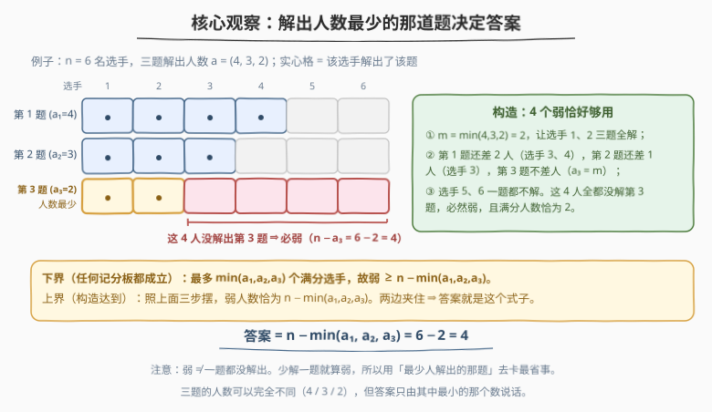
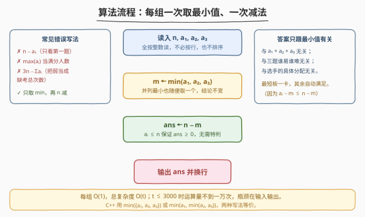
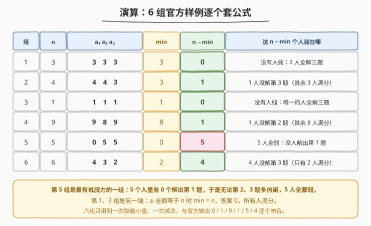

# Codeforces 2266A 好比赛 题解

## 1. 题目概述

- **标题 / 题号**：好比赛（Codeforces 2266A，英文名 Good Contest）
- **链接**：https://codeforces.com/problemset/problem/2266/A
- **来源**：Codeforces Round 1122 (Div. 3) · Problem A
- **难度**：800 分（Div. 3 签到题）
- **限制**：时间 1 s / 内存 256 MB
- **标签**：贪心、构造、计数

**题意**：一场比赛有三道题——第 $1$ 题简单、第 $2$ 题中等、第 $3$ 题困难，参赛者共 $n$ 人。一名选手被称为**弱**（weak），当且仅当他**没有**同时解出全部三道题；换句话说，少解任何一题、乃至一题都没解，都算弱。记分板已经丢失，只剩下一行三个整数 $a_1, a_2, a_3$，其中 $a_i$ 表示**解出第 $i$ 题的人数**。

现在要问：在所有与这条信息**一致**的记分板中（即每题解出人数恰好为 $a_1, a_2, a_3$），**最少**可能有多少名弱选手？输出这个最小值。

多测格式：第一行整数 $t$ 为数据组数；每组两行，第一行是 $n$，第二行是 $a_1, a_2, a_3$；每组输出一行一个整数。

**约束**：

- $1 \le t \le 3000$
- $1 \le n \le 9$
- $0 \le a_i \le n$ —— 不保证 $a_1 \ge a_2 \ge a_3$（题号顺序与人数多少无关），且允许为 $0$
- 每名选手可以解出三题的**任意子集**，包括**一题都不解**；题面没有「每人至少解一题」的限制，也没有「不同题的解出者必须互不相同」的限制
- 答案落在 $[0, n] \subseteq [0, 9]$，所有中间量都在 `int` 范围内，不需要 `long long`

## 2. 示例

官方样例（输入 / 输出原样）：

```text
输入：
6
3
3 3 3
4
4 4 3
1
1 1 1
9
9 8 9
5
0 5 5
6
4 3 2

输出：
0
1
0
1
5
4
```

逐组解释：

| 组 | $n$ | $a_1,a_2,a_3$ | $\min a_i$ | 答案 | 为什么 |
|----|-----|---------------|-----------|------|--------|
| 1 | 3 | 3 3 3 | 3 | 0 | 三题人数都等于 $n$，可以全员满分 |
| 2 | 4 | 4 4 3 | 3 | 1 | 最多 3 人三题全解，剩 1 人必弱 |
| 3 | 1 | 1 1 1 | 1 | 0 | 唯一的选手三题全解 |
| 4 | 9 | 9 8 9 | 8 | 1 | 第 2 题只有 8 人解出，其余 1 人必弱 |
| 5 | 5 | 0 5 5 | 0 | 5 | 没人解出第 1 题，5 人全部弱 |
| 6 | 6 | 4 3 2 | 2 | 4 | 第 3 题仅 2 人解出，其余 4 人必弱 |

自造一组补边界（标注为自造）：

```text
输入：
3
2
0 0 0
9
9 0 9
7
7 7 0

输出：
2
9
7
```

第一组三题都无人解出，2 人全弱；第二组第 2 题无人解出，9 人全弱——哪怕第 1、3 题人人满分；第三组第 3 题无人解出，7 人全弱。

## 3. 解题思路

### 3.1 暴力思路

把记分板看作「每名选手从 $\{1,2,3\}$ 的 $8$ 个子集中选一个」，共 $8^n$ 种。枚举所有记分板，只保留每题解出人数等于 $a_i$ 的那些，统计弱人数取最小，复杂度 $O(8^n)$。

$n = 9$ 时 $8^9 \approx 1.34 \times 10^{8}$，再乘 $t = 3000$ 组，约 $4 \times 10^{11}$ 次操作，1 s 时限下必然超时；即便只跑一组也要几百毫秒。所以必须把枚举收敛成闭式。

一个稍好的中间版本：从大到小枚举「满分人数」$k$，再检查剩余名额 $a_i - k$ 能否由 $n-k$ 名「不能全解」的选手承担（可行当且仅当 $\max_i(a_i-k) \le n-k$ 且 $\sum_i(a_i-k) \le 2(n-k)$，这是二分图 $b$-匹配的 Hall 条件）。它是 $O(n)$ 一组，完全能过，本文的 $O(1)$ 闭式正是它的极限化简。

### 3.2 核心观察：最短板决定弱人数



关键是看出这道题**只跟三个数里的最小值有关**，而且两个方向（下界、上界）都能一眼说清。

**下界**：令 $m = \min(a_1, a_2, a_3)$，取解出人数最少的那道题 $j$（$a_j = m$）。恰有 $m$ 人解出了第 $j$ 题，剩下 $n - m$ 人**都没有**解出它，于是这 $n-m$ 人不可能「三题全解」，必然全部是弱。因此

$$\text{弱人数} \ge n - m$$

这条下界无懈可击：它只用到「解出第 $j$ 题的人只有 $m$ 个」这一个事实。

**上界（可构造）**：反过来，真的能只让 $n-m$ 个人弱。让 $m$ 个人三题全解（这已把每题的 $m$ 个名额用光，且 $m \le a_i$ 保证额度够），剩下 $n - m$ 人每人至少缺第 $j$ 题；对其它两道题 $i \ne j$，还差 $a_i - m$ 个解出名额，而 $a_i \le n$ 保证 $a_i - m \le n - m$，所以这些人手足够分配，且他们反正都缺第 $j$ 题，怎么分配都还是弱。

两个方向一夹，答案就是

$$\text{答案} = n - \min(a_1, a_2, a_3)$$

> 💡 直观说法：把三道题看成三张「已解出名单」，满分选手必须**同时**出现在三张名单上，所以满分人数最多只有最短那张名单那么长——最短板给满分人数封了顶；而让最短名单上的那 $m$ 个人直接满分、其余人随便补，弱人数恰好就停在 $n-m$，说明这个顶确实顶得住。注意 $a_1 + a_2 + a_3$ 的大小、题号的难易顺序，全都与答案无关。

### 3.3 算法流程



1. 读入 $t$；
2. 每组读入 $n$，再读入 $a_1, a_2, a_3$（按整数流读，忽略换行）；
3. 令 $m = \min(a_1, a_2, a_3)$；
4. 输出 $n - m$，换行；
5. 回到第 2 步，直到 $t$ 组读完。

整个算法不保存任何跨组状态：每组只有两次比较、一次减法、一次输出。

### 3.4 示例演算



| 组 | $n$ | $a_1$ | $a_2$ | $a_3$ | $m$ | $n-m$ | 弱的人是谁 |
|----|-----|-------|-------|-------|-----|-------|------------|
| 1 | 3 | 3 | 3 | 3 | 3 | **0** | 无人弱 |
| 2 | 4 | 4 | 4 | 3 | 3 | **1** | 没解第 3 题的那 1 人 |
| 3 | 1 | 1 | 1 | 1 | 1 | **0** | 无人弱 |
| 4 | 9 | 9 | 8 | 9 | 8 | **1** | 没解第 2 题的那 1 人 |
| 5 | 5 | 0 | 5 | 5 | 0 | **5** | 全员（没人解出第 1 题） |
| 6 | 6 | 4 | 3 | 2 | 2 | **4** | 没解第 3 题的那 4 人 |

第 5 组最能说明问题：$a_1 = 0$，即第 1 题无人解出，那么 5 个人一个都不能算满分，哪怕第 2、3 题人人解出也没救。第 2、4、6 组则演示了另一种形态——前两题几乎人人会做，但总有一道题拖后腿，拖后腿的那道题缺多少人，答案就是多少。

## 4. 算法细节

1. **多测无需清空**：每组只重读 $4$ 个整数，没有数组、没有累加器，变量在循环体内定义即可，不存在「上一组残留」的问题。
2. **三数取最小的写法**：C++ 的两参 `std::min` 没有三参重载，`min(a1, a2, a3)` 直接编译失败；正确写法是 `min({a1, a2, a3})`（`<algorithm>` 已足够）或嵌套 `min(a1, min(a2, a3))`。
3. **不要引入题面没有的约束**：题面没说「每名选手至少解出一题」，也没给三道题的解出者集合之间加任何关联（三题**各自独立计数**）。擅自加上「每人至少解一题」会把第 5 组（$n=5$，$a=(0,5,5)$）算成 $0$，直接 WA。
4. **输入按整数流解析**：$n$ 与 $a_1a_2a_3$ 分两行，但用 `cin >>` 或 `read().split()` 天然跳过空白与换行；不要用按行 `getline` 再切分，行尾空格、CRLF 都可能惹麻烦。
5. **不需要排序，也不需要 `long long`**：只取最小值，与顺序无关；$a_i \le 9$，所有中间量在 `int` 内。答案非负由 $m \le a_i \le n$ 直接保证，不必特判。
6. **I/O 细节**：输出用 `'\n'` 而非 `endl`（避免 $t$ 次无谓 flush）；Python 把答案收集进列表后 `"\n".join` 一次写出，比逐行 `print` 快一个数量级。
7. **空输入防护**：C++ 用 `if (!(cin >> t)) return 0;`，Python 用 `if not data: return`，避免个别环境喂空文件时行为异常。

## 5. 正确性证明

**引理 1（满分人数上界）**：在任意与 $a$ 一致的记分板中，三题全解的选手人数不超过 $m = \min(a_1,a_2,a_3)$。

**证明**：设三题全解者构成集合 $F$。对任意 $i \in \{1,2,3\}$，$F$ 中每人都解出了第 $i$ 题，故 $|F| \le a_i$。三式同时成立，取 $i$ 使 $a_i = m$ 得 $|F| \le m$。∎

**引理 2（弱人数下界）**：任意与 $a$ 一致的记分板至少有 $n - m$ 名弱选手。

**证明**：弱人数等于 $n - |F|$（非弱 ⟺ 三题全解）。由引理 1，$|F| \le m$，故弱人数 $\ge n - m$。∎

**引理 3（构造达到下界）**：存在与 $a$ 一致的记分板，弱人数恰为 $n - m$。

**证明**：取 $j$ 使 $a_j = m$，把 $n$ 名选手分为 $P$（$|P| = m$）与 $Q$（$|Q| = n - m$）两组。

- 令 $P$ 中每人都解出三道题。于是第 $j$ 题的 $a_j = m$ 个解出名额**恰被 $P$ 用完**。
- 对每道 $i \ne j$ 的题，还需要 $a_i - m$ 个解出名额。由 $a_i \le n$ 得 $0 \le a_i - m \le n - m = |Q|$，故可在 $Q$ 中挑 $a_i - m$ 个**互不相同**的人解出第 $i$ 题；不同题挑出的子集允许重叠，因为计分是逐题独立的。

逐题核对人数：第 $j$ 题恰 $m = a_j$ 人；第 $i \ne j$ 题恰 $m + (a_i - m) = a_i$ 人。故记分板与 $a$ 一致。再看弱人数：$Q$ 中所有人都不解第 $j$ 题（第 $j$ 题的解出者全在 $P$），因此全是弱，共 $n - m$ 人；$P$ 中 $m$ 人全解三题，不是弱。弱人数恰为 $n-m$。∎

**定理**：最少可能弱人数 $= n - \min(a_1,a_2,a_3)$，且算法输出的正是该值。

**证明**：引理 2 给出任意合法记分板的下界 $n-m$，引理 3 给出达到该下界的记分板，故最小值即 $n-m$，不会更小也不会更大。算法第 3 步取 $m = \min(a_1,a_2,a_3)$、第 4 步输出 $n-m$，与上述结论一致。∎

## 6. 复杂度分析

- **时间**：每组 $O(1)$——两次比较求最小值、一次减法、一次输出，总计 $O(t) \le 3000$ 次常数操作。C++17 实测（$t = 3000$ 满约束、含进程启动）约 $11$ ms，Python3 约 $26$ ms，相对 $1$ s 时限有两个数量级余量。
- **空间**：$O(1)$ 额外空间，只需常数个整型变量（$n, a_1, a_2, a_3, m$）。Python 版一次性读入全部输入，缓冲区约 $4t$ 个短 token，几十 KB 量级。
- **对照时限**：本题真正的开销是 I/O 而非计算。即使把 $t$ 放大到 $10^6$，$O(t)$ 的读入输出也只需数百毫秒，仍远在 1 s 之内。

## 7. 参考代码

### C++17

```cpp
#include <bits/stdc++.h>
using namespace std;

int main() {
    ios::sync_with_stdio(false);
    cin.tie(nullptr);

    int t;
    if (!(cin >> t)) return 0;              // 空输入防护
    while (t--) {
        int n, a1, a2, a3;
        cin >> n >> a1 >> a2 >> a3;         // 按整数流读，换行无关
        int m = min({a1, a2, a3});          // 三数取最小（两参 min 无三参重载）
        cout << n - m << '\n';              // 最短板之外的人全都弱
    }
    return 0;
}
```

### Python3

```python
import sys


def main() -> None:
    data = sys.stdin.buffer.read().split()
    if not data:
        return
    t = int(data[0])
    pos = 1
    out = []
    for _ in range(t):
        n = int(data[pos])
        a1 = int(data[pos + 1])
        a2 = int(data[pos + 2])
        a3 = int(data[pos + 3])
        pos += 4
        out.append(str(n - min(a1, a2, a3)))
    sys.stdout.write("\n".join(out) + "\n")


main()
```

## 8. 边界情况与易错点

1. **某个 $a_i = 0$**：该题无人解出 ⇒ 全员必弱，答案为 $n$（样例第 5 组）。别因为「另外两题人数满」就输出 $0$。
2. **$n = 1$**：$(0,0,0) \to 1$，$(1,1,1) \to 0$，$(1,0,1) \to 1$。$n = 1$ 时没有「别人」可以分担，公式 $n - \min$ 依然成立，不需要特判。
3. **答案为 $0$ 的充要条件**：$n - m = 0 \iff m = n \iff a_1 = a_2 = a_3 = n$。若写成了「任意两题满员就算 $0$」，会在 $(n, n, n-1)$ 上错。
4. **最小值并列**：如 $a=(9,9,3)$ 答案 $6$，$a=(2,2,2)$（$n=2$）答案 $0$。并列时任选一个最小的 $j$ 构造都可以，证明里已按「任取」处理。
5. **把「弱」误解成「一题都没解出」**：弱是「没解出**全部**三题」，只错一题也算弱。按误解写会得到远小于正确答案的值。
6. **误加「每人至少解一题」**：会让 $a=(0,n,n)$ 这类数据得到 $0$ 而不是 $n$。
7. **`min(a1, a2, a3)` 编译失败**：C++ 必须写 `min({a1, a2, a3})` 或 `min(a1, min(a2, a3))`；这也是本地编译报错的常见原因。
8. **多测输出格式**：每组恰好一行，组间不加空行；读入顺序是「先 $n$、再三个 $a_i$」，`while (t--)` 与 `pos += 4` 必须严格对齐，否则整体错位。
9. **空输入**：个别评测环境会给空文件，C++ 用 `if (!(cin >> t)) return 0;`、Python 用 `if not data: return` 兜底。

## 相关题目与扩展

- [Codeforces 2266B Three Piles](https://codeforces.com/problemset/problem/2266/B)：同场 B 题，同样是「先找不变量、再卡边界」的 Div. 3 签到套路，可以连着做。
- [Codeforces 1335A Candies and Two Sisters](https://codeforces.com/problemset/problem/1335/A)：典型的「先推闭式、再用构造验证可达」的计数签到题，论证结构与本题同构。
- [Codeforces 1760A Medium Number](https://codeforces.com/problemset/problem/1760/A)：三数比较题，可对照 `min`/`max` 的三参写法与本题第 4 节第 2 条。
- [LeetCode 561. 数组拆分](https://leetcode.cn/problems/array-partition/)：排序后两两配对取较小值，同样是「用最短板 / 最小值决定答案」的贪心结构。

**延伸思考**：

1. **推广到 $k$ 道题**：答案仍然是 $n - \min_i a_i$，与题数无关。下界同样取人数最少的题 $j$（$n - a_j$ 人必弱）；构造时让 $a_j$ 个满分选手包圆，其余每道题各补 $a_i - a_j \le n - a_j$ 人即可，而这些人都缺第 $j$ 题，仍然弱。
2. **换一个「弱」的定义**：若弱 = 「一题都没解出」，要最大化「至少解出一题」的人数，则答案为 $\min(n,\ a_1 + a_2 + a_3)$——每个解出名额都能安排给不同的人，最多覆盖 $n$ 人。这与本题的「最短板」逻辑恰好相反，值得对比。
3. **加上可解性约束**：若题目再要求某些题的解出者集合必须包含另一批人（嵌套关系），闭式不再成立，需要退回到「枚举满分人数 $k$ + Hall 条件判定」的 $O(n)$ 做法；引理 3 的构造正是 Hall 条件在 $a_i - m \le n - m$ 时的特例。
4. **反问题**：若已知最少弱人数为 $w$，那么三个数必须且只需满足 $\min(a_1,a_2,a_3) = n - w$（即每个 $a_i \ge n-w$，且至少一个恰等于 $n-w$）。这说明在「只给人数」的题目里，全部信息量都压在最小值上，另外两个数在 $[n-w, n]$ 内怎么取都不影响答案。
