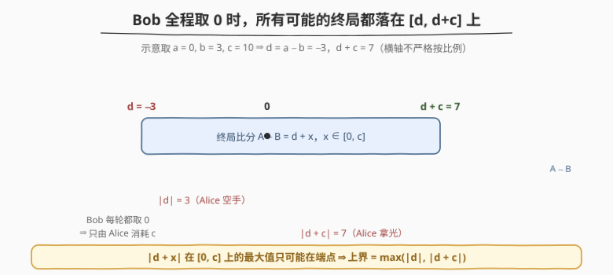
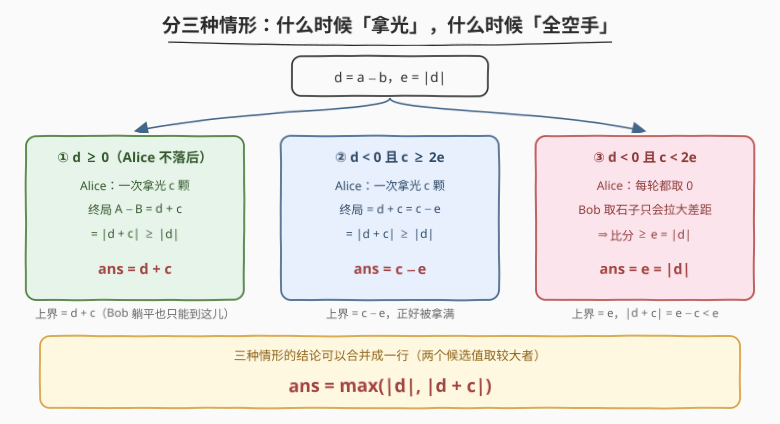
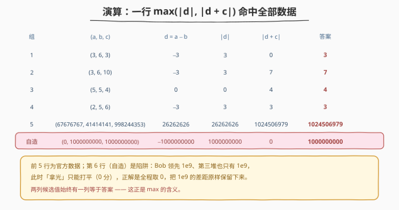

# Codeforces 2266B 三堆石子 题解

## 1. 题目概述

- **标题 / 题号**：三堆石子（Codeforces 2266B，英文名 Three Piles）
- **链接**：https://codeforces.com/problemset/problem/2266/B
- **来源**：Codeforces Round 1122 (Div. 3) · Problem B
- **难度**：$\ast 800$
- **限制**：时间 1 s / 内存 256 MB
- **标签**：博弈，贪心，数学

**题意**：Alice 手上有 $a$ 颗石子，Bob 手上有 $b$ 颗，第三堆有 $c$ 颗。两人轮流行动、Alice 先手；轮到的人可以从第三堆取走**任意多颗（允许取 0 颗）**并加到自己手上。**若连续两手都取 0 颗，游戏立即结束**。设终局两人石子数为 $A,B$，得分为 $|A-B|$：Alice 想让得分尽量大，Bob 想让得分尽量小，双方都最优，求最终得分。多测：第一行 $t$，每组给出 $a,b,c$，逐组输出一个整数。

**约束**：

- $1 \le t \le 10^4$，多测读入；
- $0 \le a,b,c \le 10^9$，所以 $|a-b|$ 与 $|a-b+c|$ 都能到 $2\times 10^9$ 量级，**必须用 64 位整型**（题面也专门提醒了）；
- 单组必须 $O(1)$：$c$ 可达 $10^9$，任何按「每手取多少」展开的搜索都不可能通过。

## 2. 示例

**官方样例（5 组）**

```text
输入
5
3 6 3
3 6 10
5 5 4
2 5 6
67676767 41414141 998244353

输出
3
7
4
3
1024506979
```

题面 Notes 解释了两组：第 1 组 Alice 取 0、Bob 也取 0，游戏立刻结束，得分 $|3-6| = 3$；第 2 组 Alice 一次拿走 10 颗，得分 $|13-6| = 7$。其余三组用本文公式可以直接验证（见 §3.4）。

## 3. 解题思路

### 3.1 暴力思路

把局面记成四元组 $(\text{剩余 } r,\ A-B,\ \text{轮到谁},\ \text{上一手是否取 0})$，对「本轮取几颗」做极小化极大搜索：Alice 的局面取 $\max$、Bob 的局面取 $\min$，若上一手取 0 而本轮也取 0 就以 $|A-B|$ 结算。状态数约 $O(c^2)$、每个状态 $O(c)$ 个转移，$c \le 10^9$ 时完全不可行；它只在验证阶段用来对拍小数据（§8 的测试脚本就是这么做的）。

需要说明的是这个博弈**一定会结束**：每次「取正数」都让第三堆严格减少，而第三堆归零后双方只能取 0，两手之后立即结算，所以极小化极大是有良好定义的。

### 3.2 核心观察：Bob 的「全程取 0」把结局压到一条线段上



记 Alice 的净领先
$$d = a - b$$
Bob 有一个几乎不用动脑的策略：**每一手都取 0**。这样第三堆只会被 Alice 消耗，而「连续两手取 0」的条件必然在 Alice 第一次取 0 时达成（Bob 上一手正是 0），游戏立即结束。设 Alice 前后共取走 $x \in [0,c]$ 颗，则终局
$$A - B = (a + x) - b = d + x$$
于是 Bob 躺平时得分恰好是 $|d + x|$。函数 $f(x) = |d+x|$ 是两条仿射函数的绝对值的上包络，在 $[0,c]$ 上是**凸函数**，凸函数在闭区间上的最大值只能落在端点：

$$f(x) \le \max\bigl(f(0),\, f(c)\bigr) = \max\bigl(|d|,\, |d + c|\bigr)$$

所以 Bob 能保证得分**不超过** $\max(|d|, |d+c|)$——这就是答案的上界。剩下的事只有一件：Alice 能不能把这个上界顶到。

### 3.3 算法流程：Alice 的两个极端策略与三段分类



Alice 只需要在「拿光」和「全空手」两个极端里挑一个。按 $d$ 的符号分类：

1. **$d \ge 0$（Alice 不落后）**：第一手直接拿走全部 $c$ 颗。此后第三堆为 0，双方只能取 0，两轮后结算，终局 $A-B = d + c$。因为 $d \ge 0$，有 $d + c = |d+c| \ge |d|$，正好达到上界。
2. **$d < 0$，记 $e = |d| = b-a$，且 $c \ge 2e$**：同样一次拿光。终局 $A - B = d + c = c - e \ge e = |d|$，所以 $|A-B| = |d+c|$，又是上界。
3. **$d < 0$ 且 $c < 2e$**：此时拿光只能得到 $|c-e| < e$，**越拿越亏**；Alice 改为每一手都取 0。Bob 想把差距抹平只能给自己加石子，可每加一颗都让 $A-B = d - x_B$ 更负、绝对值更大；一旦 Bob 也取 0（Alice 上一手就是 0），游戏立刻结束，比分停在 $e + x_B \ge e = |d|$。而上界 $\max(e, |c-e|) = e$（因为 $c < 2e$），两边吻合。

三种情形给出同一个式子，这就是整个算法：

$$\text{ans} = \max\bigl(|d|,\ |d + c|\bigr) = \max\bigl(|a-b|,\ |a-b+c|\bigr)$$

**直觉**：这 $c$ 颗石子能不能被 Alice 用来扩大差距，取决于她是领先还是落后、以及落后多少。领先时她是进攻方，全部拿来贴在自己身上；落后太多（$c < 2e$）时她成了守方，**一动不如一静**，把差距原样冻结反而最划算。这也解释了为什么一个题面看起来像博弈搜索的东西，答案是这么短的一行。

### 3.4 示例演算



| 组 | $(a,b,c)$ | $d = a-b$ | $\lvert d\rvert$ | $\lvert d+c\rvert$ | 答案 | Alice 的策略 |
|---|---|---|---|---|---|---|
| 1 | $(3,6,3)$ | $-3$ | 3 | 0 | **3** | 全空手（拿光只有 0） |
| 2 | $(3,6,10)$ | $-3$ | 3 | 7 | **7** | 拿光 |
| 3 | $(5,5,4)$ | $0$ | 0 | 4 | **4** | 拿光 |
| 4 | $(2,5,6)$ | $-3$ | 3 | 3 | **3** | 两种都行（$c = 2e$） |
| 5 | $(67676767,41414141,998244353)$ | $26262626$ | $26262626$ | $1024506979$ | **$1024506979$** | 拿光 |
| 自造 | $(0,10^9,10^9)$ | $-10^9$ | $10^9$ | 0 | **$10^9$** | 全空手 |

第 1 组和自造那组是同一类陷阱：**拿光恰好把差距抹平**，必须走全空手；第 4 组是分界点 $c = 2e$，两种策略并列最优，两个候选值相等。

## 4. 算法细节

1. **一行公式，不要写三分支**：$\max(|d|, |d+c|)$ 已经覆盖 §3.3 的全部情形；手写 `if (d >= 0) ... else if (c >= 2*abs(d)) ...` 极易在 $c = 2e$ 的等号上翻车。
2. **64 位整型**：$d + c$ 上界约 $2\times 10^9$，虽然勉强小于 `INT_MAX`，但题面明确要求 64 位，`long long` 没有额外成本。C++ 中对 `long long` 取绝对值用 `llabs` 或 `std::abs(long long)`，不要对 `unsigned` 用 `abs`。
3. **多测无状态**：每组只依赖自己的 $a,b,c$，没有需要清空的全局数组或记忆化表；唯一要保证的是每组输出正好一行。
4. **I/O 加速**：$t \le 10^4$，`ios::sync_with_stdio(false)` + `cin.tie(nullptr)` 足够；输出用 `'\n'` 而不是 `endl`。
5. **空输入防御**：读不到 $t$ 时直接 `return 0`，避免本地管道测试时读到未初始化值。
6. **Python 侧**：一次性 `sys.stdin.buffer.read().split()` 比 $t$ 次 `input()` 快一个量级；Python 整数任意精度，不存在溢出问题。
7. **不要真去模拟**：$c$ 到 $10^9$，任何逐手枚举都会超时；本题正解是纯代数化简，$O(1)$ 出答案。

## 5. 正确性证明

**引理 1（终局形式）**：设 Alice、Bob 从第三堆分别取走 $x_A, x_B$ 颗，则 $x_A + x_B \le c$，且终局得分为 $|d + x_A - x_B|$，其中 $d = a-b$。

**证明**：每颗被取走的石子都进了取走者自己的堆，故 $A = a + x_A$、$B = b + x_B$，相减得 $A - B = (a-b) + x_A - x_B = d + x_A - x_B$；第三堆剩余 $c - x_A - x_B \ge 0$。∎

**引理 2（上界）**：Bob 存在策略，使终局得分不超过 $\max(|d|, |d+c|)$，与 Alice 如何行动无关。

**证明**：取「Bob 每手都取 0」这一策略，则 $x_B = 0$，由引理 1 终局得分为 $|d + x_A|$，$x_A \in [0,c]$。函数 $f(x) = |d+x|$ 是凸函数，凸函数在闭区间上的最大值必在端点取得，故 $|d + x_A| \le \max\bigl(f(0), f(c)\bigr) = \max(|d|, |d+c|)$。∎

**引理 3（下界）**：Alice 存在策略，使终局得分不低于 $\max(|d|, |d+c|)$，与 Bob 如何行动无关。

**证明**：记 $e = |d|$，分三种情形。

- 若 $d \ge 0$：Alice 第一手取走全部 $c$ 颗。此后第三堆为 0，双方只能取 0，两手后游戏结束，终局 $A-B = d + c$；由 $d \ge 0$ 得 $|d+c| = d+c \ge |d|$，得分恰为 $\max(|d|,|d+c|)$。
- 若 $d < 0$ 且 $c \ge 2e$：同样一次拿光，终局 $A - B = d + c = c - e \ge 0$，得分为 $c - e = |d+c| \ge e = |d|$，同样是最大值。
- 若 $d < 0$ 且 $c < 2e$：Alice 每一手都取 0。她取 0 不改变任何一方的石子数；Bob 若取正数，由引理 1 终局得分为 $|d - x_B| = e + x_B \ge e$；Bob 若取 0，由于上一手也是 0，游戏立即结束，此时得分仍为 $e + x_B \ge e$。而 $c < 2e$ 保证 $|d+c| = |c-e| < e$，故 $\max(|d|,|d+c|) = e$，得分不低于它。∎

**定理**：双方最优时，终局得分等于 $\max(|a-b|, |a-b+c|)$。

**证明**：由引理 2，Bob 能把得分压到不超过该值；由引理 3，Alice 能把它顶到不低于该值。双方都按最优策略行动时取值被上下界夹住，故恰等于该值。∎

## 6. 复杂度分析

- **时间**：每组 $O(1)$——一次减法、一次加法、两次取绝对值、一次比较；总计 $O(t) \le 10^4$ 次基本运算。实测（含进程启动）约 $50$ ms，对 $1$ s 时限有 $20$ 倍以上余量。
- **空间**：$O(1)$，只有几个 64 位整数。Python 版把答案攒进 list 一次性输出，额外 $O(t)$ 的字符串空间，同样可忽略。
- **输入输出规模**：$t$ 组共 $3t$ 个整数，读入量在 $O(t)$，不构成瓶颈。

## 7. 参考代码

### C++17

```cpp
#include <iostream>
#include <algorithm>
#include <cstdlib>
using namespace std;

int main() {
    ios::sync_with_stdio(false);
    cin.tie(nullptr);

    int t;
    if (!(cin >> t)) return 0;
    while (t--) {
        long long a, b, c;
        cin >> a >> b >> c;
        long long d = a - b;                          // Alice 的净领先，可负
        long long ans = max(llabs(d), llabs(d + c));  // max(|d|, |d + c|)
        cout << ans << '\n';
    }
    return 0;
}
```

### Python3

```python
import sys


def main() -> None:
    data = sys.stdin.buffer.read().split()
    if not data:
        return
    t = int(data[0])
    pos = 1
    out = []
    for _ in range(t):
        a = int(data[pos]); b = int(data[pos + 1]); c = int(data[pos + 2])
        pos += 3
        d = a - b
        out.append(str(max(abs(d), abs(d + c))))
    sys.stdout.write("\n".join(out) + "\n")


main()
```

## 8. 边界情况与易错点

1. **$c = 0$**：两人都没得取，Alice 取 0、Bob 取 0，游戏立刻结束，答案 $= |a-b|$。公式里 $|d+0| = |d|$，无需特判。
2. **$a = b$**：$d = 0$，答案 $= c$。此时「全空手」得 0 分，必须走「拿光」，例如 $(5,5,4) \to 4$。
3. **$d < 0$ 且 $c$ 与 $|d|$ 同量级**：如 $(0,10^9,10^9)$，拿光只能打平（0 分），正解是全程取 0 拿到 $10^9$。这是本题最容易 WA 的地方——**不能只考虑「Alice 拿光」**。
4. **分界点 $c = 2|d|$**：如 $(2,5,6)$，两种策略同分（都是 3）。统一用 $\max(|d|, |d+c|)$ 就完全不必纠结等号方向。
5. **溢出与整型**：$|d+c|$ 可达 $2\times 10^9$，用 `long long`；`abs(a-b)` 在 $a,b$ 为 `long long` 时走的是 `long long` 重载，别写成 `abs((int)(a-b))`。
6. **负数不能先取绝对值再相减**：$|a| - |b|$ 在 $a=0, b=10^9$ 时给出 $-10^9$；必须先算 $d = a-b$ 再取绝对值。
7. **多测输出格式**：$t$ 组各占一行，漏写换行会让所有答案挤成一行而被判 WA。
8. **验证方式**：可以写一份 §3.1 的极小化极大暴力，在 $a,b,c \le 6$ 上做全枚举对拍（343 组）+ 随机对拍；本解已通过穷举 $a,b,c\in[0,6]$ 全量、829 组随机/固定 $D$ 扫描与 13 组极值数据，C++ 与 Python 输出完全一致。

## 相关题目与扩展

- [Codeforces 2266A. Good Contest](https://codeforces.com/problemset/problem/2266/A)：同场签到题，适合热身。
- [Codeforces 1382B. Sequential Nim](https://codeforces.com/problemset/problem/1382/B)：同样「轮流从堆里取」的取石子博弈，结论化到前缀结构上判断。
- [LeetCode 877. 石子游戏](https://leetcode.cn/problems/stone-game/)：两人从一排石堆两端取，标准区间 DP，可作为极小化极大建模的入门练习。
- [LeetCode 1140. 石子游戏 II](https://leetcode.cn/problems/stone-game-ii/)：每轮可取的数量取决于上一轮，是「状态里多带一个参数」的典型。

**延伸思考**：

1. **换先手**：若改成 Bob 先手，结论**不再是**对称的 $\max(|d|,|d-c|)$。用 §3.1 的搜索可以验证：$a=0,b=14,c=1$ 时真实值为 $14$，而不对称公式给出 $15$——因为「谁先取 0」的角色互换了，Alice 的两个极端策略不再同时可用。
2. **限量取**：若改成「每轮最多取 $k$ 颗」，Bob 的躺平上界 $\max(|d|,|d+c|)$ 依然成立，但 Alice 不再总能一次拿光，答案会变小，需要重新分析 $k$ 与 $c$、$|d|$ 的大小关系。
3. **改结束条件**：若把「连续两手取 0」改成「连续 $m$ 手取 0」，答案仍是 $\max(|d|,|d+c|)$（对 $m = 2,3,4$ 已用暴力验证）：躺平策略让 $x_B = 0$ 的上界不变，而 Alice 的两个端点策略也不受 $m$ 影响，结论原样成立。
