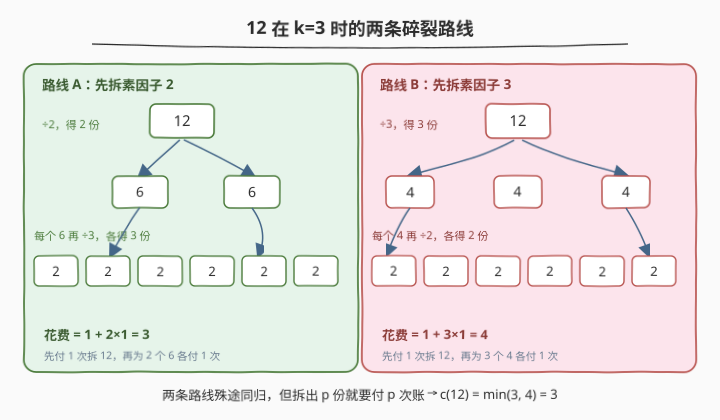
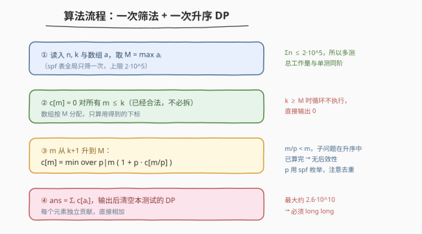

# Codeforces 2266E 质数拆解 题解

## 1. 题目概述

- **标题 / 题号**：质数拆解（Codeforces 2266E，英文名 Prime Destruction）
- **链接**：https://codeforces.com/problemset/problem/2266/E
- **来源**：Codeforces Round 1122 (Div. 3) · Problem E
- **难度**：$\ast 1400$
- **限制**：时间 2 s / 内存 256 MB
- **标签**：暴力枚举，动态规划，数学，数论

**题意**：给定 $n$ 个正整数组成的可重集 $a$ 与整数 $k$。允许执行任意多次如下操作：选出一份 $x > 1$，再选它的一个**素因子** $p$，删掉这一份 $x$、加入 $p$ 份 $x/p$。记 $f(k)$ 为让可重集中每个数都 $\le k$ 所需的最少操作数，求 $f(k)$。多测：第一行 $t$，每组给出 $n,k$ 与数组 $a$，逐组输出一个整数。

**约束**：

- $1 \le t \le 10^4$，$\sum n \le 2\times 10^5$，多测读入；
- $1 \le k \le n \le 2\times 10^5$，$1 \le a_i \le n$；
- 答案可达 $2.6\times 10^{10}$ 量级（$k=1$、所有 $a_i = 2^{17}$ 时 $2\times 10^5 \times 131071$），必须用 64 位整型。

## 2. 示例

**官方样例（6 组）**

```text
输入
6
1 1
1
6 2
6 6 4 3 2 1
8 1
8 6 4 3 2 1 8 6
12 3
12 10 9 8 7 6 5 4 3 2 1 12
10 9
10 9 8 7 6 5 4 3 2 1
5 5
5 4 3 2 1

输出
0
4
25
15
1
0
```

题面 Notes 展开的是第 2 组：两个 $6$ 各自用 $p=3$ 一次拆成三个 $2$（各 1 次），$4$ 用 $p=2$ 拆成两个 $2$（1 次），$3$ 用 $p=3$ 拆成三个 $1$（1 次），合计 4 次。注意这里**没有**先把 $6$ 拆成两个 $3$——那样两个 $3$ 还得再各拆一次，反而更贵，正是本文的核心观察。

## 3. 解题思路

### 3.1 暴力思路

把状态记成「排序后的多重集」做 BFS / 记忆化搜索：每次枚举一份 $x>k$ 与它的素因子 $p$，把状态换成「删一份 $x$、加 $p$ 份 $x/p$」。每次操作让元素个数净增 $p-1 \ge 1$，而总和 $\sum a_i$ 不变，所以状态图无环、搜索一定终止，小数据上能得到精确最优解。但规模一大就爆：终态最多是 $S = \sum a_i$ 个 $1$，$S$ 可达 $4\times 10^{10}$；即使只看 $n \le 10$、$a_i \le 30$ 的例子，中间状态数也已不可枚举。必须找结构。

### 3.2 核心观察：元素之间互不影响 → 单元素代价递推



**观察一：一次操作只碰一份元素。** 它把这一份 $x$ 换成 $p$ 份 $x/p$，其余元素分毫不动；新产生的 $p$ 份在之后每次操作里也是各自被独立处理的。于是「某个元素被怎么拆」与其他元素无关，总代价可加：

$$f(k) = \sum_{i=1}^{n} c(a_i)$$

其中 $c(m)$ 表示把**一份** $m$ 处理到全部 $\le k$ 的最少操作数。

**观察二：首步枚举素因子。** 对一份 $m>k$，第一步必须选它的某个素因子 $p$，代价 1，换来 $p$ 份 $m/p$。这 $p$ 份数值相同、彼此独立，所以

$$c(m) = \min_{p \mid m,\ p\ \text{为素数}} \Bigl(1 + p \cdot c(m/p)\Bigr), \qquad c(m)=0 \text{ 当 } m \le k$$

关键在系数是 $p$ 而不是 $1$：**拆出几份，就要为几条支路分别付账**。以 $k=3$、$m=12$ 为例：先拆 $p=2$ 得 $6,6$，两个 $6$ 各再用 $p=3$ 拆成 $2,2,2$，代价 $1+2\times 1 = 3$；先拆 $p=3$ 得 $4,4,4$，三个 $4$ 各再用 $p=2$ 拆，代价 $1+3\times 1 = 4$。同样都到达「六个 $2$」，先拆 $2$ 少花一次——份数越多，后续账单越长。

由于 $p \ge 2$ 时 $m/p \le m/2 < m$，递推只依赖更小的值，按 $m$ 升序 DP 一遍即可，且 $m$ 只需算到 $\max a_i \le 2\times 10^5$。

### 3.3 算法流程



1. **全局预处理**：埃氏筛求出每个数的最小素因子 $\text{spf}[1..2\times10^5]$，只做一次。
2. **每个测试**：读入 $a$，令 $M=\max a_i$；开数组 $c[0..M]$，初值 0（$m \le k$ 的 $c$ 本来就是 0）。
3. **升序 DP**：$m$ 从 $k+1$ 到 $M$，用 $\text{spf}$ 分解出 $m$ 的**不同**素因子 $p$，取 $\min\bigl(1 + p \cdot c[m/p]\bigr)$。
4. **汇总**：$\text{ans} = \sum_i c[a_i]$ 输出；$c$ 数组随测试重建。

### 3.4 示例演算

![样例 3、4 的 c[m] 表与求和](../../../images/cf2266e_walkthrough.svg)

**样例 3**（$k=1$，$a = 8,6,4,3,2,1,8,6$）：$c(4)=1+2c(2)=3$、$c(6)=\min(1+2c(3),\,1+3c(2))=\min(3,4)=3$、$c(8)=1+2c(4)=7$，按 $a$ 取用得 $7+3+3+1+1+0+7+3 = 25$，与样例一致。

**样例 4**（$k=3$，$a = 12,10,9,8,7,6,5,4,3,2,1,12$）：

| $m$ | 1 | 2 | 3 | 4 | 5 | 6 | 7 | 8 | 9 | 10 | 11 | 12 |
|---|---|---|---|---|---|---|---|---|---|---|---|---|
| $c(m)$ | 0 | 0 | 0 | 1 | 1 | 1 | 1 | 3 | 1 | 1 | 1 | 3 |

$c(8)=1+2c(4)=3$ 是唯一「要拆两层」的值；$c(12)=\min(1+2c(6),\,1+3c(4))=\min(3,4)=3$。求和：$3+1+1+3+1+1+1+1+0+0+0+3 = 15$，与样例一致。

## 4. 算法细节

1. **多测清空**：$c$ 数组每组按本组的 $M$ 重建（`vector<long long> c(M+1, 0)`），不要沿用上一组的值——$k$ 变了之后旧值毫无意义；而 $\text{spf}$ 与测试无关，全局只筛一次。
2. **DP 上界取 $M=\max a_i$ 而非 $n$**：$M \le n$，且 $\sum M \le \sum n = 2\times10^5$，因此所有测试的 DP 总量与单组同阶，不会因为多测爆掉。
3. **64 位整型**：$p \cdot c[m/p]$ 最大约 $2\times10^5 \times 1.3\times10^5 \approx 2.6\times10^{10}$，32 位有符号整型直接溢出；答案 $\sum c[a_i]$ 同样要 `long long`。
4. **素因子去重**：用 `while (x % p == 0) x /= p;` 只保留不同素因子；重复枚举同一个 $p$ 不改变最小值，但会让这一项的枚举次数膨胀到 $O(\log m)$ 倍。
5. **初值用 INF 更稳**：虽然每个 $m>k$ 必有素因子、循环必进，但用 `INF` 初始化再取 min，可以避免把「尚未计算」误当成 0。
6. **I/O**：$t$ 可达 $10^4$，C++ 用 `scanf/printf` 或关闭同步的 `cin/cout`；Python 用 `sys.stdin.buffer.read().split()` 一次性读入，避免逐行 `input()`。

## 5. 正确性证明

**引理 1（首步分解）**：若 $m > k$，任何把一份 $m$ 处理完的方案的第一步必为「取某素因子 $p \mid m$，把 $m$ 换成 $p$ 份 $m/p$」；操作之后这 $p$ 份互不影响。

**证明**：$m>k$ 时必须被拆，而针对它的合法操作恰是枚举素因子 $p$ 并替换为 $p$ 份 $m/p$。替换后 $m$ 消失，后续每次操作只作用于其中某一份、改动的只有那一份，其他份不受影响，故互相独立。∎

**引理 2（下界）**：$m>k$ 时 $c(m) \ge \min_{p\mid m}\bigl(1+p\cdot c(m/p)\bigr)$。

**证明**：设最优方案首步选 $p$。此后它对 $p$ 份 $m/p$ 各做了一串操作；把「只作用于第 $j$ 份及其后代」的操作按原顺序抽出，就是一份把 $m/p$ 处理完的合法方案，长度 $\ge c(m/p)$。$p$ 份合计至少 $p\cdot c(m/p)$ 次，再加首步得 $\ge 1+p\cdot c(m/p)$，对首步可选的 $p$ 取 min 即得下界。∎

**引理 3（上界）**：$m>k$ 时 $c(m) \le \min_{p\mid m}\bigl(1+p\cdot c(m/p)\bigr)$。

**证明**：取达到 min 的 $p$ 执行首步，再对这 $p$ 份 $m/p$ 各自独立执行其最优方案，总操作数恰为 $1+p\cdot c(m/p)$，结束时所有叶子都 $\le k$，是合法方案。∎

**定理 1**：对一切 $m \ge 1$，递推式给出的值就是 $c(m)$（$m \le k$ 时取 0）。

**证明**：对 $m$ 强归纳。$m \le k$ 显然。$m>k$ 时设所有 $m' < m$ 已正确；首步必有 $p \ge 2$，故 $m/p \le m/2 < m$，归纳假设保证 $c(m/p)$ 已是真值，于是引理 2、3 夹逼得等号。∎

**引理 4（可加性）**：处理整个可重集的最少操作数为 $\sum_i c(a_i)$。

**证明**：上界——对每个初始元素独立执行其最优方案（方案只依赖数值，多份同值照抄即可）。下界——任取全局最优方案，按祖先关系把每条操作归给某个初始元素（新产生的份继承被拆那一份的祖先），于是 $n$ 条链互不相交、覆盖全部操作；第 $i$ 条链是处理 $a_i$ 的合法方案，长度 $\ge c(a_i)$，求和即得下界。∎

**定理 2**：DP 输出的 $\sum_i c[a_i]$ 等于 $f(k)$。

**证明**：由定理 1，表中 $c[a_i]$ 是真值；由引理 4，求和即为最小操作数，与题面定义一致。∎

## 6. 复杂度分析

- **时间**：筛 $\text{spf}$ 为 $O(L\log\log L)$（$L=2\times10^5$，只做一次）；每组 DP 对每个 $m$ 用 $\text{spf}$ 分解，$O(\log m)$ 且常数极小，合计 $O(M\log M)$，而 $\sum M \le \sum n \le 2\times10^5$，故所有测试总计约 $O\bigl((\sum n)\log n\bigr)\approx 4\times10^6$ 次基本运算。实测最坏数据（$n=2\times10^5$、$k=1$、全部 $a_i=2^{17}$）C++ 仅约 18 ms、Python 约 0.2 s，相对 2 s 时限都有充足余量。
- **空间**：$\text{spf}$ 表 $O(L)$（0.8 MB）、$c$ 数组 $O(M)$（1.6 MB）、数组 $a$ 为 $O(n)$（0.8 MB），总计 $O(\max n)$、约 3 MB，远低于 256 MB。
- **答案量级**：操作使元素个数增加 $p-1$、总和不变，故一份 $m$ 在 $k=1$ 时最多用 $m-1$ 次操作变成 $m$ 个 $1$，即 $f(k) \le \sum(a_i-1) \le 4\times10^{10}$——这也是必须开 64 位的原因。

## 7. 参考代码

### C++17

```cpp
#include <bits/stdc++.h>
using namespace std;

static const int LIM = 200000;
static int spf[LIM + 1];

int main() {
    // ---- 最小素因子筛（a_i <= n <= 2e5，全局只做一次）----
    for (int i = 1; i <= LIM; ++i) spf[i] = i;
    for (int i = 2; (long long)i * i <= LIM; ++i)
        if (spf[i] == i)
            for (long long j = (long long)i * i; j <= LIM; j += i)
                if (spf[j] == j) spf[j] = i;

    int t;
    if (scanf("%d", &t) != 1) return 0;
    while (t--) {
        int n, k;
        scanf("%d %d", &n, &k);
        vector<int> a(n);
        int mx = 0;
        for (int i = 0; i < n; ++i) {
            scanf("%d", &a[i]);
            if (a[i] > mx) mx = a[i];
        }
        // c[m] = 把一份 m 拆到「每份 <= k」的最少操作数
        vector<long long> c(mx + 1, 0);
        for (int m = k + 1; m <= mx; ++m) {
            long long best = LLONG_MAX;
            int x = m;
            while (x > 1) {
                int p = spf[x];
                while (x % p == 0) x /= p;      // 只保留不同素因子
                long long cand = 1 + (long long)p * c[m / p];
                if (cand < best) best = cand;
            }
            c[m] = best;
        }
        long long ans = 0;
        for (int i = 0; i < n; ++i) ans += c[a[i]];
        printf("%lld\n", ans);
    }
    return 0;
}
```

### Python3

```python
import sys


def main():
    data = sys.stdin.buffer.read().split()
    if not data:
        return
    pos = 0
    t = int(data[pos]); pos += 1
    out = []
    for _ in range(t):
        n = int(data[pos]); k = int(data[pos + 1]); pos += 2
        a = [int(v) for v in data[pos:pos + n]]; pos += n
        mx = max(a)

        # 本组的最小素因子表（只需筛到 mx，所有测试合计 O(sum n)）
        spf = list(range(mx + 1))
        i = 2
        while i * i <= mx:
            if spf[i] == i:
                for j in range(i * i, mx + 1, i):
                    if spf[j] == j:
                        spf[j] = i
            i += 1

        c = [0] * (mx + 1)
        for m in range(k + 1, mx + 1):
            best = None
            x = m
            while x > 1:
                p = spf[x]
                while x % p == 0:
                    x //= p
                cand = 1 + p * c[m // p]
                if best is None or cand < best:
                    best = cand
            c[m] = best if best is not None else 0

        ans = 0
        for v in a:
            ans += c[v]
        out.append(str(ans))
    sys.stdout.write("\n".join(out) + "\n")


main()
```

## 8. 边界情况与易错点

1. **$k \ge \max a$**：循环一次都不执行，答案是 0（样例 1、6 就是这种），别漏掉这个「已经合法」的出口。
2. **$n=1$**：没有可选操作；由于 $k \le n = 1$ 且 $a_1 \le n$，必有 $a_1 = 1 \le k$，答案恒为 0。
3. **32 位溢出**：$k=1$、$a_i=2^{17}$ 时单元素代价 $131071$，$n = 2\times 10^5$ 时答案 $2.6\times10^{10}$；`int` 会悄悄溢出，必须 `long long`（Python 无此问题）。
4. **素因子被重复枚举**：$8$ 的素因子只有 $2$，若把 $2$ 数成三个，递推结果不变但常数变成三倍，极端数据下白白变慢。
5. **下标与 $c[1]$**：$m/p$ 最小为 1；若把语义偏移一格（用 $c[m-1]$ 存 $c(m)$），$m/p=1$ 时会取到 $c[0]$，边界极易写错。建议直接令「下标 = 数值」，数组开 `mx + 1`。
6. **忘记按组清空 $c$**：$k$ 变大后旧值本应更小，复用会得到偏大的错误答案，而且这种 bug 在单组测试里完全看不出来。
7. **Python 不要把筛法固定做到 $2\times10^5$**：$t = 10^4$ 时退化成 $2\times10^9$ 次操作必超时；按本组 $M$ 筛，总和才是 $O(\sum n)$。

## 相关题目与扩展

- [LeetCode 650. 只有两个键的键盘](https://leetcode.cn/problems/2-keys-keyboard/)：同样是「一次操作复制出若干份」的代价结构，$dp[n] = \min_{d \mid n,\ d<n}\bigl(dp[d] + n/d\bigr)$，与本题的 $1 + p\cdot c(m/p)$ 是同一套思想。
- [LeetCode 343. 整数拆分](https://leetcode.cn/problems/integer-break/)：把整数拆成若干部分并优化目标，正好区分「拆出几份」与「每份多小」这两个维度。
- [LeetCode 254. 因子的组合](https://leetcode.cn/problems/factor-combinations/)：枚举 $m$ 的所有因子链，正是本题操作序列去掉「必须素数」限制后的形态，可用来验证递推的枚举范围。

**延伸思考**：

1. 若操作改成「必须用 $x$ 的最大素因子拆」，递推退化成单路径，$c(m)$ 唯一且可 $O(\log m)$ 直接算；本题的自由度恰来自「可以任选素因子」。
2. 若要一次性输出**所有** $k=1..n$ 的 $f(k)$，直接跑 $n$ 遍是 $O(n^2\log n)$。注意 $c_k(m)$ 关于 $k$ 单调不增，且只在若干阈值 $k$ 处跳变（例如子问题代价归零的 $k \ge m/p$），能否用「按 $k$ 分治 + 复用子问题」做到 $O(n\log^2 n)$？
3. 若 $m = p^e$ 是素数幂，则 $c(p^e)=1+p\,c(p^{e-1})$ 只有一条支路；$k=1$ 时 $c(p^e)=\sum_{j<e}p^j=(p^e-1)/(p-1)$（例如 $2^{17}\to 131071$）。这解释了「份数按 $p$ 指数增长、代价随之指数增长」的现象。
