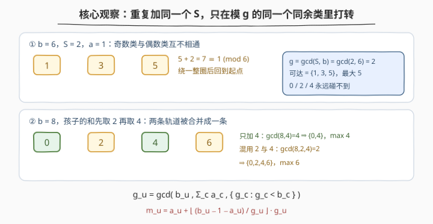
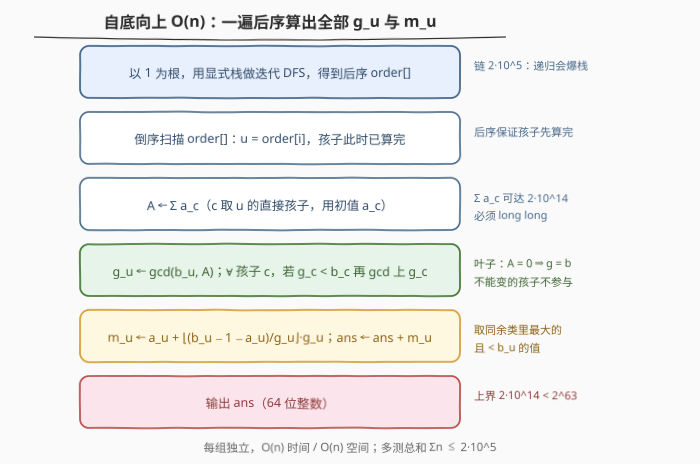
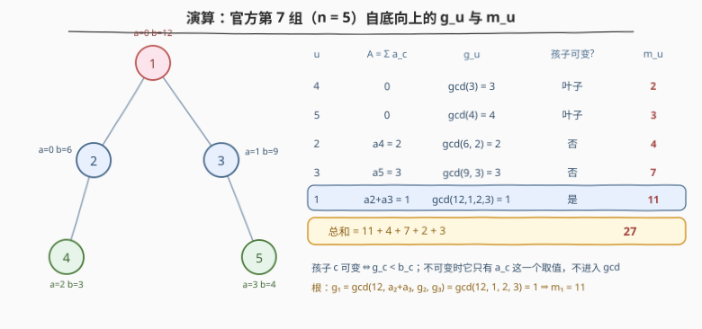

# Codeforces 2266G 模运算树 题解

## 1. 题目概述

- **标题 / 题号**：模运算树（Codeforces 2266G，英文名 Modular Tree）
- **链接**：https://codeforces.com/problemset/problem/2266/G
- **来源**：Codeforces Round 1122 (Div. 3) · Problem G（UTC 2026-09-21）
- **难度**：$\ast 2200$
- **限制**：时间 3 s / 内存 256 MB
- **标签**：DFS 与树，动态规划，贪心，数学，数论，树

**题意**：给定以节点 $1$ 为根的有根树。节点 $i$ 有初值 $a_i$ 与模数 $b_i$（保证 $0\le a_i<b_i$），当前值 $x_i$ 初始为 $a_i$。可以**任意次**执行同一种操作：选节点 $u$，令 $s$ 为 $u$ 所有**直接孩子**当前值之和，然后置 $x_u\leftarrow (x_u+s)\bmod b_u$。问操作任意次后 $\sum_i x_i$ 的最大值。多测：第一行 $t$；每组依次给 $n$、长度 $n$ 的 $a$、长度 $n$ 的 $b$、$n-1$ 条边，逐组输出一个整数。

**约束**：

- $1\le t\le 10^4$，$\sum n\le 2\times 10^5$，多测读入；
- $0\le a_i<b_i\le 10^9$，注意 $b_i=1$ 时必有 $a_i=0$；
- 节点值始终被压在 $[0,b_i)$，答案上界 $2\times 10^{14}$，**必须 64 位整型**；单组必须接近 $O(n)$，按状态搜索完全不可行。

## 2. 示例与观察
**官方样例（8 组，原样）**

```text
输入
8
1
3
7
2
0 3
5 4
1 2
3
0 2 3
7 3 4
1 2
2 3
3
0 0 1
5 2 2
1 2
2 3
4
1 2 3 4
10 3 4 5
1 2
1 3
1 4
3
0 1 3
10 2 4
1 2
1 3
5
0 0 1 2 3
12 6 9 3 4
1 2
1 3
2 4
3 5
4
0 999999999 999999999 999999999
1000000000 1000000000 1000000000 1000000000
1 2
1 3
1 4
输出
3
7
11
6
18
12
27
3999999996
```

第 7 组（答案 27）是 §3.4 的走查对象；第 8 组是星形树，三个叶子都卡在 $10^9-1$，根的孩子和与 $10^9$ 互质，所以根也能顶到 $10^9-1$。

**自造样例（1 组，说明必须混用不同时刻的孩子和）**

```text
1
3
0 2 1
8 5 2
1 2
2 3
```

输出 `12`：节点 3 是叶子恒为 1，节点 2 的和恒为 1，$g_2=\gcd(5,1)=1$ 使它取遍 $0..4$；节点 1 的和可以是 $1,2,3,4$ 中任意一个，$g_1=\gcd(8,2,1)=1$，$m_1=7$，总和 $7+4+1=12$。

## 3. 解题思路

### 3.1 暴力思路

把整棵树的当前值向量 $(x_1,\dots,x_n)$ 当状态，状态总数 $\prod b_i$，从初态 BFS 枚举操作：它精确，但 $b_i$ 到 $10^9$ 就爆炸，只配用来对拍小数据。真正的难点是孩子会变、父亲每次加的 $s$ 跟着变，**顺序会改变可达集合**，所以不能只盯「孩子的最终值」，必须刻画「孩子在各个时刻能取哪些值」。

### 3.2 核心观察：可达值恰好是一个同余类



**观察 1（单个 $s$ 只是在同余类里循环）**：固定一个孩子和 $s$，对 $u$ 连做 $k$ 次就是 $x_u\leftarrow (a_u+ks)\bmod b_u$。记 $g=\gcd(s,b_u)$，$\{ks\bmod b_u\}$ 生成 $\mathbb{Z}_{b_u}$ 的加法子群 $\langle g\rangle$，所以可达值就是 $a_u$ 所属的模 $g$ 同余类，最大值是 $\max\{x<b_u: x\equiv a_u \pmod g\}$。

**观察 2（孩子能被拨到类内任意值，还能拨回来）**：若孩子 $c$ 的可达集合是模 $g_c$ 的同余类 $R_c$，则所有可达增量构成子群 $H_c=\langle b_c,s_1,s_2,\dots\rangle$。子群对相反数封闭，所以从 $R_c$ 任一值都能拨到任一别的值、也能拨回来；拨动 $c$ 只用子树 $c$ 内的操作，不碰兄弟与祖先。

**观察 3（不同时刻的 $s$ 全部并进 gcd）**：于是可以「把孩子拨到配置 $S_1$ → 对 $u$ 连做若干次 → 拨到 $S_2$ → 再连做若干次 → …」，$x_u$ 的可达集合就是 $a_u+\langle b_u,s_1,s_2,\dots\rangle$，$s_i$ 取遍孩子可达值之和。接下来算这些和的 gcd：设 $u$ 的孩子为 $c$、$A=\sum_c a_c$，因为 $a_c\in R_c$ 所以 $A$ 必然可达；对每个**能变**的孩子（$g_c<b_c$）类内必有元素与 $a_c$ 相距 $g_c$（$a_c+g_c$ 或 $a_c-g_c$ 必有一个仍在 $[0,b_c)$ 内），所以 $A\pm g_c$ 也可达，$\gcd\{s_i\}=\gcd\bigl(A,\{g_c:g_c<b_c\}\bigr)$，即
$$g_u=\gcd\bigl(b_u,\ A,\ \{g_c:g_c<b_c\}\bigr),\qquad m_u=a_u+\Bigl\lfloor\frac{b_u-1-a_u}{g_u}\Bigr\rfloor g_u .$$

叶子没有孩子：$A=0$、集合为空，公式给出 $g_u=b_u$、$m_u=a_u$，自动正确。

> ⚠️ 两个高频写错点：gcd 里用的是孩子的**初值** $a_c$（它们可达），不是孩子的最大值；并且只有**能变**的孩子（$g_c<b_c$）才把 $g_c$ 并进去。

### 3.3 算法流程



1. 以 1 为根做迭代遍历（显式栈或队列），得到「父在子前」的序列 `order[]`；
2. 倒序扫描 `order[]`（即后序）：对 $u$ 先累加 $A=\sum_{c}a_c$，令 $g_u=\gcd(b_u,A)$，再对每个孩子 $c$ 判 $g_c<b_c$ 并合并；
3. 按公式算 $m_u$ 累加进 `ans` 后输出；$g_c$ 只依赖更深的节点，倒序扫描时孩子必已算好，全过程只有 $O(n)$ 次 gcd。

### 3.4 示例演算



节点 4、5 是叶子，值冻结在 2、3；节点 2 的和恒为 2，$a_2=0$ 沿 $\{0,2,4\}$ 循环；节点 3 的和恒为 3，$1+3k\bmod 9$ 取到 7；根的两个孩子都能变，$g_1=1$ 可以取到 11。总和 $11+4+7+2+3=27$，与官方输出一致。自造样例同理，**若误用孩子的最大值 4** 去算根，会得到 $\gcd(8,2,4)=2$、$m_1=6$，恰好少 1。

## 4. 算法细节

1. **显式栈代替递归**：$n=2\times 10^5$ 的链会让递归 DFS 爆栈，用 `vector` 自维护栈；「父在子前」的序列倒着扫就是后序。
2. **64 位整型**：$A$ 最坏 $2\times 10^5\times 10^9=2\times 10^{14}$，`int` 必溢出；`ans` 同理，取 gcd 的两个参数都必须是 `long long`。
3. **gcd 的零元**：叶子（或孩子初值全 0 且都不能变）时 $A=0$，必须保证 $\gcd(x,0)=x$，于是 $g_u=b_u$、$m_u=a_u$。
4. **「可变」判据是 $g_c<b_c$**，不是「有没有孩子」：孩子和恒为 $b_c$ 的倍数时 $g_c=b_c$，该孩子的值根本动不了，这时不能引入额外自由度。
5. **最大值的整数写法与多测**：$b_u-1-a_u\ge 0$ 由 $a_u<b_u$ 保证，直接非负整除即可，注意 $g_u$ 一般**不整除** $a_u$；$t\le 10^4$ 而 $\sum n\le 2\times 10^5$，按 $n$ 分配局部 `vector`、不要每次清空大数组，Python 用 `sys.stdin.buffer.read().split()` 一次读完。

## 5. 正确性证明

**引理 1（单个和的循环）**：固定孩子和 $s$，$u$ 的可达值集合恰为 $a_u+\langle\gcd(s,b_u)\rangle$，即 $a_u$ 在模 $\gcd(s,b_u)$ 下的整个同余类。**证明**：连做 $k$ 次得 $a_u+ks\bmod b_u$；$\{ks\bmod b_u\}$ 是由 $s$ 生成的循环子群，阶为 $b_u/\gcd(s,b_u)$，即 $\langle\gcd(s,b_u)\rangle$。∎

**引理 2（孩子集合可来回拨动）**：若 $R_c$ 是模 $g_c$ 的同余类且 $g_c<b_c$，则从 $R_c$ 中任一值出发，只用子树 $c$ 内的操作就能到达 $R_c$ 中任一值，且不改变 $c$ 的兄弟与祖先。**证明**：$c$ 的可达增量集合是子群 $H_c=\langle b_c,\text{可达孩子和}\rangle=\langle g_c\rangle$，对加法与相反数封闭，故任意两值之差都能由若干次操作凑出；操作只作用于 $c$ 及其后代。∎

**引理 3（孩子和集合的 gcd）**：设孩子集合为 $C$，$A=\sum_{c\in C}a_c$，则 $\gcd\{s:s=\sum_c v_c,\ v_c\in R_c\}=\gcd\bigl(A,\{g_c:g_c<b_c\}\bigr)$。**证明**：每个 $v_c$ 与 $a_c$ 之差是 $g_c$ 的倍数，故所有 $s\equiv A\pmod G$（$G=\gcd(A,\{g_c\})$），一边成立；另一方面 $A$ 可达，且每个可变孩子都给出相差 $g_c$ 的取值（$a_c+g_c$ 越界时 $a_c-g_c$ 必不越界），故 $A\pm g_c$ 均可达，$G$ 整除全体和的 gcd。两边相等。∎

**定理**：答案为 $\sum_u m_u$，其中 $g_u=\gcd(b_u,A_u,\{g_c:g_c<b_c\})$、$m_u=a_u+\lfloor (b_u-1-a_u)/g_u\rfloor g_u$。**证明**：由引理 1、3，$u$ 的增量子群是 $\langle b_u\rangle+\langle A_u\rangle+\sum_c\langle g_c\rangle=\langle\gcd(b_u,A_u,\{g_c\})\rangle$，故任何操作序列结束时 $x_u\equiv a_u\pmod{g_u}$、$x_u\le m_u$，这是上界。

可达性：把 $A_u$ 与各 $A_u\pm g_c$ 对应的孩子配置逐个摆好，每次对 $u$ 连做若干次，可凑出该子群中任意增量，于是能把 $x_u$ 精确置为 $m_u$。按「根、再逐层向下」定型：定型 $u$ 时只用子树 $u$ 内的操作，绝不改动已定型的祖先；被临时拨动的后代最后由引理 2 拨回各自最大值。故所有 $m_u$ 可同时取到，上界即答案。∎

## 6. 复杂度分析

- **时间**：每点做 $1+|C_u|$ 次 gcd，每次 $O(\log 10^9)$，加上 $O(n)$ 遍历，单组 $O(n\log V)$；$\sum n=2\times 10^5$ 时约 $4\times 10^6$ 次基本运算。
- **空间**：邻接表与 `a/b/par/order/g` 均为 $O(n)$，总计 $O(n)$，远小于 256 MB。
- **实测**：$n=2\times 10^5$ 的链 0.07 s、星 0.06 s（含读入），相对 3 s 时限有 30 倍以上余量；Python3 同一数据约 0.3 s。

## 7. 参考代码

### C++17

```cpp
#include <bits/stdc++.h>
using namespace std;
using ll = long long;

ll gcdll(ll x, ll y) { while (y) { ll t = x % y; x = y; y = t; } return x; }

int main() {
    int T;
    scanf("%d", &T);
    while (T--) {
        int n;
        scanf("%d", &n);
        vector<ll> a(n + 1), b(n + 1), g(n + 1, 0);
        for (int i = 1; i <= n; ++i) scanf("%lld", &a[i]);
        for (int i = 1; i <= n; ++i) scanf("%lld", &b[i]);
        vector<vector<int>> adj(n + 1);
        for (int i = 1; i < n; ++i) {
            int u, v;
            scanf("%d %d", &u, &v);
            adj[u].push_back(v); adj[v].push_back(u);
        }
        // order[] 满足「父在子前」，倒序扫描即为后序
        vector<int> par(n + 1, 0), order(1, 1);
        par[1] = -1;
        for (size_t i = 0; i < order.size(); ++i)
            for (int v : adj[order[i]])
                if (v != par[order[i]]) { par[v] = order[i]; order.push_back(v); }
        ll ans = 0;
        for (int i = n - 1; i >= 0; --i) {
            int u = order[i];
            ll A = 0, gu = b[u];
            for (int v : adj[u]) if (par[v] == u) {
                A += a[v];
                if (g[v] < b[v]) gu = gcdll(gu, g[v]);   // 只有能变的孩子
            }
            g[u] = gcdll(gu, A);                         // gcd(x,0)=x 覆盖叶子
            ans += a[u] + (b[u] - 1 - a[u]) / g[u] * g[u];
        }
        printf("%lld\n", ans);
    }
    return 0;
}
```

### Python3

```python
import sys
from math import gcd


def main():
    data = sys.stdin.buffer.read().split()
    if not data:
        return
    p = 0
    t = int(data[p]); p += 1
    out = []
    for _ in range(t):
        n = int(data[p]); p += 1
        a = [0] + [int(x) for x in data[p:p + n]]; p += n
        b = [0] + [int(x) for x in data[p:p + n]]; p += n
        adj = [[] for _ in range(n + 1)]
        for _ in range(n - 1):
            u = int(data[p]); v = int(data[p + 1]); p += 2
            adj[u].append(v); adj[v].append(u)

        par = [0] * (n + 1); par[1] = -1
        order = [1]
        for u in order:                    # 父在子前，迭代代替递归
            for v in adj[u]:
                if v != par[u]:
                    par[v] = u
                    order.append(v)

        g = [0] * (n + 1)
        ans = 0
        for u in reversed(order):          # 后序
            s = 0; gu = b[u]
            for v in adj[u]:
                if par[v] == u:
                    s += a[v]
                    if g[v] < b[v]:
                        gu = gcd(gu, g[v])
            g[u] = gcd(gu, s)
            ans += a[u] + (b[u] - 1 - a[u]) // g[u] * g[u]
        out.append(str(ans))
    sys.stdout.write("\n".join(out) + "\n")


main()
```

## 8. 边界情况与易错点

1. **$n=1$**：只有一个叶子，$g_1=b_1$，答案就是 $a_1$；此时没有边要读，样例第 1 组即此情形。
2. **$b_u=1$**：必有 $a_u=0$，$g_u=1$、$m_u=0$；若把「最大值」写成别的变形或让整除出现负数，会算出负值。
3. **全零初值**：所有 $a_i=0$ 时任何操作都是加 0，答案恒为 0，可用来验证 $A=0$ 时 gcd 没被误判成 0。
4. **深链 $2\times 10^5$**：递归 DFS 必爆栈（C++ 段错误、Python `RecursionError`），必须迭代。
5. **溢出与建图**：$A$ 与答案都能到 $2\times 10^{14}$，C++ 里 `A += a[v]`、`ans += ...` 都要 `long long`；$t=10^4$ 且每组 $n$ 很小时不要 `memset` 大数组，输入只是无向边、根固定为 1，必须自己定根，不能把 `adj` 里的邻居一律当孩子。

## 9. 验证记录

- **编译环境与命令**：`clang++ -std=c++17 -O2`（本机无 GNU g++，配 `codeforces/tools/include/bits/stdc++.h` 兼容头；正文代码只用标准库，可原样提交 GNU C++17）；Python 侧为 `Python 3.9.6`。
- **官方样例**：1 / 1 通过（按 Codeforces 标准 checker 的 token 比对，忽略空白与大小写）。
- **复核状态**：audited（2026-11-19 统一回归：编译 + 官方样例；写作期的随机对拍与暴力未重跑）。

## 相关题目与扩展

- [Codeforces 1101D GCD Counting](https://codeforces.com/problemset/problem/1101/D)：树上路径 gcd，练「子树内维护 gcd 候选」的套路。
- [Codeforces 842C Ilya And The Tree](https://codeforces.com/problemset/problem/842/C)：根到点路径上可删一个数的 gcd，同样只需保留少量候选。
- [Codeforces 475D CGCDSSQ](https://codeforces.com/problemset/problem/475/D)：区间 gcd 的不同取值只有 $O(\log V)$ 种，是本文「gcd 决定同余类粒度」的近亲。
- [LeetCode 1443. 收集树上所有苹果的最少时间](https://leetcode.cn/problems/minimum-time-to-collect-all-apples-in-a-tree/)：后序树形 DP 基本功；同场另有 [2266E Prime Destruction](https://codeforces.com/problemset/problem/2266/E) 与 [2266F MEX Replacement](https://codeforces.com/problemset/problem/2266/F)。

**延伸思考**：

1. 把「加孩子和」换成「乘孩子和」，可达集合不再是一个同余类，而由模 $b_u$ 的乘法群与孩子值的素因子结构共同决定，需要分解质因数。
2. 若限制操作次数不超过 $k$，问题变成模 $b_u$ 下的同余最短路：哪些值能在 $k$ 步内到达要用 BFS 求最小步数。
3. 若要求输出字典序最小的最优终态，就在构造 $m_u$ 时加入「贪心取最小增量 + 拓扑序」的细节；若 $b_u$ 放大到 $10^{18}$，gcd 与乘除换 `__int128`，结论都不变。
