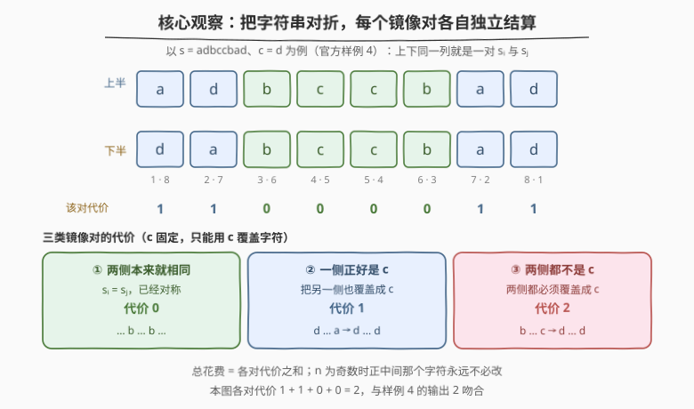
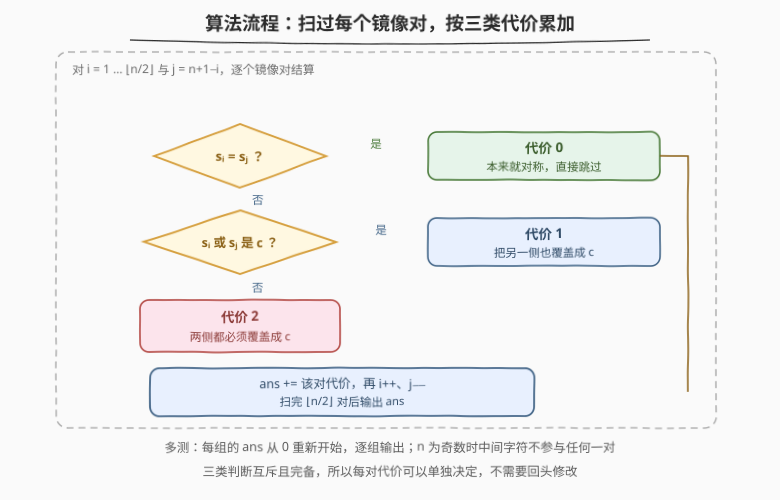
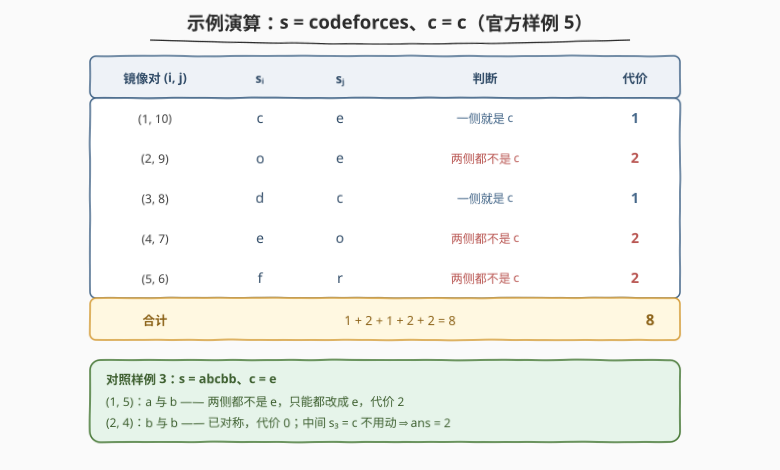

# Codeforces 2267A 变成回文串 题解

## 1. 题目概述

- **标题 / 题号**：变成回文串（Codeforces 2267A，英文名 Turn Into a Palindrome）
- **链接**：https://codeforces.com/problemset/problem/2267/A
- **来源**：Codeforces Round 1123 (Div. 2) · Problem A（UTC 2026-09-25）
- **难度**：800 分（题面 rating 800，Div. 2 签到题）
- **限制**：时间 1 s / 内存 256 MB
- **标签**：贪心，字符串

**题意**：给定长度为 $n$ 的小写字符串 $s$ 与一个小写字母 $c$。每花 1 枚硬币可以做一次操作：选一个下标 $1 \le i \le n$，把 $s_i$ 替换成 $c$——**目标字符只能是 $c$**，不能换成别的字母。求把 $s$ 变成回文串所需的最少硬币数。**多测**：第一行给测试组数 $t$，每组先给 $n$ 与 $c$，再给一行字符串 $s$，逐组输出答案。

**约束**：

- $1 \le t \le 500$；
- $1 \le n \le 100$，$s$ 只含小写拉丁字母，$c$ 也是小写字母；
- 每组答案不超过 $2\cdot\lfloor n/2\rfloor \le 100$，`int` 足够，不需要 `long long`；
- 单组 $O(n)$ 即可，总输入量 $O\!\left(\sum n\right) \le 5\times10^4$，$1$ s 时限非常宽松。

## 2. 示例与观察
**官方样例**（一个输入块，共 5 组数据）

```text
输入
5
4 b
abca
3 p
xyx
5 e
abcbb
8 d
adbccbad
10 c
codeforces

输出
1
0
2
2
8
```

- 第 1 组 `abca, c=b`：首尾两格都是 $\texttt{a}$，已对称；中间一对是 $\texttt{b}$ 与 $\texttt{c}$，把 $\texttt{c}$ 改成 $\texttt{b}$ 得 `abba`，花 1 枚。
- 第 2 组 `xyx, c=p`：本来就是回文，花 0 枚——$\texttt{x}$、$\texttt{y}$ 都不等于 $\texttt{c}$，说明「不等于 $c$」并不强制修改。
- 第 3 组 `abcbb, c=e`：首尾是 $\texttt{a}$ 与 $\texttt{b}$，两侧都不是 $\texttt{e}$，只能都改成 $\texttt{e}$，花 2 枚（**不能**把 $\texttt{b}$ 改成 $\texttt{a}$）。
- 第 4 组 `adbccbad, c=d`：4 对分别是 $(\texttt{a},\texttt{d})$、$(\texttt{d},\texttt{a})$、$(\texttt{b},\texttt{b})$、$(\texttt{c},\texttt{c})$，代价 $1+1+0+0=2$。
- 第 5 组 `codeforces, c=c`：代价 $1+2+1+2+2=8$。

**自造样例**（覆盖 $n=1$、$n=2$ 的 $0/1/2$ 三种代价、整串同字符）

```text
输入
4
1 a
z
2 a
ab
2 q
ab
6 c
cccccc

输出
0
1
2
0
```

- $n=1$ 时没有镜像对，任何单字符串都是回文，答案 0；`cccccc` 六个字符两两相等，也是 0；
- `ab, c=a`：一对 `(a,b)` 含 $\texttt{a}$，花 1；`ab, c=q`：一对 `(a,b)` 都不含 $\texttt{q}$，花 2。

## 3. 解题思路

### 3.1 暴力思路

把「当前字符串」当状态做 BFS：一次操作选一个位置改成 $c$，第一次搜到回文串时的层数就是最少步数。但每个位置只有「保持原字符」和「变成 $c$」两种有意义的终态（改两次等于改一次），可达状态数最坏 $2^{n}$；$n=100$ 时连状态都存不下，$n\le 20$ 时也早已超时。想要线性做法，必须利用回文串自身的结构。

### 3.2 核心观察：镜像对彼此独立，每对只有三种代价

回文的定义是**逐对**的：$s$ 是回文当且仅当对每个 $1 \le i \le n$ 都有 $s_i = s_{n+1-i}$。而一次操作只改动一个位置，只会影响**它所在的那一对**：既不可能顺手修好另一对，也不会破坏别的对。于是整题按对分解——总花费等于各镜像对花费之和，每对独立求最小。

固定一对 $(x, y) = (s_i, s_j)$，其中 $j = n+1-i$，只有三种情况：

| 情形 | 最少花费 | 具体做法 |
|:--|:--:|:--|
| $x = y$ | $0$ | 本来就对称，什么都不做 |
| $x \ne y$，且 $x = c$ 或 $y = c$ | $1$ | 把**不是** $c$ 的那一侧改成 $c$ |
| $x \ne y$，且 $x \ne c$、$y \ne c$ | $2$ | 两侧都必须改成 $c$ |

第三类为什么不能只动一侧？只动一侧意味着另一侧保持原值：若保留 $x$，改动的 $y$ 只能变成 $c$，要求 $c = x$，与 $x \ne c$ 矛盾；保留 $y$ 同理。所以两侧都得动，而「都变成 $c$」一定可行。第二类则显然至少 1 次（原本不相等）、至多 1 次（改非 $c$ 侧即可），故恰为 1。另外注意第一类的判断要**优先**：即使 $x = y = c$，也不需要任何操作。



### 3.3 算法流程

双指针从两端向中间扫，每轮结算一对，不需要任何额外数据结构：

1. 读入 $n$、$c$、$s$（$n$ 恒等于 $s$ 的长度），令 `ans = 0`、`i = 0`、`j = n-1`；
2. 当 `i < j` 时循环：
   - 若 `s[i] == s[j]`：这对代价为 $0$，**直接跳过**后续判断；
   - 否则若 `s[i] == c || s[j] == c`：`ans += 1`；
   - 否则：`ans += 2`；
   - 最后 `i++`、`j--`；
3. 循环结束后输出 `ans`。

循环条件用 `i < j` 而不是 `i <= j`：$n$ 为奇数时正中间那个字符自己和自己配对，永远不用修改，`i < j` 恰好把它排除在外。



### 3.4 示例演算

先看样例 5，$s = \texttt{codeforces}$、$c = \texttt{c}$，长度 10 共 5 对：

| 镜像对 | $s_i$ | $s_j$ | 分类 | 代价 |
|:--|:--:|:--:|:--|:--:|
| $(1,10)$ | c | e | 一侧就是 $c$ | 1 |
| $(2,9)$ | o | e | 两侧都不是 $c$ | 2 |
| $(3,8)$ | d | c | 一侧就是 $c$ | 1 |
| $(4,7)$ | e | o | 两侧都不是 $c$ | 2 |
| $(5,6)$ | f | r | 两侧都不是 $c$ | 2 |
| **合计** | | | $1+2+1+2+2$ | **8** |

再看样例 3，$s = \texttt{abcbb}$、$c = \texttt{e}$，长度 5 共 2 对：第 1 对是 $\texttt{a}$ 与 $\texttt{b}$，两侧都不是 $\texttt{e}$，代价 2；第 2 对两个 $\texttt{b}$ 已对称，代价 0；正中间那个 $\texttt{c}$ 不参与。答案 $2 + 0 = 2$，与官方输出一致。

对照一下：如果误以为「可以改成任意字符」，那么样例 3 的首对只需把 $\texttt{b}$ 改成 $\texttt{a}$，答案会变成 1；官方输出 2 正是用来卡这个错误模型的。



## 4. 算法细节

1. **多测清空**：`ans` 声明在每组循环体内部，天然不会跨组复用；不要写成全局变量后忘记清零。
2. **读入顺序**：先 `cin >> n >> c` 再 `cin >> s`。`>>` 会自动跳过换行与空格，因此 `n c` 单独一行、$\texttt{s}$ 在下一行的格式不需要 `getline` 配合。
3. **循环边界用 `i < j`**：这样既避免 $i = j$ 时把中间字符误算一次，也避免重复统计同一对。若写成遍历全部 $n$ 个位置，每对会被算两遍。
4. **判断顺序**：必须先判 `s[i] == s[j]`，再判是否含 $c$。若把两者顺序颠倒，`x = y = c` 这种（本应代价 0）的对称对会走进「含 $c$」分支被记成 1。
5. **「含 $c$」要查两侧**：写成 `s[i] == c || s[j] == c`。只查 `s[i]` 会漏掉 $c$ 落在右半边的情况，例如 `a...d` 且 $c = d$，此时应花 1 而非 2。
6. **长度来源**：题面保证 $s$ 的长度就是 $n$，代码里用 `s.size()` 作为循环上界更稳（不会因为读入异常而越界），两者在合法输入下完全等价。
7. **I/O 与常数**：$t \le 500$、$n \le 100$，输入总量只有 $5\times10^4$ 量级；C++ 关同步后 `cin/cout` 足够，Python 用 `sys.stdin.buffer.read().split()` 一次切分后按下标取用，避免逐行 `input()` 的开销。

## 5. 正确性证明

**引理 1（逐对分解）**：$s$ 是回文当且仅当对所有满足 $i < j = n+1-i$ 的下标对都有 $s_i = s_j$。此外，任取一个操作序列，它在第 $(i,j)$ 对上花费的硬币数只取决于它对该对两个位置的改动次数；不同对的位置集合互不相交，因此总花费等于各对花费之和，且「总花费最小」等价于「各对花费同时取到各自的最小值」。

**证明**：前半句即回文定义 $s_i = s_{n+1-i}$（对所有 $1 \le i \le n$）的等价改写，其中 $i = j$ 只可能出现在 $n$ 为奇数的正中间，此时该条件恒真。后半句：一次操作只落在唯一一个位置上，位置属于唯一一对，故可以把整个序列按对分桶，各桶的操作次数之和即总花费；各桶相互独立，所以下界是各对最小花费之和，而把每对的最优策略拼起来即可达到该下界（不同对的操作互不干扰）。∎

**引理 2（单对最小代价）**：对一对字符 $(x,y)$，把两者变成相等所需的最小操作次数为

$$\text{cost}(x,y)=\begin{cases}0, & x = y,\\[2pt] 1, & x \ne y \ \text{且}\ (x = c \ \text{或}\ y = c),\\[2pt] 2, & x \ne y \ \text{且}\ x \ne c \ \text{且}\ y \ne c.\end{cases}$$

**证明**：三种情形互斥且穷尽。

- $x = y$：不做任何操作即可满足，代价下界为 0，故为 0。
- $x \ne y$ 且含 $c$：$0$ 次不满足（两者不等）；把不等于 $c$ 的那一侧改成 $c$ 只需 1 次且立刻相等，故为 1。
- $x \ne y$ 且两侧都不是 $c$：假设只用了 1 次操作。被改的位置最终值是 $c$，未被改的位置保持原值。若未改 $x$，则需 $c = x$，与 $x \ne c$ 矛盾；若未改 $y$，则需 $c = y$，与 $y \ne c$ 矛盾。故 1 次不够，至少 2 次；而把两侧都改成 $c$ 恰好 2 次可行，故为 2。∎

**定理**：3.3 节的扫描算法输出的 `ans` 等于把 $s$ 变成回文串所需的最少硬币数。

**证明**：由引理 1，最小总花费等于每个镜像对最小代价之和。算法以 `i < j` 枚举了全部 $\lfloor n/2\rfloor$ 个镜像对，且每对恰好访问一次（$\texttt{i}$ 与 $\texttt{j}$ 同步向内收缩）；对每对，算法严格按引理 2 的三种互斥情形分支并累加对应值。因此 `ans` 恰为各对最小代价之和，即最小总花费。∎

## 6. 复杂度分析

- **时间**：单组只做一次长度为 $\lfloor n/2\rfloor$ 的双指针扫描，每轮 $O(1)$ 次字符比较与加法，故 $O(n)$；全部测试合计 $O\!\left(\sum n\right) \le 5\times10^4$ 次基本运算。
- **空间**：除存储字符串 $s$ 的 $O(n)$ 外只用了 `ans`、$\texttt{i}$、$\texttt{j}$ 三个标量，额外空间 $O(1)$；不需要建数组、哈希表或递归。
- **可行性对照**：时限 1 s。实测最大规模（$t=500$、每组 $n=100$，即 $\sum n = 5\times10^4$）C++17 约 8 ms、Python3 约 33 ms（均含进程启动开销），距时限仍有数十倍余量；即便把 $\sum n$ 放大到 $10^7$，本做法仍是纯线性扫描。

## 7. 参考代码

### C++17

```cpp
#include <iostream>
#include <string>
using namespace std;

int main() {
    ios::sync_with_stdio(false);
    cin.tie(nullptr);

    int t;
    if (!(cin >> t)) return 0;
    while (t--) {
        int n;
        char c;
        cin >> n >> c;
        string s;
        cin >> s;

        int ans = 0;
        int m = (int)s.size();                 // 题面保证 m == n
        for (int i = 0, j = m - 1; i < j; ++i, --j) {
            if (s[i] == s[j]) continue;        // 这对已对称：0 枚
            if (s[i] == c || s[j] == c) ans += 1;  // 一侧已是 c：改另一侧
            else ans += 2;                     // 两侧都不是 c：两侧都改
        }
        cout << ans << '\n';
    }
    return 0;
}
```

### Python3

```python
import sys


def main():
    data = sys.stdin.buffer.read().split()
    t = int(data[0])
    pos = 1
    out = []
    for _ in range(t):
        n = int(data[pos]); c = data[pos + 1].decode(); pos += 2
        s = data[pos].decode(); pos += 1

        ans = 0
        i, j = 0, len(s) - 1
        while i < j:
            if s[i] != s[j]:
                if s[i] == c or s[j] == c:
                    ans += 1
                else:
                    ans += 2
            i += 1
            j -= 1
        out.append(str(ans))

    sys.stdout.write('\n'.join(out) + '\n')


main()
```

## 8. 边界情况与易错点

1. **只能改成 $c$ 是本题的题眼**：若按「可以改成任意字符」建模，样例 3 会输出 1（把 `abcbb` 的末位 $\texttt{b}$ 改成 $\texttt{a}$ 得 `abcba`），而正确答案是 2。凡是「一侧等于 $c$」的便宜路径，前提都是另一侧正好是 $c$。
2. **$n = 1$**：没有镜像对，循环一次都不执行，输出 0。不要因为「$s_1 \ne c$」就错误地加 1。
3. **$n$ 为奇数的中点**：`i < j` 保证跳过 $s_{(n+1)/2}$。中点自比必然相等，即使写成 `i <= j` 也不会算错，但绝不能为了「覆盖全部下标」把循环改成扫完整串——那会与前半段重复统计（见第 6 条）。
4. **对称对要优先判等**：`x = y = c` 的一对本应代价 0；若先判「含 $c$」就记成 1。官方样例里没有全 $\texttt{c}$ 的串，但自造样例 `cccccc, c=c` 会立刻暴露（错解答 3，正确答 0）。
5. **「含 $c$」必须查两侧**：`a...d` 且 $c = d$ 时，只看 `s[i]` 会把代价从 1 抬到 2。样例 4 的 4 对里有两对正是这种情况。
6. **不要重复统计**：只扫前 $\lfloor n/2\rfloor$ 对；扫完整个字符串会让每对贡献两次，答案直接翻倍。
7. **输出与溢出**：每组一行、末尾换行，$t$ 组之间没有空行；Python 里先把结果 append 到列表再一次性 `write`，避免大量 `print` 的刷新开销。答案最大 100，`int` 完全够用，`long long` 只属冗余保险。

## 9. 验证记录

- **编译环境与命令**：`clang++ -std=c++17 -O2`（本机无 GNU g++，配 `codeforces/tools/include/bits/stdc++.h` 兼容头；正文代码只用标准库，可原样提交 GNU C++17）；Python 侧为 `Python 3.9.6`。
- **官方样例**：1 / 1 通过（按 Codeforces 标准 checker 的 token 比对，忽略空白与大小写）。
- **复核状态**：audited（2026-11-19 统一回归：编译 + 官方样例；写作期的随机对拍与暴力未重跑）。

## 相关题目与扩展

- [Codeforces 600C Make Palindrome](https://codeforces.com/problemset/problem/600/C)：把字符改成任意字母并允许重排，求最少修改次数下字典序最小的回文——本题的「对侧配对」思想在那里变成按字母频次配对，奇数频次两两互调。
- [LeetCode 125. 验证回文串](https://leetcode.cn/problems/valid-palindrome/)：只判定不修改，是本题第 3.2 节「逐对相等」判据的裸版本。
- [LeetCode 680. 验证回文字符串 Ⅱ](https://leetcode.cn/problems/valid-palindrome-ii/)：允许删掉至多一个字符，双指针遇到不等时要分两支尝试——对照本题「不等时必须改」，可以看清「不匹配的对」到底需要多少信息量才能决策。

**延伸思考**：

1. 若把「只能改成 $c$」放宽成「可以改成任意字母」，每对不等的代价都变成 1，总答案就是「不等对个数」——这恰好是本做法在 $c$ 取遍 26 个字母时三类代价的下界，也说明本题的难点全在「目标字符固定」这一条。
2. 若操作改成「一次可以同时改任意多个位置」（同一枚硬币改一批），代价会退化成「该对是否需要修改」的布尔值，答案变成不等对个数。
3. 若 $c$ 随查询变化（同一 $s$ 上多次询问不同的 $c$），可以对每对记录二元组 $(x,y)$，并预处理「含 $c$ 的对数」随 $c$ 的分布，单次询问 $O(1)$。
4. 若把回文换成「循环回文」或「允许 $k$ 处容错」，逐对独立性不再成立（一处修改可能同时服务两个约束），需要回到区间 DP 或双指针加分情况的思路。
