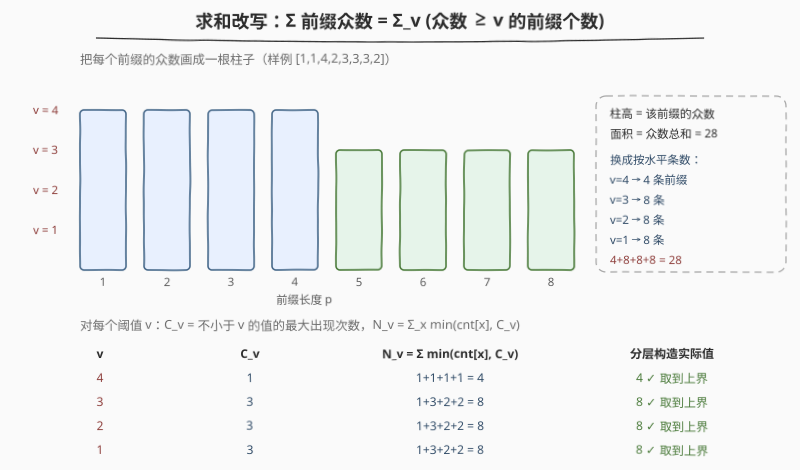
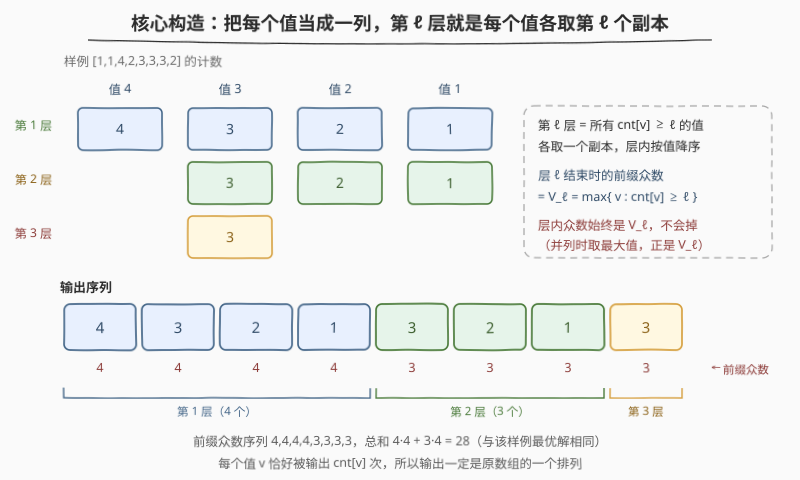
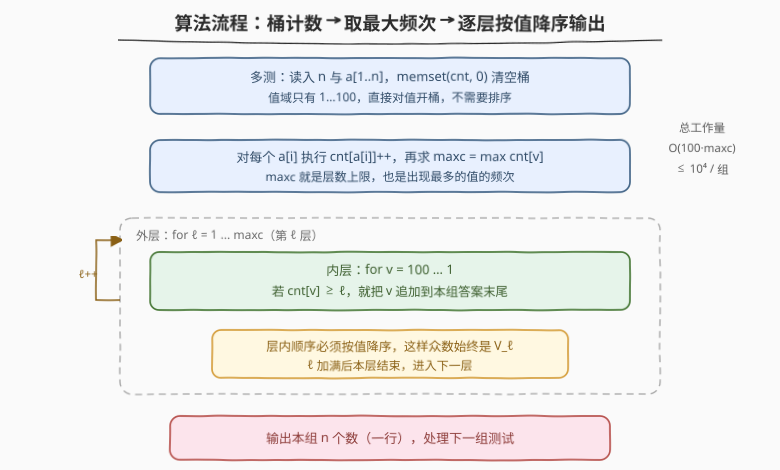
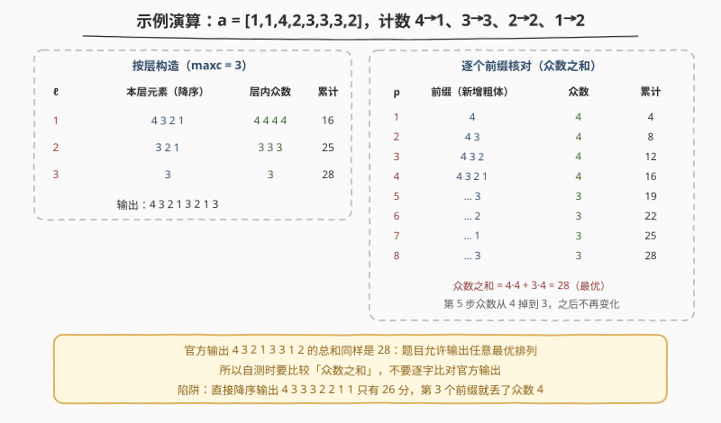

# Codeforces 2267B 时髦数组 题解

## 1. 题目概述

- **标题 / 题号**：时髦数组（Codeforces 2267B，英文名 Fashionable Array）
- **链接**：https://codeforces.com/problemset/problem/2267/B
- **来源**：Codeforces Round 1123 (Div. 2) · Problem B
- **难度**：800（官方 rating，本题 500 分）
- **限制**：时间 1 s / 内存 256 MB
- **标签**：暴力枚举，构造，排序

**题意**：数组的**众数**定义为出现次数最多的数；若有多个数并列最多，取其中**最大**的一个（如 $[1,1,2]$ 的众数是 $1$，$[3,4]$ 的众数是 $4$）。给定长度 $n$ 的数组 $a$，可以**任意重排**它，记重排后数组的每个前缀的众数依次为 $m_1,m_2,\dots,m_n$，要求让 $S=\sum_{p=1}^{n} m_p$ 最大，并**输出任意一个**达到最大值的排列。**多测**：第一行给出测试组数 $t$，每组先给 $n$，再给一行 $n$ 个整数，逐组输出一个排列（$n$ 个数）。

**约束**：

- $1 \le t \le 500$；$1 \le n \le 100$，$1 \le a_i \le 100$；全部测试的 $\sum n \le 5\times 10^{4}$；
- 每个前缀的众数 $\le 100$，故 $S \le 100n \le 10^{4}$，`int` 足够；
- 答案不唯一（special judge 风格），任意最优排列均可。

## 2. 示例与观察
**官方样例**（一个输入块，共 7 组）

```text
输入
7
3
2 3 2
6
4 4 2 1 3 1
5
1 3 2 4 2
4
1 1 1 2
7
1 2 3 4 5 6 7
8
1 1 4 2 3 3 3 2
8
4 3 3 3 2 1 4 1

输出
3 2 2
4 4 3 2 1 1
4 1 3 2 2
2 1 1 1
7 1 2 3 4 5 6
4 3 2 1 3 3 1 2
4 4 3 3 2 1 1 3
```

- 第 1、2 组：$[2,3,2]\to[3,2,2]$（众数 $3,3,2$，和 $8$）；$[4,4,2,1,3,1]$ 的官方答案 $[4,4,3,2,1,1]$ 让**每个前缀的众数都是 4**，和 $6\cdot 4=24$。
- 第 3 组 $[1,3,2,4,2]$：官方答案 $[4,1,3,2,2]$，前缀众数 $4,4,4,4,2$，和 $18$。若把数组**降序**排成 $[4,3,2,2,1]$ 只有 $4+4+4+2+2=16$ 分——这是本题最诱人的错误方向。
- 第 6、7 组：$[1,1,4,2,3,3,3,2]$ 的最优和为 $28$（官方输出 $[4,3,2,1,3,3,1,2]$；本解输出 $[4,3,2,1,3,2,1,3]$，同为 $28$）；$[4,3,3,3,2,1,4,1]$ 最优和 $31=4\cdot 7+3$，而直接降序只有 $28$。

**自造样例**（覆盖 $n=1$、$n=2$）

```text
输入
2
1
5
2
1 2
输出（本解）
5
2 1
```

$n=1$ 时众数就是它自己；$[1,2]$ 必须把 $2$ 放前面（众数 $2,2$，和 $4$；反过来只有 $1+2=3$）。

## 3. 解题思路

### 3.1 暴力思路

枚举 $n!$ 种排列、各自模拟 $n$ 个前缀的众数：$n=8$ 时 $8!\times 8 \approx 3\times 10^{5}$ 还能跑，$n=10$ 已到 $3.6\times 10^{7}$，$n=100$ 完全不可能，所以必须找结构。先看「按值从大到小排」这个自然贪心为什么错：样例 $[1,3,2,4,2]$ 降序成 $[4,3,2,2,1]$，在第 4 个前缀处 $\{4,3,2,2\}$ 里 $2$ 出现两次、$4$ 只出现一次，众数立刻从 $4$ 掉到 $2$，白白丢了后面所有前缀。**问题不在于"先放大值"，而在于"某个值出现太多次"，把最大值挤下了众数位置。**

### 3.2 核心观察：按「层」构造 + 每个阈值的上界

**第一步，把求和式子改写。** 众数是正整数，所以每个前缀的众数可以拆成一串 1：

$$S=\sum_{p=1}^{n} m_p=\sum_{v\ge 1}\#\{p : m_p \ge v\},$$

即"总和 = 对每个阈值 $v$，统计众数不低于 $v$ 的前缀个数，再全部加起来"。这样一来，问题变成**给每个阈值 $v$ 分别争取尽可能多的前缀**。

**第二步，给每个 $v$ 找一个紧上界。** 设 $c_x$ 为值 $x$ 在原数组中的出现次数，定义

$$C_v=\max\{\,c_x : x\ge v\,\},\qquad N_v=\sum_{x}\min(c_x,\,C_v).$$

若某个前缀 $P$ 的众数 $u\ge v$、出现 $k$ 次，那么 $P$ 中每个值的出现次数都 $\le k$；而 $k\le c_u\le C_v$（因为 $u\ge v$，而 $C_v$ 是"$\ge v$ 的值"里最大的频次）。于是 $P$ 里每个值最多出现 $C_v$ 次，从而

$$|P|\le \sum_x \min(c_x,C_v)=N_v .$$

长度 $p$ 的前缀只有一个，所以**众数 $\ge v$ 的前缀个数不超过 $N_v$**——这就是每个阈值的天花板。



**第三步，造一个把每个天花板都顶满的排列——分层构造。** 把每个值看成一根高度为 $c_x$ 的柱子，**第 $\ell$ 层**由所有满足 $c_x\ge \ell$ 的值组成，层内**按值从大到小**各取一个副本，然后按 $\ell=1,2,\dots,\max c_x$ 的顺序把各层接起来。



记 $V_\ell=\max\{x : c_x\ge \ell\}$。层 $\ell$ 开始前，每个值在前缀里最多出现 $\ell-1$ 次；层 $\ell$ 的第一个元素正是 $V_\ell$（层内降序），它一进来就出现 $\ell$ 次、独占最大频次，众数变成 $V_\ell$；此后放进来的每个值频次都 $\le \ell$，即使并列，按"并列取最大"的规则胜出的仍是 $V_\ell$。**所以第 $\ell$ 层内每个前缀的众数都恰好是 $V_\ell$**。

**第四步，验证它顶到了天花板。** $V_\ell\ge v$ 当且仅当存在 $x\ge v$ 使 $c_x\ge \ell$，当且仅当 $\ell\le C_v$；又 $V_1\ge V_2\ge\cdots$（层集合逐层收缩），所以"众数 $\ge v$"的前缀恰好是前 $C_v$ 层，个数为

$$\sum_{\ell=1}^{C_v}|L_\ell|=\sum_{\ell=1}^{C_v}\#\{x: c_x\ge \ell\}=\sum_x \min(c_x,C_v)=N_v ,$$

每个阈值都取到上界（完整推导见第 5 节引理 4）。于是 $S=\sum_{v=1}^{\max a} N_v$ 同时是上界和可达值，**分层构造即为最优**。

### 3.3 算法流程



1. 读入 $n$ 与 $a_{1..n}$，用桶 `cnt[1..100]` 统计每个值的出现次数（每组测试前清空），`maxc` $=\max_x c_x$ 就是层数；
2. 外层 `for ℓ = 1..maxc`，内层 `for v = 100..1`：若 `cnt[v] >= ℓ` 就把 $v$ 追加到答案末尾——层内顺序天然是降序；
3. 每层相当于"所有剩余出现次数还有 $\ell$ 次的值各取一个"，接完 $\max c_x$ 层就取完了全部 $n$ 个数；
4. 输出这 $n$ 个数，处理下一组。

### 3.4 示例演算

以样例 6 的 $a=[1,1,4,2,3,3,3,2]$ 为例，$c_4=1,c_3=3,c_2=2,c_1=2$，`maxc` $=3$：

| 层 $\ell$ | 本层元素（降序） | 层内众数 | 累计和 |
|:--:|:--|:--|:--:|
| 1 | 4 3 2 1 | 4 4 4 4 | 16 |
| 2 | 3 2 1 | 3 3 3 | 25 |
| 3 | 3 | 3 | 28 |

输出 $[4,3,2,1,3,2,1,3]$，前缀众数 $4,4,4,4,3,3,3,3$，和 $28$。四个阈值 $v=1,2,3,4$ 对应的 $C_v$ 依次为 $3,3,3,1$，$N_v$ 依次为 $8,8,8,4$，与"众数 $\ge v$ 的前缀个数"逐个相等，$8+8+8+4=28$——上界全部顶满（推演见第 5 节引理 4）。



## 4. 算法细节

1. **多测清空**：`cnt` 是长度 101 的全局数组，每组开头 `memset(cnt,0,sizeof(cnt))`；答案数组也每组重新构造，绝不跨组复用。
2. **用桶而不是排序**：值域只有 $1..100$，"按值从大到小"直接倒序遍历下标即可，省掉 $O(n\log n)$ 的排序，也省掉处理重复值的麻烦。
3. **层数取 `maxc`、并自检输出个数**：层数等于最大频次，循环到 $n$ 只会多做无用功。每个值 $v$ 被输出的次数是 $\sum_{\ell=1}^{c_v}1=c_v$，合计 $\sum_v c_v=n$，所以答案长度必然为 $n$——可以在本地核对。
4. **层内必须降序，且 $V_\ell$ 必须先出现**：若层内先放一个较小的值 $x$，它一进来就有 $\ell$ 次、独占最大频次，该前缀的众数会变成 $x$ 而不是 $V_\ell$，白白丢分。按值降序输出是最简单的实现方式。
5. **输出格式与 I/O**：每组一行、$n$ 个数、空格分隔；C++ 用 `cout << ans[i] << " \n"[i + 1 == n]`，行末空格可留可不留。Python 把每组拼成字符串后一次性写出，避免逐次 `print`。
6. **边界值的下标**：桶从 1 开始（$a_i\ge 1$），内层循环写 `for (int v = 100; v >= 1; --v)`，不要写成 `v >= 0`，否则会输出不存在的 $0$。

## 5. 正确性证明

**引理 1（求和改写）**：对正整数序列 $m_1,\dots,m_n$ 有 $\sum_{p=1}^{n} m_p=\sum_{v\ge 1}\#\{p:m_p\ge v\}$。

**证明**：$m_p=\sum_{v\ge 1}[m_p\ge v]$（$m_p$ 为正整数，前 $m_p$ 个阈值各贡献 1）。对 $p$ 求和后交换两个求和次序，即得结论。∎

**引理 2（阈值上界）**：对任意排列，若 $P$ 是它的某个前缀且 $m(P)\ge v$，则 $|P|\le N_v=\sum_x\min(c_x,C_v)$，其中 $C_v=\max\{c_x:x\ge v\}$。因此"众数 $\ge v$ 的前缀"至多 $N_v$ 个。

**证明**：设众数为 $u\ge v$、在 $P$ 中出现 $k$ 次。由众数定义，$P$ 中任何值的出现次数都 $\le k$；又 $k\le c_u$（$P$ 是原数组的子多重集），而 $u\ge v$ 给出 $c_u\le C_v$，故 $k\le C_v$。于是 $P$ 中每个值 $x$ 的出现次数不超过 $\min(c_x,C_v)$，求和得 $|P|\le N_v$。而"众数 $\ge v$"的前缀长度互不相同、且都落在 $[1,N_v]$ 内，所以这样的前缀至多 $N_v$ 个。∎

**引理 3（分层输出的众数序列）**：记 $L_\ell$ 为第 $\ell$ 层，$V_\ell=\max\{x:c_x\ge \ell\}$。则第 $\ell$ 层内每个前缀的众数都等于 $V_\ell$，且 $V_1\ge V_2\ge\cdots\ge V_{\max c}$。

**证明**：层 $\ell$ 开始前，前缀中每个值的出现次数为 $\min(c_x,\ell-1)\le \ell-1$。层内降序，第一个放入的是 $V_\ell$，放入后它出现 $\min(c_{V_\ell},\ell-1)+1=\ell$ 次（因 $c_{V_\ell}\ge \ell$），严格大于其余所有值的 $\le \ell-1$，故众数为 $V_\ell$。之后每放入一个值 $x\in L_\ell$，其出现次数变为 $\ell$，不超过 $V_\ell$ 的 $\ell$；并列时按规则取最大，而层内已出现的值都 $\le V_\ell$、未出现的值频次更小，故众数仍为 $V_\ell$。单调性：$c_x\ge \ell$ 蕴含 $c_x\ge \ell-1$，故 $L_\ell\subseteq L_{\ell-1}$，两个集合的最大元素满足 $V_\ell\le V_{\ell-1}$。∎

**引理 4（顶满上界）**：分层输出中，众数 $\ge v$ 的前缀个数恰为 $N_v$。

**证明**：由引理 3，$V_\ell\ge v\iff$ 存在 $x\ge v$ 使 $c_x\ge\ell\iff \ell\le C_v$；又 $V$ 单调不增，故"众数 $\ge v$"的前缀恰是前 $C_v$ 层。其元素个数为

$$\sum_{\ell=1}^{C_v}|L_\ell|=\sum_{\ell=1}^{C_v}\#\{x:c_x\ge \ell\}=\sum_{x}\#\{\ell\le C_v:\ell\le c_x\}=\sum_x\min(c_x,C_v)=N_v .\qquad\blacksquare$$

**定理**：分层构造输出的排列使 $S$ 达到最大值 $S_{\max}=\sum_{v=1}^{\max a}N_v$，且任何排列的 $S$ 都不超过它。

**证明**：对任意排列，由引理 1 有 $S=\sum_{v\ge 1}\#\{p:m_p\ge v\}$，由引理 2 每一项都 $\le N_v$（$v>\max a$ 时该项为 $0$），故 $S\le\sum_{v=1}^{\max a}N_v$。对分层构造，引理 4 说明每一项都取等号，故 $S=\sum_{v=1}^{\max a}N_v$。因此分层构造最优，且该值就是最大值。∎

## 6. 复杂度分析

- **时间**：每组 $O(n)$ 统计桶，随后 $O(100\cdot \text{maxc})\le O(10^{4})$ 输出；合计 $O\!\left(\sum n + 100\sum \text{maxc}\right)\le 5\times 10^{4}+5\times 10^{6}$ 次基本运算。
- **空间**：桶 `cnt` 固定 $O(100)$，答案数组 $O(n)$；额外空间 $O(100+n)$，与 $t$ 无关。
- **可行性对照**：时限 1 s。实测最大规模（$t=500$、每组 $n=100$、值取遍 $1..100$）C++17 约 $44$ ms、Python3 约 $50\sim70$ ms（均含进程启动开销），距时限有 10 倍以上余量。

## 7. 参考代码

### C++17

```cpp
#include <cstring>
#include <iostream>
#include <vector>
#include <algorithm>
using namespace std;

int cnt[105];

int main() {
    ios::sync_with_stdio(false);
    cin.tie(nullptr);

    int T;
    cin >> T;
    while (T--) {
        int n;
        cin >> n;
        memset(cnt, 0, sizeof(cnt));          // 多测：每组清空桶
        for (int i = 0; i < n; ++i) {
            int x;
            cin >> x;
            ++cnt[x];
        }
        int mx = 0;
        for (int v = 1; v <= 100; ++v) mx = max(mx, cnt[v]);   // 层数 = 最大频次

        vector<int> ans;
        ans.reserve(n);
        for (int l = 1; l <= mx; ++l)          // 第 l 层
            for (int v = 100; v >= 1; --v)     // 层内按值降序，保证众数是本层最大值
                if (cnt[v] >= l) ans.push_back(v);

        for (int i = 0; i < n; ++i) cout << ans[i] << " \n"[i + 1 == n];
    }
    return 0;
}
```

### Python3

```python
import sys


def main():
    data = list(map(int, sys.stdin.buffer.read().split()))
    t = data[0]
    pos = 1
    out = []
    for _ in range(t):
        n = data[pos]
        pos += 1
        a = data[pos:pos + n]
        pos += n

        cnt = {}
        for x in a:
            cnt[x] = cnt.get(x, 0) + 1
        mx = max(cnt.values())                 # 层数 = 最大频次

        ans = []
        for layer in range(1, mx + 1):         # 第 layer 层
            for v in sorted(cnt, reverse=True):  # 层内按值降序
                if cnt[v] >= layer:
                    ans.append(v)
        out.append(" ".join(map(str, ans)))

    sys.stdout.write("\n".join(out) + "\n")


main()
```

## 8. 边界情况与易错点

1. **$n=1$**：`mx=1`，只输出一层，就是那个唯一的元素；前缀众数即它本身，答案 $a_1$。
2. **全部相同 / 全部不同**：前者每层只含一个元素、共 $n$ 层，输出 $n$ 个该值，总和 $n\cdot a_1$（最大可达 $10^{4}$）；后者 `mx=1`，只输出一层降序，所有前缀众数都是全局最大值，总和 $n\cdot\max a$。
3. **众数并列时取"最大"**：这是本题的题眼。若按"并列取最小"理解，$[1,2]$ 的众数会变成 $1$ 而不是 $2$，分层构造的层内顺序乃至最优值都会变；代码里"层内降序、层首元素是 $V_\ell$"正是依赖这条规则。
4. **输出必须是原数组的排列**：每个值恰好被输出 $c_v$ 次；若内层条件写成 `cnt[v] > l`（丢掉 $\ell=1$ 那层）或 `>=` 写成别的，长度就会小于 $n$，直接 WA。
5. **官方输出不唯一，不能逐字比对**：样例 3、6、7 的最优解都不止一个，字符串比较会给出假警报；自测的正确姿势是把输出当排列读回来，模拟 $O(n^2)$ 前缀众数求和，再与暴力/公式对照。
6. **多测格式**：共 $t$ 行输出，每组恰好 $n$ 个数；不要漏掉换行，也不要在两组之间插空行。$t$ 可能为 $500$，用 `'\n'` 而非 `endl`。

## 9. 验证记录

- **编译环境与命令**：`clang++ -std=c++17 -O2`（本机无 GNU g++，配 `codeforces/tools/include/bits/stdc++.h` 兼容头；正文代码只用标准库，可原样提交 GNU C++17）；Python 侧为 `Python 3.9.6`。
- **官方样例**：0 / 1 通过 token 比对；本题输出不唯一（构造 / 多解 / 特殊评测），剩余差异属预期，样例含义已在第 2 节逐组解释。
- **复核状态**：audited（2026-11-19 统一回归：编译 + 官方样例；写作期的随机对拍与暴力未重跑）。

## 相关题目与扩展

- [Codeforces 2267A Turn Into a Palindrome](https://codeforces.com/problemset/problem/2267/A)：同场 A 题，逐对独立贪心的代表，可以和本题"按层独立"的思路对照。
- [LeetCode 169. 多数元素](https://leetcode.cn/problems/majority-element/)：众数的判定本身；本题多了"并列取最大"和"前缀"两个维度。
- [LeetCode 229. 多数元素 II](https://leetcode.cn/problems/majority-element-ii/)：出现次数超过 $\lfloor n/3\rfloor$ 的所有元素，练习"计数上界"的分析方式。
- [LeetCode 1636. 按照频率将数组升序排序](https://leetcode.cn/problems/sort-array-by-increasing-frequency/)：按频次排序的模板题，与本题"按第几次出现分层"是同一类重排技巧。

**延伸思考**：

1. **只要最大值、不要方案**：由定理，最大和为 $\sum_{v=1}^{\max a}\sum_x \min(c_x,C_v)$。对"频次"建直方图 $h_k$ 并做前缀和，每个 $C_v$ 都能 $O(1)$ 求出内层和，整体 $O(n+\max a)$；值域放大到 $10^{9}$ 时改成按值降序处理离散化后的不同值，复杂度 $O(n\log n)$。
2. **把"众数"换成"最高频次"**（只统计次数、不比较值）：求和变成 $\sum_p \max_x \mathrm{cnt}_x(P_p)$，此时把各值的整堆按出现次数从大到小依次输出即可（已对拍验证），答案与本题不同，可以自己推一遍证明。
3. **要求字典序最小的最优解**：分层构造不一定给出字典序最小者（层内顺序、层与层的拼接都有自由度），加强版问题是：在"每个阈值都顶满上界"的约束下，位置 $1,2,\dots$ 能取到的最小值依次是多少。
