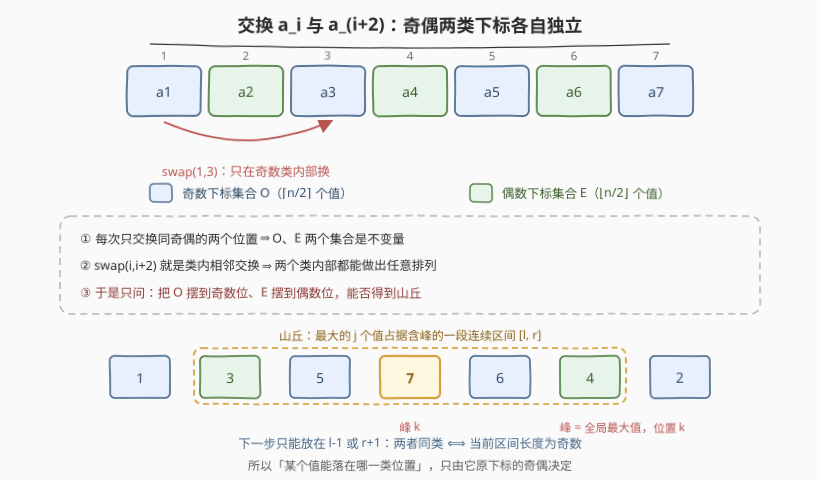
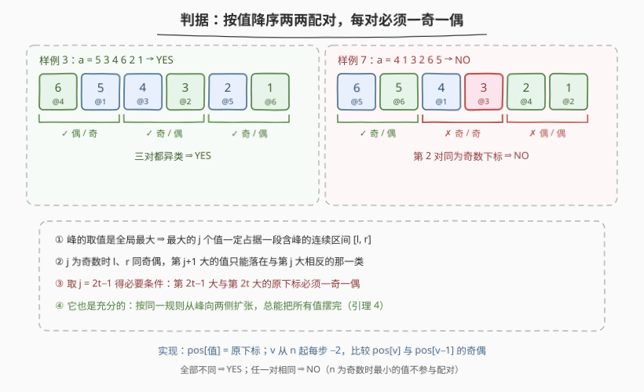
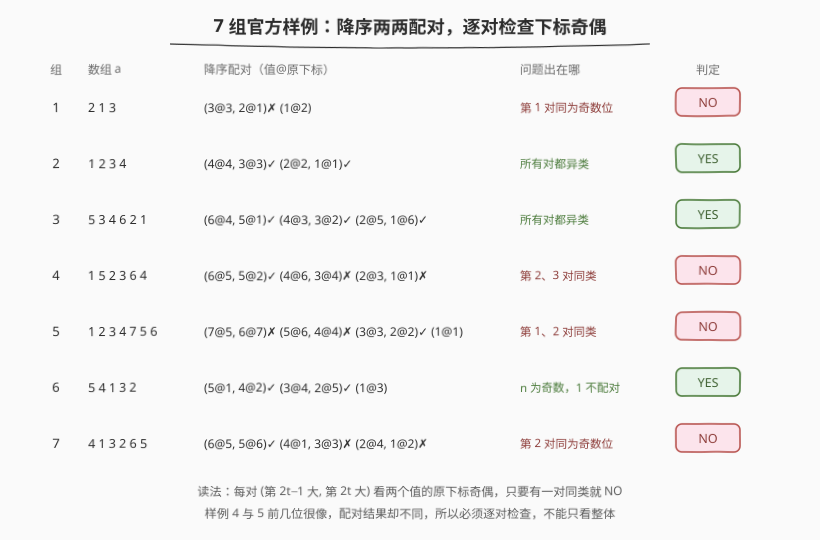

# Codeforces 2267D 后室山丘 题解

## 1. 题目概述

- **标题 / 题号**：后室山丘（Codeforces 2267D，英文名 Backrooms Hill）
- **链接**：https://codeforces.com/problemset/problem/2267/D
- **来源**：Codeforces Round 1123 (Div. 2) · Problem D
- **难度**：1400（官方 rating，本题 1250 分）
- **限制**：时间 2 s / 内存 256 MB
- **标签**：构造，动态规划，贪心，排序，双指针

**题意**：一个长度 $m$ 的数组 $b$ 称为**山丘**，当且仅当存在峰位 $k$（$1\le k\le m$）使得

$$b_1<b_2<\cdots<b_k,\qquad b_k>b_{k+1}>\cdots>b_m .$$

也就是说：从峰往左严格递增、往右严格递减（峰可以落在两端）。给定长度为 $n$、元素**两两不同**的数组 $a$，可以反复执行一种操作：任选 $i$（$1\le i\le n-2$），交换 $a_i$ 与 $a_{i+2}$。问能否把 $a$ 变成山丘。

**输入**：第一行 $t$ 表示测试组数。每组先给 $n$，再给一行 $n$ 个整数 $a_1,\dots,a_n$。
**输出**：每组一行 `YES` 或 `NO`（大小写不限）。

**约束**：

- $1\le t\le 10^{4}$，$1\le n\le 2\cdot 10^{5}$，$\sum n\le 2\cdot 10^{5}$；
- $a_i$ 两两不同且 $1\le a_i\le n$，于是 $a$ 恰好是 $1,2,\dots,n$ 的一个**排列**；
- 答案只与相对大小和下标奇偶有关，与具体数值无关。

## 2. 示例

**官方样例**（一个输入块，共 7 组）

```text
输入
7
3
2 1 3
4
1 2 3 4
6
5 3 4 6 2 1
6
1 5 2 3 6 4
7
1 2 3 4 7 5 6
5
5 4 1 3 2
6
4 1 3 2 6 5

输出
NO
YES
YES
NO
NO
YES
NO
```

- 第 1 组 $[2,1,3]$：$a_2=1$ 是最小值，且偶数位只有它一个，无法挪动，左右都比它大，永远成不了峰，故 `NO`；第 2 组已严格递增，`k=n` 即为山丘。
- 第 3 组官方给了构造：交换 $(1,3)$ 得 $[4,3,5,6,2,1]$，再交换 $(2,4)$ 得 $[4,6,5,3,2,1]$，峰为 $6$；第 6 组 $n$ 为奇数，只有 $2$ 对需要配对且全部合格，故 `YES`。

**自造样例**（覆盖 $n=1$、$n=2$）

```text
输入
3
1
1
2
2 1
3
2 1 3

输出（本解）
YES
YES
NO
```

## 3. 解题思路

### 3.1 暴力思路

操作只改变位置、不改变元素本身，所以可以在「排列」上做 BFS：状态数最多 $n!$，$n\ge 10$ 就爆炸；枚举所有目标排列再判断可达性同样是 $n!$ 级别。真正需要的是**可达性刻画**：哪些排列能通过 $\text{swap}(i,i+2)$ 得到？答案很简单——见下面的不变量。再结合「山丘」这种高度结构化的形状，可以把判定压缩到一次线性扫描。

### 3.2 核心观察：奇偶类不变量 + 从峰向两侧扩张



**不变量**。被交换的两个下标 $i$ 与 $i+2$ 同奇偶，所以**奇数位上的值集合 $O$、偶数位上的值集合 $E$ 永远不变**。反过来，$\text{swap}(i,i+2)$ 恰好是「奇数位子序列」或「偶数位子序列」里的一次相邻交换，而相邻交换能生成全排列，所以**只要两个集合分别一致，任何排列都可达**。于是问题变成：

> 能否把 $O$ 里的值摆到奇数位、$E$ 里的值摆到偶数位，使结果成为山丘？

**山丘的扩张视角**。山丘的峰一定是全局最大值（峰左边都小于它、右边也都小于它）。从峰开始，按值**从大到小**依次向外放：已放置的 $j$ 个最大元素必定占据一段**包含峰的连续区间** $[l,r]$（引理 2），下一个元素只能落在 $l-1$ 或 $r+1$ 这两个「前沿」之一。于是整道题的自由度只剩：每一步往前沿的哪一侧放。而两个前沿的**下标奇偶关系**是确定性的：设区间长度为 $L=r-l+1$，

- $L$ 为偶数时，$l$ 与 $r$ 异类，$l-1$ 与 $r+1$ 也异类——两侧任选，**两个类都拿得到**；
- $L$ 为奇数时，$l$ 与 $r$ 同类，$l-1$ 与 $r+1$ 也同类，且恰是「刚放下的那个值的类」的反面——**没得选**。

这条「奇数步被迫翻转」正是整个判据的来源。

### 3.3 判据：降序两两配对，每对必须一奇一偶



把值按从大到小排序为 $v_1>v_2>\cdots>v_n$，记 $v_t$ 在原数组中的下标为 $p_t$，类为 $c_t=p_t \bmod 2$。

- **必要性**（引理 3）：对奇数 $j$，第 $j$ 大的元素落在长度 $j$ 的区间端点，而第 $j+1$ 大的元素只能落在与它**异类**的位置，故 $c_j\ne c_{j+1}$。取 $j=1,3,5,\dots$ 得：

$$\boxed{\ \text{对每个 } t\ge 1,\ \text{第 } 2t-1 \text{ 大与第 } 2t \text{ 大的原下标必须一奇一偶（当 } 2t\le n\text{）}\ }$$

- **充分性**（引理 4）：只要每对一奇一偶，就能**整对**放在同一个前沿上（这一对内部类必然相反，先放大的、紧接着放小的），而每放完一对，两个前沿的奇偶关系回到「异类」，可以继续；最后 $n$ 为奇数时剩的那个最小值也能找到合适的前沿。

**算法流程**（线性）：

1. 读入 $a$，由于 $a$ 是排列，直接令 `pos[a_i] = i`，$O(n)$ 得到「值 → 原下标」；
2. 令 $v=n$，每次减 $2$：比较 `pos[v]` 与 `pos[v-1]` 的奇偶，只要有一对相同就判 `NO`；
3. 全部通过则判 `YES`。

等价表述：在降序序列里，前 $2t$ 个数中必须恰好有 $t$ 个来自奇数位（余下 $t$ 个来自偶数位）。

### 3.4 示例演算



以样例 3 的 $a=[5,3,4,6,2,1]$ 为例：原下标为 $6@4,\ 5@1,\ 4@3,\ 3@2,\ 2@5,\ 1@6$，降序后按 $(6,5),(4,3),(2,1)$ 配对，三对下标奇偶依次是（偶,奇）、（奇,偶）、（奇,偶），全部异类，故 `YES`。按引理 4 的方式实做：峰 $6$ 放位置 $4$，左侧依次填 $2,3,4$、右侧依次填 $5,1$，得到 $[2,3,4,6,5,1]$——它确实满足 $2<3<4<6>5>1$，而且每个值都落在与原下标同奇偶的格子上。

再看样例 7 的 $a=[4,1,3,2,6,5]$：降序为 $6@5,\ 5@6,\ 4@1,\ 3@3,\ 2@4,\ 1@2$，第二对 $(4,3)$ 的下标 $1,3$ 同奇，直接判 `NO`——事实上 $4$ 与 $3$ 只能待在奇数位，不可能一个当峰、一个当峰的邻居。

## 4. 算法细节

1. **用排列性质省掉排序**：$a$ 是 $1..n$ 的排列，所以 `pos[x] = i` 直接给出每个值的原下标，整体 $O(n)$。若值域被放大（比如 $a_i\le 10^9$），把 $(a_i,i)$ 按值降序排序即可，复杂度 $O(n\log n)$，判据完全一样。
2. **配对的方向**：从**最大的值**开始，步长 $-2$，即检查 $(\text{第 }n\text{ 大},\text{第 }n-1\text{ 大}),(\text{第 }n-2\text{ 大},\text{第 }n-3\text{ 大}),\dots$。千万不要从最小的值往上配对：$n$ 为奇数时最小的那个值本就该落单。
3. **落单元素的位置**：$n$ 为奇数时，配对共消耗 $\lfloor n/2\rfloor$ 个「奇数类」值，而奇数位有 $\lceil n/2\rceil$ 个，所以最小的值必须来自奇数位（$c_n=1$）。本判据不检查它，但它由计数自动保证——这点在做「输出构造」时要显式用上。
4. **多测清空**：`pos` 每组重新分配（或用 `vector<int> pos(n+1)`），不要跨组复用带残留的数组；$\sum n\le 2\cdot 10^{5}$ 保证总开销是一次线性扫描。
5. **奇偶判定与 I/O**：`(pos[v] ^ pos[v-1]) & 1` 或 `pos[v] % 2 != pos[v-1] % 2` 均可；`pos` 用 **1-indexed**，`pos[0]` 是哨兵，$n$ 为奇数时循环条件必须写 `v >= 2`。$t$ 可达 $10^4$，用 `ios::sync_with_stdio(false)` 加速、输出 `'\n'`；Python 一次性 `read().split()` 解析并 `'\n'.join` 输出。

## 5. 正确性证明

**引理 1（不变量与可达性）**：一次操作保持「奇数位值集合 $O$」与「偶数位值集合 $E$」不变；反之，任何满足 $O$、$E$ 分别一致的排列都可以从 $a$ 到达。

**证明**：$\text{swap}(i,i+2)$ 两下标同奇偶，故两个集合不变。把奇数位按位置顺序取出得到子序列，$\text{swap}(i,i+2)$ 正是该子序列上的一次相邻交换（偶数位同理）；相邻交换生成对称群，因此在两个类内部都能实现任意置换，组合起来即得任意一致性排列。∎

**引理 2（顶层元素成段）**：若 $b$ 是以 $k$ 为峰的山丘，则 $b_k$ 是最大值；且对任意 $1\le j\le n$，值最大的 $j$ 个元素所在的位置构成一段包含 $k$ 的连续区间 $[l_j,r_j]$。

**证明**：峰左侧严格递增、右侧严格递减，故 $b_k$ 严格大于其余所有元素，即为全局最大，且 $k$ 属于任意「前 $j$ 大」的位置集合。下面证连续性：反设存在 $u<v<w$，$u,w$ 属于前 $j$ 大而 $v$ 不属于。若 $v\le k$，则 $u<v\le k$ 给出 $b_u<b_v$，于是 $v$ 的名次严格优于 $u$ 的名次，而 $u$ 已在前 $j$ 内，矛盾；若 $v>k$，则 $k<v<w$ 给出 $b_v>b_w$，$v$ 的名次严格优于 $w$ 的名次，同样矛盾。故集合既含 $k$ 又无洞，是一段含 $k$ 的区间。∎

**引理 3（必要性）**：设 $j$ 为奇数且 $j<n$，$v_j,v_{j+1}$ 的原下标为 $p_j,p_{j+1}$，则 $p_j\not\equiv p_{j+1}\pmod 2$。

**证明**：由引理 2，前 $j$ 大占据区间 $[l,r]$，$r-l=j-1$ 为偶数，故 $l$ 与 $r$ 同类；$v_j$ 是区间中最小的元素，故必落在某个端点 $l$ 或 $r$ 上。$v_{j+1}$ 只能放在 $l-1$ 或 $r+1$：这两个位置与端点相邻，类都等于端点类的反面，因此 $v_{j+1}$ 的位置与 $v_j$ 的位置异类。由引理 1，每个值只能待在与它原下标同类的格子上，故 $p_j\not\equiv p_{j+1}$。∎

**引理 4（充分性）**：若对所有奇数 $j<n$ 都有 $p_j\not\equiv p_{j+1}\pmod 2$，则存在可达的山丘。

**证明**：构造法，记 $\mathrm{cls}(p)=p\bmod 2$ 为位置 $p$ 的类。先放 $v_1$ 并令它为峰，峰位 $k$ 暂不固定、只要求 $\mathrm{cls}(k)=c_1$。维护已放置段 $[l,r]$，记峰左侧已放 $\alpha$ 个、右侧已放 $\beta$ 个（不含峰），于是 $l=k-\alpha$、$r=k+\beta$，左前沿 $l-1$ 的类为 $c_1\oplus((\alpha+1)\bmod 2)$、右前沿 $r+1$ 的类为 $c_1\oplus((\beta+1)\bmod 2)$，故**两前沿异类 $\iff \alpha+\beta$ 为奇数**。

第一步（放 $v_2$）：$\alpha+\beta=0$，两前沿同类且都等于 $1\oplus c_1=c_2$，任选一侧放下。

归纳步（放一对 $v_{2t-1},v_{2t}$，$t\ge 2$）：此时已放 $2t-2$ 个值（含峰），$\alpha+\beta=2t-3$ 为奇数，两前沿异类，恰有一个前沿的类等于 $c_{2t-1}$，把 $v_{2t-1}$ 放在那里；放完后 $\alpha+\beta$ 变偶，两前沿同类且类为 $1\oplus c_{2t-1}=c_{2t}$，于是把 $v_{2t}$ 放在**同一侧**的下一个格子也合法。整对放在同一侧使该侧计数 $+2$，$(\alpha+1),(\beta+1)$ 的奇偶性不变，归纳得以继续。

收尾：$n$ 为奇数时还剩 $v_n$，此时 $\alpha+\beta=n-2$ 为偶数，两前沿异类，取与 $c_n$ 相符的一侧放下。于是 $n-1$ 个非峰值全部放好，$\alpha+\beta=n-1$ 为奇数，故 $\alpha+1$ 与 $\beta+1$ 一奇一偶，恰有一侧满足 $\mathrm{cls}=c_1$；把这一侧当作峰的左侧、令 $k$ 等于该侧个数 $+1$（必要时左右互换）。此时左侧恰有 $k-1$ 个、右侧恰有 $n-k$ 个格子，正好铺满 $[1,n]$，且每个值都落在与其原下标同类的格子上；又因按值从大到小、自峰向两侧铺开，序列从峰向两端严格递减，故所得数组是山丘。∎

**定理**：答案为 `YES` 当且仅当对每个 $t\ge 1$（$2t\le n$），第 $2t-1$ 大与第 $2t$ 大的原下标一奇一偶。

**证明**：必要性由引理 3 取 $j=2t-1$ 得到；充分性由引理 4 得到。算法的输出正是该条件的真假，故算法正确。∎

## 6. 复杂度分析

- **时间**：每组读入 $O(n)$ 建 `pos`，随后一次 $O(n/2)$ 的配对检查，合计 $O(n)$；所有测试相加为 $O(\sum n)\le 2\cdot 10^{5}$ 次基本运算。
- **空间与可行性**：`pos` 数组 $O(n)$，其余为常数，峰值内存 $O(\max n)\le 2\times 10^{5}$ 个 `int`（约 $0.8$ MB）。时限 $2$ s、内存 $256$ MB，实测 $n=2\cdot10^{5}$ 的单个用例：C++17 约 $0.21$ s（几乎全是读入）、Python3 约 $0.06$ s；$t=10^{4}$、每组 $n=20$ 的另一组极限数据 C++ 约 $0.14$ s。余量在 $9$ 倍以上。

## 7. 参考代码

### C++17

```cpp
#include <iostream>
#include <vector>
using namespace std;

int main() {
    ios::sync_with_stdio(false);
    cin.tie(nullptr);

    int T;
    if (!(cin >> T)) return 0;
    while (T--) {
        int n;
        cin >> n;
        vector<int> pos(n + 1, 0);        // a 是 1..n 的排列，可直接反查下标
        for (int i = 1; i <= n; ++i) {
            int x;
            cin >> x;
            pos[x] = i;
        }
        bool ok = true;
        for (int v = n; v >= 2; v -= 2)   // 按值降序两两配对 (v, v-1)
            if (((pos[v] ^ pos[v - 1]) & 1) == 0) {
                ok = false;               // 这一对的原下标同奇偶
                break;
            }
        cout << (ok ? "YES" : "NO") << '\n';
    }
    return 0;
}
```

### Python3

```python
import sys


def main():
    data = list(map(int, sys.stdin.buffer.read().split()))
    t = data[0]
    p = 1
    out = []
    for _ in range(t):
        n = data[p]
        p += 1
        a = data[p:p + n]
        p += n

        pos = [0] * (n + 1)
        for i, x in enumerate(a, 1):
            pos[x] = i

        ok = True
        for v in range(n, 1, -2):          # 按值降序两两配对 (v, v-1)
            if (pos[v] & 1) == (pos[v - 1] & 1):
                ok = False
                break
        out.append("YES" if ok else "NO")

    sys.stdout.write("\n".join(out) + "\n")


main()
```

## 8. 边界情况与易错点

1. **$n\le 2$**：$n=1$ 没有可配对元素，单元数组即山丘；$n=2$ 总能摆成（大,小）这样的顺序（峰在左）。两者都恒为 `YES`，代码里 `for (int v = n; v >= 2; ...)` 对 $n=1$ 直接不进入循环。
3. **$n$ 为奇数时的落单值**：最小值不参与配对，但它必须在奇数位上；若在代码里从最小值往上配对，就会漏掉这个约束并把正确答案判成 `NO`（例如 $[2,1,3]$）。
4. **配对方向与下标基准**：`pos` 必须 1-indexed，循环条件用 `v >= 2`，否则 $n$ 为奇数时会访问 `pos[0]` 这个哨兵，得到错误判定。
5. **多测清空**：`pos` 每组重新构造；若用全局数组，记得只清 $1..n$ 或用 `fill`，不要依赖上一组的残留。$t$ 很大时不要用 `endl`。
6. **输入保证的依赖**：判据的线性实现依赖 $1\le a_i\le n$ 且两两不同（$a$ 是排列）。若这些保证被打破（例如 $a_i$ 很大或含重复），应先离散化/去重判断，否则 `pos` 会越界——此时改用「按值降序排序并记录下标」的 $O(n\log n)$ 版本更稳。
7. **答案与数值无关**：所有判断只看下标的奇偶与值的大小顺序，与 $a_i$ 的具体取值无关，所以样例 4、5 这种「数值相近」的数组结论可以完全不同，必须逐对检查而不能看整体形态。

## 相关题目与扩展

- [Codeforces 2267A Turn Into a Palindrome](https://codeforces.com/problemset/problem/2267/A)：同场 A 题，同样是「逐对独立」的贪心。
- [Codeforces 2267C GCD Treasury](https://codeforces.com/problemset/problem/2267/C)：同场数论题，可对比「不变量决定可达性」的思路。
- [LeetCode 941. 有效的山脉数组](https://leetcode.cn/problems/valid-mountain-array/)：山丘形状本身的判定，本题把它与可达性结合。
- [LeetCode 852. 山脉数组的峰顶索引](https://leetcode.cn/problems/peak-index-in-a-mountain-array/)：峰位的二分查找；本题中峰位由构造决定，不需要查找。

**延伸思考**：

1. **输出方案**：判据写成代码只有一行，但要输出具体操作序列，就要按引理 4 的构造实做：记录每一对放在哪一侧、是第几个，最后算 $k$，再在各自奇偶类内部把值排到对应格子上，复杂度仍是 $O(n)$。
2. **允许 $\text{swap}(i,i+c)$（固定 $c$）**：此时不变量变成「下标模 $\gcd$ 结构」——更准确地说，可达排列按下标模 $c$ 分组，每组内部任意重排。判据要升级为：每个同余类内部如何分配，才能使整体的降序配对满足一奇一偶，这变成一个带容量的匹配问题。
3. **计数版本**：满足判据的排列有多少个？把每对「一个来自 $O$、一个来自 $E$」的约束写成生成函数，可推出答案只与 $n$ 有关；动手枚举 $n=1..6$ 可以验证。若题目放宽为「允许相等元素」，峰两侧可能出现相等，判据还要额外处理配对中两个值相等的情形（它们可互换，约束反而变松）。
