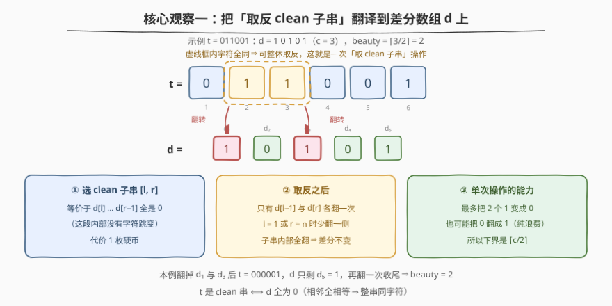
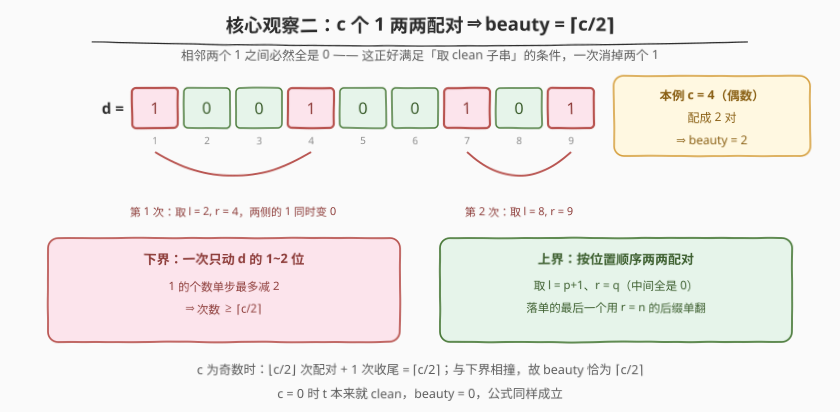
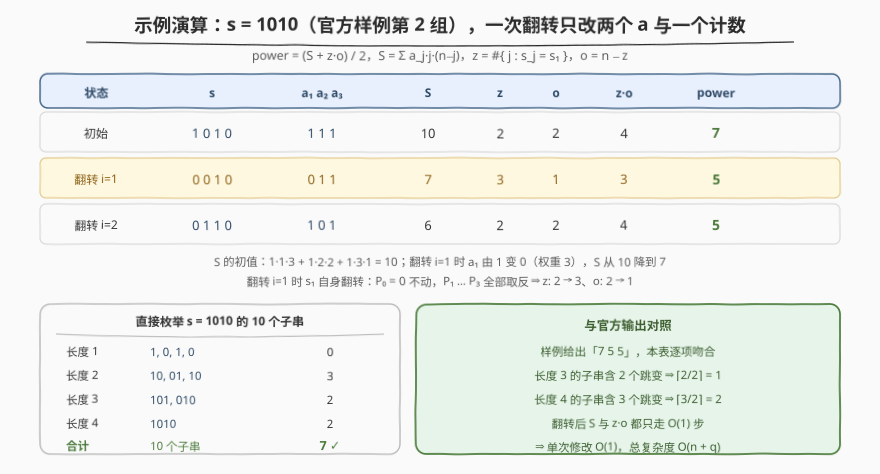

# Codeforces 2267E 干净子串 题解

## 1. 题目概述

- **标题 / 题号**：干净子串（Codeforces 2267E，英文名 Clean Substrings）
- **链接**：https://codeforces.com/problemset/problem/2267/E
- **来源**：Codeforces Round 1123 (Div. 2) · Problem E（UTC 2026-09-25）
- **难度**：2000 分（题面 rating 2000）
- **限制**：时间 2 s / 内存 256 MB
- **标签**：组合数学，数据结构，数学

**题意**：称二进制串 $t$（长度 $m$）是 **clean** 的，当且仅当对每个 $1 \le i < m$ 都有 $t_i = t_{i+1}$——也就是整串字符全相同（$m=1$ 时条件为空，自动 clean）。一次操作花 1 枚硬币：选 $t$ 的一个 clean 子串（一段连续且字符全相同的区间），把其中所有位取反。记 $\text{beauty}(t)$ 为把 $t$ 变成 clean 串所需的最少硬币数，$\text{power}(t)$ 为 $t$ **所有子串**的 beauty 之和。

给定长度 $n$ 的二进制串 $s$ 和 $q$ 次修改，每次给出一个下标 $i$，把 $s_i$ 取反。要求输出修改前、以及每次修改后的 $\text{power}(s)$。**多测**：第一行是测试组数，每组依次给出 $n$、$q$、串 $s$、$q$ 个下标，输出 $q+1$ 个整数（空格分隔，同一行）。

**约束**：

- $1 \le t \le 10^4$（测试组数）；$1 \le n, q \le 2\cdot 10^5$，且所有测试的 $\sum n \le 2\cdot10^5$、$\sum q \le 2\cdot10^5$；
- 每次修改必须 $O(1)$ 或 $O(\log n)$：共 $2\cdot10^5$ 次询问，单次 $O(n)$ 就超时；
- 答案最大约 $6.7\times 10^{14}$（全交替串、$n=2\cdot10^5$ 时 $\sum c/2 \approx n^3/12$），必须用 64 位整数。

## 2. 示例与观察
**官方样例**（一个输入块，共 4 组）

```text
输入
4
3 1
110
2
4 2
1010
1
2
8 4
10101110
3
5
2
3
10 5
1100101110
1
6
10
7
3

输出
2 2
7 5 5
36 23 22 25 26
61 66 41 35 59 60
```

- 第 1 组 `110`：6 个子串的 beauty 是 $0,0,0,0,1,1$，和为 2；翻转 $s_2$ 得 `100`，beauty 变成 $0,0,0,1,0,1$，和仍是 2。
- 第 2 组 `1010`：10 个子串里长度 2 的三个各 1、长度 3 的两个各 1、长度 4 的 1 个为 2，和 $3+2+2=7$；两次翻转后都变成 5。

**自造样例**（$n=1$ 的退化情形 + 连续三次修改）

```text
输入
2
1 1
0
1
4 3
0110
1
2
4

输出
0 0
5 3 7 5
```

- $n=1$ 时没有相邻对，单字符串天然 clean，翻转后仍是单字符，答案恒为 0；
- `0110` 的 power 为 5，连续三次翻转依次经过 `1110`、`1010`、`1011`，power 为 $3,7,5$。

## 3. 解题思路

### 3.1 暴力思路

最直接的做法是枚举所有 $O(n^2)$ 个子串，对每个子串求 beauty 再求和；每次修改后重算，复杂度 $O(n^3q)$ 或（若已知公式）$O(n^2q)$，在 $n=q=2\cdot10^5$ 下不可行。而单求一个子串的 beauty 本身也不简单：把「当前串」当状态做 BFS，状态数 $2^m$。所以必须先找到 beauty 的封闭形式，再把 power 写成可 $O(1)$ 维护的量。

### 3.2 核心观察：差分数组 + 配对 ⇒ $\text{beauty}(t)=\lceil c/2\rceil$

**第一步：换成差分数组。** 对长度 $m$ 的串 $t$ 定义

$$d_i = [\,t_i \ne t_{i+1}\,],\qquad 1 \le i < m,\qquad c = \sum_{i=1}^{m-1} d_i .$$

$t$ 是 clean 串当且仅当 $d$ 全为 0。现在看一次操作在 $d$ 上做了什么：选 clean 子串 $t[l..r]$（即 $d_l,\dots,d_{r-1}$ 全为 0）整体取反。段内部的相邻关系全都没变（两边一起翻），只有两个「边界」会变——$t_{l-1}$ 与 $t_l$ 的关系被破坏/修复，即 $d_{l-1}$ 翻转；$t_r$ 与 $t_{r+1}$ 同理，即 $d_r$ 翻转；$l=1$ 或 $r=m$ 时对应一侧不存在。所以一次操作在 $d$ 上**最多翻转 2 个位置**，且这 2 个位置之间必须夹着一段全 0（否则选不出 clean 子串）。



**第二步：配对给出上界。** 设 $d$ 中值为 1 的位置是 $p_1 < p_2 < \dots < p_c$。

- $c$ 为偶数：把 $(p_1,p_2), (p_3,p_4), \dots$ 两两配对。同一对的两个 1 之间没有别的 1，因此中间全是 0，取 $l=p_{2k-1}+1$、$r=p_{2k}$ 就是一个合法操作，它恰好把这两个 1 同时变成 0，且不动其他位置。$c/2$ 次做完。
- $c$ 为奇数：前 $c-1$ 个照样配对，最后一个 $p_c$ 之后全是 0，取 $l=p_c+1$、$r=m$（后缀单翻）即可只翻掉 $p_c$。共 $(c-1)/2+1=\lceil c/2\rceil$ 次。

**下界**：一次操作只翻转 1 或 2 个位置，1 的个数单步最多减少 2，故至少 $\lceil c/2\rceil$ 次。上下界相撞，于是

$$\text{beauty}(t) = \left\lceil \frac{c(t)}{2} \right\rceil,\qquad c(t)=\#\{i: t_i \ne t_{i+1}\}.$$



> 💡 这一步是整题的「钥匙」：beauty 从「BFS 求最小操作数」变成了「数相邻不等对的个数」，于是 power 成了对 $a_j=[s_j \ne s_{j+1}]$ 的加权计数。

### 3.3 算法流程：把 power 拆成「和 + 奇偶」，再做到 $O(1)$ 修改

令 $a_j = [s_j \ne s_{j+1}]$（$1 \le j < n$），则子串 $s[l..r]$ 的跳变数 $c(l,r)=\sum_{j=l}^{r-1} a_j$。把上取整拆开：

$$\text{power} = \sum_{l \le r} \left\lceil \frac{c(l,r)}{2} \right\rceil = \frac{1}{2}\left( S + K \right),\quad S = \sum_{l \le r} c(l,r),\quad K = \#\{(l,r): c(l,r) \text{ 为奇数}\}.$$

**求 $S$**：交换求和顺序，$a_j$ 被多少个区间 $[l,r]$ 包含？$l$ 可取 $1..j$ 共 $j$ 种，$r$ 可取 $j+1..n$ 共 $n-j$ 种，于是

$$S = \sum_{j=1}^{n-1} a_j \cdot j \cdot (n-j).$$

**求 $K$**：做前缀异或 $P_0 = 0$、$P_k = a_1 \oplus a_2 \oplus \cdots \oplus a_k$（$1 \le k \le n-1$），则 $c(l,r) = P_{r-1} \oplus P_{l-1}$，为奇数当且仅当 $P_{r-1} \ne P_{l-1}$。每个子串对应唯一一对下标 $0 \le x < y \le n-1$（取 $x=l-1$、$y=r-1$），所以

$$K = z \cdot o,\qquad z = \#\{x: P_x = 0\},\quad o = n - z .$$

**关键代换**：差分是望远镜求和的，$\bigoplus_{i=1}^{k} a_i = s_1 \oplus s_{k+1}$，因此

$$P_k = s_1 \oplus s_{k+1}\ \Longrightarrow\ P_k = 0 \iff s_{k+1} = s_1 ,$$

即 $z$ 就是「$s$ 里等于 $s_1$ 的字符个数」，$o = n-z$。于是根本不用维护前缀异或数组：

$$\boxed{\ \text{power}(s) = \frac{S + z\,(n-z)}{2}\ }$$

**修改 $s_i$** 只影响两处：$a_{i-1}$ 与 $a_i$（越界则没有）各翻转一次，$S$ 相应加减 $j(n-j)$（$j=i-1$ 或 $j=i$）；同时字符计数 $c_0,c_1$ 移动一个。注意 $z$ 是「等于**当前** $s_1$ 的字符数」：$i>1$ 时它随那个字符在两堆之间的移动而增减；$i=1$ 时 $s_1$ 自身翻转，对应 $P_1,\dots,P_{n-1}$ 全部取反而 $P_0=0$ 不动（并不是整个 $P$ 一起翻），新值恰是 $1+o_{\text{旧}}$。实现上只需「先翻转字符、更新计数，再取 $z=c_{s_1}$」，两种情况自动统一。

流程：① 读入后建 $a$、算 $S$ 与 $c_0,c_1$；② 输出初始 power；③ 每次修改翻转 $a_{i-1}$（若 $i>1$）与 $a_i$（若 $i<n$）并修正 $S$；④ 更新计数与 $s_i$，令 $z=c_{s_1}$，输出 $(S+z(n-z))/2$；⑤ 换组时数组与计数全部重建。

> 💡 若没想到第 3 个恒等式，标准做法是用**带懒标记的线段树**维护 $P$ 数组的「0 的个数」：翻转 $s_i$ 等价于对 $P[i..n-1]$ 区间取反，线段树上交换 $0/1$ 计数即可，复杂度 $O((n+q)\log n)$，也能过。题目的 data structures 标签说的就是这个套路，但本题可以用恒等式做到 $O(1)$。

### 3.4 示例演算

以样例第 2 组 $s=\texttt{1010}$（$n=4$）为例：$a=(1,1,1)$，$S = 1\cdot1\cdot3 + 1\cdot2\cdot2 + 1\cdot3\cdot1 = 10$；$P=(0,1,0,1)$，$z=2,o=2$，$K=4$，$\text{power}=(10+4)/2=7$。翻转 $s_1$ 后 $s=\texttt{0010}$：$a=(0,1,1)$，$S=7$；$s_1=0$，0 有 3 个，$z=3,o=1$，$\text{power}=(7+3)/2=5$。翻转 $s_2$ 后 $s=\texttt{0110}$：$a=(1,0,1)$，$S=6$；$z=2,o=2$，$\text{power}=5$。与官方输出 `7 5 5` 一致。

再直接枚举 $s=\texttt{1010}$ 的全部 10 个子串核对：长度 1 的四个都是 0；长度 2 的 `10`、`01`、`10` 各 1，共 3；长度 3 的 `101`、`010` 各有 2 个跳变 ⇒ 各 1，共 2；长度 4 的 `1010` 有 3 个跳变 ⇒ 2。合计 $0+3+2+2=7$。



## 4. 算法细节

1. **多测清空**：$a$ 数组、$S$、$c_0,c_1$ 全部声明在每组循环体内部（`vector` 每组按 $n$ 重新分配），不要写成全局后忘记清空；$\sum n$ 只有 $2\cdot10^5$，重复分配的开销可以忽略。
2. **两个 $a$ 都要翻**：翻转 $s_i$ 会同时改变 $s_{i-1}s_i$ 与 $s_i s_{i+1}$ 两组相邻关系，即 $a_{i-1}$ 与 $a_i$；只改一个是最常见的错。
3. **边界只翻一侧**：$i=1$ 时没有 $a_0$（判断 `i-1>=1`），$i=n$ 时没有 $a_n$（判断 `i<=n-1`）。
4. **$z$ 随 $s_1$ 走**：$z$ 是「等于当前 $s_1$ 的字符数」，$i=1$ 时 $s_1$ 自身翻转，必须先更新字符与计数、再读 `cnt[s[0]-'0']`。若用翻转前的 $s_1$ 去查表，取到的其实是 $n-z$（旧 $s_1$ 正是当前 $s_1$ 的反面），由于 $z(n-z)$ 关于 $z\leftrightarrow n-z$ 对称，本题答案碰巧不变，但换个问法就错，务必按「先更新、后取 $z$」写。
5. **1-indexed 与 0-indexed 混用**：题面下标 $i$ 从 1 开始；$a$ 用 $1..n-1$ 编号（因为权重公式 $j(n-j)$ 依赖 1-indexed），字符串用 0-indexed，读入后统一 `i-1` 访问字符、`i-1 / i` 访问 $a$。
6. **溢出**：$S$ 最大约 $\frac{n(n^2-1)}{6}\approx 1.33\times10^{15}$（$n=2\cdot10^5$），$z(n-z)\le 10^{10}$，和约 $1.34\times10^{15}$，`int` 必然溢出，必须全程 `long long`；乘法写成 `(long long)a[j] * j * (n - j)`，避免 `int * int` 先溢出。
7. **整除是精确的**：$S + z(n-z)$ 一定是偶数——因为对每个子串 $c + [c \text{ 为奇数}]$ 都是偶数，逐项求和仍为偶数，所以直接 `/ 2` 不会丢精度（不必用浮点，也无需先判断奇偶）。
8. **I/O**：总输出量为 $O(\sum q)$ 个整数，C++ 关同步后 `cout << ' ' << ans` 足够；Python 用 `sys.stdin.buffer.read().split()` 一次切分，并逐组拼成字符串后统一输出，避免逐行 `print` 的刷新开销。

## 5. 正确性证明

**引理 1（操作在差分数组上的作用）**：设 $t$ 长度 $m$，$d_i=[t_i\ne t_{i+1}]$。一次操作（选 clean 子串 $t[l..r]$ 整体取反）后，$d$ 恰好只在 $d_{l-1}$（当 $l>1$）与 $d_r$（当 $r<m$）上翻转，其余位置不变；且「$d_{l},\dots,d_{r-1}$ 全为 0」是这次操作合法的充要条件。

**证明**：合法性即 $t_l=\dots=t_r$，等价于 $d_l=\dots=d_{r-1}=0$。对 $l \le i < r$，$t_i,t_{i+1}$ 同时取反，异或值不变，故这些 $d_i$ 不变。$i=l-1$ 时只有 $t_l$ 取反，$d_{l-1}=[t_{l-1}\ne t_l]$ 翻转；$i=r$ 时只有 $t_r$ 取反，$d_r$ 翻转。$l=1$ 时 $d_{l-1}$ 不存在，$r=m$ 时 $d_r$ 不存在。∎

**引理 2（beauty 的封闭形式）**：对任意二进制串 $t$，$\text{beauty}(t)=\lceil c/2\rceil$，其中 $c=\#\{i: t_i\ne t_{i+1}\}$，且 $c=0$ 时 beauty 为 0。

**证明**：$t$ 是 clean 串 ⟺ $d$ 全 0 ⟺ $c=0$，故 $c=0$ 时无需操作。下界：由引理 1，每次操作至多翻转 $d$ 的两个位置，$d$ 中 1 的个数（即 $c$）单步最多减少 2，要把 $c$ 个 1 清空至少需要 $\lceil c/2\rceil$ 次。上界：设 1 的位置为 $p_1<\dots<p_c$（$c\ge1$）。
- 对 $k=1,2,\dots,\lfloor c/2\rfloor$，取 $l=p_{2k-1}+1$、$r=p_{2k}$。因 $p_{2k-1}<p_{2k}$ 之间没有 1，$d_{p_{2k-1}+1..p_{2k}-1}$ 全为 0，操作合法（引理 1），且只翻掉 $p_{2k-1},p_{2k}$ 这两个 1，其余位置（含尚未处理的 1）不受影响，故每一步都严格减少 2 个 1。
- 若 $c$ 为奇数，最后剩 $p_c$。它是最后一个 1，所以 $d_{p_c+1..m-1}$ 全为 0，取 $l=p_c+1$、$r=m$ 合法，只翻掉 $p_c$，再花 1 次。

两种情形分别用 $c/2$ 与 $\lceil c/2\rceil$ 次完成，与下界相同，故 $\text{beauty}(t)=\lceil c/2\rceil$。∎

**引理 3（power 的分解式）**：对长度 $n$ 的 $s$，令 $a_j=[s_j\ne s_{j+1}]$、$S=\sum_{j=1}^{n-1}a_j\,j\,(n-j)$、$z=\#\{j: s_j=s_1\}$，则 $\text{power}(s)=\big(S+z(n-z)\big)/2$。

**证明**：由引理 2，$\text{power}=\sum_{l\le r}\lceil c(l,r)/2\rceil=\frac12\big(S+K\big)$，其中 $S=\sum_{l\le r}\sum_{j=l}^{r-1}a_j$、$K$ 为 $c(l,r)$ 为奇数的子串数。对 $S$ 交换求和：$a_j$ 出现在所有满足 $l\le j<r$ 的子串中，$l$ 有 $j$ 种、$r$ 有 $n-j$ 种，得 $S=\sum_j a_j\,j\,(n-j)$。对 $K$：令 $P_0=0$、$P_k=a_1\oplus\cdots\oplus a_k$，则 $c(l,r)=P_{r-1}\oplus P_{l-1}$（异或抵消中间项），故 $c$ 为奇数 $\iff P_{l-1}\ne P_{r-1}$；映射 $(l,r)\mapsto(l-1,r-1)$ 是全体子串与全体 $0\le x<y\le n-1$ 的双射，所以 $K=z\cdot o$，$z,o$ 为 $P_0..P_{n-1}$ 中 0、1 的个数。又 $P_k=a_1\oplus\cdots\oplus a_k=s_1\oplus s_{k+1}$，故 $P_k=0\iff s_{k+1}=s_1$，于是 $z=\#\{j\in[1,n]: s_j=s_1\}$、$o=n-z$。代入即得。∎

**定理**：3.3 节的算法在每次修改后输出的值等于当前串的 power。

**证明**：初始时算法按定义算出的 $S$、$z$ 与引理 3 一致，输出正确。设某次修改前不变式「$S=\sum_j a_j\,j(n-j)$，$c_0,c_1$ 为当前串字符计数，且输出的是当前 power」成立。翻转 $s_i$ 只改变 $a_{i-1},a_i$ 与一个字符的计数值：算法对每个存在的 $a_j$ 恰好翻转一次，并用 $\pm j(n-j)$ 修正 $S$，故 $S$ 仍等于 $\sum_j a_j\,j(n-j)$；计数同步更新后，$z=c_{s_1}$（$s_1$ 为修改后的首字符）恰为「等于当前 $s_1$ 的字符数」，由引理 3 输出即为当前 power。不变式保持，归纳得每次输出都正确。∎

## 6. 复杂度分析

- **时间**：每组建 $a$、求 $S$、求计数各 $O(n)$；每次修改是常数次加减与计数更新，$O(1)$。总计 $O\!\left(\sum n + \sum q\right) \le 4\times10^5$ 次基本运算。
- **空间**：每组一个长度 $n+2$ 的 $a$ 数组与串 $s$，$O(n)$；其余都是常数个标量。$\sum n\le 2\cdot10^5$，峰值内存约 1 MB 量级。
- **可行性对照**：时限 2 s。实测最大规模（$n=q=2\cdot10^5$ 单组，含进程启动）C++17 约 0.3 s、Python3 约 0.28 s，$t=10^4$ 组小数据约 0.2 s，对 2 s 仍有 6 倍以上余量。若改用线段树维护前缀异或，则为 $O((n+q)\log n)$，同样能过，但常数更大。

## 7. 参考代码

### C++17

```cpp
#include <iostream>
#include <string>
#include <vector>
using namespace std;

int main() {
    ios::sync_with_stdio(false);
    cin.tie(nullptr);
    int T;
    if (!(cin >> T)) return 0;
    while (T--) {
        int n, q;
        string s;
        cin >> n >> q >> s;
        vector<int> a(n + 2, 0);                 // a[j] = [s[j-1] != s[j]]
        long long S = 0, cnt[2] = {0, 0};
        for (int j = 1; j < n; ++j) {
            a[j] = (s[j - 1] != s[j]);
            S += (long long)a[j] * j * (n - j);  // 权重 j*(n-j)
        }
        for (int i = 0; i < n; ++i) cnt[s[i] - '0']++;

        auto power = [&]() -> long long {
            long long z = cnt[s[0] - '0'];       // 等于 s[0] 的字符个数
            return (S + z * (n - z)) / 2;
        };

        cout << power();
        while (q--) {
            int i;
            cin >> i;                            // 1-indexed
            for (int j = i - 1; j <= i; ++j) {   // 只有 a[i-1] 与 a[i] 会变
                if (j < 1 || j > n - 1) continue;
                S -= (long long)a[j] * j * (n - j);
                a[j] ^= 1;
                S += (long long)a[j] * j * (n - j);
            }
            cnt[s[i - 1] - '0']--;
            s[i - 1] = (s[i - 1] == '0' ? '1' : '0');
            cnt[s[i - 1] - '0']++;
            cout << ' ' << power();
        }
        cout << '\n';
    }
    return 0;
}
```

### Python3

```python
import sys


def main():
    data = sys.stdin.buffer.read().split()
    T = int(data[0])
    ptr = 1
    out = []
    for _ in range(T):
        n, q = int(data[ptr]), int(data[ptr + 1]); ptr += 2
        s = list(data[ptr].decode()); ptr += 1
        a = [0] * (n + 2)                      # a[j] = (s[j-1] != s[j])
        S = 0
        for j in range(1, n):
            a[j] = 1 if s[j - 1] != s[j] else 0
            if a[j]:
                S += j * (n - j)
        cnt0 = s.count('0')
        cnt1 = n - cnt0
        res = []
        for step in range(q + 1):
            z = cnt0 if s[0] == '0' else cnt1
            res.append((S + z * (n - z)) // 2)
            if step == q:
                break
            i = int(data[ptr]); ptr += 1
            for j in (i - 1, i):               # 只有 a[i-1] 与 a[i] 会变
                if 1 <= j <= n - 1:
                    w = j * (n - j)
                    S += -w if a[j] else w
                    a[j] ^= 1
            if s[i - 1] == '0':
                cnt0 -= 1; cnt1 += 1; s[i - 1] = '1'
            else:
                cnt1 -= 1; cnt0 += 1; s[i - 1] = '0'
        out.append(' '.join(map(str, res)))
    sys.stdout.write('\n'.join(out) + '\n')


main()
```

## 8. 边界情况与易错点

1. **$n=1$**：没有任何 $a_j$，$S=0$、$z=1$、$o=0$，输出 0；修改只翻转唯一字符，答案始终 0。数组按 $n+2$ 开，访问 $a_0$ 或 $a_n$ 也不会越界。
2. **整串同字符（$c=0$）**：$S=0$ 且 $z=n$、$o=0$，答案 0；注意此时 beauty 定义是 0 而不是 $\lceil 0/2\rceil$ 之外的任何特判，公式已覆盖。
3. **修改落在端点**：$i=1$ 时只翻 $a_1$，$i=n$ 时只翻 $a_{n-1}$，两个 `if` 缺一不可；写成一个无条件语句会越界或误改。
4. **$i=1$ 时 $z$ 的含义翻转**：$s_1$ 变了，必须用**新** $s_1$ 去取计数。若沿用「初始 $s_1$ 对应的计数」，样例 2 的第一次修改就会输出错误值（正确 5，错解会得 7）。
5. **溢出**：`int` 在 $n\ge 3000$ 时 $S$ 就已超过 $2^{31}$，必须 `long long`；`j * (n - j)` 两个 `int` 相乘在 $n=2\cdot10^5$ 时是 $10^{10}$，要先转 64 位再乘（代码里 `(long long)a[j] * j * (n - j)` 靠左结合保证安全）。
6. **除法与奇偶**：$(S+z\cdot o)/2$ 是整数，直接用整除；若题目改成对 $10^9+7$ 取模，则不能先除，需要按 $2\cdot MOD$ 取模或乘 2 的逆元（见延伸思考）。
7. **多测输出格式**：每组一行、$q+1$ 个数、空格分隔、行末不要多余空格；Python 里把每组结果 `join` 后统一输出，避免逐行 flush。
8. **读入量**：$t$ 可达 $10^4$，总 token 数约 $4\cdot10^5$，必须用快速读入；C++ 用 `cin` 关同步即可，Python 不要用 `input()` 逐行读。

## 9. 验证记录

- **编译环境与命令**：`clang++ -std=c++17 -O2`（本机无 GNU g++，配 `codeforces/tools/include/bits/stdc++.h` 兼容头；正文代码只用标准库，可原样提交 GNU C++17）；Python 侧为 `Python 3.9.6`。
- **官方样例**：1 / 1 通过（按 Codeforces 标准 checker 的 token 比对，忽略空白与大小写）。
- **复核状态**：audited（2026-11-19 统一回归：编译 + 官方样例；写作期的随机对拍与暴力未重跑）。

## 相关题目与扩展

- [Codeforces 1398C Good Subarrays](https://codeforces.com/problemset/problem/1398/C)：把「子数组和等于 $k$」转成「前缀和相等」的配对计数，与本题用 $z\cdot o$ 数奇数子串是同一套「前缀量配对」技巧。
- [LeetCode 1915. 最美子字符串的数目](https://leetcode.cn/problems/number-of-wonderful-substrings/)：前缀异或 + 奇偶状态计数，正是本题 $K=z\cdot o$ 一行的直接来源（那里字母表更大，需要 $2^{10}$ 个状态）。
- [LeetCode 1529. 灯泡开关 IV](https://leetcode.cn/problems/bulb-switcher-iv/)：翻转后缀把「跳变个数」直接变成答案，可对照本题「跳变数除以 2」的差别。

**延伸思考**：

1. 若操作改成「选任意子串取反」（不要求 clean），引理 1 会说 $d$ 的 4 个位置都可能变，配对下界与构造都要重做，beauty 会退化成与 $c$ 的另一种关系。
2. 若询问改成「区间 $[l,r]$ 整体取反」，$S$ 里权重 $j(n-j)$ 的区间加权和需要用线段树维护（区间翻转会把 $a$ 的 0/1 互换，需同时维护 $\sum j(n-j)$ 与区间长度），而 $z(n-z)$ 的维护要跟着 $s_1$ 与整体计数走。
3. 若要求答案对 $10^9+7$ 取模：$(S+z\cdot o)$ 在整数意义下是偶数，但模意义下不能直接除 2，应改为对 $2\cdot MOD$ 取模后再除，或用 $2$ 的逆元并额外处理奇偶。
4. 若字符集从二进制扩到大小 $\sigma$：clean 仍等价于所有相邻相等，$a_j$ 定义不变，beauty 仍是 $\lceil c/2\rceil$，只需把 $z$ 换成「与 $s_1$ 相同的字符计数」，复杂度不变。
5. 若要求输出「历史最大 power」，由于每次修改后答案已是 $O(1)$ 得到，顺带维护最大值即可，无需额外结构。
