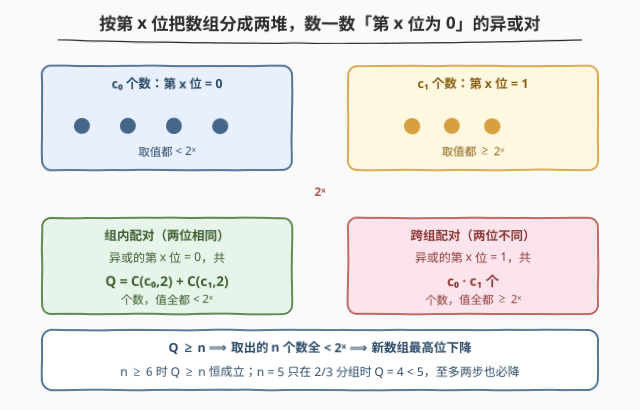
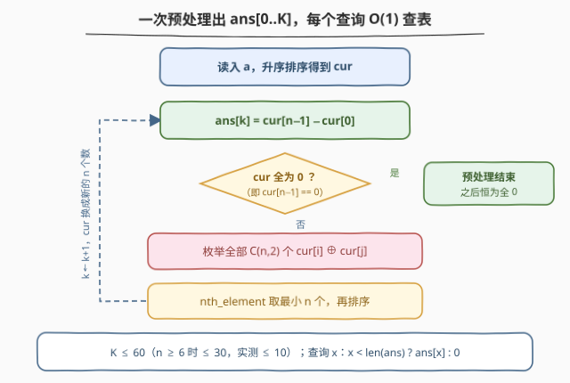
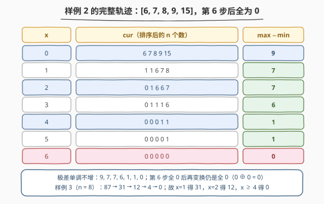

# Codeforces 2267F1 异或变换（简单版） 题解
## 1. 题目概述

- **标题 / 题号**：异或变换（简单版）（Codeforces 2267F1，英文名 XOR Transformations (Easy Version)）
- **链接**：https://codeforces.com/problemset/problem/2267/F1
- **来源**：Codeforces Round 1123 (Div. 2) · Problem F1
- **难度**：1700（1000 分，easy 版；hard 版 2267F2 为 2300）
- **限制**：时间 4 s / 内存 512 MB
- **标签**：位运算（bitmask），暴力，实现，排序

**题意**：对长度为 $m$ 的数组 $b$ 定义一次**变换** $f$：列出全部 $\binom{m}{2}$ 个 $b_i \oplus b_j\ (i<j)$，取其中**最小的 $m$ 个**组成新数组（长度仍是 $m$，按多重集理解）。给定长度 $n$ 的数组 $a$ 与 $q$ 个**互相独立**的询问 $x$：把 $a$ 连续做 $x$ 次变换后输出 $\max - \min$（每个询问前 $a$ 都还原）。多测：第一行 $t$，每组先给 $n, q$ 与 $a_1,\dots,a_n$，随后 $q$ 行各一个 $x$，逐组输出 $q$ 个答案。

**约束**：

- $1 \le t \le 100$，$5 \le n \le 2000$，$1 \le q \le 2000$，且所有测试的 $\sum n \le 2000$、$\sum q \le 2000$；
- $0 \le a_i < 2^{30}$，$0 \le x < 2^{30}$（$x$ 可达 $10^9$ 量级，绝不能按 $x$ 次模拟）；
- 与 hard 版（2267F2）的唯一区别是 $n, q \le 10^5$，同一份 $O(n^2)$ 代码在 hard 版会超时；
- 时间 4 s、内存 512 MB，允许 $O(K n^2)$，其中 $K$ 是「塌缩」所需的变换次数。

## 2. 示例与观察
**官方样例**（一个输入块，共 4 组数据）

```text
输入
4
5 1
0 0 1 1 1
1
5 2
6 7 8 9 15
0
1
8 2
102 92 15 19 25 54 62 36
2
1
10 1
56 73 81 23 17 92 50 34 67 78
2

输出
1
9
7
12
31
7
```

逐组对照（数组统一写成升序）：

| 组 | $n$ | $a$ | $x$ | 变换 $x$ 次后的数组 | 答案 |
|:--:|:--:|:--|:--:|:--|:--:|
| 1 | 5 | 0 0 1 1 1 | 1 | 0 0 0 0 1（异或为 0 的只有 4 对） | 1 |
| 2 | 5 | 6 7 8 9 15 | 0 | 6 7 8 9 15 | 9 |
| 2 | 5 | 6 7 8 9 15 | 1 | 1 1 6 7 8 | 7 |
| 3 | 8 | 15 19 25 36 54 62 92 102 | 2 | 2 2 4 6 8 10 12 14 | 12 |
| 3 | 8 | 同上 | 1 | 8 10 18 22 26 28 37 39 | 31 |
| 4 | 10 | 17 23 34 50 56 67 73 78 81 92 | 2 | 0 0 0 1 2 2 5 7 7 7 | 7 |

注意第 1 组：$[0,0,1,1,1]$ 的 10 个异或值里只有 4 个 0、6 个 1，取最小的 5 个得 $[0,0,0,0,1]$，极差仍是 1——**一次变换不保证极差严格变小**。

**自造样例**（全相同元素 + $x$ 取到 $10^9$）

```text
输入
1
5 3
7 7 7 7 7
0
1
1000000000

输出
0
0
0
```

$x=0$ 极差为 0，$x\ge1$ 起数组全 0，故 $10^9$ 也输出 0。另外 $[0,1,2,3,4]$ 的轨迹是 $4 \to 2 \to 2$：两步都不为 0，说明「只算一步」不够。

## 3. 解题思路

### 3.1 暴力思路

按定义模拟 $x$ 次：每次枚举 $\binom{n}{2}$ 个异或值、排序取前 $n$ 个，单步 $O(n^2\log n)$。$x$ 最大 $2^{30}-1$，直接模拟必然超时，逐询问模拟更糟。

但**答案序列其实很短**：手玩几组就能看到数组迅速塌缩成全 0（样例 3 只用 4 步）。只要证明「至多 60 步必全 0」，就能把所有询问压成对同一张答案表的 $O(1)$ 查表。

### 3.2 核心观察：最高位每至多两步必下降

记当前最大值 $M$ 的**最高位**为 $x$，即 $2^x \le M < 2^{x+1}$（$M=0$ 视为已归零）。按第 $x$ 位把元素分成两堆：该位为 0 的 $c_0$ 个、为 1 的 $c_1$ 个，$c_0+c_1=n$。

- 两数第 $x$ 位**相同**时异或的第 $x$ 位是 0，这样的对共 $Q=\binom{c_0}{2}+\binom{c_1}{2}$ 个，其值都 $<2^x$；
- 第 $x$ 位**不同**时异或值 $\ge2^x$，这样的对有 $c_0c_1$ 个。

所有 $<2^x$ 的值都严格小于所有 $\ge2^x$ 的值，所以只要 $Q\ge n$，取出的 $n$ 个最小值就全部 $<2^x$，**最高位立刻下降**。而 $Q$ 在两堆尽量平均时最小：$n=2k$ 时 $Q\ge2\binom{k}{2}=k(k-1)\ge2k$（$k\ge3$）；$n=2k+1$ 时 $Q\ge\binom{k}{2}+\binom{k+1}{2}=k^2\ge2k+1$（$k\ge3$，即 $n\ge7$）。于是：

- **$n\ge6$**：$Q\ge n$ 恒成立，**每一步**最高位都严格下降；
- **$n=5$**：只有 $2/3$ 分裂会出现 $Q=4<5$。此时新数组是「4 个 $<2^x$ 的值 + 1 个带第 $x$ 位的值」，再变换一次按 $4/1$ 分裂得 $Q'=\binom{4}{2}+\binom{1}{2}=6\ge5$，最高位照样下降，即至多两步降一位。

最高位不超过 29，故**至多 $2\times30=60$ 次变换后最大值就是 0**（$n\ge6$ 时至多 30 次，实测不超过 10 次）；而全 0 数组的一切异或都是 0，之后永远全 0。于是对足够大的 $x$，答案恒为 0。



> 💡 顺带一提：数组的最小值必等于**排序后相邻元素的异或最小值**（$b_{i+1}$ 夹在 $b_i,b_j$ 之间，必与其中之一共享更低的最高不同位），所以最小值一步就掉得很小；但本题要的是整个前 $n$ 小集合。

### 3.3 算法流程

1. 读入 $a$，升序排序得到 `cur`，准备答案表 `ans`（`ans[k]` 为变换 $k$ 次后的极差）。
2. `ans.push_back(cur.back() - cur.front())`。
3. 若 `cur.back() == 0`：已全 0，预处理结束，后续 $x$ 的答案都是 0。
4. 否则枚举全部 $\binom{n}{2}$ 个 `cur[i] ^ cur[j]`，用 `nth_element` 取出最小 $n$ 个并排序，替换 `cur`，回到第 2 步。
5. 每个询问 $x$：若 $x<\lvert ans\rvert$ 输出 `ans[x]`，否则输出 0。

每轮是「生成 $\binom{n}{2}$ 个异或 + 选前 $n$ 小」，$n\le2000$ 时约 $2\times10^6$ 次异或；轮数 $K\le60$（实测 $\le10$）。查询只做下标比较，$O(1)$。



### 3.4 示例演算

以样例 2 的 $a=[6,7,8,9,15]$ 走完整条轨迹：

| $x$ | 0 | 1 | 2 | 3 | 4 | 5 | 6 |
|:--:|:--|:--|:--|:--|:--|:--|:--|
| 变换后 | 6 7 8 9 15 | 1 1 6 7 8 | 0 1 6 6 7 | 0 1 1 1 6 | 0 0 0 1 1 | 0 0 0 0 1 | 0 0 0 0 0 |
| 极差 | 9 | 7 | 7 | 6 | 1 | 1 | 0 |

第 1 步：10 个异或值排序后是 $1,1,6,7,8,9,14,14,15,15$，取前 5 个得 $1,1,6,7,8$；此后每步重复「枚举 + 取前 $n$ 小」。$x=6$ 起全 0，故 $x\ge6$ 一律输出 0；样例只问 $x=0,1$，答案为 $9,7$。再看样例 3（$n=8$）：极差轨迹 $87\to31\to12\to4\to0$，所以 $x=1$ 输出 31、$x=2$ 输出 12；若误以为「降一位最高位就归零」，$x=2$ 会错答 0。



## 4. 算法细节

1. **答案表只算一次**：连续变换是确定性的，$q$ 个询问共享同一条轨迹，逐询问模拟是最大的时间陷阱。
2. **只保留前 $n$ 小**：`nth_element` 期望 $O(N)$（$N=\binom{n}{2}$）取出前 $n$ 个，再单独排序这 $n$ 个；对 $2\times10^6$ 个数整体排序会白多一个 $\log$。
3. **长度恒为 $n$**：取出个数是「当前数组长度」，初始 $n$ 之后不再变化，绝不是 $\binom{n}{2}$。
4. **提前退出**：`cur.back() == 0` 时立刻停止，同时保证循环次数 $\le60$；判断依据是最大值而不是极差。
5. **查询下标用大整数**：$x<2^{30}$，C++ 用 `long long` 读、与 `size_t` 比较；Python 无溢出问题。
6. **常数与 I/O**：`all` 在循环外 `reserve(n*(n-1)/2)` 一次、每轮 `clear()` 复用，省掉每轮约 8 MB 的分配；$a_i<2^{30}$ 保证异或值与答案都 $<2^{30}$，`int` 足够；关同步的 `cin` 即可，Python 用 `sys.stdin.buffer.read().split()` 一次切分。

## 5. 正确性证明

**引理 1（分组计数）**：设数组长度 $n$、最高位 $x$，第 $x$ 位为 0/1 的元素各有 $c_0,c_1$ 个。则两两异或中第 $x$ 位为 0 的恰有 $Q=\binom{c_0}{2}+\binom{c_1}{2}$ 个且都 $<2^x$，其余 $c_0c_1$ 个都 $\ge2^x$。

**证明**：$b_i\oplus b_j$ 的第 $x$ 位为 0 当且仅当 $b_i,b_j$ 该位相同；「同为 0」的 $\binom{c_0}{2}$ 对与「同为 1」的 $\binom{c_1}{2}$ 对互斥且穷尽。又因两操作数都 $<2^{x+1}$，异或值 $<2^{x+1}$，其第 $x$ 位为 0 等价于该值 $<2^x$，为 1 等价于 $\ge2^x$。∎

**引理 2（$Q$ 的最小值）**：$Q\ge\binom{\lfloor n/2\rfloor}{2}+\binom{\lceil n/2\rceil}{2}$，且 $n\ge6$ 时该下界 $\ge n$。

**证明**：若 $c_1\ge c_0+2$，从第 1 组挪一个到第 0 组，则
$$\Delta Q=\left[\binom{c_1-1}{2}+\binom{c_0+1}{2}\right]-\left[\binom{c_1}{2}+\binom{c_0}{2}\right]=c_0-c_1+1<0,$$
故 $Q$ 在两堆尽量平均时最小。取 $n=2k$ 得 $2\binom{k}{2}=k(k-1)\ge2k\iff k\ge3$，取 $n=2k+1$ 得 $\binom{k}{2}+\binom{k+1}{2}=k^2\ge2k+1\iff k\ge3$；唯一例外是 $n=5$ 时 $4<5$。∎

**引理 3（至多两步下降）**：$Q\ge n$ 时变换后最大值 $<2^x$；$n=5$ 且 $Q<5$ 时只能是 $2/3$ 分裂、$Q=4$，再变换一次后最大值也 $<2^x$。

**证明**：前半：那 $Q$ 个 $<2^x$ 的值都严格小于任何 $\ge2^x$ 的值，前 $n$ 小全部取自它们。后半：$c_0+c_1=5$ 时 $Q\in\{4,6,10\}$，$Q=4$ 只对应 $2/3$ 分裂；此时 $<2^x$ 的 4 个值比任何 $\ge2^x$ 的值都小，会被全部取走，第 5 个只能取跨组最小值，故新数组恰为「4 个 $<2^x$ 的值 + 1 个带第 $x$ 位的值」，再变换时按 $4/1$ 分裂得 $Q'=\binom{4}{2}+\binom{1}{2}=6\ge5$，套用前半即得。∎

**定理**：3.3 节的算法输出全部询问的正确答案。

**证明**：由引理 2、3，每至多两步最高位至少下降 1，初始最高位 $\le29$，故至多 $2\times30=60$ 步后最大值为 0；又因全 0 数组的异或恒为 0，之后一直全 0，循环必终止且 $\lvert ans\rvert\le61$。每轮都枚举了全部 $\binom{n}{2}$ 个异或值并按定义取最小 $n$ 个，故第 $k$ 轮的 `cur` 恰为 $f^k(a)$，`ans[k]` 恰为其极差；$x\le K$ 时查表即真值，$x>K$ 时 $f^x(a)$ 全 0、极差为 0，正与输出 0 相符。∎

## 6. 复杂度分析

- **时间**：预处理 $K$ 轮，每轮 $O(n^2)$ 生成异或 + $O(n^2)$ 期望时间的 `nth_element` + $O(n\log n)$ 排序前 $n$ 个，合计 $O(Kn^2)$，每询问 $O(1)$。$K\le60$（$n\ge6$ 时 $\le30$，实测 $\le10$），最坏约 $60\times2\times10^6=1.2\times10^8$ 次异或。
- **空间**：临时异或数组 $O(n^2)$ 个 32 位整数（$n=2000$ 时约 8 MB），加上 $O(n)$ 的 `cur` 与 $O(1)$ 规模的答案表，远小于 512 MB。
- **可行性实测**：$n=q=2000$、$a_i$ 随机 30 位时 C++17 约 24 ms、Python3 约 0.5 s（含解释器启动）；$t=100$、$\sum n=\sum q=2000$ 时约 14 ms / 0.1 s，均在时限的 1/8 以内。

## 7. 参考代码

### C++17

```cpp
#include <algorithm>
#include <iostream>
#include <vector>
using namespace std;

int main() {
    ios::sync_with_stdio(false);
    cin.tie(nullptr);
    int T;
    if (!(cin >> T)) return 0;
    while (T--) {
        int n, q;
        cin >> n >> q;
        vector<int> a(n);
        for (int &v : a) cin >> v;
        sort(a.begin(), a.end());
        vector<int> ans;                  // ans[k] = 变换 k 次后的 max - min
        vector<int> cur = a, all;
        all.reserve((size_t)n * (n - 1) / 2);
        while (true) {
            ans.push_back(cur.back() - cur.front());
            if (cur.back() == 0) break;   // 已全 0，之后恒为 0
            int m = (int)cur.size();      // 恒等于 n
            all.clear();
            for (int i = 0; i < m; ++i)
                for (int j = i + 1; j < m; ++j) all.push_back(cur[i] ^ cur[j]);
            nth_element(all.begin(), all.begin() + m, all.end());
            all.resize(m);                // 只留最小的 m 个
            sort(all.begin(), all.end());
            cur.swap(all);
        }
        while (q--) {
            long long x;
            cin >> x;
            cout << ((size_t)x < ans.size() ? ans[(size_t)x] : 0) << '\n';
        }
    }
    return 0;
}
```

### Python3

```python
import sys
import heapq


def main():
    data = sys.stdin.buffer.read().split()
    pos = 0
    t = int(data[pos]); pos += 1
    out = []
    for _ in range(t):
        n = int(data[pos]); q = int(data[pos + 1]); pos += 2
        a = list(map(int, data[pos:pos + n])); pos += n
        a.sort()
        ans = []                     # ans[k] = 变换 k 次后的 max - min
        cur = a
        while True:
            ans.append(cur[-1] - cur[0])
            if cur[-1] == 0:         # 已全 0，之后恒为 0
                break
            m = len(cur)             # 恒等于 n
            vals = []
            ext = vals.extend
            for i in range(m - 1):
                ai = cur[i]
                ext([ai ^ x for x in cur[i + 1:]])
            cur = heapq.nsmallest(m, vals)

        for _ in range(q):
            x = int(data[pos]); pos += 1
            out.append(str(ans[x] if x < len(ans) else 0))
    sys.stdout.write('\n'.join(out) + '\n')


main()
```

Python 用 `heapq.nsmallest(m, vals)` 代替 `nth_element + sort`：从 $2\times10^6$ 个数里取前 $n$ 小是 $O(N\log n)$，实测比整体 `sorted` 更快。

## 8. 边界情况与易错点

1. **$x=0$**：必须原样输出初始极差（样例 2 的 9）。循环第一次 `push_back` 就是它，别漏记。
2. **一次变换不保证极差变小**：样例 1（$1\to1$）与样例 2（$7\to7$）都是反例，因此不能用「极差不再变小就停」当终止条件，必须按定义算到全 0。
3. **$n=5$ 是唯一需要两步才降最高位的规模**：$2/3$ 分裂时 $Q=4<5$；若把它当成「一步降一位」，会得到 $\le30$ 步的错误上界（结论仍对，但证明有洞）。
4. **数组长度恒为 $n$**：每轮取出个数是当前长度，不是 $\binom{n}{2}$；第 $n$ 小与第 $n+1$ 小并列时任取其一都得到同一个多重集，`nth_element` 的分界不影响答案。
5. **$x$ 可达 $2^{30}-1$**：查表前必须判 `x < ans.size()`；C++ 中 `x` 用 `long long` 读、与 `size_t` 比较，避免截断或负数比较出错。
6. **元素全相同**：$x=0$ 极差为 0，$x\ge1$ 数组全 0。注意「极差为 0」不等于「数组全 0」（如 $[0,0,0,0,5]$ 极差为 5、内部已有四个 0），退出判断只能看 `cur.back() == 0`。
7. **多测清空**：`ans`、`cur`、`all` 都在每组内部定义或清空；写成全局变量又忘记清空，会把上一组的答案串进来。

## 9. 验证记录

- **编译环境与命令**：`clang++ -std=c++17 -O2`（本机无 GNU g++，配 `codeforces/tools/include/bits/stdc++.h` 兼容头；正文代码只用标准库，可原样提交 GNU C++17）；Python 侧为 `Python 3.9.6`。
- **官方样例**：1 / 1 通过（按 Codeforces 标准 checker 的 token 比对，忽略空白与大小写）。
- **复核状态**：audited（2026-11-19 统一回归：编译 + 官方样例；写作期的随机对拍与暴力未重跑）。

## 相关题目与扩展

- [Codeforces 2267F2 XOR Transformations (Hard Version)](https://codeforces.com/problemset/problem/2267/F2)：$n,q\le10^5$ 的版本。单步 $O(n^2)$ 失效，需要 0-1 二叉 Trie 支持「与定值 $v$ 异或的第 $k$ 小」查询，再用小根堆做 $k$ 路归并，单步 $O(n\log V\log n)$；「至多 60 步归零」的结论完全复用。
- [Codeforces 888G Xor-MST](https://codeforces.com/problemset/problem/888/G)：在 Trie 上按位分治求最小异或生成树，核心同样是「最小异或对来自同一位前缀的块内」。
- [LeetCode 421. 数组中两个数的最大异或值](https://leetcode.cn/problems/maximum-xor-of-two-numbers-in-an-array/)：Trie 求最大异或对，是本题「取前 $n$ 小」的对偶问题，可对照两种堆式枚举写法。

**延伸思考**：

1. 若变换改成「取**最大**的 $n$ 个」，数组会被最大的异或值主导而几乎不塌缩，答案随 $x$ 振荡，需要另找不变量。
2. 若每轮取「第 $k$ 小到第 $k+n-1$ 小」，塌缩会随 $k$ 变慢；本文的计数论证仍可用，因为起作用的只是「$<2^x$ 的异或值够不够 $k+n-1$ 个」。
3. 本文上界 60 步而随机数据实测 $\le10$ 步：能否构造出让最高位「每两步才降一位」在 30 个二进制位上连续发生的数组？这决定了 hard 版的实际常数，也是本题最值得动手玩的部分。
