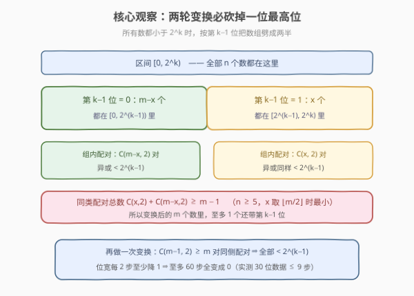
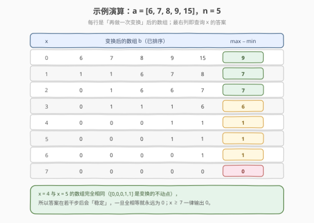

# Codeforces 2267F2 异或变换（困难版） 题解
## 1. 题目概述

- **标题 / 题号**：异或变换（困难版）（Codeforces 2267F2，英文名 XOR Transformations (Hard Version)）
- **链接**：https://codeforces.com/problemset/problem/2267/F2
- **来源**：Codeforces Round 1123 (Div. 2) · Problem F2（UTC 2026-09-25）
- **难度**：2300（本题 2000 分）
- **限制**：时间 4 s / 内存 512 MB
- **标签**：位运算，暴力枚举，数据结构，贪心，数学，排序，0-1 Trie，堆

**题意**：对长度 $m$ 的数组 $b$，一次**变换**指：列出所有 $b_i\oplus b_j\ (1\le i<j\le m)$（共 $\frac{m(m-1)}{2}$ 个值），取其中**最小的 $m$ 个**替换 $b$，长度不变。给定长度 $n$ 的数组 $a$ 和 $q$ 个询问，每个询问给出 $x$，求对 $a$ 连续做 $x$ 次变换后 $\max(a)-\min(a)$。**询问互相独立**（每次询问前 $a$ 恢复原状）。

**多测格式**：第一行 $t$；每组先给 $n,q$，再给一行 $n$ 个 $a_i$，随后 $q$ 行每行一个 $x$；每组输出一行 $q$ 个整数。

**约束**：

- $1\le t\le10^4$，$5\le n\le10^5$，$1\le q\le10^5$，$\sum n\le10^5$、$\sum q\le10^5$；
- $0\le a_i<2^{30}$，$0\le x<2^{30}$——$x$ 极大，不可能逐步模拟 $x$ 次；
- $n\ge5$ 是全文计数不等式的前提（$n<5$ 时 $\binom{n}{2}<n$，取不满 $n$ 个值）；
- 值域固定 30 位：它既是 0-1 Trie 的深度，也是"至多 60 步归零"上界的来源。

## 2. 示例与观察
**官方样例**

```text
输入
4
5 1
0 0 1 1 1
1
5 2
6 7 8 9 15
0
1
8 2
102 92 15 19 25 54 62 36
2
1
10 1
56 73 81 23 17 92 50 34 67 78
2

输出
1
9
7
12
31
7
```

- 第 1 组：[0,0,1,1,1] 的 10 个异或值里只有 3 个 0，取 5 小得 [0,0,0,1,1]，答案 1（题面 Note 写作 [0,0,0,0,1]，与逐对枚举略有出入，但 $\max-\min$ 同为 1）；第 2 组 $x=0,1$ 答案分别为 9、7。
- 第 3 组：一轮后 [8,10,18,22,26,28,37,39]（31），两轮后 [2,2,4,6,8,10,12,14]（12）。

**自造样例**（覆盖"答案先降后稳、最终归零"）

```text
输入
2
5 5
0 1 2 4 8
0
1
2
3
4
5 2
7 7 7 7 7
0
100

输出
8 4 3 3 2
0 0
```

第一组依次得到 [0,1,2,4,8]→[1,2,3,4,5]→[1,1,2,3,4]→[0,1,2,2,3]→[0,1,1,1,2]→[0,0,0,1,1]→[0,0,0,0,1]，再一步即全 0（$x\ge7$ 都是 0）；第二组一开始就全相等，任何 $x$ 都是 0。

## 3. 解题思路

### 3.1 暴力思路

单步要枚举 $\binom{n}{2}$ 个异或值再排序取前 $n$ 小，$O(n^2\log n)$；而 $x$ 接近 $2^{30}$，即便知道"答案会稳定"也无法预知稳定前的步数。$n=10^5$ 时单步就要处理 $5\times10^9$ 个值，直接爆炸。突破口是两点：**（1）迭代步数很少，可硬模拟常数步；（2）单步变换能用 Trie + 堆在 $O(n\log n)$ 内完成。**

### 3.2 核心观察：两轮必砍一位最高位



设当前所有数 $<2^k$，按**第 $k-1$ 位**把数组分成两类：该位为 $1$ 的有 $x$ 个，为 $0$ 的有 $m-x$ 个。

同类内部配对时异或的第 $k-1$ 位为 $0$，值 $<2^{k-1}$；这类配对共 $\binom{x}{2}+\binom{m-x}{2}$ 个，在 $x=\lfloor m/2\rfloor$ 最小，且对 $m\ge5$ 恒有

$$\binom{x}{2}+\binom{m-x}{2}\ \ge\ m-1 .$$

于是变换后的 $m$ 个数中**至多 1 个**还带第 $k-1$ 位。再变一次：那 $m-1$ 个小数两两异或仍 $<2^{k-1}$，共 $\binom{m-1}{2}\ge m$ 个，足够填满 $m$ 个输出位置，于是**第二次变换后全部 $<2^{k-1}$**。

结论：**位宽每两步至少降 1**。$a_i<2^{30}$ 时至多 $2\times30=60$ 步就全变成 $0$；而一旦 $\max=\min$，下一次变换得到全 $0$，之后答案恒为 $0$。这正是"$x$ 再大也能答"的原因。

### 3.3 算法流程：Trie 求 k 小异或 + 小根堆归并


单步要的是「$n$ 个最小的**无序对**异或值」。若把有序对都算进来，每个无序对 $\{i,j\}$ 恰好出现两次 $(i,j)$、$(j,i)$，故有序异或多重集排序后必然是

$$u_1,u_1,u_2,u_2,u_3,u_3,\dots$$

其中 $u_1\le u_2\le\cdots$ 是无序对异或值的升序。所以**只需求有序对的前 $2n$ 小，再取第 $1,3,5,\dots,2n-1$ 个**，即得答案数组（且天然有序）。

有序对如何高效枚举？建 30 层 0-1 Trie（节点记子树元素数 $cnt$），实现 $\operatorname{kth}(v,k)=$ 多重集中第 $k$ 小的 $v\oplus a_j$：从根沿 $v$ 的位往下，优先走"与 $v$ 同 bit"的子节点（该位异或为 $0$，整棵子树更小）；若其 $cnt<k$ 则 $k\leftarrow k-cnt$，改走另一支（该位异或为 $1$）。单次 $O(30)$。

对固定 $i$，$v\oplus a_j$ 按 $j$ 升序即 $\operatorname{kth}(a_i,1),\operatorname{kth}(a_i,2),\dots$，其中 $k=1$ 对应 $j=i$（值为 $0$）要跳过，故第 $i$ 行取 $\text{row}_i(p)=\operatorname{kth}(a_i,p+1),\ p=1..n-1$。$n$ 条行各自升序，用小根堆做 $n$ 路归并：每行压入 $p=1$，弹出全局最小 $(val,i,p)$ 后把该行 $p+1$ 压回；弹 $2n$ 次，**第偶数次**弹出的值就是新数组的一项。

### 3.4 示例演算



以 $a=[6,7,8,9,15]$ 为例（图上第二列即每轮的数组）：答案序列为

$$x=0..7:\quad 9,\ 7,\ 7,\ 6,\ 1,\ 1,\ 1,\ 0 .$$

$x=4$ 与 $x=5$ 的数组完全一样：[0,0,0,1,1] 是变换的**不动点**，而它下一步会变成全 0。所以答案曲线是"先降、可能停几拍、最终归零"。

## 4. 算法细节

1. **只模拟到需要的步数**：取 $S=\min(\max x,62)$，$x>S$ 的询问直接输出 $0$（由 3.2 的上界保证）；若只问 $x=0$，一步都不用做。
2. **早停**：每轮开头检查 `cur.front()==cur.back()`（已全相等），此后只可能是全 0，直接跳出。
3. **多测清空**：Trie 每轮重建，数组按 $(30+1)n+5$ 开；新建节点时把两个儿子与 $cnt$ 都写 0，避免跨测试、跨轮残留。
4. **跳过自己**：$\operatorname{kth}(v,1)$ 必是 $v$ 自己（$0$），行必须从 $k=2$ 起；否则每个下标凭空多一个 $0$，破坏"每个无序对恰好两次"的倍增关系，第一步的输出就会错。
5. **堆元素**：`(值, 下标, 行内位置)` 三元组 + `greater` 取最小；弹出后压入同一行下一项，堆大小始终不超过 $n$。
6. **数值范围**：值都 $<2^{30}$，答案 $<2^{30}$，用 `int`；$x$ 读入用 `long long`，避免与步数比较时的符号问题。
7. **I/O**：$\sum n,\sum q\le10^5$，`scanf/printf` 足够；Python 用 `sys.stdin.buffer.read().split()` 一次读入。

## 5. 正确性证明

**引理 1（同侧配对足够多）**：设长度 $m\ge5$、所有元素 $<2^k$，第 $k-1$ 位为 $1$ 的元素有 $x$ 个，则异或 $<2^{k-1}$ 的无序对不少于 $m-1$ 个。

**证明**：同侧配对的异或第 $k-1$ 位为 $0$，故值 $<2^{k-1}$，这类配对数为 $f(x)=\binom{x}{2}+\binom{m-x}{2}=x^2-mx+\frac{m(m-1)}{2}$，开口向上，在 $x=m/2$ 取最小。$m\ge6$ 时 $f\ge\frac{m(m-2)}{4}\ge m-1$；$m=5$ 时最小值在 $x=2,3$ 取到，$f=1+3=4=m-1$。∎

**引理 2（两步降一位）**：所有元素 $<2^k$、长度 $m\ge5$ 时，两次变换后所有元素 $<2^{k-1}$。

**证明**：由引理 1，第一次变换的 $m$ 个输出里至少 $m-1$ 个 $<2^{k-1}$，至多 1 个落在 $[2^{k-1},2^k)$。第二次变换时这 $m-1$ 个小数两两异或仍 $<2^{k-1}$，贡献 $\binom{m-1}{2}\ge m$ 个候选（$m\ge5$ 时 $\binom{4}{2}=6\ge5$），故 $m$ 个输出全部 $<2^{k-1}$。∎

**定理 1（步数上界）**：初始 $\max(a)<2^{30}$ 时，至多 $60$ 次变换后数组全为 $0$。

**证明**：由引理 2，每两次变换位宽至少减 1，故 $30$ 个"两步"后位宽为 $0$，即全 $0$；全 $0$ 数组再变换仍是全 $0$。∎

**引理 3（行序列正确）**：对固定 $i$，$\text{row}_i(p)=\operatorname{kth}(a_i,p+1)\ (p=1..n-1)$ 恰是 $\{a_i\oplus a_j:j\ne i\}$ 的升序排列。

**证明**：$\{a_i\oplus a_j:1\le j\le n\}$ 的升序是 $\operatorname{kth}(a_i,1..n)$，其中 $k=1$ 的唯一一项来自 $j=i$（值为 $0$，异或非负故必最小）。删去它，剩下 $n-1$ 项即 $j\ne i$ 的全部值且仍升序。∎

**引理 4（倍增 + 归并）**：全体有序对 $(i,j),i\ne j$ 的异或多重集是全体无序对多重集的二重拷贝，升序列表必为 $u_1,u_1,u_2,u_2,\dots$；且 $n$ 条升序行按上述方式归并，前 $2n$ 次弹出恰为全局最小的 $2n$ 个值（非降序），故第 $1,3,\dots,2n-1$ 项即为 $n$ 个最小无序对异或值。

**证明**：每个无序对 $\{i,j\}$ 贡献 $(i,j)$、$(j,i)$ 两个相同值，故每个值出现次数为 2 的倍数，升序后相同值连续成对，前 $2n$ 项恰为 $u_1,u_1,\dots,u_n,u_n$，隔一个取一个即得 $u_1..u_n$。归并部分即标准 $k$ 路归并：堆中每行只放当前最小项，堆顶是未弹出部分的最小值，弹出后压入该行下一项维持不变量；每行有 $n-1\ge2$ 项、总项数 $n(n-1)\ge2n$，前 $2n$ 次不会取空。∎

**定理 2（算法正确）**：对任意 $x$，输出（$x$ 超过模拟步数时补 $0$）等于 $f^x(a)$ 的 $\max-\min$。

**证明**：由引理 3–4，每轮 `cur` 都被正确更新为一次变换的结果，故 `ans[s]` 对 $s\le S$ 正确。若 $S=\max x<62$，全部询问在表内；否则由定理 1，$x\ge62$ 时数组已全 0；中途早停时后续变换也恒为全 0，输出 0 都正确。∎

## 6. 复杂度分析

- **单步时间**：建 Trie $O(30n)$；$n$ 次 $\operatorname{kth}$ 初始化 $O(30n)$；$2n$ 次弹出/压入，每次 $O(\log n)$ 堆操作加一次 $O(30)$ 查询，合计 $O(n\log n+30n)$。
- **总时间**：$O\big(S\cdot(n\log n+30n)\big)$，步数上界 $S\le60$（实测通常只需个位数步），且 $\sum n\le10^5$。
- **空间**：Trie 至多 $30n+1$ 个节点，每个节点两个子指针加一个计数，共 $O(30n)$；堆与数组各 $O(n)$。
- **时限对照**：$n=q=10^5$ 的满数据实测 C++ 约 $0.15$ s（2 次变换），远低于 4 s；瓶颈在读入输出而非算法本身。

## 7. 参考代码

### C++17

```cpp
#include <bits/stdc++.h>
using namespace std;
const int B = 30;                        // a_i, x < 2^30
int main() {
    int T; if (scanf("%d", &T) != 1) return 0;
    while (T--) {
        int n, q; scanf("%d %d", &n, &q);
        vector<int> a(n);
        for (int i = 0; i < n; i++) scanf("%d", &a[i]);
        sort(a.begin(), a.end());
        vector<int> qs(q); long long mx = 0;
        for (int i = 0; i < q; i++) { scanf("%d", &qs[i]); mx = max<long long>(mx, qs[i]); }
        vector<int> ans{a.back() - a.front()}, cur = a;
        vector<array<int, 2>> ch; vector<int> cnt;
        auto kth = [&](int v, int k) {      // 第 k 小的 v xor x，x 取遍多重集
            int u = 0, res = 0;
            for (int b = B - 1; b >= 0; b--) {
                int c = (v >> b) & 1, s = ch[u][c], cs = s ? cnt[s] : 0;
                if (cs >= k) u = s;
                else { k -= cs; u = ch[u][c ^ 1]; res |= 1 << b; }
            }
            return res;
        };
        for (long long st = 0, lim = min<long long>(mx, 62); st < lim && cur.front() != cur.back(); st++) {
            ch.assign((size_t)(B + 1) * n + 5, {0, 0}); cnt.assign((size_t)(B + 1) * n + 5, 0);
            int nodes = 1;
            for (int v : cur) {                     // 建 0-1 Trie，cnt 记子树大小
                int u = 0; cnt[u]++;
                for (int b = B - 1; b >= 0; b--) {
                    int c = (v >> b) & 1;
                    if (!ch[u][c]) { ch[u][c] = nodes; ch[nodes] = {0, 0}; cnt[nodes] = 0; nodes++; }
                    u = ch[u][c]; cnt[u]++;
                }
            }
            priority_queue<array<int, 3>, vector<array<int, 3>>, greater<array<int, 3>>> pq;
            for (int i = 0; i < n; i++) pq.push({kth(cur[i], 2), i, 1});    // k=2 起，跳过自己
            vector<int> nxt; nxt.reserve(n);
            for (int t = 0; t < 2 * n; t++) {       // 有序对前 2n 小
                auto [val, i, p] = pq.top(); pq.pop();
                if (!(t & 1)) nxt.push_back(val);   // 隔一个取一个 = 无序对前 n 小
                if (p + 1 <= n - 1) pq.push({kth(cur[i], p + 2), i, p + 1});
            }
            cur.swap(nxt);                          // 天然升序
            ans.push_back(cur.back() - cur.front());
        }
        for (int i = 0; i < q; i++) {
            long long x = qs[i];
            printf("%d%c", x < (long long)ans.size() ? ans[x] : 0, i + 1 == q ? '\n' : ' ');
        }
    }
    return 0;
}
```

### Python3

```python
import sys
from heapq import heapify, heappop, heappush

B = 30

def main():
    data = sys.stdin.buffer.read().split(); pos = 0
    t = int(data[pos]); pos += 1
    out = []
    for _ in range(t):
        n = int(data[pos]); q = int(data[pos + 1]); pos += 2
        a = sorted(map(int, data[pos:pos + n])); pos += n
        qs = list(map(int, data[pos:pos + q])); pos += q
        ans = [a[-1] - a[0]]; cur = a
        for _ in range(min(max(qs), 62)):          # 至多 60 步就全 0，62 是保险上界
            if cur[0] == cur[-1]: break
            ch = [[0, 0]]; cnt = [0]               # ch[u] = [bit0 儿子, bit1 儿子]
            for v in cur:
                u = 0; cnt[0] += 1
                for b in range(B - 1, -1, -1):
                    c = (v >> b) & 1
                    if ch[u][c] == 0:
                        ch[u][c] = len(cnt); ch.append([0, 0]); cnt.append(0)
                    u = ch[u][c]; cnt[u] += 1
            def kth(v, k):                         # 第 k 小的 v xor x
                u = 0; res = 0
                for b in range(B - 1, -1, -1):
                    c = (v >> b) & 1
                    s = ch[u][c]; cs = cnt[s] if s else 0
                    if cs >= k: u = s
                    else: k -= cs; u = ch[u][c ^ 1]; res |= 1 << b
                return res
            heap = [(kth(v, 2), i, 1) for i, v in enumerate(cur)]
            heapify(heap); nxt = []
            for tk in range(2 * n):
                val, i, p = heappop(heap)
                if tk % 2 == 0: nxt.append(val)
                if p + 1 <= n - 1: heappush(heap, (kth(cur[i], p + 2), i, p + 1))
            cur = nxt; ans.append(cur[-1] - cur[0])
        out.append(' '.join(str(ans[x]) if x < len(ans) else '0' for x in qs))
    sys.stdout.write('\n'.join(out) + '\n')

main()
```

> ⚠️ **Python 性能说明**：同样代码在 CPython 下跑 $n=q=10^5$ 的满数据约 $5.2$ s（2 次变换），会贴边甚至超出 4 s 限制；提交时请改用 PyPy（约快 2–3 倍），或直接交 C++。

## 8. 边界情况与易错点

1. **$x\ge62$**：不可能循环 $x$ 次；超过上界的询问只能直接输出 0，否则必超时。
2. **$x=0$**：答案就是原始 $\max-\min$，`ans[0]` 要在循环前压入。
3. **必须从 $k=2$ 起查**：$\operatorname{kth}(v,1)$ 是 $v$ 与自己（0），若从 $k=1$ 开始，每个下标凭空多一个 0，倍增关系被破坏，第一步的输出就会错。
4. **$n=5$ 是下界**：$\binom{n}{2}\ge n$ 和引理 1、2 的常数都依赖 $n\ge5$，缩到 $n<5$ 会出现反例。
5. **重复元素**：相同值让行首出现多个 0（$a_i\oplus a_j=0,j\ne i$），这是合法值不能去重，否则输出长度不是 $n$。
6. **Trie 大小与重置**：节点数上界 $(30+1)n+1$；每轮重建时必须把子指针与 $cnt$ 都写 0，否则多测互相污染。
7. **全相等数组**：`cur[0]==cur[-1]` 时一轮都不做，`ans` 只有一项，所有 $x$ 输出 0，注意用 `x < len(ans)` 判表。
8. **位宽固定 30**：从第 29 位开始；若按 $\max a_i$ 动态定层数，容易漏位或越界。

## 9. 验证记录

- **编译环境与命令**：`clang++ -std=c++17 -O2`（本机无 GNU g++，配 `codeforces/tools/include/bits/stdc++.h` 兼容头；正文代码只用标准库，可原样提交 GNU C++17）；Python 侧为 `Python 3.9.6`。
- **官方样例**：1 / 1 通过（按 Codeforces 标准 checker 的 token 比对，忽略空白与大小写）。
- **复核状态**：audited（2026-11-19 统一回归：编译 + 官方样例；写作期的随机对拍与暴力未重跑）。

## 相关题目与扩展

- [Codeforces 2267F1. XOR Transformations (Easy Version)](https://codeforces.com/problemset/problem/2267/F1)：同题简单版（$n,q\le2000$，$\sum n,\sum q\le2000$），每步 $O(n^2\log n)$ 暴力枚举异或值即可，是本题的对照实现。
- [Codeforces 1055F. Tree and XOR](https://codeforces.com/problemset/problem/1055/F)：树上路径异或第 $k$ 小，同样是 Trie 上按位二分的套路。
- [Codeforces 665E. Beautiful Subarrays](https://codeforces.com/problemset/problem/665/E)：统计异或和不小于 $k$ 的子数组。
- [LeetCode 421. 数组中两个数的最大异或值](https://leetcode.cn/problems/maximum-xor-of-two-numbers-in-an-array/)：Trie 求最大异或，本题的镜像问题。
- [LeetCode 1707. 与数组中元素的最大异或值](https://leetcode.cn/problems/maximum-xor-with-an-element-from-array/)：带阈值限制的 Trie 查询，与本题 `kth` 走位规则同源。

**延伸思考**：若把"取最小 $n$ 个"换成"取最大 $n$ 个"，对称地只需反转 Trie 的优先分支，但迭代步数上界要重新证明（最大值不再单调下降）。若把异或换成 $|b_i-b_j|$ 或 $b_i+b_j$，倍增技巧失效（有序对不再是无序对的两份拷贝），需要真正的 $k$ 小和/差算法。若只问"稳定值"而不问每一步，可以尝试刻画不动点族（形如 $[0,\dots,0,1,\dots,1]$ 的数组正是其中一类），如何由原数组直接判定收敛步数仍是开放问题。
