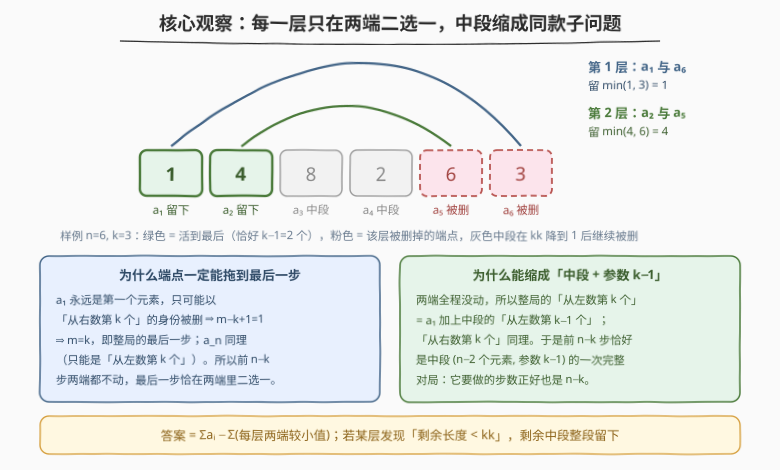
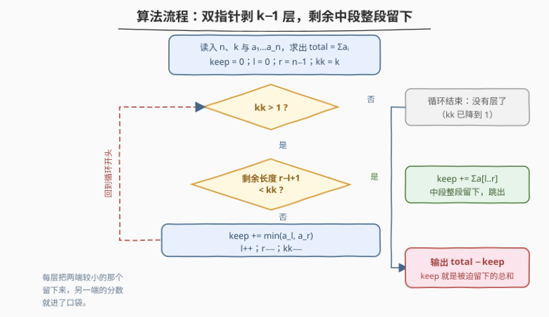
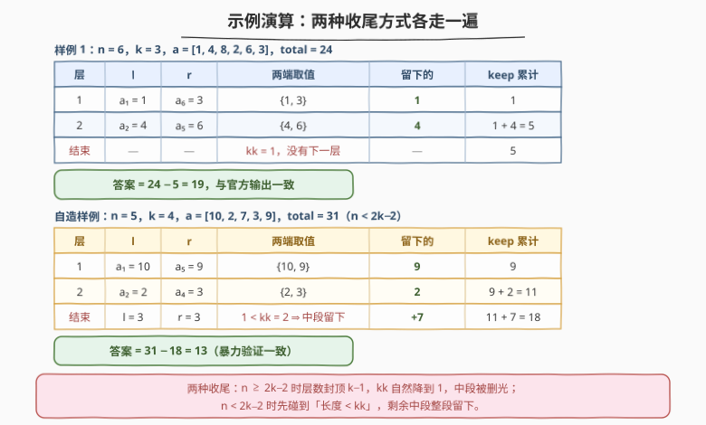

# Codeforces 2268A K 很重要 题解

## 1. 题目概述

- **标题 / 题号**：K 很重要（Codeforces 2268A，英文名 K Is Important）
- **链接**：https://codeforces.com/problemset/problem/2268/A
- **来源**：Codeforces Round 1124 (Div. 1) · Problem A（Div. 2 的编号是 2269C，同一道题）
- **难度**：1200 分（Div. 1 的签到题）
- **限制**：时间 2 s / 内存 256 MB
- **标签**：构造，贪心，双指针

**题意**：给定长度为 $n$ 的正整数数组 $a$ 与参数 $k$。只要当前数组长度 $m \ge k$，就可以做一次操作，两种任选其一：删掉**从左数第 $k$ 个**元素 $a_k$，或者删掉**从右数第 $k$ 个**元素（即从左数第 $m-k+1$ 个），把它的值累加进得分；删除后其余元素保持原有相对顺序。一直做到 $m<k$，也就是长度恰好停在 $k-1$，求能得到的最大得分。**多测**：第一行 $t$，每组给出 $n,k$ 和 $n$ 个整数，逐组输出答案。

**约束**：

- $1 \le t \le 10^4$，$1 \le k \le n \le 10^5$，且所有测试的 $\sum n \le 10^5$；
- $1 \le a_i \le 10^9$，得分最大可达 $10^5 \times 10^9=10^{14}$，必须用 `long long`；
- 操作次数与策略无关：长度每次减 $1$，从 $n$ 降到 $k-1$，**恒做 $n-k+1$ 次**；
- 单组 $O(n)$ 即可；$O(n^2)$ 在 $\sum n=10^5$ 时最坏 $10^{10}$，不可行。

## 2. 示例

**官方样例**（一个输入块，$4$ 组数据）

```text
输入
4
4 2
1 2 3 4
4 4
3 4 1 2
1 1
1
6 3
1 4 8 2 6 3

输出
9
3
1
19
```

第 1 组 $[1,2,3,4],k=2$：一路删 $3,2,4$，剩 $[1]$，得分 $9$；第 2 组 $k=n=4$ 只能删一次，删 $a_1=3$ 比删 $a_4=2$ 好；第 3 组只有一个数、$k=1$，直接得分 $1$；第 4 组留下 $[1,4]$ 之和 $5$，得分 $24-5=19$。

**自造样例**（覆盖 $k=1$、$n=k$ 与 $n<2k-2$ 的"中段整段留下"分支）

```text
输入
3
5 4
10 2 7 3 9
2 2
1000000000 1000000000
6 6
8 1 1 1 1 8

输出
13
1000000000
8
```

第 1 组留下 $9+2+7=18$（中段 $a_3=7$ 因长度不足被迫保留），得分 $31-18=13$；第 2 组只能删一个 $10^9$；第 3 组 $k=n$ 只做一次操作，删 $a_1$ 或 $a_6$，得分 $8$。

## 3. 解题思路

### 3.1 暴力思路

把「当前数组」当状态做记忆化搜索：每个状态最多两个分支，深度 $n-k+1$，叶子数 $2^{n-k+1}$，状态数等于所有可达子序列个数，最坏 $2^n$。$n$ 只有 $20$ 时还行，$n=10^5$ 时连存状态都放不下。即使写出 $O(n^2)$ 的区间 DP（枚举保留哪些下标），$\sum n=10^5$ 也必然超时。所以必须找出**结构**：到底哪些元素能活到最后？

### 3.2 核心观察：端点拖到最后一步，中段递归降维

三个事实串起全题：

1. **两端在倒数第二步之前都动不了**。$a_1$ 永远是数组的第一个元素，它想被删只有两条路：当「从左数第 $k$ 个」（要 $k=1$），或当「从左数第 $m-k+1$ 个」（要 $m-k+1=1$，即 $m=k$）。所以只要 $m>k$，$a_1$ 安全；同理 $a_n$ 永远是最后一个元素，只可能当「从左数第 $k$ 个」（要 $m=k$）时被删。
2. **最后一步恰在两端里二选一**。长度降到 $m=k$ 时，「从左数第 $k$ 个」正好是末尾的 $a_n$，「从右数第 $k$ 个」正好是开头的 $a_1$，于是这一步删的就是两端之一。也就是说：**每一局恰好牺牲两端中的一个，另一个必定活到最后**。
3. **中间是一个同款子问题**。前面 $n-k$ 步里两端都钉在原位，所以整局的「从左数第 $k$ 个」$=a_1$ 再加上中段的「从左数第 $k-1$ 个」；「从右数第 $k$ 个」同理。于是这 $n-k$ 步等价于在**中段 $a_2,\dots,a_{n-1}$（$n-2$ 个元素）上、用参数 $k-1$ 打的同一局**——而那个子局恰好也要打 $(n-2)-(k-1)+1=n-k$ 步，步数完全吻合。

把三条合起来：**终局保留集 = 「中段子局的保留集」 ∪ 「两端中被留下的那个」**。于是问题按 (长度 $-2$, 参数 $-1$) 递归降维，每一层只需决定"留左端还是留右端"，而两层的子问题完全相同，故该层保留 $\min(a_l,a_r)$ 即可；$k-1$ 层剥完后参数降到 $1$，没有层可剥了。若中途出现「剩余长度 $<kk$」，游戏直接结束，**中段整段被迫留下**。



### 3.3 算法流程

用双指针模拟这层递归，不需要真的递归，也不需要预处理：

1. 读入时顺便求出 $total=\sum a_i$，并令 `keep = 0, l = 1, r = n, kk = k`（`keep` 记录被迫留下的元素之和）。
2. 当 `kk > 1` 时循环：
   - 若 `r - l + 1 < kk`：游戏已经结束，把 $a_l..a_r$ 整段加进 `keep`，跳出；
   - 否则 `keep += min(a[l], a[r])`，然后 `l++, r--, kk--`。
3. 输出 `total - keep`。因为每次操作得分等于被删元素的值，得分总和 $=\sum$ 被删 $=total-\sum$ 保留。

循环实际执行 $t^{*}=\min(k-1,\ n-k+1)$ 次：若 $n \ge 2k-2$ 则层数被封顶在 $k-1$；若 $n<2k-2$ 则先耗尽长度，剩下 $2k-n-2=kk-1$ 个元素全部保留。



### 3.4 示例演算

以官方第 4 组 $n=6,k=3,a=[1,4,8,2,6,3]$ 和自造第 1 组 $n=5,k=4,a=[10,2,7,3,9]$ 对照两种收尾方式：

| 样例 | 层 | 两端 | 留下的 | keep |
|:--|:--|:--|:--|:--|
| $[1,4,8,2,6,3],k=3$ | 1 | $a_1=1,\ a_6=3$ | $1$ | $1$ |
| 同上 | 2 | $a_2=4,\ a_5=6$ | $4$ | $5$ |
| 同上 | 结束 | $kk=1$ | — | $5$ |

答案 $24-5=19$：活到最后的是 $a_1=1$ 与 $a_2=4$，中段的 $8,2$ 被后续操作删光。

| 样例 | 层 | 两端 | 留下的 | keep |
|:--|:--|:--|:--|:--|
| $[10,2,7,3,9],k=4$ | 1 | $a_1=10,\ a_5=9$ | $9$ | $9$ |
| 同上 | 2 | $a_2=2,\ a_4=3$ | $2$ | $11$ |
| 同上 | 结束 | 剩余长度 $1<kk=2$ | $a_3=7$ 全留 | $18$ |

答案 $31-18=13$：这里只剩 $a_3=7$ 一个元素而参数还是 $2$，已经无法操作，它被迫留下。



## 4. 算法细节

1. **多测独立**：`total / keep / l / r / kk` 全部声明在每组循环体内，不跨组复用，天然没有需要清空的全局状态。
2. **循环必须带长度检查**：除了 `while (kk > 1)`，体内还要判 `r-l+1 < kk`。因为剥 $t$ 层后剩余长度与参数分别变成 $n-2t$、$k-t$，条件 $n-2t<k-t$ 等价于 $t>n-k$；当 $n<2k-2$ 时指针还没走到中心，游戏就已经结束，漏掉这一步会让左右指针交叉，同一批元素被重复计入 `keep`。
3. **两种收尾都要处理**：`kk == 1` 退出时中段元素**已经全部被删**（不需要再加）；`r-l+1 < kk` 退出时中段元素**全部被迫保留**（必须加）。二者是相反的处理，混淆就 WA。
4. **溢出**：$total$ 与 `keep` 都要 `long long`；$10^5\times10^9=10^{14}$ 超出 `int` 上限约 $5\times10^4$ 倍，用 `int` 必错。
5. **剩余中段求和**：直接 `for` 循环累加即可，不必单独建前缀和——每轮消耗两个端点，中段求和的对象不超过剩余长度，累计仍是 $O(n)$。
6. **I/O 与特判**：$\sum n\le10^5$、$t\le10^4$，`std::ios::sync_with_stdio(false)` 后 `cin/cout` 足够（实测 $n=10^5$ 单组约 $0.15$ s，本机 `cin` 偏慢但仍远低于 2 s）；Python 用 `sys.stdin.buffer.read().split()` 一次切分。另外**不必特判 $k=1$**：`kk=1` 时循环不进入、`keep=0`、输出 $total$，正好等于"全部删光"，额外加特判反而容易写错。

## 5. 正确性证明

**引理 1（步数与终局长度）**：当 $n\ge k$ 时，过程恰好执行 $n-k+1$ 次操作，结束后数组长度恒为 $k-1$。

**证明**：每次操作使长度减 $1$，而只要长度 $m\ge k$ 就允许操作。从 $n$ 单调递减，第一次出现 $m<k$ 时 $m=k-1$，中间共走 $n-(k-1)=n-k+1$ 步。策略不影响这个计数。∎

**引理 2（端点安全到最后一步）**：设 $k\ge2$、$n\ge k$。在长度降到 $k$ 之前的任何时刻，$a_1$ 与 $a_n$ 都不能被删；而长度为 $k$ 的那一步（即最后一步）删掉的必是 $a_1$ 或 $a_n$ 之一。

**证明**：$a_1$ 恒为当前数组第 $1$ 个元素。它被当作「从左数第 $k$ 个」需要 $k=1$（已排除）；被当作「从左数第 $m-k+1$ 个」需要 $m-k+1=1$，即 $m=k$。故 $m\ge k+1$ 时 $a_1$ 不可删。对称地，$a_n$ 恒为第 $m$ 个元素，当「从左数第 $k$ 个」需要 $k=m$，当「从右数第 $k$ 个」需要 $m-k+1=m$ 即 $k=1$（已排除），故 $m\ge k+1$ 时也不可删。当 $m=k$ 时，「从左数第 $k$ 个」是位置 $k=m$ 的末元素 $a_n$，「从右数第 $k$ 个」是位置 $m-k+1=1$ 的首元素 $a_1$，两种操作恰好分别指向两端，这一次操作必删其一；由引理 1 它正是最后一步。∎

**引理 3（递归结构）**：设 $k\ge2$、$n\ge k$，记 $E(A,p)$ 为实例（数组 $A$、参数 $p$）所有可能的"终局保留下标集合"的族，并约定：$p=1$ 时 $E=\{\varnothing\}$；而 $|A|<p$ 时一步都做不了，$E$ 只含「全部下标」这一个元素。则

$$E\big(a[1..n],k\big)=\big\{\{1\}\cup S\big\}\ \cup\ \big\{\{n\}\cup S\big\},\qquad S\in E\big(a[2..n-1],\,k-1\big).$$

**证明**：由引理 2，前 $n-k$ 步中两端始终在场，故局面的「从左数第 $k$ 个」等于"$a_1$ 之后中段的从左数第 $k-1$ 个"，「从右数第 $k$ 个」等于"中段的从右数第 $k-1$ 个"。因此前 $n-k$ 步的每一步都与中段实例（$n-2$ 个元素、参数 $k-1$）的一步完全对应，且中段实例由引理 1 恰好也要执行 $(n-2)-(k-1)+1=n-k$ 步——两者步数相等，全过程双向对应。第 $n-k+1$ 步由引理 2 删掉 $a_1$ 或 $a_n$ 之一，中段终局保持不变。于是终局保留集 $=$ 中段终局 $\cup$ 留下的那个端点，方向"$\subseteq$"。反向：任取中段的一个合法对局与任一端点，把该端点摆在数组一端、按同样顺序执行中段操作（判定条件只依赖中段内部，故合法），最后删掉另一端点，得到整局的一个合法对局，方向"$\supseteq$"。∎

**定理**：设 $f(l,r,p)$ 表示在子数组 $a[l..r]$ 上、参数为 $p$ 时必须保留的元素之和的最小值，则

$$f(l,r,p)=\begin{cases}0,&p=1,\\[2pt] \sum_{i=l}^{r}a_i,&r-l+1<p,\\[2pt] \min(a_l,a_r)+f(l+1,r-1,p-1),&\text{否则},\end{cases}$$

且最大得分 $=\sum a_i-f(1,n,k)$，而 3.3 节的双指针循环正是该递归式的迭代实现。

**证明**：得分 $=\sum$ 被删 $=\sum a_i-\sum$ 保留，故最大化得分等价于最小化保留和。由引理 3，保留集是"端点（两种选法）"并"中段子局的一个保留集"，两者独立，故

$$f(l,r,p)=\min\big(a_l+f_{\text{mid}},\ a_r+f_{\text{mid}}\big)=\min(a_l,a_r)+\min_{S\in E(\text{mid},p-1)}\textstyle\sum_{i\in S}a_i=\min(a_l,a_r)+f(l+1,r-1,p-1),$$

其中 $f_{\text{mid}}$ 取遍中段实例的所有可能保留和。终止条件即"无从操作"与"没有层可剥"两种情形，与约定一致。对 $\min(p,\ r-l+1)$ 归纳即得递归式；循环每次把 $(l,r,p)$ 换成 $(l+1,r-1,p-1)$，正是同一递推。∎

## 6. 复杂度分析

- **时间**：每组一次读入 $O(n)$；剥层循环每轮 $O(1)$、至多 $\min(k-1,n-k+1)\le n/2$ 轮；末尾中段求和的对象不超过剩余长度，累计也 $O(n)$。单组 $O(n)$，总计 $O\!\left(\sum n\right)\le 10^5$ 次基本运算。
- **空间**：存数组 $O(n)$，其余只有 $5$ 个标量，额外空间 $O(1)$（不递归，无栈开销）。
- **可行性对照**：时限 2 s。实测最大数据（$n=10^5$ 单组约 $0.15$ s；$t=10^4$、$\sum n=10^5$ 约 $0.17$ s）用 C++17 跑，Python3 约 $0.04$ s（本机 `cin`/Python 的读取偏慢，但主体开销都在 I/O），距 2 s 仍有 $10$ 倍以上余量；若把 $n$ 放大到 $10^7$ 本做法仍是线性。

## 7. 参考代码

### C++17

```cpp
#include <iostream>
#include <vector>
#include <algorithm>
using namespace std;

int main() {
    ios::sync_with_stdio(false);
    cin.tie(nullptr);

    int T;
    if (!(cin >> T)) return 0;
    while (T--) {
        int n, k;
        cin >> n >> k;
        vector<long long> a(n);
        long long total = 0;
        for (auto &x : a) { cin >> x; total += x; }

        // 双指针剥层：每层保留两端中较小者，直到 kk == 1
        // 或剩余长度不足 kk（此时中段整段被迫留下）
        long long keep = 0;
        int l = 0, r = n - 1, kk = k;
        while (kk > 1) {
            if (r - l + 1 < kk) {                 // 无法再操作：中段全部保留
                for (int i = l; i <= r; ++i) keep += a[i];
                break;
            }
            keep += min(a[l], a[r]);              // 该层牺牲两端中较大者
            ++l; --r; --kk;
        }
        cout << total - keep << '\n';             // 得分 = 总和 - 被迫留下的和
    }
    return 0;
}
```

### Python3

```python
import sys


def main():
    data = sys.stdin.buffer.read().split()
    t = int(data[0])
    pos = 1
    out = []
    for _ in range(t):
        n = int(data[pos]); k = int(data[pos + 1]); pos += 2
        a = list(map(int, data[pos:pos + n])); pos += n

        total = sum(a)
        keep = 0
        l, r, kk = 0, n - 1, k
        while kk > 1:
            if r - l + 1 < kk:            # 剩余长度 < 参数：中段整段留下
                keep += sum(a[l:r + 1])
                break
            keep += a[l] if a[l] < a[r] else a[r]
            l += 1
            r -= 1
            kk -= 1
        out.append(str(total - keep))

    sys.stdout.write('\n'.join(out) + '\n')


main()
```

## 8. 边界情况与易错点

1. **$n<2k-2$ 时中段必须整段留下**：这是本题最大的坑。以 $n=5,k=4,a=[10,2,7,3,9]$ 为例，正确答案 $13$；若粗暴地只写 `keep += min(a[l],a[r])` 两轮（$9+2=11$）就输出 $31-11=20$，直接 WA；这 $7$ 分差距来自被漏掉的 $a_3=7$。
2. **$n=k$ 只有一层**：只做一次操作，答案应为 $\max(a_1,a_n)$。代码先取 `min(a1,an)`，此时剩余长度只剩 $n-2=k-2$ 而参数是 $k-1$，下一轮进入循环立刻命中「长度不足」分支，把中段 $a_2..a_{n-1}$ 整段保留，于是 $total-\min(a_1,a_n)-(a_2+\dots+a_{n-1})=\max(a_1,a_n)$。若写成固定的 $k-1$ 层循环（不带长度检查），$n=k=4,a=[3,4,1,2]$ 会多取一次 $\min(a_3,a_2)$，输出 $6$ 而正确是 $3$。
3. **$k=1$ 时全部删光**：此时答案为 $total$。不要为了"安全"给 $k=1$ 加特判返回 $0$ 或 $a_1$；循环条件 `kk>1` 已经自然处理。
4. **前 $k-1$ 个与后 $k-1$ 个的"重叠"**：只有当 $n\ge2k-2$ 时，"前 $k-1$ 对端点"互不重叠；否则左右指针会相遇甚至交叉，此时剩余元素一个都不能删，必须整体计入 $keep$。
5. **溢出**：`total` 与 `keep` 用 `long long`（或 Python 天然大整数）。$a_i$ 全取 $10^9$、$n=10^5$ 时 $total=10^{14}$，`int` 上限约 $2.1\times10^9$，远远不够。
6. **多测规模**：$t$ 可达 $10^4$，但 $\sum n\le10^5$。不要为每组开 $O(n)$ 的辅助数组再 `memset`，也不要排序（虽然 $O(n\log n)$ 也能过），把答案直接追加到输出缓冲、最后一次 `write` 才不浪费 I/O。
7. **正数前提**：$a_i\ge1$ 保证"做满所有操作"一定不亏，因此"做到不能做"是最优的；若元素允许为负，此结论立刻失效（见延伸思考）。

## 相关题目与扩展

- [Codeforces 2269C K Is Important](https://codeforces.com/problemset/problem/2269/C)：Div. 2 的同一道题，改完可以直接双开自测。
- [LeetCode 877. 石子游戏](https://leetcode.cn/problems/stone-game/)：同样只能从两端取数，但取走的值归自己、目标是差值，可用区间 DP 或奇偶性直接判定。
- [LeetCode 1406. 石子游戏 III](https://leetcode.cn/problems/stone-game-iii/)：两端取数 + 后缀和 DP，说明"两端取"一旦带权就无法像本题这样压成 $O(n)$ 贪心。
- [LeetCode 11. 盛最多水的容器](https://leetcode.cn/problems/container-with-most-water/)：另一种"双指针从两端向内收缩"的经典，对照"为什么这里收缩等价于最优"。

**延伸思考**：

1. 若 $a_i$ 允许为负，$f$ 的递推式还成立吗？成立（保留和最小化仍由引理 3 保证），但"做满 $n-k+1$ 步"不再等价于最优——此时可以少做几步（长度还没到 $k-1$ 就停），问题变成"在每一步可停"的模型，需要重新定义最优子结构。
2. 若两种操作换成"删从左数第 $k$ 个 **或** 从右数第 $j$ 个（$j\ne k$）"，端点引理会变成"$a_1$ 只可能在 $m=j$ 时被删、$a_n$ 只可能在 $m=k$ 时被删"，两条收缩轨道的速度不同，递归会退化成二维状态 $(l,r)$ 上的 DP，复杂度 $O(n^2)$。
3. 把数组改成环（首尾相邻）后，"从左数第 $k$ 个"不再有端点保护，端点引理整体失效，需要另找不变量：可以先猜"总能保住某 $k-1$ 个连续元素"，再用小数据枚举验证。
4. 本题的 $2^{\min(k-1,\,n-k+1)}$ 种可达保留集有一个漂亮的递归形状：$E(n,k)=\{\{1\}\cup(S+1)\}\cup\{\{n\}\cup(S+1)\}$，$S\in E(n-2,k-1)$。可达集个数因此是 $2^{\min(k-1,\,n-k+1)}$ 量级——这个结论可以用 $n\le8$ 的全枚举脚本自行验证，也是"为什么每层能独立取 min"的另一种解释。
