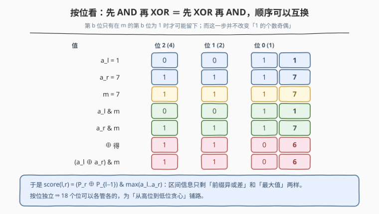
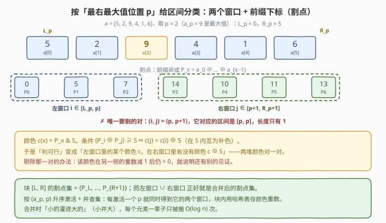
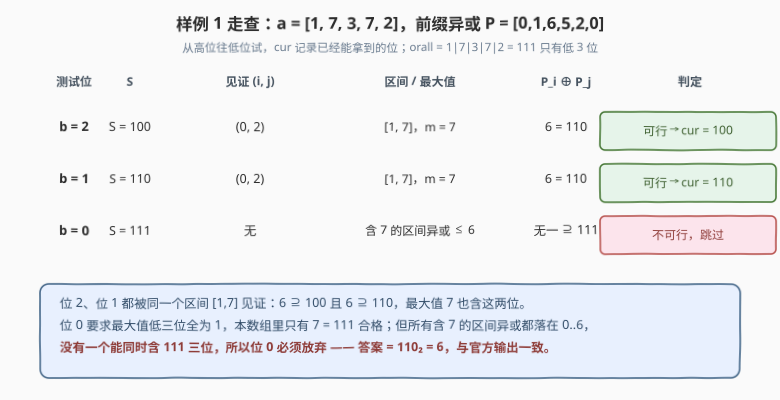

# Codeforces 2268C KiaKio 与能量区间 题解

## 1. 题目概述

- **标题 / 题号**：KiaKio 与能量区间（Codeforces 2268C，英文名 KiaKio and Energy Intervals）
- **链接**：https://codeforces.com/problemset/problem/2268/C
- **来源**：Codeforces Round 1124 (Div. 1) · Problem C（UTC 2026-09-26）
- **难度**：2300（1750 分）
- **限制**：时间 2 s / 内存 256 MB
- **标签**：位运算，按位贪心，并查集，笛卡尔树，单调栈，哈希表，小并大合并

**题意**：给定长度为 $n$ 的非负数组。任取区间 $[l,r]$ 且要求 $l<r$（至少两个元素），令 $m=\max(a_l,\dots,a_r)$ 为该区间最大值，能量为
$$\bigoplus_{i=l}^{r}\big(a_i \mathbin{\&} m\big)$$
求所有合法区间上能量的最大值。**多测**：第一行 $t$，每组给出 $n$ 与 $n$ 个整数，逐组输出一个整数。

**约束**：

- $1\le t\le 10^4$，$2\le n\le 2\cdot 10^5$，所有测试的 $\sum n\le 2\cdot 10^5$；
- $0\le a_i<2^{18}$，所以区间最大值和答案都 $<2^{18}$，只有 $18$ 个二进制位；
- 区间总数 $\Theta(n^2)$，$n=2\cdot10^5$ 时约 $2\cdot10^{10}$ 个，必须绕开"枚举区间"；
- 值域只有 $2^{18}$，暗示要**按位**处理，并且答案必然是某个 $a_p$ 的子掩码。

## 2. 示例与观察
官方样例（一个输入块，$4$ 组数据，输入 / 输出原样）：

```text
输入
4
5
1 7 3 7 2
3
3 1 2
5
1 5 2 3 4
4
3 5 2 6

输出
6
2
5
5
```

逐组说明：

- 第 1 组取 $[1,7]$：$m=7$，$(1\&7)\oplus(7\&7)=1\oplus7=6$；
- 第 2 组取 $[3,1]$：$m=3$，$(3\&3)\oplus(1\&3)=3\oplus1=2$；
- 第 3 组取 $[5,2]$：$m=5$，$(5\&5)\oplus(2\&5)=5\oplus0=5$；
- 第 4 组取 $[5,2]$：$m=5$，$5\oplus(2\&5)=5$。

自造两组（覆盖"全相同"与"最大值在中间"）：

```text
输入
3
2
8 8
3
6 1 15
2
0 0

输出
0
14
0
```

$[8,8]$ 的两个元素互相抵消得 $0$；$[6,1,15]$ 取 $[1,15]$ 得 $(1\oplus15)\&15=14$；$[0,0]$ 恒为 $0$。

## 3. 解题思路

### 3.1 暴力思路

固定 $l$，让 $r$ 一路右移，途中维护区间最大值与区间异或，于是每个区间 $O(1)$ 出分，总复杂度 $O(n^2)$。$n=2\cdot10^5$ 时约 $2\cdot10^{10}$，必然超时；而且即便把 AND 分配到每个元素上单独算，也仍要枚举所有区间。真正的信息量在于：**分值只由"区间异或"和"区间最大值"两样东西决定**，最大值只有 $n$ 种取法，可以按最大值把区间分类。

### 3.2 核心观察：把 AND 提到 XOR 外面，再做按位贪心

**按位看**。设区间最大值 $m$，则 $\bigoplus_i (a_i\&m)$ 的第 $b$ 位 = 「区间内 $a_i$ 第 $b$ 位为 $1$ 的元素个数的奇偶性」$\&\ m$ 的第 $b$ 位。而"个数的奇偶性"恰好是 $\bigoplus_i a_i$ 的第 $b$ 位。于是

$$\bigoplus_{i=l}^{r}(a_i \mathbin{\&} m)=\Big(\bigoplus_{i=l}^{r}a_i\Big)\mathbin{\&}m .$$

记前缀异或 $P_0=0,\ P_k=a_1\oplus\cdots\oplus a_k$，则能量

$$\mathrm{score}(l,r)=\big(P_{l-1}\oplus P_r\big)\mathbin{\&}\max(a_l,\dots,a_r).$$

问题于是变成：在所有对 $(i,j)$（$i<j-1$，即区间长度 $\ge 2$）中最大化 $(P_i\oplus P_j)\,\&\,\max(a_{i+1},\dots,a_j)$。

**按位贪心**。答案一定落在某个 $a_p$ 的位集里，于是从高位到低位逐位决定：维护已确定的答案 $cur$，测试 $S=cur\cup\{b\}$ 是否可行，可行就把第 $b$ 位加进 $cur$。可行性即

$$\exists\, i<j-1:\quad (P_i\oplus P_j)\supseteq S\ \ \text{且}\ \ \max(a_{i+1},\dots,a_j)\supseteq S,$$

其中 $\supseteq$ 表示"包含 $S$ 的全部位"。前半句等价于 $P_i\&S$ 与 $P_j\&S$ **在 $S$ 内互为补色**；后半句要求区间最大值本身含 $S$ 的每一位。



### 3.3 算法流程：最右最大值窗口 + 割点颜色

**把区间按最大值归类**。对每个位置 $p$ 定义 $L_p=$ 上一个 $>a_p$ 的下标 $+1$，$R_p=$ 下一个 $\ge a_p$ 的下标 $-1$。可以证明（引理 3）每个合法区间被唯一归属到它的**最右最大值位置** $p$，且归属关系就是 $l\in[L_p,p],\ r\in[p,R_p]$。于是每个区间的贡献都能在这个"窗口"里算。

**换成前缀下标（割点）**。区间 $[l,r]$ 对应一对前缀下标 $(i,j)=(l-1,r)$。节点 $p$ 关心的割点是"块 $[L_p,R_p]$ 往外扩一格"的 $P_x$，$x\in[L_p-1,R_p]$；按 $l,r$ 拆开正好是

- 左窗口：$i\in[L_p-1,\,p-1]$，即左子块 $[L_p,p-1]$ 的割点集；
- 右窗口：$j\in[p,\,R_p]$，即右子块 $[p+1,R_p]$ 的割点集。

唯一要剔除的是 $(i,j)=(p-1,p)$，它对应长度 $1$ 的区间 $[p,p]$，永远同时躺在两个窗口里。

**用并查集一次算出所有窗口**。把所有位置按 $(a_p,p)$ 字典序升序"激活"：激活 $p$ 时，已激活的正是 $\{a_q<a_p\}\cup\{a_q=a_p,q<p\}$，围绕 $p$ 的极大连续段恰好是 $[L_p,R_p]$。因此每激活一个 $p$，它的左、右邻居所在连通块就是左右窗口；再把两堆颜色并成新块的割点集即可。判可行时**迭代较小一侧**的颜色、去另一侧查询 $c\oplus S$；合并也**小的灌进大的**（小并大），于是每个元素一生只被搬 $O(\log n)$ 次。



实现上，颜色 $c(x)=P_x\,\&\,S$ 随 $S$ 变化，每轮都要重建；块内的"颜色多重集"用哈希表存颜色重数，重数只在剔除那对 $(p,p+1)$ 时才有用：把边界那个割点算作"用掉一次"，重数减 $1$ 仍为正才说明还有别的见证。

**流程小结**：先求前缀异或、`orall`（所有 $a_i$ 的按位或，答案只可能落在这些位上）与 `mx`，并把下标按 $(a_i,i)$ 升序排好（$18$ 轮共用）；然后 $b$ 从 $17$ 到 $0$，第 $b$ 位不在 `orall` 或 $S>mx$ 时直接跳过，否则跑一遍上述并查集，一旦有节点找到见证就判 $S$ 可行并执行 $cur\leftarrow S$。最终 $cur$ 即答案。

### 3.4 示例演算

以官方第 1 组 $a=[1,7,3,7,2]$ 为例（与代码一致改用 0-indexed：区间 $[l,r]$ 对应 $(i,j)=(l,r+1)$），前缀异或 $P=[0,1,6,5,2,0]$，`orall`$=111$，所以只需试低三位：

| 测试位 | $S$ | 见证 $(i,j)$ | 区间 / 最大值 | $P_i\oplus P_j$ | 判定 |
|:--|:--|:--|:--|:--|:--|
| $b=2$ | $100$ | $(0,2)$ | $[1,7]$，$m=7$ | $6=110$ | 可行，$cur=100$ |
| $b=1$ | $110$ | $(0,2)$ | $[1,7]$，$m=7$ | $6=110$ | 可行，$cur=110$ |
| $b=0$ | $111$ | 无 | 含 $7$ 的区间异或都落在 $0..6$ | 无一 $\supseteq 111$ | 不可行 |

位 $2$ 与位 $1$ 由同一个区间 $[1,7]$ 作证；位 $0$ 要求最大值同时含低三位，本数组里只有 $7=111$ 合格，而所有含 $7$ 的区间的异或值都 $\le 6$，凑不出 $111$ 三位，故答案为 $110_2=6$，与官方输出一致。



## 4. 算法细节

1. **多测清空**：每组重算 `pref / ord / orall / mx`，并把并查集、激活标记、块内哈希表指针全部重置；哈希堆只把 `top` 归零并就地清零被切出的那段，容量跨测试复用。
2. **排序只做一次**：顺序只依赖 $(a_i,i)$，与 $S$ 无关，$18$ 轮共用同一个 `ord`，避免 $18$ 次 $O(n\log n)$ 排序。
3. **哈希表实现**：颜色 $<2^{18}$，用全局数组 + 线性探测 + 双倍扩容，负载因子控制在 $1/2$ 以内；空槽用"重数为 $0$"表示，省掉一个存在标记。
4. **颜色必须每轮重建**：$c(x)=P_x\&S$ 依赖当前 $S$，不能缓存上一轮的颜色；但块的形态（哪些下标在同一块）与 $S$ 无关。
5. **下标约定**：推导用 1-indexed（$i=l-1,\ j=r$，窗口 $i\in[L_p-1,p-1]$、$j\in[p,R_p]$）；代码用 0-indexed，于是整体右移一格：左窗口 $i\in[L_p,p]$、右窗口 $j\in[p+1,R_p+1]$，非法对随之变成 $(p,p+1)$。
6. **剔除非法对**：$(p,p+1)$ 这对永远同时出现在左右窗口里，代码统一写成 `cnt - (颜色 == 边界颜色)`，只有重数 $1$ 时才真的把它整对剔掉。
7. **两个剪枝**：第 $b$ 位不在 `orall` 里直接跳过；$S>mx$ 直接跳过（子掩码 $\supseteq S$ 意味着数值 $\ge S$，而最大值只有 `mx`）。
8. **小并大**：合并时以较大的一侧为基座，把较小侧的颜色逐项灌入；比较用"不同颜色数" `ms` 而不是元素个数，能让迭代更快。
9. **I/O 与位宽**：$n,\sum n$ 都是 $2\cdot10^5$ 级别，用 `scanf/printf`（或关闭同步的 `cin/cout`）；答案 $<2^{18}$，`int` 足够，不必 `long long`。

## 5. 正确性证明

**引理 1**（AND 可提到 XOR 外）：对任意 $m$ 与非负整数 $x_1,\dots,x_k$，有 $\bigoplus_i(x_i\&m)=\big(\bigoplus_i x_i\big)\&m$。

**证明**：逐位验证。第 $b$ 位，左边 $=(m$ 的第 $b$ 位$)\cdot\big($满足 $x_i$ 第 $b$ 位为 $1$ 的 $i$ 的个数 $\bmod 2\big)$，右边 $=(m$ 的第 $b$ 位$)\cdot\big(\bigoplus_i x_i$ 的第 $b$ 位$)$，两者是同一个数。∎

**引理 2**（互补色判据）：对掩码 $S$ 与整数 $u,v$，$(u\oplus v)\&S=S\iff(v\&S)=S\oplus(u\&S)$。

**证明**：由引理 1（取两个数）得 $(u\&S)\oplus(v\&S)=(u\oplus v)\&S$。又 $u\&S$ 与 $v\&S$ 都是 $S$ 的子掩码，两者异或等于 $S$ 当且仅当 $S$ 的每一位恰有一个取 $1$，即互为补色。∎

**引理 3**（窗口归属唯一）：定义 $L_p$ 为上一个 $>a_p$ 的下标 $+1$，$R_p$ 为下一个 $\ge a_p$ 的下标 $-1$（不存在则取边界）。则每个合法区间 $[l,r]$ 恰被一个 $p$ 覆盖，$p$ 是区间内最右的最大值位置，且 $l\in[L_p,p]$、$r\in[p,R_p]$。

**证明**：*覆盖性*：取区间最右最大值位置 $p$。区间内其余元素都 $\le a_p$，所以 $p$ 左侧没有被 $>a_p$ 的元素挡住，即 $L_p\le l$；$p$ 右侧没有 $=a_p$ 的元素（否则 $p$ 不是最右），更没有 $>a_p$ 的，故 $R_p\ge r$。*唯一性*：若 $q\ne p$ 也能覆盖，则 $a_q$ 也是区间最大值。若 $q<p$，则 $p\in[q+1,R_q]$ 且 $a_p\ge a_q$，与 $R_q$ 的定义（下一个 $\ge a_q$ 的位置 $-1$）矛盾；若 $q>p$，则 $a_q<a_p$（$p$ 是最右最大值），不可能是区间最大值。∎

**引理 4**（并查集算出的就是窗口）：按 $(a_p,p)$ 字典序升序依次激活，激活 $p$ 时它所在连通块的区间恰为 $[L_p,R_p]$；该块的割点集 $\{P_x:x\in[L_p-1,R_p]\}$ 等于左窗口 $\{P_x:x\in[L_p-1,p-1]\}$ 与右窗口 $\{P_x:x\in[p,R_p]\}$ 的无交并。

**证明**：激活 $p$ 时已激活集合为 $\{q:a_q<a_p\}\cup\{q:a_q=a_p,\ q<p\}$，它是"$\le a_p$ 且不与 $p$ 右侧同值者并列"的集合；围绕 $p$ 的极大连续段左端止于最近的 $>a_p$ 者之后，右端止于最近的 $\ge a_p$ 者之前，正是 $[L_p,R_p]$。割点集把区间左右各外扩一格，按 $x\le p-1$ 与 $x\ge p$ 拆开即为两窗口，且下标集合不相交。∎

**引理 5**（判定过程正确）：`check(S)` 返回真，当且仅当存在合法区间使区间异或与区间最大值都包含 $S$ 的全部位。

**证明**：由引理 3、4，全部合法区间被"节点 $p$ + 一对窗口内的 $(i,j)$"不重不漏地枚举；将 $(i,j)=(p-1,p)$ 剔除后剩下的组合恰好分成代码里的两种情形（$i\le p-2$ 与 $i=p-1$）。颜色互补由引理 2 刻画；"另一侧重数减去边界那一次仍为正"精确表示"除被剔除的那对外还有见证"。最大值条件用 $a_p\&S=S$ 判定，而 $a_p$ 是窗口内的最大值。∎

**定理**：逐位贪心输出的 $cur$ 等于所有合法区间能量的最大值。

**证明**：设 $\mathcal V$ 为全部合法区间的能量集合，$v^*=\max\mathcal V$，`check`$(\cdot)$ 为引理 5 的判定。先证不变式 $cur\subseteq v^*$：设在处理第 $b$ 位前 $cur\subseteq v^*$。若第 $b$ 位属于 $v^*$，则 $v^*\supseteq cur\cup\{b\}$，`check` 为真，$cur$ 加上该位仍 $\subseteq v^*$；若不属于 $v^*$，反设 `check` 为真，则有 $v\in\mathcal V$ 含 $cur\cup\{b\}$。对高于 $b$ 且不在 $cur$ 中的位 $c$，当时 `check` 为假，故没有任何 $\mathcal V$ 中元素含那些位，$v$ 与 $v^*$ 在高于 $b$ 的位上都与 $cur$ 相同；于是 $v$ 在第 $b$ 位为 $1$、$v^*$ 为 $0$，得 $v>v^*$，矛盾。故该位不会被加入，不变式保持。结束时 $cur\subseteq v^*$；又每轮只在 `check` 为真时才置位，故存在 $v\in\mathcal V$ 使 $v\supseteq cur$，而若 $v$ 还多出某位 $b$，则处理该位时 $v\supseteq cur_{\text{当时}}\cup\{b\}$ 会使 `check` 为真、该位被置入，矛盾，故 $v=cur$ 且 $cur\in\mathcal V$。结合 $cur\subseteq v^*$ 得 $cur=v^*$。∎

## 6. 复杂度分析

- **时间**：排序 $O(n\log n)$；共 $18$ 轮，每轮并查集 $O(n\,\alpha(n))$，颜色表的迭代与合并按小并大为 $O(n\log n)$ 次哈希操作，单次期望 $O(1)$。故总时间 $O(18\,n\log n)$，$n=2\cdot10^5$ 时约 $5\times10^7$ 次基本操作；本机 `-O2` 实测随机数据约 $0.6$–$0.9$ s，$2$ s 时限内留有充足余量。剪枝（不在 `orall` 的位、$S>mx$）还会进一步减少轮数。
- **空间**：前缀异或、排序、并查集、激活标记各 $O(n)$；颜色哈希表的总容量按小并大是 $O(n\log n)$ 的摊还量，实际峰值约 $36n$ 个 `int`（本题 $n=2\cdot10^5$ 时约 $60$ MB），加上外层结构仍远低于 $256$ MB。

## 7. 参考代码

### C++17

```cpp
#include <bits/stdc++.h>
using namespace std;

static int n;
static vector<int> a, pre, ord, dsu, mo, mc, ms;
static vector<char> on;
static vector<int> pk, pc;              // 全局堆：哈希表的 key / 颜色重数
static size_t top;

static inline unsigned hsh(int x) {     // splitmix 风格整数哈希
    unsigned y = (unsigned)x;
    y ^= y >> 16; y *= 0x7feb352du; y ^= y >> 15; y *= 0x846ca68bu; y ^= y >> 16;
    return y;
}
static int allocMap(int cap) {          // 从堆上切一段容量 cap 的清零表
    size_t off = top; top += cap;
    if (pk.size() < top) { pk.resize(top); pc.resize(top); }
    memset(pk.data() + off, 0, sizeof(int) * cap); memset(pc.data() + off, 0, sizeof(int) * cap);
    return (int)off;
}
static inline int findRoot(int x) {
    while (dsu[x] != x) { dsu[x] = dsu[dsu[x]]; x = dsu[x]; }
    return x;
}
static inline int cntOf(int r, int c) { // 颜色 c 在块 r 中的重数，0 表示不存在
    if (r < 0) return 0;
    int off = mo[r]; unsigned cap = (unsigned)mc[r], i = hsh(c) & (cap - 1);
    while (pc[off + i]) {
        if (pk[off + i] == c) return pc[off + i];
        i = (i + 1) & (cap - 1);
    }
    return 0;
}
static void grow(int r) {               // 扩容两倍并重插（负载因子 <= 1/2）
    unsigned oc = (unsigned)mc[r], nc = oc * 2;
    int oo = mo[r], no = allocMap((int)nc);
    for (unsigned i = 0; i < oc; i++)
        if (pc[oo + i]) {
            int k = pk[oo + i], v = pc[oo + i];
            unsigned j = hsh(k) & (nc - 1);
            while (pc[no + j]) j = (j + 1) & (nc - 1);
            pk[no + j] = k; pc[no + j] = v;
        }
    mo[r] = no; mc[r] = (int)nc;
}
static inline void add(int r, int c, int d) {
    int off = mo[r]; unsigned cap = (unsigned)mc[r], i = hsh(c) & (cap - 1);
    while (pc[off + i]) {
        if (pk[off + i] == c) { pc[off + i] += d; return; }
        i = (i + 1) & (cap - 1);
    }
    pk[off + i] = c; pc[off + i] = d; ++ms[r];
    if ((unsigned)(2 * ms[r]) > cap) grow(r);
}

// 是否存在合法区间，使 (区间异或) 与 (区间最大值) 都包含 S 的全部位
static bool check(int S) {                 // 判定 S 是否可行
    top = 0;
    for (int i = 0; i < n; i++) { dsu[i] = i; on[i] = 0; }
    for (int id = 0; id < n; id++) {
        int p = ord[id];
        on[p] = 1;
        bool hasL = p > 0 && on[p - 1], hasR = p + 1 < n && on[p + 1];
        int cl = pre[p] & S, cr = pre[p + 1] & S;      // 两个边界割点的颜色
        int lr = hasL ? findRoot(p - 1) : -1;
        int rr = hasR ? findRoot(p + 1) : -1;
        if ((a[p] & S) == S) {                        // 最大值本身要含 S 的位
            // 情形 1：i = p，j >= p+2（右窗口里除去割点 p+1）
            if (hasR && cntOf(rr, cl ^ S) - ((cl ^ S) == cr) > 0) return true;
            // 情形 2：i <= p-1（左窗口除去割点 p），j 取整个右窗口
            if (hasL) {
                if (!hasR) {
                    int t = cr ^ S;
                    if (cntOf(lr, t) - (t == cl) > 0) return true;
                } else if (ms[lr] <= ms[rr]) {
                    int off = mo[lr]; unsigned cap = (unsigned)mc[lr];
                    for (unsigned i = 0; i < cap; i++) {
                        int c = pc[off + i];
                        if (!c || c - (pk[off + i] == cl) <= 0) continue;
                        if (cntOf(rr, pk[off + i] ^ S) > 0) return true;
                    }
                } else {
                    int off = mo[rr]; unsigned cap = (unsigned)mc[rr];
                    for (unsigned i = 0; i < cap; i++) {
                        if (!pc[off + i]) continue;
                        int t = pk[off + i] ^ S;
                        if (cntOf(lr, t) - (t == cl) > 0) return true;
                    }
                }
            }
        }
        // 合并：新块割点集 = 左窗口 ∪ 右窗口，小的灌进大的
        int base = -1, oth = -1;
        if (hasL && hasR) {
            if (ms[lr] >= ms[rr]) { base = lr; oth = rr; }
            else { base = rr; oth = lr; }
        } else if (hasL) base = lr;
        else if (hasR) base = rr;
        if (base < 0) {
            mo[p] = allocMap(4); mc[p] = 4; ms[p] = 0;
            add(p, cl, 1); add(p, cr, 1);
        } else {
            mo[p] = mo[base]; mc[p] = mc[base]; ms[p] = ms[base];
            if (oth >= 0) {
                int off = mo[oth]; unsigned cap = (unsigned)mc[oth];
                for (unsigned i = 0; i < cap; i++)
                    if (pc[off + i]) add(p, pk[off + i], pc[off + i]);
            } else {
                if (!hasL) add(p, cl, 1);
                if (!hasR) add(p, cr, 1);
            }
        }
        dsu[p] = p;
        if (hasL) dsu[lr] = p;
        if (hasR) dsu[rr] = p;   // 两个旧根都挂到 p 上
    }
    return false;
}

int main() {
    int T;
    if (scanf("%d", &T) != 1) return 0;
    pk.assign(1, 0); pc.assign(1, 0);
    while (T--) {
        scanf("%d", &n);
        a.resize(n); pre.assign(n + 1, 0); ord.resize(n);
        int orall = 0, mx = 0;
        for (int i = 0; i < n; i++) {
            scanf("%d", &a[i]);
            pre[i + 1] = pre[i] ^ a[i];
            orall |= a[i]; mx = max(mx, a[i]);
        }
        for (int i = 0; i < n; i++) ord[i] = i;
        sort(ord.begin(), ord.end(), [](int x, int y) { return a[x] != a[y] ? a[x] < a[y] : x < y; });
        dsu.resize(n); on.assign(n, 0); mo.assign(n, 0); mc.assign(n, 4); ms.assign(n, 0);
        size_t want = (size_t)36 * n + 8;             // 预订堆空间，省掉反复扩容
        if (pk.capacity() < want) { pk.reserve(want); pc.reserve(want); }
        int ans = 0;
        for (int b = 17; b >= 0; b--) {
            if (!((orall >> b) & 1)) continue;        // 这一位在答案里不可能出现
            int S = ans | (1 << b);
            if (S > mx) continue;                     // 没有元素够格当最大值
            if (check(S)) ans = S;
        }
        printf("%d\n", ans);
    }
    return 0;
}
```

### Python3

```python
import sys


def feasible(a, pref, order, S, n):
    par = list(range(n))
    active = bytearray(n)
    sets = [None] * n               # 每块一张 颜色 -> 重数 的表
    for p in order:
        active[p] = 1
        has_l = p > 0 and active[p - 1]
        has_r = p + 1 < n and active[p + 1]
        cl = pref[p] & S
        cr = pref[p + 1] & S
        lr = rr = -1
        if has_l:
            lr = p - 1
            while par[lr] != lr:
                par[lr] = par[par[lr]]
                lr = par[lr]
        if has_r:
            rr = p + 1
            while par[rr] != rr:
                par[rr] = par[par[rr]]
                rr = par[rr]
        if a[p] & S == S:
            if has_r:                       # 情形 1：i = p，剔掉割点 p+1
                t = cl ^ S
                if sets[rr].get(t, 0) - (1 if t == cr else 0) > 0:
                    return True
            if has_l:                       # 情形 2：剔掉左窗口里的割点 p
                if not has_r:
                    t = cr ^ S
                    if sets[lr].get(t, 0) - (1 if t == cl else 0) > 0:
                        return True
                else:
                    ls, rs = sets[lr], sets[rr]
                    if len(ls) <= len(rs):
                        for x, cx in ls.items():
                            if cx - (1 if x == cl else 0) > 0 and (x ^ S) in rs:
                                return True
                    else:
                        for x in rs:
                            t = x ^ S
                            if ls.get(t, 0) - (1 if t == cl else 0) > 0:
                                return True
        if has_l and has_r:                 # 小并大合并
            if len(sets[lr]) < len(sets[rr]):
                lr, rr = rr, lr
            base = sets[lr]
            get = base.get
            for x, cx in sets[rr].items():
                base[x] = get(x, 0) + cx
            sets[rr] = None
            par[rr] = p
            par[lr] = p
            sets[p] = base
        elif has_l or has_r:
            root = lr if has_l else rr
            base = sets[root]
            c = cr if has_l else cl
            base[c] = base.get(c, 0) + 1
            par[root] = p
            sets[p] = base
        else:
            sets[p] = {cl: 1, cr: 1} if cl != cr else {cl: 2}
        par[p] = p
    return False


def main():
    data = list(map(int, sys.stdin.buffer.read().split()))
    t = data[0]
    pos = 1
    out = []
    for _ in range(t):
        n = data[pos]; pos += 1
        a = data[pos:pos + n]; pos += n
        pref = [0] * (n + 1)
        s = 0
        for i, v in enumerate(a):
            s ^= v
            pref[i + 1] = s
        orall = 0
        for v in a:
            orall |= v
        order = sorted(range(n), key=lambda i: (a[i], i))
        mx = max(a)
        ans = 0
        for b in range(17, -1, -1):
            if not (orall >> b) & 1:
                continue
            S = ans | (1 << b)
            if S > mx:
                continue
            if feasible(a, pref, order, S, n):
                ans = S
        out.append(str(ans))
    sys.stdout.write("\n".join(out) + "\n")


main()
```

> ⚠️ **Python 说明**：这段是同一算法的直译，常数偏大（$n=2\cdot10^5$ 的随机数据实测约 $6$–$7$ s），在 $2$ s 限制下**预计超时**，仅供对照算法；正式提交请用上面的 C++17（或 PyPy 试跑，仍需自行确认）。

## 8. 边界情况与易错点

1. **长度必须 $\ge 2$**：$(p-1,p)$ 这对前缀下标对应长度 $1$ 的区间，必须在左右窗口的笛卡尔积里剔除；用"重数减一仍为正"判定，别把两个边界割点当成不同证据。
2. **$n=2$**：只有一对 $(i,j)=(0,2)$，此时 $L_p,R_p$ 会退化成两端，代码里 `hasL/hasR` 全为假的节点只会建出 $\{cl,cr\}$ 两个割点，正好覆盖唯一的区间。
3. **全 $0$ / 全相同值**：`orall` 可能为 $0$（答案直接 $0$，一轮都不跑）；全相同值会让笛卡尔树退化成链，此时每步总有一侧窗口是单点，代码仍然正确且很快。
4. **位循环上界是 $17$**：$a_i<2^{18}$，答案也 $<2^{18}$，写成 $30$ 位不会错但白跑；同时别忘了 $S>mx$ 的剪枝，否则会拿没有元素能当最大值的 $S$ 去空跑。
5. **多测重置**：`top=0` 只是把堆指针归零，被切出的那段必须显式清零（本代码在 `allocMap` 里清零），否则上一组测试的颜色会"复活"。
6. **哈希表负载**：线性探测必须保持负载 $\le 1/2$，扩容后要整表重插；不要用颜色本身当"存在标记"以外的信息，否则重数会被覆盖。
7. **颜色随 $S$ 变化**：$c(x)=P_x\&S$，每轮重建；把上一轮的颜色表留着复用是常见错误。
8. **比较"大小"的两处**：一侧是取较小的窗口迭代（`ms[lr] <= ms[rr]`），另一处是合并时以较大块为基座；两处都用"不同颜色数"而不是元素个数，写错只是常数变差、结果不变。

## 9. 验证记录

- **编译环境与命令**：`clang++ -std=c++17 -O2`（本机无 GNU g++，配 `codeforces/tools/include/bits/stdc++.h` 兼容头；正文代码只用标准库，可原样提交 GNU C++17）；Python 侧为 `Python 3.9.6`。
- **官方样例**：1 / 1 通过（按 Codeforces 标准 checker 的 token 比对，忽略空白与大小写）。
- **复核状态**：audited（2026-11-19 统一回归：编译 + 官方样例；写作期的随机对拍与暴力未重跑）。

## 相关题目与扩展

- [Codeforces 1156E Special Segments of Permutation](https://codeforces.com/problemset/problem/1156/E)：同样把区间按最大值归属到笛卡尔树节点，再用小并大统计，是本题"窗口"思想的近亲。
- [LeetCode 907. 子数组的最小值之和](https://leetcode.cn/problems/sum-of-subarray-minimums/)：单调栈划分"某元素作为最值"的极长区间，正对应 $L_p,R_p$。
- [LeetCode 421. 数组中两个数的最大异或值](https://leetcode.cn/problems/maximum-xor-of-two-numbers-in-an-array/)：按位贪心 + "某前缀是否存在"的判定，与本题 18 轮位贪心同构。
- [LeetCode 1707. 与数组中元素的最大异或值](https://leetcode.cn/problems/maximum-xor-with-an-element-from-array/)：带掩码/阈值的最大异或查询，可看作本题单点版本的加强。

**延伸思考**：

1. 把 $\max$ 换成 $\min$：只需把 $L_p,R_p$ 改成"上一个 $<a_p$"与"下一个 $\le a_p$"，颜色互补判据一字不改，复杂度不变。
2. 若要求区间长度**恰好**为 $k$：窗口内变成 $j-i=k$，可以按"位置差"分桶，每桶维护颜色表，做到 $O(18n)$ 量级。
3. 值域开到 $10^9$（$30$ 位）：位循环换成 $30$，复杂度 $O(30\,n\log n)$，仍在时限内。
4. 能否做到 $O(n\log A)$？难点在于每轮都要重建颜色表；若能让"块内是否存在互补色对"随 $S$ 位增长而**增量**维护，或许能省掉重复合并，这是一个有意思的开放方向。
