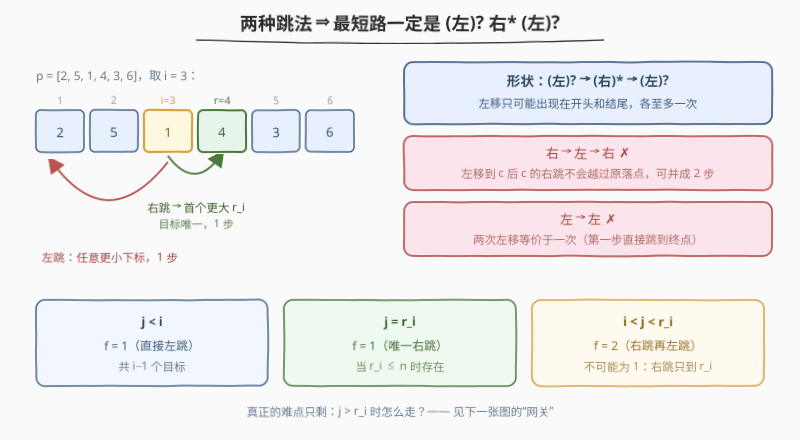
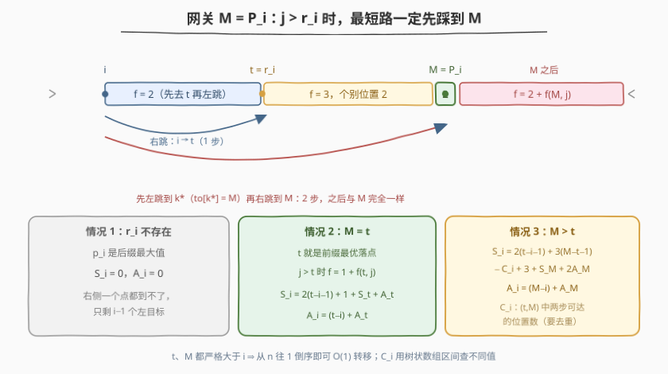
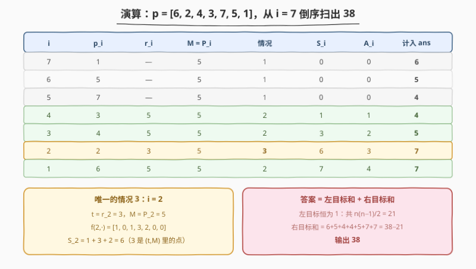

# Codeforces 2268D AghaBalaSar 与 Hamed 题解

## 1. 题目概述

- **标题 / 题号**：AghaBalaSar 与 Hamed（Codeforces 2268D，英文名 AghaBalaSar and Hamed）
- **链接**：https://codeforces.com/problemset/problem/2268/D
- **来源**：Codeforces Round 1124 (Div. 1) · Problem D（UTC 2026-09-26）
- **难度**：2600 分（Div. 1 的第四题）
- **限制**：时间 2 s / 内存 256 MB
- **标签**：数据结构（树状数组），动态规划，树，单调栈

**题意**：给定长度为 $n$ 的排列 $p$（下标 $1..n$）。从下标 $i$ 出发，一步可以走到：

1. 任意一个下标 $j<i$（往左随便跳）；
2. $i$ 右侧**第一个**满足 $p_j>p_i$ 的下标 $j$（记作 $r_i$，往右只能跳到它）。

对每一对 $(i,j)$，令 $f(i,j)$ 为从 $i$ 到 $j$ 的最少步数，**不可达记 $0$**（$f(i,i)=0$）。求 $\sum_{1\le i,j\le n} f(i,j)$。**多测**：第一行 $t$，每组给出 $n$ 与排列 $p$，逐组输出答案。

**约束**：

- $1\le t\le 10^4$，$1\le n\le 10^6$，且所有测试的 $\sum n\le 10^6$；
- $p$ 是 $1..n$ 的排列（互不相同，这一点决定了 $r_i$ 唯一）；
- $f(i,j)\le n-1$；$\sum f$ 的最大值在递增排列处取得（$n\le7$ 全枚举验证），约 $\frac{n(n^2-1)}{6}\approx 1.7\times10^{17}$（$n=10^6$），必须用 `long long`；
- 需要 $O(n\log n)$ 以内的做法：$O(n^2)$ 的状态数是 $10^{12}$ 级别，完全不可能。

## 2. 示例与观察
**官方样例**（一个输入块，$6$ 组数据）

```text
输入
6
2
1 2
2
2 1
3
1 3 2
3
1 2 3
5
1 3 5 2 4
7
6 2 4 3 7 5 1

输出
2
1
4
7
15
38
```

第 2 组 $[2,1]$：$r_1$ 不存在，故 $f(1,2)=0$，和只有 $1$；第 3 组 $[1,3,2]$：$1$ 的右跳只能到 $2$，$f(1,3)=0$；第 4 组递增：$f(i,j)=j-i\ (i<j)$，和为 $4+3=7$。

**自造样例**（专门覆盖「一个位置同时是多个 $k$ 的 $r_k$」的去重分支）

```text
输入
1
6
5 3 1 2 4 6

输出
40
```

这组数据里 $r=[6,5,4,6,6,\varnothing]$、$P=[6,6,6,6,6,6]$。对 $i=3$（$p_3=1$）有 $t=r_3=4$、$M=P_3=6$：位置 $5$ 同时是 $r_2$ 与 $r_4$，两步就能从 $3$ 到 $5$（$3\to2\to5$ 或 $3\to4\to5$），但只能**算一次**；漏掉去重会多算 $1$，输出 $39$。

## 3. 解题思路

### 3.1 暴力思路

把下标当点、两种走法当边，建 $O(n^2)$ 条边的图，每点跑一次 BFS：$O(n^3)$；即便对每个目标 $j$ 只做一次反向 BFS，也是 $n$ 次 $O(n)$，$n=10^6$ 时达 $10^{12}$。

结构来自右跳 $i\to r_i$：它是**唯一**的右移方式，落点由排列唯一确定，且所有区间 $[i,r_i]$ 两两嵌套或不相交（观察 1）。这就是把 $n^2$ 个距离压成 $O(n)$ 条转移的入口。

### 3.2 核心观察：最短路只可能是「左、右…右、左」

记 $r_i$ 为 $i$ 右侧第一个更大值，不存在时记 $r_i=n+1$。

1. **区间两两不交叉**。若 $i<k<r_i$，则 $p_k<p_i$；又 $r_i>k$ 且 $p_{r_i}>p_i>p_k$，故 $k$ 的右跳不会越过 $r_i$，即 $r_k\le r_i$。所以所有 $[i,r_i]$ 要么嵌套、要么不交。
2. **不存在「右→左→右」**。设这三步是 $a\to b\to c\to d$，其中 $b=r_a,\ c<b$。若 $c\le a$，把 $a\to b\to c$ 换成 $a\to c$，省一步；若 $a<c<b$，则 $p_c<p_a<p_b$，于是 $d=r_c\le b$，把这三步换成 $a\to b\to d$（$d<b$ 就左移一步，$d=b$ 就停在 $b$）只需 $2$ 步。两种都能变短，故最优路不会出现该形态。
3. **连续两次左移可以合并**。$a\to b\to c$ 且 $c<b<a$ 时直接 $a\to c$。

于是**任意最短路都形如 (左)? 右* 左?**：开头至多一次左移，之后一路右跳，结尾至多一次左跳。这立刻给出三种基础距离：

- $j<i$：$f=1$；共 $i-1$ 个这样的目标；
- $j=r_i$：$f=1$；
- $i<j<r_i$：$f=2$（先右跳到 $r_i$，再左跳回来；不可能为 $1$，因为右跳只到 $r_i$）。



还有一个「到不了」的判据：若 $r_i$ 不存在，说明 $p_i$ 是**后缀最大值**，那么 $i$ 及它左边的点永远跳不出 $i$（任何右跳落点都 $\le i$），于是 $f(i,j)=0\ (j>i)$。这正是样例 2 的答案只有 $1$ 的原因。

### 3.3 算法流程 / 状态转移：网关 $M=P_i$

剩下的问题是 $j>r_i$ 怎么算。关键量是**前缀最远右跳落点**

$$P_i=\max_{k\le i,\ r_k\le n} r_k .$$

它描述「花一步左跳到某个 $k\le i$，再右跳，最远能到哪」。设 $t=r_i$，$M=P_i$（必然 $M\ge t$，因为 $k=i$ 这一项就是 $t$）。

**网关引理**：任何从 $y\le i$ 出发的右跳链，只要出现了 $>M$ 的位置，它**一定先恰好落在 $M$ 上**。理由是：$c\le i$ 时 $r_c\le M$；而 $i<c<M$ 时，取使 $r_{k^*}=M$ 的 $k^*\le i$，区间 $[c,r_c]$ 与 $[k^*,M]$ 相交于 $c$，只能被后者包含（$k^*<c$），故 $r_c\le M$。所以想越过 $M$，只能从 $M$ 本身起跳。

由此分三类（倒序 $i=n\to1$ 计算，因为 $t,M>i$ 一定先算好）：

- **情况 1**：$r_i=n+1$。$S_i=0,\ A_i=0$，只有 $i-1$ 个左目标贡献 $1$。
- **情况 2**：$M=t$。段 $(i,t)$ 内每个 $2$；$t$ 本身 $1$；$j>t$ 时由网关引理 $f(i,j)=1+f(t,j)$，于是 $S_i=2(t-i-1)+1+S_t+A_t$、$A_i=(t-i)+A_t$。
- **情况 3**：$M>t$。以 $t$、$M$ 切段：
  - $j\in(i,t)$：$f=2$（$i\to t\to j$）；
  - $j\in(t,M)$：一般 $f=3$（$i\to k^*\to M\to j$），但 $j=r_k\ (k<i)$ 或 $j=r_t$ 时 $f=2$；
  - $j=M$：$f=2$（$M=r_{k^*}$，$k^*<i$）；
  - $j>M$：$f=2+f(M,j)$（网关引理，且 $i\to k^*\to M\to j$ 恰好 $2$ 步到 $M$）。

  令 $C_i$ 为 $(t,M)$ 中「能两步到达」的**不同位置**个数，则 $S_i=2(t-i-1)+3(M-t-1)-C_i+3+S_M+2A_M$、$A_i=(M-i)+A_M$。

其中 $S_i=\sum_{j>i}f(i,j)$，$A_i=\#\{j>i:f(i,j)>0\}$（可达个数），最后的 $+3$ 是 $t$ 贡献 $1$、$M$ 贡献 $2$。整体答案

$$\text{ans}=\sum_{i=1}^{n}\big(S_i+(i-1)\big).$$

$C_i$ 用树状数组维护：倒序扫描时，把位置 $x$ 标记「当且仅当存在已扫过的 $k<i$ 使 $r_k=x$」，然后查询开区间 $(t,M)$ 内的不同标记数。一个位置可能是多个 $k$ 的 $r_k$，所以必须按「位置」去重（`cnt` 数组记出现次数，只在 $0\to1$ 时插入）。另外 $j=r_t$ 也不在「$k<i$ 的 $r_k$」里，但它同样两步可达（$i\to t\to r_t$），需要临时插入 $r_t$ 再撤销。



### 3.4 示例演算

以官方第 6 组 $p=[6,2,4,3,7,5,1]$ 为例（$r=[5,3,5,5,\varnothing,\varnothing,\varnothing]$，$P_i\equiv5$），从 $i=7$ 倒序：

| $i$ | $p_i$ | $r_i$ | $M$ | 情况 | $S_i$ | $A_i$ | $S_i+(i-1)$ |
|:--|:--|:--|:--|:--|:--|:--|:--|
| 7 | 1 | — | 5 | 1 | 0 | 0 | 6 |
| 6 | 5 | — | 5 | 1 | 0 | 0 | 5 |
| 5 | 7 | — | 5 | 1 | 0 | 0 | 4 |
| 4 | 3 | 5 | 5 | 2 | 1 | 1 | 4 |
| 3 | 4 | 5 | 5 | 2 | 3 | 2 | 5 |
| 2 | 2 | 3 | 5 | 3 | 6 | 3 | 7 |
| 1 | 6 | 5 | 5 | 2 | 7 | 4 | 7 |

合计 $6+5+4+4+5+7+7=38$，与样例一致。唯一的情况 3 是 $i=2$：$t=r_2=3$、$M=P_2=5$，于是 $f(2,\cdot)=[1,0,1,3,2,0,0]$——$j=3$ 是 $1$，$j=5$ 是 $2$（左跳到 $1$ 再右跳到 $5$），$j=4$ 只能 $3$ 步，$j=6,7$ 到不了（$5$ 是后缀最大值）。$S_2=1+3+2=6$。

再看自造样例 $p=[5,3,1,2,4,6]$ 的 $i=3$：$t=4$、$M=6$，段 $(t,M)=\{5\}$；位置 $5$ 同时等于 $r_2$ 与 $r_4$，树状数组只记 $1$ 个，故 $C_3=1$，$f(3,5)=2$ 而不是 $3$。



## 4. 算法细节

1. **单调栈求 $r_i$**：从左往右扫，维护一个值递减的下标栈；遇到 $p_i$ 就弹出所有比它小的栈顶并赋 $r_x=i$。每个下标恰好被赋值一次，栈里剩下的全部赋 $n+1$。**注意是「出栈时赋值」**，写成「入栈时找栈顶」得到的是左侧更大值。
2. **哨兵 $n+1$**：$r_i=n+1$ 表示没有右跳，这样 `r[r[i]]` 之类的访问不会越界；但计算 $P_i$ 时必须**跳过** $n+1$，否则 $P_i$ 会变成 $n+1$，情况 2/3 全部错乱。
3. **倒序 + 树状数组的时序**：先把所有 $r_i\le n$ 的位置按 $r_i$ 标记一遍，然后 $i$ 从 $n$ 到 $1$ 每轮**先撤销自己**再查询，此刻集合恰好是 $\{r_k:k<i\}$。用 `cnt[x]` 记录「指向 $x$ 的 $k$ 还剩几个」，只在 $0\to1$ 与 $1\to0$ 时改树状数组，于是查询得到的是**不同位置数**。
4. **$C_i$ 的区间是开区间**：查询 `sum(M-1)-sum(t)`，$t$ 与 $M$ 都不会被算进去。临时插入 $r_t$ 时必须判 `r_t < M`（$r_t=M$ 或 $n+1$ 都不该插入），插入/撤销要成对。
5. **溢出**：$S_i$ 是 $O(n^2)$、答案 $O(n^3)$，$n=10^6$ 时约 $1.7\times10^{17}$。所有累加量一律 `long long`，`2LL*(t-i-1)` 里别忘了 `LL` 后缀。
6. **多测清空**：$t$ 可达 $10^4$，只能清到 $n+1$（`cnt`、`bit`），绝不能 `memset` 整个 $10^6$ 的数组；静态数组大小按 $10^6+5$ 开，读数用 `scanf`（实测 $n=10^6$ 仅 $0.13$ s；`cin` 关同步在本机反而慢到 $1.2$ s，稳妥起见用 `scanf`）。
7. **答案组装**：`ans += S[i] + (i-1)`，其中 $i-1$ 是所有左目标的贡献（每个恰好 $1$ 步），不要漏掉也不要重复加 $f(i,i)=0$。

## 5. 正确性证明

**引理 1（区间不交叉）**：$\forall i<k<r_i$ 有 $r_k\le r_i$（若 $r_k$ 存在）。
**证明**：$r_i$ 是 $i$ 右侧第一个更大值，故 $k<r_i\Rightarrow p_k<p_i$；又 $r_i>k$ 且 $p_{r_i}>p_i>p_k$，故 $r_k\le r_i$。∎

**引理 2（最短路形状）**：存在最优路形如 (左)? 右* 左?，即全部左移只可能出现在开头一次与结尾一次。
**证明**：先看「右→左→右」$a\to b\to c\to d$，$b=r_a$、$c<b$。若 $c\le a$，用 $a\to c$ 替换前两步即少一步；若 $a<c<b$，则 $p_c<p_a<p_b$，由引理 1 得 $d=r_c\le b$，改走 $a\to b\to d$（$d<b$ 时左移一次，$d=b$ 时不动）只需 $2$ 步，之后从 $d$ 起的走法完全不变。两种情形都严格不劣，故最优路不含该形态。再看连续两次左移：$a\to b\to c$ 且 $c<b<a$，直接用 $a\to c$ 一步。于是左移至多出现在开头和结尾各一次。∎

**引理 3（基础距离与后缀最大值）**：(1) $r_i$ 存在时 $f(i,r_i)=1$，$i<j<r_i$ 时 $f(i,j)=2$；(2) 若 $r_i$ 不存在，则 $f(i,j)=0$ 对所有 $j>i$。
**证明**：(1) 由引理 2，$1$ 步只会到 $j<i$ 或 $r_i$；而 $i\to r_i\to j$ 给出 $2$。(2) 对步数归纳证明「从 $i$ 可达的位置都 $\le i$」。设当前在 $x\le i$：左移落点 $<x\le i$；右跳 $r_x$ 若存在，当 $x<i$ 时，若 $p_x<p_i$ 则 $r_x\le i$，若 $p_x>p_i$ 则因 $p_i$ 是后缀最大值，所有 $>i$ 的位置取值都 $<p_i<p_x$，仍有 $r_x\le i$ 或 $r_x$ 不存在；当 $x=i$ 时 $r_i$ 不存在。故右跳落点也 $\le i$。∎

**引理 4（网关）**：设 $r_i=t\le n$，$M=P_i=\max_{k\le i,r_k\le n}r_k$。则对任意满足 $c\le i$ 或 $i<c<M$ 的位置 $c$，都有 $r_c\le M$。因此从任何 $y\le i$ 出发的右跳链若要出现 $>M$ 的元素，必先恰好落在 $M$。
**证明**：$c\le i$ 时由 $M$ 的定义得 $r_c\le M$。设 $i<c<M$，取 $k^*\le i$ 使 $r_{k^*}=M$（$M$ 是这些 $r_k$ 的最大值，故存在）；若 $r_c>M$，则区间 $[c,r_c]$ 与 $[k^*,M]$ 在 $c$ 处相交且互不包含（$k^*<c$ 排除前者包含后者，$r_c>M$ 排除后者包含前者），与引理 1 矛盾。故 $r_c\le M$。∎

**定理（转移正确）**：对每个 $i$，3.3 的三条公式给出的 $S_i$、$A_i$ 等于真实的和与可达个数，且算法输出的 $\sum_i(S_i+i-1)$ 正确。
**证明**：情况 1 即引理 3(2)。情况 2（$M=t$）：由引理 4 的网关论证，任何到 $j>t$ 的路必须先落在 $t$，而从 $i$ 一步就到 $t$，故 $f(i,j)=1+f(t,j)$；段 $(i,t)$ 由引理 3(1) 得 $2$，$t$ 为 $1$；可达性同理继承，得 $A_i=(t-i)+A_t$。情况 3（$M>t$）：$(i,t)$ 得 $2$，$t$ 为 $1$，$M=r_{k^*}$ 两步可达故为 $2$；$(t,M)$ 内由引理 2 的形态枚举（$2$ 步只有「左跳再右跳」$j=r_k$ 与「两次右跳」$j=r_t$ 两种，其余只能 $i\to k^*\to M\to j$ 的 $3$ 步），去重计数即 $C_i$；$j>M$ 时上界 $i\to k^*\to M\to j$ 给 $2+f(M,j)$，下界由引理 4（越过 $M$ 必落在 $M$，而从 $i$ 到 $M$ 至少 $2$ 步）给出。可达性：$i+1..M$ 全部可达，$j>M$ 当且仅当 $M$ 可达 $j$，故 $A_i=(M-i)+A_M$。三条转移的自变量 $t,M$ 都 $>i$，倒序计算无循环依赖；$S_i$、$A_i$ 都是对各目标贡献的精确求和，故最终答案正确。∎

## 6. 复杂度分析

- **时间**：单调栈 $O(n)$；前缀最大值 $O(n)$；$n$ 次树状数组查询/修改，每次 $O(\log n)$；总量 $O(n\log n)$，$\sum n\le10^6$ 时约 $2\times10^7$ 次基本操作。
- **空间**：$p,r,P,S,A$ 各 $O(n)$，`cnt`、`bit`、`stk` 也是 $O(n)$；$S,A$ 用 `long long`，其余 `int`，合计约 $40$ MB，远低于 $256$ MB。
- **实测对照**（C++17，`-O2`，本机）：$n=10^6$ 随机排列 $0.13$ s / $36$ MB；递增 $0.07$ s；递减 $0.08$ s；$t=10^4$ 且 $\sum n=10^6$ 为 $0.07$ s。即使按评测机慢 $3$ 倍估算，距 $2$ s 仍有 $5$ 倍以上余量。
- **Python**：同一算法在 CPython 下 $n=10^6$ 约 $7$ s（瓶颈是 $10^6$ 次树状数组循环），会超时；请用 PyPy3 或直接交 C++（$t=10^4$ 的小数据情形约 $2$ s，同样建议 C++）。

## 7. 参考代码

### C++17

```cpp
#include <bits/stdc++.h>
using namespace std;
typedef long long ll;

const int MAXN = 1000005;
int n;
int p[MAXN];      // 排列
int to_[MAXN];    // to_[i] = i 右侧第一个更大值的位置；不存在记 n+1
int pre_[MAXN];   // pre_[i] = max_{k<=i} to_[k]（跳过 n+1）
int stk[MAXN];
int cnt_[MAXN];   // cnt_[x]：当前扫过的 k 中满足 to_[k]=x 的个数
int bit[MAXN];    // 树状数组：不同的“右跳落点”是否落在某个区间里
ll S[MAXN], A[MAXN];
inline void bit_add(int x, int v) { for (int i = x; i <= n; i += i & -i) bit[i] += v; }
inline int bit_sum(int x) { int s = 0; for (int i = x; i > 0; i -= i & -i) s += bit[i]; return s; }

void solve() {
    scanf("%d", &n);
    for (int i = 1; i <= n; ++i) scanf("%d", &p[i]);
    // 1) 单调栈求“右侧首个更大值”
    int top = 0;
    for (int i = 1; i <= n; ++i) {
        while (top && p[i] > p[stk[top]]) to_[stk[top--]] = i;
        stk[++top] = i;
    }
    while (top) to_[stk[top--]] = n + 1;
    // 2) 前缀最大值：一步左跳 + 一步右跳能到的最远位置
    for (int i = 1; i <= n; ++i) {
        pre_[i] = pre_[i - 1];
        if (to_[i] <= n) pre_[i] = max(pre_[i], to_[i]);
    }
    // 3) 先把所有右跳落点标记进树状数组，再倒序扫时逐个撤销
    for (int i = 0; i <= n + 1; ++i) { cnt_[i] = 0; bit[i] = 0; }
    for (int i = 1; i <= n; ++i)
        if (to_[i] <= n && cnt_[to_[i]]++ == 0) bit_add(to_[i], 1);
    ll ans = 0;
    for (int i = n; i >= 1; --i) {
        if (to_[i] <= n && --cnt_[to_[i]] == 0) bit_add(to_[i], -1);
        int t = to_[i];
        if (t == n + 1) {                       // 情况 1：后缀最大值，右边一个都到不了
            S[i] = 0; A[i] = 0;
        } else if (pre_[i] == t) {              // 情况 2：t 本身就是前缀最优落点
            S[i] = 2LL * (t - i - 1) + 1 + S[t] + A[t];
            A[i] = (ll)(t - i) + A[t];
        } else {                                // 情况 3：网关 M = pre_[i] > t
            int M = pre_[i], xt = to_[t];
            bool more = (xt < M);
            if (more && cnt_[xt]++ == 0) bit_add(xt, 1);
            ll bad = (ll)bit_sum(M - 1) - bit_sum(t);   // (t,M) 里两步就能到的位置数
            if (more && --cnt_[xt] == 0) bit_add(xt, -1);
            S[i] = 2LL * (t - i - 1) + 3LL * (M - t - 1) - bad + 3 + S[M] + 2 * A[M];
            A[i] = (ll)(M - i) + A[M];
        }
        ans += S[i] + (i - 1);                  // 往左的 i-1 个目标都是 1 步
    }
    printf("%lld\n", ans);
}

int main() {
    int T;
    scanf("%d", &T);
    while (T--) solve();
    return 0;
}
```

### Python3

```python
import sys


def main():
    data = list(map(int, sys.stdin.buffer.read().split()))
    t = data[0]
    pos = 1
    out = []
    for _ in range(t):
        n = data[pos]; pos += 1
        p = data[pos:pos + n]; pos += n
        BIG = n + 1
        to = [BIG] * (n + 1)                  # 1-indexed：右侧首个更大值
        stk = []
        for i in range(1, n + 1):
            while stk and p[i - 1] > p[stk[-1] - 1]:
                to[stk.pop()] = i
            stk.append(i)
        prm = [0] * (n + 1)                   # 前缀最远右跳落点
        for i in range(1, n + 1):
            v, ti = prm[i - 1], to[i]
            if ti <= n and ti > v:
                v = ti
            prm[i] = v
        cnt = [0] * (n + 2)                   # cnt[x]：扫过的 k 中 to[k]=x 的个数
        bit = [0] * (n + 2)

        def add(x, d):
            while x <= n:
                bit[x] += d
                x += x & -x

        def qry(x):
            s = 0
            while x > 0:
                s += bit[x]
                x -= x & -x
            return s

        for i in range(1, n + 1):             # 先把所有右跳落点标记进去
            x = to[i]
            if x <= n:
                cnt[x] += 1
                if cnt[x] == 1:
                    add(x, 1)
        S = [0] * (n + 1)                     # S[i] = sum_{j>i} f(i,j)
        A = [0] * (n + 1)                     # A[i] = 可达目标个数
        ans = 0
        for i in range(n, 0, -1):             # 撤销自己后，集合恰为 {to[k] : k<i}
            ti = to[i]
            if ti <= n:
                cnt[ti] -= 1
                if cnt[ti] == 0:
                    add(ti, -1)
            if ti == BIG:
                pass                          # 情况 1：S[i]=A[i]=0
            elif prm[i] == ti:                # 情况 2
                S[i] = 2 * (ti - i - 1) + 1 + S[ti] + A[ti]
                A[i] = (ti - i) + A[ti]
            else:                             # 情况 3
                M = prm[i]
                xt = to[ti]
                extra = xt < M
                if extra:
                    cnt[xt] += 1
                    if cnt[xt] == 1:
                        add(xt, 1)
                s = qry(M - 1) - qry(ti)      # 开区间 (ti, M) 中的不同落点
                if extra:
                    cnt[xt] -= 1
                    if cnt[xt] == 0:
                        add(xt, -1)
                S[i] = 2 * (ti - i - 1) + 3 * (M - ti - 1) - s + 3 + S[M] + 2 * A[M]
                A[i] = (M - i) + A[M]
            ans += S[i] + (i - 1)             # 往左的 i-1 个目标都是 1 步
        out.append(str(ans))
    sys.stdout.write("\n".join(out) + "\n")


main()
```

## 8. 边界情况与易错点

1. **$n=1$**：没有任何有向对，答案 $0$。此时 $r_1=n+1$，走的是情况 1，$S_1=A_1=0$，`ans += 0 + 0`。
2. **递增排列**：$r_i=P_i=i+1\ (i<n)$，前 $n-1$ 个下标走情况 2、$i=n$ 走情况 1，$f(i,j)=j-i$，答案应为 $\frac{n(n-1)}{2}+\frac{n(n^2-1)}{6}$。$n=3$ 是 $7$，$n=10^6$ 是 $166667166666000000$——这是最适合自测的闭式。
3. **递减排列**：所有 $r_i=n+1$，答案恰为 $\frac{n(n-1)}{2}$（只有左跳）。$n=10^6$ 时应输出 $499999500000$。
4. **$P_i$ 的哨兵陷阱**：若把 $r_i=n+1$ 也纳入 $P_i$ 的 `max`，$P_i$ 变成 $n+1$，情况 3 会把 $M=n+1$ 当成真实位置，立刻越界或答案错乱。
5. **去重不能省**：$C_i$ 计的是「不同位置」而非「$k$ 的个数」。同一个 $x$ 可能有很多 $k$ 满足 $r_k=x$（$x$ 在 $p$ 中的左兄弟链），按个数统计会在自造样例那样的小数据上多算。
6. **$r_t$ 的边界**：$j=r_t$ 两步可达只在 $r_t<M$ 时落在 $(t,M)$ 内；$r_t=M$（已单独算作 $M$ 的 $2$ 步）与 $r_t=n+1$（不可插入）都必须排除，否则数组越界或重复计数。
7. **$t=M$ 与 $M>t$ 的分界**：判 `pre_[i] == t` 而不是 `<=`；由定义 `pre_[i] >= t` 恒成立，写 `<=` 会把情况 3 误判成情况 2，丢掉 $(t,M)$ 那一段的 $3$。
8. **多测清空范围**：只清 `0..n+1` 的 `cnt`/`bit`；用 `memset` 清满 $10^6$ 时，$t=10^4$ 组小数据会白跑 $10^{10}$ 次写操作而超时。
9. **下标从 1 开始**：$r_i$ 用 $n+1$ 作哨兵、答案里 $i-1$ 的左目标数，都是 1-indexed 写法；若改成 0-indexed 记得把哨兵与 `i-1` 同步换掉。

## 9. 验证记录

- **编译环境与命令**：`clang++ -std=c++17 -O2`（本机无 GNU g++，配 `codeforces/tools/include/bits/stdc++.h` 兼容头；正文代码只用标准库，可原样提交 GNU C++17）；Python 侧为 `Python 3.9.6`。
- **官方样例**：1 / 1 通过（按 Codeforces 标准 checker 的 token 比对，忽略空白与大小写）。
- **复核状态**：audited（2026-11-19 统一回归：编译 + 官方样例；写作期的随机对拍与暴力未重跑）。

## 相关题目与扩展

- [Codeforces 2269F AghaBalaSar and Hamed](https://codeforces.com/problemset/problem/2269/F)：Div. 2 的同一道题，可用来双开自测。
- [Codeforces 2268C KiaKio and Energy Intervals](https://codeforces.com/problemset/problem/2268/C)：同场 C 题，官方标签同样含 trees、dsu，可作同主题加练。
- [LeetCode 496. 下一个更大元素 I](https://leetcode.cn/problems/next-greater-element-i/)：单调栈求 $r_i$ 的原型，本题的第 1 步就是它。
- [LeetCode 654. 最大二叉树](https://leetcode.cn/problems/maximum-binary-tree/)：与 $[i,r_i]$ 嵌套结构同源的笛卡尔树视角，可对照理解「网关」为什么只能从 $M$ 起跳。
- [LeetCode 907. 子数组的最小值之和](https://leetcode.cn/problems/sum-of-subarray-minimums/)：区间嵌套结构上的贡献求和，与本题把 $n^2$ 对压成 $O(n)$ 次转移的思路相通。

**延伸思考**：

1. 若把「左跳随便跳」改成「左跳也只能跳到左侧第一个更小值」，路径变成一棵树上的双向爬行，答案会变成树上距离求和，可直接用 LCA 计算，$O(n\log n)$；本题的「一步左跳任意」正是让 $A_i$ 变成「区间长度 + 继承」的关键。
2. 若要求 $\sum f(i,j)^2$ 或 $\sum \binom{f(i,j)}{2}$，只需在 $S_i$ 的转移里携带二阶矩：情况 3 的「$2+f(M,j)$」会展开出 $4+4f+f^2$，于是再维护一个 $Q_i=\sum_{j>i} f(i,j)^2$ 即可，复杂度不变。
3. 若把排列换成一般数组（允许相等），$r_i$ 不再唯一（要考虑「严格大于」还是「不小于」），区间嵌套性质对「严格大于」仍然成立，但右跳链会退化，需要重做 3.2 的观察 2。
4. 三条转移本质上是把「答案继承给 $t$ 或 $M$」写成一棵树；把继承关系显式建出来后，可在这棵树上做更复杂的统计（如 $k$ 步内可达点数）。
