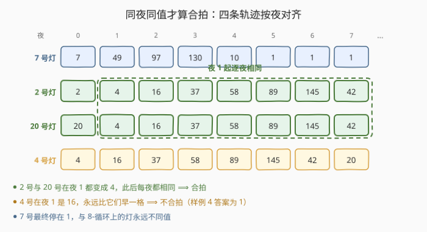
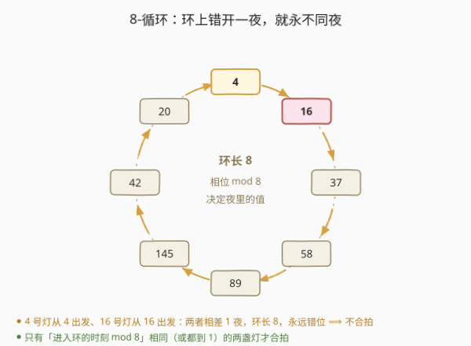
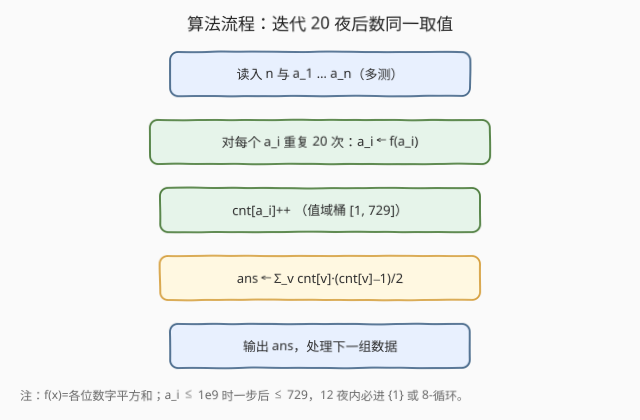
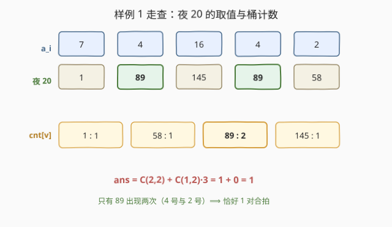

# Codeforces 2269B KiaKio 与平方数 题解

## 1. 题目概述

- **标题 / 题号**：KiaKio 与平方数（Codeforces 2269B，英文名 KiaKio and Squared Numbers）
- **链接**：https://codeforces.com/problemset/problem/2269/B
- **来源**：Codeforces Round 1124 (Div. 2) · Problem B
- **难度**：1000（Div. 2 Problem B，1000 分）
- **限制**：时间 1 s / 内存 256 MB
- **标签**：暴力枚举、实现

**题意**：$n$ 座灯塔排在海边。第 $i$ 座灯塔在第 $0$ 夜显示 $a_i$；此后每过一夜，显示的数 $x$ 变成 $x$ 的十进制各位数字的平方和 $f(x)$。例如 $23 \to 2^2+3^2=13 \to 1^2+3^2=10 \to 1$。若存在某一夜 $T$，使得从第 $T$ 夜开始，两座灯塔每一夜显示的数都**完全相同**，则称灯塔 $i$ 与 $j$（$i<j$）合拍。求合拍的灯对数量。

多测：第一行 $t$；每组第一行 $n$，第二行 $n$ 个整数 $a_1,\dots,a_n$；对每组输出一行一个整数表示答案。

**约束**：

- $1 \le t \le 1000$，$1 \le n \le 1000$，$\sum n \le 1000$
- $1 \le a_i \le 10^9$
- 答案上界为 $\binom{1000}{2} = 499500$，$32$ 位整数即可，但仍建议用 `long long`
- 时间 1 s：允许的操作量很小，但要避免逐对模拟带来的 $O(n^2)$ 常数

## 2. 示例与观察
官方样例（输入 / 输出原样）：

```text
输入：
4
5
7 4 16 4 2
4
1 7 10 100
3
4 16 37
3
2 20 4

输出：
1
6
0
1
```

1. $7 \to 49 \to 97 \to 130 \to 10 \to 1$，最终停在 $1$；两盏灯都从 $4$ 出发，逐夜相同；从 $16$ 出发与从 $2$ 出发的两盏灯落在 8-循环的不同相位上，与谁都不是同夜同值 → 答案 $1$。
2. $1,7,10,100$ 最终都到达 $1$，全部两两合拍 → $\binom{4}{2}=6$。
3. $4,16,37$ 恰是 8-循环上相邻的三个数，永远"错开一夜" → 答案 $0$。
4. 第 1 盏灯在夜 1 变成 $2^2=4$，第 2 盏灯在夜 1 变成 $2^2+0^2=4$，此后逐夜相同；第 3 盏灯一开始就是 $4$，比它们早一夜 → 只有 $1$ 对合拍。

自造一组（$a_i$ 取在 $10^9$ 附近，且刻意让入环相位对齐）：

```text
输入：
1
4
269 4 16 20

输出：
1

解释：夜 20 的取值依次为 145、89、145、58。
      269 在夜 11 从 89 入环，16 号灯一开始就在环上，两者相位恰好对齐、在夜 20 同为 145，故只有 1 对合拍。
```

## 3. 解题思路

### 3.1 暴力思路

最直接的做法：枚举每一对 $(i,j)$，让两条轨迹同步往前走、逐夜比较，直到都进入循环为止；总复杂度 $O(n^2K)$，$n=1000$ 时约 $5\times10^5$ 对 × $20$ 步 ≈ $10^7$。C++ 勉强能过，但常数与"何时停止"的判定都不划算，Python 更容易贴时限。

两种常见错解：只比较 $a_i$ 是否相等（漏掉样例 4 的"后来汇合"）；或把"最终落在同一个吸引子"的灯都算合拍（样例 3 打回：$4,16,37$ 同在 8-循环上，却因**相位不同**永远不同夜）。真正的解法是把每盏灯压缩成一个特征值，再用**桶计数**把两两比较换成 $\binom{c}{2}$ 求和。

### 3.2 核心观察：同夜同值才是合拍



- **确定性**：$f$ 是函数，一旦某夜两灯显示同一个数，此后每夜都同值。所以"从第 $T$ 夜起永远相同"$\iff$"存在某一夜 $T$ 使 $f^T(a_i)=f^T(a_j)$"，只需关心**同夜**是否相遇。
- **两个吸引子**：所有轨迹最终落入 $\{1\}$（一到就停）或 8-循环 $4 \to 16 \to 37 \to 58 \to 89 \to 145 \to 42 \to 20 \to 4$。这两类之间永不同值。
- **相位**：两条都进 8-循环的轨迹，若入环的"夜数差"为 $d$，则它们的值永远相差环上 $d$ 个位置；只有 $d \equiv 0 \pmod 8$ 才可能同夜同值。



于是可以给每盏灯一个**特征值** $b_i = f^K(a_i)$，$K$ 取一个足够大的固定夜数：$K$ 夜之后所有灯都已在吸引子上，特征值相同 $\iff$ 同夜同值 $\iff$ 合拍。

### 3.3 算法流程：固定 20 夜 + 值域桶



1. 对每个 $a_i$ 恰好迭代 $K=20$ 次，得到 $b_i = f^{20}(a_i)$；
2. 用定长数组做桶：`cnt[b_i]++`（$b_i \in [1,729]$）；
3. 答案为 $ans = \sum_{v} \binom{c_v}{2}$（$c_v$ 为桶 $v$ 的计数），每组输出一行。

**为什么 20 夜足够**：

- $a_i \le 10^9$：$10^9$ 是唯一的 10 位数且 $f(10^9)=1$，其余输入至多 9 位，故一步之后 $f(x) \le 9 \times 81 = 729$；
- 对 $y \in [1,729]$ 写 10 行程序逐个迭代即可验证：**最坏入环时间是 11 夜**，出现在 $y=269$：
  $$269 \to 121 \to 6 \to 36 \to 45 \to 41 \to 17 \to 50 \to 25 \to 29 \to 85 \to 89 \in C;$$
- 所以任何输入在 $12$ 夜之后必然已在 $\{1\}$ 或 $C$ 上。$K=20$ 留了 8 夜余量，也与证明里"向后回看恰好一个周期"的论证对齐（任何 $K \ge 19$ 都成立，20 只是好记）。

### 3.4 示例演算：样例 1



取 $a = (7,4,16,4,2)$，把每盏灯迭代 20 夜：

| 灯塔 | 1 | 2 | 3 | 4 | 5 |
|------|---|---|---|---|---|
| $a_i$ | 7 | 4 | 16 | 4 | 2 |
| 夜 20 | 1 | **89** | 145 | **89** | 58 |

桶计数为 $1:1,\ 58:1,\ 89:2,\ 145:1$，于是

$$ans = \binom{2}{2} + \binom{1}{2}\times 3 = 1 + 0 = 1.$$

与官方答案一致。样例 4 同理：$2$ 号与 $20$ 号灯的夜 20 值都是 $58$，而 $4$ 号灯是 $89$，故答案为 $1$。

## 4. 算法细节

1. **禁止"迭代到不变"**：8-循环里 $f(4)=16,\ f(16)=37,\dots$ 永不收敛，写成 `while (x != f(x)) x = f(x);` 这样的无界循环会直接死循环。必须用**固定步数**（本题取 20）。
2. **多测清空**：`cnt` 每组都要清零。$\sum n \le 1000$ 但 $t$ 可达 $1000$，最坏 $1000 \times 729 \approx 7.3\times10^5$ 次清桶，量级很小；也可以每组重建 `vector<int> cnt(730, 0)`，更不容易出错。
3. **值域与下标**：迭代后的值落在 $[1,729]$，桶开 **730**；不能拿未迭代的 $a_i$ 当下标（可达 $10^9$，必越界）。$b_i \ge 1$ 恒成立，桶下标 $0$ 空着。
4. **类型与溢出**：单组答案 $\le 499500$，`int` 够；但 `cnt[v]*(cnt[v]-1)/2` 中间量到 $10^6$，先转 `long long` 再算最稳（Python 无此问题）。
5. **$f$ 的实现**：`while (x) { d = x % 10; s += d*d; x /= 10; }`。$x \ge 1$ 无负号；每位平方 $\le 81$，累加 $\le 729$，`int` 足够，不需要 `long long`。
6. **I/O 与容器**：$\sum n \le 1000$，输入极小，C++ 开 `std::ios::sync_with_stdio(false)`、Python 用 `sys.stdin.buffer.read().split()` 一次读完即可；值域只有 729 个可能值，不要用 `unordered_map`（定长数组快一个量级且无退化风险）。

## 5. 正确性证明

**引理 1（确定性 $\Rightarrow$ 一次相遇即永远相同）**：对任意 $i,j$ 与夜 $T$，若 $f^T(a_i)=f^T(a_j)$，则对所有 $t \ge T$ 有 $f^t(a_i)=f^t(a_j)$。因此"合拍"$\iff$"存在 $T$ 使 $f^T(a_i)=f^T(a_j)$"。

**证明**：对 $t-T$ 归纳。$t=T$ 即前提；若 $t$ 时成立，则 $f^{t+1}(a_i)=f\bigl(f^t(a_i)\bigr)=f\bigl(f^t(a_j)\bigr)=f^{t+1}(a_j)$，因为同一个函数作用于同一个值时结果唯一。归纳即得所有 $t \ge T$。∎

**引理 2（值域收缩与入环时间）**：任意 $x \in [1,10^9]$ 满足 $f(x) \le 729$；且任意 $y \in [1,729]$ 满足 $f^{11}(y) \in \{1\} \cup C$，其中 $C = \{4,16,37,58,89,145,42,20\}$。

**证明**：设 $x < 10^9$，则 $x$ 至多 9 位，每位数字平方和 $\le 81$，故 $f(x) \le 9 \times 81 = 729$；唯一剩下的 $x = 10^9$ 有 $f(x) = 1 \le 729$。第二部分是有限验证：对 $y = 1,2,\dots,729$ 逐个模拟 $f$ 直到落入 $\{1\}\cup C$，记录的最大步数是 $11$（$y=269$），故 $f^{11}(y)$ 必在其中。∎

**引理 3（吸引子上的 8-周期性）**：若 $t \ge 12$，则 $f^{t+8}(x) = f^t(x)$。

**证明**：由引理 2，任意 $x$ 满足 $f(x) \le 729$，故 $f^{12}(x) = f^{11}\bigl(f(x)\bigr) \in \{1\}\cup C$。又 $f(1)=1$ 且 $f$ 把 $C$ 映到 $C$（$4 \to 16 \to 37 \to 58 \to 89 \to 145 \to 42 \to 20 \to 4$ 是一个长度恰为 $8$ 的环），故 $\{1\}\cup C$ 在 $f$ 下封闭：$t \ge 12$ 时 $f^t(x) \in \{1\}\cup C$。若该值是 $1$，则后续恒为 $1$，$f^{t+8}=f^t$；若在 $C$ 中，沿环走 $8$ 步回到原值，同样 $f^{t+8}=f^t$。∎

**定理**：令 $K = 20$、$b_i = f^K(a_i)$。则灯塔 $i,j$ 合拍 $\iff b_i = b_j$。

**证明**：

- ($\Leftarrow$) 若 $b_i = b_j$，取 $T = K$，由引理 1 立即得到合拍。
- ($\Rightarrow$) 设存在 $T$ 使 $f^T(a_i)=f^T(a_j)$。若 $T \le K$，引理 1 直接给出夜 $K$ 也相等。若 $T > K = 20$，则 $T \ge 21$，由引理 3（取 $t = T-8 \ge 13 \ge 12$）得 $f^T = f^{T-8}$，即可以从夜数里安全地减掉 $8$；反复减 $8$ 直到落入 $[13,20]$，得到某个 $T' \in [13,20]$ 满足 $f^{T'}(a_i)=f^{T'}(a_j)$。又 $T' \le K$，再用一次引理 1 得 $b_i = f^K(a_i) = f^K(a_j) = b_j$。∎

**推论**：程序输出的 $\sum_v \binom{c_v}{2}$ 恰为合拍对数。

**证明**：由定理，合拍对与"落在同一个桶里的下标对"一一对应；桶 $v$ 内有 $c_v$ 盏灯，任取两盏都合拍且贡献一对，故贡献 $\binom{c_v}{2}$；各桶互不相交，求和即得总数。∎

## 6. 复杂度分析

- **时间**：每组 $O(nK + V)$，其中 $K = 20$、$V = 729$。迭代部分共 $\sum n \times 20 \le 2\times10^4$ 次数字运算（每次至多拆 10 位）；清桶共 $t \times 729 \le 7.3\times10^5$ 次赋值。总计 $10^6$ 量级。1 s 时限下的实测（$n=1000$ 单组最坏 / $t=1000$ 且 $n=1$ 的多测最坏）：C++ 约 4–6 ms（含进程启动），Python 约 30–40 ms，余量都在 25 倍以上。
- **空间**：桶数组 $730$ 个 `int` 加输入数组 $O(n)$，约 $3$ KB，与 $t$ 无关，远低于 256 MB。

## 7. 参考代码

### C++17

```cpp
#include <bits/stdc++.h>
using namespace std;

// f(x) = 十进制各位数字的平方和
static inline int nxt(int x) {
    int s = 0;
    while (x > 0) { int d = x % 10; s += d * d; x /= 10; }
    return s;
}

int main() {
    ios::sync_with_stdio(false);
    cin.tie(nullptr);

    const int K = 20;        // 20 夜后所有轨迹都已在 {1} 或 8-循环上
    int t;
    if (!(cin >> t)) return 0;
    while (t--) {
        int n;
        cin >> n;
        int cnt[730] = {0};  // 迭代后的值域是 [1, 729]
        for (int i = 0; i < n; ++i) {
            int x;
            cin >> x;
            for (int k = 0; k < K; ++k) x = nxt(x);
            ++cnt[x];
        }
        long long ans = 0;
        for (int v = 1; v <= 729; ++v)
            if (cnt[v] >= 2) ans += 1LL * cnt[v] * (cnt[v] - 1) / 2;
        cout << ans << '\n';
    }
    return 0;
}
```

### Python3

```python
import sys

K = 20


def nxt(x: int) -> int:
    s = 0
    while x:
        d = x % 10
        s += d * d
        x //= 10
    return s


def main() -> None:
    data = sys.stdin.buffer.read().split()
    if not data:
        return
    t = int(data[0])
    pos = 1
    out = []
    for _ in range(t):
        n = int(data[pos]); pos += 1
        cnt = {}
        for _ in range(n):
            x = int(data[pos]); pos += 1
            for _ in range(K):
                x = nxt(x)
            cnt[x] = cnt.get(x, 0) + 1
        ans = 0
        for c in cnt.values():
            ans += c * (c - 1) // 2
        out.append(str(ans))
    sys.stdout.write("\n".join(out) + "\n")


main()
```

## 8. 边界情况与易错点

1. **迭代到"不变"就停 → 死循环**：$4 \to 16 \to 37 \to \dots \to 20 \to 4$ 永不收敛，`while (x != nxt(x))` 一定卡死；必须固定步数。
2. **忽略相位**：只按"最终落在哪个吸引子"分类，会把 $4$ 与 $16$ 判成合拍。样例 3 的答案是 $0$，专门检测这一点。
3. **步数不足**：$K < 12$ 时 $269$（需 11 夜入环）这类数还没入环，$f^K$ 的值仍带初始相位信息，会得出错误答案；取 $K = 20$ 安全。
4. **$n = 1$**：没有任何灯对，答案必须是 $0$；不要漏输出换行，也不要输出 $1$。
5. **下标越界**：未迭代的 $a_i$ 可达 $10^9$，不能直接当桶下标；桶大小 $730$ 恰好覆盖迭代后的 $[1,729]$。
6. **多测不清空**：`cnt` 残留会把上一组的计数带进下一组，在 $t$ 很大、$n$ 很小的数据上必然 WA。
7. **$10^9$ 是 10 位数**：推导上界时不要漏掉它（$f(10^9)=1$，结论仍成立，但证明要写全）。
8. **输出类型**：答案用 `long long` 打印；组与组之间不要输出空行，也不要带多余空格。

## 9. 验证记录

- **编译环境与命令**：`clang++ -std=c++17 -O2`（本机无 GNU g++，配 `codeforces/tools/include/bits/stdc++.h` 兼容头；正文代码只用标准库，可原样提交 GNU C++17）；Python 侧为 `Python 3.9.6`。
- **官方样例**：1 / 1 通过（按 Codeforces 标准 checker 的 token 比对，忽略空白与大小写）。
- **复核状态**：audited（2026-11-19 统一回归：编译 + 官方样例；写作期的随机对拍与暴力未重跑）。

## 相关题目与扩展

- [LeetCode 202. 快乐数](https://leetcode.cn/problems/happy-number/)：同一个 $f$，只判"是否到 1"。本题相当于在它的基础上再区分 8-循环上的相位。
- [LeetCode 258. 各位相加](https://leetcode.cn/problems/add-digits/)：数位迭代的另一种形态，用 $(x-1) \bmod 9 + 1$ 一步到位，可见"数位迭代"常能压成闭式。
- [LeetCode 957. N 天后的牢房](https://leetcode.cn/problems/prison-cells-after-n-days/)：状态必然进入短周期，按周期跳过 $N$ 天——与本题"用周期性对齐夜数"的思路一致。
- [Codeforces Gym 104471F. Happy Numbers](https://codeforces.com/problemset/gymProblem/104471/F)：统计区间内快乐数个数，$r \le 10^{200}$，需要数位 DP。

**延伸思考**：

1. 若把 $f$ 换成"各位数字的立方和"，吸引子变成多个不动点（$1,153,370,371,407$）和若干环（如 $55 \to 250 \to 133 \to 55$），此时特征值必须写成"环编号 + 相位"，不能再靠"迭代 20 夜"一刀切。
2. 若夜数是**给定**的 $T$（不是"某一夜起"），则判据变成 $f^T(a_i)=f^T(a_j)$，只需迭代 $T$ 次；但当 $T$ 极大时要用"入环时间 + 周期取模"快速跳步。
3. 若要求改成"存在无穷多夜同值"而非"某一夜起逐夜同值"，结论会变弱：8-循环上不同相的两盏灯也算，这是一组值得对照的反例。
