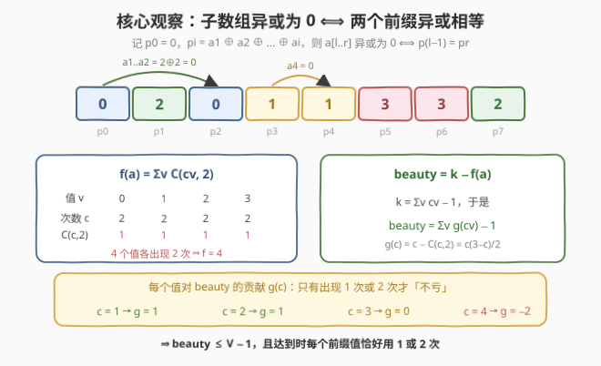
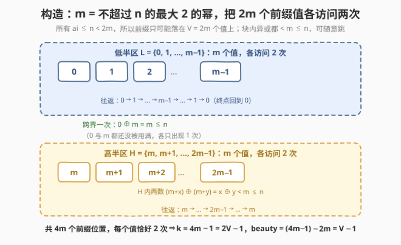
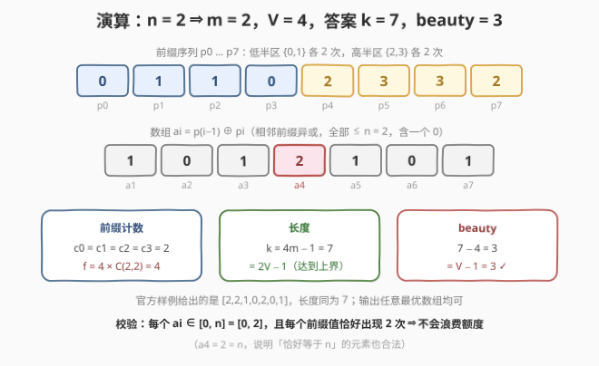

# Codeforces 2271C 异或问题 题解

## 1. 题目概述

- **标题 / 题号**：异或问题（Codeforces 2271C，英文名 XOR Problem）
- **链接**：https://codeforces.com/problemset/problem/2271/C
- **来源**：DeepInfra Round 1 (Codeforces Round 1126, Div. 1 + Div. 2) · Problem C
- **难度**：1400（1250 分）
- **限制**：时间 2 s / 内存 256 MB
- **标签**：位运算，构造，图论，贪心，数学

**题意**：给定整数 $n$。对任意数组 $a$，记 $|a|$ 为它的长度，$f(a)$ 为异或和恰为 $0$ 的**非空连续子数组**个数，定义**美丽度**

$$\text{beauty}(a)=|a|-f(a).$$

现在只允许使用 $0\le a_i\le n$ 的元素：先让美丽度**最大**，再在美丽度最大的前提下让长度 $|a|$ **最大**，输出这个最大长度 $k$，以及任意一个满足要求的数组。

多测：输入第一行 $t$，之后每组一行一个 $n$；对每组先输出一行 $k$，再输出一行 $k$ 个整数 $a_1,\dots,a_k$。

**约束**：

- $1 \le t \le 10^4$，$1 \le n \le 2\times 10^5$，且 $\sum n \le 2\times 10^5$
- $0 \le a_i \le n$：**$0$ 也是合法元素**，所以相邻两个前缀异或允许相同
- 题目要的是具体方案；题面保证 $\sum k \le 10^6$，所以逐组 $O(k)$ 地输出即可
- 长度会达到 $4m-1$（$m$ 为不超过 $n$ 的最大 $2$ 的幂），最坏 $4\times 131072-1=524287$，`int` 足够

## 2. 示例

官方样例：

```text
输入：
2
1
2

输出：
3
1 1 1
7
2 2 1 0 2 0 1
```

$n=1$：官方方案 $a=[1,1,1]$ 的前缀为 $0,1,0,1$，异或为 $0$ 的子数组是 $(1,2)$ 与 $(2,3)$，$f=2$、beauty $=1$，且任何长度 $4$ 的 $0/1$ 数组美丽度都 $\le 0$。$n=2$：官方方案 $f=4$、beauty $=7-4=3$。

再补两组**自造示例**（非官方，前一组正是本文构造在 $n=3$ 的输出，后一组是 $n=4$）：

```text
输入：
2
3
4

输出：
7
1 0 1 2 1 0 1
15
1 3 1 0 1 3 1 4 1 3 1 0 1 3 1
```

注意 $n=3$ 与 $n=2$ 的 $V$ 相同（都是 $4$），故两者答案长度都是 $7$。

## 3. 解题思路

### 3.1 暴力思路

元素有 $n+1$ 种可选、长度又事先未知，直接枚举「方案」等于同时猜长度和内容，规模爆炸。即使锁定长度 $k$，逐个子数组求异或也是 $O(k^2)$。破局点在于把「子数组异或为 $0$」翻译成前缀语言：**两个前缀异或相等**。剩下的事就变成在前缀序列上做规划。

### 3.2 核心观察：前缀异或 + 每个值最多用两次



取 $p_0=0$、$p_i=a_1\oplus a_2\oplus\cdots\oplus a_i$，则

$$a_l\oplus\cdots\oplus a_r=0\iff p_{l-1}=p_r .$$

设值 $v$ 在前缀数组 $p_0,p_1,\dots,p_k$ 中出现 $c_v$ 次，则每一对相等前缀对应一个异或为 $0$ 的区间，于是

$$f(a)=\sum_v \binom{c_v}{2},\qquad k+1=\sum_v c_v .$$

把它代回美丽度：

$$\text{beauty}=k-\sum_v\binom{c_v}{2}=\sum_v\left(c_v-\binom{c_v}{2}\right)-1=\sum_v g(c_v)-1,\qquad g(c)=c-\binom{c}{2}=\frac{c(3-c)}{2}.$$

逐项算出来：$g(1)=1,\ g(2)=1,\ g(3)=0,\ g(4)=-2,\ g(5)=-5$。含义非常清晰：

- 某个前缀值只用 **$1$ 次**或 **$2$ 次**，对 beauty 的贡献都是 $1$——第 $2$ 次出现是「免费」的；
- 用到 **$3$ 次及以上**就开始倒亏，用得越多亏得越狠。

所以只有两件事值得做：**让尽量多的不同前缀值出现**，并且**每个值最多出现两次**。

前缀的取值还有一个硬上界：$a_i\le n<2^{b}$（$b$ 是 $n$ 的二进制位数），而异或不会产生更高位，故所有前缀 $<2^b$。记 $V=2^b=2m$（$m$ 为不超过 $n$ 的最大 $2$ 的幂），前缀总共只有 $V$ 种取值，于是

$$\text{beauty}\le V-1,\qquad \text{取等时必须}\ k+1=\sum_v c_v\le 2V,\ \text{即}\ k\le 2V-1 .$$

### 3.3 构造：拆成两个半区，各走一个往返



把 $V=2m$ 个前缀值分成**低半区** $L=\{0,1,\dots,m-1\}$ 与**高半区** $H=\{m,m+1,\dots,2m-1\}$。两半内部都「完全连通」：

- 同一半区内任意两数的异或都 $<m\le n$，块内可以随便跳，产生的元素永远合法；
- 跨界只走一次：$0\oplus m=m\le n$，也合法。

于是取前缀序列

$$p=\underbrace{0,1,\dots,m-1,\;m-1,\dots,1,0}_{2m\ \text{个：}\;L\;\text{去+回}},\quad\underbrace{m,m+1,\dots,2m-1,\;2m-1,\dots,m}_{2m\ \text{个：}\;H\;\text{去+回}} .$$

它从 $p_0=0$ 出发，共 $4m$ 个位置，$L$ 与 $H$ 中每个值**恰好出现 $2$ 次**。令 $a_i=p_{i-1}\oplus p_i$，得到

$$k=4m-1=2V-1,\qquad \text{beauty}=(4m-1)-V\cdot\binom{2}{2}=4m-1-2m=2m-1=V-1,$$

美丽度与长度**同时**取到上界。

### 3.4 示例演算



$n=2\Rightarrow m=2,\ V=4$，构造给出的前缀与数组是

$$p=0,1,1,0,\;2,3,3,2\quad\Longrightarrow\quad a=1,0,1,2,1,0,1 .$$

四个前缀值各出现 $2$ 次，$f=4\times\binom{2}{2}=4$，$\text{beauty}=7-4=3=V-1$，$k=7=2V-1$，且所有 $a_i\le 2=n$。官方样例给的是 $[2,2,1,0,2,0,1]$，长度同为 $7$，说明最优方案不唯一。

## 4. 算法细节

1. **求 $m$**：`int m = 1; while ((m << 1) <= n) m <<= 1;`，即 $m=2^{\lfloor\log_2 n\rfloor}$；随后 $V=2m$、$k=4m-1$，全部数值都在 `int` 内（$k\le 524287$）。
2. **不必显式保存整条前缀**：按「低半区去 + 回 → 跨到 $m$ → 高半区去 + 回」两段生成 $p$，输出相邻异或即可；也可以边生成边算差值，做到 $O(1)$ 额外空间。
3. **元素形态**：块内往返产生的差值就是 $i\oplus(i+1)=2^{t+1}-1$（$t$ 为 $i$ 末尾连续 $1$ 的个数）以及末尾那个 $0$，所以它们形如 $1,3,7,\dots$，全都 $<m\le n$；跨界的差值恰好是 $m$。$n=4$ 时元素序列为 $1,3,1,0,1,3,1,\mathbf{4},1,3,1,0,1,3,1$。
4. **输出格式**：每组先单独一行 $k$，再一行 $k$ 个数；数与数之间一个空格，行末不加多余空格，组与组之间直接换行。C++ 可用 `printf("%d%c", x, i + 1 == lim ? '\n' : ' ')` 一次成型。
5. **多测**：$t$ 最多 $10^4$，每组重建 `vector` 并 `reserve(4 * m)`，避免反复扩容；总分配量与 $\sum k$ 同阶（$\le 10^6$）。
6. **I/O**：C++ 直接用 `scanf/printf`（或关同步后用 `cin/cout`）；Python 必须整组 `' '.join(...)` 后一次 `write`，逐个数 `print` 在 $10^6$ 次输出下会超时。

## 5. 正确性证明

**引理 1（前缀刻画）**：对任意数组 $a$，$f(a)=\sum_v\binom{c_v}{2}$，其中 $c_v$ 表示值 $v$ 在 $p_0,\dots,p_k$ 中出现的次数。

**证明**：由 $a_l\oplus\cdots\oplus a_r=p_{l-1}\oplus p_r$，该区间异或为 $0$ 当且仅当 $p_{l-1}=p_r$。下标对 $(l-1,r)$ 与区间 $[l,r]$ 一一对应，故 $f$ 等于相等前缀对的个数；对值 $v$，它的 $c_v$ 个出现位置两两配对共 $\binom{c_v}{2}$ 对，按值求和即得。∎

**引理 2（取值上界）**：若所有 $a_i\le n$，则一切 $p_i<2^b=V$，前缀至多 $V$ 种不同取值。

**证明**：$a_i\le n<2^b$ 说明每个 $a_i$ 的第 $b$ 位及更高位都是 $0$；异或逐位进行不会产生更高位，故 $p_i<2^b$。小于 $V$ 的非负整数恰有 $V$ 个。∎

**引理 3（$g$ 的极大值）**：对任意整数 $c\ge 0$，$g(c)\le 1$，且等号成立当且仅当 $c\in\{1,2\}$。

**证明**：$g(0)=0$，$g(1)=g(2)=1$，$g(3)=0$；当 $c\ge 3$ 时 $g(c)=\frac{c(3-c)}{2}\le 0<1$。∎

**定理 1（美丽度上界）**：任何合法数组都满足 $\text{beauty}\le V-1$。

**证明**：由引理 1 与引理 3，

$$\text{beauty}=\sum_{v:\,c_v\ge 1}g(c_v)-1\le \#\{v:c_v\ge 1\}-1\le V-1,$$

最后一步用引理 2。∎

**定理 2（长度上界）**：若 $\text{beauty}=V-1$，则 $k\le 2V-1$。

**证明**：定理 1 证明中的两个不等号必须同时取等：前者要求每个用到的值满足 $c_v\in\{1,2\}$（引理 3），后者要求 $V$ 个取值全部被用到。于是 $k+1=\sum_v c_v\le 2V$，即 $k\le 2V-1$。∎

**定理 3（构造正确且最优）**：3.3 节的前缀序列给出合法数组，且 $k=2V-1$、$\text{beauty}=V-1$。

**证明**：分三点。

① 起点 $p_0=0$，符合前缀定义。

② 相邻差值合法：$L$ 内（含回程）两数都 $<m$，异或 $<m\le n$；跨界一步 $0\oplus m=m\le n$；$H$ 内两数形如 $m+x,m+y$，异或 $=x\oplus y<m\le n$。故所有 $a_i=p_{i-1}\oplus p_i\in[0,n]$。

③ $L$、$H$ 各走一个「去 + 回」，其中每个值恰好出现 $2$ 次，前缀共 $4m=2V$ 个位置，$k=4m-1$；由引理 1，

$$\text{beauty}=k-\sum_v\binom{c_v}{2}=(4m-1)-V\cdot\binom{2}{2}=2m-1=V-1,$$

长度也取到定理 2 的上界 $2V-1$。∎

**结论**：该构造同时达到美丽度上界 $V-1$ 与长度上界 $2V-1$，正是题目要求的解。

## 6. 复杂度分析

- **时间**：每组 $O(k)=O(m)$（$m\le n$），求 $m$ 的循环 $O(\log n)$；总计 $O(\sum k)\le 10^6$ 次基本运算。C++ 实测（含进程启动）：单组 $n=2\times 10^5$ 约 $46$ ms，$t=10^4$ 约 $52$ ms，最坏合法数据（$n$ 取 $2$ 的幂时 $k=4n-1$ 最大，$\sum k\approx 8.5\times10^5$）约 $68$ ms，相对 $2$ s 时限仍有 $30$ 倍以上余量。
- **空间**：$O(m)$，只存一组答案，逐组复用，不随 $t$ 增长；输出缓冲 $O(k)$。
- **Python**：同为 $O(\sum k)$，整组 `join` 输出，实测最坏合法数据约 $0.22$ s（单组 $n=2\times10^5$ 约 $0.13$ s），同样安全。

## 7. 参考代码

### C++17

```cpp
#include <cstdio>
#include <vector>
using namespace std;

int main() {
    int t;
    if (scanf("%d", &t) != 1) return 0;
    while (t--) {
        int n;
        scanf("%d", &n);
        int m = 1;                       // m = 不超过 n 的最大 2 的幂
        while ((m << 1) <= n) m <<= 1;

        // 前缀序列 p：低半区 [0, m-1] 往返，再高半区 [m, 2m-1] 往返
        vector<int> p;
        p.reserve((size_t)4 * m);
        for (int i = 0; i < m; i++) p.push_back(i);
        for (int i = m - 1; i >= 0; i--) p.push_back(i);
        for (int i = 0; i < m; i++) p.push_back(m + i);
        for (int i = m - 1; i >= 0; i--) p.push_back(m + i);

        int k = (int)p.size() - 1;        // = 4m - 1
        printf("%d\n", k);
        for (int i = 1; i <= k; i++)
            printf("%d%c", p[i] ^ p[i - 1], i == k ? '\n' : ' ');
    }
    return 0;
}
```

### Python3

```python
import sys

def solve():
    data = sys.stdin.buffer.read().split()
    if not data:
        return
    t = int(data[0])
    out = []
    ptr = 1
    for _ in range(t):
        n = int(data[ptr]); ptr += 1
        m = 1
        while (m << 1) <= n:
            m <<= 1
        # 前缀序列 p：低半区往返 + 高半区往返
        p = list(range(m))
        p += range(m - 1, -1, -1)
        p += [m + i for i in range(m)]
        p += range(2 * m - 1, m - 1, -1)
        out.append(str(len(p) - 1))                     # k = 4m - 1
        out.append(' '.join(str(p[i] ^ p[i - 1]) for i in range(1, len(p))))
    sys.stdout.write('\n'.join(out) + '\n')

solve()
```

## 8. 边界情况与易错点

1. **$n=1$**：$m=1,\ V=2$，前缀 $0,0,1,1$，答案 $a=[0,1,0]$、$k=3$、beauty $=3-2=1$。（官方给 $[1,1,1]$，两者都对。）
2. **$n$ 恰为 $2$ 的幂**：$m=n$，$k=4n-1$ 直接顶到上界；若误取 $m=2^{\lceil\log_2 n\rceil}$（如 $n=4$ 取 $m=8$），输出的元素会超过 $n$，直接 WA。
3. **忘记 $0$ 合法**：题面写的是 $0\le a_i\le n$，所以「相邻前缀相等」被允许；$n=1$ 与 $n=2$ 的构造都用到这一点。
4. **长度漏掉 $-1$**：$k+1=\sum c_v\le 2V$ 给出的是 $k\le 2V-1$。若强行输出 $2V$ 个元素，必有一个值出现 $3$ 次，$g$ 从 $1$ 掉到 $0$，beauty 反而变小。
5. **输出格式**：$k$ 必须**单独一行**，把 $k$ 和数组打在同一行会 WA；组与组之间要有换行，行末多余空格一般无害。
6. **多测性能与状态**：Python 每组写一次 stdout 或逐个数 `print` 都可能超时，务必整组 `join`；C++ 不要用 `endl`。另外每组都要重新求 $m$、从 $p_0=0$ 起步，不要复用上一组的状态。

## 相关题目与扩展

- [Codeforces 1847C - Vampiric Powers, anyone?](https://codeforces.com/problemset/problem/1847/C)：同样用前缀异或把「子段异或」化成「前缀集合」问题，值域很小时可以直接枚举可达前缀。
- [LeetCode 1442. 形成两个异或相等数组的三元组数目](https://leetcode.cn/problems/count-triplets-that-can-form-two-arrays-of-equal-xor/)：前缀异或相等 $\iff$ 区间异或为 $0$，与本题 $f(a)$ 的计数方式完全一致，适合练「按值统计频次再组合」。
- [LeetCode 1310. 子数组异或查询](https://leetcode.cn/problems/xor-queries-of-a-subarray/)：前缀异或 $O(1)$ 区间查询的模板题。
- [LeetCode 89. 格雷编码](https://leetcode.cn/problems/gray-code/)：在超立方体上求哈密顿回路；本题是它的「每点恰好访问两次」宽松版，块内完全图的连通性正是构造的关键。

**延伸思考**：若把元素范围改为 $1\le a_i\le n$（禁止 $0$），相邻前缀不再允许相等，$g(2)=1$ 的「免费第二次」也失效，问题立刻变成在图上找一条每点至多访问两次的走法，答案不再有 $4m-1$ 这样整齐的形式。另一个变体是把目标改成 $|a|-2f(a)$（重复的惩罚加倍）：此时 $g(2)=0<g(1)=1$，最优解退化为「所有前缀互不相同」，最长方案就是一条简单路径，长度会显著缩短。
