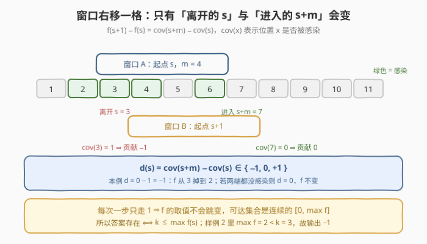
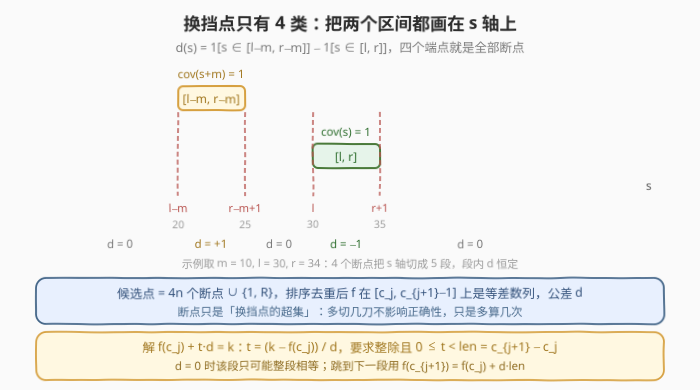
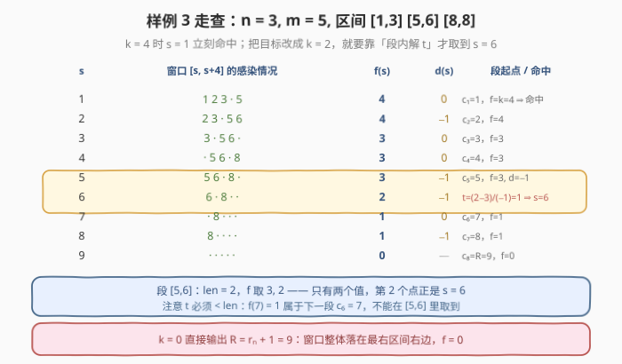

# Codeforces 2271D 目标感染 题解

## 1. 题目概述

- **标题 / 题号**：目标感染（Codeforces 2271D，英文名 Target Infection）
- **链接**：https://codeforces.com/problemset/problem/2271/D
- **来源**：DeepInfra Round 1 (Codeforces Round 1126, Div. 1 + Div. 2) · Problem D
- **难度**：1700（1750 分）
- **限制**：时间 2 s / 内存 256 MB
- **标签**：二分查找，暴力，贪心，实现，双指针

**题意**：数轴上给定 $n$ 个**互不相交、互不相邻**的感染区间 $[l_i,r_i]$，区间内每个整数位置都感染，其余位置不感染，区间按左端点升序给出。另有 $m$ 个人站成一排：若第一个人站在 $s$，则他们占据 $s,s+1,\dots,s+m-1$ 这 $m$ 个连续位置。记

$$f(s)=\#\{\,x\in[s,\,s+m-1]:x\text{ 被感染}\,\}.$$

给定 $k$，求**任意一个**整数 $s$ 使 $f(s)=k$，不存在则输出 $-1$。多测：第一行 $t$，每组先一行 $n,m,k$，随后 $n$ 行 $l_i,r_i$。

**约束**：

- $1\le t\le 10^4$，$1\le n\le 2\times 10^5$，$\sum n\le 2\times 10^5$
- $1\le m\le 10^9$，$0\le k\le m$
- $1\le l_i\le r_i\le 10^{15}$，且 $r_i+1<l_{i+1}$：区间两两分离，中间至少隔一个未感染位置
- 输出要求 $1\le s\le 10^{18}$；坐标上界只有 $10^{15}$，这个宽松上界正是留给「$k=0$ 时把窗口推到最右边」的余量

## 2. 示例与观察
官方样例（$t=6$ 组）：

```text
输入
6
1 5 5
7 11
2 4 3
1 2
5 6
3 5 4
1 3
5 6
8 8
1 3 2
10 12
3 6 0
1 1
4 5
10 12
1 1000000000 1
1000000000000000 1000000000000000

输出
7
-1
2
9
42
999999876543210
```

- 第 1 组 $s=7$ 时窗口恰为 $[7,11]$，完全落在区间内，$f=5$。
- 第 2 组区间为 $[1,2]$、$[5,6]$，长度 $4$ 的窗口最多覆盖 $2$ 个位置，$k=3$ 不可达，故 $-1$。
- 第 3 组 $s=2$ 时窗口 $[2,6]$ 覆盖 $2,3,5,6$，$f=4$。
- 第 4 组 $s=9$ 时窗口 $[9,11]$ 覆盖 $10,11$，$f=2$。
- 第 5 组 $k=0$，$s=42$ 时窗口 $[42,47]$ 全在区间外，$f=0$。
- 第 6 组只有一个孤立感染点 $10^{15}$，窗口长 $10^9$，只要 $s\in[10^{15}-10^9+1,\,10^{15}]$ 就能恰好覆盖它。

**自造示例**（非官方）：把第 3 组的 $k$ 改成 $2$，其余不变，此时 $s=6$ 合法（窗口 $[6,10]$ 覆盖 $6,8$，$f=2$）。3.4 节会逐点走查这组数据。

> 💡 本题**多解**。本篇代码在官方样例上输出 7、-1、1、9、13、999999000000001，与官方答案不同，但每个都满足 $f(s)=k$。

## 3. 解题思路

### 3.1 暴力思路

最直接的做法是枚举 $s$ 再算 $f(s)$，但 $s$ 的有效范围到 $10^{15}$，逐点枚举不可能；即使每组只花 $O(n)$ 求一次 $f$，总代价也是 $10^{15}\cdot n$。也不能对 $s$ 二分：$f$ 先增后减，并不单调。所以必须利用 $f$ 的结构。

### 3.2 核心观察：窗口滑一格，$f$ 只变 $-1/0/+1$



记 $\mathrm{cov}(x)\in\{0,1\}$ 表示位置 $x$ 是否被感染（区间互不相交，这是干净的 0/1 指示函数，而不是覆盖次数）。比较相邻两个窗口 $[s,s+m-1]$ 与 $[s+1,s+m]$：它们只差两个位置，丢掉 $s$、加入 $s+m$，于是

$$f(s+1)-f(s)=\mathrm{cov}(s+m)-\mathrm{cov}(s)\in\{-1,0,+1\}.$$

两条硬性质：

1. **$f$ 是「一次走一格」的阶梯**：变化量绝对值不超过 $1$，取值不可能从 $a$ 跳到 $a+2$。于是 $f$ 在 $s\ge1$ 上的值域是连续整数区间 $[0,M]$（$M=\max f$）——走到最值后必须一格一格退回 $0$，中途每个值都会被踩到。
2. **斜率只有三种**：在 $\mathrm{cov}$ 不变处 $d(s)=f(s+1)-f(s)$ 为常数，故 $f$ 在每段上是公差为 $-1$、$0$ 或 $+1$ 的等差数列。

于是只需把 $s$ 轴切成 $O(n)$ 段，段内解一次线性方程即可。

### 3.3 算法流程：断点分段 + 段内解方程



$\mathrm{cov}(x)$ 只在跨过区间端点时改变：$x=l_i$ 处 $0\to1$，$x=r_i+1$ 处 $1\to0$。因此 $d(s)=\mathrm{cov}(s+m)-\mathrm{cov}(s)$ 只在四类 $s$ 处换挡：

$$\mathcal{S}=\{\,l_i-m,\;r_i-m+1,\;l_i,\;r_i+1\,\}_{i=1}^{n},\qquad |\mathcal{S}|\le 4n .$$

把 $\mathcal{S}$ 裁到 $[1,R]$（$R=r_n+1$）、并上哨兵 $1$ 与 $R$，排序去重得到 $1=c_1<c_2<\cdots<c_q=R$。相邻候选点之间没有换挡点，故 $d$ 在整段 $[c_j,c_{j+1}-1]$ 上恒为 $d_j$，共 $\mathrm{len}=c_{j+1}-c_j$ 个点，段内取值是

$$f(c_j+t)=f(c_j)+t\cdot d_j,\qquad 0\le t<\mathrm{len}.$$

要命中 $k$，只需看 $(k-f(c_j))$ 能否被 $d_j$ 整除、且 $t=(k-f(c_j))/d_j\in[0,\mathrm{len}-1]$；命中就输出 $c_j+t$，段的推进用 $f(c_{j+1})=f(c_j)+d_j\cdot\mathrm{len}$。全程只维护一个当前值，$f(1)$ 用一次 $O(n)$ 统计得到，$\mathrm{cov}$ 用二分（或随候选点单调的两个指针）查询。

> 💡 断点集合只是「换挡点的**超集**」：某个端点换挡前后 $d$ 恰好相同就会多切一刀。这不影响正确性，只多算一次。

### 3.4 示例演算



取 $n=3,\ m=5$，区间 $[1,3],[5,6],[8,8]$。断点（裁到 $\ge1$）为 $\{2,3,4,5,7,8\}$，并上哨兵 $1$ 与 $R=9$，逐点算得

$$f=4,4,3,3,3,2,1,1,0\qquad(s=1,\dots,9).$$

- $k=4$：第一个候选点 $c_1=1$ 就满足 $f=k$，输出 $1$——这正是官方样例第 3 组的一个合法答案。
- $k=2$：走到段起点 $c_5=5$，$f=3$、$d_5=\mathrm{cov}(10)-\mathrm{cov}(5)=0-1=-1$、$\mathrm{len}=2$，解 $t=(2-3)/(-1)=1<2$，输出 $5+1=6$。
- $k=0$：直接输出 $R=r_n+1=9$（窗口 $[9,13]$ 全在区间右侧，$f=0$）。

注意 $f(7)=1$ 紧邻其后，但它属于下一段 $c_6=7$；段 $[5,6]$ 内 $t$ 必须严格小于 $\mathrm{len}=2$。

## 4. 算法细节

1. **起点值 $f(1)$**：窗口为 $[1,m]$，只有 $l_i\le m$ 的区间有交，贡献 $\min(r_i,m)-l_i+1$；区间升序，一旦 $l_i>m$ 即 `break`，单组 $O(n)$。
2. **候选点裁剪**：$l_i-m$ 可能低到 $-10^9$，必须丢弃；同时**必须**显式加入 $1$ 与 $R=r_n+1$，否则会漏掉 $s=1$ 和尾部恒为 $0$ 的那一段。
3. **$\mathrm{cov}$ 查询**：C++ 对 $l$ 数组二分后判断 $x\le r$；Python 利用「$c_j$ 升序 ⇒ $c_j$ 与 $c_j+m$ 都升序」，用两个只增不减的指针把每组查询摊到 $O(n)$。
4. **整除判断**：先判 $d\ne0$ 再取模，否则除以零；$d=\pm1$ 时取模恒为 $0$，但仍保留通用写法。
5. **$t$ 的上界是 $\mathrm{len}-1$**：段内恰好 $\mathrm{len}$ 个点，$t=\mathrm{len}$ 对应下一段起点 $c_{j+1}$，留给下一轮检查。
6. **$k=0$ 特判**：直接输出 $R=r_n+1\le10^{15}+1\le10^{18}$，省掉一批边界讨论。
7. **多测清空**：`cand` 每组重建、两个指针重置为 $-1$、`fc` 重新从 $f(1)$ 出发，不要跨组复用。
8. **数据范围**：$\mathrm{len}$ 可达 $10^{15}$，$d\cdot\mathrm{len}$ 同量级，一律 `long long`；$f$ 本身不超过 $m\le10^9$。

## 5. 正确性证明

**引理 1（差分公式）**：对任意整数 $s$，$f(s+1)-f(s)=\mathrm{cov}(s+m)-\mathrm{cov}(s)\in\{-1,0,1\}$。
**证明**：两窗口公共部分是 $[s+1,s+m-1]$，后者多出 $s+m$、少掉 $s$，其余位置相同；$f$ 是窗口内 $\mathrm{cov}$ 之和，相减即得。∎

**引理 2（段内 $d$ 恒定）**：若 $[c_j,c_{j+1})$ 不含 $\mathcal{S}$ 中元素，则 $c_j\le s<c_{j+1}$ 时 $d(s)=d(c_j)$。
**证明**：$\mathrm{cov}(x)$ 只在 $x\in\{l_i\}\cup\{r_i+1\}$ 变号。若 $\mathrm{cov}(s)$ 变号则 $s=l_i$ 或 $r_i+1\in\mathcal{S}$；若 $\mathrm{cov}(s+m)$ 变号则 $s=l_i-m$ 或 $r_i-m+1\in\mathcal{S}$。段内无 $\mathcal{S}$ 元素，故两者都不变号。∎

**引理 3（段内等差）**：在引理 2 的条件下，$f(c_j+t)=f(c_j)+t\cdot d(c_j)$ 对一切 $0\le t<\mathrm{len}$ 成立。
**证明**：对 $t$ 归纳。$t=0$ 显然；若对 $t$ 成立且 $t+1<\mathrm{len}$，由引理 1、2 得 $f(c_j+t+1)=f(c_j+t)+d(c_j)=f(c_j)+(t+1)d(c_j)$。∎

**引理 4（解的归一化）**：若某个整数 $s^*$ 满足 $f(s^*)=k$，则存在 $s\in[1,R]$ 满足 $f(s)=k$。
**证明**：设 $1\le s^*\le R$ 时已成立。若 $s^*\ge R+1$，窗口全在 $r_n$ 右侧，$f(s^*)=0$，故 $k=0$，取 $s=R$ 即可。若 $s^*\le0$：对 $x<1$ 有 $\mathrm{cov}(x)=0$，由引理 1 得 $f(x+1)\ge f(x)$，故 $f$ 在 $(-\infty,1]$ 上单调不减，$k=f(s^*)\le f(1)$；又 $f(R)=0\le k$。由引理 1，从 $s=1$ 走到 $s=R$ 的游走每步变化不超过 $1$，必然经过 $f(1)$ 与 $0$ 之间的一切整数，故 $k$ 在 $[1,R]$ 上被取到。∎

**定理 1（输出合法）**：算法若输出 $s$，则 $f(s)=k$ 且 $1\le s\le10^{18}$。
**证明**：命中方式只有两种。其一 $s=c_j$ 且 $f(c_j)=k$；其二 $s=c_j+t$，$0\le t<\mathrm{len}$ 且 $t=(k-f(c_j))/d_j$ 为整数，由引理 3 得 $f(s)=k$。又 $1\le c_j\le s<c_{j+1}\le R\le10^{15}+1\le10^{18}$。∎

**定理 2（不漏解）**：若存在整数 $s^*$ 使 $f(s^*)=k$，算法必输出某个合法位置。
**证明**：$k=0$ 由特判输出 $R$ 成立。设 $k\ge1$，由引理 4 可设 $1\le s^*\le R$；又 $f(R)=0<k$，故 $s^*<R$。候选点从 $1$ 递增到 $R$ 且相邻无缝，故存在唯一 $j$ 使 $c_j\le s^*<c_{j+1}$。由引理 3，$t=s^*-c_j\in[0,\mathrm{len})$ 且 $f(c_j)+t\,d_j=k$，整除性与区间性检查均通过，算法输出 $c_j+t=s^*$。∎

**定理 3（$-1$ 判得准）**：$f$ 在 $s\ge1$ 上的值域恰为 $[0,M]$，$M=\max_{s\ge1}f(s)$；故答案存在当且仅当 $k\le M$。
**证明**：由引理 1，$f$ 是步长绝对值 $\le1$、终点 $f(R)=0$ 的游走，设最大值在 $s_0$ 处取到。从 $s_0$ 走到 $R$ 每格下降不超过 $1$，必经过 $M,M-1,\dots,0$；而 $f\ge0$，故值域为 $[0,M]$。又 $s\ge R$ 时 $f=0$，$s\le0$ 时 $f(s)\le f(1)$，所以 $[1,R]$ 上的最大值即全局最大值。∎

## 6. 复杂度分析

- **时间**：构造候选点 $O(n)$，排序 $O(n\log n)$，扫描 $O(n)$ 次、每次 $O(\log n)$ 查询（Python 用单调指针则 $O(n)$）；总 $O(\sum n\log n)$，$\sum n\le2\times10^5$ 时候选点至多 $8\times10^5$ 个。
- **空间**：$O(n)$ 存区间与候选点，单组复用，不随 $t$ 累积。
- **实测**：C++ 最坏数据（单组 $n=2\times10^5$、区间全退化成点、$k$ 取不可达值强制扫满全部候选点）约 $50$ ms，$t=10^4$、$\sum n=2\times10^5$ 约 $20$ ms；Python 同规模约 $0.4$ s。相对 $2$ s 时限余量充足。

## 7. 参考代码

### C++17

```cpp
#include <cstdio>
#include <algorithm>
#include <vector>
using namespace std;
typedef long long ll;

int main() {
    int T;
    if (scanf("%d", &T) != 1) return 0;
    while (T--) {
        int n; ll m, k;
        scanf("%d %lld %lld", &n, &m, &k);
        vector<ll> l(n), r(n);
        for (int i = 0; i < n; i++) scanf("%lld %lld", &l[i], &r[i]);
        ll R = r[n - 1] + 1;                   // f(R) = 0
        if (k == 0) { printf("%lld\n", R); continue; }
        ll f1 = 0;                             // f(1)：窗口 [1, m]
        for (int i = 0; i < n && l[i] <= m; i++) f1 += min(r[i], m) - l[i] + 1;
        vector<ll> cand{1, R};                 // 断点 ∪ {1, R}
        for (int i = 0; i < n; i++) {
            ll xs[4] = {l[i] - m, r[i] - m + 1, l[i], r[i] + 1};
            for (ll x : xs) if (x >= 1 && x <= R) cand.push_back(x);
        }
        sort(cand.begin(), cand.end());
        cand.erase(unique(cand.begin(), cand.end()), cand.end());
        auto cov = [&](ll x) {                 // 位置 x 是否被感染
            int lo = 0, hi = n - 1, p = -1;
            while (lo <= hi) {
                int md = (lo + hi) >> 1;
                if (l[md] <= x) { p = md; lo = md + 1; } else hi = md - 1;
            }
            return (p >= 0 && x <= r[p]) ? 1LL : 0LL;
        };
        ll fc = f1, ans = -1;
        for (size_t j = 0; j < cand.size(); j++) {
            if (fc == k) { ans = cand[j]; break; }
            if (j + 1 == cand.size()) break;
            ll len = cand[j + 1] - cand[j];    // 段 [c_j, c_{j+1}-1]
            ll d = cov(cand[j] + m) - cov(cand[j]);
            if (d != 0 && (k - fc) % d == 0) {
                ll t = (k - fc) / d;
                if (t >= 0 && t < len) { ans = cand[j] + t; break; }
            }
            fc += d * len;                     // f(c_{j+1})
        }
        printf("%lld\n", ans);
    }
    return 0;
}
```

### Python3

```python
import sys


def main():
    data = sys.stdin.buffer.read().split()
    if not data:
        return
    t = int(data[0]); ptr = 1; out = []
    for _ in range(t):
        n, m, k = int(data[ptr]), int(data[ptr + 1]), int(data[ptr + 2])
        ptr += 3
        L = [int(data[ptr + 2 * i]) for i in range(n)]
        R = [int(data[ptr + 2 * i + 1]) for i in range(n)]
        ptr += 2 * n
        bound = R[-1] + 1                      # f(bound) = 0
        if k == 0:
            out.append(str(bound))
            continue
        f1 = 0                                 # f(1)
        for i in range(n):
            if L[i] > m:
                break
            f1 += min(R[i], m) - L[i] + 1
        cand = {1, bound}                      # 断点 ∪ {1, R}
        for i in range(n):
            for x in (L[i] - m, R[i] - m + 1, L[i], R[i] + 1):
                if 1 <= x <= bound:
                    cand.add(x)
        cand = sorted(cand)
        ia = ib = -1                           # 两个只增不减的指针
        fc = f1; ans = -1
        for j, cur in enumerate(cand):
            while ia + 1 < n and L[ia + 1] <= cur:
                ia += 1
            while ib + 1 < n and L[ib + 1] <= cur + m:
                ib += 1
            ca = 1 if ia >= 0 and cur <= R[ia] else 0
            cb = 1 if ib >= 0 and cur + m <= R[ib] else 0
            if fc == k:
                ans = cur
                break
            if j + 1 == len(cand):
                break
            ln = cand[j + 1] - cur
            d = cb - ca
            if d and (k - fc) % d == 0:
                s = (k - fc) // d
                if 0 <= s < ln:
                    ans = cur + s
                    break
            fc += d * ln
        out.append(str(ans))
    sys.stdout.write("\n".join(out) + "\n")


main()
```

## 8. 边界情况与易错点

1. **$k=0$**：不能想当然输出 $s=1$，第一个窗口可能整段落在区间里。统一输出 $R=r_n+1$ 最稳；若坚持走扫描，也必须把 $R$ 放进候选点，否则尾部恒为 $0$ 的段无人检查。
2. **无解判定**：$k$ 大于「长度 $m$ 的窗口能覆盖的最多感染点」时输出 $-1$。由定理 3，可达值连续，不会因跳过而误判；真正的误判来自漏掉候选点。
3. **除以零**：$d=0$ 时不能做 `diff / d`，必须先分支；该支只有 $f(c_j)=k$ 才有解。
4. **段长算错**：段 $[c_j,c_{j+1}-1]$ 共 $\mathrm{len}=c_{j+1}-c_j$ 个点。若把上界放宽到 $t\ge\mathrm{len}$，就会输出 $c_j+t\ge c_{j+1}$ 的位置，而那里 $d$ 已换挡，$f(c_j)+t\,d_j\ne f(c_j+t)$，答案直接非法。
5. **断点被裁掉**：$l_i-m$ 常为负数，裁剪时别连 $1$ 一起丢；$r_n+1$ 恰等于 $R$，重复加入后要去重。
6. **溢出与符号**：$\mathrm{len}$ 可达 $10^{15}$，`int` 必爆；$f\le m\le10^9$，但 `d * len` 与 `fc + d * len` 都要在 `long long` 里算。$d=-1$ 时 `(k-fc) % d == 0` 依然成立。
7. **多测状态**：$t$ 最大 $10^4$，每组的 `cand`、两个指针、`f1` 都要重置；把 `cand` 提到循环外忘了 `clear` 是最常见的 WA。
8. **输出范围**：$s$ 必须落在 $[1,10^{18}]$。本篇输出都 $\le r_n+1\le10^{15}+1$，天然满足；若改成从 $s\le0$ 起扫，就可能输出 $0$ 或负数。

## 9. 验证记录

- **编译环境与命令**：`clang++ -std=c++17 -O2`（本机无 GNU g++，配 `codeforces/tools/include/bits/stdc++.h` 兼容头；正文代码只用标准库，可原样提交 GNU C++17）；Python 侧为 `Python 3.9.6`。
- **官方样例**：0 / 1 通过 token 比对；逐字比对未通过（多为多解题），剩余差异属预期，样例含义已在第 2 节逐组解释。
- **复核状态**：audited（2026-11-19 统一回归：编译 + 官方样例；写作期的随机对拍与暴力未重跑）。

## 相关题目与扩展

- [Codeforces 1741F - Multi-Colored Segments](https://codeforces.com/problemset/problem/1741/F)：统计每个区间被多少异色区间覆盖，同为「区间端点当事件 + 扫描线维护覆盖量」。
- [Codeforces 1555E - Boring Segments](https://codeforces.com/problemset/problem/1555/E)：双指针扫区间 + 线段树维护覆盖，是本题「窗口滑动 + 覆盖量变化」的带权加强版。
- [LeetCode 986. 区间列表的交集](https://leetcode.cn/problems/interval-list-intersections/)：有序区间列表求交，正是本题「窗口与区间求交」这一步的模板。
- [LeetCode 1094. 拼车](https://leetcode.cn/problems/car-pooling/)：端点差分 + 前缀和求每点覆盖量，是「事件点」思想的入门题。

**延伸思考**：若同一个数组要回答多组 $k$，可以把每段 $f$ 的取值区间 $[\min,\max]$ 与代表位置记下来，合并成 $O(n)$ 个互不相交的值区间，再对 $k$ 二分定位到段、$O(1)$ 反解 $s$，单次询问 $O(\log n)$。若「感染」带权（每点贡献 $w_x$），引理 1 的步长不再是 $\pm1$，值域不再连续，但分段技巧仍然成立：段内 $f$ 还是等差，只是公差变大，$-1$ 判定要逐段检查。若要求输出**最小**合法 $s$，本算法的段本就按 $s$ 升序处理，命中后继续维护即可。
