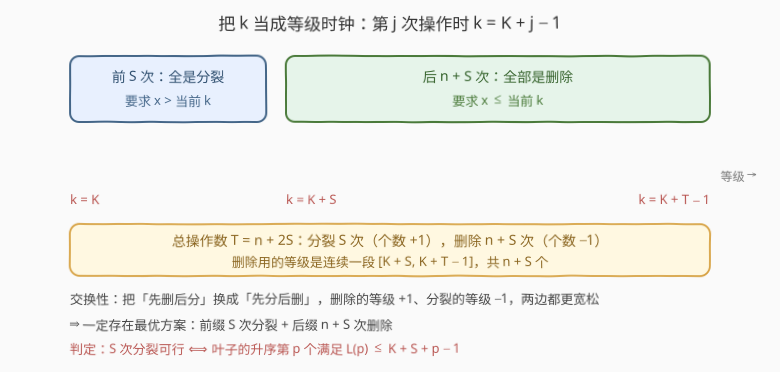
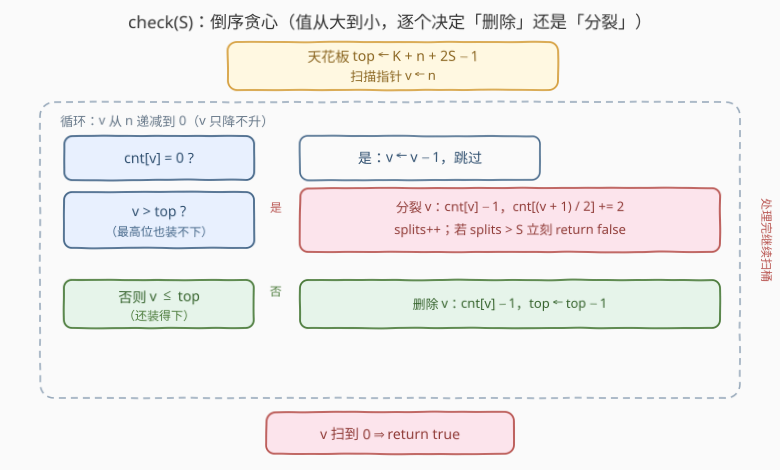
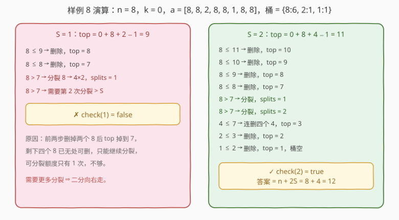

# Codeforces 2271E 清空数组 题解

## 1. 题目概述

- **标题 / 题号**：清空数组（Codeforces 2271E，英文名 Array Emptying）
- **链接**：https://codeforces.com/problemset/problem/2271/E
- **来源**：DeepInfra Round 1 (Codeforces Round 1126, Div. 1 + Div. 2) · Problem E
- **难度**：2100（2250 分）
- **限制**：时间 2 s / 内存 256 MB
- **标签**：二分答案，数据结构，贪心

**题意**：给定长度 $n$ 的数组 $a$ 与整数 $k$。每次操作任选一个元素 $x$：若 $x \le k$，把 $x$ 删掉；否则把 $x$ 删掉，再放入两个值均为 $\lceil x/2 \rceil$ 的元素。无论走哪一支，操作结束后 $k$ 都加 $1$。求清空数组的最少操作次数。

要特别留意：**操作内容不由人选**。挑中 $x$ 后是「删」还是「分裂」完全由「$x$ 与当前 $k$ 的大小关系」强制决定，能选的只有每一轮挑哪个元素。输入为多测：第一行 $t$，之后每组给出 $n, k$ 与 $a_1,\dots,a_n$，逐组输出一个整数。

**约束**：

- $1 \le t \le 10^4$，$1 \le n \le 2\cdot 10^5$，$\sum n \le 2\cdot 10^5$
- $0 \le k \le n$，$1 \le a_i \le n$——值域与 $n$ 同阶，可开桶计数，省掉排序
- 每分裂一次元素个数 $+1$，最终个数是 $n+S$（$S$ 为分裂次数）
- 答案可达 $3n$ 量级（$n=2\cdot10^5$ 时约 $3.4\times10^5$），`int` 够用，`long long` 更稳

## 2. 示例

官方样例共 $8$ 组：

```text
输入：
8
4 0
4 4 1 4
3 0
3 2 2
6 3
6 3 6 4 6 5
6 2
6 6 5 6 6 6
5 0
3 5 3 1 3
6 1
6 4 6 5 4 6
7 1
7 2 7 7 3 7 7
8 0
8 8 2 8 8 1 8 8

输出：
6
5
6
8
7
8
11
12
```

样例 $1$：先把一个 $4$ 分裂成两个 $2$（$k$ 变 $1$），随后删 $1,2,2,4,4$，共 $6$ 步 $=$ 分裂 $1$ 次 $+$ 删除 $5=4+1$ 次。样例 $7$（$k=1$，五个 $7$ 加一个 $3$、一个 $2$）需分裂 $2$ 次：$2$ 在等级 $1$ 分裂、$7$ 在等级 $2$ 分裂，之后 $9$ 个叶子在等级 $3..11$ 上依次删除，答案 $7+2\times2=11$。

自造补充（非官方）：`1 0 / 1` 输出 $3$（$1>0$ 先强制分裂）；`2 0 / 2 2` 输出 $4$（分裂一次后删 $1,1,2$）；`4 0 / 3 3 3 3` 输出 $8$（分裂两次得 $2,2,2,2,3,3$ 再连删）。

## 3. 解题思路

### 3.1 暴力思路

按定义直接搜：状态为「当前多重集 $+$ 当前 $k$」，每步 $O(n)$ 种挑法，做 BFS / 最短路。元素集合随分裂不断膨胀，状态数爆炸，$n=2\cdot10^5$ 完全不可能；暴力只配用来对小数据对拍。正解必须把动态过程压成静态判定。

### 3.2 核心观察：先分后删，$k$ 是等级时钟



**把 $k$ 看作时间轴。** $k$ 每次操作必加 $1$，故初始 $k=K$ 时，第 $j$ 次操作的 $k$ 恒为 $K+j-1$。于是 $k$ 不再是变量，而是**操作序号的线性函数**；把这次 $k$ 的取值叫做该操作的**等级**：删除 $x$ 要求等级 $\ge x$，分裂 $x$ 要求等级 $< x$。

**先分后删。** 若相邻两次是「删 $u$ 于等级 $\ell$、接着分裂 $v$ 于等级 $\ell+1$」，交换它们：分裂提前一级，等级由 $\ell+1$ 降到 $\ell$，而 $v>\ell+1>\ell$ 仍成立；删除推后一级，等级由 $\ell$ 升到 $\ell+1$，而 $u\le\ell<\ell+1$ 仍成立。交换恒合法，不断交换即知：**存在「前 $S$ 次全是分裂、后 $n+S$ 次全是删除」的最优方案**。

**点数。** 设分裂 $S$ 次、删除 $E$ 次。元素个数由 $n$ 到 $0$，分裂 $+1$、删除 $-1$，故 $E=n+S$，总操作数

$$T=S+E=n+2S .$$

删除占第 $S+1..T$ 次，即**连续一段等级** $[K+S,\,K+T-1]$，共 $n+S$ 个；分裂占等级 $[K,\,K+S-1]$。

**判定形式。** 把 $a$ 分裂出的 $n+S$ 个叶子升序排成 $L_1\le\dots\le L_{n+S}$。让它们依次占用 $K+S,\,K+S+1,\,\dots$ 这 $n+S$ 个等级（小叶子配低等级，由交换论证可知这是最优且必要的搭配），当且仅当

$$L_p \le K+S+p-1 \qquad (1\le p\le n+S).$$

另外 $S$ 次分裂要各占等级 $K..K+S-1$ 中的一个，分裂值必须**大于**所占等级。后面会看到倒序贪心给出的分裂值全部 $\ge K+S+1$，比任何分裂位都大，因此分裂的调度永不成问题——这正是「$S$ 次分裂是否可行」可以只看叶子条件的原因。

### 3.3 算法流程：倒序贪心 + 二分答案



**关键引理（倒序贪心）**：固定天花板 $top$（把数组删空时最高那个删除位的等级），则「从大到小扫、装得下就删、装不下就分裂」得到的方案，是所有「等级从 $top$ 往下连续使用」的方案中分裂次数最少的。

理由：当前最高剩余等级就是 $top$。若当前最大元素 $v>top$，则 $v$ 在任何剩余等级上都删不掉（剩余等级都 $\le top<v$），**必须分裂**，没有选择；若 $v\le top$，就让它占用 $top$（最高等级留给最大元素不会更差），再把 $top$ 减一继续。贪心「被逼无奈才分裂」，自然最少。

**二分。** 固定 $S$ 后取 $top=K+n+2S-1$（即 $T=n+2S$ 次操作时最后一次的等级），跑一遍倒序贪心：需要分裂数 $>S$ 说明 $S$ 太小，否则 $S$ 可行。可行性关于 $S$ 单调（$S$ 加 $1$ 时 $top$ 加 $2$、额度加 $1$），于是在 $[0,n]$ 上二分最小可行 $S^*$，答案 $n+2S^*$。上界 $n$ 是安全的：那时 $top=K+3n-1$，删掉 $n$ 个元素后仍有 $top\ge K+2n-1\ge n\ge$ 任何 $a_i$，一次分裂都不需要。

实现不必真维护多重集：值域 $\le n$，开桶 `cnt[]`，指针 $v$ 从 $n$ 往下扫且只降不升，每次 `check` 复制一份桶，单次 $O(n)$。

### 3.4 示例演算

对样例 $8$（$n=8$，$k=0$，桶 $8{:}6,\ 2{:}1,\ 1{:}1$）走一遍：



$S=1$ 时 $top=9$：连删两个 $8$ 后 $top$ 只剩 $7$，第三个 $8$ 无处可删只能分裂；分裂后 $top$ 仍是 $7$，还有 $8$ 装不下，需要第二次分裂，超出额度 $1$，返回 false。

$S=2$ 时 $top=11$：先连删四个 $8$（$top$ 由 $11$ 降到 $7$），剩两个 $8$ 各分裂一次得四个 $4$；$4\le7$ 连删四个（$top$ 降到 $3$），再删 $2$、删 $1$ 收尾。分裂 $2$ 次、删除 $10$ 次，$T=8+2\times2=12$，与官方输出一致；二分得 $S^*=2$。可见倒序检查并不真排时间表，只回答「给定天花板与额度，够不够用」。

## 4. 算法细节

1. **桶代替排序**：`cnt[1..n]` 计数；指针 $v$ 单调递减，整个 `check` 为 $O(n+S)$，均摊 $O(n)$。
2. **复制桶**：C++ 用 `memcpy`，Python 用整表切片 `base[:]`（逐元素 for 拷贝会明显变慢）。
3. **$top$ 用 `long long`**：$K+n+2S-1$ 最大约 $8\times10^5$，`int` 不溢出但 `long long` 零成本。
4. **提前剪枝**：`++splits > S` 立即 `return false`；这也是 $v=1$ 的兜底（$1$ 分裂出的仍是 $1$，桶不缩小，靠它退出）。
5. **新值是 $\lceil v/2\rceil=(v+1)/2$**：一定落在 $[1,v]$；写成 `v/2` 在 $v$ 为奇数时错。
6. **二分与多测**：`lo=0, hi=n`，输出 $n+2\,lo$；每次只清 `cnt[1..n]`，别按 $2\cdot10^5$ 整表 memset。

## 5. 正确性证明

**引理 1（操作数）**：若方案分裂 $S$ 次，则删除 $n+S$ 次，总操作数 $T=n+2S$。**证明**：个数起点 $n$、终点 $0$，分裂 $+1$、删除 $-1$，故 $E=n+S$，$T=S+E=n+2S$。∎

**引理 2（先分后删）**：任意合法方案都可重排成「前 $S$ 次分裂、后 $n+S$ 次删除」。**证明**：只需说明相邻的「删 $u$ 于等级 $\ell$、分裂 $v$ 于等级 $\ell+1$」可互换：互换后分裂在等级 $\ell$ 需 $v>\ell$，而原式 $v>\ell+1$ 更强；删除在等级 $\ell+1$ 需 $u\le\ell+1$，而原式 $u\le\ell$ 更强；操作类型不依赖位置，故仍合法。反复交换即得。∎

**引理 3（叶子判定）**：固定 $S$，「存在 $S$ 次分裂使 $n+S$ 个叶子能从等级 $K+S$ 起依次删除」$\iff$「存在一种分裂方式使叶子升序满足 $L_p\le K+S+p-1$」。**证明**：删除位第 $p$ 个的等级为 $K+S+p-1$。若可配，叶子与等级都升序配对即得不等式；反之把第 $p$ 小的叶子放在等级 $K+S+p-1$ 上，每个都能删。∎

**引理 4（倒序贪心最优）**：固定 $top$，倒序贪心用的分裂数不超过任何「用等级 $top,top-1,\dots$ 连续删除」的方案。**证明**：对轮数归纳。设当前最高剩余等级 $top$、剩余最大元素 $v$。若 $v>top$，任何方案都得处理 $v$，但剩余等级全 $<v$，$v$ 删不掉只能分裂，贪心与之一致。若 $v\le top$，任何方案都要给 $v$ 分配某个剩余等级；若未占 $top$，把它与占 $top$ 者交换（两者都 $\le v\le top$，合法性不变），故可设 $v$ 占 $top$——贪心正是如此。归纳即得。∎

**引理 5（必要性）**：$S$ 次分裂可行 $\Rightarrow$ `check(S)` 通过。**证明**：由引理 2 可设先分后删，删除位等级为 $K+S..K+n+2S-1$，叶子升序满足引理 3 的不等式，即这些叶子可放在天花板 $top=K+n+2S-1$ 往下连续的 $n+S$ 个等级上。于是存在一个用 $S$ 次分裂、自 $top$ 起连续删除的方案，由引理 4 贪心分裂数 $\le S$。∎

**引理 6（充分性 / 填位）**：设 $S^*$ 为使 `check` 通过的最小值，则 $S^*$ 次分裂真的可行。**证明**：记 $top=K+n+2S^*-1$，贪心用 $c\le S^*$ 次分裂，叶子可放在等级 $top,top-1,\dots,R$ 上，$R=top-(n+c)+1=K+2S^*-c$。若 $c=S^*$，删除位恰是 $K+S^*..top$，而分裂值全 $\ge K+S^*+1$ 大于每个分裂位 $K..K+S^*-1$，已合法。若 $c<S^*$，还差 $d=S^*-c$ 个更低等级 $K+S^*..R-1$，做法是**补 $d$ 次分裂**：每次取当前值 $\ge K+S^*$ 的最小叶子 $u$，换成两个 $\lceil u/2\rceil$。这样的叶子一定存在：若某刻全部叶子 $<K+S^*$，则它们都 $\le K+S^*-1$，共 $m\le n+S^*-1$ 个，升序记作 $w_j$，有 $w_j+j\le (K+S^*-1)+m\le K+n+2S^*-2$，即这批分裂用在低两级的 $top-2$ 上仍满足引理 3，于是 `check(S^*-1)` 也通过，与最小性矛盾。

记第 $t$ 次补分裂后叶子升序为 $u_1\le\dots\le u_{n+c+t}$，断言 $u_p\le (R-t)+p-1$：$t=0$ 即贪心结论；设该步分裂 $u_q$（$q$ 为最小满足 $u_q\ge K+S^*$ 的下标），产生两份 $c_0=\lceil u_q/2\rceil$。旧下标 $>q$ 的元素排名整体 $+1$ 而右侧也多一级，不等式不变；旧下标 $<q$ 的元素值都 $<K+S^*\le R-t$，排名不变时有 $u_i\le K+S^*-1\le (R-t)+i-2$，排名后移时右侧同样多一级。两份 $c_0$ 中设第一份新排名 $p$，由 $c_0\le u_q$ 知比它小的只能是原来 $<q$ 的元素，故 $p\le q$：若 $p<q$ 则 $c_0\le u_p<K+S^*\le R-t$；若 $p=q$ 则 $c_0\le\lceil (R-t+q-1)/2\rceil\le R-t+q-2$（因 $R-t\ge K+S^*+1\ge2$）。故断言成立。取 $t=d$ 得 $R-d=K+S^*$，即 $u_p\le K+S^*+p-1$，由引理 3 可行；补出的分裂值也 $\ge K+S^*$，大于任何分裂位等级，总能排进 $K..K+S^*-1$。∎

**定理**：设 $S^*$ 为 $[0,n]$ 中最小使 `check` 通过的参数，则最少操作次数为 $n+2S^*$。**证明**：设最优方案分裂 $c_0$ 次，由引理 1 答案为 $n+2c_0$。引理 5 给出 `check(c_0)` 通过，故 $S^*\le c_0$；引理 6 说明 $S^*$ 次分裂可行，故 $c_0\le S^*$。两者相等；二分在单调性下恰好取到最小可行值，算法正确。∎

## 6. 复杂度分析

- **时间**：单次 `check` $=$ 复制桶 $O(n)$ $+$ 扫桶与操作 $O(n+S)$，即 $O(n)$；二分 $O(\log n)$ 次，单组 $O(n\log n)$。$\sum n=2\cdot10^5$ 时总操作量约 $3.6\times10^6$，远低于 2 s。
- **空间**：两个长度 $n+1$ 的桶，$O(n)$；无递归。
- **实测**（$n=2\cdot10^5$，最坏形态「元素全为 $n$、$k=0$」）：C++ 约 $0.24$ s，Python（CPython）约 $0.85$ s；$t=10^4$ 组小数据约 $0.15$ s / $0.2$ s，均留有余量。

## 7. 参考代码

### C++17

```cpp
#include <bits/stdc++.h>
using namespace std;

const int MAXN = 200005;
int n;
long long K;
int cnt[MAXN], cur[MAXN];

// 判断“至多 S 次分裂”能否用倒序贪心完成
bool check(int S) {
    long long top = K + 2LL * S + n - 1;      // 最后一次操作时的 k
    memcpy(cur + 1, cnt + 1, sizeof(int) * (n + 1));
    int v = n;                                // 当前最大的、还有剩余的元素值
    int splits = 0;
    while (v > 0) {
        if (cur[v] == 0) { --v; continue; }
        if (v > top) {                        // 最高位也装不下：只能分裂
            if (++splits > S) return false;
            --cur[v];
            cur[(v + 1) / 2] += 2;
        } else {                              // 还装得下：用当前最高位删掉它
            --cur[v];
            --top;
        }
    }
    return true;
}

int main() {
    ios::sync_with_stdio(false);
    cin.tie(nullptr);
    int T;
    cin >> T;
    while (T--) {
        cin >> n >> K;
        for (int i = 1; i <= n; ++i) cnt[i] = 0;
        for (int i = 0; i < n; ++i) { int x; cin >> x; ++cnt[x]; }
        int lo = 0, hi = n;                   // check(n) 恒为真
        while (lo < hi) {
            int mid = lo + (hi - lo) / 2;
            if (check(mid)) hi = mid; else lo = mid + 1;
        }
        cout << n + 2LL * lo << '\n';
    }
    return 0;
}
```

### Python3

```python
import sys

def main():
    data = list(map(int, sys.stdin.buffer.read().split()))
    if not data:
        return
    t = data[0]
    pos = 1
    out = []
    for _ in range(t):
        n = data[pos]; k = data[pos + 1]; pos += 2
        base = [0] * (n + 2)
        for i in range(pos, pos + n):
            base[data[i]] += 1
        pos += n

        def check(S, base=base, n=n, k=k):
            cur = base[:]                       # C 级整表拷贝
            top = k + 2 * S + n - 1             # 最后一次操作时的 k
            v = n
            splits = 0
            while v > 0:
                c = cur[v]
                if c == 0:
                    v -= 1
                    continue
                if v > top:                     # 装不下，只能分裂
                    splits += 1
                    if splits > S:
                        return False
                    cur[v] = c - 1
                    cur[(v + 1) >> 1] += 2
                else:                           # 装得下，用当前最高位删掉
                    cur[v] = c - 1
                    top -= 1
            return True

        lo, hi = 0, n
        while lo < hi:
            mid = (lo + hi) >> 1
            if check(mid):
                hi = mid
            else:
                lo = mid + 1
        out.append(str(n + 2 * lo))
    sys.stdout.write('\n'.join(out) + '\n')

main()
```

## 8. 边界情况与易错点

1. **$S=0$ 合法**（如所有 $a_i\le K$）：答案是 $n$，二分下界须取 $0$。
2. **$n=1,a_1=1,k=0$**：答案是 $3$ 不是 $1$（$1>0$ 先强制分裂一次），`check(0)` 必须返回 false。
3. **全相等于 $n$**：答案可达约 $1.7n$（$n=2\cdot10^5$ 时 $342858$），二分上界别设成对数级。
4. **取整方向**：放入的是 $\lceil v/2\rceil$，即 `(v+1)/2`；写 `v/2` 在奇数时立刻错。
5. **$top$ 只在删除时自减**：分裂不占删除位（其时间已含在 $2S$ 里），多减一次直接崩掉正确性。
6. **多测清空**：$t$ 大、单组 $n$ 小时必须按当前 $n$ 清桶，否则残留计数会被当成元素。

## 相关题目与扩展

- [Codeforces 1730C Minimum Notation](https://codeforces.com/problemset/problem/1730/C)：同样是「从大往小决定谁必须被改造」的逆序贪心。
- [LeetCode 410. 分割数组的最大值](https://leetcode.cn/problems/split-array-largest-sum/)：二分答案 + 贪心判定的模板题，与本题「二分分裂次数 + 倒序 check」同构。
- [LeetCode 1552. 两球之间的磁力](https://leetcode.cn/problems/magnetic-force-between-two-balls/)：二分答案的经典形态，可对照判定单调性的写法。

**延伸思考**：

1. 若把分裂规则换成 $\lfloor x/2\rfloor$ 或 $x-1$，倒序贪心还成立吗？关键看「分裂值 $\ge$ 所有分裂位等级」是否仍成立。
2. 若 $k$ 每次加 $c$ 而不是 $1$，天花板变成 $K+c\cdot T-?$，推导要如何修改？
3. 能省掉二分做到 $O(n)$ 吗？难点是「失败时到底差多少次分裂」没有简单公式，二分是最稳的写法。
