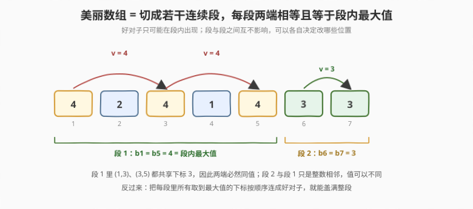
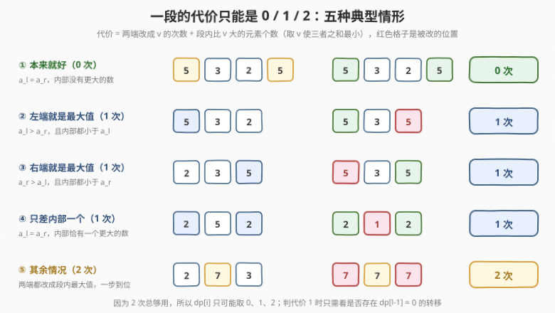
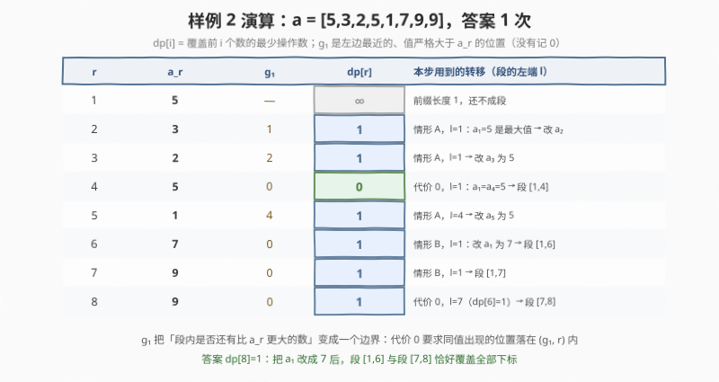

# Codeforces 2271F 美丽的石柱 题解

## 1. 题目概述

- **标题 / 题号**：美丽的石柱（Codeforces 2271F，英文名 Beautiful Pillers）
- **链接**：https://codeforces.com/problemset/problem/2271/F
- **来源**：DeepInfra Round 1 (Codeforces Round 1126, Div. 1 + Div. 2) · Problem F
- **难度**：2300（2500 分）
- **限制**：时间 2 s / 内存 256 MB
- **标签**：构造，数据结构，动态规划，贪心，实现

**题意**：对数组 $b$，称下标对 $(l,r)$（$l<r$）是**好对子**，若 $b_l=b_r$ 且对任何 $l<i<r$ 都有 $b_i<b_l$。下标 $i$ 被 $(l,r)$ **覆盖**指 $l\le i\le r$。若每个下标都被至少一个好对子覆盖，则 $b$ 是**美丽**的。给定 $a$，一次操作可选定 $i,x$ 令 $a_i=x$（$1\le x\le 10^9$），求把 $a$ 变美丽的最少操作数并输出方案。多测：第一行 $t$；每组给出 $n$ 与 $a_1,\dots,a_n$；输出 $k$ 及 $k$ 行 `i x`。

**约束**：

- $1\le t\le 10^4$，$\sum n\le 2\times 10^5$；$2\le n\le 2\times 10^5$，$1\le a_i\le 10^9$
- 新值也必须落在 $[1,10^9]$：不能靠"填一个超大哨兵"绕开内部元素的比较
- 题面只承诺 $n$ 次以内一定有解，但最优解**永远不超过 2**（3.3 节），输出量极小

## 2. 示例

```text
输入：
5
3
1 2 3
8
5 3 2 5 1 7 9 9
5
1 1 1 1 1
8
1 2 3 4 4 3 2 1
2
1000000000 1000000000

输出：
1
1 3
1
5 7
0
2
1 3
8 3
0
```

- $[1,2,3]$：把 $a_1$ 改成 $3$ 得 $[3,2,3]$，好对子 $(1,3)$ 盖住全部三个下标，答案 $1$。
- $[5,3,2,5,1,7,9,9]$：本来只有 $(1,4)$ 与 $(7,8)$，下标 $5,6$ 没人盖；把 $a_5$ 改成 $7$ 后新增好对子 $(5,6)$，答案 $1$。
- $[1,1,1,1,1]$：相邻两个 $1$ 都是好对子，$0$ 次。
- $[1,2,3,4,4,3,2,1]$：两端改成 $3$ 得 $[3,2,3,4,4,3,2,3]$，分段 $[1,3],[4,5],[6,8]$ 各自合法，答案 $2$。
- $[10^9,10^9]$：本身就是好对子，$0$ 次。

## 3. 解题思路

### 3.1 暴力思路

改动集合有 $2^n$ 种、每个位置有 $10^9$ 种取值，枚举终态不可行；哪怕只判"当前数组是否美丽"，也要枚举 $\Theta(n^2)$ 个下标对再查覆盖。破局点是把"美丽"翻译成结构：好对子的相对位置被限制得极死。

### 3.2 核心观察：好对子互不交叉，整数组被切成"段"



设 $(l_1,r_1)$、$(l_2,r_2)$ 都是好对子，端点值为 $v_1=b_{l_1}=b_{r_1}$、$v_2=b_{l_2}=b_{r_2}$。若它们**交叉**（$l_1<l_2<r_1<r_2$），则 $l_2$ 是 $(l_1,r_1)$ 的内部点，故 $v_2<v_1$；$r_1$ 是 $(l_2,r_2)$ 的内部点，故 $v_1<v_2$，矛盾。所以**好对子两两不交叉**：只能嵌套、分离，或恰好共享一个端点。

取"极大好对子"（互不嵌套）。它们覆盖 $[1,n]$，按左端点排序后相邻两个不能留空，只能**共享一个端点**或**整数相邻**（前一个右端点 $+1$ 等于后一个左端点）。

- 共享端点的一串：共享位置 $p$ 的值既等于前一对的端点值、又等于后一对的端点值，所以这一串的端点值**全都等于同一个 $v$**，且内部元素都 $<v$。合并后就是一段 $[s,t]$ 满足 $b_s=b_t=v=\max b_{[s,t]}$。
- 相邻但不共享的两串彼此独立，值可以不同。

于是整数组被切成若干连续段，每段满足

$$b_s=b_t=\max_{s\le i\le t} b_i,\qquad t>s .$$

反过来，若一段满足它，取段内所有等于最大值的下标 $s=q_1<\dots<q_k=t$，则 $(q_{j-1},q_j)$ 都是好对子（端点同值且是段内最大值，中间自然更小），串联覆盖整段。

> 💡 数组美丽 $\iff$ 能切成若干长度 $\ge 2$ 的连续段，每段**两端相等且等于段内最大值**。注意段比好对子弱：段内可以有多个最大值（如 $4,2,4,1,4$），相邻两个最大值配对即可。

### 3.3 算法流程：一段的代价只有 $0/1/2$，答案不超过 $2$



固定一段 $[l,r]$。终态要求两端都等于某个 $v$、段内都 $\le v$，故

$$\mathrm{cost}(l,r)=\min_{1\le v\le 10^9}\Big([a_l\ne v]+[a_r\ne v]+\#\{i\in(l,r):a_i>v\}\Big).$$

- $a_l=a_r=w$：取 $v=w$ 花 $\#\{>w\}$；取 $v\ne w$ 至少动两端。故 $\mathrm{cost}=\min(\#\{>w\},2)$。
- $a_l\ne a_r$：令 $u=\max(a_l,a_r)$，取 $v=u$ 花 $1+\#\{>u\}$；$v\notin\{a_l,a_r\}$ 至少动两端。故 $\mathrm{cost}=\min(1+\#\{>u\},2)$。

$v$ 总能取段内最大值（$\le 10^9$，合法），所以代价只能是 $0,1,2$，判据极干净：

| 代价 | 条件 |
|------|------|
| $0$ | $a_l=a_r$，段内没有 $>a_l$ 的元素 |
| $1$ | (A) $a_l>a_r$ 且段内没有 $>a_l$ 的；(B) $a_r>a_l$ 且段内没有 $>a_r$ 的；(C) $a_l=a_r$ 且段内**恰有一个** $>a_l$ 的 |
| $2$ | 其余（两端都改成段内最大值） |

由此 $dp[i]\le 2$（$i\ge2$）：把前缀 $[1,i]$ 整段处理只改两端。设 $dp[0]=0$、$dp[i]=\min_{l<i}(dp[l-1]+\mathrm{cost}(l,i))$，实现时只需回答：代价 $0$ 的集合里最小的 $dp[l-1]$ 是 $0$ 还是 $1$（若是 $2$ 便与兜底等价），以及代价 $1$ 的集合里有没有 $dp[l-1]=0$ 的 $l$；都没有就取 $2$。

对固定 $r$，记 $g_1$ 为最大的 $p<r$ 且 $a_p>a_r$（不存在记 $0$），$g_2$ 为最大的 $p<g_1$ 且 $a_p>a_r$。候选如下：

- **代价 $0$**：$a_l=a_r$ 且 $g_1<l<r$（"段内无 $>a_r$"$\iff l>g_1$）。
- **(A)**：$a_l>a_r$ 且 $l$ 是"活着的值"的出现位置。用单调栈维护所有仍可能充当段内最大值的值：栈内值严格递减、**同值合并**，每项记录该值所有可用 $l$ 的 $\min dp[l-1]$ 与来源，靠前缀最小值 $O(1)$ 取值。
- **(B)**：$l\in[g_1+1,r-1]$（右端点就是段内最大值），在 $dp[l-1]=0$ 的位置表上二分。
- **(C)**：$a_l=a_r$ 且 $g_2<l<g_1$（内部恰有一个更大的数）。
- 兜底 $2$：任取一个 $dp[l-1]=0$ 的位置。

$g_1$ 用"前一个严格更大"的单调栈均摊 $O(1)$ 求出；$g_2$ 用线段树查"最后一个 $>a_r$ 的位置"。每个值的出现位置按 $dp[l-1]\in\{0,1\}$ 分桶，桶内下标天然递增，二分即可。总复杂度 $O(n\log n)$。

### 3.4 示例演算



以第 2 组 $a=[5,3,2,5,1,7,9,9]$ 为例：

- $r=4$：$a_4=5$、$g_1=0$，同值的 $l=1$ 落在 $(0,4)$ 且 $dp[0]=0$，代价 $0$，$dp[4]=0$，段 $[1,4]$。
- $r=6$：$a_6=7$ 比左边都大、$g_1=0$，情形 (B)：$l=1$ 有 $dp[0]=0$，代价 $1$（把 $a_1$ 改成 $7$），$dp[6]=1$。
- $r=8$：$a_8=9$、$g_1=0$；同值位置 $l=7$ 的 $dp[6]=1$，代价 $0$，$dp[8]=1$，段 $[7,8]$。

最终 $dp[8]=1$：改 $a_1=7$，段 $[1,6]$ 与段 $[7,8]$ 覆盖全部下标。

## 4. 算法细节

1. **值域压缩**：对 $a$ 排序去重，值映射到 $1..V$；所有"按值分桶"的结构开 $2V$。
2. **$g_1$ 与 $g_2$**：$g_1$ 用"弹掉 $\le a_r$ 的栈顶"的单调栈均摊 $O(1)$；$g_2$ 必须另查——$[5,7,3]$ 中 $5$ 早被 $7$ 弹出，取"栈中下一项"是错的，得用区间最大值线段树。
3. **情形 (A) 的栈要合并同值**：否则 $[5,5,3]$ 会丢掉 $l=1$ 这个合法左端点。
4. **分桶**：`occ[2v+d]` 存"值 $v$ 且 $dp[l-1]=d$"的位置（$d\in\{0,1\}$），`lvl0` 存所有 $dp[l-1]=0$ 的位置；都按下标递增追加，二分查找。
5. **只判 $0$ 与 $1$**：兜底代价 $2$ 对任意 $l$ 成立，无需维护 $dp[l-1]=2$ 的候选，常数很小。
6. **边界量**：`dp[1]=INF`（长度 $1$ 不能成段），位置 $1$ 以 $dp[0]=0$ 入桶，位置 $2$ 不能当段首。
7. **多测**：每组重建全部容器；$\sum n\le 2\times10^5$ 保证总量。
8. **I/O**：C++ 用 `scanf/printf`；Python 用 `buffer.read()` 读入、`'\n'.join` 一次输出。

## 5. 正确性证明

**引理 1（不交叉）**：若 $(l_1,r_1)$、$(l_2,r_2)$ 是好对子且 $l_1<l_2<r_1<r_2$，矛盾。

**证明**：记 $v_1=b_{l_1}=b_{r_1}$、$v_2=b_{l_2}=b_{r_2}$。由 $l_1<l_2<r_1$ 得 $v_2=b_{l_2}<v_1$；由 $l_2<r_1<r_2$ 得 $v_1=b_{r_1}<v_2$，矛盾。∎

**引理 2（结构定理）**：$b$ 美丽 $\iff$ 存在 $1=p_0<p_1<\dots<p_k=n$，使每段 $[p_{j-1}+1,p_j]$（长 $\ge2$）满足两端值相等且等于段内最大值。

**证明**：$\Rightarrow$：取全部极大好对子，由引理 1 两两不交叉；它们覆盖 $[1,n]$，排序后相邻两个只能共享端点或整数相邻。把连续共享端点的合并成一串：共享位置 $p$ 的值同时是两对的端点值，故整串端点值同为 $v$ 且内部都 $<v$，合并后即满足条件的段；不同串整数相邻，构成划分。$\Leftarrow$：段内所有最大值位置 $q_1<\dots<q_k$ 相邻配对都是好对子，串联覆盖整段，故全数组被覆盖。∎

**引理 3（段代价）**：$\mathrm{cost}(l,r)$ 只能取 $0,1,2$，判据如 3.3 节表格。

**证明**：终态等价于"存在 $v$ 使 $b_l=b_r=v$ 且段内都 $\le v$"——内部元素 $\le v$ 不必动，$>v$ 的必须改小（改成 $1$ 即可，因 $v\ge1$），故 $\mathrm{cost}$ 等于 3.3 节的式子。若 $a_l=a_r=w$：$v=w$ 花 $\#\{>w\}$，$v\ne w$ 至少动两端，故 $\mathrm{cost}=\min(\#\{>w\},2)$。若 $a_l\ne a_r$：$v=\max(a_l,a_r)$ 花 $1+\#\{>\max\}$，$v\notin\{a_l,a_r\}$ 至少动两端，故 $\mathrm{cost}=\min(1+\#\{>\max\},2)$。$v$ 取段内最大值总可行，故 $\le2$。∎

**引理 4（候选集合）**：代价 $0$ 的 $l$ 集恰为 $\{l:a_l=a_r,\ g_1<l<r\}$；情形 (C) 的 $l$ 集恰为 $\{l:a_l=a_r,\ g_2<l<g_1\}$；情形 (B) 的区间 $[g_1+1,r-1]$ 内满足 $a_l<a_r$ 的 $l$ 全合法。

**证明**："段内无 $>a_r$ 的元素"$\iff l>g_1$；"内部恰有一个 $>a_r$"$\iff g_2<l<g_1$。情形 (B) 需要 $a_r>a_l$ 且 $l>g_1$；若区间内某 $l$ 有 $a_l=a_r$，该段真实代价其实是 $0$、属于代价 $0$ 的集合且会被优先检查，把它也当代价 $1$ 只会让该候选偏大，不会影响最小值。∎

**定理 1（DP 正确）**：按 $dp[0]=0$、$dp[i]=\min_{l<i}(dp[l-1]+\mathrm{cost}(l,i))$ 递推，$dp[i]$ 是覆盖前 $i$ 个数的最少操作数。

**证明**：对 $i$ 归纳。任何合法终态由引理 2 对应一个划分，每段改动数 $\ge\mathrm{cost}$，故操作数 $\ge dp[i]$；反过来按引理 3 的取法逐段构造，总改动数 $=dp[i]$ 且终态美丽，故可达。∎

**定理 2（答案 $\le2$）**：$n\ge2$ 时 $dp[n]\le2$。

**证明**：只取一段 $[1,n]$，由引理 3 代价 $\le2$。∎

**定理 3（枚举完备）**：程序算出的 $dp[r]$ 等于真实最优。

**证明**：每个候选的"声称代价"都不小于真实代价（引理 4 已讨论 (B) 的松弛），故 $dp[r]\ge OPT$。设最优划分最后一段为 $[l,r]$，真实代价 $c$：$c=0$ 时该 $l$ 在代价 $0$ 集合中被枚举且声称代价 $=dp[l-1]$；$c=1$ 时该 $l$ 落在 (A)(B)(C) 之一、声称代价 $=dp[l-1]+1$；$c=2$ 时兜底给出 $\le2\le OPT$。三种情形都有 $dp[r]\le OPT$，故等号成立。∎

## 6. 复杂度分析

- **时间**：排序与压缩 $O(n\log n)$；每个 $r$ 做常数次二分 $O(\log n)$、一次均摊 $O(1)$ 的 $g_1$、必要时一次线段树查询 $O(\log n)$，合计 $O(n\log n)$。
- **空间**：$a$、压缩表、$dp$、各桶与栈、线段树均 $O(n)$。
- **实测**：C++ 在 $n=2\times10^5$ 的随机/递增/全等/交替数据上约 $0.02\sim0.05$ s（含进程启动），相对 $2$ s 有 $40$ 倍以上余量；Python 在 $n=2\times10^5$ 随机数据上约 $0.7\sim1.0$ s，仍在时限内但余量偏小，比赛时建议优先提交 C++。

## 7. 参考代码

### C++17

```cpp
#include <cstdio>
#include <vector>
#include <algorithm>
#include <utility>
using namespace std;
const int INF = 1000000000;

// 区间最大值线段树：查“<= t 的最后一个值 > x 的位置”
struct SegMax {
    int sz;
    vector<int> mx;
    void init(const vector<int>& a) {              // a 为 1-indexed
        int n = (int)a.size() - 1;
        for (sz = 1; sz < n; sz <<= 1) {}
        mx.assign(2 * sz, 0);
        for (int i = 0; i < n; i++) mx[sz + i] = a[i + 1];
        for (int i = sz - 1; i >= 1; i--) mx[i] = max(mx[2 * i], mx[2 * i + 1]);
    }
    int findLast(int t, int x) {
        if (t < 0 || mx[1] <= x) return -1;
        int i = sz + t;
        if (mx[i] > x) return t;
        for (; i > 1; i >>= 1) {
            if (!(i & 1)) continue;
            int s = i - 1;                         // 左兄弟整块都在 t 左侧
            if (mx[s] > x) {
                while (s < sz) s = (mx[2 * s + 1] > x) ? 2 * s + 1 : 2 * s;
                return s - sz;
            }
        }
        return -1;
    }
};

int main() {
    int T;
    if (scanf("%d", &T) != 1) return 0;
    while (T--) {
        int n;
        scanf("%d", &n);
        vector<int> a(n + 1), vals;
        for (int i = 1; i <= n; i++) { scanf("%d", &a[i]); vals.push_back(a[i]); }
        sort(vals.begin(), vals.end());
        vals.erase(unique(vals.begin(), vals.end()), vals.end());
        int V = (int)vals.size();
        vector<int> vid(n + 1);
        for (int i = 1; i <= n; i++)
            vid[i] = (int)(lower_bound(vals.begin(), vals.end(), a[i]) - vals.begin());

        SegMax sm;
        sm.init(a);
        vector<vector<int>> occ(2 * V);   // occ[2*v+d]：值 v 且 dp[l-1]=d 的位置（递增）
        vector<int> lvl0;                 // dp[l-1]=0 的位置
        vector<int> stVal, stMin, stArg;  // 情形 (A) 的栈：活着的值严格递减，同值合并
        vector<int> pmMin, pmArg;         // 栈上 dp 的前缀最小值和来源
        vector<int> pst;                  // 前一个严格更大的位置
        vector<int> dp(n + 1, INF), par(n + 1, 0);
        dp[0] = 0;
        lvl0.push_back(1);
        occ[2 * vid[1]].push_back(1);

        for (int r = 2; r <= n; r++) {
            int x = a[r], v = vid[r];
            while (!stVal.empty() && stVal.back() < x) {
                stVal.pop_back(); stMin.pop_back(); stArg.pop_back();
                pmMin.pop_back(); pmArg.pop_back();
            }
            int lim = (int)stVal.size() - 1;
            if (lim >= 0 && stVal[lim] == x) lim--;      // 只保留严格更大的值
            while (!pst.empty() && a[pst.back()] <= x) pst.pop_back();
            int g1 = pst.empty() ? 0 : pst.back();       // 左边最近的更大元素
            pst.push_back(r);

            int best = INF, bl = 0;
            vector<int>& c0 = occ[2 * v];
            vector<int>::iterator it = lower_bound(c0.begin(), c0.end(), g1 + 1);
            if (it != c0.end() && *it <= r - 1) { best = 0; bl = *it; }        // 代价 0
            if (best == INF) {                                                 // 同值、dp=1
                vector<int>& c1 = occ[2 * v + 1];
                it = lower_bound(c1.begin(), c1.end(), g1 + 1);
                if (it != c1.end() && *it <= r - 1) { best = 1; bl = *it; }
            }
            if (best == INF && lim >= 0 && pmMin[lim] == 0) { best = 1; bl = pmArg[lim]; }  // (A)
            if (best == INF) {                                                 // (B)
                it = lower_bound(lvl0.begin(), lvl0.end(), g1 + 1);
                if (it != lvl0.end() && *it <= r - 1) { best = 1; bl = *it; }
            }
            if (best == INF && g1 >= 1) {                                      // (C)
                int g2 = sm.findLast(g1 - 2, x) + 1;
                it = lower_bound(c0.begin(), c0.end(), g2 + 1);
                if (it != c0.end() && *it <= g1 - 1) { best = 1; bl = *it; }
            }
            if (best == INF) { best = 2; bl = lvl0[0]; }                       // 兜底

            dp[r] = best;
            par[r] = bl;
            int dprev = dp[r - 1];
            if (dprev == 0) lvl0.push_back(r);
            if (dprev <= 1) occ[2 * v + dprev].push_back(r);
            if (!stVal.empty() && stVal.back() == x) {
                if (dprev < stMin.back()) { stMin.back() = dprev; stArg.back() = r; }
                int k = (int)stVal.size() - 1;
                if (k == 0 || stMin[k] < pmMin[k - 1]) { pmMin[k] = stMin[k]; pmArg[k] = stArg[k]; }
                else { pmMin[k] = pmMin[k - 1]; pmArg[k] = pmArg[k - 1]; }
            } else {
                stVal.push_back(x); stMin.push_back(dprev); stArg.push_back(r);
                int k = (int)stVal.size() - 1;
                if (k == 0 || dprev < pmMin[k - 1]) { pmMin.push_back(dprev); pmArg.push_back(r); }
                else { pmMin.push_back(pmMin[k - 1]); pmArg.push_back(pmArg[k - 1]); }
            }
        }

        // 还原各段并输出改动
        vector<pair<int, int>> ops;
        for (int r = n; r >= 2;) {
            int l = par[r], M = 0;
            for (int i = l + 1; i <= r - 1; i++) M = max(M, a[i]);
            if (a[l] == a[r]) {
                int cnt = 0, first[2] = {0, 0};
                for (int i = l + 1; i <= r - 1; i++)
                    if (a[i] > a[l]) { if (cnt < 2) first[cnt] = i; cnt++; }
                if (cnt <= 2) { for (int t = 0; t < cnt; t++) ops.push_back(make_pair(first[t], 1)); }
                else { ops.push_back(make_pair(l, M)); ops.push_back(make_pair(r, M)); }
            } else {
                int hi = max(a[l], a[r]);
                bool ng = false;
                for (int i = l + 1; i <= r - 1; i++) if (a[i] > hi) { ng = true; break; }
                if (!ng) {
                    if (a[l] > a[r]) ops.push_back(make_pair(r, a[l]));
                    else ops.push_back(make_pair(l, a[r]));
                } else {
                    ops.push_back(make_pair(l, M));
                    ops.push_back(make_pair(r, M));
                }
            }
            r = l - 1;
        }
        printf("%d\n", (int)ops.size());
        for (size_t i = 0; i < ops.size(); i++) printf("%d %d\n", ops[i].first, ops[i].second);
    }
    return 0;
}
```

### Python3

```python
import sys
from bisect import bisect_left

INF = 10 ** 9


class SegMax:
    """区间最大值线段树 + “<= t 的最后一个 > x 的位置”。"""
    __slots__ = ("sz", "mx")

    def __init__(self, a):
        n = len(a)
        sz = 1
        while sz < n:
            sz <<= 1
        self.sz = sz
        mx = [0] * (2 * sz)
        mx[sz:sz + n] = a
        for i in range(sz - 1, 0, -1):
            p, q = mx[2 * i], mx[2 * i + 1]
            mx[i] = p if p > q else q
        self.mx = mx

    def find_last(self, t, x):
        if t < 0:
            return -1
        mx, sz = self.mx, self.sz
        if mx[1] <= x:
            return -1
        i = sz + t
        if mx[i] > x:
            return t
        while i > 1:
            if i & 1:
                s = i - 1
                if mx[s] > x:
                    while s < sz:
                        s = 2 * s + 1 if mx[2 * s + 1] > x else 2 * s
                    return s - sz
            i >>= 1
        return -1


def solve_case(a):
    n = len(a)
    rank = {v: i for i, v in enumerate(sorted(set(a)))}
    vid = [rank[v] for v in a]
    V = len(rank)
    sm = SegMax(a)
    occ = [[] for _ in range(2 * V)]      # occ[2*v+d]：值 v 且 dp[l-1]=d 的位置
    lvl0 = [1]                            # dp[l-1]=0 的位置
    occ[2 * vid[0]].append(1)
    st_val, st_min, st_arg = [], [], []   # 情形 (A)：活着的值严格递减，同值合并
    pm_min, pm_arg, pst = [], [], []      # 栈前缀最小值 / 前一个严格更大
    dp, par = [INF] * (n + 1), [0] * (n + 1)
    dp[0] = 0

    for r in range(2, n + 1):
        x, v = a[r - 1], vid[r - 1]
        while st_val and st_val[-1] < x:
            st_val.pop(); st_min.pop(); st_arg.pop()
            pm_min.pop(); pm_arg.pop()
        lim = len(st_val) - 1
        if lim >= 0 and st_val[lim] == x:
            lim -= 1
        while pst and a[pst[-1]] <= x:
            pst.pop()
        g1 = pst[-1] + 1 if pst else 0     # 左边最近的更大元素
        pst.append(r - 1)

        c0 = occ[2 * v]
        best = bestl = INF
        k = bisect_left(c0, g1 + 1)
        if k < len(c0) and c0[k] <= r - 1:
            best, bestl = 0, c0[k]        # 代价 0
        if best == INF:                   # 同值、dp[l-1]=1
            c1 = occ[2 * v + 1]
            k = bisect_left(c1, g1 + 1)
            if k < len(c1) and c1[k] <= r - 1:
                best, bestl = 1, c1[k]
        if best == INF and lim >= 0 and pm_min[lim] == 0:
            best, bestl = 1, pm_arg[lim]  # (A)
        if best == INF:                   # (B)
            k = bisect_left(lvl0, g1 + 1)
            if k < len(lvl0) and lvl0[k] <= r - 1:
                best, bestl = 1, lvl0[k]
        if best == INF and g1 >= 1:       # (C)
            g2 = sm.find_last(g1 - 2, x) + 1
            k = bisect_left(c0, g2 + 1)
            if k < len(c0) and c0[k] <= g1 - 1:
                best, bestl = 1, c0[k]
        if best == INF:                   # 兜底：两次
            best, bestl = 2, lvl0[0]
        dp[r], par[r] = best, bestl

        dprev = dp[r - 1]
        if dprev == 0:
            lvl0.append(r)
        if dprev <= 1:
            occ[2 * v + dprev].append(r)
        if st_val and st_val[-1] == x:
            if dprev < st_min[-1]:
                st_min[-1], st_arg[-1] = dprev, r
            k = len(st_val) - 1
            if k == 0 or st_min[k] < pm_min[k - 1]:
                pm_min[k], pm_arg[k] = st_min[k], st_arg[k]
            else:
                pm_min[k], pm_arg[k] = pm_min[k - 1], pm_arg[k - 1]
        else:
            st_val.append(x); st_min.append(dprev); st_arg.append(r)
            k = len(st_val) - 1
            if k == 0 or dprev < pm_min[k - 1]:
                pm_min.append(dprev); pm_arg.append(r)
            else:
                pm_min.append(pm_min[k - 1]); pm_arg.append(pm_arg[k - 1])

    ops, r = [], n
    while r >= 2:
        l = par[r]
        M = max(a[l:r - 1]) if r - l > 1 else 0
        if a[l - 1] == a[r - 1]:
            bad = [i for i in range(l + 1, r) if a[i - 1] > a[l - 1]]
            if len(bad) <= 2:
                for i in bad:
                    ops.append((i, 1))
            else:
                ops += [(l, M), (r, M)]
        elif not any(a[i - 1] > max(a[l - 1], a[r - 1]) for i in range(l + 1, r)):
            if a[l - 1] > a[r - 1]:
                ops.append((r, a[l - 1]))
            else:
                ops.append((l, a[r - 1]))
        else:
            ops += [(l, M), (r, M)]
        r = l - 1
    return ops


def main():
    data = sys.stdin.buffer.read().split()
    if not data:
        return
    t, p, out = int(data[0]), 1, []
    for _ in range(t):
        n = int(data[p]); p += 1
        a = [int(v) for v in data[p:p + n]]; p += n
        ops = solve_case(a)
        out.append(str(len(ops)))
        out += ["%d %d" % op for op in ops]
    sys.stdout.write('\n'.join(out) + '\n')


main()
```

## 8. 边界情况与易错点

1. **$n=2$**：两数相等答案 $0$，不等答案 $1$（`dp[1]` 不可行，只能用 $l=1$ 当段首）。
2. **值域上界 $10^9$**：方案只把端点改成"段内已有的最大值"、把内部改成 $1$，两个方向都不越界；别图省事写 $10^9+1$。
3. **段长至少 $2$**：`dp[1]=INF`，位置 $2$ 不能作为段首入桶，否则会用长度 $1$ 的段转移。
4. **代价 $0$ 的门槛是"上一个更大"而不是"上一次同值"**：$[3,5,3]$ 中 $(1,3)$ 不是好对子（中间有 $5\ge3$）。
5. **情形 (C) 最易漏**：$[2,5,2]$ 一次就够（把 $5$ 改小），只写 (A)(B) 会输出 $2$。
6. **情形 (B) 区间含同值位置**：真实代价可能是 $0$，但代价 $0$ 的候选先被检查，不影响答案（引理 4），不必特判。
7. **$g_2$ 不能用 $g_1$ 的栈取"下一项"**：$[5,7,3]$ 中 $5$ 已被弹出，必须用区间最大值结构。
8. **同值合并**：情形 (A) 的栈若遇同值不合并，$[5,5,3]$ 会丢掉 $l=1$ 而多输出一次操作。
9. **多测**：$t$ 可达 $10^4$，每组都要重建桶、栈、线段树与 `dp`，不能沿用上一组状态；Python 每组只写一次 stdout。

## 相关题目与扩展

- [Codeforces 1454F - Array Partition](https://codeforces.com/problemset/problem/1454/F)：同样把数组切成连续段比较段内最值，用单调栈刻画"某元素作为最值能管多远"。
- [Codeforces 547B - Mike and Feet](https://codeforces.com/problemset/problem/547/B)：单调栈求极值作用区间的模板，对应本题的 $g_1$。
- [LeetCode 962. 最大宽度坡](https://leetcode.cn/problems/maximum-width-ramp/)：单调栈维护"左侧更优候选"，与情形 (A) 的"活着的值"同源。
- [LeetCode 907. 子数组的最小值之和](https://leetcode.cn/problems/sum-of-subarray-minimums/)：前一个/后一个更小元素，可对照本题 $g_1,g_2$ 的求法。
- [LeetCode 1024. 视频拼接](https://leetcode.cn/problems/video-stitching/)：本题"段必须无缝铺满数轴"与区间覆盖贪心同源，可用来检验分段理解。

**延伸思考**：

1. 若好对子定义改成"内部不超过"（$b_i\le b_l$），$(i,i+1)$ 在 $b_i\le b_{i+1}$ 时即成好对子，结构退化为"相邻对覆盖两格"，可以直接贪心，难度骤降。
2. 若操作改成"只能把 $a_i$ 减小"，"把两端抬到段内最大值"这条免费路径失效，代价不再 $\le2$，答案可能达到 $\Theta(n)$，需要重新设计 DP。
3. 若要求操作数最少的前提下**字典序最小**的操作序列，每条转移只有 $O(1)$ 个候选，带上第二关键字仍可 $O(n\log n)$ 完成。
