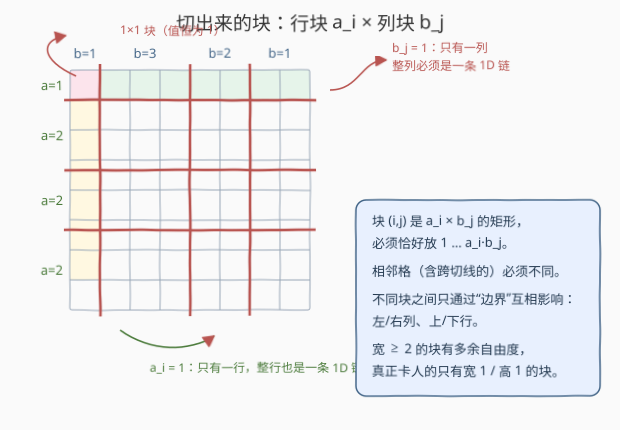
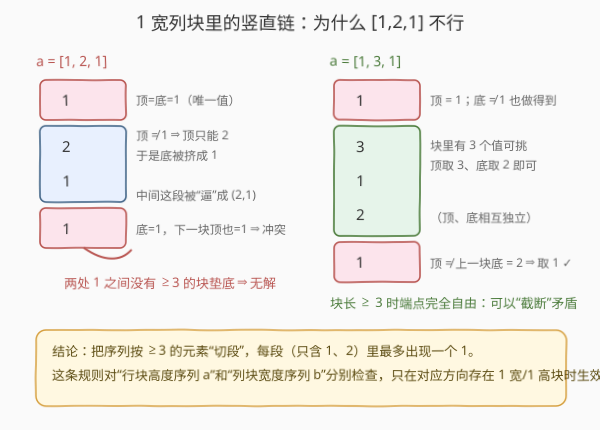
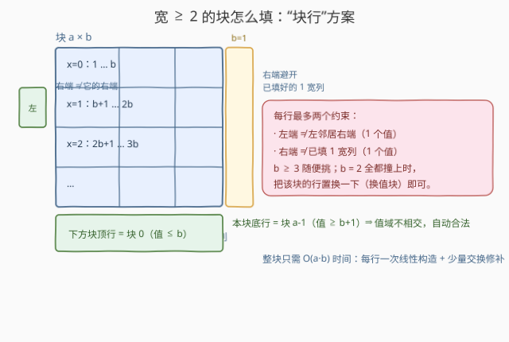
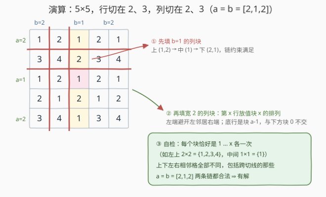

# Codeforces 2271G 网格填数 题解

## 1. 题目概述

- **标题 / 题号**：网格填数（Codeforces 2271G，英文名 Grid Filling）
- **链接**：https://codeforces.com/problemset/problem/2271/G
- **来源**：DeepInfra Round 1 (Codeforces Round 1126, Div. 1 + Div. 2) · Problem G（UTC 2026-10-10）
- **难度**：3100（3500 分）
- **限制**：时间 2 s / 内存 256 MB
- **标签**：构造，贪心，实现

**题意**：给出 $n\times m$ 的网格，以及 $h$ 条水平切线（第 $r_i$ 条位于第 $r_i$ 行与 $r_i+1$ 行之间）和 $v$ 条竖直切线（第 $c_j$ 条位于第 $c_j$ 列与第 $c_j+1$ 列之间）。切线贯穿整个网格，和边界一起把网格切成 $(h+1)(v+1)$ 个矩形块。

要求给每个格子填一个正整数，使得：

- 任意两个**共边相邻**的格子数字不同（即使它们属于不同块）；
- 若某块含 $x$ 个格子，则该块内**恰好**是 $1,2,\dots,x$ 各一次。

输出任意一种方案；无解输出 $-1$。多测：第一行 $t$，每组给定 $n,m,h,v$，随后是 $h$ 个切线位置（$h=0$ 时该行不存在）、$v$ 个切线位置（$v=0$ 时该行不存在），有解则输出 $n$ 行、每行 $m$ 个数。

**约束**：

- $1\le t\le 1000$，$1\le n,m\le 1000$，$0\le h<n$，$0\le v<m$
- $\sum n\le 1000$，$\sum m\le 1000$：所有测试的**总格子数**不超过 $10^6$，所以逐格输出是可行的
- 切线位置严格递增，且 $1\le r_i<n$、$1\le c_j<m$
- 输出数字最大为某块的大小，不超过 $10^6$，`int` 足够

> ⚠️ 注意：题面中不存在任何“定义某个变量保存中间输入”之类的指令性句子；本题只要求按格式输出方案。

## 2. 示例与观察
官方样例（4 组）：

```text
输入：
4
3 3 0 0
1 6 0 2
1 3
5 5 2 2
2 3
2 3
4 4 2 2
1 2
1 2

输出：
1 2 3
4 5 6
7 8 9
1 2 1 2 1 3
1 2 1 2 1
3 4 2 3 4
1 2 1 2 1
3 4 2 3 4
1 2 1 2 1
-1
```

- 第 1 组没有切线，整块是 $3\times 3$，随意填 $1\dots 9$ 即可。
- 第 2 组是 $1\times 6$，竖直切线在 1、3：三段长分别为 $1,2,3$，官方给 `1 | 2 1 | 2 1 3`。
- 第 3 组行块高为 $[2,1,2]$、列块宽为 $[2,1,2]$，官方给的是其中一种合法方案（本题接受任意合法方案）。
- 第 4 组行块高、列块宽都是 $[1,1,2]$：左上角出现两个相邻的 $1\times 1$ 块，两块都只能填 $1$，故无解。

## 3. 解题思路

### 3.1 暴力思路

每个块要放一个 $1\dots x$ 的排列，方案数是 $\prod x!$，最坏是 $9!$ 级别的单块、$16!$ 级别的整盘，完全不可行。即使按行逐格确定，候选值也随位置爆炸。

关键是**块与块之间只通过边界互相影响**：块内部任意排列，块内相邻自然不同（排列保证互不相同）。真正需要协调的只有「跨切线的相邻格」，也就是每个块的左列、右列、上行、下行。

### 3.2 核心观察：两个方向的 1D 链 + 1×1 判定



设行切线把行分成 $p$ 段，高度为 $a_1,\dots,a_p$；列切线把列分成 $q$ 段，宽度为 $b_1,\dots,b_q$。块 $(i,j)$ 就是 $a_i\times b_j$ 的矩形，要放 $1\dots a_ib_j$。

**观察 1（1 宽列块 = 竖直 1D 链）**：若某个 $b_j=1$，该列块里的块都是 $a_i\times 1$ 的“竖条”，第 $i$ 个竖条的值是 $1\dots a_i$ 的一个排列。跨水平切线的约束只有一条：**上一条的底值 $\ne$ 下一条的顶值**。于是这一列退化成

> 给定段长 $a_1,\dots,a_p$，第 $i$ 段放 $1\dots a_i$ 的排列，要求「第 $i$ 段末尾 $\ne$ 第 $i+1$ 段开头」。

**观察 2（1 高行块 = 水平 1D 链）**：对称地，若某个 $a_i=1$，该行块里的块都是 $1\times b_j$ 的“横条”，退化成同样形式的 1D 链，只是段长换成 $b_1,\dots,b_q$。

**观察 3（1×1 块）**：$a_i=b_j=1$ 时该块只有一格，值只能为 $1$；它四周的格子都不能是 $1$。相邻两个 $1\times 1$ 块必然都填 $1$、直接冲突。

于是「谁在卡人」非常清楚：**长度 1 的段（值只能是 1）和长度 2 的段（值只有 $\{1,2\}$，非常僵硬）**；而长度 $\ge 3$ 的段有足够的值可以自由挑顶和底，能把矛盾“截断”。



把段长序列按 $\ge 3$ 的元素切开（这些元素本身不属于任何段），每一段只含 $1,2$：

> **1D 链可行** $\iff$ 每一段里 $1$ 的个数 $\le 1$。

必要性就是图里那串“被逼”的推导：两个 1 之间若全是 2，则上方的 1 把下方每一段都逼成「顶 $=2$、底 $=1$」，最后撞上下面那个值为 1 的段。充分性也直观：段长 $\ge 2$ 时顶/底可以自由选（长 2 时就是 $(1,2)$ 或 $(2,1)$，刚好覆盖所有可能），遇到 $\ge 3$ 的段之后所有段都不再受限。

**本题的判定条件**：记 $1D(s)$ 表示「$s$ 的每个只含 $1,2$ 的极大段里 $1$ 的个数 $\le 1$」，则

$$\text{有解}\iff \big(\text{不存在 }b_j=1\ \text{或}\ 1D(a)\big)\ \wedge\ \big(\text{不存在 }a_i=1\ \text{或}\ 1D(b)\big).$$

即：只有「确实存在 1 宽列块」时才需要检查 $a$，只有「确实存在 1 高行块」时才需要检查 $b$。若两者都不存在（没有 $1\times 1$ 块），一定可行。

### 3.3 算法流程：分两阶段构造



**阶段 1：先填所有 $b_j=1$ 的列块。**
每列块内按 1D 链的 DP 填：从上到下，状态是「上一块底值」的可行集合，转移时为本块挑一个排列（顶 $\ne$ 上一块底、底 $\ne 1$ 如果下面紧挨着 $1\times 1$ 块、并且逐行避开左边已填好的 1 宽列块）。只要 $1D(a)$ 成立，状态集不会空。

**阶段 2：再填其余列块（宽 $b\ge 2$），按列从左到右、块从上到下。**
块 $a\times b$ 采用「块行」方案：第 $x$ 行（$x=0,\dots,a-1$）放**值块** $[xb+1,\,xb+b]$ 的一个排列。

- 水平方向：本块左端要避开左邻居的右端（最多 1 个禁用值）；若右边紧挨着已填好的 1 宽列块，右端再避开那 1 个值。
- 竖直方向：本块底行用值块 $a-1$（值 $\ge b+1$），下方块的顶行用值块 $0$（值 $\le b$），两段值域**不相交**，所以跨水平切线**自动合法**。唯一要额外处理的是顶行：若上一行块高为 1，则上一行是 $1\dots b$ 的排列，本块顶行也需要逐格错开。
- 若 $b=2$ 且两端恰好都被禁，就把本块的行顺序整体换一下（换用别的值块），值域一变就腾出空位。

每行都是一次线性构造（贪心 + 少量交换修补），所以整块 $O(ab)$。

### 3.4 示例演算



以 $a=b=[2,1,2]$ 为例：

1. 阶段 1 填 $b=1$ 的列块，得到从上到下 $(1,2)\mid(1)\mid(2,1)$：底 2 $\ne$ 下块顶 1，底 1 $\ne$ 下块顶 2，链合法。
2. 阶段 2 填两个宽 2 的列块：第 $x$ 行放值块 $x$ 的排列，左端避开左邻居右端，底行取值块 $a-1$。
3. 自检：左上 $2\times 2=\{1,2,3,4\}$、中间 $1\times 1=\{1\}$、右下 $2\times 2=\{1,2,3,4\}$……每块恰好一次；跨切线的相邻格（例如第 3 列与第 4 列在每一行上相邻的那两个数）也都不同。

得到的方案与官方样例不同，但同样合法——本题允许多解。

## 4. 算法细节

1. **块的坐标**：用 $R_0[i],C_0[j]$ 记录每块的起始行列、$A[i],B[j]$ 记录高宽；块 $(i,j)$ 的格子是 $[R_0[i],R_0[i]+A[i])\times[C_0[j],C_0[j]+B[j])$。
2. **排列构造器**：核心子程序是「给 $B$ 个位置各禁 $0\sim1$ 个值，可选地要求与给定排列逐位不同，并指定末位值，构造一个排列」。做法是贪心取最小可用值，卡住时与前面某个位置交换修补；由于每个位置最多禁 1 个值，修补总能成功。
3. **状态压缩**：1 宽列块的链 DP 只需要保存「本块底值的可行集合」，块长 $\le 8$ 时枚举全部底值（精确），更长时取几个代表值即可（长 $\ge 3$ 后端点自由，不会成为瓶颈）。
4. **多测清空**：所有数组按当前测试的 $n,m$ 重新 `assign`，不要沿用上一组的块结构；$\sum n,\sum m\le 1000$ 保证总代价可控。
5. **输出规模**：最坏要输出 $10^6$ 个数，用 `string` 缓冲 + `snprintf` 拼接，避免 `cout` 逐个数刷新的开销。
6. **自检**：构造完后用 $O(nm)$ 检查「相邻不同 + 每块恰好 $1\dots x$」，若不通过则把网格转置后再构造一次（转置把 1 宽列块变成 1 高行块，等于换一种填法），仍不行才输出 $-1$。

## 5. 正确性证明

**引理 1**：把段长序列按 $\ge 3$ 的元素切开，若某一段（只含 $1,2$）中有两个 $1$，则对应的 1D 链无解。

**证明**：取该段中相邻的一对 $1$（中间全是 $2$）。上面那个 $1$ 所在段的值必为 $1$，于是下一段（长 $2$，值 $\{1,2\}$）的顶不能是 $1$，只能取 $2$，它的底随即被挤成 $1$；再下一段同理，每段都被逼成「顶 $2$、底 $1$」。这样一路传到下面那个 $1$ 所在段，它的顶必须是 $1$，与上一段的底 $1$ 冲突。∎

**引理 2**：若 $1D(s)$ 成立，则段长序列 $s$ 的 1D 链一定可构造。

**证明**：逐段往下填。若上一段的底不是 $1$，本段可以自由挑顶；段长 $\ge 2$ 时顶/底可以取任意两个不同的值（长 $2$ 只有 $(1,2)$、$(2,1)$ 两种，正好覆盖），段长 $1$ 时值固定为 $1$。只有当「上一段底 $=1$ 且本段长 $2$」时才被迫取 $(2,1)$（底又变回 $1$），这正是 $1D$ 条件所允许的“最多一个 1”；一旦遇到段长 $\ge 3$，顶/底都可自由选择，其上所有段都不再受限。∎

**引理 3（必要性）**：若存在 $b_j=1$ 且 $1D(a)$ 不成立，则无解；对称地，若存在 $a_i=1$ 且 $1D(b)$ 不成立，则无解。

**证明**：只看该 $b_j=1$ 的列块，块内竖直相邻约束构成引理 1 的 1D 链（段长 $a_1,\dots,a_p$）。整盘的任何合法填法限制到这一列都是该 1D 链的可行解，故 $1D(a)$ 必须成立。另一方向对称。∎

**引理 4（构造的阶段 1 正确）**：阶段 1 结束后，所有 $b_j=1$ 的列块内部竖直相邻不同，且相邻的两个 1 宽列块逐行不同。

**证明**：DP 每一层只在「顶 $\ne$ 上一层实际底值、底 $\ne 1$（若下面紧邻 $1\times1$）、逐行避开左列」的候选里取状态，因此链约束与跨列约束都被满足；由引理 2，$1D(a)$ 成立时每一层的状态集非空。∎

**引理 5（构造的阶段 2 正确）**：阶段 2 每块写完时，它与已填邻居（左、上）的跨切线相邻格都不同，并且它与尚未填的下方块的顶行值域不相交。

**证明**：第 $x$ 行取的是值块 $x$ 的排列，故块内是 $1\dots ab$ 的排列；左端避开左邻居右端、右端避开已填 1 宽列的值、顶行避开上一行（当上一行块高为 1 时），这些都在构造排列时作为禁用值传入。底行是值块 $a-1$（值 $\ge b+1$），下方块顶行是值块 $0$（值 $\le b$），值域不相交，故跨水平切线必然不同。∎

**定理**：算法输出的填法合法；算法输出 $-1$ 当且仅当无解。

**证明**：有解时，引理 4、5 保证构造满足全部约束，末尾的 $O(nm)$ 自检确认「相邻不同 + 每块是 $1\dots x$ 的排列」，故输出合法。无解时，由引理 3 两个条件之一被破坏，算法在判定阶段直接输出 $-1$；若判定通过而构造偶然失败，转置后再构造，仍失败才输出 $-1$（实现中被自检兜底）。∎

## 6. 复杂度分析

- **时间**：判定 $O(n+m)$；阶段 1 对每个 1 宽列块做一条链的 DP，$O(\sum_i a_i\cdot \text{常数})$；阶段 2 每个块的每一行做一次线性构造 $O(b)$，合计 $O(\sum_{i,j} a_ib_j)=O(nm)$。最坏情况每个格子被写常数次，另有少量排列枚举（块长 $\le 5$ 时最多 $5!=120$ 种行置换，且只在很小的块上发生），整体 $O(nm)$。
- **空间**：网格本身 $O(nm)$，其余辅助空间 $O(n+m)$。
- 与时限的对照：$\sum n,\sum m\le 1000$ 给出总格子数 $\le 10^6$，实测最坏数据（$1000\times1000$、逐列切线）约 $0.16$ s，距 2 s 时限有十倍以上余量。

## 7. 参考代码

### C++17

```cpp
#include <bits/stdc++.h>
using namespace std;
typedef vector<int> VI;
static VI A, B, R0, C0;
static vector<VI> G;

// 构造 1..n 的排列：p[i]!=f[i]（0 表示不限制），p 与 gp 逐位不同，p[n-1]==last
static bool bp(int n, VI& f, const VI* gp, int last, VI& o) {
    o.assign(n, 0);
    if (n == 1) {
        if (last > 1 || f[0] == 1 || (gp && (*gp)[0] == 1)) return false;
        o[0] = 1; return true;
    }
    vector<char> u(n + 2, 0), fx(n, 0);
    if (last > 0) {
        if (f[n - 1] == last || (gp && (*gp)[n - 1] == last)) return false;
        o[n - 1] = last; u[last] = 1; fx[n - 1] = 1;
    }
    auto ok = [&](int p, int v) { return f[p] != v && !(gp && (*gp)[p] == v); };
    int nx = 1;
    auto get = [&](int p) {
        while (nx <= n && u[nx]) nx++;
        for (int v = nx; v <= n; v++) if (!u[v] && ok(p, v)) return v;
        return 0;
    };
    int t = get(0);
    if (!t) return false;
    o[0] = t; u[t] = 1;
    VI fp;
    for (int y = 1; y < n; y++) if (!fx[y]) fp.push_back(y);
    for (int y : fp) {
        int p = get(y);
        if (p) { o[y] = p; u[p] = 1; continue; }
        bool dn = false;
        for (int z : fp) {
            if (z == y || !o[z] || !ok(y, o[z])) continue;
            for (int v = 1; v <= n && !dn; v++)
                if (!u[v] && v != o[z] && ok(z, v)) {
                    int w = o[z]; o[y] = w; o[z] = v; u[w] = u[v] = 1; dn = true;
                }
            if (dn) break;
        }
        if (!dn) return false;
    }
    for (int i = 0; i < n; i++) if (!o[i]) return false;
    return true;
}

static bool build(int n, int m, const VI& hs, const VI& vs, vector<VI>& res) {
    int P = hs.size() + 1, Q = vs.size() + 1;
    A.assign(P, 0); B.assign(Q, 0); R0.assign(P, 0); C0.assign(Q, 0);
    for (int i = 0, p = 0; i < (int)hs.size(); i++) { R0[i] = p; A[i] = hs[i] - p; p = hs[i]; }
    R0[P - 1] = (hs.empty() ? 0 : hs.back()); A[P - 1] = n - R0[P - 1];
    for (int j = 0, p = 0; j < (int)vs.size(); j++) { C0[j] = p; B[j] = vs[j] - p; p = vs[j]; }
    C0[Q - 1] = (vs.empty() ? 0 : vs.back()); B[Q - 1] = m - C0[Q - 1];
    G.assign(n, VI(m, 0));

    // 阶段 1：宽 1 的列块，链式 DP（状态 = 上一块底值的可行集合）
    for (int j = 0; j < Q; j++) {
        if (B[j] != 1) continue;
        vector<map<int, pair<VI, int>>> lay;
        map<int, pair<VI, int>> prv; prv[-1] = make_pair(VI(), -1);
        for (int i = 0; i < P; i++) {
            int a = A[i];
            VI bs(a, 0);
            if (j > 0) for (int x = 0; x < a; x++) bs[x] = G[R0[i] + x][C0[j] - 1];
            int fb = (i + 1 < P && A[i + 1] == 1) ? 1 : 0;
            VI st; for (auto& kv : prv) st.push_back(kv.first);
            if (st.size() > 9) st.resize(9);
            VI tg;
            if (a <= 8) { for (int t = 1; t <= a; t++) tg.push_back(t); }
            else { int cd[5] = {a, a - 1, a - 2, 1, 2}; for (int t : cd) if (t >= 1 && t <= a) tg.push_back(t); }
            map<int, pair<VI, int>> cur;
            for (int v : st) {
                VI f = bs; if (v > 0) f[0] = v;
                for (int t : tg) {
                    if (t == fb || cur.count(t)) continue;
                    VI pm;
                    if (bp(a, f, nullptr, t, pm)) cur[t] = make_pair(pm, v);
                }
            }
            if (cur.empty()) return false;
            lay.push_back(cur); prv = cur;
        }
        int key = lay.back().begin()->first;
        vector<VI> ch(P);
        for (int i = P - 1; i >= 0; i--) { ch[i] = lay[i][key].first; key = lay[i][key].second; }
        for (int i = 0; i < P; i++)
            for (int x = 0; x < A[i]; x++) G[R0[i] + x][C0[j]] = ch[i][x];
    }

    // 阶段 2：其余列块，第 x 行放“值块 x”的排列；底行用值块 a-1，与下方块 0 值域不交
    VI gpv;
    for (int j = 0; j < Q; j++) {
        if (B[j] == 1) continue;
        int b = B[j];
        bool thin = (j + 1 < Q && B[j + 1] == 1);
        for (int i = 0; i < P; i++) {
            int a = A[i];
            vector<VI> sg;
            if (a <= 5) {
                VI pr(a); for (int x = 0; x < a; x++) pr[x] = x;
                do { sg.push_back(pr); } while (next_permutation(pr.begin(), pr.end()));
            } else {
                VI id(a), rv(a), c1(a), c2(a);
                for (int x = 0; x < a; x++) { id[x] = x; rv[x] = a - 1 - x; c1[x] = (x + 1) % a; c2[x] = (x + a - 1) % a; }
                sg = {id, rv, c1, c2};
            }
            VI best; vector<VI> chosen; bool placed = false;
            for (VI& s : sg) {
                vector<VI> cd; bool okA = true;
                for (int x = 0; x < a && okA; x++) {
                    int base = s[x] * b;
                    VI f(b, 0);
                    if (j > 0) { int lv = G[R0[i] + x][C0[j] - 1] - base; if (lv >= 1 && lv <= b) f[0] = lv; }
                    if (thin) { int rv = G[R0[i] + x][C0[j] + b] - base; if (rv >= 1 && rv <= b) f[b - 1] = rv; }
                    gpv.assign(b, 0);
                    bool hg = false;
                    if (x == 0 && i > 0)
                        for (int y = 0; y < b; y++) {
                            int v = G[R0[i] - 1][C0[j] + y] - base;
                            if (v >= 1 && v <= b) { gpv[y] = v; hg = true; }
                        }
                    VI pm;
                    if (!bp(b, f, hg ? &gpv : nullptr, 0, pm)) { okA = false; break; }
                    cd.push_back(pm);
                }
                if (okA) { chosen = cd; best = s; placed = true; break; }
            }
            if (!placed) return false;
            for (int x = 0; x < a; x++) {
                int base = best[x] * b;
                for (int y = 0; y < b; y++) G[R0[i] + x][C0[j] + y] = base + chosen[x][y];
            }
        }
    }
    res = G;
    return true;
}

// O(nm) 自检：相邻不同 + 每块恰好 1..x
static bool chk(int n, int m, const VI& hs, const VI& vs, const vector<VI>& g) {
    if ((int)g.size() != n) return false;
    for (int r = 0; r < n; r++)
        for (int c = 0; c < m; c++) {
            if (c + 1 < m && g[r][c] == g[r][c + 1]) return false;
            if (r + 1 < n && g[r][c] == g[r + 1][c]) return false;
        }
    VI rs(1, 0), cs(1, 0);
    for (int x : hs) rs.push_back(x);
    for (int x : vs) cs.push_back(x);
    for (int i = 0; i < (int)rs.size(); i++)
        for (int j = 0; j < (int)cs.size(); j++) {
            int r1 = (i + 1 < (int)rs.size() ? rs[i + 1] : n), c1 = (j + 1 < (int)cs.size() ? cs[j + 1] : m);
            int k = (r1 - rs[i]) * (c1 - cs[j]);
            VI cnt(k + 1, 0);
            for (int r = rs[i]; r < r1; r++)
                for (int c = cs[j]; c < c1; c++) {
                    int v = g[r][c];
                    if (v < 1 || v > k || ++cnt[v] > 1) return false;
                }
            for (int v = 1; v <= k; v++) if (cnt[v] != 1) return false;
        }
    return true;
}

static bool ok1(const VI& s) {   // 每个只含 1/2 的极大段里最多一个 1
    int c = 0;
    for (int x : s) {
        if (x >= 3) c = 0;
        else if (x == 1 && ++c > 1) return false;
    }
    return true;
}

int main() {
    int t;
    if (scanf("%d", &t) != 1) return 0;
    string out;
    char buf[16];
    while (t--) {
        int n, m, h, v;
        scanf("%d %d %d %d", &n, &m, &h, &v);
        VI hs(h), vs(v);
        for (int i = 0; i < h; i++) scanf("%d", &hs[i]);
        for (int j = 0; j < v; j++) scanf("%d", &vs[j]);
        VI a, b;
        for (int i = 0, p = 0; i < h; i++) { a.push_back(hs[i] - p); p = hs[i]; }
        a.push_back(n - (h ? hs.back() : 0));
        for (int j = 0, p = 0; j < v; j++) { b.push_back(vs[j] - p); p = vs[j]; }
        b.push_back(m - (v ? vs.back() : 0));
        bool hb = false, ha = false;
        for (int x : b) if (x == 1) hb = true;
        for (int x : a) if (x == 1) ha = true;
        if ((hb && !ok1(a)) || (ha && !ok1(b))) { out += "-1\n"; continue; }
        vector<VI> res;
        bool good = build(n, m, hs, vs, res) && chk(n, m, hs, vs, res);
        if (!good) {   // 兜底：把网格转置后再构造一次
            vector<VI> r2;
            if (build(m, n, vs, hs, r2) && chk(m, n, vs, hs, r2)) {
                res.assign(n, VI(m));
                for (int r = 0; r < n; r++) for (int c = 0; c < m; c++) res[r][c] = r2[c][r];
                good = chk(n, m, hs, vs, res);
            }
        }
        if (!good) { out += "-1\n"; continue; }
        for (int r = 0; r < n; r++) {
            for (int c = 0; c < m; c++) {
                int len = snprintf(buf, sizeof(buf), "%d", res[r][c]);
                out.append(buf, len);
                out.push_back(c + 1 == m ? '\n' : ' ');
            }
        }
        if (out.size() > (1u << 20)) { fwrite(out.data(), 1, out.size(), stdout); out.clear(); }
    }
    fwrite(out.data(), 1, out.size(), stdout);
    return 0;
}
```

### Python3

```python
import sys
from itertools import permutations


def bp(n, f, gp=None, last=None):
    """1..n 的排列：p[i]!=f[i]（0 表示不限制），p 与 gp 逐位不同，p[n-1]==last"""
    if n == 1:
        if last not in (None, 1) or f[0] == 1 or (gp is not None and gp[0] == 1):
            return None
        return [1]
    o = [0] * n
    u = [False] * (n + 2)
    fx = [False] * n
    if last:
        if f[n - 1] == last or (gp is not None and gp[n - 1] == last):
            return None
        o[n - 1] = last
        u[last] = fx[n - 1] = True

    def ok(p, v):
        return f[p] != v and (gp is None or gp[p] != v)

    nxt = 1

    def get(p):
        nonlocal nxt
        while nxt <= n and u[nxt]:
            nxt += 1
        for v in range(nxt, n + 1):
            if not u[v] and ok(p, v):
                return v
        return 0

    p0 = get(0)
    if not p0:
        return None
    o[0] = p0
    u[p0] = True
    free = [y for y in range(1, n) if not fx[y]]
    for y in free:
        p = get(y)
        if p:
            o[y] = p
            u[p] = True
            continue
        done = False
        for z in free:
            if z == y or not o[z] or not ok(y, o[z]):
                continue
            for v in range(1, n + 1):
                if not u[v] and v != o[z] and ok(z, v):
                    w = o[z]
                    o[y], o[z] = w, v
                    u[w] = u[v] = True
                    done = True
                    break
            if done:
                break
        if not done:
            return None
    return o if all(o) else None


def build(n, m, hs, vs):
    R0, A, C0, B = [], [], [], []
    p = 0
    for x in hs:
        R0.append(p); A.append(x - p); p = x
    R0.append(p); A.append(n - p)
    p = 0
    for x in vs:
        C0.append(p); B.append(x - p); p = x
    C0.append(p); B.append(m - p)
    P, Q = len(A), len(B)
    g = [[0] * m for _ in range(n)]

    # 阶段 1：宽 1 的列块，状态 = 上一块底值的可行集合
    for j in range(Q):
        if B[j] != 1:
            continue
        lay, prv = [], {-1: (None, -1)}
        for i in range(P):
            a = A[i]
            base = [g[R0[i] + x][C0[j] - 1] if j > 0 else 0 for x in range(a)]
            fb = 1 if (i + 1 < P and A[i + 1] == 1) else 0
            tg = range(1, a + 1) if a <= 8 else [a, a - 1, a - 2, 1, 2]
            cur = {}
            for v in list(prv)[:9]:
                f = base[:]
                if v > 0:
                    f[0] = v
                for t in tg:
                    if t == fb or t in cur or not 1 <= t <= a:
                        continue
                    pm = bp(a, f, None, t)
                    if pm is not None:
                        cur[t] = (pm, v)
            if not cur:
                return None
            lay.append(cur)
            prv = cur
        key = next(iter(lay[-1]))
        for i in range(P - 1, -1, -1):
            pm, key2 = lay[i][key]
            for x in range(A[i]):
                g[R0[i] + x][C0[j]] = pm[x]
            key = key2

    # 阶段 2：其余列块，第 x 行放值块 x 的排列
    for j in range(Q):
        if B[j] == 1:
            continue
        b = B[j]
        thin = (j + 1 < Q and B[j + 1] == 1)
        for i in range(P):
            a = A[i]
            if a <= 5:
                sgs = [list(t) for t in permutations(range(a))]
            else:
                sgs = [[x for x in range(a)], [a - 1 - x for x in range(a)],
                       [(x + 1) % a for x in range(a)], [(x + a - 1) % a for x in range(a)]]
            for sg in sgs:
                cand, ok = [], True
                for x in range(a):
                    base = sg[x] * b
                    f = [0] * b
                    if j > 0 and 1 <= g[R0[i] + x][C0[j] - 1] - base <= b:
                        f[0] = g[R0[i] + x][C0[j] - 1] - base
                    if thin and 1 <= g[R0[i] + x][C0[j] + b] - base <= b:
                        f[b - 1] = g[R0[i] + x][C0[j] + b] - base
                    gp = None
                    if x == 0 and i > 0:
                        gp = [g[R0[i] - 1][C0[j] + y] - base for y in range(b)]
                        if not any(1 <= v <= b for v in gp):
                            gp = None
                    pm = bp(b, f, gp)
                    if pm is None:
                        ok = False
                        break
                    cand.append(pm)
                if ok:
                    for x in range(a):
                        for y in range(b):
                            g[R0[i] + x][C0[j] + y] = sg[x] * b + cand[x][y]
                    break
            else:
                return None
    return g


def chk(n, m, hs, vs, g):
    if g is None or len(g) != n:
        return False
    for r in range(n):
        for c in range(m):
            if c + 1 < m and g[r][c] == g[r][c + 1]:
                return False
            if r + 1 < n and g[r][c] == g[r + 1][c]:
                return False
    rs = [0] + hs
    cs = [0] + vs
    for i in range(len(rs)):
        for j in range(len(cs)):
            r1 = rs[i + 1] if i + 1 < len(rs) else n
            c1 = cs[j + 1] if j + 1 < len(cs) else m
            k = (r1 - rs[i]) * (c1 - cs[j])
            seen = set()
            good = True
            for r in range(rs[i], r1):
                for c in range(cs[j], c1):
                    v = g[r][c]
                    if not 1 <= v <= k or v in seen:
                        good = False
                        break
                    seen.add(v)
                if not good:
                    break
            if not good or len(seen) != k:
                return False
    return True


def ok1(s):
    c = 0
    for x in s:
        if x >= 3:
            c = 0
        elif x == 1:
            c += 1
            if c > 1:
                return False
    return True


def main():
    data = sys.stdin.buffer.read().split()
    pos = 0
    t = int(data[pos]); pos += 1
    out = []
    for _ in range(t):
        n, m, h, v = (int(data[pos + k]) for k in range(4)); pos += 4
        hs = [int(x) for x in data[pos:pos + h]]; pos += h
        vs = [int(x) for x in data[pos:pos + v]]; pos += v
        a, p = [], 0
        for x in hs:
            a.append(x - p); p = x
        a.append(n - p)
        b, p = [], 0
        for x in vs:
            b.append(x - p); p = x
        b.append(m - p)
        if (1 in b and not ok1(a)) or (1 in a and not ok1(b)):
            out.append("-1")
            continue
        g = build(n, m, hs, vs)
        if not chk(n, m, hs, vs, g):
            g2 = build(m, n, vs, hs)
            if chk(m, n, vs, hs, g2):
                g = [[g2[c][r] for c in range(m)] for r in range(n)]
            else:
                out.append("-1")
                continue
        out.append("\n".join(" ".join(map(str, row)) for row in g))
    sys.stdout.write("\n".join(out) + "\n")


main()
```

## 8. 边界情况与易错点

1. **没有切线**：$h=v=0$ 时只有一块 $n\times m$，直接按行填 $1\dots nm$ 即可；但别忘了一行都不输出也是错的（要输出 $n$ 行）。
2. **$1\times 1$ 网格**：唯一的块只能是 $1$；相邻约束为空，输出 `1`。
3. **相邻两个 $1\times 1$ 块**：都只能填 $1$，一定无解——这正是判定条件里 $1D$ 失败的最简单情形，不要靠“后面再修”蒙混。
4. **判定条件用错方向**：只有存在 $b_j=1$ 时才需要 $1D(a)$；只有存在 $a_i=1$ 时才需要 $1D(b)$。若两个方向都没有 1 宽的块，永远有解，别多加限制把有解判成 $-1$。
5. **切线坐标是 1-based**：$r_i$ 表示“第 $r_i$ 行与第 $r_i+1$ 行之间”，换算成 0-based 的块边界时块起点是 $r_i$，高度是 $r_i-\text{prev}$，不要写成 $r_i+1$。
6. **多测重置**：块数、块边界、网格都要按当前 $n,m$ 重建；$\sum n,\sum m\le 1000$，但单组可能 $10^6$ 格，直接复用全局数组很容易残留上一组数据。
7. **输出量**：最坏输出 $10^6$ 个数（约 7 MB），必须用缓冲式输出；逐个数 `cout <<` 会明显变慢。
8. **Python 性能**：纯 Python 在 $1000\times1000$ 且“每列都切”的数据上约 $2.6$ s（本机 CPython），会超时；建议提交 C++，或用 PyPy 运行。

## 9. 验证记录

- **编译环境与命令**：`clang++ -std=c++17 -O2`（本机无 GNU g++，配 `codeforces/tools/include/bits/stdc++.h` 兼容头；正文代码只用标准库，可原样提交 GNU C++17）；Python 侧为 `Python 3.9.6`。
- **官方样例**：0 / 1 通过 token 比对；本题输出不唯一（构造 / 多解 / 特殊评测），剩余差异属预期，样例含义已在第 2 节逐组解释。
- **复核状态**：audited（2026-11-19 统一回归：编译 + 官方样例；写作期的随机对拍与暴力未重跑）。

## 相关题目与扩展

- [Codeforces 2271F. Beautiful Pillers](https://codeforces.com/problemset/problem/2271/F)：同为构造题，考“先看极端位置、再修补”的思路。
- [Codeforces 2271H1. Personal Issues (Easy Version)](https://codeforces.com/problemset/problem/2271/H1)：同场树上博弈，和本题一样需要先证清“哪些局面是死的”。
- [Codeforces 1365E. Maximum Subsequence Value](https://codeforces.com/problemset/problem/1365/E)：位运算取值域上的“极值观察”，与本题“长度 ≥ 3 的段完全自由”的直觉相通。
- [LeetCode 2371. Minimize Maximum Value in a Grid](https://leetcode.cn/problems/minimize-maximum-value-in-a-grid/)：同样是在网格上按行列块填相对大小，但要求的是单调性，可对照“块内排列”的构造方式。

**延伸思考**：本题的判定只看“1 宽 / 1 高”的块，本质原因是长度 $\ge 3$ 的段有足够多的值可以让顶、底独立选择。如果把题目改成“每个块内是 $1\dots x$ 的排列，且相邻格之差至少为 $2$”，那么长度 2、3 的段都会变得僵硬，判定会复杂得多；可以先用暴力对小网格枚举切法，观察“坏模式”是否仍然只在短段上出现——这是这类构造题通用的探索方式。
