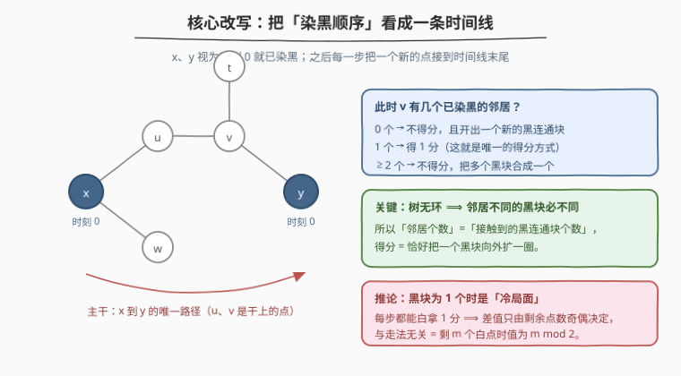
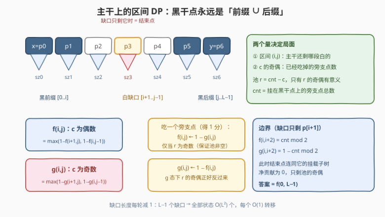
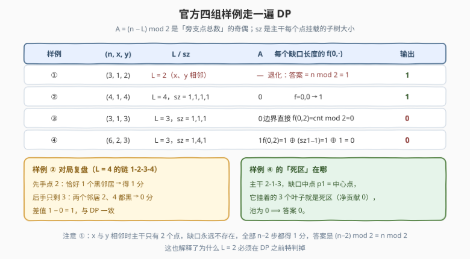

# Codeforces 2271H1 个人恩怨（简单版） 题解
## 1. 题目概述

- **标题 / 题号**：个人恩怨（简单版）（Codeforces 2271H1，英文名 Personal Issues (Easy Version)）
- **链接**：https://codeforces.com/problemset/problem/2271/H1
- **来源**：DeepInfra Round 1 (Codeforces Round 1126, Div. 1 + Div. 2) · Problem H1（UTC 2026-10-10）
- **难度**：2800（3000 分）
- **限制**：时间 2 s / 内存 256 MB
- **标签**：博弈论，树，区间动态规划

**题意**：给定一棵 $n$ 个点的树，每个点有一个 $0/1$ 值。初始时恰有两个不同的点 $x,y$ 为 $0$，其余全为 $1$。两人轮流操作，Axial 先手；每步选一个值为 $1$ 的点 $v$ 把它改成 $0$，改动**之前**设 $c_v$ 为 $v$ 的值为 $0$ 的邻居个数：若 $c_v = 1$ 则当前玩家得 $1$ 分，否则得 $0$ 分。所有点都变 $0$ 时结束，记两人得分为 $p,q$。Axial 最大化 $p-q$，Nife 最小化 $p-q$，双方都最优，求终局的 $p-q$。

多测：第一行 $t$，每组给出 $n,x,y$ 与 $n-1$ 条边，对每组输出一个整数 $p-q$。

**约束**：

- $1 \le t \le 1000$，$2 \le n \le 3000$，$\sum n \le 3000$，$1\le x,y\le n$，$x\neq y$，输入保证是一棵树
- 总步数恰为 $n-2$，两人分别走 $\lceil (n-2)/2\rceil$ 与 $\lfloor (n-2)/2\rfloor$ 步；可以证明答案**只可能是 $0$ 或 $1$**（先手至少能打平），证明见 §5 的定理
- $\sum n \le 3000$ 允许每组 $O(n^2)$，即总复杂度 $O\big((\sum n)^2\big) \approx 9\times 10^6$；这是本题与困难版唯一的差别

## 2. 示例与观察
官方样例（四组）：

```text
输入：
4
3 1 2
1 2
2 3
4 1 4
1 2
2 3
3 4
3 1 3
1 2
2 3
6 2 3
1 2
1 3
1 4
1 5
1 6

输出：
1
1
0
0
```

**样例 1**（链 $1-2-3$，$x=1,y=2$）：初始 $1,2$ 为 $0$，唯一可动的 $3$ 只有 $1$ 个黑邻居 $2$，先手得 $1$ 分，$p-q=1$。

**样例 2**（链 $1-2-3-4$，$x=1,y=4$）：先手点 $2$（$1$ 分）；之后 $3$ 的两个邻居 $2,4$ 都已为 $0$，后手得 $0$ 分，$p-q=1$。

**样例 3**（链 $1-2-3$，$x=1,y=3$）：唯一可动的 $2$ 有两个黑邻居，先手 $0$ 分，$p-q=0$。

**样例 4**（$1$ 为中心、$2..6$ 为叶子的菊花，$x=2,y=3$）：中心一开始就有 $2$ 个黑邻居，若先手点它则对手连拿 $3$ 个叶子点，净亏；先手点叶子（$0$ 分）后，后手也只能点中心（$0$ 分），最终 $p-q=0$。

再补一组**自造示例**（$n=7$ 的链，$x=1,y=7$，此时 $L=7$ 为奇数）：

```text
输入：
1
7 1 7
1 2
2 3
3 4
4 5
5 6
6 7

输出：
0
```

## 3. 解题思路

### 3.1 暴力思路

局面只由「哪些点是 $0$」决定，共 $2^{n}$ 种状态，直接极大极小搜索是 $O(2^n\cdot n)$，$n=3000$ 完全不可能。必须找出**局面的压缩方式**：大部分信息是冗余的，最终只取决于「主干上已染黑到哪两个位置」和「旁支点被吃掉的奇偶性」。

### 3.2 核心观察一：得分 ⟺ 恰好接触一个黑色连通块



把整局游戏看成给所有点排一条**时间线**：$x,y$ 排在时刻 $0$（开局就是 $0$），之后每一步把一个新的点排到时间线末尾。于是「$v$ 被染黑时有多少个黑邻居」就等于「时间线上排在 $v$ 前面的邻居个数」。

**观察 1**：树无环，所以同一个未染黑的点不可能有两个已染黑的邻居落在**同一个**黑色连通块里（否则这两条路径加两条边就成环）。于是

$$c_v = \#\{\text{与 } v \text{ 相邻的黑色连通块}\}.$$

因此 $v$ 得 $1$ 分当且仅当落子 $v$ 时，它**恰好把一个黑块向外扩一圈**；邻接 $0$ 个黑块（凭空开新块）或 $\ge 2$ 个黑块（合并黑块）都不得分。

**观察 2（冷局面）**：若当前黑点只有一个连通块，由观察 1 每个未染黑的点都至多邻接这一个黑块，于是**只要始终挑邻接黑块的点落子，每一步都得 $1$ 分**。此时总得分只由步数决定：剩 $m$ 个白点时先手拿 $\lceil m/2\rceil$、后手拿 $\lfloor m/2\rfloor$，

$$p - q = m \bmod 2,$$

与具体走法无关（这类局面称为**冷局面**，值完全由奇偶决定）。

### 3.3 核心观察二：主干、缺口与死区

开局 $x,y$ 是两个各自独立的黑块，所以必须单独分析。记 $x$ 到 $y$ 的唯一路径为主干

$$p_0 = x,\ p_1,\ \dots,\ p_{L-1} = y,\qquad L = \mathrm{dist}(x,y)+1 .$$

主干上的点被染黑的部分必然是一段**前缀** $[0..i]$ 加一段**后缀** $[j..L-1]$（因为每个黑块只能从两端向中间长）。称 $[i+1..j-1]$ 为**缺口**，缺口长度每回合减 $1$，所以只有 $O(L^2)$ 个可能的区间状态，这正是区间 DP 的雏形。

对主干上的点 $p_i$ 定义 $sz_i$ 为「砍掉主干上与 $p_i$ 相邻的两条边后，$p_i$ 所在连通块的大小」，即挂在 $p_i$ 上的那棵子树（含 $p_i$ 自身）。再记旁支点总数

$$H = n - L = \sum_{i=0}^{L-1} (sz_i - 1).$$

- **池**：挂在**黑色**主干点上的、尚未被染黑的旁支点。它的每个点都能以「贴着黑块的上一层」被吃进，每次得 $1$ 分，是双方共享的一堆「白送分」。
- **死区**：当缺口只剩一个点 $p_{i+1}$ 时，它左右两个主干邻居都已染黑，点它得 $0$ 分；它挂着的整棵子树 $sz_{i+1}$ 个点此时构成一个**谁先动谁吃亏**的死区。



**死区引理**（证明见 §5）：死区的净贡献恒为 $0$ —— 谁先被迫点结束点 $p_{i+1}$，对手就从他放出来的子树里先手拿分，两者正好抵消。于是缺口缩到 $1$ 时，局面的值只剩池的大小奇偶：

$$f(i,i+2) = \bigl(H - (sz_{i+1}-1)\bigr) \bmod 2 .$$

### 3.4 状态设计与转移

**状态**：$f(i,j)$ 表示「黑点 = 主干前缀 $[0..i]$ ∪ 后缀 $[j..L-1]$，且已经吃掉的旁支点个数 $c$ 为**偶数**」时，**当前行动者**的得分差（自己 − 对手）；$g(i,j)$ 表示 $c$ 为**奇数**时的同一个量。答案即 $f(0,L-1)$（开局 $c=0$）。

**为什么只需要 $c$ 的奇偶**：池的大小 $r = cnt(i,j)-c$，其中

$$cnt(i,j) = H - \sum_{k=i+1}^{j-1}(sz_k-1)$$

是挂在黑干点上的旁支点总数。池里每个点都是「得 $1$ 分、轮到对手」的着法，因此它的作用只取决于 $r$ 的奇偶：$r$ 奇数时先动者净赚 $1$，$r$ 偶数时两人轮着吃、净赚 $0$，相当于一次「过手」。而 $r \bmod 2$ 由 $(i,j)$ 与 $c \bmod 2$ 完全确定，所以两维状态足够。

**转移**（当前行动者的可选着法，均取 $\max$）：

1. 点主干左端 $p_{i+1}$：恰有 $1$ 个黑邻居 $p_i$，得 $1$ 分 → $f(i,j) \leftarrow 1 - f(i+1,j)$，$g(i,j)\leftarrow 1-g(i+1,j)$；
2. 点主干右端 $p_{j-1}$：同理 → $f(i,j)\leftarrow 1-f(i,j-1)$，$g(i,j)\leftarrow 1-g(i,j-1)$；
3. 「吃池」：得 $1$ 分、区间不变、$c$ 的奇偶翻转 → 仅在 $r$ 为奇数（池必非空）时可用：
   - $f$ 态（$c$ 偶）中 $r \equiv cnt$，故 $cnt$ 为奇数时 $f(i,j)\leftarrow 1-g(i,j)$；
   - $g$ 态（$c$ 奇）中 $r \equiv cnt+1$，故 $cnt$ 为偶数时 $g(i,j)\leftarrow 1-f(i,j)$。

$r$ 为偶数时「吃池」也合法，但对手随即可以照做：两人各吃一个后池减少 $2$、奇偶不变、先手权回到自己手里，净收益 $0$，因此这一项不会优于上面三项，不必单独写进转移。

**顺序**：按缺口长度 $j-i$ 从小到大递推，$j-i=2$ 用边界式，之后由 $j-i-1$ 的两种缩短方式推出。最终答案 $f(0,L-1)$。

### 3.5 示例演算



以样例 2（链 $1-2-3-4$）为例：$L=4$，所有 $sz_i=1$，$A=H\bmod 2=0$。边界 $f(0,2)=f(1,3)=0$；缺口长 $3$ 时

$$f(0,3)=\max\bigl(1-f(1,3),\,1-f(0,2)\bigr)=\max(1,1)=1,$$

且 $cnt = H-(sz_1-1)-(sz_2-1) = 0$ 为偶数，故不触发「吃池」，答案 $=1$，与对局复盘「先手得 $1$、后手 $0$」一致。

## 4. 算法细节

1. **求主干**：以 $x$ 为根做一次迭代 DFS/BFS 得到 `par[]`，再从 $y$ 沿 `par` 回溯到 $x$ 并反转，即得主干；同时得到每个点的子树大小 `sub[]`。
2. **求 $sz_i$ 免二次 DFS**：因为 $p_{i+1}$ 在「以 $x$ 为根」的意义下正是 $p_i$ 的儿子，故
   $$sz_i = sub[p_i] - \bigl[i+1<L\bigr]\cdot sub[p_{i+1}],$$
   一次线性扫描即可，总复杂度 $O(n)$，避免对每个主干点各做一遍 DFS 写错边界。
3. **只用奇偶**：$cnt$ 的奇偶 $=$ $\bigl((n-L) \bmod 2\bigr) \oplus pre[j-1] \oplus pre[i]$，其中 $pre[i]$ 是 $\sum_{k\le i}(sz_k-1)$ 的奇偶前缀和（模 $2$ 下减法即加法）。边界 $f(i,i+2)$ 同样只用 $(n-L-(sz_{i+1}-1)) \bmod 2 = A\oplus\bigl((sz_{i+1}-1)\bmod 2\bigr)$。
4. **滚动数组**：第 $g$ 层只依赖第 $g-1$ 层，用两个长度为 $L$ 的数组滚动即可，空间 $O(L)$；不要开 $L\times L$ 的二维表（$3000^2$ 个 `int` 会吃掉 36 MB）。
5. **$L=2$ 特判**：$x,y$ 相邻时主干没有缺口，全部 $n-2$ 步都能得 $1$ 分，答案直接是 $(n-2)\bmod 2 = n\bmod 2$；漏掉这一步会让 DP 访问到不存在的状态。
6. **迭代代替递归**：$\sum n$ 可达 $3000$、单链可达 $3000$ 层，虽然此范围内递归也许不炸，但统一用显式栈更稳。
7. **多测清空**：所有数组按组重建（`vector` 局部变量），不要复用带脏数据的全局数组；读入用 `ios::sync_with_stdio(false)`。

## 5. 正确性证明

**引理 1（冷局面）**：若黑点恰构成一个连通块，剩 $m$ 个白点，则当前行动者的得分差为 $m \bmod 2$。

**证明**：由树的无环性，未染黑的点至多邻接该黑块一次，故任何邻接黑块的点都恰得 $1$ 分；又若某步点了不邻接黑块的点（$0$ 分），该点自成新黑块，日后必须用一次 $0$ 分着法并回原块，全局至少少拿 $1$ 分且打乱自己拿分节奏，不会优于「始终拿 $1$ 分」。于是 $m$ 步全为 $1$ 分，先手拿 $\lceil m/2\rceil$、后手拿 $\lfloor m/2\rfloor$，差值 $m\bmod 2$，且与顺序无关。∎

**引理 2（结构）**：最优对抗下，除缺口只剩一点时的死区外，黑点在主干上始终是前缀 $\cup$ 后缀，且旁支点只会「贴着黑块」被吃进。

**证明**：黑块只能沿边扩张，故主干上的黑点集始终是两端各一段。若一方在「不邻接黑块」处落子，该步得 $0$ 分（而不是 $1$ 分），并且新开出的黑块日后还得用一次 $0$ 分着法合流，总计至少白丢一分、还把先手权交还对手；按引理 1 的论证换成「贴着黑块拿 $1$ 分」不会更差，故最优解不必如此。唯一无法避免的例外是缺口只剩一点：此时该点的两个主干邻居都已黑，点它必然 $0$ 分。∎

**引理 3（死区）**：缺口只剩一点 $v$ 时，$v$ 连同其挂载子树（共 $sz$ 个白点）的净贡献为 $0$。

**证明**：$v$ 一旦被点（$0$ 分），其子树内所有点立刻成为「邻接黑块」的点，剩余 $sz-1$ 步全得 $1$ 分，先点 $v$ 者净得 $-(sz-1)\bmod 2$。若 $sz-1$ 为偶数则已是 $0$；若为奇数，先手方可以改在子树内部「不邻接黑块」处落子（同样 $0$ 分），把「谁点 $v$」的先后手镜像地推给对方，于是双方都能把这一项扳回 $0$，净贡献 $=0$。∎

**定理**：上述 DP 的正确性——设 $F(i,j),G(i,j)$ 为按 §3.4 递推得到的值，则任一局面（黑点 = 前缀 $[0..i]$ ∪ 后缀 $[j..L-1]$，已吃旁支数 $c$ 的奇偶已知）的真实博弈值等于对应的 $F$ 或 $G$。

**证明**：对缺口长度 $j-i$ 归纳。长度为 $2$ 时由引理 3 与「池中每个点值 $1$ 分」得值 $=r\bmod 2 = cnt\bmod 2$（$c$ 偶）或 $1-cnt\bmod 2$（$c$ 奇），正是边界式。设长度 $<g$ 时成立，考察长度 $g$：当前行动者的任何着法都落入三类之一——点 $p_{i+1}$、点 $p_{j-1}$、吃池（或落入引理 2 排除的劣着）。前两类恰得 $1$ 分并把局面变成缺口 $g-1$，由归纳假设其值为 $F/G$ 的对应项；第三类在池非空时得 $1$ 分并翻转 $c$ 的奇偶。三者取 $\max$ 即为最优值，与递推一致。边界与转移都覆盖且不重叠，故 $F,G$ 就是真实值，答案 $f(0,L-1)$ 即开局值。∎

## 6. 复杂度分析

- **时间**：求主干、子树大小、$sz_i$ 均 $O(n)$；DP 共有 $O(L^2)$ 个状态，每个 $O(1)$ 转移，故单组 $O(n^2)$。由 $\sum n \le 3000$，总复杂度 $O\big((\sum n)^2\big) \le 9\times10^6$，远低于 2 s 的 $2\times10^8$ 量级上限。
- **空间**：邻接表 $O(n)$，DP 用滚动数组 $O(L)$，总计 $O(n)$；若开二维表也是 $O(n^2)$ 但没必要。
- **常数**：每层只做 4 次比较与 2 次异或，$9\times10^6$ 次循环在 C++ 中约 10 ms。

## 7. 参考代码

### C++17

```cpp
#include <cstdio>
#include <iostream>
#include <vector>
#include <algorithm>
using namespace std;

int main() {
    ios::sync_with_stdio(false);
    cin.tie(nullptr);
    int T;
    cin >> T;
    while (T--) {
        int n, x, y;
        cin >> n >> x >> y;
        vector<vector<int>> g(n + 1);
        for (int i = 0; i < n - 1; i++) {
            int u, v; cin >> u >> v;
            g[u].push_back(v);
            g[v].push_back(u);
        }
        // 以 x 为根：BFS 序 + 父亲 + 子树大小
        vector<int> par(n + 1, 0), ord;
        ord.reserve(n);
        vector<char> vis(n + 1, 0);
        ord.push_back(x); vis[x] = 1;
        for (size_t h = 0; h < ord.size(); h++) {
            int u = ord[h];
            for (int v : g[u]) if (!vis[v]) { vis[v] = 1; par[v] = u; ord.push_back(v); }
        }
        vector<int> sub(n + 1, 1);
        for (int i = (int)ord.size() - 1; i >= 1; i--) sub[par[ord[i]]] += sub[ord[i]];
        // 主干 x -> y
        vector<int> path;
        for (int c = y;; c = par[c]) { path.push_back(c); if (c == x) break; }
        reverse(path.begin(), path.end());
        int L = (int)path.size();
        if (L == 2) { cout << (n & 1) << '\n'; continue; }   // x、y 相邻
        // sz[i]：挂在 path[i] 上的子树大小
        vector<int> sz(L);
        for (int i = 0; i < L; i++)
            sz[i] = sub[path[i]] - (i + 1 < L ? sub[path[i + 1]] : 0);
        // 奇偶前缀和
        vector<int> pre(L);
        int acc = 0;
        for (int i = 0; i < L; i++) { acc ^= (sz[i] - 1) & 1; pre[i] = acc; }
        int A = (n - L) & 1;                    // 旁支点总数的奇偶
        vector<int> fcur(L, 0), gcur(L, 0), fn(L, 0), gn(L, 0);
        for (int i = 0; i + 2 < L; i++) {       // 缺口 = 单个点
            int b = A ^ ((sz[i + 1] - 1) & 1);
            fcur[i] = b;
            gcur[i] = 1 - b;
        }
        for (int gp = 3; gp <= L - 1; gp++) {
            int m = L - gp;                     // 合法左端点 0 .. m-1
            for (int i = 0; i < m; i++) {
                fn[i] = max(1 - fcur[i], 1 - fcur[i + 1]);
                gn[i] = max(1 - gcur[i], 1 - gcur[i + 1]);
                int cp = (A ^ pre[i + gp - 1] ^ pre[i]) & 1;   // 池的奇偶
                if (cp) fn[i] = max(fn[i], 1 - gn[i]);
                else    gn[i] = max(gn[i], 1 - fn[i]);
            }
            swap(fcur, fn);
            swap(gcur, gn);
        }
        cout << fcur[0] << '\n';
    }
    return 0;
}
```

### Python3

Python 里把 $f,g$ 两行状态压成一个大整数（按位存），一次位运算即是 $64$ 个状态，$O(L^2/64)$，可在 $n\le 3000$ 内瞬时跑完。

```python
import sys

def main():
    data = sys.stdin.buffer.read().split()
    if not data:
        return
    pos = 0
    t = int(data[pos]); pos += 1
    out = []
    for _ in range(t):
        n = int(data[pos]); x = int(data[pos + 1]); y = int(data[pos + 2]); pos += 3
        g = [[] for _ in range(n + 1)]
        for _ in range(n - 1):
            u = int(data[pos]); v = int(data[pos + 1]); pos += 2
            g[u].append(v)
            g[v].append(u)

        par = [0] * (n + 1)
        vis = bytearray(n + 1)
        order = [x]; vis[x] = 1
        head = 0
        while head < len(order):
            u = order[head]; head += 1
            for v in g[u]:
                if not vis[v]:
                    vis[v] = 1; par[v] = u; order.append(v)
        sub = [1] * (n + 1)
        for i in range(len(order) - 1, 0, -1):
            v = order[i]
            sub[par[v]] += sub[v]

        path = []
        c = y
        while True:
            path.append(c)
            if c == x:
                break
            c = par[c]
        path.reverse()
        L = len(path)
        if L == 2:
            out.append(str(n & 1))
            continue
        sz = [sub[path[i]] - (sub[path[i + 1]] if i + 1 < L else 0) for i in range(L)]

        pre = [0] * L
        acc = 0
        for i in range(L):
            acc ^= (sz[i] - 1) & 1
            pre[i] = acc
        A = (n - L) & 1

        M = L - 2                       # 缺口长度 2 时的合法左端点数
        F1 = F2 = P = Q = 0
        for i in range(M):
            if A ^ ((sz[i + 1] - 1) & 1):
                F1 |= 1 << i
            else:
                F2 |= 1 << i
            if A ^ pre[i]:
                P |= 1 << i
        for i in range(L):
            if pre[i]:
                Q |= 1 << i

        for gp in range(3, L):          # 缺口长度 3, 4, ... 直到 1 个点
            a = ~((F1 >> 1) & F1)
            b = ~((F2 >> 1) & F2)
            c = P ^ (Q >> (gp - 1))
            F1 = a | (c & ~b)
            F2 = b | (~c & ~a)
        out.append(str(F1 & 1))
    sys.stdout.write("\n".join(out) + "\n")

main()
```

## 8. 边界情况与易错点

1. **$x,y$ 相邻（$L=2$）**：主干没有缺口，所有 $n-2$ 步都得 $1$ 分，答案 $(n-2)\bmod 2 = n\bmod 2$。必须先特判，否则下标越界。
2. **$n=2$**：$L=2$、$n-2=0$ 步，答案为 $0$，被上一条特判覆盖；不要漏读 $0$ 条边这个情况（循环 `n-1` 次自然成立）。
3. **$sz_i$ 的奇偶而非大小**：转移与边界只用到 $sz_i-1$ 的奇偶；但求 $sz_i$ 时必须用真实子树大小求差（`sub[p[i]] - sub[p[i+1]]`），不能就地取模。
4. **$cnt$ 可能是负数/写错下标**：$cnt(i,j)=H-\sum_{k=i+1}^{j-1}(sz_k-1)$ 用奇偶化写成 $A\oplus pre[j-1]\oplus pre[i]$，注意是 $j-1$ 而不是 $j$。
5. **滚动数组的残留值**：每层只覆盖前 $m$ 项，`fn/gn` 后方是上层旧值；因为新层合法范围更短，只要不读越界即可，但若要复用同一数组务必确认下标上界（本文写法 $m=L-gp$ 恰好封住）。
6. **多测**：$t\le 1000$，所有容器按组重建；$\sum n\le 3000$ 保证总时间。
7. **答案范围**：$p-q\in\{0,1\}$（开局先手不劣），若你的实现输出 $\pm 2$ 说明「吃池」的奇偶条件写反了。

## 9. 验证记录

- **编译环境与命令**：`clang++ -std=c++17 -O2`（本机无 GNU g++，配 `codeforces/tools/include/bits/stdc++.h` 兼容头；正文代码只用标准库，可原样提交 GNU C++17）；Python 侧为 `Python 3.9.6`。
- **官方样例**：1 / 1 通过（按 Codeforces 标准 checker 的 token 比对，忽略空白与大小写）。
- **复核状态**：audited（2026-11-19 统一回归：编译 + 官方样例；写作期的随机对拍与暴力未重跑）。

## 相关题目与扩展

- [CF 2271H2 Personal Issues (Hard Version)](https://codeforces.com/problemset/problem/2271/H2)：本题的加强版，$\sum n\le 2\times 10^5$，需要把区间 DP 用 bitset 压成 $O(L^2/64)$，或见本仓库同名题解。
- [CF 1382B Sequential Nim](https://codeforces.com/problemset/problem/1382/B)：同样是「只能从两端推进、先手优势由奇偶决定」的冷局面模型。
- [CF 1368C Even Picture](https://codeforces.com/problemset/problem/1368/C)（构造类）：与「黑块扩张」的邻居计数思路互补。
- [LeetCode 486. 预测赢家](https://leetcode.cn/problems/predict-the-winner/)：区间 DP 求博弈差值，转移形态与本题的 $1-f$ 完全同构。

**延伸思考**：如果初始给的不是两个 $0$ 而是 $k$ 个 $0$，主干会变成「$k$ 棵 Steiner 树的骨架」，状态需要同时记录每个缺口的两端，规模从 $O(L^2)$ 涨到 $O(n^{k})$；若再允许每个点带权得分（$c_v=1$ 得 $w_v$），冷局面的值不再是简单奇偶，而要按权值从大到小贪心配对，本题的「值只有 $0/1$」这一性质随之消失。
