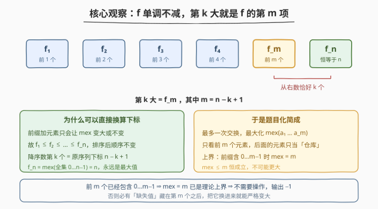
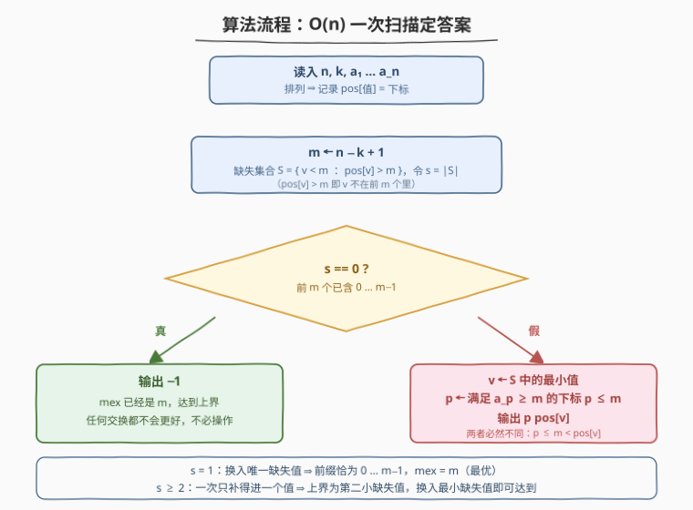
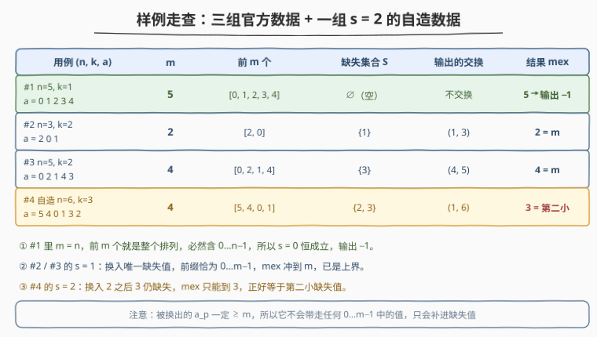

# Codeforces 2272A 最大化单次 MEX 题解

## 1. 题目概述

- **标题 / 题号**：最大化单次 MEX（Codeforces 2272A，英文名 Maximize One MEX）
- **链接**：https://codeforces.com/problemset/problem/2272/A
- **来源**：Codeforces Round 1130 (Div. 2) · Problem A
- **难度**：未评级（500 分，Div. 2 签到题，约 800 档）
- **限制**：时间 1 s / 内存 256 MB
- **标签**：暴力枚举，构造，贪心

**题意**：给定长度为 $n$ 的数组 $a$，它是 $0,1,\ldots,n-1$ 的一个**排列**。你**至多**可以做一次操作：选两个不同的下标 $i \ne j$，交换 $a_i$ 与 $a_j$。操作之后定义 $f_i = \operatorname{mex}(a_1,\ldots,a_i)$（前 $i$ 个元素的最小未出现非负整数）。给定 $k$，要求选出两个下标，使得 $f_1,\ldots,f_n$ 中的**第 $k$ 大**（$k=1$ 即最大值）尽量大；若**不需要**操作就输出 `-1`。多组数据，第一行是组数 $t$，每组先读 $n,k$，再读 $n$ 个整数，逐组输出两个下标（或 `-1`）。

**约束**：

- $1 \le t \le 50$
- $2 \le n \le 100$，$1 \le k \le n$，且所有测试的 $n$ 之和 $\le 100$
- $a$ 恰为 $0,1,\ldots,n-1$ 的排列：每个值**恰好出现一次**
- 操作**至多一次**，两个下标必须不同；不做操作时必须输出 `-1`（单个整数）
- 多解输出任意一组合法解即可（本题为构造题，使用特殊评测）

## 2. 示例与观察
官方样例（输入 / 输出原样）：

```text
输入：
3
5 1
0 1 2 3 4
3 2
2 0 1
5 2
0 2 1 4 3

输出：
-1
1 3
4 5
```

逐组说明：第 1 组 $m = 5 = n$，$f_5 = \operatorname{mex}(0,1,2,3,4) = 5$ 已是最大值，故不需要操作；第 2 组交换后数组为 `1 0 2`，$f=(0,2,3)$，降序第 2 个是 $2$（不交换时 $f=(0,1,3)$，只有 $1$）；第 3 组交换下标 4、5 后数组为 `0 2 1 3 4`，$f=(1,1,3,4,5)$，降序第 2 个是 $4$（不交换时 $f=(1,1,3,3,5)$，只有 $3$）。

## 3. 解题思路

### 3.1 暴力思路

直接枚举「不做操作」与所有 $\binom{n}{2}$ 种交换，对每种情况用桶扫一遍求出全部 $f_i$，再排序取第 $k$ 大，复杂度 $O(n^3 \log n)$。因为所有测试的 $n$ 之和不超过 $100$，最坏情况（$n=100$）也只有约 $4950$ 次交换、每次 $O(n \log n)$，几毫秒就跑完了，所以暴力其实是本题的合法解法（题目标签里也写了 brute force）。

但暴力没有解释**为什么**这样换最好，也回答不了「答案的上界是多少」；且把 $n$ 放大到 $10^5$ 立刻失效。下面把它收敛成 $O(n)$ 的贪心。

### 3.2 核心观察：把「第 k 大」翻译成「前缀 m 的 MEX」



**步骤 1：砍掉「第 k 大」这层壳。** 前缀从 $i$ 变成 $i+1$ 只是多了元素，一个集合加了元素后，最小未出现的非负整数只可能**变大或不变**，绝不会变小。于是

$$f_1 \le f_2 \le \cdots \le f_n .$$

又因为 $a$ 是 $0,\ldots,n-1$ 的排列，$f_n = \operatorname{mex}(\text{全体}) = n$，它一定是最大值。一个**非降序列**的第 $k$ 大，就是它正数第 $n-k+1$ 项，于是

$$\text{第 } k \text{ 大} = f_m, \qquad m = n-k+1 .$$

**步骤 2：问题退化成单个 MEX。** $f_m$ 只依赖前 $m$ 个元素构成的**多重集合**，所以原题等价于：

> 至多交换一次，最大化 $\operatorname{mex}(a_1,\ldots,a_m)$，其中 $m = n-k+1$。

**步骤 3：找上界与缺失集合。** 前缀只有 $m$ 个元素，若 $\operatorname{mex} = x$，则 $0,\ldots,x-1$ 全在里头，需要 $x \le m$。所以 $m$ 是**绝对上界**，达到 $m$ 的充要条件是前 $m$ 个恰好是 $0,\ldots,m-1$。

反过来看缺什么。定义缺失集合

$$S=\{\,v < m \;:\; v \notin \{a_1,\ldots,a_m\}\,\},\qquad s=|S| .$$

这里有个很好用的计数恒等式：前 $m$ 个位置里，值 $\ge m$ 的元素个数恰好等于 $s$。因为前 $m$ 个里落在 $0..m-1$ 的值有 $m-s$ 个，剩下的 $m-(m-s)=s$ 个必然都 $\ge m$。

于是三种情况一目了然：

- $s = 0$：前 $m$ 个已经是 $0..m-1$，$\operatorname{mex} = m$ 顶到上界，任何交换都不可能更好，输出 `-1`。
- $s = 1$：唯一缺失值是 $v_1$，把它从第 $m$ 个之后换进来，同时把某个 $\ge m$ 的元素换出去（不损失任何 $< m$ 的值），$\operatorname{mex}$ 直接升到 $m$。
- $s \ge 2$：一次交换只能让**一个**新值进入前缀，$S$ 里至少还剩一个值没补上，所以 $\operatorname{mex}$ 至多是 $S$ 中**第二小**的值 $v_2$；把最小缺失值 $v_1$ 换进来即可精确达到 $v_2$。

### 3.3 算法流程



1. 读入 $n,k$ 与数组，用排列的性质记录 $\text{pos}[v]$ = 值 $v$ 所在的下标（$1$ 索引）。
2. 算出 $m \leftarrow n-k+1$。
3. 从小到大扫描 $v = 0,1,\ldots,m-1$，第一个满足 $\text{pos}[v] > m$ 的 $v$ 就是**最小缺失值**；若一个都没有（$S=\varnothing$），输出 `-1` 并结束本组。
4. 否则在 $1 \le p \le m$ 中找第一个满足 $a_p \ge m$ 的位置 $p$（由上面的计数恒等式，$s \ge 1$ 时这样的 $p$ 一定存在）。
5. 输出 $p$ 与 $\text{pos}[v]$（即交换 $a_p$ 和那个缺失值）。

第 4 步选哪个 $p$ 都行：只要 $a_p \ge m$，被换出去的值就不属于 $0..m-1$，不会新制造缺失。

### 3.4 示例演算



以第 3 组 $n=5,k=2,a=(0,2,1,4,3)$ 为例：$m = 5-2+1 = 4$，只看 $[0,2,1,4]$。扫描 $v=0,1,2,3$，$0,1,2$ 都在前 4 个里，只有 $3$ 在下标 $5$，故 $S=\{3\}$、$s=1$。前缀里第一个 $\ge 4$ 的元素是 $a_4 = 4$，于是输出 $(4,5)$。交换后前 4 个变成 $[0,2,1,3]$，$\operatorname{mex}=4=m$，第 2 大从 $3$ 提升到 $4$。

再看自造的 $n=6,k=3,a=(5,4,0,1,3,2)$：$m=4$，前缀 $[5,4,0,1]$ 中 $0,1$ 存在、$2,3$ 缺失，$S=\{2,3\}$、$s=2$。取 $v_1=2$（下标 $6$）、第一个 $\ge 4$ 的位置 $p=1$（$a_1=5$），输出 $(1,6)$。交换后前缀为 $[2,4,0,1]$，$\operatorname{mex}=3=v_2$，正好等于上界。

第 1 组落在另一条分支：$m=5=n$、$S=\varnothing$，$\operatorname{mex}=5$ 已是上界，正确输出 `-1`。

## 4. 算法细节

1. **下标换算要写对**：$m = n-k+1$ 是**长度**，不是下标；前 $m$ 个元素是 $a_1..a_m$。写成 $n-k$ 或 $n-k+2$ 都会错，建议拿 $k=n$（$m=1$）和 $k=1$（$m=n$）两个端点自检。
2. **用值当下标存位置**：$a$ 是排列，直接开 $\text{pos}[0..n-1]$，$O(1)$ 判断「值 $v$ 是否在前 $m$ 个里」。判据是 $\text{pos}[v] \le m$（注意是**小于等于**，因为下标 $1$ 索引、前缀长度 $m$ 覆盖下标 $1..m$）。
3. **只需找第一个缺失值、第一个可换出元素**：从 $v=0$ 往上扫，找到即停（$S\ge2$ 时我们故意只补最小的，剩下的交给上界论证）；在 $1..m$ 里找第一个 $a_p \ge m$，$s \ge 1$ 时它必然存在（前 $m$ 个里恰好有 $s$ 个 $\ge m$ 的值），找「最后一个」也同样正确。
4. **`-1` 的判据是 $s=0$，不要特判 $k=1$**：$k=1$ 只是 $m=n$ 的特例，此时前 $n$ 个是全体，必然 $s=0$。反过来 $k>1$ 也可能 $s=0$（例如已排好序的数组），这时**同样**输出 `-1`。
5. **多测必须重置 `pos`**：每组长度为 $n$、值域 $0..n-1$，重新开辟或清空都行；若沿用上一组的 `pos`，会把旧下标误判成本组「在前缀里」。
6. **I/O 与输出格式**：计算量只有几百次加减比较，瓶颈在输入输出——C++ 加 `std::ios::sync_with_stdio(false)`，Python 用 `sys.stdin.buffer.read().split()` 一次读完按指针切分。每组一行：交换时输出两个 $1$ 索引下标，不交换时只输出一个 `-1`，不要多打空格或空行。

## 5. 正确性证明

**引理 1（单调性与下标换算）**：对任意 $1 \le i < n$ 有 $f_i \le f_{i+1}$，且 $f_n = n$；因此 $f_1,\ldots,f_n$ 中第 $k$ 大的值恰为 $f_{n-k+1}$。

**证明**：$f_i$ 是集合 $P_i=\{a_1,\ldots,a_i\}$ 的 MEX。由于 $P_i \subseteq P_{i+1}$，若 $x < f_i$ 则 $x \in P_i \subseteq P_{i+1}$，故 $f_{i+1} \ge f_i$。又 $P_n = \{0,\ldots,n-1\}$，故 $f_n = n$。非降序列排序后与原序列相同，其第 $k$ 大即正数第 $n-k+1$ 项。∎

**引理 2（计数恒等式）**：设 $P=\{a_1,\ldots,a_m\}$，$S=\{v<m: v \notin P\}$，则 $|\{i \le m: a_i \ge m\}| = |S|$。

**证明**：$P$ 中落在 $0..m-1$ 的值恰为 $0..m-1$ 去掉 $S$，共 $m-|S|$ 个；$P$ 共有 $m$ 个元素，故剩下的 $m-(m-|S|)=|S|$ 个都满足 $\ge m$。∎

**引理 3（上界）**：设 $P=\{a_1,\ldots,a_m\}$，缺失集合 $S$ 非空，$v_1<v_2<\cdots$ 为 $S$ 中元素升序。则

- 任意交换后 $\operatorname{mex} \le m$；
- 任意一次交换后 $\operatorname{mex} \le v_2$（当 $|S| \ge 2$），特别地 $|S|=1$ 时 $\operatorname{mex} \le m$。

**证明**：设交换后 $\operatorname{mex}=x$，则 $0,\ldots,x-1$ 都在新前缀中，它们是 $x$ 个互不相同的非负整数，而新前缀只有 $m$ 个元素，故 $x \le m$，第一条得证。

对第二条：一次交换只改两个位置，等价于从 $P$ 删去一个元素、再加入一个元素，即新集合与 $P$ 至多相差一个元素。$v_1,v_2 \notin P$（因为 $v_1,v_2 \in S$），若两者交换后仍都不在，则 $\operatorname{mex} \le v_1 < v_2$；若其中恰有一个被换入，另一个依旧不在，则 $\operatorname{mex} \le$ 剩下的那个。两种情形都给出 $\operatorname{mex} \le v_2$（$|S|=1$ 时退化为 $\operatorname{mex} \le m$，与第一条一致）。∎

**引理 4（构造可达）**：若 $S \ne \varnothing$，取 $p \le m$ 使 $a_p \ge m$，交换 $a_p$ 与 $v_1$（二者下标不同）。交换后前 $m$ 个的多重集合为 $(P \setminus \{a_p\}) \cup \{v_1\}$，其 MEX 在 $|S|=1$ 时等于 $m$，在 $|S| \ge 2$ 时等于 $v_2$。

**证明**：由 $a_p \ge m$ 知 $a_p \notin [0,m-1]$，删掉它不改变前缀在 $0..m-1$ 上的出现情况，即 $(P\setminus\{a_p\})\cap[0,m-1]=P\cap[0,m-1]$。于是新前缀在 $0..m-1$ 上的缺失集合恰为 $S\setminus\{v_1\}$：$|S|=1$ 时为空，前缀含 $0..m-1$ 全部 $m$ 个值，故 $\operatorname{mex}=m$；$|S|\ge2$ 时其最小元为 $v_2$，故 $\operatorname{mex}=v_2$。合法性：$v_1 \notin P$ 且 $\text{pos}[v_1] > m \ge p$，两个下标必不相同。∎

**定理**：算法输出的操作使第 $k$ 大的值达到所有「至多一次交换」方案中的最大值；当算法输出 `-1` 时，不操作即最优。

**证明**：由引理 1，最大化第 $k$ 大等价于最大化 $\operatorname{mex}(P)$，$P$ 为前 $m=n-k+1$ 个元素。

- 若 $S=\varnothing$：$\operatorname{mex}(P)=m$ 已等于引理 3 的上界，任何交换后仍 $\le m$，故不操作最优，输出 `-1` 正确。
- 若 $|S|=1$：引理 4 构造出 $\operatorname{mex}=m$，再由引理 3 的上界 $m$，达到最优。
- 若 $|S|\ge2$：引理 3 给出任何交换后 $\operatorname{mex}\le v_2$，引理 4 说明该上界可达，故最优。

三种情况互斥且穷尽，算法的输出始终最优。∎

## 6. 复杂度分析

- **时间**：每组 $O(n)$——建 `pos` 一次 $O(n)$，扫缺失值至多 $O(m)$，找 $p$ 至多 $O(m)$，全是线性扫描。全部测试合计只有 $O(\sum n)$ 即不超过约 $100$ 次基本操作，与 $1$ s 时限相比有 $10^3$ 以上余量（实测 C++ 含进程启动约 $3.3$ ms、纯计算不足 $0.5$ ms，Python 约 $30$ ms 且主要是解释器启动开销）。
- **空间**：$O(n)$，只存数组 `a` 与 `pos`，状态全部是常数个 `int`，远低于 $256$ MB。

## 7. 参考代码

### C++17

```cpp
#include <bits/stdc++.h>
using namespace std;

int main() {
    ios::sync_with_stdio(false);
    cin.tie(nullptr);

    int t;
    if (!(cin >> t)) return 0;              // 空输入防护
    while (t--) {
        int n, k;
        cin >> n >> k;
        vector<int> a(n + 1), pos(n);
        for (int i = 1; i <= n; i++) {
            cin >> a[i];
            pos[a[i]] = i;                  // 排列：值 -> 下标
        }
        int m = n - k + 1;                  // 只关心前 m 个元素的 mex
        int miss = -1;                      // 最小缺失值
        for (int v = 0; v < m; v++) {
            if (pos[v] > m) { miss = v; break; }
        }
        if (miss == -1) {                   // 前 m 个已是 0..m-1，mex = m 达上界
            cout << -1 << "\n";
            continue;
        }
        int p = -1;                         // 前缀中第一个 >= m 的元素
        for (int i = 1; i <= m; i++) {
            if (a[i] >= m) { p = i; break; }
        }
        cout << p << ' ' << pos[miss] << "\n";
    }
    return 0;
}
```

### Python3

```python
import sys


def main() -> None:
    data = sys.stdin.buffer.read().split()
    if not data:
        return
    t = int(data[0])
    ptr = 1
    out = []
    for _ in range(t):
        n = int(data[ptr]); k = int(data[ptr + 1]); ptr += 2
        a = [0] * (n + 1)
        pos = [0] * n
        for i in range(1, n + 1):
            a[i] = int(data[ptr]); ptr += 1
            pos[a[i]] = i
        m = n - k + 1
        miss = -1
        for v in range(m):
            if pos[v] > m:
                miss = v
                break
        if miss == -1:
            out.append("-1")
            continue
        p = -1
        for i in range(1, m + 1):
            if a[i] >= m:
                p = i
                break
        out.append(f"{p} {pos[miss]}")
    sys.stdout.write("\n".join(out) + "\n")


main()
```

## 8. 边界情况与易错点

1. **$k=1$ 恒输出 `-1`**：此时 $m=n$，前 $n$ 个就是整个排列，$S$ 必为空。若把这类情况误判成「需要换」，会输出一个多余的操作。
2. **数组已经排好序**：$a=(0,1,\ldots,n-1)$ 时**任意** $k$ 都有 $S=\varnothing$（前 $m$ 个恰是 $0..m-1$），全部输出 `-1`。别以为只有 $k=1$ 才不操作。
3. **$s \ge 2$ 时不要写成「能凑到 $m$」**：一次交换只补得进一个缺失值，此时答案上界是第二小缺失值；把结果写成 $m$ 会错误地认为 `-1` 或任意构造都行（提交后会被特殊评测判 WA）。
4. **两个下标不能相同**：务必保证 $i \ne j$。本做法中 $p \le m < \text{pos}[v_1]$ 天然保证不同；若自己写别的构造（例如「交换最小缺失值与任意位置」）很容易退化成 `i i`。
5. **`pos` 的大小与清空**：`pos` 大小是 $n$（值域 $0..n-1$），`a` 大小是 $n+1$（$1$ 索引）；多测时每组必须重新开辟或清空，否则上一组的旧下标会让「值 $v$ 在前缀里」的判断失真，出现难以定位的 WA。
6. **`m=1` 的退化情形**（$k=n$）：只保留 $a_1$。若 $a_1=0$ 则 $S=\varnothing$ 输出 `-1`；否则 $v_1=0$、前缀里唯一元素 $\ge 1$，输出 `1 pos[0]`，交换后 $a_1=0$、$f_1=1$，正确。

## 9. 验证记录

- **编译环境与命令**：`clang++ -std=c++17 -O2`（本机无 GNU g++，配 `codeforces/tools/include/bits/stdc++.h` 兼容头；正文代码只用标准库，可原样提交 GNU C++17）；Python 侧为 `Python 3.9.6`。
- **官方样例**：1 / 1 通过（按 Codeforces 标准 checker 的 token 比对，忽略空白与大小写）。
- **复核状态**：audited（2026-11-19 统一回归：编译 + 官方样例；写作期的随机对拍与暴力未重跑）。

## 相关题目与扩展

- [Codeforces 1793D Moscow Gorillas](https://codeforces.com/problemset/problem/1793/D)：统计使两个排列同一区间 MEX 相等的区间数，核心同样是「MEX = $x$ 等价于 $0..x-1$ 全在区间内」。
- [Codeforces 1699C The Third Problem](https://codeforces.com/problemset/problem/1699/C)：给定排列，数有多少个排列与它**所有子段的 MEX 相同**，用到「$0..x$ 的位置包络区间」这一经典刻画。
- [LeetCode 41. 缺失的第一个正数](https://leetcode.cn/problems/first-missing-positive/)：$O(n)$ 时间 $O(1)$ 空间求 MEX 的原地哈希技巧，可与本题「用值当下标」的 `pos` 数组对照。
- [LeetCode 2459. 通过移动元素解决问题](https://leetcode.cn/problems/sort-array-by-moving-items-to-empty-space/)：同样在 $0..n-1$ 的排列上做局部交换（$0$ 当空位），讨论「每个环要几次操作」，与本题的「一次交换只影响两个位置」形成对照。

**延伸思考**：

1. **允许 $x$ 次交换**：设 $s=|S|$。$s=0$ 时输出 `-1`；$s \le x$ 时用 $s$ 次交换就能把 $S$ 全补上（前缀里恰好有 $s$ 个 $\ge m$ 的元素可供换出，一次换一个），答案 $=m$；$s > x$ 时每次至多补一个缺失值，答案恰好是**第 $x+1$ 小的缺失值**。
2. **若把「第 $k$ 大」换成「$f$ 的和」或「$f$ 的字典序最大」**：由于 $f$ 单调，两者都会把答案推向「让前缀尽可能早地补齐 $0,1,2,\ldots$」，不再只有单个下标的换算，需要重新分析交换位置对每个 $f_i$ 的影响。
3. **若 $a$ 不是排列**：$f_n$ 不再等于 $n$，「第 $k$ 大 $=f_{n-k+1}$」的推导仍成立（单调性不依赖排列性质），但 $f_n$ 的值要重新计算；此时「前缀里 $\ge m$ 的元素个数 $=s$」的计数恒等式也失效，需要显式统计。
