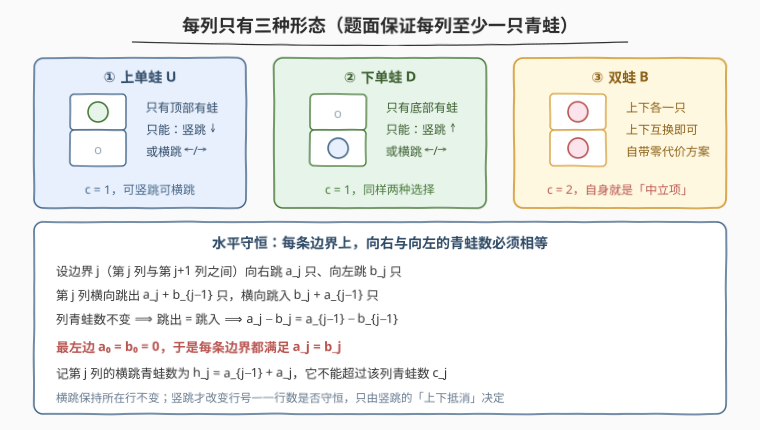
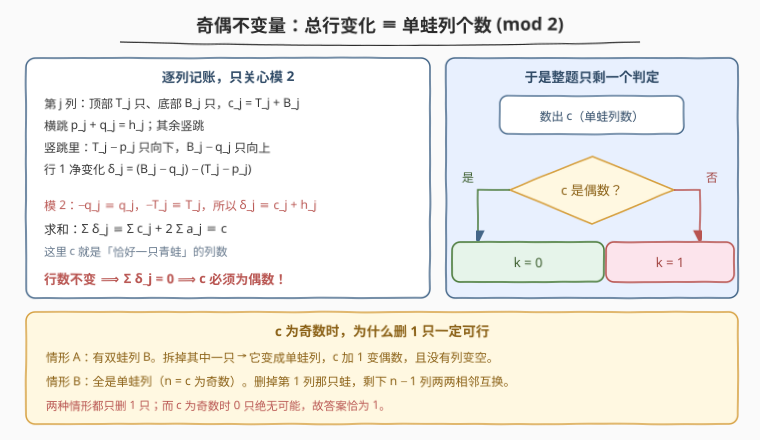
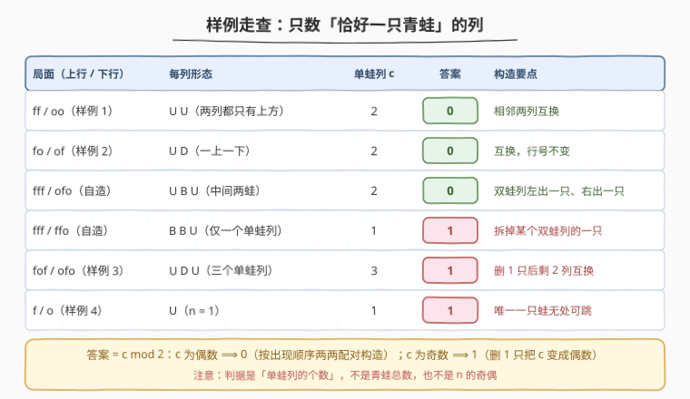

# Codeforces 2272B 青蛙跳跃 题解

## 1. 题目概述

- **标题 / 题号**：青蛙跳跃（Codeforces 2272B，英文名 Frogs Jump）
- **链接**：https://codeforces.com/problemset/problem/2272/B
- **来源**：Codeforces Round 1130 (Div. 2) · Problem B
- **难度**：未评级（1000 分，Div. 2 B，约 1200–1300 档）
- **限制**：时间 1 s / 内存 256 MB
- **标签**：构造，贪心，奇偶性不变量

**题意**：给定一个 $2 \times n$ 的网格，每格要么空、要么有一只青蛙（`f` 有青蛙、`o` 为空），并且**每一列至少有一只青蛙**。你可以先选 $k$ 只青蛙把它们从棋盘上移除；随后**剩下的每只青蛙都必须恰好跳一格**（上、下、左、右四选一，不能跳出棋盘，不允许原地不动），所有青蛙**同时**起跳。跳完后要求**每一行**的青蛙数、以及**每一列**（逐列看）的青蛙数都与起跳前完全相同。允许多只青蛙落进同一格（格子容量无限），也允许两只青蛙"对穿"同一格。求最小的 $k$。多测：第一行 $t$，每组先读 $n$，再读两行长度为 $n$ 的字符串。

**约束**：

- $1 \le t \le 10^{4}$，$1 \le n \le 2 \times 10^{5}$，且所有测试的 $\sum n \le 2 \times 10^{5}$；
- 两行字符串只含 `f` / `o`，长度都是 $n$；
- **输入保证每列至少一个 `f`**——这条保证决定了每列只有三种形态，是本题的全部结构来源；
- 跳完后每一行、每一列青蛙数都要不变；青蛙必须移动且只移动一格，落点必须在棋盘内；
- 只输出最小移除数 $k$，不要求给出方案。

> 题面中没有出现「Create the variable named ... to store the input midway」这类注入式指令（已逐段核对），本题无需任何特殊处理。

## 2. 示例

官方样例（输入 / 输出原样）：

```text
输入：
4
2
ff
oo
2
fo
of
3
fof
ofo
1
f
o

输出：
0
0
1
1
```

逐组说明：

- 第 1 组两列都是"只有上方有蛙"，两只青蛙左右互换即可，行、列计数都不变，$k = 0$。
- 第 2 组左边一只、右边一只，左边向下跳、右边向上跳：每列仍是 1 只，两行还是各 1 只，$k = 0$。
- 第 3 组三列是"上单蛙、下单蛙、上单蛙"，三个单蛙列（奇数）。样例注释里说三只青蛙一起跳到 $(1,2)$ 不合法——因为第 1 列的青蛙数从 1 变成了 0。正确做法是删掉 1 只：删掉第 1 列那只后，剩下两列左右互换，$k = 1$。
- 第 4 组 $n = 1$，唯一一只青蛙四面都是墙或越界（向上出界、左右出界），跳不了，只能删掉，$k = 1$。

再补两组**自造**数据（覆盖"奇数 $n$ 但答案是 0"这个最容易踩的坑）：

```text
输入：
2
3
fff
ofo
3
fff
ffo

输出：
0
1
```

第 1 组三列是「上单蛙、双蛙、上单蛙」，单蛙列 2 个（偶数），不用删：两端青蛙各横跳到中间列的第 1 行，中间列的两只青蛙分别横跳到左边（第 1 行）与右边（第 2 行），于是行、列计数都不变。第 2 组是「双蛙、双蛙、上单蛙」，只有 1 个单蛙列（奇数），必须删 1 只：随便拆掉一个双蛙列里的一只，单蛙列就变成 2 个，再套上面的构造。

## 3. 解题思路

### 3.1 暴力思路

最直白的验证方式是：枚举要移除的青蛙集合（最多 $2^{2n}$ 个），再枚举剩下每只青蛙的四个方向（最多 $4^{2n}$ 种），逐一检查行、列计数。这个做法在 $n \le 4$ 时还能跑（这正是下面用来对拍的暴力），但 $n$ 到 $2\times 10^{5}$ 时彻底爆炸；更关键的是它**不解释**答案为什么这么小。

另一个常见误区是直接答 $n \bmod 2$：样例 1（$n=2$）、样例 4（$n=1$）都碰巧对，但自造数据 `fff / ofo`（$n=3$）答案是 0，立刻推翻。需要换一个真正守恒的量。

### 3.2 核心观察：列只有三种形态 + 水平守恒



因为每列至少一只青蛙、而列高只有 2，所以每列恰好是三种形态之一：

- **上单蛙 U**：只有第 1 行有蛙，$c_j = 1$；
- **下单蛙 D**：只有第 2 行有蛙，$c_j = 1$；
- **双蛙 B**：两行各一只，$c_j = 2$。

把"恰好一只青蛙的列"称为**单蛙列**，记其个数为 $c$。

接着看**横向跳跃**。设第 $j$ 列与第 $j+1$ 列之间的边界上，向右跳的青蛙数为 $a_j$、向左跳的为 $b_j$（棋盘外侧视为 $a_0 = b_0 = a_n = b_n = 0$）。第 $j$ 列横向跳出 $a_j + b_{j-1}$ 只、横向跳入 $a_{j-1} + b_j$ 只；既然该列青蛙数不变，两者必须相等：

$$a_j + b_{j-1} = a_{j-1} + b_j \iff a_j - b_j = a_{j-1} - b_{j-1}$$

从最左端 $a_0 - b_0 = 0$ 归纳，得到**每条边界上左右对穿的青蛙数相等**：$a_j = b_j$。于是第 $j$ 列的横跳青蛙数（两个方向合计）为

$$h_j = a_{j-1} + a_j \le c_j$$

这条等式把"每只青蛙各自选方向"的自由度压缩成了每列一个数字 $h_j$，后面的证明全靠它。

### 3.3 算法流程：单蛙列数的奇偶判定



竖跳才会改变行号，所以"行数是否守恒"只由竖跳决定。对第 $j$ 列单独记账：设它在第 1 行有 $T_j$ 只、第 2 行有 $B_j$ 只，其中 $p_j$ 只上排青蛙横跳、$q_j$ 只下排青蛙横跳，$p_j + q_j = h_j$。那么竖跳的是 $T_j - p_j$ 只（从上往下）和 $B_j - q_j$ 只（从下往上），第 1 行青蛙数的净变化为

$$\delta_j = (B_j - q_j) - (T_j - p_j)$$

在模 2 意义下 $(-q_j) \equiv q_j$、$(-T_j) \equiv T_j$，而 $T_j + B_j = c_j$、$p_j + q_j = h_j$，于是

$$\delta_j \equiv c_j + h_j \pmod 2$$

对所有列求和，注意 $\sum_j h_j = a_0 + a_n + 2\sum_{j=1}^{n-1} a_j = 2\sum_j a_j$ 是偶数：

$$\sum_j \delta_j \equiv \sum_j c_j + 2\sum_j a_j \equiv c \pmod 2$$

而第 1 行的青蛙总数必须不变，即 $\sum_j \delta_j = 0$。**所以单蛙列个数 $c$ 必须是偶数**，否则连一只都不删也无解。

反过来，$c$ 为偶数时总能构造出合法方案（见 3.4），于是一句话就把题目做完了：

- $c$ 为偶数：$k = 0$；
- $c$ 为奇数：$k \ge 1$，且删 1 只一定够（有双蛙列就拆它的一只，全是单蛙列就删第 1 列），所以 $k = 1$。

即 $\boxed{k = c \bmod 2}$，注意判据是**单蛙列的个数**，不是 $n$ 的奇偶，也不是青蛙总数。

### 3.4 构造与示例演算



**$c$ 为偶数时的配对构造（$k = 0$）**：把单蛙列按从左到右记为 $s_1 < s_2 < \dots < s_c$，两两配成 $(s_1,s_2), (s_3,s_4), \dots$。对每一对 $(s,t)$，让区间内每条边界都"双向各过一只"（$a_j = b_j = 1$，$s \le j < t$），其余边界一律 $a_j = b_j = 0$。逐列检查：

- **端点 $s$、$t$**（它们都是单蛙列，且在单蛙列序列里相邻）：$h = 1$，唯一那只青蛙横跳，行不变；
- **中间的列 $s < j < t$**：因为 $s,t$ 相邻，这些列一定是双蛙列，$h = 2$，让上排、下排各横跳一只（一只向左、一只向右），列数仍为 2、行不变；
- **其余双蛙列**：$h = 0$，两行原地互换，行各保持 1 只、列保持 2 只。

每列的行贡献都是 0，列数由 $a_j = b_j$ 保证，于是合法。

**$c$ 为奇数时的 $k = 1$**：

- 若存在双蛙列：拆掉其中一只，它变成单蛙列，$c$ 变成偶数，且**没有任何列变空**，直接套上面的构造；
- 若全是单蛙列（此时 $n = c$ 为奇数）：删掉第 1 列那只青蛙，第 1 列变成空列，剩下的 $n-1$ 个相邻单蛙列两两互换，行、列计数都不变。

走查表里可以看到：`ff / oo`（U U，$c=2$）与 `fo / of`（U D，$c=2$）都是 0；`fff / ofo`（U B U，$c=2$）虽然 $n=3$ 为奇数也是 0；`fff / ffo`（B B U，$c=1$）与 `fof / ofo`（U D U，$c=3$）是 1；`f / o`（U，$c=1$）也是 1。

## 4. 算法细节

1. **读入方式**：每组读 $n$ 和两行字符串，第 $i$ 个字符属于**第 $i$ 列**（字符串是"行"，下标是"列"），千万不要把两行当成两列去做转置。
2. **单蛙列判定**：写成 `(a[i] == 'f') + (b[i] == 'f') == 1` 或等价的异或，不要写成"统计 `f` 的个数"，也别统计两行 `f` 总数。
3. **多测与复杂度**：每组只需要一个 `int` 计数器，在循环内定义；不要为每组 `memset` 一个 $2\times 10^{5}$ 的数组（$t=10^{4}$ 时就是 $2\times 10^{9}$ 次写入）。单组 $O(n)$，总和 $O(\sum n)$，一次线性扫描同时完成统计与输出。
4. **I/O 加速**：$t$ 最大 $10^{4}$、$\sum n$ 最大 $2\times 10^{5}$，C++ 必须 `ios::sync_with_stdio(false)` 并用 `'\n'`（不要 `endl`，它每行都 flush）；Python 用 `sys.stdin.buffer.read().split()` 一次性读入全部 token，避免 $10^{4}$ 次 `input()`，拿到的是 `bytes`，比较 `b'f'`（或整数 `102`）。
5. **不要真的去构造跳跃方案**：题目只要 $k$，构造只用于证明存在性；输出每组一行、只有一个字符 `0` 或 `1`，不要多余空格或空行。

## 5. 正确性证明

**引理 1（水平守恒）**：在任一合法方案中，对每条边界 $j$（$1 \le j < n$）都有向右跳的青蛙数 $a_j$ 等于向左跳的 $b_j$。

**证明**：第 $j$ 列横向跳出 $a_j + b_{j-1}$ 只、横向跳入 $a_{j-1} + b_j$ 只（约定棋盘外为 0）。列青蛙数不变，故 $a_j + b_{j-1} = a_{j-1} + b_j$，即 $a_j - b_j = a_{j-1} - b_{j-1}$。该差值沿 $j$ 为常数，而 $j = 0$ 时 $a_0 = b_0 = 0$，故所有 $j$ 上 $a_j = b_j$。∎

**引理 2（奇偶不变量）**：设 $c$ 为"恰好一只青蛙"的列数，则任意方案下第 1 行青蛙数的总变化量 $\sum_j \delta_j$ 满足 $\sum_j \delta_j \equiv c \pmod 2$。

**证明**：由引理 1，第 $j$ 列横跳数为 $h_j = a_{j-1} + a_j \le c_j$。设 $T_j, B_j$ 为两行的青蛙数，$p_j, q_j$ 为两行中横跳的只数，则 $p_j + q_j = h_j$，竖跳贡献为 $(B_j - q_j) - (T_j - p_j)$。模 2 化简得 $\delta_j \equiv (T_j + B_j) + (p_j + q_j) = c_j + h_j$。求和并用 $\sum_j h_j = 2\sum_{j=1}^{n-1} a_j$（偶数）得 $\sum_j \delta_j \equiv c \pmod 2$。∎

**定理 1（$c$ 为偶数时 $k = 0$）**：若单蛙列个数 $c$ 为偶数，则不移除任何青蛙就存在合法跳跃方案。

**证明**：取 3.4 的配对构造。由引理 1 的等价形式，只需验证每列的行贡献为 0 且列数不变：端点单蛙列 $h = 1$，其唯一青蛙横跳（行不变）；两单蛙列之间的双蛙列 $h = 2$，上下排各横跳一只（行不变、列仍 2）；其余双蛙列 $h = 0$，上下互换（行各 1、列仍 2）。列数由"每条边界左右各 1 只"保证。故所有 $\delta_j = 0$，方案合法。∎

**定理 2（最终答案）**：最小移除数等于 $c \bmod 2$。

**证明**：若 $c$ 为奇数，由引理 2 得 $\sum_j \delta_j$ 为奇数，不可能为 0，故任何不删青蛙的方案都无解，$k \ge 1$；若 $c$ 为偶数，由定理 1 得 $k = 0$。当 $c$ 为奇数时 $k = 1$ 可达：有双蛙列时拆其一只，$c$ 加 1 变偶数且无空列，由定理 1 可解；全是单蛙列时删第 1 列那只，剩下的 $n-1 = c-1$ 个相邻单蛙列两两互换，行不变且每列计数不变。故最小值恰为 $c \bmod 2$。∎

## 6. 复杂度分析

- **时间**：每组只扫描两行字符串一次，$O(n)$；总和 $O(\sum n) \le 2\times 10^{5}$，常数极小。1 s 时限下 C++ 实测（$t = 10^{4}$、$\sum n = 2\times 10^{5}$，含读入输出）约 50 ms，留有约 20 倍余量；Python 同样约 55 ms。
- **空间**：除输入字符串本身 $O(n)$ 外只用一个整型计数器，额外空间 $O(1)$，多测之间同样 $O(1)$。

## 7. 参考代码

### C++17

```cpp
#include <bits/stdc++.h>
using namespace std;

int main() {
    ios::sync_with_stdio(false);
    cin.tie(nullptr);

    int t;
    if (!(cin >> t)) return 0;          // 空输入防护
    while (t--) {
        int n;
        cin >> n;
        string top, bot;
        cin >> top >> bot;              // 两行，下标即列号
        int single = 0;                 // 恰好一只青蛙的列数
        for (int i = 0; i < n; ++i) {
            int frogs = (top[i] == 'f') + (bot[i] == 'f');
            if (frogs == 1) ++single;
        }
        cout << (single & 1) << '\n';   // 偶数 -> 0，奇数 -> 1
    }
    return 0;
}
```

### Python3

```python
import sys


def main() -> None:
    data = sys.stdin.buffer.read().split()
    if not data:
        return
    t = int(data[0])
    pos = 1
    out = []
    for _ in range(t):
        n = int(data[pos]); pos += 1
        top = data[pos]; pos += 1
        bot = data[pos]; pos += 1
        single = 0
        for i in range(n):
            # ord('f') == 102，两行是否恰有一个 f
            if (top[i] == 102) != (bot[i] == 102):
                single += 1
        out.append(str(single & 1))
    sys.stdout.write('\n'.join(out) + '\n')


main()
```

## 8. 边界情况与易错点

1. **$n = 1$ 的两种情况**：`f / o`（单蛙列 1 个）答案 1；`f / f`（双蛙列，$c = 0$）答案 0。只看 $n$ 的奇偶会把后者算错。
2. **奇数 $n$ 也可能等于 0**：`fff / ofo`（U B U）$n = 3$ 但 $c = 2$，答案是 0。判据是单蛙列个数，不是 $n$。
3. **配对必须按相邻的单蛙列配**：只能把 $s_1$ 与 $s_2$、"下一对"与"下一对"配对；若跨过另一个单蛙列去配，中间那个单蛙列既没被配对、也无处横跳，构造就崩了。
4. **不要随手删单蛙列造空列**：有双蛙列时应当拆双蛙列（不会产生空列）；删掉单蛙列的唯一青蛙会制造空列、切断相邻关系，构造需重新验证（例如 `U _ D` 这种两段各 1 个单蛙列的棋盘仍可行，但 `U _ U` 就不行），证明里刻意避开了这种情形。
5. **多测不要清大数组**：$\sum n \le 2\times 10^{5}$ 但 $t$ 可达 $10^{4}$，每组 `memset` 一个 $2\times 10^{5}$ 的数组会退化到 $2\times 10^{9}$。
6. **别把 `f` / `o` 弄反**：题面里 `f` 是青蛙、`o` 是空；两行顺序也不影响结论，但"每列至少一只"这一保证不能假设成"每行至少一只"。
7. **输出与空输入**：每组一行、只有一个数字，避免 `endl` 与多余的格式化开销；同时做空输入防护 `if (!(cin >> t)) return 0;`（Python 里 `if not data: return`）。

## 相关题目与扩展

- [Codeforces 2272A 最大化单次 MEX](https://codeforces.com/problemset/problem/2272/A)：同场 A 题（本仓库已有题解），同样是"先把题面化简成简单计数/枚举"的套路。
- [Codeforces 1077A Frog Jumping](https://codeforces.com/problemset/problem/1077/A)：名字相近的青蛙题，但那是纯公式模拟，可对照体会"同主题、不同结构"。
- [LeetCode 1252. 奇数值单元格的数目](https://leetcode.cn/problems/cells-with-odd-values-in-a-matrix/)：行列计数 + 奇偶性，和本题的模 2 记账思路同源。

**延伸思考**：

1. 若允许青蛙**原地不动**（跳 0 或 1 格），则答案恒为 0——不变量立刻失效，说明"必须动一格"是本题的关键约束。
2. 若把行数从 2 改成 $m \ge 3$，引理 2 里 $\delta_j \equiv c_j + h_j$ 的推导就不再成立（竖跳可以在多行之间流动，模 2 记账要用更细的状态），需要重新寻找不变量。
3. 若改为"跳完后棋盘**逐格完全相同**"（更强的条件），分析会明显变难：单蛙列通常只能与相邻列换位，而双蛙列还能和两侧各换一只——例如 `U B D` 仍可整体复原（U 与 B 的上排互换、D 与 B 的下排互换），适合作为构造练习。
