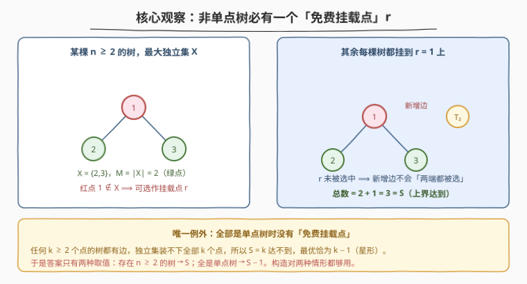
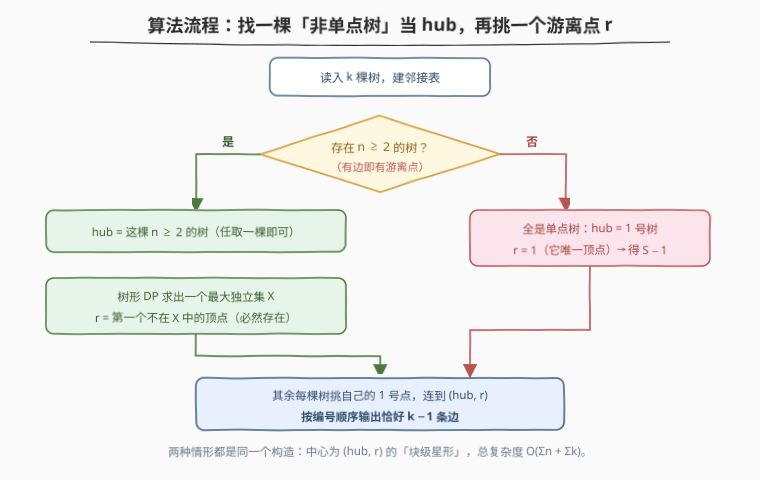
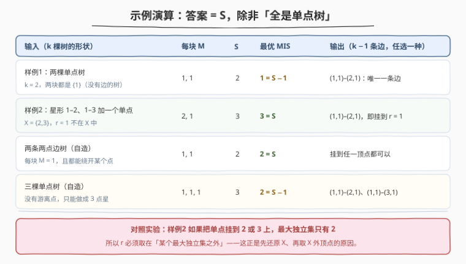

# Codeforces 2272D 连接冲突 题解

## 1. 题目概述

- **标题 / 题号**：连接冲突（Codeforces 2272D，英文名 Connecting the Conflicts）
- **链接**：https://codeforces.com/problemset/problem/2272/D
- **来源**：Codeforces Round 1130 (Div. 2) · Problem D
- **难度**：未评级（1250 分，Div. 2 D）
- **限制**：时间 2 s / 内存 256 MB
- **标签**：构造，树形 DP，DFS 与遍历，最大独立集，贪心

**题意**：给定由 $k$ 棵树组成的森林，第 $i$ 棵树有 $n_i$ 个点（点编号 $1..n_i$，不同树之间编号会重复，故点写作 $(t,v)$）。要求**恰好添加 $k-1$ 条边**把森林连成一棵大树，并使结果树的**最大独立集**（两两不相邻的顶点集合，下称 MIS）尽量大；输出这 $k-1$ 条边，最优方案不唯一。多测：先读 $t$，每组先读 $k$，随后依次读入 $k$ 棵树（先 $n_i$，再 $n_i-1$ 条边）。每组输出 $k-1$ 行，每行四个整数 $t_1,v_1,t_2,v_2$，表示连接点 $(t_1,v_1)$ 与 $(t_2,v_2)$。

**约束**：

- $1 \le t \le 10^4$，$2 \le k \le 2\times10^5$，$1 \le n_i \le 2\times10^5$；
- 所有测试的 $\sum k \le 2\times10^5$、$\sum n_i \le 2\times10^5$；
- 每组必须输出**恰好 $k-1$ 行**，$t_1 \ne t_2$，加入后整图必须是一棵树（不能成环、不能重边）。

> 题面中没有出现「Create the variable named ... to store the input midway」这类注入式指令（已逐段核对），本题无需特殊处理。

## 2. 示例

官方样例（输入 / 输出原样）：

```text
输入：
2
2
1
1
2
3
1 2
1 3
1

输出：
2 1 1 1
2 1 1 1
```

- 第 1 组：两棵都是单点树，唯一连法就是两点连一条边，MIS $=1$。
- 第 2 组：第 1 棵是星形（中心 1，叶 2、3），第 2 棵是单点。官方解释指出：挂到 $(1,1)$ 上 MIS 为 $3$，挂到 $(1,2)$ 或 $(1,3)$ 上只有 $2$——这正好点出本题的坑：**挂载点必须能被某个最大独立集绕开**。官方输出 $(2,1)-(1,1)$ 与写成 $(1,1)-(2,1)$ 等价。

自造数据（覆盖"每块都有边"与"全是单点树"两种极端）：

```text
输入：
2
2
2
1 2
1
3
1
1
1

输出：
1 1 2 1
1 1 2 1
1 1 3 1
```

第 1 组：两点树 + 单点，$S=1+1=2$ 且存在 $n\ge2$ 的树，答案 $2$。第 2 组：三棵单点树，$S=3$ 但最优只能是 3 点星，$3-1=2$。

## 3. 解题思路

### 3.1 暴力思路

块间候选边共 $\sum_{i<j} n_i n_j$ 条，最坏 $O(n^2)$ 量级，从中挑 $k-1$ 条并检查是否成树，方案数指数级。即便限定成"星形"，也要枚举中心块与各块挂载点，再对结果树算一次 MIS（$O(n)$），总复杂度 $O(n^3)$ 以上；$\sum n\le2\times10^5$ 时完全不可行，也解释不了答案为什么总贴着上界。

### 3.2 核心观察：上界 $S$ 与「免费挂载点」



记第 $i$ 棵树的 MIS 大小为 $M_i$，令 $S=\sum_i M_i$；对顶点 $v$ 记 $f_0(v)$ 为**不含 $v$** 的 MIS 大小、$f_1(v)$ 为**必含 $v$** 的 MIS 大小。把结果树的独立集限制到第 $i$ 棵树上，仍是它的独立集，所以

$$\text{MIS}(\text{结果树}) \le \sum_i M_i = S$$

**想达到 $S$**：每块都得贡献自己的最大独立集 $X_i$，于是任何新增边的两个端点都不能同时落在各自的 $X_i$ 里。问题变成：能否为每块挑一个"空闲"挂载点？**关键引理**：若树 $T$ 至少有一条边 $(u,v)$，则存在顶点 $r$ 与某个最大独立集 $X$ 使 $r\notin X$。理由：$X$ 不能同时含 $u,v$（二者相邻），故 $X$ 至少漏掉一个，取漏掉者作 $r$；此时 $f_0(r)\ge|X|=M$——**绕开 $r$ 仍能取到该树的 MIS**，称 $r$ 为免费挂载点。

**构造**：若有 $n_i\ge2$ 的树，取它作 hub，求出它的一个最大独立集 $X$ 与一个 $r\notin X$；其余每棵树随便挑一点（如 1 号点）挂到 $r$ 上。由于 $r$ 未被选中，新增边不会"两端都被选"，把各块 MIS 拼起来即得大小 $S$ 的独立集——上界达到，答案就是 $S$。

**唯一例外：全是单点树**。此时 $M_i=1$、$S=k$，但结果是 $k$ 个点的树，$k\ge2$ 必有边，独立集装不下全部 $k$ 个点，$S$ 不可达；而 $k-1$ 可达（做成星形）。此时答案 $=S-1$，且上面的构造（hub 取 1 号单点树、$r$ 取它的唯一顶点）输出的正好是这棵星。

$$\text{答案}=\begin{cases} S, & \text{存在 } n_i \ge 2 \\ S-1, & \text{全部 } n_i = 1\end{cases}$$

注意**只有**单点树缺挂载点，与树的形状、大小无关——两个点的树也满足"有边就有游离点"。

### 3.3 算法流程



1. 读入全部 $k$ 棵树存邻接表；
2. `hub` $=$ 第一棵满足 $n_i\ge2$ 的树；若不存在则 `hub` $=1$（全是单点树）；
3. 以 0 号为根对 `hub` 做**迭代** DFS 得到父亲与访问序，再逆序做树形 DP：

$$g_0(u)=\sum_{v \in \text{child}(u)} \max\bigl(g_0(v), g_1(v)\bigr),\qquad g_1(u)=1+\sum_{v \in \text{child}(u)} g_0(v)$$

4. 正向还原一个最大独立集 $X$：根取 $g_1>g_0$（平局取"不选"）；父亲被选则儿子必不选，否则儿子取 $\arg\max$（平局取"不选"）；
5. $r=$ 第一个不在 $X$ 中的顶点（hub 为单点树时回退为 1 号点）；
6. 对每个 $j\ne hub$ 输出 `hub r j 1`，共 $k-1$ 行。

### 3.4 示例演算



以官方第 2 组为例：星 1–2、1–3 有 $M_1=2$（独立集 $\{2,3\}$），单点树 $M_2=1$，故 $S=3$，且存在 $n\ge2$ 的树，答案应为 $3$。DP 还原出 $X=\{2,3\}$，第一个不在 $X$ 的点是 1，于是把单点树挂到 $(1,1)$：结果边集 $\{1\!-\!2,\ 1\!-\!3,\ (1,1)\!-\!(2,1)\}$，取 $\{2,3,(2,1)\}$ 即独立集，大小 $3=S$。反面：若挂到 $(1,2)$ 上，$\{2,3\}$ 与 $(2,1)$ 冲突，树退化成 4 点路径，MIS 只有 $2$。

## 4. 算法细节

1. **迭代 DFS，不要递归**：$n$ 可达 $2\times10^5$，一条链就能打爆递归栈（Codeforces 上常见 RE）；用显式栈 + 父亲数组，先取访问序再逆序 DP。
2. **只对 hub 做 DP**：其它块只需知道"挑哪个点挂"，不需要 $M_i$，故 DP 只需 $O(n_{hub})$；且任何 $n_i\ge2$ 的树都有游离点，hub 随便挑一棵即可，无须比较 $M_i$。
3. **还原时平局取"不选"**：`sel[v] = (g1[v] > g0[v])`，让内部点更倾向不选，$r$ 更早出现；单点树 $g_1=1>g_0=0$ 必被选中，用默认值 $r=1$ 兜底。
4. **父亲数组兼作访问标记**：`par[0]=-2`、未访问为 `-1`，省掉 `visited` 数组，也避免多测反复清大数组。
5. **输出与 I/O**：每棵非 hub 树恰好一条边、总共 $k-1$ 条，顺序无关；C++ 关同步 + `'\n'`，Python 用 `sys.stdin.buffer.read().split()` 一次读完再逐个取 token；邻接表按用例现场构造。

## 5. 正确性证明

**引理 1（上界）**：任意连边方案下，结果树 MIS 不超过 $S$。**证明**：设 $I$ 为结果树独立集，$I_i=I\cap V(T_i)$。$T_i$ 的内部边都在结果树中，故 $I_i$ 是 $T_i$ 的独立集，$|I_i|\le M_i$；各 $V(T_i)$ 互不相交且并为全集，故 $|I|=\sum_i|I_i|\le S$。∎

**引理 2（游离点存在）**：若树 $T$ 满足 $n\ge2$，则存在顶点 $r$ 与 $T$ 的最大独立集 $X$ 使 $r\notin X$，且 $f_0(r)\ge M$。**证明**：$n\ge2$ 时 $T$ 至少有一条边 $(u,v)$。任取最大独立集 $X$，它不能同时含 $u,v$：若 $u\notin X$ 取 $r=u$，否则 $v\notin X$ 取 $r=v$。把 $X$ 限制在挖掉 $r$ 的树上仍是独立集，故 $f_0(r)\ge|X|=M$。∎

**引理 3（构造可达 $S$）**：若存在 $n_{hub}\ge2$ 的树，取 $r\notin X_{hub}$，把其余每棵树的 1 号点连到 $r$，则结果图是树且 MIS $=S$。

**证明**：共 $k-1$ 条新边、均连接 hub 与另一块，块间呈星形连通，边数 $=\sum(n_i-1)+(k-1)=\sum n_i-1$，故结果是一棵树。取 $I=\bigcup_i X_i$：块内无边，块间只有形如 $(r,1)$ 的边，而 $r\notin X_{hub}$，故无新边两端都在 $I$ 中，$I$ 是独立集且 $|I|=S$；由引理 1 得 MIS $=S$。∎

**引理 4（全单点树）**：若所有 $n_i=1$，任意方案 MIS $\le k-1$，且星形可达 $k-1$。**证明**：结果图是 $k$ 个点的树，$k\ge2$ 时至少一条边，其两端不能同时入选，故 MIS $\le k-1$；取一个点作中心、其余都连它，即得大小 $k-1$ 的叶子独立集。∎

**定理**：算法输出的 $k-1$ 条边合法，且使结果树 MIS 最大。

**证明**：输出恒为"hub 与其余各块各一条边"，共 $k-1$ 条、块间星形连通、无重边自环，故合法。若存在 $n_i\ge2$ 的树，由引理 2 取到游离点、引理 3 达到 $S$，再由引理 1 知 $S$ 为上界，故最优；若全为单点树，输出正是星形，由引理 4 恰为最优 $k-1=S-1$。∎

## 6. 复杂度分析

- **时间**：读入 $O\bigl(\sum n_i+\sum k\bigr)$；hub 的建序、DP、还原与找 $r$ 均为 $O(n_{hub})$；输出 $O(k)$。总计 $O\bigl(\sum n_i+\sum k\bigr)$，与输入同阶。2 s 时限下 C++ 实测最大数据：$k=2\times10^5$ 全单点约 0.24 s，$n=199999$ 单链加单点约 0.45 s（含读入输出），余量 4 倍以上；Python 同规模约 0.26 s。
- **空间**：邻接表 $O(\sum n_i)$，父亲/访问序/两个 DP 数组/标记数组均为 $O(n_{hub})$，输出缓冲 $O(k)$，总体 $O\bigl(\sum n_i+k\bigr)$，远低于 256 MB。

## 7. 参考代码

### C++17

```cpp
#include <bits/stdc++.h>
using namespace std;

int main() {
    ios::sync_with_stdio(false);
    cin.tie(nullptr);
    int t;
    if (!(cin >> t)) return 0;                        // 空输入防护
    while (t--) {
        int k; cin >> k;
        vector<int> n(k);
        vector<vector<vector<int>>> adj(k);
        for (int i = 0; i < k; ++i) {
            cin >> n[i];
            adj[i].assign(n[i], {});
            for (int e = 1; e < n[i]; ++e) {
                int u, v; cin >> u >> v; --u; --v;
                adj[i][u].push_back(v); adj[i][v].push_back(u);
            }
        }
        int hub = 0;                                  // 第一棵 n>=2 的树；全单点时取 0 号
        for (int i = 0; i < k; ++i) if (n[i] >= 2) { hub = i; break; }
        int m = n[hub];
        vector<int> par(m, -1), ord, st{0};
        ord.reserve(m); par[0] = -2;
        while (!st.empty()) {                         // 迭代 DFS，深链也不爆栈
            int u = st.back(); st.pop_back(); ord.push_back(u);
            for (int v : adj[hub][u]) if (par[v] == -1) par[v] = u, st.push_back(v);
        }
        vector<int> g0(m, 0), g1(m, 0);               // 逆序树形 DP
        for (int i = m - 1; i >= 0; --i) {
            int u = ord[i], s0 = 0, s1 = 1;
            for (int v : adj[hub][u]) if (par[v] == u) s0 += max(g0[v], g1[v]), s1 += g0[v];
            g0[u] = s0; g1[u] = s1;
        }
        vector<char> sel(m, 0);                       // 还原最大独立集（平局取不选）
        sel[ord[0]] = g1[ord[0]] > g0[ord[0]];
        for (int i = 0; i < m; ++i)
            for (int v : adj[hub][ord[i]])
                if (par[v] == ord[i]) sel[v] = sel[ord[i]] ? 0 : (g1[v] > g0[v]);
        int r = 0;                                    // r = 第一个游离点
        for (int u = 0; u < m; ++u) if (!sel[u]) { r = u; break; }
        for (int j = 0; j < k; ++j) if (j != hub)     // 其余每棵树的 1 号点挂到 (hub, r)
            cout << hub + 1 << ' ' << r + 1 << ' ' << j + 1 << " 1\n";
    }
    return 0;
}
```

### Python3

```python
import sys


def main() -> None:
    data = sys.stdin.buffer.read().split()
    if not data:
        return
    it = iter(data)
    t = int(next(it))
    out = []
    for _ in range(t):
        k = int(next(it))
        n, adj = [0] * k, [None] * k
        for i in range(k):
            m = int(next(it)); n[i] = m
            g = [[] for _ in range(m)]
            for _e in range(m - 1):
                u = int(next(it)) - 1; v = int(next(it)) - 1
                g[u].append(v); g[v].append(u)
            adj[i] = g

        hub = next((i for i in range(k) if n[i] >= 2), 0)
        m, g = n[hub], adj[hub]
        par, order, stk = [-1] * m, [], [0]
        par[0] = -2
        while stk:                                    # 迭代 DFS，避免递归过深
            u = stk.pop(); order.append(u)
            for v in g[u]:
                if par[v] == -1: par[v] = u; stk.append(v)
        g0, g1 = [0] * m, [0] * m                     # 逆序树形 DP
        for u in reversed(order):
            s0, s1 = 0, 1
            for v in g[u]:
                if par[v] == u: s0 += max(g0[v], g1[v]); s1 += g0[v]
            g0[u], g1[u] = s0, s1
        sel = [0] * m                                 # 还原最大独立集（平局取不选）
        sel[order[0]] = int(g1[order[0]] > g0[order[0]])
        for u in order:
            for v in g[u]:
                if par[v] == u: sel[v] = 0 if sel[u] else int(g1[v] > g0[v])
        r = next((u for u in range(m) if not sel[u]), 0)
        out += [f"{hub + 1} {r + 1} {j + 1} 1" for j in range(k) if j != hub]
    sys.stdout.write("\n".join(out) + ("\n" if out else ""))


main()
```

## 8. 边界情况与易错点

1. **$k=2$ 且两棵都是单点树**：答案 $1$，只输出一条边；此时 $S=2$ 却达不到，是"以为答案恒为 $S$"翻车的第一个点。
2. **例外判据是"每棵都 $n_i=1$"**：只要有一棵 $n_i\ge2$，答案就是 $S$，与该树多大无关（两个点的树也算），不要写成"某棵树够大才行"。
3. **$r$ 必须游离于某个最大独立集之外**：样例 2 中挂到 $(1,2)$ 或 $(1,3)$ 上 MIS 只有 $2$，挂到 $(1,1)$ 上才是 $3$；必须真正求出 $X$ 再取 $X$ 外的点，不能随手挑。
4. **递归 DFS 会爆栈**：$2\times10^5$ 的链在 Codeforces 上极易 RE，两版代码都用显式栈迭代。
5. **输出行数**：每组恰好 $k-1$ 行（$k=2$ 时 1 行），多一行少一行都 WA；行内四个数顺序随意，但树编号要在 $1..k$、点编号要在该树范围内。
6. **多测与溢出**：$t$ 可达 $10^4$，每组 `memset` 一个 $2\times10^5$ 数组会到 $2\times10^9$，故按用例现场构造 `vector`；$M_i\le n_i$、$S\le\sum n_i\le2\times10^5$，`int` 足够且本题无乘法取模。

## 相关题目与扩展

- [Codeforces 2272A 最大化单次 MEX](https://codeforces.com/problemset/problem/2272/A)：同场 A 题（本仓库已有题解），同样是"先把题面化简成一个不变式"。
- [LeetCode 337. 打家劫舍 III](https://leetcode.cn/problems/house-robber-iii/)：树上最大独立集模板题，转移式与本文 $g_0,g_1$ 完全一致。
- [LeetCode 968. 监控二叉树](https://leetcode.cn/problems/binary-tree-cameras/)：把"选/不选"两状态扩成三状态，适合对照练习状态设计。
- [Codeforces 1324F Maximum White Subtree](https://codeforces.com/problemset/problem/1324/F)：同为树上 DP，但需要换根，可对照本文"只对一个块做 DP"的取舍。

**延伸思考**：

1. 若要求答案数值最大化的同时输出**字典序最小**的边集，只需在候选 hub 与各自游离点中按 $(hub,r)$ 排序取最小，仍是 $O(n)$。
2. 若把"最大独立集"换成"最小点覆盖"，树的 König 对偶仍成立，但连边方式会改变匹配结构，"块级星形"不再总最优，需要重新推导。
3. 若连边数放宽到 $k$ 条（结果图带环），独立集问题立刻变难；本题能被"上界 + 构造"秒杀，关键前提正是"结果必须是一棵树"。
