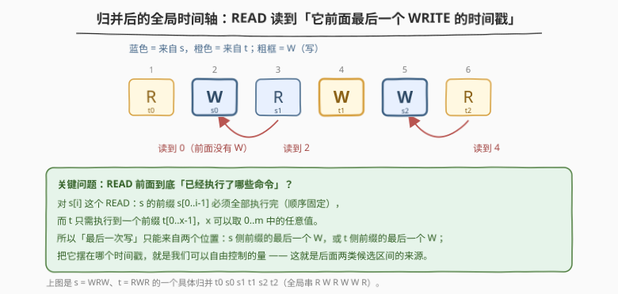
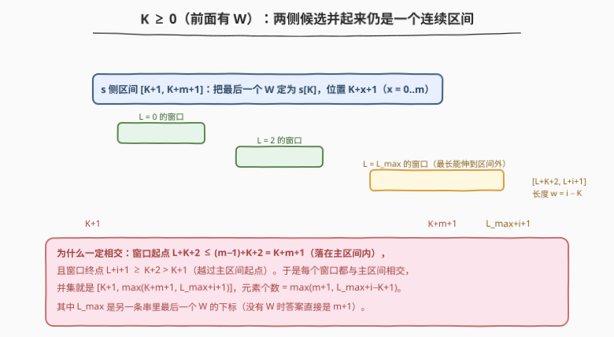
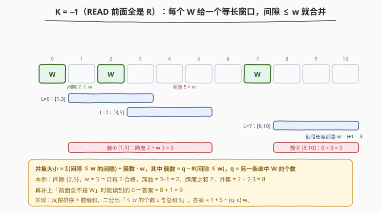
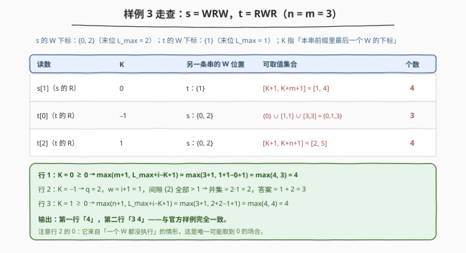

# Codeforces 2272E 内存单元截获 题解

## 1. 题目概述

- **标题 / 题号**：内存单元截获（Codeforces 2272E，英文名 Memory Cell Interception）
- **链接**：https://codeforces.com/problemset/problem/2272/E
- **来源**：Codeforces Round 1130 (Div. 2) · Problem E（UTC 2026-10-26）
- **难度**：未评级（1750 分，Div. 2 第五题）
- **限制**：时间 2 s / 内存 256 MB
- **标签**：二分查找，贪心，双指针

**题意**：两条线程 A、B 各有命令串 $s$（长 $n$）与 $t$（长 $m$），字符只有 `R`（读）与 `W`（写），共享内存格初值为 $0$。把两串按**各自内部顺序**归并成长 $n+m$ 的全局序列，全局第 $i$ 条命令的时间戳就是 $i$：遇到 `W` 把当前时间戳写进内存格，遇到 `R` 读出内存格当时的值（即**它前面最后一个 `W` 的时间戳**，若无 `W` 则为 $0$）。对 $s$、$t$ 中的**每个** `R`，求它在**所有合法归并**中能读到的**不同取值个数**。

**约束**：

- 组数（首行）$1 \le T \le 10^{4}$；题面把组数也记作 $t$、与串 $t$ 重名，下文统一用 $T$
- $1 \le n, m \le 2\times 10^{5}$，且所有测试的 $\sum n \le 2\times 10^{5}$、$\sum m \le 2\times 10^{5}$
- 每条串**至少含一个** `R`，字符仅为 `R` / `W`；时间戳从 $1$ 开始，初值 $0$
- 输出两行：第一行是 $s$ 中每个 `R` 的答案（按出现顺序），第二行是 $t$ 中每个 `R` 的答案，个数必须分别吻合

## 2. 示例与观察
```text
输入：
3
1 1
R
R
1 2
R
WR
3 3
WRW
RWR

输出：
1
1
2
2
4
3 4
```

第 1 组两串都只有 `R`，前面永远没有 `W`，都只读到 $0$，答案各为 $1$。第 2 组 $s=\texttt{R}$、$t=\texttt{WR}$：$s$ 的 `R` 读 $\{0,1\}$，$t$ 的 `R` 读 $\{1,2\}$，答案各 $2$。
第 3 组 $s=\texttt{WRW}$、$t=\texttt{RWR}$：$s$ 的 `R` 能读 $4$ 个值，$t$ 的两个 `R` 依次读 $3$ 个、$4$ 个值。注意 $t$ 第一个 `R` 的可取值是 $\{0,1,3\}$，**不是连续整数段** —— 这是最容易想错的地方。

## 3. 解题思路

### 3.1 暴力思路

枚举所有归并方式（共 $\binom{n+m}{n}$ 种），逐种模拟并用 `set` 去重：$n,m \le 10$ 就有 $184756$ 种归并，$n=m=2\times 10^{5}$ 时完全不可行。优化必须来自「读值只能是什么」的结构性刻画。

### 3.2 核心观察：读值只能是两类「最后一次写」的位置



对 $s$ 中下标为 $i$ 的那个 `R`（0-indexed），记 $K=\max\{k<i: s[k]=\texttt{W}\}$（$K=-1$ 表示不存在）。

**观察 1（前缀形态）**：$s[i]$ 执行前已执行的命令**恰好**是 $s[0..i-1]$ 加上 $t$ 的某个前缀 $t[0..x-1]$，且 $x\in[0,m]$ 可任取。顺序约束把 $s$ 侧钉死；$t$ 侧任取前缀都合法（放下这两段，接 $s[i]$，其余排后面）。

**观察 2（谁是最后一个写）**：$s$ 侧前缀固定，所以来自 $s$ 的最后一个 `W` **只能是** $s[K]$；另一来源是 $t$ 中某个 `W`（下标 $L$）。于是只有两类候选值：

- **$s$ 侧**：让 $s[K]$ 当最后一次写。它前面有 $K$ 条 $s$ 命令与 $x$ 条 $t$ 命令，位置 $K+x+1$；$K$ 之后到 $s[i]$ 之间的 $s$ 命令天然全为 `R`，故 $x$ 可取 $0..m$：

$$v \in [K+1,\;K+m+1]\qquad(m+1 \text{ 个值}).$$

- **$t$ 侧**：让 $t[L]=\texttt{W}$ 当最后一次写（$L$ 为 $t$ 中某个 `W` 下标）。它前面有 $L$ 条 $t$ 命令与 $y$ 条 $s$ 命令，位置 $L+y+1$，其中 $s$ 的全部 `W` 必须在它前面（$y\ge K+1$）、它到 $s[i]$ 之间的 $s[y..i-1]$ 必须全是 `R`（同样只需 $y\ge K+1$）、且 $y\le i$：

$$v \in [L+K+2,\;L+i+1],\qquad \text{窗口长 } w=i-K .$$

- 若前面**一个 `W` 都没有**则读到 $0$，这成立当且仅当 $K=-1$（$s$ 前缀全 `R`，再把 $t$ 整条排后面）。

### 3.3 算法流程：两种情形，一个公式



**情形 A（$K \ge 0$）**。主区间 $[K+1,\,K+m+1]$ 长 $m+1$，每个 $t$ 侧窗口 $[L+K+2,\,L+i+1]$ 的起点满足

$$L+K+2 \le (m-1)+K+2 = K+m+1,$$

落在主区间内，而终点 $L+i+1 \ge K+2 > K+1$，故**每个窗口都与主区间相交**，并集退化成一段：

$$\big[K+1,\;\max(K+m+1,\,L_{\max}+i+1)\big]\;\Longrightarrow\;\text{答案}=\max\big(m+1,\;L_{\max}+i-K+1\big),$$

其中 $L_{\max}$ 是另一条串里最后一个 `W` 的下标；另一条串没有 `W` 时答案为 $m+1$。

**情形 B（$K=-1$）**。主区间不存在，候选是 $\{0\}$ 加上每个 `W` 贡献的等长窗口 $[L+1,\,L+i+1]$（长度 $w=i+1$）。



把另一串的 `W` 位置升序写成 $p_1<\dots<p_q$，间隙 $g_k=p_{k+1}-p_k$。相邻窗口相交或相接当且仅当 $g_k\le w$，故按「间隙 $\le w$」把 `W` 切成簇，簇内并成一段、长度为（簇跨度 $+\,w$）：

$$|\text{并集}|=\sum_{g_k\le w} g_k+(\#\text{簇})\cdot w,\qquad \#\text{簇}=q-\#\{k:g_k\le w\}.$$

间隙**排序**后做前缀和，每个 `R` 二分出「$\le w$ 的个数 $c$ 与总和 $S$」，答案 $=1+S+(q-c)\,w$（开头的 $1$ 是值 $0$；$q=0$ 时公式自动给 $1$，无需特判）。对 $t$ 中每个 `R` 只需交换两串角色再跑一遍。

### 3.4 示例演算



以 $s=\texttt{WRW}$、$t=\texttt{RWR}$ 为例（$s$ 的 `W` 在 $\{0,2\}$，$t$ 的 `W` 在 $\{1\}$）：

| 读数 | $K$ | 情形 | 可取值 | 个数 |
|------|-----|------|--------|------|
| $s[1]$ | $0$ | A，$L_{\max}=1$ | $[1,4]$ | $\max(4,\,1+1-0+1)=4$ |
| $t[0]$ | $-1$ | B，$w=1$，间隙 $\{2\}$ | $\{0\}\cup[1,1]\cup[3,3]=\{0,1,3\}$ | $1+0+2\cdot 1=3$ |
| $t[2]$ | $1$ | A，$L_{\max}=2$ | $[2,5]$ | $\max(4,\,2+2-1+1)=4$ |

输出第一行 `4`、第二行 `3 4`，与官方样例一致。

## 4. 算法细节

1. **预处理**：对每条串求 `W` 下标、相邻间隙（**升序排序**）、间隙前缀和、最后一个 `W` 下标、`W` 个数，供另一条串的读数查询。
2. **$K$ 的维护**：从左到右扫，遇到 `R` 时先用**当前** `lastW`（严格在 $i$ 之前），再把 `x[i]=='W'` 的更新放在后面；顺序写反会把 $i$ 自己算进去。
3. **0-indexed 与时间戳**：位置 = 下标 $+\,1$，公式里的 $+1$ 都来自这里。自检：$n=m=1$ 且都为 `R` 应输出 `1` / `1`。
4. **溢出**：$L_{\max}+i-K+1 < n+m$，`int` 够；但 $(q-c)\cdot w$ 最大约 $4\times10^{10}$，**必须 `long long`**。
5. **二分方向**：间隙排序后才有单调性，用 `upper_bound` 求 $\le w$ 的个数；前缀和数组比 `gap` 长 $1$ 且 `pre[0]=0`，保证 $q=0,c=0$ 时可直接取用。
6. **双指针替代**：情形 B 的读数只出现在本串首个 `W` 之前，此时 $w=i+1$ 单调递增，可把二分换成摊还指针做到每组 $O(n+m)$。
7. **输出**：每串答案个数等于该串 `R` 的个数，逐行输出；行末空格 CF 忽略，但行与个数都不能错。

## 5. 正确性证明

**引理 1（前缀形态）**：任意合法归并中，若 $s[i]$ 是 `R`，则它执行前已执行的命令恰为 $s[0..i-1]\cup t[0..x-1]$（$0\le x\le m$），且每个 $x$ 都存在对应归并。

**证明**：顺序保持 $\Rightarrow$ 已执行的 $s$、$t$ 命令各是前缀；$s[i]$ 前 $s$ 侧必已执行完 $s[0..i-1]$，$t$ 侧可取任一个 $x$。反向：把 $t[0..x-1]$ 与 $s[0..i-1]$ 任意穿插，接 $s[i]$，再接剩余命令，合法。∎

**引理 2（候选只有两类）**：若 $s[i]$ 读到 $v\ne0$，则 $v$ 必是 $s[K]$（$K\ge0$）或某个 $t[L]=\texttt{W}$ 的时间戳；$v=0$ 可达当且仅当 $K=-1$。

**证明**：$v$ 是前一个 `W` 的时间戳。若该 `W` 属于 $s$，则 $s$ 前缀中最后一个 `W` 是 $s[K]$，任何更早的 `W` 全局位置都更早，故只能是 $s[K]$；否则属于 $t$。又 $v=0$ 等价于前面无 `W`，由引理 1 即 $s$ 前缀全 `R` 且 $x=0$。∎

**引理 3（情形 A 的值域是单区间）**：$K\ge0$ 时值集为 $[K+1,K+m+1]\cup\bigcup_{L\in W(t)}[L+K+2,L+i+1]$，大小 $=\max(m+1,\,L_{\max}+i-K+1)$（$t$ 无 `W` 时为 $m+1$）。

**证明**：（可达 1）取 $x\in[0,m]$、$v=K+x+1$，归并 $t[0..x-1],s[0..K],s[K+1..i],t[x..m-1]$：$s[K]$ 前恰 $K+x$ 条命令，其后到 $s[i]$ 只有全 `R` 的 $s[K+1..i-1]$，故读到 $v$。（可达 2）取 $t[L]=\texttt{W}$、$y\in[K+1,i]$、$v=L+y+1$，归并 $t[0..L-1]$ 与 $s[0..y-1]$（任意穿插）后接 $t[L]$、$s[y..i]$、$t[L+1..m-1]$：$t[L]$ 前恰 $L+y$ 条命令，$s$ 的全部 `W` 都在 $s[0..y-1]$ 中，其间只有 `R`，故读到 $v$。（必要性）引理 2。又窗口起点 $\le K+m+1$、终点 $>K+1$，都与主区间相交，并集为 $[K+1,\max(K+m+1,L_{\max}+i+1)]$，个数即 $\max(m+1,L_{\max}+i-K+1)$；$t$ 无 `W` 时无窗口，只剩 $m+1$ 个值。∎

**引理 4（情形 B 的簇计数）**：$K=-1$ 时值集为 $\{0\}\cup\bigcup_{L\in W(t)}[L+1,L+i+1]$，大小 $=1+\sum_{g\le w}g+(\#\text{簇})\cdot w$，$w=i+1$。

**证明**：窗口形状与可达性由引理 3 的构造取 $K=-1$ 得到；$0$ 可达且与所有窗口不交（起点 $\ge1$）。对 $L_1<L_2$，两窗口 $[L_1+1,L_1+w]$、$[L_2+1,L_2+w]$ 相交或相接 $\iff L_2-L_1\le w$，故簇边界正是间隙 $>w$ 处；簇内并成连续段、长度 $=(p_{\text{last}}-p_{\text{first}})+w$，对所有簇求和得跨度之和 = 所有 $\le w$ 的间隙之和，簇数 $=q-\#\{g\le w\}$。∎

**定理**：对每个 `R`，算法输出正是它在所有合法归并中可读不同值的个数。

**证明**：$K\ge0$ 由引理 3，$K=-1$ 由引理 4（$q=0$ 时公式给 $1+0+0=1$，与「只能读 $0$」一致）。对 $t$ 中 `R` 的处理只是交换两串角色，论证逐字对称。∎

## 6. 复杂度分析

- **时间**：每组预处理 $O((n+m)\log(n+m))$（收集 `W`、排序间隙），每个 `R` 一次二分 $O(\log(n+m))$；总计 $O((\sum n+\sum m)\log(n+m))$，约 $4\times10^{5}\times18$ 次基本操作。
- **空间**：$O(n+m)$，存 `W` 列表、间隙、前缀和。
- **可行性**：实测 C++ 单组 $n=m=2\times10^{5}$ 约 $0.06$ s（$2$ s 限额，余量 $>30$ 倍）；Python3 单组约 $0.17$ s，同样安全。

## 7. 参考代码

### C++17

```cpp
#include <bits/stdc++.h>
using namespace std;
using ll = long long;

struct Info {                    // 「另一条串」里所有 W 的信息
    int last = -1, q = 0;        // 最后一个 W 的下标、W 的个数
    vector<int> gap;             // 相邻 W 的间隙（已升序排序）
    vector<ll> pre;              // 间隙前缀和，pre[0] = 0
};
Info build(const string& y) {
    Info f;
    vector<int> w;
    for (int i = 0; i < (int)y.size(); ++i) if (y[i] == 'W') w.push_back(i);
    f.q = (int)w.size();
    if (f.q) f.last = w.back();
    for (size_t k = 1; k < w.size(); ++k) f.gap.push_back(w[k] - w[k - 1]);
    sort(f.gap.begin(), f.gap.end());
    f.pre.assign(f.gap.size() + 1, 0);
    for (size_t k = 0; k < f.gap.size(); ++k) f.pre[k + 1] = f.pre[k] + f.gap[k];
    return f;
}
// 串 x 中每个 'R' 的答案；ny = |y|，f 是 y 的 W 信息
vector<ll> solve(const string& x, int ny, const Info& f) {
    vector<ll> res;
    int lastW = -1;                                  // x 前缀里最后一个 W
    for (int i = 0; i < (int)x.size(); ++i) {
        if (x[i] == 'R') {
            if (lastW >= 0)                          // 情形 A
                res.push_back(f.last < 0 ? ny + 1LL
                              : max<ll>(ny + 1, (ll)f.last + i - lastW + 1));
            else {                                   // 情形 B
                ll w = i + 1;
                int c = (int)(upper_bound(f.gap.begin(), f.gap.end(), (int)w) - f.gap.begin());
                res.push_back(1 + f.pre[c] + (ll)(f.q - c) * w);
            }
        }
        if (x[i] == 'W') lastW = i;
    }
    return res;
}
int main() {
    ios::sync_with_stdio(false);
    cin.tie(nullptr);
    int T;
    cin >> T;
    while (T--) {
        int n, m;
        string s, t;
        cin >> n >> m >> s >> t;
        Info fs = build(s), ft = build(t);
        vector<ll> A = solve(s, m, ft), B = solve(t, n, fs);
        for (size_t k = 0; k < A.size(); ++k) cout << A[k] << " \n"[k + 1 == A.size()];
        for (size_t k = 0; k < B.size(); ++k) cout << B[k] << " \n"[k + 1 == B.size()];
    }
    return 0;
}
```

### Python3

```python
import sys
from bisect import bisect_right

def build(y):
    w = [i for i, ch in enumerate(y) if ch == 'W']
    last = w[-1] if w else -1
    gap = sorted(w[k] - w[k - 1] for k in range(1, len(w)))
    pre = [0] * (len(gap) + 1)
    for k, g in enumerate(gap):
        pre[k + 1] = pre[k] + g
    return last, gap, pre, len(w)

def solve(x, ny, info):
    last, gap, pre, q = info
    res = []
    lastW = -1                       # x 前缀里最后一个 W
    for i, ch in enumerate(x):
        if ch == 'R':
            if lastW >= 0:           # 情形 A
                res.append(ny + 1 if last < 0 else max(ny + 1, last + i - lastW + 1))
            else:                    # 情形 B
                w = i + 1
                c = bisect_right(gap, w)
                res.append(1 + pre[c] + (q - c) * w)
        if ch == 'W':
            lastW = i
    return res

def main():
    data = sys.stdin.buffer.read().split()
    p = 0
    T = int(data[p]); p += 1
    out = []
    for _ in range(T):
        n = int(data[p]); m = int(data[p + 1]); p += 2
        s = data[p].decode(); t = data[p + 1].decode(); p += 2
        out.append(' '.join(map(str, solve(s, m, build(t)))))
        out.append(' '.join(map(str, solve(t, n, build(s)))))
    sys.stdout.write('\n'.join(out) + '\n')

main()
```

## 8. 边界情况与易错点

1. **另一条串没有 `W`**：情形 A 输出 $m+1$（只剩 $s$ 侧区间），情形 B 输出 $1$（只有 $0$），`f.last < 0` 与 $q=0$ 两个分支都要照顾。
2. **两条串全是 `R`**：每个 `R` 都只读 $0$，两行答案全是 `1`；此时 `gap` 为空、`pre=[0]`，二分返回 $0$。
3. **$n=m=1$ 且都为 `R`**：输出两行 `1`，行数不能少（多测最容易漏行）。
4. **本串以 `W` 开头**：第一个 `R` 的 $K\ge0$ 必走情形 A；情形 B 只出现在本串首个 `W` 之前的 `R`，故 $w=i+1$ 单调递增，这也是双指针优化的依据。
5. **溢出**：$(q-c)\cdot w$ 达 $4\times10^{10}$，C++ 里要靠 `(ll)` 强转成 `long long`；而 $L_{\max}+i-K+1 < n+m \le 4\times10^{5}$，`int` 足够，别把两者混为一谈。
6. **间隙必须排序**：按位置顺序的间隙不单调，直接二分会漏算；排序后配前缀和，注意 `pre` 长度比 `gap` 多 $1$。
7. **多测清空**：`Info` 用值语义每组重建；若改用全局数组，要按当前 $n,m$ 清空而不是按最大值清空。

## 9. 验证记录

- **编译环境与命令**：`clang++ -std=c++17 -O2`（本机无 GNU g++，配 `codeforces/tools/include/bits/stdc++.h` 兼容头；正文代码只用标准库，可原样提交 GNU C++17）；Python 侧为 `Python 3.9.6`。
- **官方样例**：1 / 1 通过（按 Codeforces 标准 checker 的 token 比对，忽略空白与大小写）。
- **复核状态**：audited（2026-11-19 统一回归：编译 + 官方样例；写作期的随机对拍与暴力未重跑）。

## 相关题目与扩展

- [LeetCode 56. 合并区间](https://leetcode.cn/problems/merge-intervals/)：按「相邻是否接触」把区间并成簇，正是本题情形 B 的骨架。
- [LeetCode 986. 区间列表的交集](https://leetcode.cn/problems/interval-list-intersections/)：两族区间用双指针扫描，练习端点相对关系。
- [LeetCode 1024. 视频拼接](https://leetcode.cn/problems/video-stitching/)：区间覆盖类贪心，体会「只关心可达的最远端点」。
- [Codeforces 1175E. Minimal Segment Cover](https://codeforces.com/problemset/problem/1175/E)：区间覆盖的最少线段数，同样把区间问题化成端点上的贪心/倍增。

**延伸思考**：若只问「最小/最大可读值」，就是区间端点，$O(1)$ 可读出（情形 B 的最小值是 $p_1+1$、最大值是 $p_q+i+1$），无需簇计数；若改成「有多少种归并能读到 $v$」，存在性变成计数，要在归并网格上做路径计数，难度陡增；若线程数增到三条以上，「最后一次写」可能来自任意一条线程，候选集合变成高维结构，目前没有同样简洁的结论。
