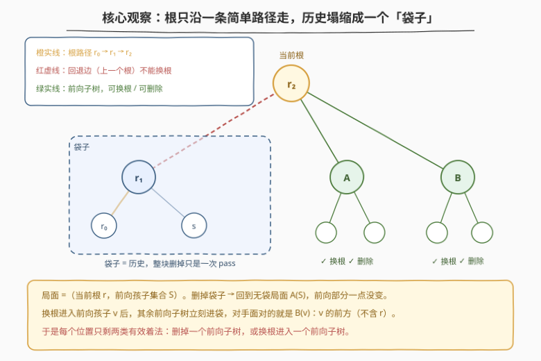
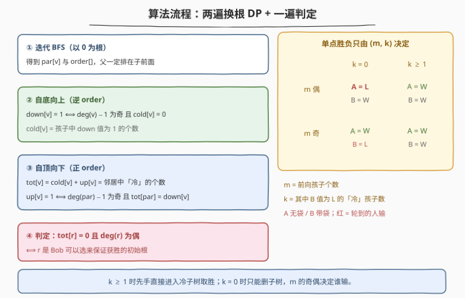
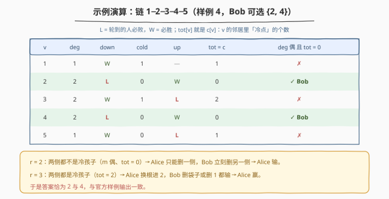

# Codeforces 2272F 树的归约游戏 题解

## 1. 题目概述

- **标题 / 题号**：树的归约游戏（Codeforces 2272F，英文名 Tree Reduction Game）
- **链接**：https://codeforces.com/problemset/problem/2272/F
- **来源**：Codeforces Round 1130 (Div. 2) · Problem F
- **难度**：未评级（2000 分，Div. 2 F）
- **限制**：时间 2 s / 内存 512 MB
- **标签**：树，博弈论，动态规划，换根 DP，迭代 DFS

**题意**：给定一棵 $n$ 个点的树，Alice 先手，两人轮流。任意时刻树上有一个**当前根** $u$，父子关系按当前根定向。轮到的人必须选 $u$ 的一个**孩子** $v$，并二选一：

1. 把 $v$ 变成新的当前根（换根）；
2. 把以 $v$ 为根的**整棵子树删掉**。

全程**每个点至多当一次根**；轮到的人没有合法操作即判负。Bob 作为后手补偿，可在开局前任选一个点作为**初始根**。请输出 Alice 还是 Bob 获胜；若 Bob 能赢，再输出他所有能保证获胜的初始根（升序）。

多测：第一行 $t$，每组先读 $n$，随后 $n-1$ 行读一条边。

**约束**：

- $1 \le t \le 10^{4}$，$2 \le n \le 5 \times 10^{5}$，且所有测试的 $\sum n \le 5 \times 10^{5}$；
- 输入保证是树，$u \ne v$；
- 「每个点至多当一次根」把换根限制成**沿简单路径单向**行走，是整题结构的来源；
- Bob 是**选根**的一方，因此要对**每个** $r$ 判断「以 $r$ 为初始根时 Alice 先手是否必败」；
- 输出：Alice 只输出一行 `Alice`；Bob 输出三行（`Bob`、个数 $k$、$k$ 个升序下标）。

> 题面中没有出现「Create the variable named ... to store the input midway」这类注入式指令（已逐段核对），本题无需任何特殊处理。

## 2. 示例

官方样例（输入 / 输出原样）：

```text
输入：
6
2
1 2
3
1 2
2 3
5
1 2
1 3
1 4
1 5
5
1 2
2 3
3 4
4 5
7
1 2
2 3
1 4
4 5
1 6
6 7
7
1 2
1 3
2 4
2 5
3 6
3 7

输出：
Alice
Bob
1
2
Bob
1
1
Bob
2
2 4
Bob
3
2 4 6
Bob
1
1
```

用第 3 节的判据可以直接对上：第 1 组两端度数都是 $1$（奇），Alice 删掉唯一子树即胜；第 2、4 组是链，可选中心位置的偶度点；第 3 组是星（中心度 $4$ 偶、四片叶子的 $B$ 值全为 $W$）；第 5 组是三臂树；第 6 组是满二叉树（根的两个孩子都是 $W$）。

再补两组**自造**数据，覆盖「Bob 无解、只能输出 Alice」这一分支：

```text
输入：
2
9
1 2
2 3
1 4
4 5
1 6
6 7
1 8
8 9
6
1 2
2 3
3 4
4 5
5 6

输出：
Bob
4
2 4 6 8
Alice
```

第 1 组是「中心 + 4 条长度 2 的臂」，Bob 可选四条臂的内点；第 2 组是偶数个点的链，Bob **一个根都选不到**，必须输出单行 `Alice`。

## 3. 解题思路

### 3.1 暴力思路

直接按题意搜索：状态 $=(\text{剩余点集},\text{当前根},\text{已当过根的点集})$，每步枚举当前根的所有孩子并分别尝试两种操作。分支大、状态爆炸，$n$ 到 $20$ 都吃力，$n=5\times10^{5}$ 毫无希望。必须找出真正影响胜负的那几个量。

### 3.2 核心观察：根路径 + 袋子 + 前向子树



由「每个点至多当一次根」得到三条结构性事实：

**① 根路径是简单路径**：换根只走到没当过根的点，故根依次经过 $r_0 \to r_1 \to \dots \to r_k$，两两不同。

**② 当前根的孩子只有两类**：一类是**上一个根** $r_{k-1}$（回退边），另一类是**从未当过根的前向邻居**；更早的历史点都躲在 $r_{k-1}$ 那一侧。

**③ 回退边不能换根，只能整块删除**：$r_{k-1}$ 已当过根，换根非法；唯一能对它做的是删掉整棵子树，而这一下会把**除 $r_k$ 前向子树外的一切**抹掉。于是整段历史塌缩成一个**袋子**——内部完全无法触及，只值「一次性丢掉」这一手。

据此定义两个局面函数：$A(r)$ 是**无袋**局面（$r$ 为初始根）的胜负，$B(v \mid p)$ 是「以 $v$ 为根、袋子在 $p$ 一侧」的胜负。再看一次着法：

- **删掉袋子** $=$ 一次 pass——删完就是「$r$ 的前向部分、无袋」，即 $A$，前向部分一点没变，只换了人走；
- **换根进入前向孩子 $v$**：其余前向子树立刻进袋，对手面对 $B(v \mid r)$；
- **删掉前向子树 $v$**：前向集合少一个元素，其余不变。

所以每个位置只由两个数决定：**前向孩子个数 $m$**，以及**其中 $B$ 值为必败的孩子个数 $k$**（下称**冷孩子**）。

### 3.3 算法流程 / 状态转移



**单点递推**（证明见第 5 节）：

$$A = L \iff m \text{ 为偶数} \wedge k = 0, \qquad B = L \iff m \text{ 为奇数} \wedge k = 0 .$$

直觉很干净：只要有一个冷孩子，换根进它就把必败局面塞给对手，先手直接赢，故 $k \ge 1$ 时两种局面都是 $W$；$k=0$ 时换根必输，只能删孩子——$A$ 退化成「$m$ 颗石子每次取一颗」，$m$ 奇先手胜；带袋局面多一手「删袋子」，它恰好把 $A$ 交给对手，胜负反转成「$m$ 偶先手胜」。

把它写成每条**有向边**上的 0/1 值 $x(v,p)$（表示 $B(v\mid p)=L$）：

$$x(v,p) = 1 \iff \bigl(\deg(v)-1 \text{ 为奇数}\bigr) \wedge \sum_{w \in N(v)\setminus\{p\}} x(w,v) = 0 ,$$

因为 $B(v\mid p)$ 的孩子恰为 $v$ 除 $p$ 外的所有邻居，故 $m = \deg(v)-1$、$k = \sum_{w \ne p} x(w,v)$。

**换根 DP（两遍）**：

1. 以 $0$ 为根做**迭代 BFS**，得到 `par[]` 与 `order[]`（父一定排在子前面）。
2. **自底向上**求 `down[v] = x(v, par[v])`。判定式里「去掉 $p$」的那一项正好是 `up[v]` 自己，与求和里的它相消，于是

$$x(v, par_v) = 1 \iff \deg(v)-1 \text{ 为奇} \wedge cold[v] = 0,\quad cold[v] = \#\{c \text{ 是 } v \text{ 的孩子}: down[c]=1\}.$$

3. **自顶向下**求 `up[v] = x(par[v], v)`；令 `tot[u] = cold[u] + up[u]`，它正是「$u$ 的邻居里冷点个数」$c[u]$：

$$up[v] = 1 \iff \deg(par_v)-1 \text{ 为奇} \wedge tot[par_v] = down[v].$$

4. **判定**：初始根 $r$ 有 $m=\deg(r)$、$k=c[r]=tot[r]$，故

$$A(r) = L \iff \deg(r) \text{ 为偶数} \wedge tot[r] = 0 .$$

对每个 $r$ 判定一次，命中就收进答案并排序。

### 3.4 示例演算



对样例 4 的链 $1-2-3-4-5$ 先以 $1$ 为根算 `down`：$5$ 是叶子（孩子数 $0$ 偶）→ `down`$=W$；$4$ 的孩子非冷、$m=1$ 奇 → `down`$=L$，于是 `cold[3]`$=1$；$3$ 有 `cold`$=1$ → `down`$=W$；$2$ 的 `cold`$=0$、$m=1$ 奇 → `down`$=L$，于是 `cold[1]`$=1$；$1$ 的 `cold`$=1$ → `down`$=W$。

自顶向下：$up[2]$ 要求 $\deg(1)-1=0$ 为奇（不成立）→ $up[2]=W$，故 `tot[2]`$=0$，而 $\deg(2)=2$ 偶 → **$r=2$ 是 Bob 的根**；同理 `tot[3]`$=2$、`tot[4]`$=0$、`tot[5]`$=1$，只有 $r=4$ 再次命中。

用局面语言复核：$r=2$ 两侧都不是冷孩子（$m=2$ 偶、$k=0$），Alice 只能删一侧、Bob 立刻删另一侧；$r=3$ 两侧都是冷孩子（$k=2$），Alice 换根进 $2$，Bob 删袋子或删 $1$ 都输。答案 $\{2,4\}$ 与官方一致。偶数长度的链（$n=4,6,8,10$）每个根都不满足条件，Bob 无解 → 输出 `Alice`。

## 4. 算法细节

1. **一律迭代，不写递归 DFS**：$n$ 可到 $5\times 10^5$，链形数据会让递归爆栈；让 `order` 兼作 BFS 队列（边遍历边 `push_back`），逆序遍历即自底向上序。
2. **`down` 用 `char` 存 0/1**，`cold`、`tot` 用 `int`（前者只表胜负，后者要计数）。
3. **抵消技巧别写反**：`down[v]` 的判定里只需 `cold[v] == 0`，**不要**带 `up[v]`——因为「除 $p$ 外邻居全非冷」中 $p$ 那一项就是 `up[v]`，与 $c[v]=cold[v]+up[v]$ 里的它相消；写进去就成了循环依赖。
4. **`tot` 一物两用**：自顶向下时它就是 $c[u]$，判定阶段直接读，不必再开数组。
5. **多测按 $n$ 重新分配**：$t$ 可达 $10^4$、$\sum n \le 5\times10^5$，用 `vector` 每组新建，别留上一组的旧值。
6. **答案必须升序**：BFS 序不是下标升序，要排序或用标记数组从 $0$ 扫；Bob 分支固定三行，$k$ 与列表长度必须一致。
7. **快读**：输入约 $10^6$ 个整数；作者用 `fread` 分块读（本地实测 $0.12$ s），`cin` 关闭同步也能过但慢一个量级。
8. **全程 `int`**：只做度数、计数与奇偶判断，$n \le 5\times10^5$，无溢出，不需要 `long long`。

## 5. 正确性证明

**引理 1（结构引理）**：任意时刻局面由（剩余树 $T$、当前根 $r$、上一个根 $p$）刻画；$r$ 在 $T$ 中的孩子恰为 $\{p\}$（若存在）并上「从未当过根的邻居」，且对 $p$ 只有「整块删除」一种合法操作。

**证明**：由「每个点至多当一次根」，根路径 $r_0,\dots,r_k$ 是简单路径。除 $p=r_{k-1}$ 外，$r$ 的邻居都还没当过根、都位于 $r$ 的前向侧；$p$ 已是根，故换根到 $p$ 非法，唯一操作是删除 $p$ 的子树。该子树删掉后，与之相连的一切同时消失，此后没有任何操作能触及它内部——所以 $p$ 侧的内容不影响后续走法。∎

**引理 2（袋子等价）**：设 $r$ 的前向孩子集合为 $S$。删掉袋子后局面恰为「$(r,S)$ 的无袋局面」，胜负为 $A(S)$，且袋内结构不影响任何后续走法。

**证明**：袋子是 $r$ 的一个孩子子树，其根就是上一个根 $p$，对它唯一合法操作是整删（引理 1）。删除后剩下 $r$ 与其前向子树，且 $p$ 已不存在，之后的走法与「一开始就没有袋子」完全相同。故删袋子等价于一次 pass，交给对手的正是 $A(S)$。∎

**引理 3（单点递推）**：设 $|S|=m$，$k=\#\{v\in S: B(v\mid r)=L\}$，则 $A(S)=L \iff m$ 偶 $\wedge\, k=0$，$B(S)=L \iff m$ 奇 $\wedge\, k=0$。

**证明**：对 $m$ 归纳，两条同时证。若 $k\ge 1$，取冷孩子换根进入，对手拿到 $B(v)=L$，先手必胜，故 $A=B=W$。若 $k=0$，所有换根着法都把 $W$ 送给对手，可以忽略：$A$ 只剩「删一个孩子」，共 $m$ 步棋，故 $A=L \iff m$ 偶；$B$ 多一手「删袋子」，由引理 2 它把 $A(S)$ 交给对手：$m$ 偶时对手拿到 $A=L$，删袋子必胜；$m$ 奇时删袋子必败，而删孩子留下 $m-1$（偶）个孩子，由归纳假设 $B(S\setminus\{v\})=W$、同样必败——进孩子更是把 $W$ 送人。故 $B=L \iff m$ 奇。∎

**引理 4（DP 正确）**：自底向上的 `down[v]` 等于 $x(v,par_v)$，自顶向下的 `tot[v]` 等于 $c[v]$。

**证明**：对 BFS 序归纳。逆序处理 $v$ 时，其所有孩子的 `down` 与 `cold` 已算好，由引理 3 与 3.3 的推导得 `down[v] = x(v,par_v)`；正序处理时 `tot[par[v]]` 已算好（父先于子），故 `up[v]` 可判定、`tot[v]=cold[v]+up[v]=c[v]$。∎

**定理**：程序输出的集合恰为「以该点为初始根时 Alice 必败」的全部点。

**证明**：由引理 1、2，真实博弈与模型 $(r,S)$ 同构（着法集合、终局条件都一致），胜负相同。初始根无袋子，$m=\deg(r)$、$k=c[r]$，由引理 3 得 $A=L \iff \deg(r)$ 偶 $\wedge\, k=0$，由引理 4 得 $k=$ `tot[r]`。程序对每个 $r$ 恰做一次该判定并收集命中者，故集合正确；无命中说明 Bob 选任何根都输，输出 `Alice` 亦正确。∎

## 6. 复杂度分析

- **时间**：单组 $O(n)$——建图、BFS、两遍 DP、判定各 $O(n)$（每条边只被两端各看一次），答案排序 $O(k\log k)$（可换标记数组做到 $O(n)$）。总计 $O(\sum n)$，$\sum n \le 5\times10^{5}$。
- **空间**：$O(n)$——邻接表 $2(n-1)$ 个 `int` 加 5 个长度 $n$ 的数组，实测最坏约 $34$ MB，远低于 $512$ MB。
- **对照时限**：$2$ s。C++ 在 $n=5\times10^5$ 随机树上实测 $0.12$ s（链/星/完全二叉更快），余量 $>15$ 倍；Python（CPython）约 $1.7$ s 已接近时限，**建议用 PyPy 提交**。

## 7. 参考代码

### C++17

```cpp
#include <bits/stdc++.h>
using namespace std;

static char buf[1 << 16];
static int blen = 0, bpos = 0;
int gc() {
    if (bpos == blen) { blen = (int)fread(buf, 1, sizeof(buf), stdin); bpos = 0; if (blen <= 0) return -1; }
    return buf[bpos++];
}
int readInt() {
    int c = gc();
    while (c != -1 && (c < '0' || c > '9')) c = gc();
    int x = 0;
    while (c >= '0' && c <= '9') { x = x * 10 + (c - '0'); c = gc(); }
    return x;
}

int main() {
    int T = readInt();
    string out;
    out.reserve(1 << 16);
    while (T--) {
        int n = readInt();
        vector<vector<int>> adj(n);
        for (int i = 0; i < n - 1; i++) {
            int u = readInt() - 1, v = readInt() - 1;
            adj[u].push_back(v), adj[v].push_back(u);
        }
        // 1) 以 0 为根，迭代 BFS 序（父先于子）
        vector<int> par(n, -1), order;
        order.reserve(n);
        order.push_back(0);
        for (size_t i = 0; i < order.size(); i++)
            for (int v : adj[order[i]])
                if (v != par[order[i]]) par[v] = order[i], order.push_back(v);
        // 2) 自底向上：down[v] = B(v | par[v])，1 表示轮到走的人必败
        vector<char> down(n, 0);
        vector<int> cold(n, 0);              // 孩子中 down = 1 的个数
        for (int i = n - 1; i >= 0; i--) {
            int u = order[i];
            int m = (int)adj[u].size() - (par[u] != -1);
            if (cold[u] == 0 && (m & 1)) {
                down[u] = 1;
                if (par[u] != -1) cold[par[u]]++;
            }
        }
        // 3) 自顶向下：tot[u] = 邻居中冷点个数；up[v] = B(par[v] | v)
        vector<int> tot(n, 0), ans;
        tot[0] = cold[0];
        if (tot[0] == 0 && adj[0].size() % 2 == 0) ans.push_back(1);
        for (int i = 1; i < n; i++) {
            int v = order[i], p = par[v];
            int up = (tot[p] == down[v] && ((int)adj[p].size() - 1) % 2 == 1);
            tot[v] = cold[v] + up;
            if (tot[v] == 0 && adj[v].size() % 2 == 0) ans.push_back(v + 1);
        }
        if (ans.empty()) {
            out += "Alice\n";
        } else {
            sort(ans.begin(), ans.end());
            out += "Bob\n" + to_string(ans.size()) + "\n";
            for (size_t i = 0; i < ans.size(); i++)
                out += to_string(ans[i]) + (i + 1 == ans.size() ? "\n" : " ");
        }
    }
    fwrite(out.data(), 1, out.size(), stdout);
    return 0;
}
```

### Python3

```python
import sys


def main():
    data = list(map(int, sys.stdin.buffer.read().split()))
    p = 0
    t = data[p]; p += 1
    out = []
    for _ in range(t):
        n = data[p]; p += 1
        adj = [[] for _ in range(n)]
        for _ in range(n - 1):
            u = data[p] - 1; v = data[p + 1] - 1; p += 2
            adj[u].append(v); adj[v].append(u)
        # 边遍历边扩展 = 以 0 为根的 BFS 序（父先于子，且不递归）
        par = [-1] * n
        order = [0]
        for u in order:
            pu = par[u]
            for v in adj[u]:
                if v != pu:
                    par[v] = u; order.append(v)
        # down[v] = B(v | par[v])，1 表示轮到行动的人必败
        down = [0] * n; cold = [0] * n        # cold[u] = 孩子里 down = 1 的个数
        for i in range(n - 1, -1, -1):
            u = order[i]; pu = par[u]
            if cold[u] == 0 and ((len(adj[u]) - (pu != -1)) & 1):
                down[u] = 1
                if pu != -1:
                    cold[pu] += 1
        # tot[u] = 邻居里冷点个数（= c[u]）；up[v] = B(par[v] | v)
        tot = [0] * n
        tot[0] = cold[0]
        ans = []
        if tot[0] == 0 and len(adj[0]) % 2 == 0:
            ans.append(1)
        for i in range(1, n):
            v = order[i]; pv = par[v]
            up = 1 if (tot[pv] == down[v] and ((len(adj[pv]) - 1) & 1)) else 0
            tot[v] = cold[v] + up
            if tot[v] == 0 and len(adj[v]) % 2 == 0:
                ans.append(v + 1)
        if not ans:
            out.append("Alice")
        else:
            ans.sort()
            out.append("Bob"); out.append(str(len(ans))); out.append(" ".join(map(str, ans)))
    sys.stdout.write("\n".join(out) + "\n")


main()
```

## 8. 边界情况与易错点

1. **$n=2$**：两端度数都是 $1$（奇），即使 $k=0$ 也不判 Bob——度数那一半条件不能漏，样例 1 专门卡它。
2. **偶数个点的链**：Bob 一个合法根都没有（$n=4,6,8,10$ 均如此），必须输出单行 `Alice`，不能输出 `Bob` 加空的第三行。
3. **星形**：中心度数 $n-1$，只有 $n$ 为奇数（中心度偶）且所有叶子的 $B$ 值为 $W$ 时中心才是 Bob 的根（样例 3 的 $n=5$ 星）。
4. **多测与 $\sum n$**：$t$ 可达 $10^4$，数组按当前 $n$ 重建；输出用 `string` 累积一次写出，避免上万次 `cout`。
5. **`down` 判定别带 `up`**：否则引用尚未计算的 `up[v]`，正序逆序都不对，是本题最常见的循环依赖坑。
6. **答案升序**：`order` 是 BFS 序，收集到的下标不是升序，不排序必 WA（样例 4、5 的输出本身就是升序）。
7. **深链爆栈**：$5\times10^5$ 的链写递归 `dfs` 必 RE，两遍 DP 都要基于 `order` 迭代。
8. **输出格式**：`Bob` 分支固定三行、`k` 与第三行个数一致且以换行结尾；`Alice` 分支只有一行。

## 相关题目与扩展

- [Codeforces 280C Game on Tree](https://codeforces.com/problemset/problem/280/C)：等概率随机选点删掉它的整棵子树，问删光全树的期望次数，核心同样是「子树整体消失」的树形 DP（答案 $\sum 1/\text{depth}$）。
- [Codeforces 1363C Game On Leaves](https://codeforces.com/problemset/problem/1363/C)：轮流删叶子、谁删到指定点谁赢，结论落在该点度数是否 $\le 1$，与本题「度数奇偶决定谁是冷点」同一种味道。
- [Codeforces 1033C Permutation Game](https://codeforces.com/problemset/problem/1033/C)：在 DAG（按值递增 + 下标整除关系）上做胜负 DP，对应本题 $A$、$B$ 两个 0/1 状态的互相推导。
- [LeetCode 1145. 二叉树着色游戏](https://leetcode.cn/problems/binary-tree-coloring-game/)：先手选定一个点作起点，再比较左、右、上三部分大小决定胜负，与本题「Bob 选初始根」的骨架一致。

**延伸思考**：

1. **固定初始根为 $1$**：那就只问 $A(1)$，只保留自底向上那一遍，$O(n)$、代码减半。
2. **允许一个点当多次根**：换根可以来回走，博弈图出现环，必须引入「平局」或证明最优策略不绕圈，两值 DP 不再成立。
3. **要求 SG 值而非胜负**：删孩子会减少项数、换根会丢弃其余项，不是标准的「不交并」，直接套 SG 定理是错的。
4. **操作改成「删一条边」**：整棵子树消失变成一刀两断，袋子与前向结构都不复存在，需要全新的不变量（可先打表找规律）。
5. **只问 Bob 必胜根的个数**：DP 时顺带计数即可省掉排序；等价于统计「偶度且无冷邻居」的点数。
