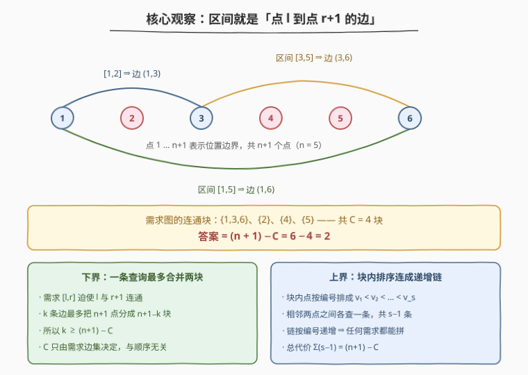
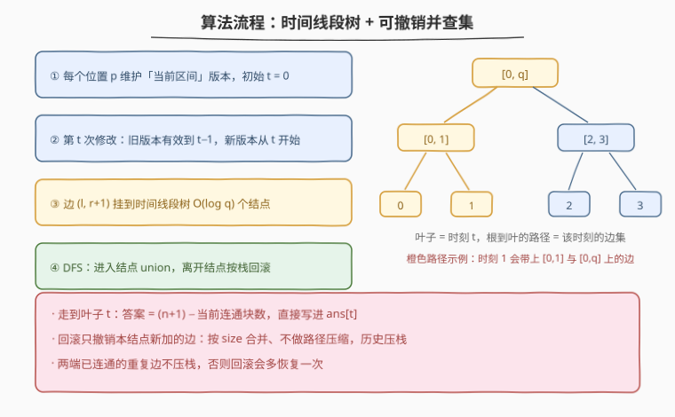
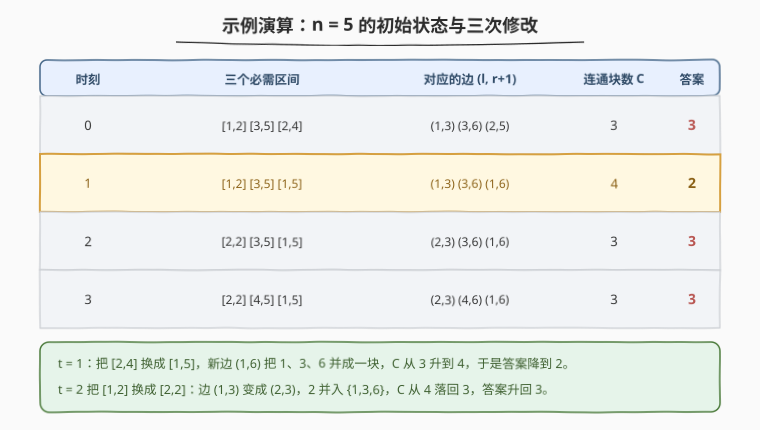

# Codeforces 2272G 区间合并 题解

## 1. 题目概述

- **标题 / 题号**：区间合并（Codeforces 2272G，英文名 Ranges）
- **链接**：https://codeforces.com/problemset/problem/2272/G
- **来源**：Codeforces Round 1130 (Div. 2) · Problem G
- **难度**：未评级（2500 分，Div. 2 压轴）
- **限制**：时间 5 s / 内存 512 MB
- **标签**：数据结构，分治，并查集，离线处理

**题意**：数轴上有 $n$ 个位置 $1..n$，每个区间 $[l,r]$（$1\le l\le r\le n$）都对应一个"值"。获取值只有两条途径：

1. **直接查询**任意区间 $[l,r]$，代价为 $1$；
2. 若某 $k$（$l\le k<r$）的 $[l,k]$ 与 $[k+1,r]$ 的值都已获得，可以**免费合并**出 $[l,r]$。

合并可以反复使用，但值不能被拆开——知道 $[l,r]$ 的值并不等于知道它子区间的值。当前有 $m$ 个必需区间（允许重复），求至少需要多少次直接查询。接着进行 $q$ 次修改，第 $t$ 次把第 $p_t$ 个必需区间**替换**为 $[l_t,r_t]$。对初始状态和每次修改后的状态分别输出答案；每个状态互相独立，都从"什么都没获得"开始。多测：首行 $t$，每组先读 $n,m,q$，再读 $m$ 行区间、$q$ 行 $(p,l,r)$，每组输出 $q+1$ 行。

**约束**：

- $1\le t\le 10^4$，$1\le n,m,q\le 2\times 10^5$
- 所有测试的 $\sum n$、$\sum m$、$\sum q$ 均不超过 $2\times 10^5$
- $1\le l\le r\le n$，$1\le p\le m$；修改是替换，区间个数恒为 $m$
- 位置值域与"边界点"共 $n+1$ 个，答案不超过 $m$，也不超过 $n$

## 2. 示例与观察
官方样例（输入 / 输出原样）：

```text
输入：
3
5 3 3
1 2
3 5
2 4
3 1 5
1 2 2
2 4 5
3 2 2
1 3
1 3
2 1 1
1 2 3
15 8 8
15 15
13 14
10 10
8 12
8 15
15 15
15 15
14 14
1 3 3
8 10 12
4 12 14
6 13 15
6 7 11
8 10 12
3 1 3
5 11 12

输出：
3
2
3
3
1
2
2
5
6
6
7
7
8
8
8
8
```

第 1 组：初始 $[1,2],[3,5],[2,4]$ 两两都不能正好拼出对方，需要 3 次；把 $[2,4]$ 换成 $[1,5]$ 后只需查 $[1,2]$ 与 $[3,5]$、再合并得到 $[1,5]$，答案是 2。第 2 组：两个必需区间完全一样，查一次就够，此后两区间不同，答案恒为 2。第 3 组答案见输出。

## 3. 解题思路

### 3.1 暴力思路

最直觉的想法是"闭包"：从 $m$ 个必需区间出发，反复把能由两个已有区间拼接而成的区间免费加入集合，最后数一数有多少个区间"必须直接查"。问题是这个数并不由闭包唯一决定：一个区间即使自己不直接查，也可能作为别人拼接的材料，而"谁该直接查"是全局选择。枚举所有候选的直接查询集合是 $2^{O(n^2)}$ 级别的，单次配置都不可行，$q$ 次修改更不可能。

突破口是换一个与"拼接顺序无关"的刻画。

### 3.2 核心观察：区间 = 边，答案 = $(n+1)-$ 连通块数



**建模**。把位置**边界** $1,2,\ldots,n+1$ 看成 $n+1$ 个点（点 $x$ 代表"$x-1$ 与 $x$ 之间的缝"），把区间 $[l,r]$ 看成连接点 $l$ 与点 $r+1$ 的无向边。区间长度 $r-l+1$ 恰是这条边跨过的点数。

**合并 = 首尾相接**。把 $[l,k]$ 与 $[k+1,r]$ 合并成 $[l,r]$，在图上就是边 $(l,k+1)$ 与边 $(k+1,r+1)$ 在点 $k+1$ 处接上。于是"直接查询"相当于选边，而反复合并能得到的区间，正好是沿着选中的边、按编号严格递增走出的**递增路径**：

$$\text{区间 }[l,r]\text{ 可组装}\iff \exists\, l=v_0<v_1<\cdots<v_s=r+1,\ \text{每条 }(v_{i-1},v_i)\text{ 都被直接查询}$$

（证明见引理 1。）

**下界**。每条必需区间都要求它的两个端点处在同一连通块，所以"选中边"构成的图，其连通块必须比需求图**更粗**。若需求图（点集 $1..n+1$、边集 $\{(l_i,r_i+1)\}$）有 $C$ 个连通块，而选中 $k$ 条边后连通块数为 $C_E$，则

$$C_E\ge (n+1)-k,\qquad C_E\le C\ \Longrightarrow\ k\ge (n+1)-C .$$

**上界（构造）**。对需求图的每个连通块，把块内的点按编号排成 $v_1<v_2<\cdots<v_s$，只直接查询相邻两点之间的区间 $[v_i,\,v_{i+1}-1]$，共 $s-1$ 条。它们连成一条递增链，任何一条需求边 $(u,v)$（同块、$u<v$）都能沿链从 $u$ 走到 $v$，逐段拼接即得 $[u,v-1]$。总代价 $\sum(s-1)=(n+1)-C$，恰好达到下界。

$$\text{答案}=(n+1)-C$$

关键在于：$C$ 只由**需求边集**决定，与拼接顺序、与"谁当材料"完全无关——这正是并查集能维护的量，也是把题目变成"动态连通性"的桥梁。

### 3.3 算法流程：离线时间线段树 + 可撤销并查集



每次修改是"删一条边、加一条边"，即**动态连通性**。离线读入所有修改后，用经典的时间线段树分治：

1. 第 $p$ 个必需区间是一个**槽位**，其取值随时间分段。初始版本在时刻 $0$ 生效；第 $t$ 次修改把槽位 $p$ 换成新区间，则旧版本在 $[st_p,\,t-1]$ 生效、新版本从 $t$ 起生效（$st_p$ 是旧版本的起始时刻）。
2. 时间轴有 $q+1$ 个时刻 $0,1,\ldots,q$。取 `base` 为不小于 $q+1$ 的 $2$ 的幂，建叶子数为 `base` 的线段树；把每条"（边，生效时间区间）"挂到它覆盖的 $O(\log q)$ 个规范结点上。
3. 从根 DFS：进入结点时把挂在该结点上的所有边 `union` 进**可撤销并查集**；到达叶子 $t$ 时，并查集里恰好是时刻 $t$ 生效的全部边，直接记下 $(n+1)-\text{comps}$；离开结点时按栈回滚到进入前的快照。

可撤销并查集**只按大小合并、不做路径压缩**，`find` 为 $O(\log n)$；`union` 时把"被挂接的根 → 新父亲"压栈，回滚时弹栈即可精确恢复父子关系、子树大小与连通块数。

### 3.4 示例演算



第一组数据 $n=5$（点集 $1..6$），答案 $=6-C$：

| 时刻 | 三个必需区间 | 对应的边 | 连通块 | 答案 |
| --- | --- | --- | --- | --- |
| 0 | $[1,2],[3,5],[2,4]$ | $(1,3),(3,6),(2,5)$ | $\{1,3,6\},\{2,5\},\{4\}$ → 3 块 | 3 |
| 1 | $[1,2],[3,5],[1,5]$ | $(1,3),(3,6),(1,6)$ | $\{1,3,6\},\{2\},\{4\},\{5\}$ → 4 块 | 2 |
| 2 | $[2,2],[3,5],[1,5]$ | $(2,3),(3,6),(1,6)$ | $\{1,2,3,6\},\{4\},\{5\}$ → 3 块 | 3 |
| 3 | $[2,2],[4,5],[1,5]$ | $(2,3),(4,6),(1,6)$ | $\{1,4,6\},\{2,3\},\{5\}$ → 3 块 | 3 |

时刻 1 把 $[2,4]$ 换成 $[1,5]$，新边 $(1,6)$ 把 $1,3,6$ 连成一块，$C$ 从 3 升到 4，于是只要 2 次查询——与题面注释完全一致（先查 $[1,2]$、$[3,5]$，再合并出 $[1,5]$）。时刻 2 把 $[1,2]$ 换成 $[2,2]$，边 $(1,3)$ 变成 $(2,3)$，点 $2$ 并入 $\{1,3,6\}$，$C$ 回落到 3。

## 4. 算法细节

1. **端点加一**：区间 $[l,r]$ 对应边 $(l,\,r+1)$，点集是 $1..n+1$，答案是 $(n+1)-C$。写成 $n-C$ 在 $n=1$ 时会输出 $0$。
2. **版本时间是闭区间** $[st_p,\,t-1]$，但线段树分解用半开写法最省事：把 $[L,R]$ 当作 $[L,\,R+1)$ 处理。若 $L>R$（时间上为空的版本）直接跳过。
3. **别忘收尾**：读完 $q$ 次修改后，所有槽位"最后一个版本"一直生效到时刻 $q$，必须统一补挂，否则最后几个时刻会丢边、答案偏大。
4. **并查集三件套**：`par[]`、`sz[]`、`comps`。`union` 时把 $sz$ 小的根挂到大的下面，压栈 $(b,a)$ 并 `--comps`；两端已连通时**什么都不压**，否则回滚会多恢复一次、把 `comps` 弄错。
5. **按快照回滚**：进入结点时记下历史栈大小 `snap`，退出时弹到 `snap` 为止（不是清空整个栈），这样兄弟子树才能正确复用同一份并查集。
6. **叶子编号**：时刻 $t$ 的叶子是 `base+t`；`base+t>base+q` 的填充叶子没有答案，输出时跳过。
7. **多测清空**：每个测试重建并查集（大小为 $n+2$）、清空历史栈与线段树的边表。$\sum n,\sum m,\sum q\le 2\times 10^5$，总量可控，但上一组的残留边会直接导致 WA。
8. **I/O**：每组输出 $q+1$ 行、总和 $\sum(q+1)$ 行，用字符串缓冲一次性输出；C++ 关闭同步。DFS 深度只有 $O(\log q)$，但调用次数 $O(q)$，`std::function` 或显式栈都可以。

## 5. 正确性证明

**引理 1（组装 = 递增链）**：设 $Q$ 为直接查询的区间集合。$[l,r]$ 能由 $Q$ 反复合并得到，当且仅当存在 $l=v_0<v_1<\cdots<v_s=r+1$ 使 $[v_{i-1},\,v_i-1]\in Q$ 对每个 $i$ 成立。

**证明**：

（$\Leftarrow$）把这些区间从左到右依次合并。每次合并的两段首尾相接（前一段终点 $v_i-1$ 与后一段起点 $v_i$ 相邻），合并规则允许，$s-1$ 次后得到 $[l,r]$。

（$\Rightarrow$）对合并次数归纳。$0$ 次时 $[l,r]\in Q$，取 $s=1$。若 $[l,r]$ 由 $[l,k]$ 与 $[k+1,r]$ 合并而来，由归纳假设两者各有一条递增链，第一条终点为 $k+1$、第二条起点也为 $k+1$，首尾相接即得 $[l,r]$ 的递增链。∎

**引理 2（下界）**：若需求图 $G$ 有 $C$ 个连通块，则任何合法方案至少直接查询 $(n+1)-C$ 次。

**证明**：设方案查询 $k$ 个区间，边集为 $E$。由引理 1，每条需求边 $(l_i,r_i+1)$ 的两端必须被 $E$ 连通，故 $E$ 的每个连通块都是若干需求连通块之并，即 $C_E\le C$。另一方面 $n+1$ 个点、$k$ 条边的图至少有 $(n+1)-k$ 个连通块，故 $(n+1)-k\le C_E\le C$，即 $k\ge(n+1)-C$。∎

**引理 3（上界可达）**：存在恰用 $(n+1)-C$ 次查询的合法方案。

**证明**：对需求图每个连通块，设其点集为 $\{v_1<v_2<\cdots<v_s\}$，查询区间 $[v_i,\,v_{i+1}-1]$（$1\le i<s$）。区间合法（$v_i\le v_{i+1}-1$），总数为 $\sum(s-1)=(n+1)-C$。任一需求 $(l,r+1)$ 的两端同块，设 $v_a=l<v_b=r+1$，沿链 $v_a\to v_{a+1}\to\cdots\to v_b$ 逐段合并即得 $[l,r]$。∎

**定理（答案公式）**：最优直接查询次数恰为 $(n+1)-C$，其中 $C$ 是需求图的连通块数。

**证明**：引理 2 给出下界，引理 3 给出达到下界的可行方案，故最优值等于 $(n+1)-C$。∎

**引理 4（离线结构正确）**：DFS 到达叶子 $t$ 时，并查集中的边恰为所有在时刻 $t$ 生效的需求边。

**证明**：一条边挂到时间线段树上后，"根到叶子 $t$ 的路径包含它"当且仅当 $t$ 落在它的生效区间内（线段树区间分解的标准性质）。DFS 进入结点时加边、离开时回滚到进入前的快照，故任意时刻并查集中的边恰是当前根叶路径上各结点边之并。∎

**定理（算法正确）**：程序输出的第 $t$ 个值（$0\le t\le q$）就是该时刻的最优答案。

**证明**：由引理 4，叶子 $t$ 处 `comps` 等于该时刻需求图的连通块数 $C_t$，输出 $(n+1)-C_t$，由答案公式即为最优值。∎

## 6. 复杂度分析

- **时间**：每个版本挂 $O(\log q)$ 个结点，共 $O\big((m+q)\log q\big)$ 条记录；DFS 中每条记录一次 `union`（两次 `find`，按大小合并且不压缩时 $O(\log n)$），回滚 $O(1)$。总计 $O\big((n+m+q)\log q\log n\big)$。实测 $n=m=q=2\times10^5$ 的随机数据约 $1.4$ s，时限 $5$ s，余量约 $3.5$ 倍。
- **空间**：边表 $O\big((m+q)\log q\big)$，并查集与辅助数组 $O(n)$；实测峰值约 $70$ MB，远低于 $512$ MB。
- **Python**：同算法在 CPython 下实测约 $6$–$7$ s，会被 $5$ s 卡掉；需要 PyPy，或把结点边表压成扁平数组、内联 `find` 以减少常数。下文 Python 代码以可读性优先。

## 7. 参考代码

### C++17

```cpp
#include <bits/stdc++.h>
using namespace std;

struct RollbackDSU {
    vector<int> par, sz;
    vector<pair<int, int>> hist;   // (被挂的根, 新的父亲)
    int comps = 0;

    void init(int n) {
        par.resize(n + 1);
        sz.assign(n + 1, 1);
        for (int i = 0; i <= n; i++) par[i] = i;
        comps = n;
        hist.clear();
        hist.reserve(1024);
    }
    int find(int x) const {
        while (par[x] != x) x = par[x];
        return x;
    }
    void unite(int a, int b) {
        a = find(a); b = find(b);
        if (a == b) return;              // 已连通：不记历史，回滚时也不必撤销
        if (sz[a] < sz[b]) swap(a, b);
        par[b] = a;
        sz[a] += sz[b];
        --comps;
        hist.push_back({b, a});
    }
    void rollback(size_t snap) {
        while (hist.size() > snap) {
            auto [b, a] = hist.back();
            hist.pop_back();
            par[b] = b;
            sz[a] -= sz[b];
            ++comps;
        }
    }
};

int main() {
    ios::sync_with_stdio(false);
    cin.tie(nullptr);

    int T;
    if (!(cin >> T)) return 0;
    while (T--) {
        int n, m, q;
        cin >> n >> m >> q;

        vector<int> L(m + 1), R(m + 1), st(m + 1, 0);
        for (int i = 1; i <= m; i++) {
            cin >> L[i] >> R[i];
            st[i] = 0;                   // 该版本从时刻 0 起生效
        }

        int base = 1;
        while (base < q + 1) base <<= 1;
        vector<vector<pair<int, int>>> seg(2 * base);

        auto addSeg = [&](int l, int r, int u, int v) {   // 边 (u,v) 在时间 [l,r] 有效
            if (l > r) return;
            l += base; r += base + 1;
            while (l < r) {
                if (l & 1) seg[l++].push_back({u, v});
                if (r & 1) seg[--r].push_back({u, v});
                l >>= 1; r >>= 1;
            }
        };

        for (int t = 1; t <= q; t++) {
            int p, l, r;
            cin >> p >> l >> r;
            addSeg(st[p], t - 1, L[p], R[p] + 1);   // 旧版本到此为止
            L[p] = l; R[p] = r; st[p] = t;          // 新版本从 t 开始
        }
        for (int i = 1; i <= m; i++) addSeg(st[i], q, L[i], R[i] + 1);

        RollbackDSU dsu;
        dsu.init(n + 1);
        vector<int> ans(q + 1, 0);

        function<void(int)> dfs = [&](int node) {
            size_t snap = dsu.hist.size();
            for (auto &e : seg[node]) dsu.unite(e.first, e.second);
            if (node >= base) {
                int t = node - base;
                if (t <= q) ans[t] = (n + 1) - dsu.comps;
            } else {
                dfs(node << 1);
                dfs(node << 1 | 1);
            }
            dsu.rollback(snap);
        };
        dfs(1);

        string out;
        out.reserve(ans.size() * 3);
        for (int t = 0; t <= q; t++) {
            out += to_string(ans[t]);
            out += '\n';
        }
        fwrite(out.data(), 1, out.size(), stdout);
    }
    return 0;
}
```

### Python3

```python
import sys


def main():
    data = sys.stdin.buffer.read().split()
    if not data:
        return
    pos = 0
    T = int(data[pos]); pos += 1
    out = []

    for _ in range(T):
        n = int(data[pos]); m = int(data[pos + 1]); q = int(data[pos + 2]); pos += 3
        verts = n + 2                       # 点编号 1..n+1

        par = list(range(verts))
        sz = [1] * verts
        comps = n + 1
        hist = []                           # (被挂的根, 新的父亲)

        base = 1
        while base < q + 1:
            base <<= 1
        seg = [[] for _ in range(2 * base)]

        def add_seg(l, r, u, v):            # 边 (u,v) 在时间 [l,r] 内有效
            if l > r:
                return
            l += base
            r += base + 1
            while l < r:
                if l & 1:
                    seg[l].append((u, v))
                    l += 1
                if r & 1:
                    r -= 1
                    seg[r].append((u, v))
                l >>= 1
                r >>= 1

        L = [0] * (m + 1)
        R = [0] * (m + 1)
        st = [0] * (m + 1)
        for i in range(1, m + 1):
            L[i] = int(data[pos]); R[i] = int(data[pos + 1]); pos += 2
            st[i] = 0

        for t in range(1, q + 1):
            p = int(data[pos]); l = int(data[pos + 1]); r = int(data[pos + 2]); pos += 3
            add_seg(st[p], t - 1, L[p], R[p] + 1)
            L[p] = l; R[p] = r; st[p] = t

        for i in range(1, m + 1):
            add_seg(st[i], q, L[i], R[i] + 1)

        ans = [0] * (q + 1)
        snap = [0] * (2 * base)

        stack = [(1, 0)]
        while stack:
            node, exiting = stack.pop()
            if exiting:                     # 退出结点：回滚到进入前的快照
                target = snap[node]
                while len(hist) > target:
                    b, a = hist.pop()
                    par[b] = b
                    sz[a] -= sz[b]
                    comps += 1
                continue

            snap[node] = len(hist)
            for u, v in seg[node]:          # 不加路径压缩，只按大小合并
                while par[u] != u:
                    u = par[u]
                while par[v] != v:
                    v = par[v]
                if u != v:
                    if sz[u] < sz[v]:
                        u, v = v, u
                    par[v] = u
                    sz[u] += sz[v]
                    comps -= 1
                    hist.append((v, u))

            if node >= base:
                t = node - base
                if t <= q:
                    ans[t] = n + 1 - comps
                stack.append((node, 1))     # 叶子也要回滚
            else:
                stack.append((node, 1))     # 先压退出标记，再压孩子
                stack.append((node << 1 | 1, 0))
                stack.append((node << 1, 0))

        out.append("\n".join(map(str, ans)))

    sys.stdout.write("\n".join(out) + "\n")


main()
```

## 8. 边界情况与易错点

1. **$n=1$**：点集只有 $\{1,2\}$，点 $1$ 与 $2$ 被合并，$C=1$，答案 $2-1=1$。答成 $n-C=0$ 就错了。
2. **重复区间**：$m$ 个必需区间完全相同时，同一条边被 `union` 多次，$C$ 只减少一次，答案恒为 $1$（样例 2）；并查集天然去重，不需要特判。
3. **漏掉收尾版本**：最后一次修改之后还要把所有槽位的末版本挂到时刻 $q$，漏了会让最后若干时刻答案偏大。
4. **区间端点写错**：版本有效区间是 $[st,t-1]$，若写成 $[st,t]$，就会把修改后的旧边也算进去，$C$ 偏大、答案偏小。
5. **重复边压栈**：`unite` 里两端已连通却仍压栈，回滚时会多做一次恢复，`comps` 与 `sz` 同时错乱，且很难定位。
6. **回滚过头**：必须回滚到"进入该结点时的快照"，清空整个栈会让兄弟子树用上不属于自己的边。
7. **填充叶子**：`base` 是不小于 $q+1$ 的 $2$ 的幂，时刻 $q$ 之后还有填充叶子，输出前要跳过 `t>q`。
8. **答案范围**：答案 $\le\min(m,n)$，`int` 足够；但 `comps` 初值是 $n+1$（不是 $n$），相减时不要少算一个点。

## 9. 验证记录

- **编译环境与命令**：`clang++ -std=c++17 -O2`（本机无 GNU g++，配 `codeforces/tools/include/bits/stdc++.h` 兼容头；正文代码只用标准库，可原样提交 GNU C++17）；Python 侧为 `Python 3.9.6`。
- **官方样例**：1 / 1 通过（按 Codeforces 标准 checker 的 token 比对，忽略空白与大小写）。
- **复核状态**：audited（2026-11-19 统一回归：编译 + 官方样例；写作期的随机对拍与暴力未重跑）。

## 相关题目与扩展

- [Codeforces 1416D Graph and Queries](https://codeforces.com/problemset/problem/1416/D)：离线把操作压到时间轴上、再用并查集/线段树回答，与本题同款思路。
- [Codeforces 1109F Sasha and Algorithm of Silence's Sounds](https://codeforces.com/problemset/problem/1109/F)：真正需要在线维护连通块数的题，可作为"不允许离线"时的对照。
- [LeetCode 1697. 检查边长度限制的路径是否存在](https://leetcode.cn/problems/checking-existence-of-edge-length-limited-paths/)：把询问排序后离线并查集回答连通性，是同一种"离线 + 并查集"的骨架。
- [LeetCode 305. 岛屿数量 II](https://leetcode.cn/problems/number-of-islands-ii/)：只加不删的连通块计数，正是本题并查集里 `comps` 维护的那个量。

**延伸思考**：

1. **要求输出具体方案**：由引理 3 的构造，在每个连通块内把点排序、查相邻区间即可；但每次修改后都要重算，可离线在每个叶子处记录连通块划分再回放构造。
2. **改成加边/删边任意混合**：一条边可能多次增删，时间线段树不再适用，需要在线动态连通性（LCT 或 Euler Tour Tree），常数会大很多。
3. **若合并要付代价或同一区间只能合并一次**："区间 = 边、答案 = 点数 − 连通块数"立即失效，因为拼接不再是纯可达性，需要回到区间 DP 或最短路模型。
4. **若允许丢弃部分必需区间**：问题变成"用最少边让指定点对连通"的最小 Steiner 森林，是 NP 难的；本题能有多项式解，完全依赖"每个必需区间都必须被精确拼出"这一强约束。
