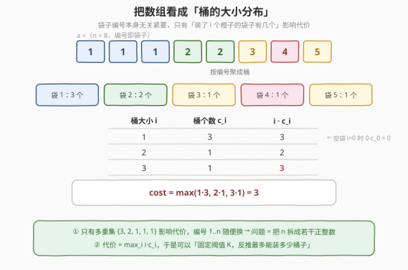
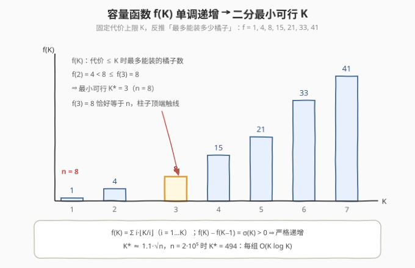
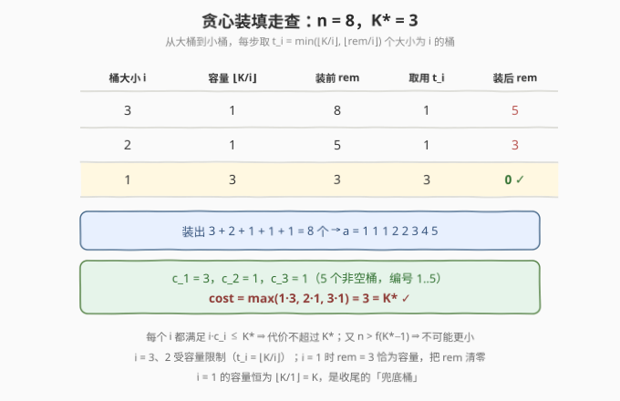

# Codeforces 2273A 拉文西亚橙子 题解

## 1. 题目概述

- **标题 / 题号**：拉文西亚橙子（Codeforces 2273A，英文名 Lavencia Oranges）
- **链接**：https://codeforces.com/problemset/problem/2273/A
- **来源**：Codeforces Round 1127 (Div. 1, Based on Mexican Olympiad in Informatics 2026) · Problem A
- **难度**：1300（500 分，Div. 1 的 A 题）
- **限制**：时间 2 s / 内存 256 MB
- **标签**：二分查找，构造，动态规划，贪心

**题意**：René 有 $n$ 个橙子和 $n$ 个编号 $1..n$ 的袋子（初始全空）。他用数组 $a$ 打包：第 $i$ 个橙子放进袋子 $a_i$，因此 $a_i \in [1,n]$（袋子编号只有 $n$ 个，允许有空袋）。Jacqueline 会选一个整数 $s$，没收所有「恰好装了 $s$ 个橙子」的袋子，并且专挑让 René 损失最大的那个 $s$。形式化地，令 $c_i$ 为 $a$ 中**恰好出现 $i$ 次**的值的个数（也就是恰好装了 $i$ 个橙子的袋子数），代价为

$$\text{cost}(a)=\max_{0 \le i \le n} i \cdot c_i .$$

给定 $n$，输出**最小可能的代价**，以及**任意一个**达到该代价的数组 $a_1,\dots,a_n$。多测：第一行 $t$，每组一个 $n$，每组输出两行（答案 + 数组）。

**约束**：

- $1 \le t \le 10^4$，且 $\sum n \le 2\cdot 10^5$
- $1 \le n \le 2\cdot 10^5$
- $a_i \in [1,n]$：编号只有 $n$ 个；$c_0$ 数的是空袋，但 $0\cdot c_0=0$ 不影响代价
- 多解输出任意一组（Special Judge），但第二行必须**恰好** $n$ 个整数

## 2. 示例

官方样例（输入 / 输出原样）：

```text
输入：
3
4
5
8

输出：
2
1 2 3 3
3
1 1 2 2 2
3
4 2 1 5 1 3 1 3
```

三组答案为 $2,3,3$。由于是多解题，官方数组只是其中一组：第三组官方的分拆是 $3+2+1+1+1$（$c_3=c_2=1,\ c_1=3$）；本文程序输出同一分拆的另一种编号方式 `1 1 1 2 2 3 4 5`，代价同样为 $\max(3\cdot 1,\,2\cdot 1,\,1\cdot 3)=3$，两者都合法。这说明**真正要决定的只是「每种大小的桶各几个」**。

## 3. 解题思路

### 3.1 暴力思路

直接枚举所有数组 $a \in [1,n]^n$，共 $n^n$ 种，逐个代入代价公式取最小：$n=4$ 时只有 $256$ 种，$n=2\cdot10^5$ 时是天量。稍聪明一点：代价只与「每种大小的桶有几个」有关，于是可以枚举 $n$ 的整数分拆；但分拆数增长极快（$p(100)\approx 1.9\times 10^8$，$p(200)\approx 4\times 10^{12}$），这条路线只在 $n$ 只有几十时可用于对拍。暴力的失败点在于把「选哪个分拆」当搜索，而分拆的**可行性**其实有闭式刻画。

### 3.2 核心观察：代价只取决于桶大小分布，容量有闭式



**观察 1（编号无关）**：把每个袋子看成一个桶，桶大小 = 它装的橙子数。数组 $\{a_i\}$ 与多重集 $\{d_1,\dots,d_m\}$（非空桶大小，$m\le n$）对应，代价只依赖这个多重集：

$$\text{cost}=\max_{i \ge 1} i\cdot c_i,\qquad c_i=\#\{j: d_j=i\},\qquad \sum_{i\ge 1} i\cdot c_i = n .$$

问题于是变成：**选一个 $n$ 的整数分拆，最小化 $\max_i i\cdot c_i$**。

**观察 2（固定阈值）**：与其直接最小化，不如问「代价能否 $\le K$」。条件 $\max_i i\,c_i\le K$ 逐项展开即

$$c_i \le \left\lfloor \frac{K}{i}\right\rfloor \ (1\le i\le K),\qquad c_i=0\ (i>K).$$

于是**代价 $\le K$ 时最多能装多少橙子**有闭式 $f(K)=\sum_{i=1}^{K} i\lfloor K/i\rfloor$；取 $c_i=\lfloor K/i\rfloor$ 能装满 $f(K)$ 个；多余的橙子只需少装几个（§5 引理 3 说明总能恰好装到 $n$），故 $n$ 可行 $\iff f(K)\ge n$。

**观察 3（二分）**：$f(K)-f(K-1)=\sigma(K)$（$K$ 的约数和）$>0$，所以 $f$ 严格递增，答案是 $K^{*}=\min\{K:f(K)\ge n\}$。量级上 $f(K)\approx 0.822K^2$，故 $K^{*}\approx 1.1\sqrt n$：$n=2\cdot 10^5$ 时 $K^{*}=494$。

### 3.3 算法流程：二分 K，再从大到小贪心装填



1. **倍增定上界**：从 $hi=1$ 翻倍到 $f(hi)\ge n$（$K^{*}=O(\sqrt n)$，最多十几倍）。
2. **二分**：在 $[1,hi]$ 上二分最小 $K^{*}$ 使 $f(K^{*})\ge n$，输出 $K^{*}$。
3. **贪心装填**：$rem=n$，从 $i=K^{*}$ 降到 $1$，每步取 $t_i=\min(\lfloor K^{*}/i\rfloor,\ \lfloor rem/i\rfloor)$ 个大小为 $i$ 的桶，$rem \leftarrow rem-i\,t_i$；$rem=0$ 时提前结束。
4. **还原数组**：给每个非空桶一个互不相同的编号（从 $1$ 递增），每个编号重复「桶大小」次。桶数 $\le n$，编号必落在 $[1,n]$。

为什么不会卡在「剩下的凑不出来」？若某步 $t_i$ 由 $rem$ 而非容量决定，剩余立刻 $<i$ 且此后只减不增，大小为 $1$ 的桶有 $K^{*}$ 个容量兜底；若每步都由容量决定，则到 $i=1$ 时剩余恰为 $n-(f(K^{*})-K^{*})=K^{*}-(f(K^{*})-n)\le K^{*}$，仍被吃干。完整证明见 §5 引理 3。

### 3.4 示例演算



取 $n=8$：$f(1)=1,\ f(2)=4,\ f(3)=8$，故 $f(2)<8\le f(3)$，$K^{*}=3$。

| $i$ | 容量 $\lfloor 3/i\rfloor$ | 装前 $rem$ | 取用 $t_i$ | 装后 $rem$ |
|-----|---------------------------|-----------|-----------|-----------|
| 3 | 1 | 8 | 1 | 5 |
| 2 | 1 | 5 | 1 | 3 |
| 1 | 3 | 3 | 3 | 0 |

得到分拆 $3+2+1+1+1=8$，即 $c_3=c_2=1,\ c_1=3$，代价 $\max(3,2,3)=3=K^{*}$，对应数组 `1 1 1 2 2 3 4 5`。再看两组：$n=5$ 时 $f(2)=4<5\le f(3)=8$，$K^{*}=3$，装出 $3+2$，数组 `1 1 1 2 2`，代价 $3$（而 $2+2+1$ 代价 $4$、$1\times5$ 代价 $5$，都更差）；$n=9$ 时 $f(3)=8<9\le f(4)=15$，$K^{*}=4$，装出 $4+3+2$，代价 $4$。

## 4. 算法细节

1. **多测清空**：`cnt` 按本组的 $K^{*}$ 开，`rem`、桶编号计数器每组重置；跨组复用是本题最常见的 WA 来源。
2. **忽略空袋**：$0\cdot c_0=0$，不必为空格子占编号，只输出 $n$ 个橙子的归属。
3. **上界用倍增**：若写 `hi = n` 并 $O(n)$ 求 $f$，单组退化成 $O(n\log n)$；倍增 + 二分只有 $O(\log K^{*})$ 次求值，每次 $O(K^{*})$。
4. **$f(K)$ 求法**：按定义 $O(K)$ 累加即可；理论上可用 $\lfloor K/i\rfloor$ 的调和分块做到 $O(\sqrt K)$（对应标签里的 dp/数论优化），但 $K\le 500$ 时没必要。
5. **整数范围**：$f(K)$ 最大约 $0.822\cdot 494^2\approx 2.0\times 10^5$，与 $n$ 同量级，`int` 够用；仍统一用 `long long` 存中间量，避免改范围时溢出。
6. **输出格式**：每组两行，第二行恰好 $n$ 个数、行末不多打空格；C++ 用 `" \n"[i+1==n]`，Python 用 `" ".join(map(str, a))`。

## 5. 正确性证明

**引理 1（代价 = 分拆模型）**：对任意数组 $a$，令 $c_i=\#\{v: v \text{ 在 } a \text{ 中出现 } i \text{ 次}\}$，则 $\sum_{i\ge 1} i\,c_i=n$ 且 $\text{cost}(a)=\max_{i\ge 1} i\,c_i$；反之，任意满足 $\sum i\,c_i=n$ 的非负整数序列都可由某个 $a$ 实现，代价恰为 $\max_{i\ge 1} i\,c_i$。

**证明**：把每个值 $v$ 的出现次数记为 $f_v$，则 $\sum_v f_v=n$，按 $f_v$ 分组即得 $\sum_i i\,c_i=n$；代价中 $i=0$ 项为 $0$，故 $\text{cost}=\max_{i\ge1} i\,c_i$。反向：给每个 $i$ 分配 $c_i$ 个互不相同的编号，每个编号重复 $i$ 次，总位置数 $\sum i\,c_i=n$；编号个数 $\sum c_i\le\sum i\,c_i=n$，落在 $[1,n]$ 内。∎

**引理 2（容量上界）**：若存在代价 $\le K$ 的数组，则 $n\le f(K)$。

**证明**：代价 $\le K$ 意味着对每个 $i\ge1$ 有 $i\,c_i\le K$，即 $c_i\le\lfloor K/i\rfloor$，且 $i>K$ 时 $c_i=0$。代入引理 1 得 $n=\sum_{i\ge1} i\,c_i\le\sum_{i=1}^{K} i\lfloor K/i\rfloor=f(K)$。∎

**引理 3（贪心恰好装满）**：设 $f(K)\ge n$，$rem_i$ 为处理桶大小 $i$ 前的剩余（$rem_{K+1}=n$），$t_i=\min(\lfloor K/i\rfloor,\lfloor rem_i/i\rfloor)$，$rem_{i-1}=rem_i-i\,t_i$。则贪心结束时 $rem_1\le K=\lfloor K/1\rfloor$，从而 $t_1=rem_1$、$rem_0=0$，恰好装出 $n$ 个橙子，且所有 $i\,t_i\le K$。

**证明**：分两种情形。

- **A**：存在 $j\ge2$ 使 $t_j=\lfloor rem_j/j\rfloor<\lfloor K/j\rfloor$（受剩余量限制）。此时 $rem_{j-1}=rem_j\bmod j<j$，之后 $rem$ 单调不增，故 $rem_1\le rem_{j-1}\le j-1\le K-1$。
- **B**：对所有 $j\ge2$ 都有 $t_j=\lfloor K/j\rfloor$（受容量限制）。则 $rem_1=n-\sum_{j=2}^{K} j\lfloor K/j\rfloor=n-\bigl(f(K)-K\bigr)=K-\bigl(f(K)-n\bigr)\le K$，且由 $f(K)\ge n$ 知 $rem_1\ge0$。

两情形都有 $0\le rem_1\le K=\lfloor K/1\rfloor$，故 $t_1=\min(K,rem_1)=rem_1$，$rem_0=0$；又每步 $t_i\le\lfloor K/i\rfloor$ 给出 $i\,t_i\le K$。∎

**定理**：设 $K^{*}=\min\{K:f(K)\ge n\}$，则最小可能代价就是 $K^{*}$，且上述构造输出的数组代价恰为 $K^{*}$。

**证明**：① **下界**：设某数组代价为 $C$，由引理 2 得 $n\le f(C)$，故 $C\ge K^{*}$。② **可达**：引理 3 说明 $K=K^{*}$ 时贪心恰好装出 $n$ 个橙子且各桶满足 $i\,t_i\le K^{*}$，由引理 1 代价 $\le K^{*}$。③ **恰为 $K^{*}$**：构造的代价 $C'\le K^{*}$，而 ① 已证 $C'\ge K^{*}$，故 $C'=K^{*}$。∎

## 6. 复杂度分析

- **时间**：每组 $O(K^{*}\log K^{*})$ 用于倍增 + 二分（每次 $f$ 求值 $O(K^{*})$），$O(K^{*})$ 装填，$O(n)$ 构造输出；合计 $O(\sum n+\sum K^{*}\log K^{*})$。$K^{*}\le 494$，单组最坏约 $10^4$ 次基本运算，瓶颈是 $2\cdot10^5$ 个整数的读写。
- **空间**：$O(n+K^{*})=O(n)$，主要是长度 $n$ 的待输出数组（约 $0.8$ MB）与长度 $K^{*}$ 的计数数组，远低于 $256$ MB。
- **实测**：$t=1,n=2\cdot10^5$ 约 $20$ ms；$t=10^4$ 且每组 $n=20$ 约 $31$ ms，相对 $2$ s 时限有 $60$ 倍以上余量。

## 7. 参考代码

### C++17

```cpp
#include <bits/stdc++.h>
using namespace std;

// f(K)：代价 <= K 时最多能装下的橘子数
long long f(long long K) {
    long long s = 0;
    for (long long i = 1; i <= K; i++) s += i * (K / i);
    return s;
}

int main() {
    ios::sync_with_stdio(false);
    cin.tie(nullptr);
    int t; if (!(cin >> t)) return 0;
    while (t--) {
        int n; cin >> n;
        long long hi = 1;                       // 倍增定上界
        while (f(hi) < n) hi <<= 1;
        long long lo = 1;
        while (lo < hi) {                       // 二分最小可行 K
            long long mid = (lo + hi) >> 1;
            if (f(mid) >= n) hi = mid; else lo = mid + 1;
        }
        long long K = lo; cout << K << '\n';
        vector<int> cnt(K + 1, 0);
        long long rem = n;
        for (long long i = K; i >= 1; i--) {     // 从大桶到小桶贪心装填
            long long take = min(K / i, rem / i);
            cnt[(int)i] = (int)take;
            rem -= take * i;
            if (!rem) break;
        }
        int bag = 0; vector<int> a; a.reserve(n);
        for (long long i = K; i >= 1; i--)
            for (int c = 0; c < cnt[(int)i]; c++) {
                ++bag;
                for (long long j = 0; j < i; j++) a.push_back(bag);
            }
        for (int i = 0; i < n; i++) cout << a[i] << " \n"[i + 1 == n];
    }
    return 0;
}
```

### Python3

```python
import sys


def max_sum(k: int) -> int:
    """代价 <= k 时最多能装下的橘子数"""
    return sum(i * (k // i) for i in range(1, k + 1))


def solve(n: int):
    hi = 1
    while max_sum(hi) < n:
        hi <<= 1
    lo = 1
    while lo < hi:                          # 二分最小可行 K
        mid = (lo + hi) // 2
        if max_sum(mid) >= n:
            hi = mid
        else:
            lo = mid + 1
    k = lo
    cnt = [0] * (k + 1)
    rem = n
    for i in range(k, 0, -1):               # 从大桶到小桶贪心装填
        take = min(k // i, rem // i)
        cnt[i] = take
        rem -= take * i
        if rem == 0:
            break
    a, bag = [], 0
    for i in range(k, 0, -1):
        for _ in range(cnt[i]):
            bag += 1
            a.extend([bag] * i)
    return k, a


def main() -> None:
    data = sys.stdin.buffer.read().split()
    if not data:
        return
    t = int(data[0]); ptr = 1
    out = []
    for _ in range(t):
        n = int(data[ptr]); ptr += 1
        k, a = solve(n)
        out += [str(k), " ".join(map(str, a))]
    sys.stdout.write("\n".join(out) + "\n")


main()
```

## 8. 边界情况与易错点

1. **$n=1$**：$f(1)=1\ge1$，$K^{*}=1$，输出 `1` 与 `1`，代价 $1$；二分下界写 $0$ 时要注意 `f(0)=0` 无意义。
2. **$n=2$**：$f(1)=1<2\le f(2)=4$，$K^{*}=2$，输出 `1 1` 或 `1 2` 代价都是 $2$；答案也不是简单的 $\lceil\sqrt n\rceil$（$n=9$ 时为 $4>3$）。
3. **行内个数必须恰为 $n$**：少一个或多一个都会被判格式错误；构造总长度 $\sum i\,t_i=n$，但要确认 `rem` 归零后才跳出。
4. **编号不能为 $0$、也不能超过 $n$**：编号从 $1$ 递增分配，桶数 $\sum t_i\le n$ 自动成立；若按「编号 = 桶大小」写会撞号：两个大小为 $3$ 的桶都被写成 $3$，合并成一个出现 $6$ 次的值，代价反而涨到 $6$。
5. **$f(K)$ 累加上界是 $K$ 而非 $n$**：$i>K$ 的项为 $0$，写成 `i <= n` 会把 $O(K)$ 变成 $O(n)$，在 $t=10^4$ 时明显变慢。
6. **Python I/O**：$t=10^4$ 时逐行 `print` 开销大，务必拼进列表后一次 `"\n".join` 写出。

## 相关题目与扩展

- [LeetCode 343. 整数拆分](https://leetcode.cn/problems/integer-break/)：同样先枚举「把 $n$ 拆成哪些正整数」，再定最优分拆，可作本题「分拆建模」的入门对照。
- [LeetCode 410. 分割数组的最大值](https://leetcode.cn/problems/split-array-largest-sum/)：经典的「最小化最大值」+ 二分答案，与本题把 $\max_i i\,c_i\le K$ 翻转成可行性判定如出一辙。
- [Codeforces 1613C Poisoned Dagger](https://codeforces.com/problemset/problem/1613/C)：二分答案处理「覆盖/容量」累加和，判定函数也是先算总量再与 $n$ 比较。
- [LeetCode 875. 爱吃香蕉的珂珂](https://leetcode.cn/problems/koko-eating-bananas/)：二分答案 + 单调可行性判定的最小模板，可与本题的 $f(K)$ 判定对照。

**延伸思考**：

1. **把 $i\,c_i$ 换成 $i^2c_i$**：容量变成 $f_2(K)=\sum_{i\le\sqrt K} i\lfloor K/i^2\rfloor\approx \frac12 K\ln K$，答案量级升到 $O(n/\ln n)$，但二分与贪心结构不变，只需把 $f$ 换成 $f_2$。
2. **限制非空袋数恰为 $m$**：除 $\sum i\,c_i=n$ 还要 $\sum c_i=m$，闭式容量不再够用，需要「份数 + 总和」的二维可行性 DP；本题是 $m$ 自由时的退化版本。
3. **把 $\max$ 换成 $\sum$**：$\sum_i i\,c_i=n$ 恒成立，答案永远是 $n$，可见「取 max」正是问题有结构的根源。
4. **求所有 $n$ 的 $K^{*}$**：$K^{*}(n)=\min\{K:f(K)\ge n\}$ 且 $f(K)-f(K-1)=\sigma(K)$，故 $n\in(f(K-1),f(K)]$ 时 $K^{*}(n)=K$，可对 $n\le N$ 用 $O(N)$ 预处理出全部答案。
