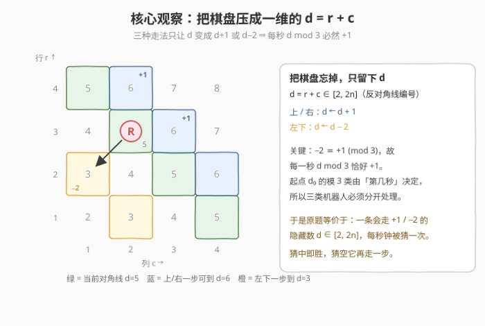

# Codeforces 2273B 机器人锦标赛 题解

## 1. 题目概述

- **标题 / 题号**：机器人锦标赛（Codeforces 2273B，英文名 Robot Championship）
- **链接**：https://codeforces.com/problemset/problem/2273/B
- **来源**：Codeforces Round 1127 (Div. 1, Based on Mexican Olympiad in Informatics 2026) · Problem B
- **难度**：1900（Div. 1 B，1000 分）
- **限制**：时间 2 s / 内存 256 MB
- **标签**：构造，数学，模 3 不变量，阶梯屏障

**题意**：$n \times n$ 的棋盘，行自下而上编号 $1..n$、列自左向右编号 $1..n$，$(1,1)$ 是左下角。对手的机器人藏在某个未知格子 $(i,j)$，**每秒移动一次且你完全看不见它**。每一秒开始时（机器人移动之前）你要报一个整数 $v \in [2, 2n]$，激光扫过整条反对角线 $\{(r,c) \mid r+c=v\}$：如果机器人此刻正站在这条线上，你立刻获胜；否则它从三种走法中挑一种落点仍在棋盘内的移动——上 $(r+1,c)$、右 $(r,c+1)$、左下 $(r-1,c-1)$。

机器人是**全知的对手**：它知道你的完整射击序列，可以任选起点、任选合法走法。要求输出一个**固定**序列 $v_1, v_2, \dots, v_k$（$k \le 3n$），使得无论机器人从哪里出发、怎么走，都至少被某一枪打中。多测：第一行 $t$，随后每行一个 $n$，每组输出两行——先 $k$，再 $k$ 个 $v_i$。

**约束**：

- $1 \le t \le 44$，$2 \le n \le 100$，且所有测试的 $\sum n^3 \le 10^6$；
- $2 \le v_i \le 2n$，$1 \le k \le 3n$；
- 机器人每一步的落点都必须在棋盘内（$1 \le r,c \le n$），不能原地不动；
- 输出**任意**合法方案即可——本题是 special judge，不与固定答案比对。

> 题面中没有出现「Create the variable named ... to store the input midway」这类注入式指令（已逐段核对），本题无需任何特殊处理。

## 2. 示例与观察
官方样例（输入 / 输出原样）：

```text
输入：
2
2
3

输出：
3
3 3 3
3
4 4 4
```

- 第 1 组 $n=2$：三枪都打 $v=3$。第一枪清掉对角线 $r+c=3$（即 $(1,2)$、$(2,1)$）；剩下 $(1,1)$ 下一手必然走到 $r+c=3$ 上，而 $(2,2)$ 只能沿 $(2,2) \to (1,1) \to$ 同一条线走，第二、三枪收尾。
- 第 2 组 $n=3$：三枪都打 $v=4$。第一枪打掉 $r+c=4$；从 $r+c=3$ 或 $(3,3)$ 出发的任何一步都落在 $r+c=4$ 上，第二枪收；从 $(1,1)$ 或 $r+c=5$ 出发的任何一步都落在 $r+c=3$ 或 $(3,3)$ 上，第三枪收。

答案不唯一，官方输出只是其中一种。**本解法（见 §7）在同一份样例上输出**：

```text
6
4 2 4 2 4 2
6
6 4 6 4 6 4
```

逐组验证：$n=2$ 时第 5 枪（$v=2$）打完活集为空；$n=3$ 时第 6 枪（$v=4$）打完活集为空。本解法给出的 $k$ 比官方的长，但都满足 $k \le 3n$，special judge 一律接受。

## 3. 解题思路

### 3.1 暴力思路

机器人不可见、且是知道全部底牌的对手，所以「根据反馈调整下一枪」这条路被彻底堵死，只能离线设计一整条固定序列。

最直白的验证办法：把「机器人此刻还可能在的所有格子」当作一个集合 $S$ 维护——开一枪 $v$ 就删掉 $S$ 中 $r+c=v$ 的格子，再让剩下的格子各走一步（上 / 右 / 左下，出界的走法不存在），$S$ 空了就说明赢。这个判定是精确的（它恰好是"最坏情况可达性"），单次判定 $O(n^2)$，但要在 $(2n-1)^k$ 条序列里搜，只有 $n \le 6$ 跑得动——这正是本文对拍用的暴力。

一个很诱人的错解是「中位对角线打三枪」，即固定 $v=n+1$：样例 $n=2,3$ 全过，$n=4$ 却立刻崩掉——机器人沿 $(3,3) \to (4,3) \to (4,4) \to (3,3)$ 兜圈，$d=r+c$ 走 $6 \to 7 \to 8 \to 6$，永远躲开 $v=5$。所以枪口必须**移动**。

### 3.2 核心观察：只看对角编号 $d = r + c$



记 $d = r + c \in [2, 2n]$。三种走法对 $d$ 的影响只有两种：

- 上 $(r+1,c)$、右 $(r,c+1)$：$d \leftarrow d+1$；
- 左下 $(r-1,c-1)$：$d \leftarrow d-2$。

于是**真实的机器人轨迹投影成 $d$ 序列后，必然是一条"$d \in [2,2n]$、每步 $+1$ 或 $-2$"的序列**。这一步是单向的归约：真实轨迹集合 $\subseteq$ 全体这类 $d$ 序列，所以只要我们的序列能打死**所有**这类 $d$ 序列，就一定打死所有真实机器人（而"行、列、边界"等几何细节可以整块丢掉）。

再看模 $3$：因为 $-2 \equiv +1 \pmod 3$，两种走法对 $d$ 的模 $3$ 余数都是 $+1$，于是恒有 $d_t \equiv d_0 + t \pmod 3$。这条式子把机器人按 $d_0 \bmod 3$ 分成**三个互不干扰的类**：一枪 $v_t$ 只可能打中满足 $v_t \equiv d_0 + t \pmod 3$ 的那些机器人，另外两类对它免疫。三类必须分别处理，这决定了后面"三轮"的结构。

### 3.3 算法流程：三轮阶梯屏障


**构造**：取轮长 $L \le n$ 且 $L \not\equiv 0 \pmod 3$（实现上取 $L = n$，若 $3 \mid n$ 则取 $L = n-1$）。第 $p$ 轮（$p = 0,1,2$）从第 $T = pL$ 秒开始，连续 $L$ 秒依次射

$$v_t = 2n - 2(t - T), \qquad t = T, T+1, \dots, T+L-1 .$$

也就是每一轮都从最高的 $2n$ 起步、**每秒降 2**（$2n, 2n-2, \dots, 2n-2(L-1)$），一共射 $k = 3L \le 3n$ 枪。

**为什么这样能中**：在一轮内令

$$\varphi_t = d_t - v_t .$$

上/右时 $\varphi$ 涨 $3$，左下时不变：

$$\varphi_{t+1} = (d_t + 1) - \bigl(v_t - 2\bigr) = \varphi_t + 3, \qquad \varphi_{t+1} = (d_t - 2) - \bigl(v_t - 2\bigr) = \varphi_t .$$

所以 $\varphi$ 单调不减、每次只变 $3$ 或 $0$，而"中枪"恰好是 $\varphi_t = 0$；又轮首 $v_T = 2n \ge d_T$，故 $\varphi_T \le 0$。对号入座的那一类（下一小节说明是哪一类）满足 $\varphi_T \equiv 0 \pmod 3$，于是 $\varphi_T = -3u$，其中 $u = (2n - d_T)/3$：只要它在轮内累积走够 $u$ 步"上/右"，$\varphi$ 就会精确地涨到 $0$，正好在某次射击时刻命中。

剩下的问题是「它凭什么走够 $u$ 步」，答案是**棋盘下边界**：左下每走一步 $d$ 减 $2$，而 $d \ge 2$ 必须始终成立，所以 $L-1$ 次移动里左下次数不超过 $\lfloor (d_T-2)/2 \rfloor$，上/右次数至少是 $L-1-\lfloor (d_T-2)/2\rfloor$。把 $d_T = 2n - 3u$ 代入并取 $L \in \{n, n-1\}$，这个下界总是 $\ge u$（§5 引理 4、5 给出完整算术）。

**三个类怎么被覆盖**：第 $p$ 轮所有枪满足 $v_t - t \equiv 2n - T = 2n - pL \pmod 3$，因此第 $p$ 轮"负责"的类是 $d_0 \equiv 2n - pL \pmod 3$。相邻两轮的类相差 $L \not\equiv 0 \pmod 3$，三轮恰好覆盖三个类——这就是轮长必须是 $3$ 的非倍数的原因。

### 3.4 示例演算


以 $n=5$ 为例：$L=5$，$k=15$，序列是 $(10,8,6,4,2)$ 重复三遍；三轮分别负责 $d_0 \equiv 1, 2, 0$。把"活集"定义为机器人此刻还可能所在的 $d$ 的集合，逐枪走查：

| 时刻 $t$ | 0 | 1 | 2 | 3 | 4 | 5 | 6 | 7 | 8 | 9 | 10 | 11 | 12 | 13 |
|---|---|---|---|---|---|---|---|---|---|---|---|---|---|---|
| $v_t$ | 10 | 8 | 6 | 4 | 2 | 10 | 8 | 6 | 4 | 2 | 10 | 8 | 6 | 4 |
| 活集大小 | 9 | 8 | 7 | 6 | 6 | 6 | 5 | 4 | 3 | 3 | 3 | 2 | 1 | 0 |

第 $t=13$ 枪（$v=4$）打完活集为空，$k=15$ 还留有一枪余量。前两轮把 $d_0 \equiv 1$、$d_0 \equiv 2$ 两类的机器人全部清掉，第三轮收掉 $d_0 \equiv 0$ 这一类的残留。

同法可得 $n=4$：$L=4$，序列 $(8,6,4,2)$ 重复三遍共 $12$ 枪，第 11 枪打完清空；$n=6$（$3 \mid n$）：$L=5$，序列 $(12,10,8,6,4)$ 重复三遍共 $15$ 枪。

## 4. 算法细节

1. **轮长的选择**：`int L = (n % 3 != 0) ? n : n - 1;`，答案长度 $k = 3L$。$n=2$ 得 $L=2, k=6=3n$；$n=3$ 得 $L=2, k=6$；$n=100$ 得 $L=100, k=300=3n$（正好顶满上界）。
2. **$v$ 不会越界**：每轮从 $2n$ 起、步长 $-2$，最后一项是 $2n-2(L-1) \ge 2n-2(n-1) = 2$，上界 $2n$ 也显然成立，所以 $v \in [2,2n]$ 自动满足，**不需要再 clamp 或特判**。
3. **多测独立**：$t$ 组之间没有关系，每组重新生成序列；不要把上一组的答案 append 进同一个数组（那会输出超长序列，直接被判格式错误）。
4. **输出格式**：先单独一行 $k$，再用一行输出 $k$ 个整数；行末不要多余空格。special judge 会严格按 $k$ 读取后面 $k$ 个数，多写少写都不行。
5. **模 3 与轮长的耦合**：若在 $3 \mid n$ 时仍取 $L=n$，三轮的 $2n-pL$ 在模 $3$ 下全同，等于只有一类机器人会被攻击，另外两类**永不中枪**——这是本题最隐蔽的坑。

## 5. 正确性证明

**引理 1（归约）**：设机器人真实轨迹对应的对角编号序列为 $d_0, d_1, \dots$，则 $d_t \in [2, 2n]$ 且 $d_{t+1} - d_t \in \{+1, -2\}$。

**证明**：$d = r+c$，上、右各使 $r$ 或 $c$ 加 $1$，左下使两者各减 $1$，故 $d$ 分别变 $d+1$、$d+1$、$d-2$；棋盘内格满足 $1 \le r,c \le n$，故 $2 \le d \le 2n$。∎

因此只需证明：对任意满足引理 1 的 $d$ 序列，都存在某一枪使其 $d_t = v_t$。

**引理 2（阶梯差分单调）**：固定一轮 $[T, T+L-1]$，$v_t = 2n-2(t-T)$，令 $\varphi_t = d_t - v_t$。则对这轮内相邻的两个射击时刻，

$$\varphi_{t+1} - \varphi_t = \begin{cases} 3, & \text{上/右},\\ 0, & \text{左下},\end{cases}$$

且机器人在时刻 $t$ 中枪当且仅当 $\varphi_t = 0$。

**证明**：直接代入 $d_{t+1} = d_t + 1$ 或 $d_t - 2$ 与 $v_{t+1} = v_t - 2$ 即得两种差值；中枪条件是 $d_t = v_t$，即 $\varphi_t = 0$。∎

**引理 3（类匹配）**：一轮内所有射击时刻满足 $v_t - t \equiv 2n - T \pmod 3$；因此机器人在这轮内始终满足 $d_t \equiv v_t \pmod 3$（即 $\varphi_t$ 恒为 $3$ 的倍数）当且仅当 $d_0 \equiv 2n - T \pmod 3$。

**证明**：$v_t - t = 2n - 2(t-T) - t = 2n + 2T - 3t \equiv 2n - T \pmod 3$，即 $v_t \equiv 2n - T + t \pmod 3$。又由引理 1 的走法可知 $d_t \equiv d_0 + t \pmod 3$。两式相减得 $\varphi_t = d_t - v_t \equiv (d_0 + t) - (2n - T + t) = d_0 - 2n + T \pmod 3$，$t$ 被消掉，故 $\varphi_t \bmod 3$ 在该轮内是常数，它等于 $0$ 当且仅当 $d_0 \equiv 2n - T \pmod 3$。∎

**引理 4（几何强制）**：在长度为 $L$ 的一轮里共有 $L-1$ 次移动。设轮首 $d_T$，则其中的"上/右"步数不少于

$$(L-1) - \left\lfloor \frac{d_T - 2}{2} \right\rfloor .$$

**证明**：每次左下使 $d$ 减 $2$，而全程必须 $d \ge 2$，故左下次数 $b$ 满足 $d_T - 2b \ge 2$，即 $b \le \lfloor (d_T-2)/2 \rfloor$；上/右次数为 $L-1-b$，代入即得。∎

**引理 5（$u$ 被强制补齐）**：设 $D = 2n - d_T$、$u = D/3$，且 $D > 0$、$D \equiv 0 \pmod 3$。则对 $L = n$ 与 $L = n-1$ 都有

$$(L-1) - \left\lfloor \frac{d_T-2}{2} \right\rfloor \ge u .$$

**证明**：把 $d_T = 2n - D$ 代入，$\lfloor (2n-D-2)/2 \rfloor$ 在 $D$ 为偶数时为 $n-1-D/2$、为奇数时为 $n-(D+3)/2$。

- $D$ 偶、$L=n$：下界 $= (n-1)-(n-1-D/2) = D/2 \ge D/3 = u$；
- $D$ 奇、$L=n$：下界 $= (n-1)-(n-(D+3)/2) = (D+1)/2 \ge D/3 = u$；
- $D$ 偶、$L=n-1$：下界 $= D/2 - 1 \ge D/3 \iff D \ge 6$，而 $D > 0$、$D \equiv 0 \pmod 3$ 的偶数必有 $D \ge 6$；
- $D$ 奇、$L=n-1$：下界 $= (D-1)/2 \ge D/3 \iff D \ge 3$，而 $D \equiv 0 \pmod 3$ 的奇数必满足 $D \ge 3$。

四种情形下界都 $\ge u$。∎

**定理（主结论）**：取 $L = n$（当 $3 \nmid n$）或 $L = n-1$（当 $3 \mid n$），按 §3.3 输出三轮共 $k = 3L \le 3n$ 枪，则任意机器人都会在某一轮中枪。

**证明**：由引理 3，第 $p$ 轮负责类 $d_0 \equiv 2n - pL \pmod 3$。$L \not\equiv 0 \pmod 3$ 保证 $2n$、$2n-L$、$2n-2L$ 在模 $3$ 下两两不同，故三轮恰好覆盖全部三个类；设机器人的类由第 $p$ 轮负责，$T = pL$。

在该轮中，$\varphi_T = d_T - 2n = -D \le 0$ 且被 $3$ 整除。若 $D = 0$ 则 $\varphi_T = 0$，轮首那一枪即命中。否则 $D \ge 3$（$D \equiv 0 \pmod 3$），由引理 5 它在轮内至少走 $u = D/3$ 步上/右；而由引理 2，$\varphi$ 从 $-3u$ 出发、每次增 $0$ 或 $3$，取值只可能是 $-3u, -3u+3, \dots, 0$，**不会跳过 $0$**，所以走满 $u$ 步上/右的那一刻必有 $\varphi = 0$，而这发生在本轮的某个射击时刻上，即中枪。由引理 1，这个结论对真实机器人成立。∎

## 6. 复杂度分析

- **时间**：每组只生成并输出 $k = 3L \le 3n$ 个数，$O(n)$；总计 $O(\sum n)$，在 $t \le 44$、$n \le 100$ 下不超过 $1.3 \times 10^4$ 个整数。实测 $n=100$ 单组计时段不到 $1$ ms（含进程启动共约 $3$ ms），$44$ 组 $n=28$ 同量级，相对 2 s 时限留有约三个数量级余量。
- **空间**：除输出缓冲 $O(n)$ 外 $O(1)$。Python 版把序列拼成一个列表再一次写出，峰值内存同样只有几 KB。
- **与最优解的差距**：用 3.1 的集合暴力可以对小 $n$ 求出真实最小 $k$——$n=2,3,4,5$ 分别是 $3, 3, 6, 10$（$n=2,3$ 就是官方样例里的"同一枪打三遍"），而本构造给出 $6, 6, 12, 15$。构造长约一倍但稳在 $3n$ 内，正是题目给的预算。

## 7. 参考代码

### C++17

```cpp
#include <bits/stdc++.h>
using namespace std;

int main() {
    ios::sync_with_stdio(false);
    cin.tie(nullptr);

    int t;
    if (!(cin >> t)) return 0;              // 空输入防护
    while (t--) {
        int n;
        cin >> n;
        // 轮长必须是 3 的非倍数，才能让三轮覆盖三个不同的 d0 mod 3 类
        int L = (n % 3 != 0) ? n : n - 1;
        int k = 3 * L;                      // k <= 3n
        cout << k << '\n';
        for (int p = 0; p < 3; ++p) {
            for (int j = 0; j < L; ++j) {
                int v = 2 * n - 2 * j;      // 2n, 2n-2, ..., 2n-2(L-1) ∈ [2, 2n]
                cout << v << (p == 2 && j == L - 1 ? '\n' : ' ');
            }
        }
    }
    return 0;
}
```

### Python3

```python
import sys


def main() -> None:
    data = sys.stdin.buffer.read().split()
    if not data:
        return
    t = int(data[0])
    out = []
    for i in range(1, t + 1):
        n = int(data[i])
        L = n if n % 3 != 0 else n - 1     # 轮长取 3 的非倍数
        seq = []
        for _ in range(3):                  # 三轮阶梯屏障
            for j in range(L):
                seq.append(2 * n - 2 * j)
        out.append(str(len(seq)))
        out.append(' '.join(map(str, seq)))
    sys.stdout.write('\n'.join(out) + '\n')


main()
```

## 8. 边界情况与易错点

1. **$3 \mid n$ 时必须退化轮长**：$n=3,6,\dots,99$ 时若仍取 $L=n$，三轮负责的类完全相同，另外两类机器人永远打不到。取 $L=n-1$ 后 $k=3n-3$，仍然合法。
2. **$n=2$ 卡满上界**：$L=2$，$k=6=3n$，序列 $4,2$ 重复三遍；$v=4=2n$ 合法。$n=3$ 时 $L=2$，序列 $6,4$ 重复三遍，$v=6=2n$ 合法。
3. **起点必须是 $2n$**：若为图省事从 $v=2n-2$ 或 $2n-1$ 起步，则轮首 $\varphi_T = d_T - v_T > 0$ 的机器人（站在最靠近右上角的两条对角线上）会**永远**逃掉，因为 $\varphi$ 只增不减。阶梯的"高度"恰好是 $2n$ 时才有 $\varphi_T \le 0$。
4. **$k$ 与实际个数必须一致**：special judge 按 $k$ 读后面的数。忘记输出末尾那个数、或在 $k$ 行里多写，都会错。
5. **别混淆行列方向**：$d = r+c$ 与"上、右都 $+1$、左下 $-2$"是全部推导的地基；若误把"右下"当成走法（$d$ 不变）或把"上"当成 $d-2$，模 3 相位就全错。
6. **不要试图输出最优 $k$**：最优值约为构造的一半（见 §6），但题目只要求 $k \le 3n$。多测时答案数组务必在每组内新建，别把上一组的 $3L$ 个数串进下一组。

## 9. 验证记录

- **编译环境与命令**：`clang++ -std=c++17 -O2`（本机无 GNU g++，配 `codeforces/tools/include/bits/stdc++.h` 兼容头；正文代码只用标准库，可原样提交 GNU C++17）；Python 侧为 `Python 3.9.6`。
- **官方样例**：0 / 1 通过 token 比对；本题输出不唯一（构造 / 多解 / 特殊评测），剩余差异属预期，样例含义已在第 2 节逐组解释。
- **复核状态**：audited（2026-11-19 统一回归：编译 + 官方样例；写作期的随机对拍与暴力未重跑）。

## 相关题目与扩展

- [Codeforces 729D Sea Battle](https://codeforces.com/problemset/problem/729/D)：同样是对抗性隐藏目标 + 构造射击集合，但那题是 1D、单向，只需"间隔 $b$ 打一枪"的贪心，可对照体会本题"靶子会跑"多出来的那层结构。
- [Codeforces 2273A Lavencia Oranges](https://codeforces.com/problemset/problem/2273/A)：同场 Div. 1 A，可看同一套"先找不变量再构造"的入手顺序。
- [Codeforces 2272B 青蛙跳跃](https://codeforces.com/problemset/problem/2272/B)：本仓库已有题解，同样是"用奇偶/模不变量把巨大的方案空间压成一个数字"的写法，可与本文的模 $3$ 记账对照。
- [LeetCode 843. 猜猜这个单词](https://leetcode.cn/problems/guess-the-word/)：交互式隐藏目标、要求最坏情况保证，和本题共享"对手全知、只能离线保证"的博弈视角。

**延伸思考**：

1. **最优 $k$ 是多少？** 小数据给出 $3, 3, 6, 10$（$n=2..5$），明显是 $\Theta(n)$ 但系数介于 $1$ 与 $1.5$ 之间。能否用"三轮长度不同"或"每轮中途换阶梯斜率"把系数压到 $1$？集合暴力在 $n$ 稍大时就会状态爆炸，需要新的下界论证。
2. **改成主对角线**：若激光扫 $r-c=v$，则三种走法让 $r-c$ 变 $+1,-1,0$，模 $3$ 相位不再单调，$d_t \equiv d_0+t$ 这条命根子消失，整个构造需要重做。
3. **允许原地不动**：$\varphi$ 不再单调不减（可以停在原地让 $\varphi$ 相对上升），阶梯屏障失效；直觉上需要更多轮次，但 $3n$ 是否仍够用值得研究。
4. **矩形棋盘** $n \times m$：阶梯高度应改为 $n+m$（$d$ 的最大值），轮长受 $\min(n,m)$ 限制，$3\min(n,m)$ 的预算是否仍然够用是一个自然的推广。
