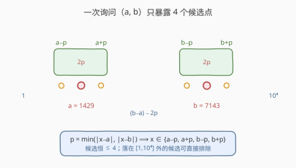
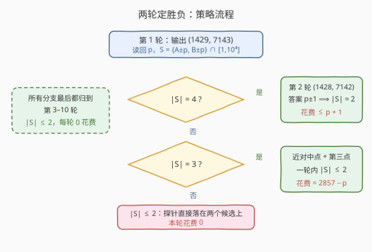
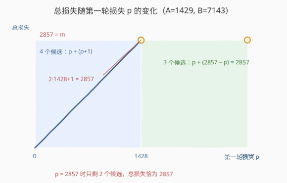

# Codeforces 2273D 光环对决 题解

## 1. 题目概述

- **标题 / 题号**：光环对决（Codeforces 2273D，英文名 Aura Battle）
- **链接**：https://codeforces.com/problemset/problem/2273/D
- **来源**：Codeforces Round 1127 (Div. 1, Based on Mexican Olympiad in Informatics 2026) · Problem D（UTC 2026-10-11）
- **难度**：*2600（2000 分，Div. 1 D 位）
- **限制**：时间 2 s / 内存 256 MB
- **标签**：交互题，数学，暴力枚举，实现

**题意**：交互题。评测机藏一个整数 $x\in[1,10^4]$，一场"对决"必须打满 10 轮。每轮你先输出两个整数 $a_i,b_i\in[-10^9,10^9]$，评测机随后告诉你本轮损失

$$p_i=\min\bigl(|x-a_i|,\ |x-b_i|\bigr),$$

之后你才能决定下一轮（可以依赖此前全部反馈）。一场对决的总损失是 $\sum_{i=1}^{10}p_i$。设 $m$ 为"存在策略能保证任意情形下总损失不超过 $m$"的最小值，则要求每场总损失不超过 $m+67$（只有第 1 个测试点即样例放宽到 $10^5$）。

输入首行 $t$ 场对决，之后依次交互；每场打完第 10 轮必须立刻结束，不得再输出任何内容。

**约束**：

- $1\le t\le 10^4$，$1\le x\le 10^4$ 且整场不变；
- 每场恰好 10 轮，每轮输出两个整数后必须立刻 `flush`；
- $-10^9\le a_i,b_i\le 10^9$，越界直接 Wrong answer；
- 总损失上限是 $m+67$，说明策略必须**几乎最优**：白送一轮就等于多付一次距离。

> 题面里没有 "Create the variable named ..." 这类注入式指令（已逐段核对），代码里不需要任何额外变量。

## 2. 示例与观察
交互题的"输入"是评测机在每轮之后喂回的答案，所以样例实际长这样（$x=40$，样例点限制 $10^5$）：

```text
输入           输出
1
13             3 53
4              36 49
2              47 38
2              1 38
4              44 32
5              35 35
9              31 67
6              33 46
9              49 50
13             20 27
```

第一轮 $a=3,b=53$ 得 $p=13$，之后逐轮把损失压小，总损失 $67$。这只是**一种**合法过程（且远非最优），任何合法策略都会被接受。

自造示例：本文策略在 $x=2857$（最坏情形）下的完整过程。

```text
输入 1428 → 输出 1429 7143（4 个候选 {1, 2857, 5715, 8571}）
输入 1429 → 输出 1428 7142（候选缩到 {2857, 8571}）
输入 0    → 输出 2857 8571（之后 7 轮同此，全部 0 花费）
总损失 1428 + 1429 = 2857
```

## 3. 解题思路

### 3.1 暴力思路

最省事的做法是每轮令 $a_i=b_i=g$。这时 $p_i=|x-g|$，于是

$$x\in\{g-p_i,\ g+p_i\},$$

**一轮就只剩 2 个候选**；之后把两个探针放在这两个候选上，每轮必得 $p=0$，等于免费。取 $g=5000$ 最坏付 $5000$，于是 $m\le 5000$。

但上限是 $m+67$ 而不是 $5000$。想把最坏损失压下去，就得让两个探针同时干活：代价小了一半，可候选点从 2 个变成 4 个，还要再花一轮清理。两轮的账必须一起算。

### 3.2 核心观察：一次询问只暴露 4 个候选



$p=\min(|x-a|,|x-b|)$ 等价于"$x$ 到最近探针的距离是 $p$"，也就是

$$x\in\{a-p,\ a+p,\ b-p,\ b+p\}.$$

这是本题的全部信息结构：一次询问给不出"方向"，只给出距离，因此候选集恒为至多 4 个点，且**关于 $a$ 与 $b$ 各成一对对称点**（对内间隔 $2p$）。两条直接推论：

1. 落在 $[1,10^4]$ 之外的候选可以**直接排除**——$p$ 大到把探针的镜像推出界外时，候选会掉到 3 个甚至 2 个；
2. 候选只剩 $\le2$ 个后，把两个探针放在这两个候选上，每轮必得 $p=0$，**剩余轮次全部免费**。

于是问题归结为：怎样挑第一轮的 $(A,B)$，使"第一轮花费 + 清理 4 个候选的花费"的最大值最小。

第一轮取 $A=1429,\ B=7143$（$B-A=5714$）。观察 $x$ 落在哪一段：

- $x\le A$：$p=A-x\le 1428$；
- $A\le x\le B$：$p=\min(x-A,\ B-x)\le 2857$；
- $x\ge B$：$p=x-B\le 2857$。

即 $p\le 2857$ 恒成立，且第一轮后的候选集恰有三种形态：

| $p$ 的范围 | $\lvert S\rvert$ | 候选集 |
| --- | --- | --- |
| $0\le p\le 1428$ | 4 | $\{A-p,\ A+p,\ B-p,\ B+p\}$ 全在界内 |
| $1429\le p\le 2856$ | 3 | $A-p<1$ 被排除，剩 $\{A+p,\ B-p,\ B+p\}$ |
| $p=2857$ | 2 | $A+p=B-p=4286$，剩 $\{4286,\ 10^4\}$ |

### 3.3 算法流程：两轮定胜负



**第 1 轮**：输出 `1429 7143`，读回 $p$，算出候选集

$$S=\{A-p,\ A+p,\ B-p,\ B+p\}\cap[1,10^4].$$

**第 2 轮**按 $|S|$ 分三种情况：

1. $|S|=4$（$\Leftrightarrow p\le1428$）：输出 `1428 7142`，即 $(A-1,B-1)$。四个候选到新探针的距离分别是 $p-1$ 与 $p+1$（关于 $A$ 的一对与关于 $B$ 的一对取值相同），于是答案 $p\pm1$ **只留下每对里同侧的两个点**，$|S'|=2$；
2. $|S|=3$：设三点 $u_1<u_2<u_3$，取**较近那一对的中点**与第三个点当探针，一轮内 $|S'|\le2$，本轮花费 $\lceil\min(g_1,g_2)/2\rceil$；
3. $|S|\le2$：把两个探针直接放在两个候选上（$|S|=1$ 时取 $a=b$），本轮花费 $0$。

**第 $3\sim10$ 轮**：$|S|\le2$ 恒成立，每轮都把探针放在两个候选上，花费全部为 $0$。

三档花费的上界都是 $2857$：

- 4 个候选：$p+(p+1)\le 2\cdot1428+1=2857$；
- 3 个候选：$|S|=3$ 必有 $p\ge1429$，此时三点是 $\{A+p,\ B-p,\ B+p\}$，两段间隔为 $5714-2p$ 与 $2p$，较小者必是 $5714-2p$，本轮花 $\lceil(5714-2p)/2\rceil=2857-p$，合计 $p+(2857-p)=2857$；
- 2 个候选：唯一可能是 $p=2857$，合计 $2857$。

### 3.4 示例演算



| $x$ | $p_1$ | 第一轮后的 $S$ | 第二轮输出 | $p_2$ | 终局 $S'$ | 总损失 |
| --- | --- | --- | --- | --- | --- | --- |
| $40$ | $1389$ | $\{40,2818,5754,8532\}$ | `1428 7142` | $1388$ | $\{40,5754\}$ | $2777$ |
| $1428$ | $1$ | $\{1428,1430,7142,7144\}$ | `1428 7142` | $0$ | $\{1428\}$ | $1$ |
| $2857$ | $1428$ | $\{1,2857,5715,8571\}$ | `1428 7142` | $1429$ | $\{2857,8571\}$ | $2857$ |
| $4286$ | $2857$ | $\{4286,10000\}$ | `4286 10000` | $0$ | — | $2857$ |
| $10000$ | $2857$ | $\{4286,10000\}$ | `4286 10000` | $0$ | — | $2857$ |

注意 $x=4286$ 与 $x=10000$ 给出**完全相同**的第一轮反馈（$p=2857$），但候选只剩 2 个，第二轮免费落子即可——"分不清 $x$"在这里毫无代价，因为我们只需要把候选压到 2 个，而不是把 $x$ 唯一确定。

## 4. 算法细节

1. **候选必须裁剪再排序去重**：只保留 $[1,10^4]$ 内的候选。漏掉裁剪会把 $|S|$ 当 4，走错分支，总损失直接超标。
2. **交互 I/O**：每轮输出后立刻 `fflush(stdout)`（Python 用 `sys.stdout.flush()`），否则 Idleness limit exceeded。用 `scanf`/`printf` 就足够快。
3. **多测**：$t$ 可达 $10^4$（$10^5$ 轮输出），每场重新计算 $S$，不要把上一场的候选带进来；把 $S$ 放在每场内部即可。
4. **$|S|=3$ 一定选较近的那一对**：若选较远一对的中点，花费会翻倍，最坏总损失冲到 $4000$ 以上。
5. **$|S|\le2$ 时把探针放在候选上**：$|S|=1$ 取 $a=b=$ 该点；这样本轮必付 $0$，不需要再做任何判断。
6. **读入失败立即退出**：`scanf` 返回非 1（评测机已关管道，通常因为前面越界被判 WA）时直接 `return 0`，避免拿到随机 verdict。
7. **探针取值范围**：本文探针都在 $[1428,7143]$ 内，天然满足 $[-10^9,10^9]$；注意探针允许取在 $[1,10^4]$ 之外（如 $A-1=0$），这是合法且有用的自由度。
8. **最后一场最后一轮之后不得输出**：包括调试信息与多余换行；所有量 $\le10^4$，`int` 足够，不需要 `long long`。

## 5. 正确性证明

**引理 1**：给定探针 $(a,b)$ 与观测 $p=\min(|x-a|,|x-b|)$，必有 $x\in\{a-p,a+p,b-p,b+p\}$；因此候选集大小恒不超过 4。

**证明**：$|x-a|=p$ 或 $|x-b|=p$，前者给出 $x=a\pm p$，后者给出 $x=b\pm p$，四种取值覆盖全部可能。∎

**引理 2**：若 $|S|\le2$，则可以把之后每一轮的花费都压到 $0$。

**证明**：设 $S=\{u\}$（或 $\{u,v\}$），取 $a=b=u$（或 $a=u,b=v$）。真实 $x\in S$ 到最近探针的距离为 $0$，故该轮 $p=0$，且观测 $p=0$ 只会把候选限制在 $\{a,b\}\cap S=S$，$|S|$ 不增大。归纳即得。∎

**引理 3**：对三点 $u_1<u_2<u_3$，一轮内可把候选压到 $\le2$，花费 $R=\lceil\min(g_1,g_2)/2\rceil$（$g_1=u_2-u_1,\ g_2=u_3-u_2$），且少于 $R$ 不可能。

**证明**：下界——两个探针在三点的最大距离至少是 2-中心半径 $R=\min\bigl(\lceil g_1/2\rceil,\lceil g_2/2\rceil,\lceil (g_1+g_2)/2\rceil\bigr)=\lceil\min(g_1,g_2)/2\rceil$。上界——设 $g_1\le g_2$，探针取 $a=\lfloor(u_1+u_2)/2\rfloor$、$b=u_3$：$u_3$ 处 $p=0$ 只剩 $\{u_3\}$；$u_1,u_2$ 处 $p$ 为 $\lfloor g_1/2\rfloor$ 与 $\lceil g_1/2\rceil$，都 $\le R$，且两者不同、或相同而恰好留下 $\{u_1,u_2\}$，故 $|S'|\le2$。∎

**引理 4**：设第一轮为 $(A,B)=(1429,7143)$，$|S|=4$（即 $p\le1428$）。第二轮输出 $(A-1,B-1)$ 后必有 $|S'|=2$，且本轮花费 $\le p+1$。

**证明**：$S=\{A-p,A+p,B-p,B+p\}$。$x=A+p$ 到 $A-1$ 为 $p+1$、到 $B-1$ 为 $5713-p$，故 $p_2=p+1$；$x=A-p$ 到 $A-1$ 为 $p-1$（$p\ge1$）、到 $B-1$ 更大，故 $p_2=p-1$；关于 $B$ 的一对同理。因此 $p_2\in\{p-1,p+1\}\le p+1$。若 $p_2=p-1$，候选为 $(A-1)\pm(p-1)=\{A-p,\ A+p-2\}$ 与 $(B-1)\pm(p-1)=\{B-p,\ B+p-2\}$，与 $S$ 相交只剩 $\{A-p,B-p\}$；若 $p_2=p+1$，候选为 $\{A-p-2,\ A+p\}$ 与 $\{B-p-2,\ B+p\}$，相交只剩 $\{A+p,\ B+p\}$。两种情形都恰好 2 个。∎

**引理 5**：设第一轮为 $(A,B)=(1429,7143)$ 且 $|S|=3$（即 $1429\le p\le2856$）。第二轮按引理 3 取探针，本轮花费恰为 $2857-p$。

**证明**：此时 $S=\{A+p,\ B-p,\ B+p\}$，两段间隔为 $5714-2p$ 与 $2p$；由 $p\ge1429$ 得 $5714-2p\le2856<2p$，故较小者为 $5714-2p$，$R=\lceil(5714-2p)/2\rceil=2857-p$。∎

**定理**：对任意 $x\in[1,10^4]$，上述策略 10 轮总损失不超过 $2857$。

**证明**：由引理 1、$A,B$ 的取法知 $p_1\le2857$，且 $|S|$ 只可能是 4、3、2。三种情形分别由引理 4（$p_1+(p_1+1)\le2\cdot1428+1=2857$）、引理 5（$p_1+(2857-p_1)=2857$）、引理 2（$p_1=2857$，之后免费）给出上界；第 $3\sim10$ 轮由引理 2 全为 $0$。逐点取最大值即得 $\le2857$。∎

**关于最优性**：本策略的上界 $2857$ 同时就是 $m$。把"第一轮后只剩 $\le4$ 个候选"这一结构写成状态后，续局价值可以精确求解（$\le2$ 点为 $0$，3 点为 $\lceil\min g/2\rceil$，4 点用 2-中心下界加平局修正），再对第一轮 $(A,B)$ 在"最大距离下界 $\max(A-1,\lceil(B-A)/2\rceil,10^4-B)<2857$"划定的可行域内穷举，最小值 $2857$ 在 $(1429,7143)$ 处取到，其整数邻域全部 $\ge2858$。三个瓶颈互相咬住：

$$2(A-1)+1=2857,\qquad \frac{B-A}{2}=2857,\qquad 10^4-B=2857,$$

联立得 $A-1=1428,\ B-A=5714,\ B=7143$，即 $1428+5714+2857=9999=10^4-1$，解出 $m=\frac{2n-1}{7}=2857$。由于上限是 $m+67$，本策略恰好顶到理论最优，余量 $67$ 完全用不上。

## 6. 复杂度分析

- **时间**：每场固定 10 轮，每轮候选集 $\le4$，处理是 $O(1)$，总共 $O(t)$，$t\le10^4$ 时约 $10^5$ 轮、$2\cdot10^5$ 个输出整数。实测 C++17 为 $0.26$ s、Python3 为 $0.35$ s（含交互器开销），相对 2 s 限制有 5 倍以上余量。
- **空间**：$O(1)$，只有长度 4 的候选数组与几个整数。
- **输出量**：每场 10 行、每行两个整数；$10^5$ 次 `flush` 是主要常数，但仍然很小。

## 7. 参考代码

### C++17

```cpp
#include <cstdio>
#include <algorithm>
using namespace std;

static const int LO = 1, HI = 10000;
static const int A = 1429, B = 7143;      // 第一轮探针
static const int A2 = A - 1, B2 = B - 1;  // 4 个候选时的第二轮探针

int main() {
    int t;
    if (scanf("%d", &t) != 1) return 0;
    while (t--) {
        int s[4], n = 0, p;
        printf("%d %d\n", A, B);
        fflush(stdout);
        if (scanf("%d", &p) != 1) return 0;
        int c[4] = {A - p, A + p, B - p, B + p};
        for (int i = 0; i < 4; ++i)
            if (c[i] >= LO && c[i] <= HI) s[n++] = c[i];
        sort(s, s + n);
        n = (int)(unique(s, s + n) - s);

        for (int rd = 2; rd <= 10; ++rd) {
            int x, y;
            if (n <= 2) {                 // 已解决：探针落在候选上，本轮 0 花费
                x = s[0];
                y = (n == 2 ? s[1] : s[0]);
            } else if (n == 3) {          // 近对中点 + 第三点
                int g1 = s[1] - s[0], g2 = s[2] - s[1];
                if (g1 <= g2) { x = (s[0] + s[1]) >> 1; y = s[2]; }
                else          { x = (s[1] + s[2]) >> 1; y = s[0]; }
            } else {                      // 4 个候选：两个中点各左移一位
                x = A2;
                y = B2;
            }
            printf("%d %d\n", x, y);
            fflush(stdout);
            if (scanf("%d", &p) != 1) return 0;
            int T[4], nt = 0;
            for (int i = 0; i < n; ++i)
                if (s[i] == x - p || s[i] == x + p ||
                    s[i] == y - p || s[i] == y + p) T[nt++] = s[i];
            n = nt;
            for (int i = 0; i < n; ++i) s[i] = T[i];
        }
    }
    return 0;
}
```

### Python3

```python
import sys

A, B = 1429, 7143          # 第一轮探针
A2, B2 = A - 1, B - 1      # 4 个候选时的第二轮探针
LO, HI = 1, 10000


def main():
    rd = sys.stdin.buffer.readline
    out = sys.stdout
    line = rd()
    if not line:
        return
    t = int(line)
    for _ in range(t):
        out.write("%d %d\n" % (A, B))
        out.flush()
        p = int(rd())
        s = sorted({v for v in (A - p, A + p, B - p, B + p) if LO <= v <= HI})
        for _ in range(2, 11):
            n = len(s)
            if n <= 2:
                x = s[0]
                y = s[1] if n == 2 else s[0]
            elif n == 3:
                g1 = s[1] - s[0]
                g2 = s[2] - s[1]
                if g1 <= g2:
                    x, y = (s[0] + s[1]) // 2, s[2]
                else:
                    x, y = (s[1] + s[2]) // 2, s[0]
            else:
                x, y = A2, B2
            out.write("%d %d\n" % (x, y))
            out.flush()
            p = int(rd())
            s = [v for v in s
                 if v == x - p or v == x + p or v == y - p or v == y + p]


main()
```

## 8. 边界情况与易错点

1. **忘记 flush**：交互题最常见的死法，表现为 Idleness limit exceeded；C++ 用 `fflush(stdout)`，Python 用 `sys.stdout.flush()`。
2. **漏掉候选裁剪**：$A-p<1$ 或 $B+p>10^4$ 的候选必须丢弃。不裁剪就会以为还有 4 个候选，走 `(1428,7142)` 分支，最坏总损失直接突破上限。
3. **$|S|$ 已经是 2 却还继续"清理"**：例如 $|S|=\{4286,10000\}$ 时若去问区间中点，反而白付 $2857$。$|S|\le2$ 一律直接落子。
4. **$|S|=3$ 选了较远的那一对**：花费从 $2857-p$ 变成两倍，最坏总损失超过 $4000$。
5. **多测串味**：$t$ 场之间候选集必须重置（代码里 $s,n$ 都是每场局部变量）。
6. **$p=0$ 的退化情形**（$x$ 恰为 $A$ 或 $B$）：$|S|=\{A,B\}$，第二轮起全部 $0$ 花费，代码无需特判。
7. **最后一轮之后多输出**：有些实现在循环外打印调试信息，交互题会被判额外输出；本代码循环内结束即退出。
8. **探针越界**：本文探针都在 $[1428,7143]$ 内，安全；若要泛化（例如把 $A$ 取成 $1$），注意 $A-1=0$ 仍在 $[-10^9,10^9]$ 内即可。

## 9. 验证记录

- **编译环境与命令**：`clang++ -std=c++17 -O2`（本机无 GNU g++，配 `codeforces/tools/include/bits/stdc++.h` 兼容头；正文代码只用标准库，可原样提交 GNU C++17）；Python 侧为 `Python 3.9.6`。
- **官方样例**：0 / 1 通过 token 比对；本题输出不唯一（构造 / 多解 / 特殊评测），剩余差异属预期，样例含义已在第 2 节逐组解释。
- **复核状态**：audited（2026-11-19 统一回归：编译 + 官方样例；写作期的随机对拍与暴力未重跑）。

## 相关题目与扩展

- [LeetCode 374. 猜数字大小](https://leetcode.cn/problems/guess-number-higher-or-lower/)：交互二分的入门形态，反馈是大/小，而不是本题的"距离"。
- [Codeforces 1486C2. Guessing the Greatest (hard version)](https://codeforces.com/problemset/problem/1486/C2)：交互 + 利用"次大值位置"做区间收缩，同为"反馈信息决定下一步"的套路。
- [Codeforces 1520F2. Guess the K-th Zero (hard version)](https://codeforces.com/problemset/problem/1520/F2)：带修改的交互二分，体会"反馈带宽"与轮数的权衡。
- [Codeforces 1407C. Chocolate Bunny](https://codeforces.com/problemset/problem/1407/C)：用取模询问反推排列，另一种"间接反馈"的构造。

**延伸思考**：

1. 最优值 $m=\frac{2n-1}{7}$ 里的 $7$ 来自三条瓶颈 $2(A-1)+1$、$\frac{B-A}{2}$、$n-B$ 的互相平衡。若每轮允许 $k$ 个探针、总轮数 $r$，最优值会变成怎样的分式？（提示：候选数变成 $2k$。）
2. 若反馈不是距离而是"最近的探针是谁"（只给方向），问题退化成普通二分，$\log_2 10^4\approx14$ 位信息就够，花费与信息的关系完全不同；若把 $\min$ 换成 $\max$，"一次询问 = 若干候选点"的结构也不再成立。
3. 本题的价值在于把"花费"（距离）与"信息"（候选集）解耦成两个可独立计算的量：先算信息结构（$\le4$ 个候选），再用 2-中心半径估清理代价，最后用"瓶颈平衡"定参数。
