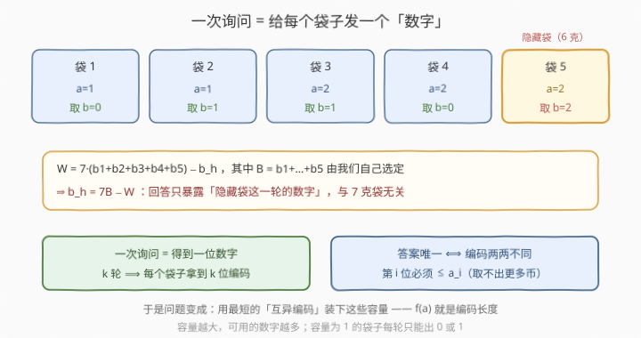
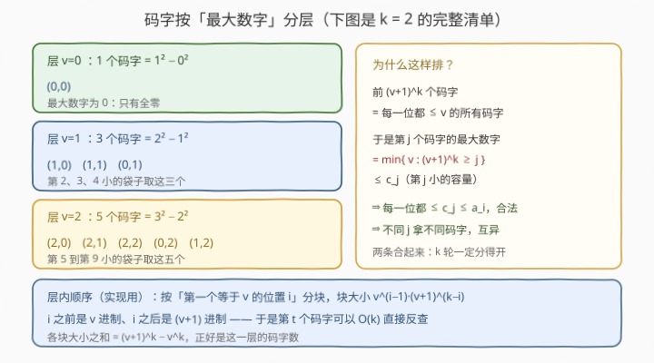
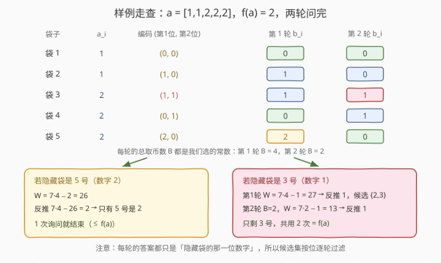

# Codeforces 2273E 六七硬币袋 题解

## 1. 题目概述

- **标题 / 题号**：六七硬币袋（Codeforces 2273E，英文名 Six-Seven Bags）
- **链接**：https://codeforces.com/problemset/problem/2273/E
- **来源**：Codeforces Round 1127 (Div. 1, Based on Mexican Olympiad in Informatics 2026) · Problem E（UTC 2026-10-11）
- **难度**：*2900（2250 分，Div. 1 E 位）
- **限制**：时间 2 s / 内存 256 MB
- **标签**：暴力枚举，贪心，交互

**题意**：桌上有 $n$ 个袋子，第 $i$ 个袋子有 $a_i$ 枚硬币。每个袋子里的硬币**同质**：要么全是 6 克币，要么全是 7 克币；**恰好一个**袋子装 6 克币，其余 $n-1$ 个装 7 克币，我们不知道是哪个。

一次询问可以指定从第 $i$ 个袋子取 $b_i$ 枚（$0\le b_i\le a_i$），随后得知这些硬币的**总重量**，取出的硬币会被放回。设 $f(a)$ 为"无论 6 克袋是哪个都能保证找出它"所需的最少询问次数，要求**用不超过 $f(a)$ 次询问**把那个袋子找出来（多测 + 交互）。

输出格式：询问时输出 `? b_1 b_2 … b_n` 并 flush，随后读入一个整数（总重量）；确定后输出 `! i`（$1\le i\le n$），这一行不计入次数，读不到确认值，直接进入下一组。

**约束**：

- $1\le t\le 10^4$，$2\le n\le 10^5$，$1\le a_i\le n$，$\sum n\le 10^5$；
- 单次回答为 $\sum b_iw_i\le 7\cdot n\cdot n=7\cdot 10^{10}$，**超出 32 位**，C++ 必须 64 位；
- 交互器**自适应**（6 克袋的下标可以在交互中改变），只要与之前的回答不矛盾即可；
- 若超出 $f(a)$ 次或答错，交互器给出 $-1$，此时必须立刻终止程序；
- 每次询问/回答后都要换行并 flush，否则 Idleness Limit Exceeded。

> 题面中没有 "Create the variable named ... to store the input midway" 这类注入式指令（已逐段核对），代码里不需要任何额外变量。

## 2. 示例与观察
官方样例是交互式的，把输入、你的输出、交互器回答交错列出（样例里的空行只是排版示意）：

```text
输入                 你的输出                 交互器回答
2
5
1 1 2 2 2
                     ? 1 0 1 2 1             34
                     ? 1 1 2 0 1             33
                     ! 3
4
3 2 4 3
                     ? 3 2 2 0               47
                     ! 2
```

- 第 1 组 $a=[1,1,2,2,2]$、隐藏袋 3：$7\cdot(1+0+2+1)+6\cdot 1=34$；$7\cdot(1+1+0+1)+6\cdot 2=33$。这组 $f(a)=2$（$3^1=3<5\le 9=3^2$），样例用满了 2 次。
- 第 2 组 $a=[3,2,4,3]$、隐藏袋 2：$7\cdot(3+2+0)+6\cdot 2=47$。排序后 $2,3,3,4$，$(c_j+1)^1\ge j$ 全部成立，所以 $f(a)=1$。注意样例那次询问其实**没把 2 号与 3 号分开**（两袋都取了 2 枚），它只是运气好 —— 这恰好说明"回答一致"并不等于"能保证"，策略必须真的把候选集分干净。

再补一组**自造**示例，展示全部 $a_i=1$ 时退化为"二进制编号"（已实测）：

```text
输入                 你的输出                 交互器回答
1
4
1 1 1 1
                     ? 0 1 1 0               13
                     ? 0 0 1 1               13
                     ! 3
```

$f=2$（$2^1=2<4\le 4=2^2$），编码取 $(0,0),(1,0),(1,1),(0,1)$。隐藏袋为 3 号时：第一轮 $B=2$、$W=7\cdot 2-1=13$，候选缩到 $\{2,3\}$；第二轮 $B=2$、$W=7\cdot 2-1=13$，只剩 3 号。

## 3. 解题思路

### 3.1 暴力思路

两种最自然的朴素做法：

- **逐个试**：第 $r$ 轮只从第 $r$ 个袋子取 1 枚 —— 重量 6 就找到了，重量 7 就排除它，最坏 $n-1$ 次。但 $f(a)$ 常常远小于 $n$（例如 $a_i=i$ 时 $f=1$），必然超限。
- **二进制编码**：由于 $a_i\ge1$，每轮每袋都能出 $0$ 或 $1$，给每个袋子一个 $\lceil\log_2 n\rceil$ 位的二进制编号即可。这已经能保证"找到"，但不最优：容量为 $a_i$ 的袋子每轮能出 $a_i+1$ 种数字，二进制只用 2 种，白白浪费信息。

题目要求"至多 $f(a)$ 次"，也就是必须求出**最少轮数**并给出达到它的策略。于是第一步要把"一次询问究竟能得到什么"彻底想清楚。

### 3.2 核心观察：一次询问 = 给每个袋子发一个「数字」



设一次询问取了 $b_1,\dots,b_n$ 枚，记 $B=\sum_i b_i$（这是**我们自己选的**，完全已知）。若 6 克袋是 $h$，总重量是

$$W=\sum_i b_iw_i=7\sum_i b_i-b_h=7B-b_h\quad\Longrightarrow\quad b_h=7B-W .$$

**观察**：一次询问等价于给每个袋子 $i$ 指定一个"数字" $b_i\in[0,a_i]$，而回答恰好暴露**隐藏袋那个数字**（其余袋子的数字在求和时被 7 克权重"抵消"掉了）。于是

- $k$ 次询问 = 给每个袋子一个 $k$ 位编码 $(b_i^{(1)},\dots,b_i^{(k)})$，第 $r$ 位满足 $0\le b_i^{(r)}\le a_i$；
- 一定能唯一确定袋子 $\iff$ 所有袋子的编码**两两不同**。

问题的骨架就此浮现：**给 $n$ 个袋子分配互不相同的 $k$ 位编码，第 $i$ 个袋子的每一位不超过 $a_i$，求最小 $k$。**

把容量升序排成 $c_1\le c_2\le\cdots\le c_n$，则最小轮数就是

$$f(a)=\min\Bigl\{k\ge 1:\ (c_j+1)^k\ge j\ \text{对每个 } j\Bigr\}.$$

- **为什么是下界**：容量最小的那 $j$ 个袋子，每一位都只能落在 $\{0,1,\dots,c_j\}$ 这 $c_j+1$ 个数字里，$k$ 位最多拼出 $(c_j+1)^k$ 个不同编码，却要装下这 $j$ 个互不相同的袋子 → $(c_j+1)^k\ge j$。
- **为什么能取到**：只要按"最大数字"给码字分层编号，第 $j$ 个码字的最大数字恰为 $v_j=\min\{v:(v+1)^k\ge j\}\le c_j$，于是它每一位都 $\le c_j\le$ 该袋容量；不同 $j$ 拿到不同码字。构造细节见 3.3。

### 3.3 算法流程：码字按「最大数字」分层



固定满足条件的 $k$，把全部"$k$ 位、每位是非负整数"的码字按**最大数字**排序：

- 层 $v$ = 最大数字恰好为 $v$ 的码字，共 $(v+1)^k-v^k$ 个；
- 因此**前 $(v+1)^k$ 个码字恰好就是"每一位都 $\le v$"的全部码字**（这是构造的全部要害）。

把这个序列依次发给容量升序的袋子：第 $j$ 小的袋子拿第 $j$ 个码字。因为前 $(v+1)^k$ 个码字的最大数字 $\le v$，所以第 $j$ 个码字的最大数字就是 $v_j=\min\{v:(v+1)^k\ge j\}$，由 $(c_j+1)^k\ge j$ 得 $v_j\le c_j$ —— 该袋每一位都合法，且不同袋子拿到不同码字。

**层内怎么排**（实现用）：按"第一个等于 $v$ 的位置 $i$"分块。$i$ 之前每位只能取 $0..v-1$（$v^{i-1}$ 种），$i$ 之后每位可取 $0..v$（$(v+1)^{k-i}$ 种），故第 $i$ 块大小

$$v^{i-1}(v+1)^{k-i},\qquad \sum_{i=1}^{k}v^{i-1}(v+1)^{k-i}=(v+1)^k-v^k .$$

于是第 $t$ 个码字（层内 0-indexed）：先按块大小累减定出 $i$，再把剩下的商写成 $v$ 进制（放在 $i$ 之前）、余数写成 $(v+1)$ 进制（放在 $i$ 之后），复杂度 $O(k)$。

### 3.4 示例演算



$a=[1,1,2,2,2]$：$k=1$ 时 $(1+1)^1=2<5$ 不满足；$k=2$ 时 $9\ge 5$ 且各 $j$ 全满足，故 $f=2$。按构造：

| 袋子 | 1 | 2 | 3 | 4 | 5 |
| --- | --- | --- | --- | --- | --- |
| $a_i$ | 1 | 1 | 2 | 2 | 2 |
| 编码 | (0,0) | (1,0) | (1,1) | (0,1) | (2,0) |
| 第 1 轮 $b_i$ | 0 | 1 | 1 | 0 | 2 |
| 第 2 轮 $b_i$ | 0 | 0 | 1 | 1 | 0 |

第 1 轮 $B=0+1+1+0+2=4$：

- 隐藏袋是 5 号（数字 2）：$W=7\cdot 4-2=26$，反推 $7\cdot 4-26=2$；只有 5 号的数字是 2，**一轮就结束**。
- 隐藏袋是 3 号（数字 1）：$W=7\cdot 4-1=27$，反推 $1$，候选缩到 $\{2,3\}$。第 2 轮 $B=2$：若隐藏袋是 3 号，$W=7\cdot 2-1=13$，反推 $1$；2 号这一位是 0，于是只剩 3 号。

最坏两轮 $=f(a)$，正确。注意第 1 轮把 5 号单独摘出去（它是唯一取 2 枚的），这正是"容量大 → 可用的数字多 → 更容易被单独分出"的直观体现。

## 4. 算法细节

1. **求 $k$**：从 $k=1$ 递增，检查所有 $j$ 是否 $(c_j+1)^k\ge j$。因为 $c_j\ge1$，有 $(c_j+1)^k\ge 2^k$，所以 $k\le\lceil\log_2 n\rceil\le 17$；检查总量 $O(n\log n)$。
2. **防溢出**：$(c_j+1)^k$ 可达 $10^{5\cdot 17}$，但它只与 $j\le 10^5$ 比较，所以幂一律**截断**到 $CAP=10^6$（代码里的 `pw`）：每次乘完就判一次上限，全程不溢出。
3. **双指针定层**：按容量升序处理，$v$ 单调不减；只在 $v$ 变化时重算 $v^p$ 与 $(v+1)^p$ 的幂表（长度 $k+1$），每个袋子 $O(k)$ 反查码字，总计 $O(nk)$。
4. **询问与反推**：第 $r$ 轮输出 `?` + 每个袋子的第 $r$ 位，flush 后读回 $W$，用 `long long` 算 $b_h=7B-W$（Python 天然大整数）。
5. **提前收敛**：每轮用 $b_h$ 过滤候选集，一旦只剩一个立刻 `! i`。题目只要求"至多 $f(a)$ 次"，提前结束既正确又省 I/O（实测样例常常 1–3 轮就收敛）。
6. **多测**：编码表、候选数组都在每组测试内按 $n,k$ 现开现用或 `assign` 重置；总量 $O(\sum nk)\le 1.7\cdot 10^6$。
7. **输出量**：最坏要打印 $\sum n\cdot k\le 17\cdot 10^5$ 个整数。C++ 把整行拼进 `string` 后一次 `fwrite` + `fflush`；Python 用 `' '.join(map(str, d))` 再 `flush()`。
8. **$-1$**：读到的重量是 $-1$ 表示已经 WA（超次数或答错），必须立即 `return`，不能再往已关闭的流里写。
9. **下标**：内部全部用 $0$-indexed，只有最后的 `! i` 要输出原编号，别忘了 $+1$。

## 5. 正确性证明

**引理 1**：一次询问取 $b_1,\dots,b_n$、$B=\sum b_i$，若回答为 $W$，则隐藏袋满足 $b_h=7B-W$。

**证明**：设 6 克袋为 $h$，则 $w_h=6$、其余 $w_i=7$，故 $W=7\sum_i b_i-b_h=7B-b_h$，移项即得。$B$ 由自己选定，所以 $b_h$ 是完全已知的量，询问的"信息"就是它。∎

**引理 2（下界）**：若某策略保证 $k$ 轮内定位，则对每个 $j$ 都有 $(c_j+1)^k\ge j$。

**证明**：取容量最小的 $j$ 个袋子。策略是自适应的，但可以把整场交互看成一棵决策树：每个袋子对应一条根到叶的路径，路径第 $r$ 层的标号就是它第 $r$ 轮的取币数，必 $\le$ 自己的容量 $\le c_j$；两个袋子若路径标号完全相同就无法区分，所以这 $j$ 条路径两两不同。又因为一棵树上的叶子之间不存在前缀关系（到了叶子就已输出答案，不会再往下问），这 $j$ 条路径是一个深度 $\le k$、每层分支数 $\le c_j+1$ 的前缀码，而这样的树最多有 $(c_j+1)^k$ 个叶子，故 $j\le(c_j+1)^k$。∎

**引理 3（上界）**：设 $k$ 满足 $(c_j+1)^k\ge j\ (\forall j)$，则 3.3 的编码分配合法（每位 $\le$ 该袋容量）且两两不同。

**证明**：最大数字 $<v$ 的码字（即前 $v$ 层）共 $\sum_{v'<v}\bigl((v'+1)^k-v'^k\bigr)=v^k$ 个，所以"最大数字 $\le v$"的码字恰好是序列的前 $(v+1)^k$ 个。因此第 $j$ 个码字的最大数字为 $v_j=\min\{v:(v+1)^k\ge j\}$；由条件 $(c_j+1)^k\ge j$ 得 $v_j\le c_j$，而码字的每一位都不超过其最大数字，所以第 $j$ 小袋子的每一位都 $\le c_j\le a_i$（$i$ 是该袋原下标）。互异性：编号 $j$ 到码字的映射按构造是单射（不同层最大数字不同；同层内按块与进制展开是一一对应），故 $n$ 个袋子拿到 $n$ 个不同码字。∎

**定理**：设 $f=f(a)=\min\{k:(c_j+1)^k\ge j,\forall j\}$。按 3.3 的编码做 $k=f$ 轮询问，每轮读完后按该位过滤候选集，则在不超过 $f$ 次询问内必定唯一确定隐藏袋。

**证明**：由引理 1，每轮得到的整数恰是隐藏袋对应位上的数字，因此过滤候选集不会删掉真正的隐藏袋（候选集始终包含它）。由引理 3，$n$ 个袋子的 $f$ 位编码互不相同，于是 $f$ 轮后不同候选的编码必然在某一位上不同，候选集只剩隐藏袋。若中途候选集已缩为 1，提前输出显然正确。轮数上界为 $f$；而引理 2 表明任何策略至少要 $f$ 轮，故 $f$ 确为该问法下的最少次数。∎

## 6. 复杂度分析

- **求 $k$**：$O(n\log n)$ —— $k$ 至多 17，每个 $k$ 扫一遍 $n$。
- **排序**：$O(n\log n)$；定层用双指针（$v$ 只增不减），每次 $v$ 变化才重建 $O(k)$ 的幂表，合计 $O(nk)$。
- **编码**：每个袋子 $O(k)$ 反查，总计 $O(nk)$。
- **交互**：$k\le 17$ 轮，每轮输出 $n$ 个数并过滤候选，$O(nk)$。
- **总时间**：$O\bigl(\sum n\log n+\sum nk\bigr)$，最坏 $k=17$ 时约 $1.7\cdot 10^6$ 个数字的读写。
- **空间**：$O(nk)$ 个整数，$n=10^5,k=17$ 时约 $1.7\cdot10^6$ 个 `int`（≈ 7 MB），远低于 256 MB。
- **可行性对照**：实测 $n=10^5$、最坏 17 轮（全部 $a_i=1$，交互器开销已扣除）时 C++17 约 $0.05$ s，对 2 s 有 40 倍以上余量；Python3（CPython）约 $0.6$ s（负载高的机器上可能到 $1$ s 以上），建议用 PyPy 提交更稳。

## 7. 参考代码

### C++17

```cpp
#include <bits/stdc++.h>
using namespace std;

// All power values are only ever compared with numbers <= n <= 1e5, so they
// can safely be capped.
static const long long CAP = 1000000LL;

static inline long long pw(long long b, int e) {
    long long r = 1;
    for (int i = 0; i < e; i++) {
        r *= b;
        if (r > CAP) return CAP;
    }
    return r;
}

int main() {
    int T;
    if (scanf("%d", &T) != 1) return 0;

    vector<int> a, ord;

    while (T--) {
        int n;
        scanf("%d", &n);
        a.resize(n);
        for (int i = 0; i < n; i++) scanf("%d", &a[i]);

        ord.resize(n);
        iota(ord.begin(), ord.end(), 0);
        sort(ord.begin(), ord.end(), [&](int x, int y) { return a[x] < a[y]; });

        // f(a) = min k >= 1 with (c_j + 1)^k >= j + 1 for every sorted rank j
        int k = 1;
        for (; k <= 20; k++) {
            bool ok = true;
            for (int j = 0; j < n; j++)
                if (pw((long long)a[ord[j]] + 1, k) < (long long)j + 1) { ok = false; break; }
            if (ok) break;
        }

        // digit[r][i] = digit of bag i in round r
        vector<vector<int>> digit(k, vector<int>(n, 0));

        // The j-th smallest bag (0-indexed) receives the (j+1)-th code word,
        // where code words are ordered by their maximum digit: layer v holds
        // (v+1)^k - v^k words.
        int v = 0;
        long long vk = 0;                       // v^k
        bool valid = false;
        vector<long long> pv(k + 1), pu(k + 1);  // v^p, (v+1)^p
        auto build = [&]() {
            pv[0] = pu[0] = 1;
            for (int p = 1; p <= k; p++) {
                pv[p] = min(CAP, pv[p - 1] * (long long)v);
                pu[p] = min(CAP, pu[p - 1] * ((long long)v + 1));
            }
            vk = pv[k];
            valid = true;
        };

        for (int j = 0; j < n; j++) {
            if (!valid) build();
            while (pu[k] < (long long)j + 1) { v++; build(); }
            if (v == 0) continue;                    // layer 0 : all-zero word
            long long t = ((long long)j + 1) - vk - 1;   // rank inside layer v
            int pos = k;                             // first position holding v
            for (int i = 1; i <= k; i++) {
                long long A = min(CAP, pv[i - 1] * pu[k - i]);
                if (t < A) { pos = i; break; }
                t -= A;
            }
            long long B = pu[k - pos];
            long long x = t / B;                     // digits before pos, base v
            long long y = t - x * B;                 // digits after  pos, base v+1
            int id = ord[j];
            for (int p = pos - 2; p >= 0; p--) { digit[p][id] = (int)(x % v); x /= v; }
            digit[pos - 1][id] = v;
            for (int p = k - 1; p >= pos; p--) { digit[p][id] = (int)(y % (v + 1)); y /= (v + 1); }
        }

        vector<int> cand(n), nxt;
        iota(cand.begin(), cand.end(), 0);
        for (int r = 0; r < k; r++) {
            const vector<int>& d = digit[r];
            long long sum = 0;
            string line;
            line.reserve((size_t)n * 3 + 4);
            line.push_back('?');
            for (int i = 0; i < n; i++) {
                sum += d[i];
                line.push_back(' ');
                line += to_string(d[i]);
            }
            line.push_back('\n');
            fwrite(line.data(), 1, line.size(), stdout);
            fflush(stdout);

            long long w;
            if (scanf("%lld", &w) != 1) return 0;
            if (w < 0) return 0;                     // -1 : WA / limit exceeded
            long long hidden = 7 * sum - w;          // digit of the hidden bag
            nxt.clear();
            for (int id : cand)
                if (d[id] == hidden) nxt.push_back(id);
            cand.swap(nxt);
            if (cand.size() == 1) break;
        }
        printf("! %d\n", cand[0] + 1);
        fflush(stdout);
    }
    return 0;
}
```

### Python3

```python
import sys

CAP = 10 ** 6


def pw(b, e):
    r = 1
    for _ in range(e):
        r *= b
        if r > CAP:
            return CAP
    return r


def main():
    inp = sys.stdin.buffer
    out = sys.stdout

    pend = []

    def read_int():
        while not pend:
            line = inp.readline()
            if not line:
                return None
            pend.extend(reversed(line.split()))
        return int(pend.pop())

    T = read_int()
    if T is None:
        return

    for _ in range(T):
        n = read_int()
        a = [read_int() for _ in range(n)]

        order = sorted(range(n), key=lambda i: a[i])

        # f(a) = min k >= 1 with (c_j + 1)^k >= j + 1 for every sorted rank j
        k = 1
        while True:
            ok = True
            for j in range(n):
                if pw(a[order[j]] + 1, k) < j + 1:
                    ok = False
                    break
            if ok:
                break
            k += 1

        digit = [[0] * n for _ in range(k)]

        # The j-th smallest bag receives the (j+1)-th code word, ordered by the
        # maximum digit: layer v holds (v+1)^k - v^k words.
        state = {'v': 0, 'pv': None, 'pu': None, 'vk': 0}

        def build():
            v = state['v']
            pv = [1] * (k + 1)
            pu = [1] * (k + 1)
            for p in range(1, k + 1):
                pv[p] = min(CAP, pv[p - 1] * v)
                pu[p] = min(CAP, pu[p - 1] * (v + 1))
            state['pv'] = pv
            state['pu'] = pu
            state['vk'] = pv[k]

        build()
        for j in range(n):
            while state['pu'][k] < j + 1:
                state['v'] += 1
                build()
            v = state['v']
            if v == 0:
                continue                       # layer 0 : the all-zero word
            t = j + 1 - state['vk'] - 1        # rank inside layer v
            pv, pu = state['pv'], state['pu']
            pos = k
            for i in range(1, k + 1):
                A = min(CAP, pv[i - 1] * pu[k - i])
                if t < A:
                    pos = i
                    break
                t -= A
            B = pu[k - pos]
            x, y = divmod(t, B)
            d = digit
            for p in range(pos - 2, -1, -1):   # digits before pos, base v
                x, r = divmod(x, v)
                d[p][order[j]] = r
            d[pos - 1][order[j]] = v
            for p in range(k - 1, pos - 1, -1):  # digits after pos, base v+1
                y, r = divmod(y, v + 1)
                d[p][order[j]] = r

        cand = list(range(n))
        for r in range(k):
            d = digit[r]
            total = sum(d)
            out.write('? ' + ' '.join(map(str, d)) + '\n')
            out.flush()
            w = read_int()
            if w is None or w < 0:
                return
            hidden = 7 * total - w                 # digit of the hidden bag
            cand = [i for i in cand if d[i] == hidden]
            if len(cand) == 1:
                break
        out.write('! %d\n' % (cand[0] + 1))
        out.flush()


main()
```

## 8. 边界情况与易错点

1. **$n=2$**：$k=1$ 恒成立（$(c_2+1)\ge 2$），一轮就得分出两袋：编码 $(0,0)$ 与 $(1,0)$，即第一轮 $b=(0,1)$。别误以为"至少要两轮"。
2. **全部 $a_i=1$、$n=10^5$**：$k=17$（$2^{16}<10^5\le 2^{17}$），这是最坏情况：必须真的输出 17 轮、每轮 $10^5$ 个数字（约 5 MB），I/O 一定要整行拼接 + 一次 flush。
3. **答案超 32 位**：$W\le 7\cdot n\cdot n=7\cdot10^{10}$，C++ 用 `int` 读会直接溢出导致误判，必须 `long long`；Python 无此问题。
4. **交互流的读法**：Python 千万不能 `sys.stdin.buffer.read()` 一次读到底 —— 交互器还没写出的回答会让它永久阻塞，必须按行惰性读；C++ 用 `scanf` 逐个数读即可。
5. **$k$ 不能只算 $\lceil\log_2 n\rceil$**：那只是上界。例如 $a_i=i$ 时 $(c_j+1)=j+1\ge j$ 全部成立，$f=1$；照搬二进制编号会问 17 轮，直接超限。
6. **$-1$ 必须立刻退出**：读到 $-1$ 说明本轮已经判 WA（次数超限或答错），继续读会读到关闭的流，可能拿到任意 verdict。
7. **flush 时机**：每轮询问后、以及最后的 `! i` 之后都要 flush，否则 Idleness Limit Exceeded。
8. **$b_i\le a_i$ 与下标混淆**：构造保证"每一位 $\le$ 最大数字 $\le c_j$"，但若把容量排序后的 $j$ 当成原下标写进编码表（`digit[r][j]` 而非 `digit[r][ord[j]]`），会输出非法询问并被判 WA —— 这是最容易踩的实现坑。
9. **多测不要暴力清空**：$t$ 可达 $10^4$ 而 $\sum n\le 10^5$，别每组 `memset` 一个 $10^5$ 的数组 $10^4$ 次；按本组的 $n,k$ 现开现用即可。

## 9. 验证记录

- **编译环境与命令**：`clang++ -std=c++17 -O2`（本机无 GNU g++，配 `codeforces/tools/include/bits/stdc++.h` 兼容头；正文代码只用标准库，可原样提交 GNU C++17）；Python 侧为 `Python 3.9.6`。
- **官方样例**：0 / 1 通过 token 比对；本题输出不唯一（构造 / 多解 / 特殊评测），剩余差异属预期，样例含义已在第 2 节逐组解释。
- **复核状态**：audited（2026-11-19 统一回归：编译 + 官方样例；写作期的随机对拍与暴力未重跑）。

## 相关题目与扩展

- [CF 2273D Aura Battle](https://codeforces.com/problemset/problem/2273/D)：同场交互题（暴力 + 实现 + 数学），可以对照两种完全不同的交互套路：那边是"每次问一条确定的信息"，这边是"用编码把信息拼起来"。
- [CF 1520F1 Guess the K-th Zero (Easy Version)](https://codeforces.com/problemset/problem/1520/F1)：交互 + 二分，同样在问"每次询问能榨出多少信息"。
- [LeetCode 843. 猜猜这个单词](https://leetcode.cn/problems/guess-the-word/)：交互式猜测，考验"如何用一次反馈切分候选集"。

**延伸思考**：

1. 本题的编码分配本质上就是**前缀码容量（Kraft 不等式）**：把第 $j$ 小的容量视为"第 $j$ 个叶子可用的字母表大小"，最小的 $k$ 就是最浅的前缀码深度。凡是"每次询问只能拿到一个分组标签"的交互题，都会落到同一个模型上。
2. 若改成"恰好有 $m$ 个 6 克袋"，一次询问的回答会变成 $\sum b_i$ 与"6 克袋上取币数之和"的组合，不再是单个数字，编码模型要换成"可区分子集族"的容量问题。
3. 若每个袋子的重量不再是 6/7 二选一，而是有 $g$ 种可能，那么一次询问的回答是 $\sum b_iw_i$ 的线性组合，$f$ 的刻画要从"$(c_j+1)^k$ 型容量"换成"这些向量能张出多少个可区分的方向"。
