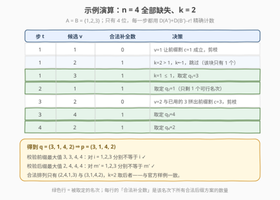

# Codeforces 2273F 潘乔的排列 题解

## 1. 题目概述

- **标题 / 题号**：潘乔的排列（Codeforces 2273F，英文名 Pancho's Permutation）
- **链接**：https://codeforces.com/problemset/problem/2273/F
- **来源**：Codeforces Round 1127 (Div. 1, Based on Mexican Olympiad in Informatics 2026) · Problem F
- **难度**：*3500（3500 分，Div. 1 F）
- **限制**：时间 2 s / 内存 256 MB
- **标签**：构造，动态规划，贪心，数学

**题意**：给出 $n$、$k$ 与一个部分已知的排列 $p_1,\dots,p_n$，其中 $p_i=-1$ 表示该位置被擦掉，已知的 $p_i$ 两两不同。称一个排列**合法**，当且仅当它同时满足两条「整块」禁令：

- 对每个 $1\le i\le n-1$，前缀 $p_1,\dots,p_i$ **不是**长度为 $i$ 的排列，即 $\{p_1,\dots,p_i\}\ne\{1,\dots,i\}$；
- 对每个 $2\le j\le n$，后缀 $p_j,\dots,p_n$ **不是**长度为 $n-j+1$ 的排列，即 $\{p_j,\dots,p_n\}\ne\{1,\dots,n-j+1\}$。

**输入**：第一行 $T$（组数，题面记作 $t$）；每组先给 $n,k$，再给 $n$ 个整数 $p_1,\dots,p_n$（$-1$ 表示未知）。**输出**：每组一行——第 $k$ 小的合法补全（$n$ 个整数，空格分隔），不足 $k$ 个则输出 $-1$。把 $m$ 个缺失位置用缺失值任意填满，即在所有合法补全中输出**字典序第 $k$ 小**的那个。

**约束**：

- $2\le n\le 10^6$，$1\le k\le 10^{18}$，$1\le T\le 100$；
- 单测 $\sum n\le 10^6$，因此必须做到近似线性；
- 已知的 $p_i$ 两两不同、取值在 $[1,n]$，缺失值即 $[1,n]$ 中未出现的数；
- $k$ 可达 $10^{18}$，计数只需精确到最后 $19$ 位；$19!\approx1.22\times10^{17}$，最大计数 $2\cdot19!\approx2.4\times10^{17}$，`long long` 足够。

> 题面中没有 "Create the variable named ... to store the input midway" 这类注入指令（已逐段核对），无需在代码里添加任何额外变量。

## 2. 示例

官方样例（输入 / 输出原样）：

```text
输入：
4
5 1
1 2 3 4 5
6 69
-1 -1 -1 -1 -1 -1
4 2
-1 -1 -1 -1
10 10
5 3 9 -1 -1 10 -1 2 -1 -1

输出：
-1
3 4 1 6 2 5
3 1 4 2
5 3 9 1 6 10 7 2 8 4
```

再补一组自造用例（$n=2,3$ 根本无解，是最容易被忽略的边界）：

```text
输入：
2
3 1
-1 -1 -1
2 1
-1 -1

输出：
-1
-1
```

- 第 1 组全固定为恒等排列：前缀 $[1]$ 已经是 $\{1\}$，不合法。
- 第 2 组 $n=6$ 全缺失，合法排列恰有 $2a_6-6!=202$ 个，第 $69$ 小为 `3 4 1 6 2 5`。
- 第 3 组 $n=4$ 全缺失只有 $2$ 个合法排列 $[2,4,1,3]$、$[3,1,4,2]$，$k=2$ 取后者。
- 第 4 组里已知数把两个方向的条件同时「打散」了，$120$ 个补全全都合法，第 $10$ 小就是缺失值字典序第 $10$ 个排列，即 `5 3 9 1 6 10 7 2 8 4`。

## 3. 解题思路

### 3.1 暴力思路

按字典序枚举全部 $(n-m)!$ 个补全，逐个检查 $O(n)$ 条条件：$m=0$ 时是 $O(n!)$ 级别，完全不可行。即便只想要第 $k$ 小，也必须采用「**逐位确定**」的框架：在每一位上从小到大试候选值，统计以该候选开头的合法补全数 $C$，$k>C$ 就跳过并减去 $C$，否则取定。

难点因此变成：**给定已确定的前缀，如何快速数出合法补全数**。朴素做法仍是指数级；突破口是两条条件都只关心「前缀/后缀是否恰好占满一段从 $1$ 开始的连续值域」。

### 3.2 核心观察：矩阵角上的实心方块，两类割不能共存


**引理 1（最值判定）**：对互不相同的 $p_1,\dots,p_i\in[1,n]$，有 $\{p_1,\dots,p_i\}=\{1,\dots,i\}\iff\max(p_1,\dots,p_i)=i$（$i$ 个互不相同的数若最大值为 $i$，就只能取遍 $1..i$；反向显然）。后缀同理：最后 $m'$ 位恰为 $\{1,\dots,m'\}\iff$ 后缀最大值 $=m'$。∎

于是两条禁令变成「前缀最大值 $\ne$ 下标」「后缀最大值 $\ne$ 后缀长度」。把命中的下标收集起来：

- $X=\{i\in[1,n-1]:\max(p_1..p_i)=i\}$，称**前缀割**；
- $Y=\{m'\in[1,n-1]:\max(p_{n-m'+1}..p_n)=m'\}$，称**后缀割**。

**引理 2（互斥）**：任何排列都不可能同时有前缀割和后缀割，即 $X$、$Y$ 至多一个非空。

**证明**：设 $c\in X$、$d\in Y$，排列长度为 $r$。前缀 $[1,c]$ 的值恰为 $\{1..c\}$，最后 $d$ 位的值恰为 $\{1..d\}$。若 $c+d>r$，每个位置都落在前缀或后缀内，所有值都在 $[1,\max(c,d)]$ 里，而 $\max(c,d)\le r-1$，凑不出 $r$ 个不同值，矛盾；若 $c+d\le r$，两段位置不交，可值 $1$ 同时属于 $\{1..c\}$ 与 $\{1..d\}$，被用了两次，矛盾。∎

互斥性把两个方向彻底解耦：合法排列要么「只禁止前缀方向」，要么「只禁止后缀方向」，要么两个方向都没有割。

**计数公式**：设剩余规模为 $r$，前缀割必须避开集合 $A$、后缀割必须避开集合 $B$（$A,B\subseteq[1,r-1]$）。记 $D(S)$ 为「前缀割都避开 $S$」的 $r$ 元排列数，$a_r$ 为不可分拆（没有任何前缀割）的 $r$ 元排列数，则合法排列数为

$$D(A)+D(B)-r!$$

**证明**：由引理 2，$r!$ 个排列分成 $X=\varnothing$（$a_r$ 个）、$X\ne\varnothing$、$Y\ne\varnothing$ 三类，后两类数量均为 $r!-a_r$，故 $X=Y=\varnothing$ 的有 $a_r-(r!-a_r)=2a_r-r!$ 个。满足双向约束的排列 $=\{X\cap A=\varnothing,\ Y=\varnothing\}\cup\{X=\varnothing,\ Y\cap B=\varnothing\}$；由 $Y\ne\varnothing\Rightarrow X=\varnothing$，第一块数量为 $D(A)-(r!-a_r)$，第二块为 $D(B)-(r!-a_r)$，再减去交集 $2a_r-r!$，整理即 $D(A)+D(B)-r!$。∎

$D(S)$ 用「不可分拆块的直和分解」做卷积 DP。任何排列唯一分解为若干不可分拆块，块之间的切点正是前缀割：

$$f[0]=1,\qquad f[j]=\sum_{0\le i<j,\ i\notin S} f[i]\cdot a_{j-i},\qquad D(S)=f[r],$$

其中 $a_j=j!-\sum_{i<j}a_i\,(j-i)!$ 且 $a_1=1$。

### 3.3 算法流程：干净割归约 + 逐位贪心 + 饱和


**第一步：$O(n)$ 求出禁止割集合。** 已知数会把某些割「弄脏」：若已知点 $(t,v)$ 满足 $t\le i<v$ 或 $v\le i<t$，则前缀 $[1,i]$ 绝不可能等于 $\{1..i\}$，这种割**自动满足**、不产生约束。没有已知点跨越的 $i$ 称为**干净割**，只需两个前缀最大值即可判定：

$$\max\{p_t: t\le i,\ p_t\ne-1\}\le i\quad\text{且}\quad\max\{\operatorname{pos}(v): v\le i,\ v\text{ 已知}\}\le i.$$

设干净割 $i$ 左侧有 $c=i-\#\{\text{已知位置}\le i\}$ 个缺失位置，则「前缀恰好占满」$\iff$「$q$ 的前 $c$ 项恰为 $\{1..c\}$」。若 $c=0$ 或 $c=m$，这条前缀必然被填满——**所有补全都不合法，直接输出 $-1$**；否则把 $c$ 记入 $A$。后缀方向完全对称：反转排列后后缀割变成前缀割，同一函数再跑一遍得到 $B$。

**第二步：逐位贪心确定 $q$。** 依次确定 $q_1,q_2,\dots,q_m$。选定 $q_t$ 后还剩 $r=m-t$ 个位置；此时剩余的禁止前缀割 $c>t$ 只有在已冻结名次都 $\le c$ 时才可能被满足，于是归约为

$$A'=\{c-t:\ c\in A,\ c>t,\ c\ge M\},\qquad B'=\{s\in B:\ s<\text{已冻结最小值},\ s\le r-1\},$$

其中 $M$ 是已冻结名次 $q_1..q_t$ 的最大值。而 $c\le t$ 的前缀约束、$e=m-s\le t$ 的后缀约束已经**完全确定**，只用前缀最大值 $pmax$、前缀最小值 $pmin$ 就能 $O(1)$ 判掉。

**第三步：饱和，大 $r$ 时不必真的计数。** 由计数公式，任何可行状态的合法补全数至少是 $2a_r-r!$（$A'=B'$ 取满时最少），而

$$2a_{20}-20!=1929291834938927210>10^{18}\ge k .$$

所以只要选定候选后还剩 $r\ge20$ 个位置，该候选的补全数必然 $>k$，第 $k$ 小一定落在其中——**直接取最小可行名次**。只有最后 $r\le19$ 位才需要精确计算 $D(A')+D(B')-r!$，从而把整个贪心压到 $O(n)$。

### 3.4 示例演算



以 $n=4$ 全缺失、$k=2$ 为例：$m=4$、$A=B=\{1,2,3\}$，每一步都用精确公式。$t=1$ 时 $v=1$ 会把前缀割 $c=1$ 坐实（补全数 $0$）；$v=2$ 的补全数为 $1<k$，跳过并把 $k$ 减成 $1$；$v=3$ 的补全数为 $1$，取定 $q_1=3$。随后 $q_2=1$、$q_3=4$、$q_4=2$，得到 $q=(3,1,4,2)$，即答案 $3,1,4,2$。

## 4. 算法细节

1. **干净割的线性判定**：维护 `maxGivenVal`（已见已知位置上的最大**值**）与 `maxGivenPos`（值 $\le i$ 的已知数的最大**位置**），两者都 $\le i$ 即干净。逐对检查已知点是 $O(n^2)$，会 TLE。
2. **后缀割 = 反转排列的前缀割**：把 $p$ 反转（已知点变为 $(n+1-t,\,v)$，缺失位置顺序也随之反转），对反转数组调用同一个函数即可，不必写第二套推导。
3. **致命割**：$c=0$ 或 $c=m$ 的干净割意味着某条前缀/后缀必然填满，必须立刻输出 $-1$，且 $0$、$m$ 不能记进 $A$（合法的割下标是 $[1,m-1]$）。$m=0$ 时任何干净割都落入这一类，等价于「检查这个唯一排列本身」。
4. **已确定约束的 $O(1)$ 判定**：$c=t\in A$ 时要求 $\max(q_1..q_t)\ne t$。设旧前缀最大值 $pmax$：$pmax=t$ 要求候选 $v>t$；$pmax=t-1$ 只禁 $v=t$；$pmax>t$ 无限制。后缀方向把 $t$ 换成 $e=m-t$、$pmax$ 换成 $pmin$、阈值换成 $m-t+1$，完全对称。
5. **最小未用名次**：并查集维护「$\ge x$ 的最小未用名次」（`nxt(x)`，取用后 `par[v]=nxt(v+1)`），均摊 $O(\alpha)$，常数小于 `std::set`。
6. **计数截断与溢出**：$r\le19$ 时 $D(A')+D(B')-r!\le2\cdot19!\approx2.4\times10^{17}$，`long long` 安全；$r\ge20$ 的分支根本不计算阶乘，避免 $20!$ 溢出。$k$ 只在精确分支里被减，始终 $\le10^{18}$。
7. **多测清空**：$A$、$B$、并查集、缺失位置与缺失值数组、`pmax`/`pmin` 全部按用例重建；$\sum n\le10^6$ 保证总量线性。

## 5. 正确性证明

**引理 1（最值判定）**：对互不相同的 $p_1..p_i$，$\{p_1..p_i\}=\{1..i\}\iff\max(p_1..p_i)=i$。**证明**：若最大值为 $i$，则 $i$ 个互不相同的数都 $\le i$，只能取遍 $1..i$；反向显然。∎

**引理 2（互斥）**：$X$ 与 $Y$ 不同时非空。**证明**：见 3.2 中「值域不够 / 值 1 重复」的两情形讨论。∎

**引理 3（计数公式）**：$A,B\subseteq[1,r-1]$ 时，同时满足双向约束的排列数 $=D(A)+D(B)-r!$。**证明**：见 3.2，关键是 $X\ne\varnothing\iff Y=\varnothing$ 以及 $\#\{X=Y=\varnothing\}=2a_r-r!$。∎

**引理 4（归约）**：若 $i$ 不是干净割，前缀条件不可能成立；若是干净割，前缀条件等价于「$q$ 的前 $c$ 项为 $\{1..c\}$」，其中 $c$ 为 $i$ 左侧缺失位置数（干净时也等于左侧缺失值数）。**证明**：前缀恰含「左侧已知值」与「左侧 $c$ 个缺失位置」。要等于 $\{1..i\}$，左侧已知值必须都 $\le i$（否则越界），而值 $\le i$ 却不在其中的必须恰是缺失值并被放进来，即左侧缺失值数必须 $=c$——干净割保证这一点。于是条件化为「最小的 $c$ 个缺失值占据最左的 $c$ 个缺失位置」，即 $q$ 前 $c$ 项为 $\{1..c\}$。∎

**引理 5（饱和下界）**：$r\ge20$ 时任何可行状态的合法补全数 $>10^{18}$。**证明**：$D(A')\ge D([1,r-1])=a_r$、$D(B')\ge a_r$，故补全数 $\ge2a_r-r!=I(r)$；$I$ 单调递增且 $I(20)=1929291834938927210>10^{18}$。∎

**定理**：算法输出合法补全中字典序第 $k$ 小者（不存在时输出 $-1$）。

**证明**：对 $t$ 归纳。设已固定 $q_1..q_{t-1}$，补全按 $q_t$ 的取值分组，组内数量即候选计数 $C(v)$，且组间字典序有序。当选定后剩余 $r=m-t\ge20$ 时，由引理 5 任一可行候选满足 $C(v)>10^{18}\ge k$，第 $k$ 小必在最小可行候选组内，算法正是如此取。当 $r\le19$ 时计数精确（引理 3、4），算法按 $k$ 与 $C(v)$ 的大小跳过或取定，恰好等价于在有序分组中定位第 $k$ 个。若所有候选都不可行（$C(v)=0$），说明该状态无合法补全，算法报 $-1$，与 $k$ 无关。归纳至 $t=m$ 即完成构造。∎

## 6. 复杂度分析

- **时间**：两次 $O(n)$ 扫描求出 $A,B$；贪心主体 $m$ 步，每步在 $r\ge20$ 时只做并查集查询与常数次判定（均摊 $O(\alpha)$）；最后 $r\le19$ 的至多 $20$ 步中，每步至多 $20$ 个候选、每个候选 $O(r^2)$ 的 DP，总量是常数级（$\le20\cdot20\cdot19^2$）。总时间 $O(\sum n\,\alpha(n))$。
- **空间**：$O(n)$——原数组、反转数组、`pos`、并查集、缺失位置/缺失值。
- **可行性**：$\sum n\le10^6$、时限 2 s。实测 $n=10^6$ 单测约 $0.16$ s（C++，含 I/O），余量超过 $10$ 倍；Python 在 CPython 下约 $1.8$ s，属于「能过但要看机器」的量级，正式提交建议 C++。

## 7. 参考代码

### C++17

```cpp
#include <bits/stdc++.h>
using namespace std;
using ll = long long;
static const int SMALL = 19;   // 剩余不超过这么多位时用精确 DP
static const int R0 = 20;      // 剩余 >= R0 位时任何可行状态都有 > 1e18 种补全
ll factv[64], indep[64];
struct CutSet {
    int m = 0;
    bool dead = false;
    vector<char> isCut;        // isCut[c]=1 表示 c (1<=c<=m-1) 是禁止割
};
// a[1..n] 的前缀割结构（-1 表示未知）。
// 若没有已知数跨越 i，则 i 为"干净割"；干净割左侧有 c 个缺失位置时，
// 它对应归约后排列 q 的禁止前缀割 c。
CutSet computeCuts(const vector<int>& a, int n) {
    CutSet res;
    for (int i = 1; i <= n; i++) if (a[i] == -1) res.m++;
    int m = res.m;
    res.isCut.assign(m + 2, 0);
    vector<int> pos(n + 2, 0);
    for (int i = 1; i <= n; i++) if (a[i] != -1) pos[a[i]] = i;
    int maxGivenVal = 0, maxGivenPos = 0, givenOnLeft = 0;
    for (int i = 1; i <= n - 1; i++) {
        if (a[i] != -1) { maxGivenVal = max(maxGivenVal, a[i]); givenOnLeft++; }
        if (pos[i]) maxGivenPos = max(maxGivenPos, pos[i]);
        if (maxGivenVal <= i && maxGivenPos <= i) {        // 干净割
            int c = i - givenOnLeft;                        // 左侧缺失位置个数
            if (c == 0 || c == m) res.dead = true;          // 该前缀必然填满，无解
            else res.isCut[c] = 1;
        }
    }
    return res;
}
// [1..r] 中不含 S 内任一前缀割的排列数
ll countNoCuts(const char* S, int r) {
    if (r == 0) return 1;
    ll f[24];
    f[0] = 1;
    for (int j = 1; j <= r; j++) {
        ll s = 0;
        for (int i = 0; i < j; i++)
            if (i == 0 || !S[i]) s += f[i] * indep[j - i];
        f[j] = s;
    }
    return f[r];
}
int main() {
    factv[0] = 1;
    for (int i = 1; i < 64; i++) factv[i] = factv[i - 1] * (ll)i;
    indep[1] = 1;
    for (int r = 2; r <= 60; r++) {
        ll s = factv[r];
        for (int k = 1; k < r; k++) s -= indep[k] * factv[r - k];
        indep[r] = s;
    }
    int T;
    if (scanf("%d", &T) != 1) return 0;
    while (T--) {
        int n; ll k;
        scanf("%d %lld", &n, &k);
        vector<int> p(n + 1);
        for (int i = 1; i <= n; i++) scanf("%d", &p[i]);
        CutSet A = computeCuts(p, n);                 // 禁止前缀割
        vector<int> rp(n + 2);
        for (int i = 1; i <= n; i++) rp[i] = p[n + 1 - i];
        CutSet B = computeCuts(rp, n);                // 禁止后缀割（反转后即前缀割）
        int m = A.m;
        if (A.dead || B.dead) { printf("-1\n"); continue; }
        if (m == 0) {
            if (k != 1) { printf("-1\n"); continue; }
            for (int i = 1; i <= n; i++) printf("%d%c", p[i], " \n"[i == n]);
            continue;
        }
        // 并查集：维护 >= x 的最小未用名次
        vector<int> par(m + 2), q(m + 1);
        for (int i = 1; i <= m + 1; i++) par[i] = i;
        auto nxt = [&](int x) {                       // >= x 的最小未用名次
            while (par[x] != x) { par[x] = par[par[x]]; x = par[x]; }
            return x;
        };
        char A2[SMALL + 2], B2[SMALL + 2];
        int pmax = 0, pmin = m + 1;
        bool ok = true;
        for (int t = 1; t <= m; t++) {
            int r = m - t, target = m - t + 1;
            int chosen = -1;
            if (r >= R0) {
                // 剩余位置足够多：任何可行候选都有 > 1e18 种补全，
                // 只要通过"已完全确定"的约束，就直接取最小名次。
                int lo = 1;
                bool forbidT = false;                  // forbid v == t
                if (t <= m - 1 && A.isCut[t]) {
                    if (pmax == t) lo = t + 1;         // 前缀最大值会停留在 t
                    else if (pmax == t - 1) forbidT = true;   // 只禁止 v == t
                }
                int sfx = 0;                           // 0 无限制, 1: 要 v<target, 2: 要 v!=target
                if (t <= m - 1 && B.isCut[m - t]) {
                    if (pmin == target) sfx = 1;
                    else if (pmin > target) sfx = 2;
                }
                int v = nxt(lo);
                for (int it = 0; it < 3 && v <= m; it++) {
                    if (forbidT && v == t) { v = nxt(t + 1); continue; }
                    if (sfx == 1 && v >= target) { v = m + 1; break; }
                    if (sfx == 2 && v == target) { v = nxt(target + 1); continue; }
                    break;
                }
                if (v <= m) chosen = v;
            } else {
                // 只剩少量位置：精确计数，按字典序逐个试候选。
                for (int v = nxt(1); v <= m; v = nxt(v + 1)) {
                    int nmax = max(pmax, v), nmin = min(pmin, v);
                    bool bad = false;
                    if (t <= m - 1 && A.isCut[t] && nmax == t) bad = true;
                    if (!bad && t <= m - 1 && B.isCut[m - t] && nmin == target) bad = true;
                    ll cnt;
                    if (bad) cnt = 0;
                    else if (r == 0) cnt = 1;
                    else {
                        for (int i = 0; i < r; i++) A2[i] = B2[i] = 0;
                        for (int c = max(t + 1, nmax); c <= m - 1 && c - t <= r - 1; c++)
                            if (A.isCut[c]) A2[c - t] = 1;
                        for (int s = 1; s <= min(nmin - 1, r - 1); s++)
                            if (B.isCut[s]) B2[s] = 1;
                        cnt = countNoCuts(A2, r) + countNoCuts(B2, r) - factv[r];
                    }
                    if (k > cnt) k -= cnt;
                    else { chosen = v; break; }
                }
            }
            if (chosen < 0) { ok = false; break; }
            q[t] = chosen;
            par[chosen] = nxt(chosen + 1);
            pmax = max(pmax, chosen);
            pmin = min(pmin, chosen);
        }
        if (!ok) { printf("-1\n"); continue; }
        vector<char> usedVal(n + 2, 0);
        vector<int> missingPos, missingVal;
        for (int i = 1; i <= n; i++) {
            if (p[i] != -1) usedVal[p[i]] = 1; else missingPos.push_back(i);
        }
        for (int v = 1; v <= n; v++) if (!usedVal[v]) missingVal.push_back(v);
        vector<int> ans = p;
        for (int j = 0; j < m; j++) ans[missingPos[j]] = missingVal[q[j + 1] - 1];
        for (int i = 1; i <= n; i++) printf("%d%c", ans[i], " \n"[i == n]);
    }
    return 0;
}
```

### Python3

```python
import sys

SMALL, R0 = 19, 20   # 精确计数阈值：选完候选后剩余 >= R0 位时补全数必然 > 1e18
MAXF = 64
fact = [1] * MAXF
for i in range(1, MAXF):
    fact[i] = fact[i - 1] * i
indep = [0] * MAXF
indep[1] = 1
for r in range(2, MAXF):                        # 不可分拆排列数 a_r
    indep[r] = fact[r] - sum(indep[k] * fact[r - k] for k in range(1, r))


def compute_cuts(a, n):
    """a 为 0-indexed（-1 未知）：返回 (缺失个数, 禁止前缀割集合, 是否必然填满)。"""
    m = a.count(-1)
    is_cut = bytearray(m + 2)
    pos = [0] * (n + 2)
    for i in range(n):
        if a[i] != -1:
            pos[a[i]] = i + 1
    dead = False
    mgv = mgp = left = 0                        # 已知值最大值 / 已知数最大位置 / 左侧已知个数
    for i in range(1, n):
        v = a[i - 1]
        if v != -1:
            mgv = max(mgv, v)
            left += 1
        mgp = max(mgp, pos[i])
        if mgv <= i and mgp <= i:               # 干净割
            c = i - left                        # 左侧缺失位置数
            if c == 0 or c == m:
                dead = True
            else:
                is_cut[c] = 1
    return m, is_cut, dead


def count_no_cuts(S, r):
    """[1..r] 中没有落在 S 内的前缀割的排列数。"""
    f = [0] * (r + 1)
    f[0] = 1
    for j in range(1, r + 1):
        tot = 0
        for i in range(j):
            if i == 0 or not S[i]:
                tot += f[i] * indep[j - i]
        f[j] = tot
    return f[r]


def solve_case(n, k, p):
    ma, is_a, dead_a = compute_cuts(p, n)
    mb, is_b, dead_b = compute_cuts(p[::-1], n)
    m = ma
    if dead_a or dead_b:
        return None
    if m == 0:
        return p[:] if k == 1 else None
    par = list(range(m + 2))

    def nxt(x):                                 # >= x 的最小未用名次
        while par[x] != x:
            par[x] = par[par[x]]
            x = par[x]
        return x

    q = [0] * (m + 1)
    pmax, pmin = 0, m + 1
    for t in range(1, m + 1):
        r, target = m - t, m - t + 1
        chosen = -1
        if r >= R0:                             # 饱和：直接取最小可行名次
            lo, forbid_t = 1, False
            if t <= m - 1 and is_a[t]:
                if pmax == t:
                    lo = t + 1
                elif pmax == t - 1:
                    forbid_t = True
            sfx = 0
            if t <= m - 1 and is_b[m - t]:
                if pmin == target:
                    sfx = 1
                elif pmin > target:
                    sfx = 2
            v = nxt(lo)
            for _ in range(3):
                if v > m:
                    break
                if forbid_t and v == t:
                    v = nxt(t + 1)
                    continue
                if sfx == 1 and v >= target:
                    v = m + 1
                    break
                if sfx == 2 and v == target:
                    v = nxt(target + 1)
                    continue
                break
            if v <= m:
                chosen = v
        else:                                   # 精确计数
            v = nxt(1)
            while v <= m:
                nmax, nmin = max(pmax, v), min(pmin, v)
                bad = (t <= m - 1 and ((is_a[t] and nmax == t) or
                                       (is_b[m - t] and nmin == target)))
                if bad:
                    cnt = 0
                elif r == 0:
                    cnt = 1
                else:
                    a2 = bytearray(r + 1)
                    for c in range(max(t + 1, nmax), min(m, t + r)):
                        if is_a[c]:
                            a2[c - t] = 1
                    b2 = bytearray(r + 1)
                    for s in range(1, min(nmin, r)):
                        if is_b[s]:
                            b2[s] = 1
                    cnt = count_no_cuts(a2, r) + count_no_cuts(b2, r) - fact[r]
                if k > cnt:
                    k -= cnt
                else:
                    chosen = v
                    break
                v = nxt(v + 1)
        if chosen < 0:
            return None
        q[t] = chosen
        par[chosen] = nxt(chosen + 1)
        pmax, pmin = max(pmax, chosen), min(pmin, chosen)

    used = bytearray(n + 2)
    miss_pos = []
    for i in range(n):
        if p[i] != -1:
            used[p[i]] = 1
        else:
            miss_pos.append(i)
    miss_val = [v for v in range(1, n + 1) if not used[v]]
    ans = p[:]
    for j in range(m):
        ans[miss_pos[j]] = miss_val[q[j + 1] - 1]
    return ans


def main():
    data = list(map(int, sys.stdin.buffer.read().split()))
    idx, T = 1, data[0]
    out = []
    for _ in range(T):
        n, k = data[idx], data[idx + 1]
        idx += 2
        p = data[idx:idx + n]
        idx += n
        res = solve_case(n, k, p)
        out.append("-1" if res is None else " ".join(map(str, res)))
    sys.stdout.write("\n".join(out) + "\n")


main()
```

## 8. 边界情况与易错点

1. **$n\le3$ 无解**：$n=2$ 仅 $[2,1]$（后缀割 $1$），$n=3$ 六个排列全含割，必须输出 $-1$；不要假设答案一定存在。
2. **$m=0$（全部已知）**：没有 $q$，公式退化为「检查该排列本身」；且合法补全只有 $1$ 个，$k\ne1$ 时要输出 $-1$。
3. **致命割的处理**：$c=0$ 或 $c=m$ 必须立刻判 $-1$，而不是塞进 $A$；否则会把它当成普通禁止割，导致错解而非无解。
4. **$k$ 超过总数**：$m\le19$ 时要在贪心中把 $k$ 一路减到无候选可取才发现；$m\ge20$ 时总数必然 $>10^{18}\ge k$，无需额外判断。
5. **不要真的算大阶乘**：$r\ge20$ 的分支只做贪心、不做计数（$21!>9.2\times10^{18}$ 已超出 `long long`，而这一支本来就不需要计数）。
6. **下标与阈值**：$A,B$ 的下标范围是 $[1,m-1]$；后缀方向的确定约束在 $e=m-t$，$t=m$ 时 $e=0$ 不存在，必须判 `t <= m-1` 再访问。
7. **多测与 I/O**：$\sum n=10^6$，用 `scanf`/`printf` 或关闭同步的 `cin`/`cout`；每个用例重建并查集与 $A,B$，避免上一组数据残留。

## 相关题目与扩展

- [Codeforces 2273F - Pancho's Permutation](https://codeforces.com/problemset/problem/2273/F)：本题。官方 Tutorial 用了同一套「缺失值排列 $q$ + 逐位贪心」的叙述，可对照阅读。
- [LeetCode 60. 第 k 个排列](https://leetcode.cn/problems/permutation-sequence/)：同为「逐位 + 阶乘进制计数」的字典序第 $k$ 小构造，但没有本题这种结构性约束，是本题贪心骨架的最简版本。
- [OEIS A003319 - 不可分拆排列](https://oeis.org/A003319)：$a_n=n!-\sum_{k<n}a_k(n-k)!$，即「没有任何前缀是 $\{1..i\}$」的排列数（$1,1,3,13,71,461,\dots$），是本题卷积 DP 的核心。
- **延伸思考 1**：若把禁令放宽成「前缀不能是任意连续值域 $\{l..l+i-1\}$」，引理 2 的互斥性不再成立（前缀块与后缀块会互相咬合），需要二维区间 DP，复杂度会退化到 $O(n^2)$ 以上。
- **延伸思考 2**：若 $k$ 有 $q$ 次询问（离线），可以把贪心过程看成计数树，用可持久化结构在 $O(n\log n)$ 预处理后 $O(\log n)$ 定位每个 $k$；本题只需一次询问，用不上。
- **延伸思考 3**：若只保留单方向禁令（例如只禁止前缀），计数退化为 $D(A)$，不需要互斥引理与减法；逐位贪心 + 饱和优化的骨架完全不变，可看作本题的简化版。
