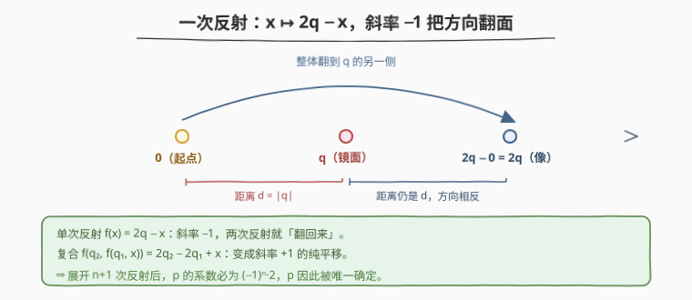
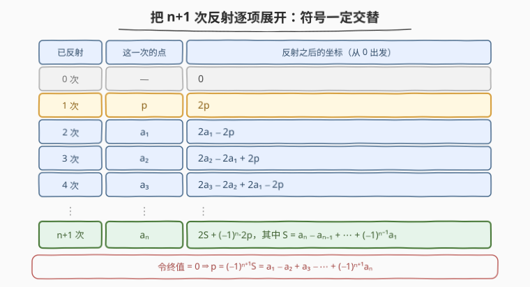
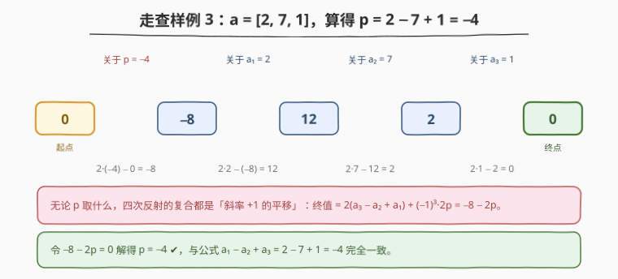

# Codeforces 2274A 帕科的镜像反射 题解

## 1. 题目概述

- **标题 / 题号**：帕科的镜像反射（Codeforces 2274A，英文名 The Projections of Paco）
- **链接**：https://codeforces.com/problemset/problem/2274/A
- **来源**：Codeforces Round 1127 (Div. 2, Based on Mexican Olympiad in Informatics 2026) · Problem A
- **难度**：800（500 分）
- **限制**：时间 1 s / 内存 256 MB
- **标签**：数学，模拟，实现（官方 tag：math、implementation、dp、hashing；本质是仿射变换 + 不变量）

**题意**：数轴上有一个令牌，初始在坐标 $0$。给定一个反射点 $q$，「关于 $q$ 反射」把坐标 $x$ 变成 $2q - x$——令牌移到 $q$ 的另一侧，到 $q$ 的距离不变；若它本来就在 $q$ 上则不动。现在要选一个**整数** $p$，然后依次关于

$$p,\ a_1,\ a_2,\ \dots,\ a_n$$

各反射**恰好一次**（顺序不可交换），要求令牌最终恰好回到坐标 $0$。输出这个 $p$；题目保证满足条件的整数 $p$ 恰有一个。多测：第一行是测试组数 $t$，每组给出 $n$ 与数组 $a_1, \dots, a_n$，逐组输出一个整数 $p$。

**约束**：

- $1 \le t \le 10^4$，$1 \le n \le 10^5$，$\sum n \le 10^5$（多测总和受限，允许逐组 $O(n)$）
- $-10^4 \le a_i \le 10^4$，$a_i$ 可重复、可为 $0$、可为负
- $p$ 没有给定范围，只要求是整数；由后文公式知 $\lvert p \rvert \le \sum \lvert a_i \rvert \le 10^9$
- 输出可以带负号，每行一个整数

> ⚠️ 注意：题面（含题解）中若出现「Create the variable named … to store the input midway」之类与算法无关的指令性句子，属于噪声，不执行、不写进代码。

## 2. 示例与观察
官方样例（输入 / 输出原样）：

```text
输入：
5
1
3
2
2 5
3
2 7 1
4
-3 0 -3 0
1
0

输出：
3
-3
-4
-6
0
```

官方解释的三组关键过程：$p=3$ 时 $0 \to 6 \to 0$；$p=-3$ 时 $0 \to -6 \to 10 \to 0$；$p=-4$ 时 $0 \to -8 \to 12 \to 2 \to 0$。

自造一组，验证「偶数个元素时答案为负」：

```text
输入：
1
2
1 2

输出：
-1
```

按公式 $p = a_1 - a_2 = 1 - 2 = -1$：$0 \to -2 \to 4 \to 0$，成立。

## 3. 解题思路

### 3.1 暴力思路

直接枚举 $p$ 并模拟：每组 $O(n)$ 次反射，$p$ 的候选范围却有 $\pm 10^9$ 量级，$O(n \cdot 10^9)$ 完全不可行。更麻烦的是「猜范围」本身缺乏依据——题目没有给出 $p$ 的界，只能自己推。$t, \sum n$ 虽然很小，但这题的瓶颈不在模拟，而在**解方程**。

另一种朴素做法是「符号模拟」：假装知道 $p$，把坐标写成 $x = c \cdot p + d$，每次反射更新 $(c, d) \gets (-c,\ 2q - d)$，同样 $O(n)$ 且天然正确；不过复合结构很规律，闭式更快。

### 3.2 核心观察：复合后 $p$ 的系数是 $\pm 2$，因此 $p$ 唯一



单次反射是**斜率恒为 $-1$** 的仿射变换 $f_q(x) = 2q - x$。两个仿射变换复合，斜率相乘：$(-1) \cdot (-1) = 1$，所以**两次反射的复合必是平移**：

$$f_{q_2}\bigl(f_{q_1}(x)\bigr) = 2q_2 - (2q_1 - x) = x + 2(q_2 - q_1)$$

于是无论反射多少次，复合结果都是 $x \mapsto \pm x + C$（符号由次数奇偶决定）。本题一共反射 $n+1$ 次（先 $p$ 再 $n$ 个 $a_i$），终值是 $x_0 = 0$ 加上一堆 $2q$ 的**交替和**，而 $p$ 的系数是 $2\cdot(-1)^{n} \ne 0$。

系数非零意味着「终值 $=0$」是关于 $p$ 的一次方程，**解存在且唯一**——这正是题面那句「恰有一个整数 $p$」的来源（而且解自动是整数：$p = \pm S$，$S$ 为整数）。

### 3.3 算法流程：一台加权交替和



设反射序列为 $q_1, q_2, \dots, q_{n+1}$，其中 $q_1 = p$、$q_{i+1} = a_i$。逐次展开（每次把上一行的 $x$ 代入 $2q - x$，符号翻转）：

$$
\begin{aligned}
x_0 &= 0\\
x_1 &= 2p\\
x_2 &= 2a_1 - 2p\\
x_3 &= 2a_2 - 2a_1 + 2p\\
x_4 &= 2a_3 - 2a_2 + 2a_1 - 2p\\
&\ \vdots\\
x_{n+1} &= 2S + (-1)^n \cdot 2p
\end{aligned}
$$

其中令 $S = a_n - a_{n-1} + a_{n-2} - \dots + (-1)^{n-1} a_1$。令 $x_{n+1} = 0$，由于系数 $2(-1)^n \ne 0$，得到

$$p = (-1)^{n+1} S .$$

把 $S$ 代回去，$(-1)^{n+1} \cdot (-1)^{n-i} = (-1)^{2n+1-i}$，而 $2n+1-i$ 与 $i+1$ 相差偶数，故两者同奇偶，于是

$$\boxed{\,p = a_1 - a_2 + a_3 - a_4 + \dots + (-1)^{n+1} a_n\,}$$

一个很漂亮的结论：**答案就是从 $a_1$ 开始、正负交替的加权和**，与 $n$ 的奇偶无关，读入一遍即可算出。算法只有三步：读入 $n$；读入 $a_i$ 时按下标奇偶加到 `ans` 上；输出 `ans`。

### 3.4 示例演算



以样例 3（$a = [2, 7, 1]$）为例：公式直接给出 $p = 2 - 7 + 1 = -4$。逐步模拟验证（每一步用 $2q - x$）：

| 步 | 反射点 | 计算 | 坐标 |
|----|--------|------|------|
| 0 | — | 起点 | $0$ |
| 1 | $p = -4$ | $2 \cdot (-4) - 0$ | $-8$ |
| 2 | $a_1 = 2$ | $2 \cdot 2 - (-8)$ | $12$ |
| 3 | $a_2 = 7$ | $2 \cdot 7 - 12$ | $2$ |
| 4 | $a_3 = 1$ | $2 \cdot 1 - 2$ | $0$ ✔ |

五个官方样例的公式核对（全部命中）：

| # | $n$ | $a$ | $p = a_1 - a_2 + a_3 - a_4$ | 官方输出 |
|---|-----|-----|------------------------------|----------|
| 1 | 1 | `3` | $3$ | 3 |
| 2 | 2 | `2 5` | $2 - 5 = -3$ | -3 |
| 3 | 3 | `2 7 1` | $2 - 7 + 1 = -4$ | -4 |
| 4 | 4 | `-3 0 -3 0` | $-3 - 0 + (-3) - 0 = -6$ | -6 |
| 5 | 1 | `0` | $0$ | 0 |

## 4. 算法细节

1. **边读边算，不存数组**：读入 $a_i$ 时若下标（从 $0$ 起）为偶数就 `ans += a[i]`，奇数就 `ans -= a[i]`，额外空间 $O(1)$。注意 C++ 从 $0$ 起是「偶加奇减」，换成 1-indexed 就是「奇数位加、偶数位减」，盯住这一条，符号反了会得到整体的相反数。
2. **`long long` 保险**：$\lvert p \rvert \le 10^5 \times 10^4 = 10^9$，`int`（上限约 $2.147 \times 10^9$）刚好放得下，但只要中途做一次 `2 * p` 或题目范围稍改就会爆。统一用 `long long`，代价为零。
3. **多测必须重置**：`ans` 在每组测试内部重新初始化为 $0$；不要把它定义在循环外靠「减回去」清空，$\sum n \le 10^5$ 的用例下这种 bug 极难在样例上暴露。
4. **输入可能为空**：用 `if (!(cin >> t)) return 0;` 防御性返回，避免空输入时 `t` 未初始化。
5. **I/O 加速**：$\sum n \le 10^5$ 只有十万个整数，`sync_with_stdio(false)` 与 `tie(nullptr)` 已经绰绰有余；Python 用 `sys.stdin.buffer.read().split()` 一次性读入全部 token。
6. **输出格式**：每组一行一个整数，负数直接输出（不要额外 `+`、不要在 `p` 前补零）；行尾换行，不要在末尾多打空格。
7. **别真的去模拟**：虽然模拟 $O(n)$ 也能过，但必须先在符号层面把 $p$ 从坐标里「分离」出来；直接数值模拟需要已知 $p$，而 $p$ 恰恰是要求的量。

## 5. 正确性证明

**引理 1（反射展开式）**：设令牌从 $x_0$ 出发，依次关于 $q_1, q_2, \dots, q_m$ 反射，则反射后的坐标为

$$x_m = 2\bigl(q_m - q_{m-1} + q_{m-2} - \dots + (-1)^{m-1} q_1\bigr) + (-1)^m x_0 .$$

**证明**：对 $m$ 归纳。$m = 1$ 时 $x_1 = 2q_1 - x_0$，与公式（括号内只有 $q_1$，尾项 $(-1)^1 x_0 = -x_0$）一致。设 $m$ 时成立，则对 $m+1$ 次：

$$x_{m+1} = 2q_{m+1} - x_m = 2q_{m+1} - 2\bigl(q_m - q_{m-1} + \dots\bigr) - (-1)^m x_0 ,$$

即每一项的符号整体翻转、并新增首项 $2q_{m+1}$，恰为 $m+1$ 的形式，且尾项变为 $(-1)^{m+1}x_0$。归纳完成。∎

**引理 2（本题的特化）**：取 $m = n+1$、$q_1 = p$、$q_{i+1} = a_i$、$x_0 = 0$，则

$$x_{n+1} = 2S + (-1)^n \cdot 2p, \qquad S = \sum_{i=1}^{n} (-1)^{n-i} a_i .$$

**证明**：把 $q_{i+1} = a_i$ 代入引理 1，$a_i$ 的系数是 $2(-1)^{(n+1)-(i+1)} = 2(-1)^{n-i}$；$p = q_1$ 的系数是 $2(-1)^{(n+1)-1} = 2(-1)^n$；$x_0 = 0$ 使尾项消失。∎

**定理**：$p^\ast = \sum_{i=1}^{n} (-1)^{i+1} a_i = a_1 - a_2 + a_3 - \dots + (-1)^{n+1}a_n$ 是使令牌回到 $0$ 的**唯一**整数。

**证明**：由引理 2，$x_{n+1} = 0 \iff 2S + (-1)^n 2p = 0 \iff p = (-1)^{n+1}S$。因为 $(-1)^n \cdot 2 \ne 0$，这是一次方程，解存在且唯一，故唯一性成立。

再化简该解：$p^\ast = (-1)^{n+1}\sum_{i}(-1)^{n-i}a_i = \sum_{i}(-1)^{2n+1-i}a_i$。由于 $2n+1-i$ 与 $i+1$ 之差 $2n-2i$ 是偶数，两数的奇偶性相同，故 $(-1)^{2n+1-i} = (-1)^{i+1}$，即 $p^\ast = \sum_{i}(-1)^{i+1}a_i$。又因为 $S$、$p^\ast$ 都是整数，解确实是整数，满足题目「恰有一个整数」的断言。∎

**推论（不变量）**：令牌的坐标始终是偶数。起点 $0$ 是偶数，反射 $x \mapsto 2q - x$ 在 $x$ 为偶数时结果显然是偶数。因此终值只能是偶数——这也从另一侧面说明 $p$ 必为整数（解 $p = (-1)^{n}(t - 2S)/2$ 的分子恒为偶数）。

## 6. 复杂度分析

- **时间**：单组 $O(n)$，只做一次读入与 $n$ 次加减；总计 $O(\sum n) \le 10^5$ 次基本运算，运算量本身远小于 $1$ s。实测最大规模（$t = 10^4$、每 $n = 10$ 共 $10^5$ 个数、$a_i = \pm 10^4$ 交替）时，C++ 含进程启动与 I/O 约 $0.11$–$0.14$ s（`/usr/bin/time` 计时，$5$ 次取典型值），其中绝大部分是读入约 $1$ MB 输入的 I/O 开销；相对 $1$ s 的时限仍有 $7$ 倍以上余量。
- **空间**：$O(1)$ 辅助空间（只存 `ans`、`n` 与当前读入的数）。Python 版本一次性 `split()` 全部输入，额外 $O(\sum n)$ 的 token 列表，约 $10^5$ 个短字符串，仍在 256 MB 之内。

## 7. 参考代码

### C++17

```cpp
#include <iostream>
using namespace std;

int main() {
    ios::sync_with_stdio(false);
    cin.tie(nullptr);

    int t;
    if (!(cin >> t)) return 0;              // 空输入防御
    while (t--) {
        int n;
        cin >> n;
        long long ans = 0;                  // 每组重新初始化
        for (int i = 0; i < n; ++i) {
            long long x;
            cin >> x;
            if (i % 2 == 0) ans += x;       // a_1 - a_2 + a_3 - a_4 + ...
            else            ans -= x;
        }
        cout << ans << '\n';
    }
    return 0;
}
```

### Python3

```python
import sys


def main() -> None:
    data = sys.stdin.buffer.read().split()
    if not data:
        return
    t = int(data[0])
    pos = 1
    out = []
    for _ in range(t):
        n = int(data[pos])
        pos += 1
        ans = 0
        for i in range(n):
            x = int(data[pos + i])
            ans += x if i % 2 == 0 else -x   # a_1 - a_2 + a_3 - ...
        pos += n
        out.append(str(ans))
    sys.stdout.write("\n".join(out) + "\n")


main()
```

## 8. 边界情况与易错点

1. **$n = 1$**：答案就是 $a_1$（样例 1 输出 $3$，样例 5 输出 $0$）。令牌先关于 $p$ 到 $2p$，再关于 $a_1$ 回到 $2a_1 - 2p$，令其为 $0$ 得 $p = a_1$，不要因为「反射两次」就误以为 $n=1$ 时答案是 $0$。
2. **答案可以是 $0$**：$a_1 = a_2$（如 `3 3`）或全零，此时 $p=0$，令牌全程停在 $0$。注意输出 `0` 而不是空行，也别把 $0$ 当成「无解」。
3. **答案可以为负，且符号易写反**：样例 2、3、4 都是负数，不要取绝对值或加 `+` 号；若写成 $a_2 - a_1 + a_4 - a_3 + \dots$（整体取反）得到的是 $-p$，样例 2 上就会输出 $3$ 而非 $-3$。记住「**第一项是 $a_1$，符号为正**」。
4. **溢出**：$\lvert p \rvert$ 最大 $10^9$，`int` 勉强够用但不安全；统一 `long long`。Python 无此问题。
5. **多测清空**：`ans` 必须在读 $n$ 之后重新置 $0$；把它放在 while 外会让第 $2$ 组起答案错乱，而单组样例（或所有样例答案恰好相同的巧合）不会报错。
6. **下标从 $0$ 还是 $1$ 开始**：C++ 循环变量 $i$ 从 $0$ 起时是「偶加奇减」，Python 的 `enumerate` / `range` 同理；从 1 遍历则要写成 `i % 2 == 1` 加。这类题最常见的 WA 就是把这条约定记混。
7. **不要枚举 $p$**：$p$ 的量级到 $10^9$，且题目只保证「恰有一个整数解」，不存在可枚举的上界。

## 9. 验证记录

- **编译环境与命令**：`clang++ -std=c++17 -O2`（本机无 GNU g++，配 `codeforces/tools/include/bits/stdc++.h` 兼容头；正文代码只用标准库，可原样提交 GNU C++17）；Python 侧为 `Python 3.9.6`。
- **官方样例**：1 / 1 通过（按 Codeforces 标准 checker 的 token 比对，忽略空白与大小写）。
- **复核状态**：audited（2026-11-19 统一回归：编译 + 官方样例；写作期的随机对拍与暴力未重跑）。

## 相关题目与扩展

- [Codeforces 2274B Prefix](https://codeforces.com/problemset/problem/2274/B)：同场 B 题，贪心/前缀视角，可与本题的「先找不变量再落公式」对照。
- [LeetCode 858. 镜面反射](https://leetcode.cn/problems/mirror-reflection/)：激光在正方形房间中关于墙面反射，核心同样是「反射展开成直线」与奇偶性判断。
- [LeetCode 780. 到达终点](https://leetcode.cn/problems/reaching-points/)：正向过程不唯一、反向唯一，与本题「复合变换的系数决定唯一性」是同一类可逆性思维。

**延伸思考**：

- **目标不是 $0$ 而是 $t$**：由引理 2 得 $p = (-1)^n (t - 2S)/2$，只有当 $t$ 为偶数时才有整数解——这正是不变量「坐标恒为偶数」的另一种表述。若令 $t$ 为奇数，则题目无解，可以据此设计交互/构造题。
- **顺序可以打乱**（$p$ 仍排第一）：终值仍形如 $2(\pm a_{\sigma(1)} \pm \dots) + (-1)^n 2p$，只是每个 $a$ 前的符号由它在序列中的位置奇偶决定；若题意改成「重排后使终值为 $0$」，就变成给每个元素挑选 $+/-$ 并匹配目标值的问题，标签里的 hashing 这时才真正派上用场。
- **二维情形**：把「关于点反射」换成「关于直线反射」，两次反射的复合变成旋转（夹角的两倍），三次变成滑移反射；「系数为 $\pm 1$ 的仿射变换」这一结构不变，但 $\pm 2$ 的整性论证要换成对旋转角的约束。
