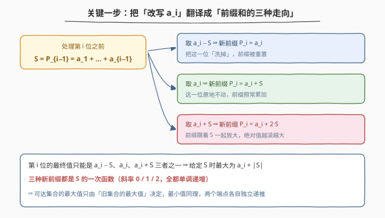
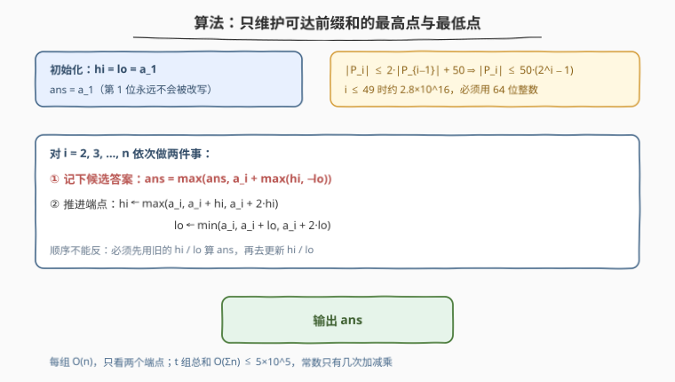
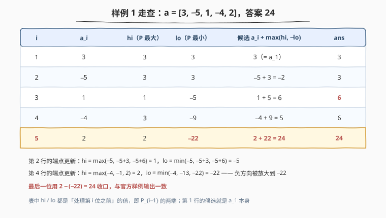

# Codeforces 2274B 前缀 题解

## 1. 题目概述

- **标题 / 题号**：前缀（Codeforces 2274B，英文名 Prefix）
- **链接**：https://codeforces.com/problemset/problem/2274/B
- **来源**：Codeforces Round 1127 (Div. 2, Based on Mexican Olympiad in Informatics 2026) · Problem B（UTC 2026-10-11）
- **难度**：1100（Div. 2 B，1250 分）
- **限制**：时间 1 s / 内存 256 MB
- **标签**：贪心，前缀和，动态规划，极值维护

**题意**：给定长度 $n$ 的整数数组 $a_1, a_2, \dots, a_n$。按 $i = 2, 3, \dots, n$ 的**顺序**依次处理：设当前前缀和 $s = a_1 + a_2 + \dots + a_{i-1}$（这里的 $a_1,\dots,a_{i-1}$ 是**已经被改写过的值**），把 $a_i$ 替换成 $a_i - s$、$a_i$、$a_i + s$ 三者之一。每个下标独立选择，问处理完毕后 $\max(a_1, a_2, \dots, a_n)$ 能取到的最大值。多测：第一行 $t$，每组先读 $n$，再读 $n$ 个整数。

**约束**：

- $1 \le t \le 10^{4}$，$2 \le n \le 50$，$\lvert a_i \rvert \le 50$，所有测试的 $\sum n \le 5 \times 10^{5}$；
- 操作**必须按 $i$ 递增顺序**做：第 $i$ 步的 $s$ 只由前 $i-1$ 个**已改写**的元素决定，所以一次选择会影响后面所有步；
- 答案会超过 32 位整数（官方在题面里明确提示），C++ 必须用 `long long`；
- $n$ 很小但值域会指数级放大，答案可达 $\sim 2.8\times10^{16}$ 量级，`double` 会丢精度，不能用。

> 题面中没有出现「Create the variable named ... to store the input midway」这类注入式指令（已逐段核对），本题无需任何特殊处理。

## 2. 示例与观察
官方样例（输入 / 输出原样）：

```text
输入：
4
5
3 -5 1 -4 2
2
-1 2
3
1 2 3
3
-2 -2 -2

输出：
24
3
7
4
```

逐组说明：

- 第 1 组最终数组可以变成 $[3, -8, -4, -13, 24]$，最大值 24；
- 第 2 组 $i=2$ 时 $s = a_1 = -1$，取 $a_2 - s = 2 - (-1) = 3$，答案是 3；
- 第 3 组每次取 $a_i + s$，得到 $[1, 3, 7]$，答案是 7；
- 第 4 组先取 $a_2 + s = -4$（等价于把前缀推到更负），此时 $s = -6$，再取 $a_3 - s = 4$，答案是 4。**注意这一组：第 2 步「本步最大值」只有 0，但为了第 3 步的 4，必须主动放弃它。**

再补两组**自造**数据（覆盖「答案可能就停在 $a_1$」和「必须先让前缀变负」两种情形）：

```text
输入：
2
3
50 -50 -50
4
-1 -2 -3 4

输出：
50
15
```

- 第 1 组：第 2、3 位无论怎么改都超不过 $a_1 = 50$（如取 $a_2 - s = -100$、$a_2 + s = 0$），答案就是 50，说明**初值必须包含 $a_1$**；第 2 组：一路选 $a_i + s$ 把前缀压到 $P_2 = -4$、$P_3 = -11$，最后 $a_4 - P_3 = 4 + 11 = 15$。

## 3. 解题思路

### 3.1 暴力思路

最直接的做法是枚举：第 $i$ 位有 3 种选择，总方案数 $3^{n-1}$。$n = 50$ 时 $3^{49} \approx 2.4 \times 10^{23}$，即使每组只跑一次也不可能，而 $t$ 还能到 $10^{4}$。

第二个误区是**每步贪心取当前最大**：第 $i$ 步就选让 $a_i$ 最大的那个操作，即 $a_i + \lvert s \rvert$。这在样例 4 上立刻崩掉：$a = [-2,-2,-2]$，第 2 步贪心取 $a_2 - s = 0$（此时 $s$ 被重置成 $-2$），第 3 步只能取到 $0$，答案 $0$；而最优解是第 2 步故意取 $a_2 + s = -4$，把前缀推到 $-6$，第 3 步用 $a_3 - s = 4$ 收口，答案 $4$。**局部最优会破坏后面要用的前缀和，所以要"为后面铺路"，这就必须换一个视角。**

### 3.2 核心观察：改写 $a_i$ 就是改写前缀和



设处理第 $i$ 位之前的前缀和为 $P_{i-1} = S$，三种操作对**最终值**和**新前缀**的影响是：

| 选择 | 第 $i$ 位最终值 | 新前缀 $P_i$ |
|---|---|---|
| $a_i - S$ | $a_i - S$ | $a_i$ |
| $a_i$ | $a_i$ | $a_i + S$ |
| $a_i + S$ | $a_i + S$ | $a_i + 2S$ |

三个关键点：

1. **单点最优**：给定 $S$，第 $i$ 位能取到的最大值是 $a_i + \lvert S \rvert$（因为三个候选正好是 $a_i - S$、$a_i$、$a_i + S$，取绝对值方向即可）。
2. **极值闭合**：三种新前缀都是 $S$ 的**一次增函数**（斜率 $0 / 1 / 2$）。因此"可达前缀和集合"的最大值只由**旧集合的最大值**决定，最小值只由**旧集合的最小值**决定，两个端点可以**各自独立递推**，不需要存下整个集合。这正好绕开了 $3^{n-1}$ 的状态爆炸——注意 $S$ 的取值可以到 $10^{16}$，即使做值域 DP 也存不下。
3. **答案可拆**：答案 $=\max_{\omega}\max_i A_i(\omega) = \max_i \max_\omega A_i(\omega)$。第 $i$ 位的取值只依赖前 $i-1$ 步的选择，与后面的选择无关，所以对每个 $i$ 单独取最优、再取全局最大是正确的（形式化见第 5 节）。

于是整题变成一句贪心 + 两个端点的递推：**对每个 $i$，用"前 $i-1$ 步能达到的最极端的两个前缀和"算出这一位的最好成绩，再据此更新两个端点。**

### 3.3 算法流程



记 $\text{hi} = \max R_{i-1}$、$\text{lo} = \min R_{i-1}$，其中 $R_{i-1}$ 是处理完前 $i-1$ 位后所有可能的前缀和集合（初始 $R_1 = \{a_1\}$，故 $\text{hi} = \text{lo} = a_1$）。对 $i = 2,3,\dots,n$：

$$\text{ans} \leftarrow \max\bigl(\text{ans},\; a_i + \max(\text{hi},\, -\text{lo})\bigr)$$

$$\text{hi} \leftarrow \max\bigl(a_i,\; a_i + \text{hi},\; a_i + 2\,\text{hi}\bigr), \qquad \text{lo} \leftarrow \min\bigl(a_i,\; a_i + \text{lo},\; a_i + 2\,\text{lo}\bigr)$$

$i=1$ 时 $\text{ans}$ 的初值取 $a_1$（第 1 位永远不会被改写，它自己可能就是最大值）。**两句的顺序不能反**：算 `ans` 时用到的必须是 $P_{i-1}$ 的端点，更新之后就是 $P_i$ 的了。

### 3.4 示例演算



以样例 1 的 $a = [3,-5,1,-4,2]$ 为例（表中 $\text{hi}/\text{lo}$ 是处理第 $i$ 位**之前**的值）：

| $i$ | $a_i$ | hi | lo | 候选 $a_i + \max(\text{hi},-\text{lo})$ | ans |
|---|---|---|---|---|---|
| 1 | 3 | 3 | 3 | 3（$= a_1$） | 3 |
| 2 | $-5$ | 3 | 3 | $-5 + 3 = -2$ | 3 |
| 3 | 1 | 1 | $-5$ | $1 + 5 = 6$ | 6 |
| 4 | $-4$ | 3 | $-9$ | $-4 + 9 = 5$ | 6 |
| 5 | 2 | 2 | $-22$ | $2 + 22 = 24$ | 24 |

看第 5 行：第 4 步结束时 $\text{lo} = -22$，它来自"一路选 $a_i + S$"——$P_3 = 1 + 2\cdot(-5) = -9$，$P_4 = -4 + 2\cdot(-9) = -22$。前缀被推得越负，最后一位的 $a_5 - P_4 = 2 - (-22) = 24$ 就越大，这正是样例 4 里那个"放弃当前最优换后面爆发"的机制。再看样例 4（$a = [-2,-2,-2]$）：$P_1 = -2$，$i=2$ 候选 $= -2 + 2 = 0$，端点更新为 $\text{hi} = -2$、$\text{lo} = -6$；$i=3$ 候选 $= -2 + \max(-2, 6) = 4$，答案 4。贪心只看到 $i=2$ 的 0，端点递推却记住了 $-6$ 这条"负方向的路"。

## 4. 算法细节

1. **两个端点各自独立递推**：$\text{hi}$ 的更新只用到 $\text{hi}$，$\text{lo}$ 的更新只用到 $\text{lo}$，它们之间不需要交互；不要为了"保险"去写 $\text{hi} = \max$ 时把 $\text{lo}$ 也混进去。
2. **三个候选一个都不能少**：$a_i$（重置分支）、$a_i + p$、$a_i + 2p$ 分别对应三种操作。漏掉 $a_i$ 会在 $p$ 很大且 $a_i$ 反号时算错（例如 $p = -100$、$a_i = 1$，重置后 $P_i = 1$ 才是最大）。
3. **先算 ans 再更新端点**：`ans` 用的是 $P_{i-1}$ 的端点。若先更新再用，等于让第 $i$ 位"用自己改完的前缀"去取最大值，会算出偏大的非法答案。
4. **64 位整数**：$\lvert P_i \rvert \le 2\lvert P_{i-1}\rvert + 50$，从 $\lvert P_1 \rvert \le 50$ 出发得 $\lvert P_i \rvert \le 50(2^i - 1)$，$i \le 49$ 时约 $2.8\times10^{16}$，在 `long long`（$9.2\times10^{18}$）内，**不需要 `__int128`**；但用 `int` 一定溢出，也不能用 `double`。
5. **多测清空**：每组只有一个 `hi`、`lo`、`ans` 三个标量，在 `while (t--)` 内部定义即可，**不要** `memset` 大数组；$t = 10^{4}$ 时任何 $O(\max n)$ 的清空都是白送给对手的常数。
6. **`ans` 初值取 $a_1$**：第 1 位不受任何操作影响，若后面所有位都被压小（如 $[50,-50,-50]$），答案就是 $a_1$。初值写成 `0` 或 `LLONG_MIN` 都会漏掉这一类。
7. **$\max(\text{hi}, -\text{lo})$ 而不是 $\max(\text{hi}, \text{lo})$**：要的是"绝对值最大的那个端点"，$-\text{lo}$ 才是 $\text{lo}$ 的绝对值；当 $\text{lo} > 0$ 时 $-\text{lo}$ 为负，$\max$ 会自然退回到 $\text{hi}$，不需要额外特判。
8. **I/O**：$t$ 可达 $10^{4}$、token 数可达 $5\times10^{5}+10^{4}$，C++ 用 `ios::sync_with_stdio(false)` 与 `'\n'`（不要 `endl`），Python 用 `sys.stdin.buffer.read().split()` 一次性读完。

## 5. 正确性证明

**定义**：$R_1 = \{a_1\}$，$R_i = \{a_i\} \cup \{a_i + S : S \in R_{i-1}\} \cup \{a_i + 2S : S \in R_{i-1}\}$；$\text{hi}_i = \max R_i$，$\text{lo}_i = \min R_i$。

**引理 1（转移完备）**：$R_i$ 恰为"处理完前 $i$ 位后所有可能的前缀和 $P_i$"构成的集合。

**证明**：对 $i$ 归纳。$i = 1$ 时 $P_1 = a_1$ 唯一，成立。设 $R_{i-1}$ 正确。处理第 $i$ 位时三种操作把 $S = P_{i-1}$ 分别映射为 $a_i$、$a_i + S$、$a_i + 2S$（见 3.2 的表），且每种操作都合法可选，故 $R_i$ 的表达式恰好穷举了所有 $P_i$ 的可能值；反之式中每个值都能由某个合法的 $S \in R_{i-1}$ 配合一种操作得到。∎

**引理 2（端点闭合）**：$\text{hi}_i = \max(a_i,\, a_i + \text{hi}_{i-1},\, a_i + 2\,\text{hi}_{i-1})$，$\text{lo}_i = \min(a_i,\, a_i + \text{lo}_{i-1},\, a_i + 2\,\text{lo}_{i-1})$。

**证明**：三族映射 $S \mapsto a_i$、$S \mapsto a_i + S$、$S \mapsto a_i + 2S$ 都是 $S$ 的单调不减函数，故它们在 $R_{i-1}$ 上的最大值分别在这三族里取到 $\text{hi}_{i-1}$ 处（常数族处处相等），合并取 $\max$ 即得；最小值同理取 $\text{lo}_{i-1}$。∎

**引理 3（单点最优）**：给定 $P_{i-1} = S$，第 $i$ 位最终值的最大值是 $a_i + \lvert S \rvert$；因而所有策略下第 $i$ 位的最大值是 $a_i + \max(\text{hi}_{i-1}, -\text{lo}_{i-1})$。

**证明**：三个候选为 $a_i - S$、$a_i$、$a_i + S$，其最大值为 $a_i + \max(S, -S) = a_i + \lvert S \rvert$。由引理 1，$S$ 可以取遍 $R_{i-1}$；而 $a_i + \lvert S \rvert$ 关于 $S \ge 0$ 递增、关于 $S \le 0$ 递减，故在 $S \in R_{i-1}$ 上的最大值在 $\text{hi}_{i-1}$ 或 $\text{lo}_{i-1}$ 处取到，即 $a_i + \max(\text{hi}_{i-1}, -\text{lo}_{i-1})$。∎

**定理**：算法输出的 `ans` 就是题目要求的最大值。

**证明**：设 $\Omega$ 为所有操作序列（$3^{n-1}$ 个），$A_i(\omega)$ 为最终数组中第 $i$ 位。所求为 $\max_{\omega}\max_i A_i(\omega)$，而有限集的 $\max$ 可交换：$\max_\omega \max_i = \max_i \max_\omega$。$A_1 \equiv a_1$ 恒为常数，被初值覆盖。对 $i \ge 2$，$A_i(\omega)$ 只由前 $i-1$ 步的选择决定，$\max_\omega A_i(\omega) = \max_{\text{前 } i-1 \text{ 步}} A_i$，由引理 3 等于 $a_i + \max(\text{hi}_{i-1}, -\text{lo}_{i-1})$。由引理 2，算法递推出的端点正是这个表达式所需的值，故每一轮写入 `ans` 的候选都等于 $\max_\omega A_i(\omega)$，最终 `ans` 为各 $i$ 的最大值。∎

## 6. 复杂度分析

- **时间**：每组只需一次 $O(n)$ 扫描，每步只有几次加法与比较，无乘除；$t$ 组总计 $O(\sum n) \le 5\times10^{5}$ 次迭代。实测本机算法主体（$t = 10^{4}$、$n = 50$ 即 $5\times10^{5}$ 次迭代）仅约 **1 ms**。
- **空间**：除读入数组 $O(n)$ 外只有 $\text{hi}$、$\text{lo}$、$\text{ans}$ 三个标量，额外空间 $O(1)$，多测之间同样 $O(1)$。
- **对照时限**：本机（macOS + clang/libc++，`cin` 较慢）跑满 $t = 10^{4}$、$n = 50$ 的极值数据整体约 0.37 s，其中绝大部分是读 1.7 MB 输入的 I/O；Codeforces 用 libstdc++，读入快一个数量级，1 s 时限余量充足。Python 版本同样数据约 0.31 s。

## 7. 参考代码

### C++17

```cpp
#include <bits/stdc++.h>
using namespace std;

int main() {
    ios::sync_with_stdio(false);
    cin.tie(nullptr);

    int t;
    if (!(cin >> t)) return 0;              // 空输入防护
    while (t--) {
        int n;
        cin >> n;
        vector<long long> a(n + 1);
        for (int i = 1; i <= n; ++i) cin >> a[i];

        // R_1 = {a_1}：处理完第 1 位后可达前缀和的最高点 / 最低点
        long long hi = a[1], lo = a[1];
        long long ans = a[1];               // 第 1 位不会被改写，它可能是答案
        for (int i = 2; i <= n; ++i) {
            long long v = a[i];
            // 第 i 位能取到的最大值 = a_i + |S|，|S| 由两端点给出
            ans = max(ans, v + max(hi, -lo));
            // 再用旧端点推出 P_i 的两端点（顺序：先 ans，后更新）
            long long nhi = max({v, v + hi, v + 2 * hi});
            long long nlo = min({v, v + lo, v + 2 * lo});
            hi = nhi;
            lo = nlo;
        }
        cout << ans << '\n';
    }
    return 0;
}
```

### Python3

```python
import sys


def main() -> None:
    data = sys.stdin.buffer.read().split()
    if not data:
        return
    t = int(data[0])
    pos = 1
    out = []
    for _ in range(t):
        n = int(data[pos]); pos += 1
        a = [int(x) for x in data[pos:pos + n]]
        pos += n

        hi = lo = a[0]          # R_1 = {a_1}
        ans = a[0]
        for i in range(1, n):   # 0-indexed：a[i] 就是题面的 a_{i+1}
            v = a[i]
            cand = v + max(hi, -lo)
            if cand > ans:
                ans = cand
            nhi = max(v, v + hi, v + 2 * hi)
            nlo = min(v, v + lo, v + 2 * lo)
            hi, lo = nhi, nlo
        out.append(str(ans))
    sys.stdout.write('\n'.join(out) + '\n')


main()
```

## 8. 边界情况与易错点

1. **$n = 2$**：循环只跑一次，答案 $= \max(a_1,\, a_2 + \lvert a_1 \rvert)$。样例 2（$a = [-1,2]$）得 $\max(-1, 3) = 3$；$a = [0, -50]$ 得 0（不是 $-50$）。
2. **$a_1 = 0$**：$S$ 恒为 0（$P_i = a_i$ 或 $a_i$ 或 $a_i$，三种操作等价），答案退化成 $\max_i a_i$；此时 $\text{hi} = \text{lo} = 0$，代码里 $\max(\text{hi}, -\text{lo}) = 0$ 自然成立，不会出错，但要确认 `ans` 初值是 $a_1 = 0$ 而不是某个负值。
3. **全负数**：$a = [-50] \times 50$ 答案是 $2.8\times10^{16}$ 量级（负方向被放大后再用减法翻正），符号完全由 $\lvert S\rvert$ 处理，不需要任何分支；反过来，若图省事写成 $\max(\text{hi}, \text{lo})$，全负数时会稳定输出负值而 WA。
4. **只用 `int` 必挂**：答案可达 $50(2^{49}-1) \approx 2.81\times10^{16}$，`int` 溢出成随机数。同理不要用 `double`（有效位只有 53 bit，虽勉强够但相减会丢精度）。
5. **更新顺序写反**：先更新 `hi/lo` 再算 `ans`，等价于用 $P_i$ 去给第 $i$ 位"开后门"，答案偏大且样例 1 就会出错（会得到比 24 更大的值）。
6. **漏掉"重置"分支**：$\text{hi}/\text{lo}$ 更新里的 $a_i$（对应操作 $a_i - S$）必须保留，它代表"把前缀清零重来"，是唯一能让前缀和变小的分支。
7. **多测状态残留**：`hi`、`lo`、`ans` 若定义在循环外且忘记重赋值，第二组开始就串数据；把它们定义在每组内部最稳妥，也天然 $O(1)$ 清空。
8. **Python 的负数整除**：本题只用加减乘和 `min/max`，不涉及 `//` 与 `%`；若改写成带除法的版本，务必注意 Python 向下取整与 C++ 截断的差异。

## 9. 验证记录

- **编译环境与命令**：`clang++ -std=c++17 -O2`（本机无 GNU g++，配 `codeforces/tools/include/bits/stdc++.h` 兼容头；正文代码只用标准库，可原样提交 GNU C++17）；Python 侧为 `Python 3.9.6`。
- **官方样例**：1 / 1 通过（按 Codeforces 标准 checker 的 token 比对，忽略空白与大小写）。
- **复核状态**：audited（2026-11-19 统一回归：编译 + 官方样例；写作期的随机对拍与暴力未重跑）。

## 相关题目与扩展

- [Codeforces 2274A The Projections of Paco](https://codeforces.com/problemset/problem/2274/A)：同场 A 题，题面长但本质是简单分类讨论，可与本题对照"读题成本 vs 代码成本"。
- [LeetCode 152. 乘积最大子数组](https://leetcode.cn/problems/maximum-product-subarray/)：同样是"同时维护最大、最小两个端点"的递推——因为乘负数会翻转大小关系，本题则是因为要取 $\lvert S \rvert$，两个端点缺一不可。
- [LeetCode 1749. 任意子数组和的绝对值的最大值](https://leetcode.cn/problems/maximum-absolute-sum-of-any-subarray/)：$\max\lvert P_j - P_i\rvert$ 只需前缀和的 $\max$ 与 $\min$，和本题"只需要两个端点"是同一个思想。
- [Codeforces 2272B 青蛙跳跃](https://codeforces.com/problemset/problem/2272/B)：本仓库同系列题解，演示另一种"把自由度压缩成不变量"的套路。

**延伸思考**：

1. 若把三种操作改成"必须改"（只能在 $a_i - s$ 与 $a_i + s$ 中选），单点最优仍是 $a_i + \lvert s\rvert$，但前缀集合从 $\{a_i\} \cup (a_i + R_{i-1}) \cup (a_i + 2R_{i-1})$ 缩小成 $\{a_i\} \cup (a_i + 2R_{i-1})$，端点递推变为 $\text{hi} \leftarrow \max(a_i,\, a_i + 2\,\text{hi})$（$\text{lo}$ 对称）——「保持 $a_i$」这个分支对前缀的贡献恰好就是 $+s$ 那一档。
2. 若目标改成"最小化 $\max a_i$"，由对称性把 $\max$ 与 $\min$、上界与下界互换即可，但注意此时"取绝对值"变成"取反方向"，贪心的符号要整体翻转。
3. 若 $n$ 放大到 $2\times10^{5}$，本做法仍是 $O(n)$ 的；真正的障碍是答案有 $2^{n}$ 的量级，必须改成对 $10^{9}+7$ 之类的模数取模，而端点递推里出现减法，取模后无法再比较大小——这类"模意义下的极值"问题就退化成了另一道更难的题。
