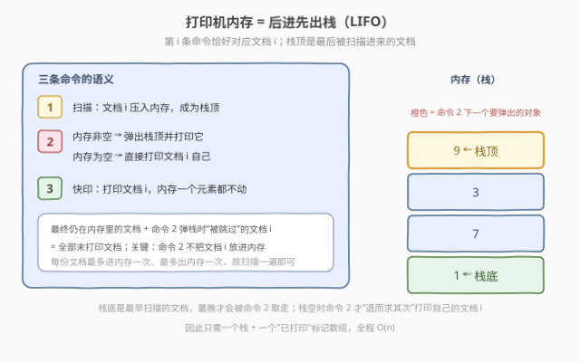
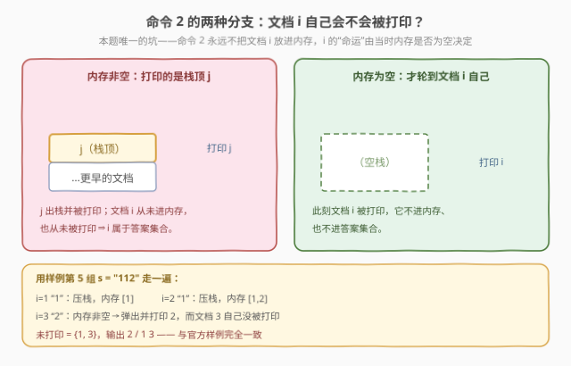
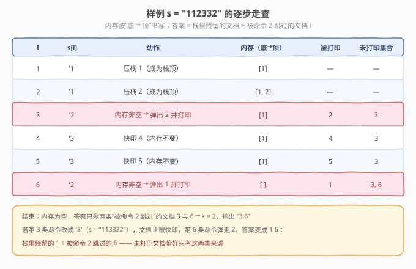

# Codeforces 2275B 未能付印 题解

## 1. 题目概述

- **标题 / 题号**：未能付印（Codeforces 2275B，英文名 Did Not Go to Print）
- **链接**：https://codeforces.com/problemset/problem/2275/B
- **来源**：Codeforces Round 1125 (Div. 3) · Problem B（UTC 2026-10-07）
- **难度**：800
- **限制**：时间 2 s / 内存 256 MB
- **标签**：栈、模拟（官方 tag：data structures、implementation）

**题意**：K1o0n 的新打印机带内存，可以先把文档攒起来再打。共有 $n$ 份文档，编号 $1 \sim n$，初始内存为空；朋友们依次执行 $n$ 条命令，第 $i$ 条命令与文档 $i$ 对应，字符只可能是三种：

- `'1'`：扫描。文档 $i$ 被送入内存，并放在**所有已有文档的最上面**；
- `'2'`：从内存打印。若内存非空，打印**最上面**的那份文档并把它移出内存；若内存为空，则直接打印文档 $i$；
- `'3'`：快印。直接打印文档 $i$，内存一个元素都不动。

求所有**没被打印**的文档，按编号递增输出。每组数据输出两行：第一行是未打印文档的个数 $k$，第二行是这 $k$ 个编号（$k=0$ 时第二行为空行）。

**约束**：

- $1 \le t \le 10^{4}$，$1 \le n \le 2\times10^{5}$，且 $\sum n \le 2\times10^{5}$
- 字符串 $s$ 的长度恰为 $n$，字符集为 $\{1,2,3\}$
- 内存是**栈**（后进先出），不是队列
- 输出编号必须严格递增、空格分隔；$k=0$ 时不必输出任何编号，但空行要保留

## 2. 示例与观察
官方样例（输入与输出均原样）：

```text
输入：
6
2
12
2
13
2
23
6
112332
3
112
6
211213

输出：
1
2
1
1
0

2
3 6
2
1 3
3
2 4 5
```

六组答案依次为 2、1、空、`3 6`、`1 3`、`2 4 5`。注意第 3 组 $k=0$，输出里 `0` 之后仍有一个空行；第 1 组中文档 1 扫描后又被命令 2 弹出打印，于是文档 2 自己没进内存、也没被打印。

## 3. 解题思路

### 3.1 暴力思路

逐条命令模拟本身已经是 $O(n)$，所以本题的"暴力"不是复杂度爆炸，而是**想错方向**：对每份文档单独重放一遍命令来判断它是否被打印，是 $O(n^2)$，$\sum n = 2\times10^{5}$ 时最坏约 $4\times10^{10}$ 次操作，2 s 内必挂；把问题当成"谁打印了谁"的匹配题去建图或倒推，则纯属走偏。

### 3.2 核心观察：命令 2 的“错位”与栈残留



把内存看成一个栈，栈顶就是"最上面"的文档。逐类命令看文档 $i$ 的去向：

- 命令 `'3'`：文档 $i$ 立刻被打印，与内存无关；
- 命令 `'1'`：文档 $i$ 进栈，之后要么被某条 `'2'` 弹出并打印，要么一直留在栈里 —— 后者就是未打印；
- 命令 `'2'`：这里藏着本题唯一的**错位陷阱**。若内存非空，被打印的是**栈顶文档 $j$**（$j < i$），而文档 $i$ 自己既没进内存、也没被打印，它必然属于答案；只有内存为空时，$i$ 才"替补"自己上去被打印。

于是未打印集合可以精确地写成两类文档的并：

$$A = S \cup B$$

其中 $S$ 是扫描结束时仍留在内存（栈）里的文档集合；$B$ 是所有满足「$s_i$ 为 `'2'` 且执行第 $i$ 条命令时内存非空」的下标 $i$ 组成的集合。$B$ 里的文档从头到尾没有进过内存，因此不属于 $S$，两类必须合并 —— 这正是样例 4、5 中 3、6 与 1、3 的来源。

### 3.3 算法流程



1. 为每组数据建 `printed[1..n]`（初值全 0）与空栈 `st`；
2. 令 $i$ 从 1 扫到 $n$，按 $s_i$ 分派：
   - $s_i$ 为 `'1'`：把 $i$ 压栈；
   - $s_i$ 为 `'2'`：若栈非空，弹出栈顶并将**被弹出的文档**标记为已打印（不标记 $i$）；若栈为空，标记 $i$；
   - $s_i$ 为 `'3'`：标记 $i$；
3. 再令 $i$ 从 1 扫到 $n$，把所有 `printed[i] == 0` 的 $i$ 依次收集，输出个数 $k$ 与列表。

最后一步按下标递增扫描，输出天然有序，无需排序或归并；每条命令只做 $O(1)$ 次栈操作或写标记。

### 3.4 示例演算



对样例第 4 组 $s = $ `112332`：第 3 条命令 `'2'` 弹出文档 2，把文档 3 留进答案；第 6 条命令 `'2'` 弹出文档 1，把文档 6 留下，最终 $A = \{3, 6\}$。

再看覆盖"空内存分支"的样例第 6 组 $s = $ `211213`：第 1 条命令时内存为空，打印文档 1；随后压入 2、3，第 4 条命令弹出 3；再压入 5，第 6 条命令快印 6。结束时栈里剩 2 和 5，加上第 4 条命令"跳过"的文档 4，答案就是 `2 4 5`。

## 4. 算法细节

1. **多测清空**：`printed` 每轮重建为 `vector<char>(n + 1, 0)`，栈每轮清空；不要复用上一轮的脏状态（$t$ 达 $10^4$ 时最容易漏）。
2. **下标对齐**：文档编号从 1 开始，代码用 1-indexed，取字符时写 `s[i - 1]`，避免整体右移带来的边界麻烦。
3. **输出格式**：先输出 $k$ 换行，再输出编号；$k = 0$ 时必须仍输出一个空行（`cout << '\n'`），且行末不留多余空格。
4. **不必排序**：若分别收集"被命令 2 跳过的 $i$"与"栈中残留"再合并，需要额外排序；用 `printed` 标记最后顺序扫一遍，天然递增且代码最短。
5. **栈的实现**：`vector<int>` 加 `reserve(n)` 比 `std::stack<int>` 更快，还能直接 `back()` 取栈顶。
6. **类型与 I/O**：$k \le n$，`int` 足够，本题无乘法、无溢出；换行用 `'\n'` 而非 `endl`，Python 用 `sys.stdin.buffer.read().split()` 一次读完、`bytearray` 做标记。

## 5. 正确性证明

**引理 1（栈不变式）**：处理完前 $i$ 条命令后，内存自底向顶恰好是"已执行 `'1'` 且尚未被 `'2'` 弹出的文档编号"，且严格递增。

**证明**：对 $i$ 归纳。初始为空，成立。设前 $i-1$ 条满足：

- 第 $i$ 条是 `'1'`：文档 $i$ 进栈，$i$ 大于此前所有编号，故成为栈顶且序列仍严格递增，正好是"已扫描未弹出"集合加入 $i$；
- 第 $i$ 条是 `'2'` 且内存非空：弹出栈顶，即移除集合中编号最大的元素，剩余仍严格递增且仍是"已扫描未弹出"；内存为空时无操作；
- 第 $i$ 条是 `'3'`：内存不变。∎

**引理 2（打印集合正确）**：执行完前 $i$ 条命令后，`printed` 标记的文档集合恰好等于这 $i$ 条命令实际打印过的文档集合。

**证明**：按第 $i$ 条命令分类。`'1'` 不打印任何文档，算法也不标记；`'3'` 打印 $i$、算法标记 $i$；`'2'` 且内存为空时打印 $i$、标记 $i$；`'2'` 且内存非空时，题面要求打印"内存中最上面的文档"，由引理 1 栈顶正是该文档，算法弹出并标记它，同时不标记 $i$，与现实一致。四种情形两侧同步变化，归纳即得。∎

**引理 3（补集等价）**：扫描结束后 `printed[d] = 0` 当且仅当文档 $d$ 从未被打印。

**证明**：由引理 2，标记集合等于打印过的文档集合，取补即得；且每份文档至多被标记一次，不存在"标记后取消"。∎

**定理**：算法输出的列表恰好是全部未打印文档的编号，且严格递增。

**证明**：由引理 3，输出集合与未打印集合相等，不漏不重；最后一步令 $i$ 从 1 到 $n$ 依次检查，仅当 `printed[i] = 0` 时追加 $i$，故编号严格递增，长度即 $k$。∎

## 6. 复杂度分析

- **时间**：每组 $O(n)$ —— 扫描命令 $n$ 次、每次 $O(1)$；再顺序扫 $n$ 次收集答案。总计 $O(\sum n) \le 2\times10^{5}$。本地实测（含 I/O）：单组 $n = 2\times10^{5}$ 约 25 ms，全 `'1'` 的最坏情况约 46 ms，$t = 10^{4}$ 组共 $2\times10^{5}$ 个字符约 35 ms，相对 2 s 有 40 倍以上余量。
- **空间**：每组 $O(n)$ —— `printed` 为 $n+1$ 个 `char`，栈最多 $n$ 个 `int`，合计不到 1 MB，远小于 256 MB。

## 7. 参考代码

### C++17

```cpp
#include <cstddef>
#include <iostream>
#include <string>
#include <vector>
using namespace std;

int main() {
    ios::sync_with_stdio(false);
    cin.tie(nullptr);

    int t;
    cin >> t;
    while (t--) {
        int n;
        string s;
        cin >> n >> s;

        vector<char> printed(n + 1, 0);   // printed[i] = 文档 i 是否已被打印
        vector<int> stk;                  // 打印机内存：栈，栈顶是最后放进去的文档
        stk.reserve(n);

        for (int i = 1; i <= n; ++i) {
            char c = s[i - 1];
            if (c == '1') {
                stk.push_back(i);         // 文档 i 进入内存栈顶
            } else if (c == '2') {
                if (!stk.empty()) {
                    printed[stk.back()] = 1;  // 打印栈顶文档
                    stk.pop_back();
                    // 文档 i 自己既不进内存也没被打印，最终仍在“未打印”集合里
                } else {
                    printed[i] = 1;       // 内存为空：直接打印文档 i
                }
            } else {                      // '3'：快印文档 i，不碰内存
                printed[i] = 1;
            }
        }

        vector<int> ans;
        ans.reserve(n);
        for (int i = 1; i <= n; ++i)
            if (!printed[i]) ans.push_back(i);

        cout << ans.size() << '\n';
        for (size_t k = 0; k < ans.size(); ++k)
            cout << ans[k] << (k + 1 == ans.size() ? '\n' : ' ');
        if (ans.empty()) cout << '\n';    // k = 0 时仍要输出第二行的空行
    }
    return 0;
}
```

### Python3

```python
import sys


def main() -> None:
    data = sys.stdin.buffer.read().split()
    t = int(data[0])
    pos = 1
    out = []
    for _ in range(t):
        n = int(data[pos])
        s = data[pos + 1].decode()
        pos += 2

        printed = bytearray(n + 1)
        stk = []
        for i, ch in enumerate(s, 1):
            if ch == '1':
                stk.append(i)
            elif ch == '2':
                if stk:
                    printed[stk.pop()] = 1
                else:
                    printed[i] = 1
            else:
                printed[i] = 1

        ans = [str(i) for i in range(1, n + 1) if not printed[i]]
        out.append(str(len(ans)))
        out.append(' '.join(ans))
    sys.stdout.write('\n'.join(out) + '\n')


main()
```

## 8. 边界情况与易错点

1. **$k = 0$ 的空行**：样例第 3 组即此情况，必须输出 `0` 后再输出一个空行，漏掉会判格式不符。
2. **$n = 1$ 的三种情况**：`'1'` → `1 / 1`；`'2'` → `0 / 空行`；`'3'` → `0 / 空行`。循环边界写 `1..n`，别写成 `0..n-1` 而错位。
3. **命令 `'2'` 的两处坑**：内存为空时才打印文档 $i$ 自己；内存非空时文档 $i$ 也**不能**标记为已打印（它只是"发起者"）。写反是本题最常见的 WA。
4. **全 `'1'` 数据**：$k = n$，答案包含 $1 \sim n$ 全部编号，第二行很长；注意最后一个编号后仍要换行。
5. **多测状态污染**：`printed` 与栈必须每组开头重建；用全局数组而不清空后缀，会让上一组更长的数据留下脏标记。
6. **全 `'3'` 数据**：内存始终为空，$k = 0$，可以顺手验证空行逻辑；所有命令都是 `'2'` 时同样 $k = 0$。

## 9. 验证记录

- **编译环境与命令**：`clang++ -std=c++17 -O2`（本机无 GNU g++，配 `codeforces/tools/include/bits/stdc++.h` 兼容头；正文代码只用标准库，可原样提交 GNU C++17）；Python 侧为 `Python 3.9.6`。
- **官方样例**：1 / 1 通过（按 Codeforces 标准 checker 的 token 比对，忽略空白与大小写）。
- **复核状态**：audited（2026-11-19 统一回归：编译 + 官方样例；写作期的随机对拍与暴力未重跑）。

## 相关题目与扩展

- [Codeforces 5C. Longest Regular Bracket Sequence](https://codeforces.com/problemset/problem/5/C)：同样用栈维护"最近未匹配"的元素，注意栈里存下标而不是字符。
- [LeetCode 20. 有效的括号](https://leetcode.cn/problems/valid-parentheses/)：栈模拟入门模板，"谁在栈顶"与本题是同一个直觉。
- [LeetCode 946. 验证栈序列](https://leetcode.cn/problems/validate-stack-sequences/)：判断入栈/出栈序列是否合法，本质是模拟弹出规则。
- [LeetCode 682. 棒球比赛](https://leetcode.cn/problems/baseball-game/)：用栈处理一串命令并求最终得分，可作为"命令驱动栈"的练习。

**延伸思考**：

1. 把命令 `'2'` 改成"打印内存里**最早**放进去的文档"（FIFO），弹出对象变成队首，用 `deque` 即可；$B$ 与 $S$ 的定义不变，变的只是"谁被弹出"。
2. 若要求输出**打印顺序**而非未打印列表，就在每次真正打印时追加编号，$O(n)$ 完成；所有权转移关系依旧只由栈决定。
3. 若改成"打印内存中**编号最小**的文档"，需要 `set` 或小根堆，复杂度升到 $O(n \log n)$ —— 换一种取出规则就换一种数据结构。
