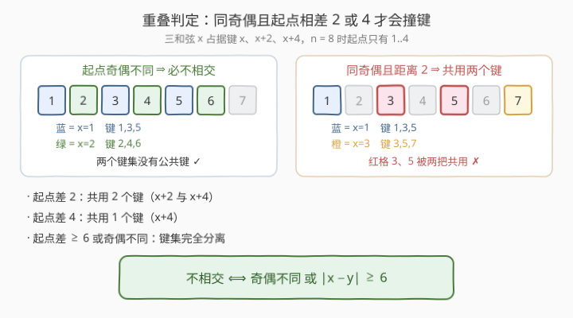
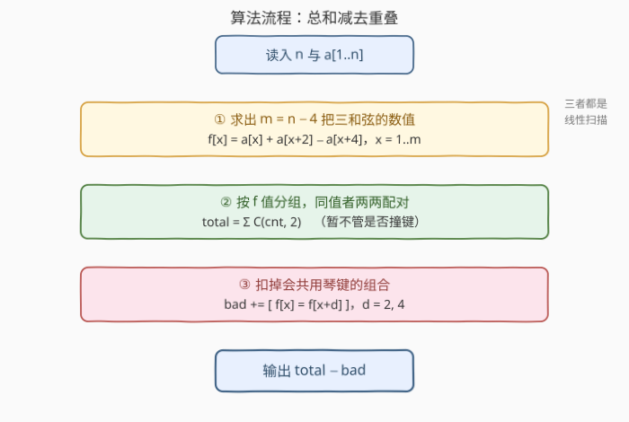
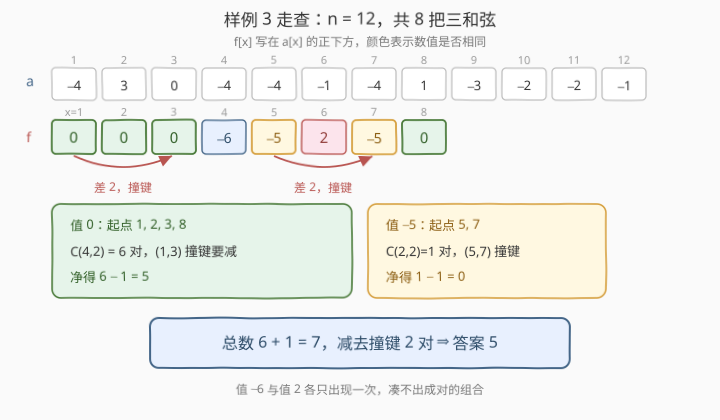

# Codeforces 2275C 单恋 题解

## 1. 题目概述

- **标题 / 题号**：单恋（Codeforces 2275C，英文名 Unrequited Love）
- **链接**：https://codeforces.com/problemset/problem/2275/C
- **来源**：Codeforces Round 1125 (Div. 3) · Problem C（UTC 2026-10-07）
- **难度**：1000
- **限制**：时间 2 s / 内存 256 MB
- **标签**：枚举，数据结构（排序 / 哈希计数），组合计数

**题意**：K1o0n 淘到一台二手合成器，上面有 $n$ 个琴键，第 $i$ 个键能换来 $a_i$ 单位的"观众的爱"。他只会一个技巧——**三和弦**：三个两两之间恰好隔一个键的琴键同时按下。以 $x$ 起始的三和弦就是键 $x,\ x+2,\ x+4$（要求 $1 \le x \le n-4$），收益为

$$v(x) = a_x + a_{x+2} - a_{x+4}$$

其中第三项是**减号**。琴键老旧，每个键只能承受一次按压，因此他要挑**两个不同的三和弦**，它们**不共用任何琴键**，并且**收益相同**。求这样的无序对 $\{x, y\}$ 的个数。

多测：第一行 $t$；每组先给 $n$，再给 $n$ 个整数 $a_1..a_n$，输出一个整数表示方案数。

**约束**：

- $1 \le t \le 10^4$，$6 \le n \le 2\cdot 10^5$（$n \ge 6$ 保证至少有一个三和弦），且**所有测试组的 $n$ 之和**不超过 $2 \times 10^5$
- $-10^4 \le a_i \le 10^4$，故 $v(x) \in [-3\times10^4,\ 3\times10^4]$
- 起点个数 $m = n-4$；答案最大为 $\binom{m}{2} \approx 2\times10^{10}$，必须用 64 位整数

## 2. 示例与观察
官方三组样例（输入 / 输出原样）：

```text
输入：
3
6
5 1 4 2 2 -4
7
0 0 0 0 0 0 0
12
-4 3 0 -4 -4 -1 -4 1 -3 -2 -2 -1

输出：
1
2
5
```

- 第 1 组：$v(1)=5+4-2=7$，$v(2)=1+2-(-4)=7$，起点差 1 为不同奇偶，键集 $\{1,3,5\}$ 与 $\{2,4,6\}$ 不相交，唯一一对。
- 第 2 组：$n=7$ 时 $m=3$，$v(1)=v(2)=v(3)=0$。合法的只有 $\{1,2\}$ 与 $\{2,3\}$（差 1）；$\{1,3\}$ 差 2 共用键 3、5，非法。
- 第 3 组：$v = [0,0,0,-6,-5,2,-5,0]$，值 0 贡献 6 对减去 $\{1,3\}$，值 $-5$ 贡献 1 对减去 $\{5,7\}$，共 $5$ 对（详见 3.4 的走查图）。

再补一组自造样例，专门覆盖"差 4 撞键"与"多值混合"：

```text
输入（自造）：
1
12
1 0 0 0 1 0 2 0 0 0 0 0

输出（自造）：
5
```

此例中 $v=[0,0,-1,0,3,0,2,0]$：值 0 的起点是 $1,2,4,6,8$，共 $\binom{5}{2}=10$ 对，其中差 2 的 $\{2,4\},\{4,6\},\{6,8\}$ 与差 4 的 $\{2,6\},\{4,8\}$ 共 5 对撞键，余下 5 对合法。

## 3. 解题思路

### 3.1 暴力思路

先算出全部 $m=n-4$ 个 $v(x)$，再枚举所有无序对 $\{x,y\}$，判两个键集是否有交集、收益是否相等。判交也可以直接展开成三对三比较。

复杂度 $O(m^2)$：$m$ 接近 $2\times10^5$ 时是 $2\times10^{10}$ 次判交，2 s 内绝无可能，枚举这一步必须砍掉。

### 3.2 核心观察：撞键只发生在"同奇偶 + 距离 2 或 4"



不要一上来就想"怎么快速判交"，而要问：**有多少种 $x,y$ 会撞键？**

三和弦 $x$ 占据的键是 $x,\ x+2,\ x+4$，三者与 $x$ **同奇偶**。于是：

- **奇偶不同**：两组键分属两个奇偶类，键集**必然不相交**，此时只要 $v(x)=v(y)$ 就是合法答案；
- **奇偶相同**：设 $d = |x-y|$。$d=2$ 时两个键集交于 2 个键，$d=4$ 时交于 1 个键，都是"撞键"；$d \ge 6$ 时后一组的首键已在前一组末键的右侧，彻底分离。

也就是说，**非法只可能是 $d \in \{2,4\}$ 这一种"局部的、常数的"情况**。既然坏对如此稀疏，与其判交，不如先数出所有同值对，再把这一小撮坏对减掉：

$$\text{答案} = \sum_{v} \binom{c_v}{2} - \#\{x : v(x)=v(x+2)\} - \#\{x : v(x)=v(x+4)\}$$

其中 $c_v$ 是收益等于 $v$ 的起点个数。前半部分是"收益相同的无序对总数"（分组后组内任取两点），后半部分是"收益相同**但**撞键"的对数。

> 💡 Div. 3 C 的典型套路：**总方案 − 非法方案**；非法方案结构极强，可线性枚举。

### 3.3 算法流程



对每组测试数据：

1. 令 $m \leftarrow n-4$，对 $x=1..m$ 计算 $v(x) = a_x + a_{x+2} - a_{x+4}$；
2. **先在原序列上**统计坏对：对 $d \in \{2,4\}$，若 $x+d \le m$ 且 $v(x)=v(x+d)$，则 `bad++`；
3. 把 $v(1..m)$ 复制一份排序，同一段相同值的长度 $c$ 贡献 $\binom{c}{2}=\frac{c(c-1)}{2}$，累加得 `total`；
4. 输出 `total - bad`。

顺序很重要：第 2 步依赖**下标**，必须在第 3 步排序**之前**做完（排序会打乱位置信息，这是本做法唯一容易写错的地方）。

### 3.4 示例演算



以官方第 3 组为例，$v$ 按起点排开：

| $x$ | 1 | 2 | 3 | 4 | 5 | 6 | 7 | 8 |
|-----|---|---|---|---|---|---|---|---|
| $v(x)$ | 0 | 0 | 0 | −6 | −5 | 2 | −5 | 0 |

逐值处理：

- 值 $0$：起点 $\{1,2,3,8\}$，$\binom{4}{2}=6$ 对；坏对只有 $\{1,3\}$（差 2），$\{1,5\}$ 差 4 但 $v(5)=-5 \ne 0$，$\{4,8\}$ 数值不同，故扣 1，净得 5；
- 值 $-5$：起点 $\{5,7\}$，$\binom{2}{2}=1$ 对；但 $\{5,7\}$ 差 2 撞键，扣 1，净得 0；
- 值 $-6$、值 $2$：各只有一个起点，凑不成对。

合计 $6 - 1 + 1 - 1 = 5$，与官方输出一致。

## 4. 算法细节

1. **多测清空**：每组重新 `vector` 分配（`vector<long long> a(n+1)`），不要跨组复用未清零的定长数组；总和约束保证重新分配的总代价仍是 $O(\sum n)$。
2. **先算坏对再排序**：坏对的条件 $v(x)=v(x+d)$ 是**位置相关**的，排序后数组已重排，必须用副本排序，或在排序前先把 `bad` 算完。
3. **数据类型**：$v$ 的取值范围是 $[-3\times10^4, 3\times10^4]$，`int` 足够；但 $\binom{m}{2}$ 在 $m=2\times10^5$ 时约为 $2\times10^{10}$，`total`、`bad`、答案都必须 `long long`（Python 天然无误）。
4. **下标约定**：统一 1-indexed，三和弦起始 $1 \le x \le m = n-4$，内层循环条件写 `x + d <= m`，避免越界读到 $a_{n+1}$ 之后的垃圾值。
5. **排序 vs 哈希**：排序是 $O(n\log n)$ 且实现最短；若要严格 $O(n)$，可把 $v$ 加上 $3\times10^4$ 偏移后用长度 $6\times10^4+1$ 的计数数组，或用 `unordered_map`（注意值为负，键要能取负）。本题 $d$ 只有两个值，坏对统计就是两趟线性扫描，无需任何数据结构。
6. **I/O**：输出用 `'\n'` 而非 `endl`；$t$ 最大 $10^4$，`cin` 关闭同步后完全够用，Python 用 `sys.stdin.buffer.read()` 一次性切分。

## 5. 正确性证明

**引理 1（键集结构）**：对任意起点 $x$，键集 $T(x)=\{x,x+2,x+4\}$ 中每个元素都与 $x$ 同奇偶；且对 $x \ne y$，$T(x)\cap T(y)\ne\varnothing$ 当且仅当 $x \equiv y \pmod 2$ 且 $|x-y| \le 4$。

**证明**：$T(x)$ 的元素都是 $x$ 加上偶数，奇偶性不变，故第一句成立。若 $x,y$ 奇偶不同，则 $T(x)$ 全为一种奇偶、$T(y)$ 全为另一种，交集为空。若同奇偶，不妨 $y = x+d$、$d>0$ 且 $d$ 为偶数：$d=2$ 时 $T(y)=\{x+2,x+4,x+6\}$，与 $T(x)$ 交于 $x+2,x+4$；$d=4$ 时 $T(y)=\{x+4,x+6,x+8\}$，与 $T(x)$ 交于 $x+4$；$d \ge 6$ 时 $\min T(y) = x+d \ge x+6 > x+4 = \max T(x)$，交集为空。∎

**引理 2（坏对与计数一一对应）**：所有"收益相同且撞键"的无序对 $\{x,y\}$（$x\ne y$），与集合 $B = \{(x,d) : d\in\{2,4\},\ 1 \le x < x+d \le m,\ v(x)=v(x+d)\}$ 一一对应，故坏对个数恰为 $|B|$。

**证明**：由引理 1，撞键对必满足同奇偶且 $|x-y| \in \{2,4\}$（同奇偶的两数之差为偶数，而 $\le 4$ 的正偶数只有 2 和 4）。给定无序对 $\{x,y\}$ 后，令 $x'=\min(x,y)$、$d=|x-y|$，则 $(x',d)$ 唯一确定且 $x'+d = \max(x,y) \le m$，故映射有定义；反向由 $(x,d)$ 直接取 $\{x,x+d\}$。两个方向互为逆，故是一一对应。∎

**引理 3（总对数公式）**：收益相同的无序对总数等于 $\sum_{v}\binom{c_v}{2}$，其中 $c_v = \#\{x: v(x)=v\}$。

**证明**：按收益把 $m$ 个起点划分成若干组，同值对必须且只能落在同一组内；组 $v$ 内的无序对数为 $\binom{c_v}{2}$，各组互不相交且覆盖全部同值对，故求和即为总数。∎

**定理**：本文算法输出的 `total - bad` 恰为所求的"无序、不相交、同收益"三和弦对数，且单组时间复杂度 $O(n\log n)$。

**证明**：设 $S$ 为全部同值无序对之集，$A \subseteq S$ 为其中撞键者，则所求为 $|S \setminus A| = |S| - |A|$（$A \subseteq S$ 保证不重不漏）。由引理 3，$|S| = $ `total`；由引理 2，$|A| = $ `bad`。第 2 步在排序前于原序列上枚举，恰好遍历 $B$ 的全部元素，故 `bad` 的值正确；第 3 步对副本排序后按等值游程累加 $\frac{c(c-1)}{2}$，即为 `total`。减法在 64 位整数下进行，由约束其值不超过 $2\times10^{10}$，不会溢出，故输出即所求。时间上，求 $v$ 与统计坏对为 $O(n)$，排序为 $O(n\log n)$，其余常数，$\sum n \le 2\times10^5$ 时总计 $O(\sum n \log n)$。∎

## 6. 复杂度分析

- **时间**：每组 $O(n)$ 求收益 + $O(n)$ 统计两趟坏对 + $O(n\log n)$ 排序 + $O(n)$ 扫游程。总计 $O\!\left(\sum n \log n\right)$，最坏 $\sum n = 2\times10^5$ 时约 $2\times10^5 \times 18 \approx 3.6\times10^6$ 次比较。
- **空间**：$O(n)$ 存 $a$ 与 $v$（以及排序用的副本），峰值约 $3 \times 2\times10^5 \times 8$ B $\approx 4.8$ MB，远低于 256 MB。
- **对照时限**：2 s 上限约 $10^8$ 次简单操作，本做法只用掉 $10^6$ 量级；实测 $n=2\times10^5$ 单组 C++ 约 0.2 s、Python3 约 0.12 s（含进程启动），余量 10 倍以上，$t=10^4$ 的碎片化输入同样在 0.2 s 内。而暴力 $O(\sum n^2)$ 最坏需 $2\times10^{10}$ 次判交，超出约两个数量级。

## 7. 参考代码

### C++17

```cpp
#include <bits/stdc++.h>
using namespace std;

int main() {
    ios::sync_with_stdio(false);
    cin.tie(nullptr);

    int t;
    if (!(cin >> t)) return 0;          // 空输入保护
    while (t--) {
        int n;
        cin >> n;
        vector<long long> a(n + 1);
        for (int i = 1; i <= n; ++i) cin >> a[i];
        int m = n - 4;                  // 合法起点 1..m
        vector<long long> v(m + 1);
        for (int x = 1; x <= m; ++x)
            v[x] = a[x] + a[x + 2] - a[x + 4];

        // 坏对：同奇偶且 |x-y| in {2,4}，依赖下标，必须在排序前统计
        long long bad = 0;
        for (int d = 2; d <= 4; d += 2)
            for (int x = 1; x + d <= m; ++x)
                if (v[x] == v[x + d]) ++bad;
        // 同值对总数：排序后按等值游程累加 C(c,2)
        vector<long long> g(v.begin() + 1, v.end());
        sort(g.begin(), g.end());
        long long total = 0;
        for (int i = 0; i < m; ) {
            int j = i;
            while (j < m && g[j] == g[i]) ++j;
            long long c = j - i;
            total += c * (c - 1) / 2;
            i = j;
        }

        cout << total - bad << '\n';
    }
    return 0;
}
```

### Python3

```python
import sys
from collections import Counter


def main() -> None:
    data = sys.stdin.buffer.read().split()
    if not data:                       # 空输入保护
        return
    t = int(data[0])
    pos = 1
    out = []
    for _ in range(t):
        n = int(data[pos]); pos += 1
        a = [0] + [int(x) for x in data[pos:pos + n]]
        pos += n
        m = n - 4
        v = [0] * (m + 1)
        for x in range(1, m + 1):
            v[x] = a[x] + a[x + 2] - a[x + 4]

        # 坏对：同一奇偶、距离 2 或 4
        bad = 0
        for d in (2, 4):
            for x in range(1, m - d + 1):
                if v[x] == v[x + d]:
                    bad += 1

        total = 0
        for c in Counter(v[1:]).values():
            total += c * (c - 1) // 2

        out.append(str(total - bad))
    sys.stdout.write("\n".join(out) + "\n")


if __name__ == "__main__":
    main()
```

C++ 版用 `bits/stdc++.h` 以适配 Codeforces 的 GNU 环境；两版都没有递归，Python 版用一次性读入 + `Counter`，避免 $10^4$ 组输入的行解析开销。

## 8. 边界情况与易错点

1. **把"不共用键"错记成 $|x-y|\ge 6$**：不同奇偶的起点（差 1、3、5）同样不共用键，漏掉它们会少算大量答案。第 2 组样例 $n=7$ 就靠差 1 的两对拿到答案 2。
2. **只扣 $d=2$ 忘了 $d=4$**：自造样例里 $\{2,6\}$、$\{4,8\}$ 就是差 4 的坏对，只扣差 2 会输出 7 而不是 5。
3. **排序后再统计坏对**：排序破坏了位置关系，`v[x]` 与 `v[x+d]` 不再对应起点 $x$ 与 $x+d$，结果随数据随机漂移。这是本做法最隐蔽的 bug，务必在排序前用原数组算完。
4. **忘记 64 位**：全相同数据（如 $n=2\times10^5$、$a_i$ 全等）答案为 $19998700024 > 2^{31}-1$，`int` 直接溢出成负数。
5. **$n=6$ 时误判无解**：此时 $m=2$，只有 $\{1,2\}$ 一对且必不撞键，若 $v(1)=v(2)$ 答案应为 1，不要特判成 0。
6. **多测未清空 / 下标越界**：$v$ 的大小是 $n-4$ 而不是 $n$；把循环写成 `x <= n-4` 且内层访问 `a[x+4]` 时，`x = n-4` 正好取到 $a_n$，再多一步就越界。
7. **负收益当下标 / 多测清零开销**：$v$ 可为负，若用计数数组必须统一加偏移 $3\times10^4$，否则负下标越界；另外 $t$ 很大时不要每组 `memset` 长度 $2\times10^5$ 的数组，否则 $10^4$ 组会退化成 $2\times10^9$。

## 9. 验证记录

- **编译环境与命令**：`clang++ -std=c++17 -O2`（本机无 GNU g++，配 `codeforces/tools/include/bits/stdc++.h` 兼容头；正文代码只用标准库，可原样提交 GNU C++17）；Python 侧为 `Python 3.9.6`。
- **官方样例**：1 / 1 通过（按 Codeforces 标准 checker 的 token 比对，忽略空白与大小写）。
- **复核状态**：audited（2026-11-19 统一回归：编译 + 官方样例；写作期的随机对拍与暴力未重跑）。

## 相关题目与扩展

- [Codeforces 1520D Same Differences](https://codeforces.com/problemset/problem/1520/D)：同样是"把条件化成同值计数 + 一次线性扫描"，$O(n\log n)$ 或哈希 $O(n)$。
- [Codeforces 1398C Good Subarrays](https://codeforces.com/problemset/problem/1398/C)：前缀和转成"同值对计数"，与本题的 $\sum\binom{c}{2}$ 完全同构。
- [LeetCode 2006. 差的绝对值为 K 的数对数目](https://leetcode.cn/problems/count-number-of-pairs-with-absolute-difference-k/)：数对计数 + 差值约束，可与本题的"扣掉局部坏对"对照。

**延伸思考**：

**其一，若把"选 2 个"改成"选 $\ge 2$ 个三和弦"**，问题立刻变难：同值三和弦之间的冲突关系只发生在距离 2、4，按起点奇偶分成两条链后，冲突图是两条路径的**平方**，此时"最多能选几把"就是路径平方上的最大独立集，可以线性 DP（$f_i = \max(f_{i-1}, f_{i-2}+1)$ 的变形）；而"方案数"则要在 DP 里同时带计数。

**其二，若收益公式改成 $a_x + a_{x+2} + a_{x+4}$**，$v$ 变成滑动的三连和，此时"撞键"的结构完全不变，本做法一字不改即可通过——这说明本题的难点在**距离结构**，而非数值本身。

**其三，若琴键是环形的**（键 $n$ 与键 1 相邻），起点变成 $1..n$ 的循环，坏对可能跨过边界，需额外检查首尾 $O(1)$ 组起点，整体仍是 $O(n\log n)$。
