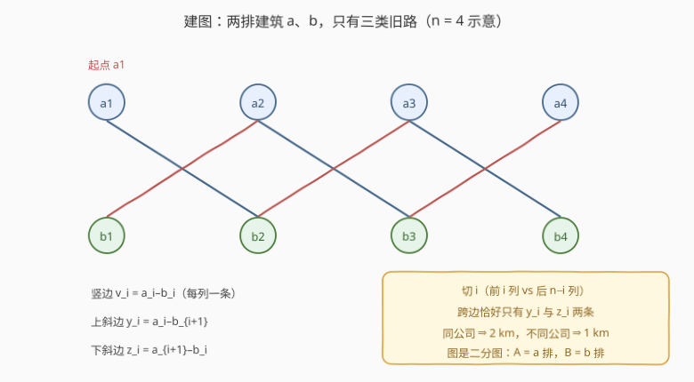
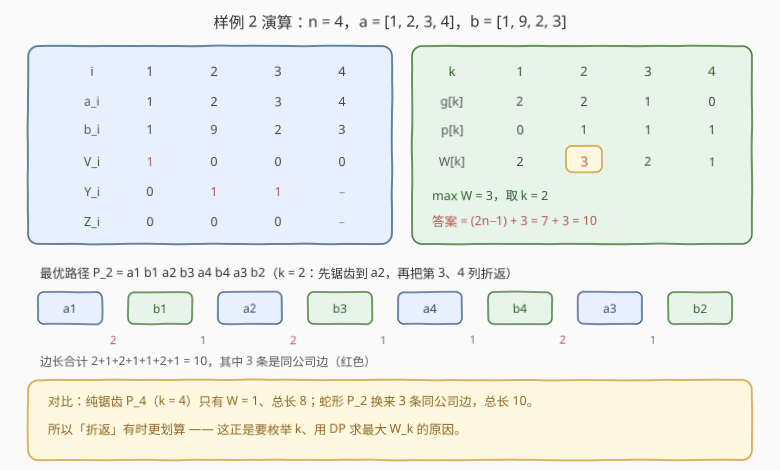

# Codeforces 2275E 悔意已在路上 题解

## 1. 题目概述

- **标题 / 题号**：悔意已在路上（Codeforces 2275E，英文名 Repentance Is Already on the Way）
- **链接**：https://codeforces.com/problemset/problem/2275/E
- **来源**：Codeforces Round 1125 (Div. 3) · Problem E
- **难度**：1500
- **限制**：时间 2 s / 内存 256 MB
- **标签**：动态规划、图论建模、二分图、实现

**题意**：城市 $\mathbb{X}$ 有两条平行主干道，每条干道各有 $n$ 栋楼。第一排第 $i$ 栋属于公司 $a_i$，第二排第 $i$ 栋属于公司 $b_i$（同一公司可以拥有多栋楼）。可用的旧路只有三类，全部双向：

- $a_i$ 与 $b_i$ 相连；
- $a_i$ 与 $b_{i+1}$ 相连（要求 $i+1\le n$）；
- $a_i$ 与 $b_{i-1}$ 相连（要求 $i\ge 2$）。

一条路若两端属于**同一公司**，长度为 2 km；否则为 1 km。K1o0n 从 $a_1$ 出发，要求**恰好访问全部 $2n$ 栋楼各一次**（终点任意），求所有合法路线中**总长度的最大值**。输入为 $t$ 组数据，每组依次给出 $n$、$a_1..a_n$、$b_1..b_n$，每组输出一个整数。

**约束**：

- $1 \le t \le 10^4$，$1 \le n \le 2\times 10^5$，且 $\sum n \le 2\times 10^5$；
- $1 \le a_i, b_i \le 10^9$，公司编号只用来判等，与大小无关；
- 路线是一条**哈密顿路径**：$2n$ 个点各访问一次，起点固定为 $a_1$；
- 答案上界 $4n-2 \approx 8\times 10^5$，累加用 `long long` 更稳；
- 时间 2 s / 内存 256 MB，要求每组 $O(n)$。

## 2. 示例与观察
官方样例（输入与输出均原样）：

```text
输入：
5
1
5
5
4
1 2 3 4
1 9 2 3
5
7 7 7 7 7
7 7 7 7 7
5
1 3 2 4 5
2 3 5 2 4
2
1 2
1 2

输出：
2
10
18
12
5
```

第 3 组所有楼同属一家公司，$2n-1=9$ 条边每条 2 km，故为 18；第 5 组 $n=2$，两条路径 $a_1b_1a_2b_2$ 与 $a_1b_2a_2b_1$ 取长者得 5。再补一组自造示例（说明「折返比一路向右更划算」）：

```text
输入：
1
3
5 5 9
5 9 5

输出：
9
```

纯锯齿 $a_1b_1a_2b_2a_3b_3$ 的边长为 $2+2+1+2+1=8$，而 $a_1b_1a_2b_3a_3b_2$ 是 $2+2+2+1+2=9$。

## 3. 解题思路

### 3.1 暴力思路

「每个点恰好经过一次」就是哈密顿路径问题，在一般图上 NP 难：枚举访问顺序有 $(2n)!$ 种，状压 DP 需要 $O(2^{2n}\cdot 2n)$，即便做 $O(n^2)$ 的线性 DP 也会在 $\sum n=2\times10^5$ 时超时。所以必须先把图的结构看清楚——这张图其实是一条 **4-环链**，合法路径少得出奇。

### 3.2 核心观察：边权拆成 1 + 指示子，图是 4-环链



先给三类边命名（$v_i$ 对所有 $i$ 存在，$y_i,z_i$ 只在 $1\le i\le n-1$ 存在）：

$$v_i=(a_i,b_i),\qquad y_i=(a_i,b_{i+1}),\qquad z_i=(a_{i+1},b_i).$$

于是 $a_i$ 恰好连向 $b_{i-1},b_i,b_{i+1}$，四元组 $\{a_i,b_i,a_{i+1},b_{i+1}\}$ 诱导出 4-环 $a_ib_ia_{i+1}b_{i+1}a_i$，相邻两列共享边 $v_{i+1}$ —— 全图正是 4-环链。

**观察 1（拆边权）**：任何合法路线都恰有 $2n-1$ 条边，而每条边长 $=1+[\text{两端同公司}]$，故

$$\text{总长}=(2n-1)+\#\{\text{两端同公司的边}\}.$$

最大化总长 $\iff$ 最大化「同公司边」的条数。下文记 $V_i=[a_i=b_i]$、$Y_i=[a_i=b_{i+1}]$、$Z_i=[a_{i+1}=b_i]$ 三个 0/1 指示子。

**观察 2（切只有两条跨边）**：把 $a$ 排看作二分图左部、$b$ 排看作右部（所有边都跨部）。令 $L_i=\{a_1..a_i,b_1..b_i\}$ 为「前 $i$ 列」，则 $L_i$ 与其补集之间的边**恰好只有** $y_i$ 与 $z_i$ 两条。

**观察 3（二分图端点）**：$L_i$ 的诱导子图 $G_i$ 与原图同构（$i$ 列，两部各 $i$ 个点）。$G_i$ 上的哈密顿路径有 $2i$ 个点，必须沿部交替，故两端点分属不同部；起点 $a_1$ 在左部，**终点必在右部**，即某个 $b_j$。

### 3.3 算法流程：切 + 蛇形路径递推


由观察 2、3 能得到非常刚性的结构（严格证明见 §5）：

1. 任意路径在切 $i$ 上用到 1 条或 2 条跨边。
2. 若只用 1 条，则必是 $z_i$：路径离开 $L_i$ 后不能再回来，于是 $L_i$ 被走成一整块；该块是从 $a_1$ 出发的 $G_i$ 的哈密顿路径，由观察 3 它终止于右部，而跨边只碰 $a_i$（$y_i$）与 $b_i$（$z_i$），故块只能停在 $b_i$，跨边只能是 $z_i$。
3. 于是路径形状为：先用 $v_i,z_i$（$i<k$）做锯齿 $a_1b_1a_2b_2\cdots a_k$，再从 $a_k$ 进入第 $k..n$ 列，走一条绕回 $b_k$ 的**蛇形**路径 $S_k$。第 $k$ 条路径记作 $P_k$，终点为 $b_k$，$k=1..n$ 共 $n$ 条。
4. 蛇形路径唯一且可递推：

$$S_n=a_n\to b_n,\qquad S_k=a_k\to b_{k+1}\to(\text{把 }S_{k+1}\text{ 反向走一遍})\to b_k,$$

$$E(S_k)=\{y_k,z_k\}\cup E(S_{k+1}),\qquad E(S_n)=\{v_n\}.$$

设 $g[k]$ 为 $S_k$ 上同公司边数（倒序递推），$p[k]=\sum_{i<k}(V_i+Z_i)$ 为 $P_k$ 锯齿部分贡献的同公司边数，则

$$g[n]=V_n,\qquad g[k]=g[k+1]+Y_k+Z_k\quad(k<n),$$

$$p[k]=\sum_{i<k}(V_i+Z_i),\qquad W_k=p[k]+g[k],\qquad \text{答案}=(2n-1)+\max_{1\le k\le n}W_k.$$

$P_k$ 的锯齿与蛇形两部分边集不交，所以 $W_k$ 就是 $P_k$ 的同公司边总数。等价写法是差分 $W_{k+1}=W_k+V_k-Y_k$，可以边扫边更新，省掉 $p$ 数组。

### 3.4 示例演算



以样例 2（$n=4$，$a=[1,2,3,4]$，$b=[1,9,2,3]$）为例，三个指示子为：

| $i$ | 1 | 2 | 3 | 4 |
|---|---|---|---|---|
| $V_i=[a_i=b_i]$ | 1 | 0 | 0 | 0 |
| $Y_i=[a_i=b_{i+1}]$ | 0 | 1 | 1 | – |
| $Z_i=[a_{i+1}=b_i]$ | 0 | 0 | 0 | – |

倒序算出 $g[4]=0$、$g[3]=0+Y_3+Z_3=1$、$g[2]=1+Y_2+Z_2=2$、$g[1]=2+Y_1+Z_1=2$；正序算出 $p[1..4]=0,1,1,1$。

| $k$ | 1 | 2 | 3 | 4 |
|---|---|---|---|---|
| $g[k]$ | 2 | 2 | 1 | 0 |
| $p[k]$ | 0 | 1 | 1 | 1 |
| $W_k$ | 2 | **3** | 2 | 1 |

最大值 $W_2=3$，答案 $=(2\cdot 4-1)+3=10$，与官方输出一致。对应路径 $P_2=a_1b_1a_2b_3a_4b_4a_3b_2$，边长 $2+1+2+1+1+2+1=10$（在 $a_2$ 处折返，把第 3、4 列整段绕回来）。

## 4. 算法细节

1. **0-indexed 统一**：代码里列下标取 $0..n-1$，`g[k]` 对应「第 $k$ 列到最后一列」的蛇形路径；`Y_k` 即 `a[k]==b[k+1]`、`Z_k` 即 `a[k+1]==b[k]`，两者都要求 `k+1 < n`。与题面 1-indexed 的差别只落在边界判断上。
2. **$g$ 的初值**：必须单独写 `g[n-1] = (a[n-1]==b[n-1])`，因为 $S_n$ 只含竖边 $v_n$、没有 $y,z$；$n=1$ 时倒序循环不执行，自然得到 `g[0]=[a_1=b_1]`。
3. **两趟扫描**：先倒序求 `g`，再正序维护 `pref` 并取最大值；切忌对每个 $k$ 重扫一次后缀，否则退化成 $O(n^2)$。
4. **多测清空**：`g` 用 `vector<long long> g(n)` 每组重建，只申请 $O(n)$、总申请量 $O(\sum n)$；不要 `memset` 固定大数组或开静态二维数组。
5. **不真正构造路径**：$W_k$ 只依赖三个 0/1 指示子；把 $P_k$ 逐条走出来既引入 $O(n^2)$，又容易在折返段写出边界 bug，而题目只要长度。
6. **溢出**：答案上界 $4n-2\approx 8\times 10^5$，`int` 也够，但输出写 `2LL*n-1+best`、累加用 `long long`，可彻底避免隐患。
7. **I/O**：总输入量约 $4\times10^5$ 个数，C++ 用 `scanf/printf`（或 `ios::sync_with_stdio(false)`）即可；Python 用 `sys.stdin.buffer.read().split()` 一次读完，避免多测下反复 `input()` 的开销。

## 5. 正确性证明

**引理 1（端点所在部）**：$G_i$ 中任何从 $a_1$ 出发的哈密顿路径都终止于某个 $b_j$。

**证明**：$G_i$ 是二分图，两部各 $i$ 个点；哈密顿路径有 $2i$ 个点，相邻点必分属两部，故两端点分属不同部。起点 $a_1$ 在左部，终点只能在右部，即某个 $b_j$。∎

**引理 2（跨边条数）**：对切 $i$（$1\le i<n$），任何从 $a_1$ 出发的哈密顿路径恰用 $y_i,z_i$ 中的 1 条或 2 条。

**证明**：路径连通且覆盖两侧，至少用 1 条；跨边总共只有这两条，至多用 2 条。∎

**引理 3（单边切必为 $z_i$）**：若某路径在切 $i$ 只用 1 条跨边，则该边是 $z_i$，且路径以「$L_i$ 的哈密顿路径块（从 $a_1$ 到 $b_i$）」开头。

**证明**：只用一个跨边时，离开 $L_i$ 后无法返回，故 $L_i$ 的点被连续走成一个块；块从 $a_1$ 出发、是 $G_i$ 的哈密顿路径，其末点是块中唯一与跨边相接的点。$y_i$ 接 $a_i$、$z_i$ 接 $b_i$，而引理 1 说明末点在右部，故末点必为 $b_i$，跨边必为 $z_i$。∎

**定理 1（路径结构）**：$G_n$（$n\ge 1$）中从 $a_1$ 出发的哈密顿路径恰有 $n$ 条；第 $k$ 条 $P_k$ 终止于 $b_k$，且 $E(P_k)=\{v_i,z_i: i<k\}\cup\{y_i,z_i: k\le i\le n-1\}\cup\{v_n\}$。

**证明**：对 $n$ 归纳，同时证明「存在且唯一」「终点是 $b_k$」「边集如上」。$n=1$ 时只有 $a_1b_1$，即 $E(P_1)=\{v_1\}$。

设 $n\ge 2$。$a_1$ 的邻居只有 $b_1$（边 $v_1$）与 $b_2$（边 $y_1$），且 $a_1$ 是起点、路径上度为 1，故只有两种情形：

- **首边是 $v_1$**：路径形如 $a_1,b_1,a_2$（$a_1$ 只用掉 $v_1$，故 $b_1$ 的另一条边只能是 $z_1$），再接一条覆盖第 $2..n$ 列、起点 $a_2$ 的哈密顿路径。把第 $2..n$ 列整体下标减一，得到 $G_{n-1}$ 上从 $a_1$ 出发的哈密顿路径，由归纳假设它是某个 $P_{k'}$，其边集平移后为 $\{v_i,z_i:2\le i\le k'\}\cup\{y_i,z_i:k'+1\le i\le n-1\}\cup\{v_n\}$；并上 $\{v_1,z_1\}$ 恰为 $E(P_{k'+1})$，终点 $b_{k'+1}$。于是 $P_1..P_{n-1}$ 生成出 $P_2..P_n$，每个都唯一。
- **首边是 $y_1$**：此时 $v_1$ 不在路径上，$b_1$ 的可用边只剩 $z_1=a_2b_1$，故 $b_1$ 度数为 1、是终点。删去 $a_1,b_1$ 后，余下覆盖第 $2..n$ 列且以 $b_2,a_2$ 为两端的哈密顿路径；把它反向再整体下标减一，是 $G_{n-1}$ 上从 $a_1$ 到右部的哈密顿路径，由归纳假设其终点是 $b_1$，即只能是 $P_1$。并上 $\{y_1,z_1\}$ 得 $E(P_1)=\{y_i,z_i:1\le i\le n-1\}\cup\{v_n\}$，终点 $b_1$，同样唯一。

两情形互斥且穷尽 $a_1$ 的全部出路（$E(P_1)$ 不含 $v_1$，$E(P_{k\ge 2})$ 含 $v_1$，故不同 $k$ 的边集互不相同），合计 $n$ 条。归纳构造同时说明这些边集确实覆盖全部点、连通、无环、每点度数不超过 2，所以 $P_1..P_n$ 全部合法。∎

**定理 2（答案正确）**：算法输出的 $(2n-1)+\max_k W_k$ 等于最大可能路线长度。

**证明**：由定理 1，所有合法路线就是 $P_1..P_n$。对 $P_k$ 逐边计数：锯齿部分贡献 $V_i+Z_i$（$i<k$），蛇形部分贡献 $Y_i+Z_i$（$k\le i\le n-1$）与 $V_n$，两部分无重复边，故同公司边数恰为

$$W_k=p[k]+g[k]=\sum_{i<k}(V_i+Z_i)+\sum_{k\le i\le n-1}(Y_i+Z_i)+V_n.$$

又 $|E(P_k)|=2(k-1)+2(n-k)+1=2n-1$，由观察 1 得长度 $=(2n-1)+W_k$。对所有 $k$ 取最大即得最优解。∎

## 6. 复杂度分析

- **时间**：每组 $O(n)$ —— 读入 $2n$ 个数 $O(n)$，倒序递推 $g$ 一次 $O(n)$，正序维护 $p$ 并取最大值一次 $O(n)$；总体 $O(\sum n)\le 2\times10^5$。实测 C++（$n=2\times10^5$ 单组，以及 $t=10^4$、$\sum n=2\times10^5$）约 30–40 ms，距 2 s 有两个数量级余量；Python3 约 0.12–0.17 s，同样安全。
- **空间**：$O(n)$ —— $a,b$ 各 $n$ 个 `int`，`g` 为 $n$ 个 `long long`，另有 $O(1)$ 标量；峰值仅几 MB，远小于 256 MB。

## 7. 参考代码

### C++17

```cpp
#include <bits/stdc++.h>
using namespace std;

int main() {
    int t;
    if (scanf("%d", &t) != 1) return 0;
    while (t--) {
        int n;
        scanf("%d", &n);
        vector<int> a(n), b(n);
        for (int i = 0; i < n; i++) scanf("%d", &a[i]);
        for (int i = 0; i < n; i++) scanf("%d", &b[i]);

        // 每条边先记 1 km 基准；extra 只数「两端同公司」的边（0/1）
        // g[k]：第 k 列到最后一列这条蛇形路径内同公司边的条数，倒序递推
        vector<long long> g(n);
        g[n - 1] = (a[n - 1] == b[n - 1]) ? 1 : 0;
        for (int k = n - 2; k >= 0; k--)
            g[k] = g[k + 1] + ((a[k] == b[k + 1]) ? 1 : 0)
                            + ((a[k + 1] == b[k]) ? 1 : 0);

        long long pref = 0, best = 0;   // pref = sum_{i<k} (V_i + Z_i)
        for (int k = 0; k < n; k++) {
            best = max(best, pref + g[k]);
            pref += ((a[k] == b[k]) ? 1 : 0);                     // V_k
            if (k + 1 < n) pref += ((a[k + 1] == b[k]) ? 1 : 0);  // Z_k
        }
        printf("%lld\n", 2LL * n - 1 + best);
    }
    return 0;
}
```

### Python3

```python
import sys

def main():
    data = sys.stdin.buffer.read().split()
    p = 0
    t = int(data[p]); p += 1
    out = []
    for _ in range(t):
        n = int(data[p]); p += 1
        a = data[p:p + n]; p += n
        b = data[p:p + n]; p += n

        # g[k]：第 k..n-1 列的蛇形路径内同公司边数（尾部递推）
        g = [0] * n
        g[n - 1] = 1 if a[n - 1] == b[n - 1] else 0
        for k in range(n - 2, -1, -1):
            g[k] = g[k + 1] + (a[k] == b[k + 1]) + (a[k + 1] == b[k])

        pref = 0
        best = 0
        for k in range(n):
            if pref + g[k] > best:
                best = pref + g[k]
            pref += (a[k] == b[k])                    # V_k
            if k + 1 < n:
                pref += (a[k + 1] == b[k])            # Z_k
        out.append(str(2 * n - 1 + best))
    sys.stdout.write("\n".join(out) + "\n")

main()
```

## 8. 边界情况与易错点

1. **$n=1$**：全图只有一条边 $a_1b_1$，$2n-1=1$，答案 1 或 2；`g[0]` 由初值给出、倒序循环不执行，注意不要访问 `g[1]`。
2. **全部同公司**：所有边都是 2 km，答案 $4n-2$（样例 3 的 $n=5$ 得 18），此时 $\max W_k=2n-1$。
3. **全部不同公司**：答案退化为 $2n-1$，$\max W_k=0$；若把 `best` 初始化成负数会输出错值。
4. **$Y,Z$ 的下标上界**：只有 $k\le n-2$（0-indexed）才有 $y_k,z_k$，必须写 `if (k + 1 < n)`；漏判在 C++ 是越界读（不报错但答案错），在 Python 会取到错误元素。
5. **$g$ 的初值位置**：$S_n$ 只有竖边 $v_n$，故 `g[n-1]` 必须单独赋值；若从 `g[n]=0` 起推并额外加 $Y_{n-1},Z_{n-1}$ 就会访问不存在的边。
6. **多测读入**：每组必须读满 $2n$ 个数，别漏读 $b$；用 `scanf` 或一次性 `split` 都不会错位。
7. **Python 布尔加法**：`True + True == 2`、`False == 0`，可直接参与求和，但不要用 `is` 与整数比较。
8. **不要真的构造路径**：$W_k$ 是纯计数，构造 $P_k$ 会让代码变成 $O(n^2)$ 并引入折返段边界 bug。

## 9. 验证记录

- **编译环境与命令**：`clang++ -std=c++17 -O2`（本机无 GNU g++，配 `codeforces/tools/include/bits/stdc++.h` 兼容头；正文代码只用标准库，可原样提交 GNU C++17）；Python 侧为 `Python 3.9.6`。
- **官方样例**：1 / 1 通过（按 Codeforces 标准 checker 的 token 比对，忽略空白与大小写）。
- **复核状态**：audited（2026-11-19 统一回归：编译 + 官方样例；写作期的随机对拍与暴力未重跑）。

## 相关题目与扩展

- [Codeforces 2275E 本题](https://codeforces.com/problemset/problem/2275/E)
- [Codeforces Round 1125 官方 Tutorial](https://codeforces.com/blog/entry/157528)
- [LeetCode 980. 不同路径 III](https://leetcode.cn/problems/unique-paths-iii/)：小网格上的哈密顿路径计数，回溯 + 可行性剪枝。
- [LeetCode 847. 访问所有节点的最短路径](https://leetcode.cn/problems/shortest-path-visiting-all-nodes/)：状压 DP 求「访问全部点」的最短路，点集必须很小。
- [LeetCode 943. 最短超级串](https://leetcode.cn/problems/find-the-shortest-superstring/)：TSP 式状压 DP，同样是「全排列压成子集」的套路。

**延伸思考**：本题的关键不是 DP 模板，而是**先证明合法路径只有 $n$ 条**——结构一旦锁死，DP 只是两趟线性递推。若旧路再多一类 $a_i$–$b_{i+2}$，每个切就有 4 条跨边、路径数指数增长，必须上按列维护度数/连通性的插头 DP；若把「最长」改成「最短」，或允许重复经过点，问题就退化为普通最短路，本题的结构美感也就消失了。
