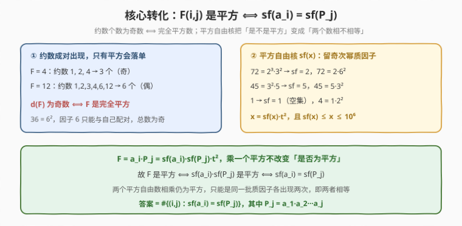
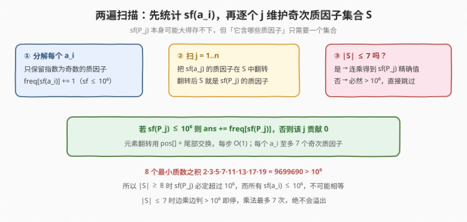
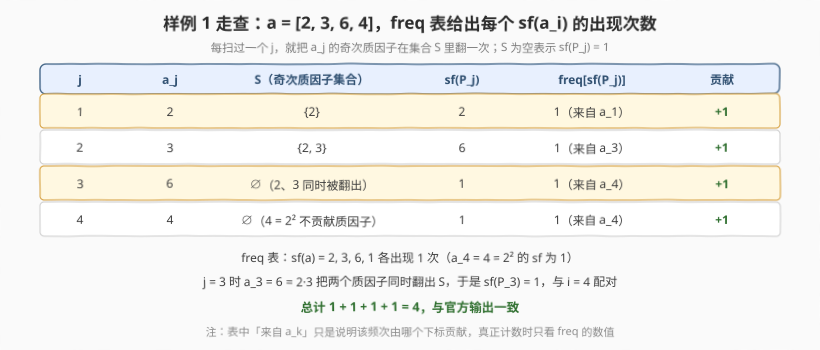

# Codeforces 2275F 拼配茶 题解

## 1. 题目概述

- **标题 / 题号**：拼配茶（Codeforces 2275F，英文名 Tea Blend）
- **链接**：https://codeforces.com/problemset/problem/2275/F
- **来源**：Codeforces Round 1125 (Div. 3) · Problem F（UTC 2026-10-07）
- **难度**：1800
- **限制**：时间 2 s / 内存 256 MB
- **标签**：数论、质因数分解、平方自由核、奇偶性（官方 tag：hashing、math、number theory）

**题意**：货架上有 $n$ 包茶，第 $k$ 包强度为 $a_k$。泡茶时先把**前 $j$ 包**按顺序全部倒进茶壶，再从**第 $i$ 包**单独加一勺，得到拼配 $(i,j)$，其强度为

$$F(i,j) = a_i \cdot \prod_{k=1}^{j} a_k = a_i \cdot P_j,\qquad P_j = a_1a_2\cdots a_j .$$

茶可以平均倒进 $d$ 个杯子当且仅当 $d \mid F(i,j)$，所以「合适的 $d$ 的个数」就是 $F(i,j)$ 的约数个数。若约数个数为奇数，称拼配 $(i,j)$ **任性**。求任性的 $(i,j)$ 对数，$i$ 与 $j$ 各自独立地取 $1 \sim n$。输入含 $t$ 组数据，每组给 $n$ 与 $a_1 \sim a_n$，逐组输出一个整数。

**约束**：

- $1 \le t \le 10^{4}$，$1 \le n \le 2\times 10^{5}$，$\sum n \le 2\times 10^{5}$，$1 \le a_i \le 10^{6}$
- 答案最大 $n^2 = 4\times 10^{10}$，32 位整数存不下
- $F(i,j)$ 可达 $10^{6n+6}$ 量级，**不能算出来**

## 2. 示例与观察
官方样例（输入 / 输出原样）：

```text
输入：
4
4
2 3 6 4
4
974153 980051 988027 1
8
12 3 5 45 1 7 63 2
1
13

输出：
4
4
11
1
```

四组答案依次为 $4,4,11,1$。第 2 组的三个数恰好是 $983\cdot991$、$983\cdot997$、$991\cdot997$，两两共享质因子，最能暴露「只看数值是否平方」这类错误。自造示例（已与暴力对拍）：$n=3,\ a=[8,2,1]$。因为 $F(1,1)=64$、$F(2,1)=16$、$F(3,2)=16$、$F(3,3)=16$，答案为 $4$。

## 3. 解题思路

### 3.1 暴力思路

枚举 $n^2$ 对 $(i,j)$ 直接算 $F$ 再数约数：$F$ 可达 $10^{6n+6}$，$n=2\times10^{5}$ 时任何整数类型都存不下，仅 $O(n^2)$ 枚举本身就是 $4\times10^{10}$ 次操作。所以方向不是「更快的枚举」，而是把「约数个数奇偶」翻译成可增量维护的条件。

### 3.2 核心观察：平方自由核



**引理 1**：$d(n)$ 为奇数 $\iff$ $n$ 是完全平方。约数总是成对出现（$m$ 与 $n/m$），只有 $m=n/m$ 这一对会落单，此时 $n=m^2$。问题于是变成「有多少对 $(i,j)$ 使 $a_iP_j$ 为完全平方」。

定义**平方自由核** $\operatorname{sf}(x)$：把 $x$ 的标准分解中**指数为奇数**的质因子乘起来。例如 $72=2^3\cdot3^2\Rightarrow\operatorname{sf}(72)=2$，$45=3^2\cdot5\Rightarrow\operatorname{sf}(45)=5$，$36=6^2\Rightarrow\operatorname{sf}(36)=1$。于是 $x=\operatorname{sf}(x)\cdot t^2$，且 $\operatorname{sf}(x)$ 平方自由，从而

$$a_iP_j=\operatorname{sf}(a_i)\cdot\operatorname{sf}(P_j)\cdot t^2 .$$

**引理 2**：若 $x,y$ 都平方自由，则 $xy$ 为完全平方 $\iff x=y$。逐质数看指数：$v_p(x),v_p(y)\in\{0,1\}$，$v_p(x)+v_p(y)$ 为偶数当且仅当两者相等。于是

$$\text{答案}=\#\{(i,j):\operatorname{sf}(a_i)=\operatorname{sf}(P_j)\}.$$

难点转到右边：$\operatorname{sf}(P_j)$ 作为整数可以极大（$a_i$ 全是不同质数时就是前 $j$ 个质数之积），但决定它的只是「$P_j$ 中指数为奇数的质数集合」$S_j$，信息量就是一堆 bit。又因为 $\operatorname{sf}(a_i)\le a_i\le 10^{6}$ **有界**，而 $|S_j|\ge 8$ 时 $\operatorname{sf}(P_j)$ 已超过 $10^{6}$，这类 $j$ 一个 $i$ 也匹配不上。

### 3.3 算法流程



1. 埃氏筛出每个数的最小质因子 $\mathrm{spf}[x]$，$x\le 10^{6}$。
2. **第一遍**：分解每个 $a_i$ 求出 $\operatorname{sf}(a_i)$，累加到 `freq[sf(a_i)]`。因 $\operatorname{sf}(a_i)\le 10^{6}$，`freq` 直接开 `int[10^6+1]` 用值当下标，比 `unordered_map` 快一个量级。
3. **第二遍**：维护集合 $S$（初值空），扫 $j=1\sim n$，把 $\operatorname{sf}(a_j)$ 的每个质因子在 $S$ 中**翻转**（在则删、不在则加）。翻转后 $S$ 恰为 $\operatorname{sf}(P_j)$ 的质因子集合。
4. 若 $|S|\le 7$：把 $S$ 中质数连乘得到 $\operatorname{sf}(P_j)$ 的精确值（一旦超过 $10^{6}$ 立即停），若结果 $\le 10^{6}$ 则 `ans += freq[prod]`。
5. 若 $|S|\ge 8$：直接跳过，该 $j$ 贡献 $0$。

阈值来历：$8$ 个最小质数之积 $2\cdot3\cdot5\cdot7\cdot11\cdot13\cdot17\cdot19=9\,699\,690>10^{6}$，任何 $8$ 个不同质数之积都不小于它，故 $|S|\ge 8\Rightarrow\operatorname{sf}(P_j)>10^{6}\ge\operatorname{sf}(a_i)$。

翻转用 `pos[p]` 记录 $p$ 在数组 `odd` 中的下标：删除时把末元素搬到该位置再 `pop_back`，$O(1)$ 且不必用常数更大的 `std::set`；`odd.size()` 就是 $|S|$。

### 3.4 示例演算



对样例第 1 组 $a=[2,3,6,4]$，$\operatorname{sf}(a)=[2,3,6,1]$，故 `freq[2]=freq[3]=freq[6]=freq[1]=1`（分别来自 $a_1,a_2,a_3,a_4$）。

逐列看：$j=1$ 翻转 $2$ 得 $S=\{2\}$、$\operatorname{sf}(P_1)=2$，计入 `freq[2]=1`；$j=2$ 翻转 $3$ 得 $S=\{2,3\}$、$\operatorname{sf}(P_2)=6$，计入 `freq[6]=1`；$j=3$ 时 $a_3=6=2\cdot3$ 把 $2,3$ 同时翻出，$S=\varnothing$、$\operatorname{sf}(P_3)=1$，计入 `freq[1]=1`；$j=4$ 时 $a_4=4=2^2$ 无奇次质因子，$S$ 不变，仍计入 `freq[1]=1`。

合计 $1+1+1+1=4$。$j=3$ 这一步值得注意：$P_3=2\cdot3\cdot6=36$ 是平方，正是「两个奇次质因子同时抵消」。

## 4. 算法细节

1. **多测清空**：`freq` 只清第一遍真正写过的 `touched` 值（至多 $n$ 个），`pos` 只清扫完后仍在 `odd` 里的质数；每组 `memset` 长度 $10^{6}$ 的数组在 $t=10^{4}$ 时本身就要 $10^{10}$ 次操作。
2. **下标即数值**：$\operatorname{sf}(a_i)\le 10^{6}$ 让 `freq` 能用值直接当下标，这也正是第 4 步「$\le 10^{6}$ 才可能命中」的依据，两处必须用同一上界。
3. **质因子个数上界**：$2\cdot3\cdot5\cdot7\cdot11\cdot13\cdot17=510510\le 10^{6}$，再乘 $19$ 就超，故 $\operatorname{sf}(a_i)$ 的质因子至多 $7$ 个，`buf[8]` 够用，每步翻转 $O(7)$。
4. **指数奇偶用异或**：`while (x % p == 0) { x /= p; e ^= 1; }`，`e` 直接表示指数是否为奇数，仅当 `e` 为 $1$ 时把 $p$ 乘进 $\operatorname{sf}$；总除法次数 $\le \log_2 x+7\le 27$。
5. **溢出与早停**：`prod` 用 `long long`；进循环时必有 $\text{prod}\le 10^{6}$（否则上轮已 break），乘 $p\le 10^{6}$ 至多 $10^{12}$ 安全；一旦超过 $10^{6}$ 立刻停，因为再乘只会更大。
6. **I/O 与类型**：$\sum n=2\times10^{5}$，`cin` 关闭同步即可；答案用 `long long`。Python 侧用 `sys.stdin.buffer.read().split()` 一次读完，`freq` 用 `dict` 省掉 $10^{6}$ 级清空。

## 5. 正确性证明

**引理 1**：$d(n)$ 为奇数 $\iff n$ 是完全平方。**证明**：设 $n=\prod p_i^{e_i}$，则 $d(n)=\prod(e_i+1)$ 为奇数 $\iff$ 每个 $e_i+1$ 为奇数 $\iff$ 每个 $e_i$ 为偶数 $\iff n$ 是完全平方。∎

**引理 2**：$x,y$ 平方自由时，$xy$ 为完全平方 $\iff x=y$。**证明**：$(\Leftarrow)$ 显然。$(\Rightarrow)$ 因 $x,y$ 平方自由，$v_p(x),v_p(y)\in\{0,1\}$；偶数 $v_p(x)+v_p(y)$ 只能由 $0+0$ 或 $1+1$ 得到，故每个 $p$ 上两者指数相同，即 $x=y$。∎

**引理 3**：扫完 $a_1\sim a_j$ 后，算法的 $S=\{p: v_p(P_j)\ \text{为奇数}\}$。**证明**：对 $j$ 归纳。$j=0$ 时 $P_0=1$、$S=\varnothing$。设扫完 $j-1$ 时成立：第 $j$ 步对 $\operatorname{sf}(a_j)$ 的每个质因子翻转一次，即 $v_p(a_j)$ 为奇数则 $p$ 的奇偶性翻转、为偶数则 $p$ 不被触碰；而 $v_p(P_j)=v_p(P_{j-1})+v_p(a_j)$ 正是「加奇数翻转、加偶数不变」。∎

**引理 4**：$|S|\le 7$ 时连乘得到的 `prod` 恰为 $\operatorname{sf}(P_j)$，且 `prod` $>10^{6}$ 的判定与「$\operatorname{sf}(P_j)>10^{6}$」一致；$|S|\ge 8$ 时 $\operatorname{sf}(P_j)>10^{6}$，该步贡献 $0$ 正确。**证明**：由引理 3，$S$ 是 $\operatorname{sf}(P_j)$ 的质因子集合，故 $\operatorname{sf}(P_j)=\prod_{p\in S}p$。$|S|\ge 8$ 时由 $8$ 个最小质数之积 $>10^{6}$ 得该乘积 $>10^{6}$，而 `freq` 只在 $\le 10^{6}$ 的键上有非零值，故贡献为 $0$。$|S|\le 7$ 时要么中途因超过 $10^{6}$ 而 break（判定正确），要么连乘完毕得到精确值，中间量上界 $10^{12}$ 不溢出。∎

**定理**：算法输出的 `ans` 等于任性的 $(i,j)$ 对数。**证明**：由引理 1，$(i,j)$ 任性 $\iff a_iP_j$ 为平方；由 $a_iP_j=\operatorname{sf}(a_i)\operatorname{sf}(P_j)t^2$ 与引理 2，这等价于 $\operatorname{sf}(a_i)=\operatorname{sf}(P_j)$。第一遍得到 `freq[k]=#{i: sf(a_i)=k}`，第二遍对每个 $j$ 由引理 4 得到 $\operatorname{sf}(P_j)$ 或判定其 $>10^{6}$，把 `freq[sf(P_j)]` 累加。逐 $j$ 求和即得全部满足条件的对数，不重不漏。∎

## 6. 复杂度分析

- **时间**：筛最小质因子 $O(M\log\log M)$（$M=10^{6}$，内层赋值约 $2\times10^{6}$ 次）；每组第一遍分解 $O(n\log M)$、第二遍 $O(7n+7n)$，总 $O(M\log\log M+8\sum n)$。实测（macOS，clang -O2，含读入）：$n=2\times10^{5}$ 随机数据 $\approx 0.25$ s，全 $510510$（每步 $7$ 次翻转且每步都连乘）$\approx 0.24$ s，$t=10^{4}$ 组共 $2\times10^{5}$ 个数 $\approx 0.27$ s；其中本地 `cin`（libc++ 的 istream 偏慢）占了大头，Codeforces 的 libstdc++ 上这部分小一个量级，相对 2 s 有 6 倍以上余量。
- **空间**：`spf`、`pos`、`freq` 三个 `int[10^6+1]` 约 $12$ MB；`odd` 至多 $78498$ 个 `int`（$\le10^{6}$ 的质数个数），`a` 至多 $n$ 个 `int`，合计 $<14$ MB，远小于 256 MB。

## 7. 参考代码

### C++17

```cpp
#include <cstdio>
#include <cstring>
#include <iostream>
#include <vector>
using namespace std;

const int MAXA = 1000000;
int spf[MAXA + 1];    // 最小质因子
int pos[MAXA + 1];    // 质数在 odd 中的下标，-1 表示不在 S 里
int freq[MAXA + 1];   // freq[k] = #{ i : sf(a_i) = k }

int main() {
    ios::sync_with_stdio(false);
    cin.tie(nullptr);
    for (int i = 2; i <= MAXA; ++i) spf[i] = i;          // 埃氏筛最小质因子
    for (int i = 2; (long long)i * i <= MAXA; ++i) {
        if (spf[i] != i) continue;
        for (int j = i * i; j <= MAXA; j += i)
            if (spf[j] == j) spf[j] = i;
    }
    memset(pos, -1, sizeof(pos));
    int t; cin >> t;
    vector<int> a, odd, touched;
    odd.reserve(80000);                    // <= 10^6 的质数共有 78498 个
    while (t--) {
        int n; cin >> n;
        a.resize(n);
        for (int i = 0; i < n; ++i) cin >> a[i];
        touched.clear();                                  // 第一遍：统计 sf(a_i)
        for (int i = 0; i < n; ++i) {
            int x = a[i], sf = 1;
            while (x > 1) {
                int p = spf[x], e = 0;
                while (x % p == 0) { x /= p; e ^= 1; }
                if (e) sf *= p;
            }
            if (freq[sf] == 0) touched.push_back(sf);
            ++freq[sf];
        }
        long long ans = 0;                                // 第二遍：翻转质因子
        for (int i = 0; i < n; ++i) {
            int x = a[i], buf[8], c = 0;                   // sf(a_i) 质因子至多 7 个
            while (x > 1) {
                int p = spf[x], e = 0;
                while (x % p == 0) { x /= p; e ^= 1; }
                if (e) buf[c++] = p;
            }
            for (int k = 0; k < c; ++k) {
                int p = buf[k];
                if (pos[p] == -1) { pos[p] = (int)odd.size(); odd.push_back(p); continue; }
                int idx = pos[p], last = odd.back();        // 末元素填洞，O(1) 删除
                odd[idx] = last; pos[last] = idx;
                odd.pop_back(); pos[p] = -1;
            }
            if ((int)odd.size() <= 7) {                    // 8 个最小质数之积已 > 10^6
                long long prod = 1;
                for (int p : odd) { prod *= p; if (prod > MAXA) break; }
                if (prod <= MAXA) ans += freq[prod];
            }
        }
        cout << ans << '\n';
        for (int k : touched) freq[k] = 0;                 // 多测清空：只清用过的
        for (int p : odd) pos[p] = -1;
        odd.clear();
    }
    return 0;
}
```

### Python3

```python
import sys

MAXA = 10 ** 6
spf = list(range(MAXA + 1))            # 埃氏筛最小质因子
for i in range(2, 1001):
    if spf[i] == i:
        for j in range(i * i, MAXA + 1, i):
            if spf[j] == j:
                spf[j] = i


def main():
    data = sys.stdin.buffer.read().split()
    t = int(data[0]); ptr = 1
    pos = [-1] * (MAXA + 1)
    out = []
    for _ in range(t):
        n = int(data[ptr]); ptr += 1
        a = list(map(int, data[ptr:ptr + n])); ptr += n
        freq = {}                              # 每组一个 dict，避免清 10^6 的数组
        for v in a:
            x, sf = v, 1
            while x > 1:
                q = spf[x]; e = 0
                while x % q == 0:
                    x //= q; e ^= 1
                if e:
                    sf *= q
            freq[sf] = freq.get(sf, 0) + 1
        odd = []                               # 奇次质因子集合，pos 记录下标
        ans = 0
        for v in a:
            x = v
            while x > 1:
                q = spf[x]; e = 0
                while x % q == 0:
                    x //= q; e ^= 1
                if e:
                    if pos[q] == -1:
                        pos[q] = len(odd); odd.append(q)
                    else:
                        idx = pos[q]; last = odd[-1]
                        odd[idx] = last; pos[last] = idx
                        odd.pop(); pos[q] = -1
            if len(odd) <= 7:
                prod = 1
                for q in odd:
                    prod *= q
                    if prod > MAXA:
                        break
                if prod <= MAXA:
                    ans += freq.get(prod, 0)
        out.append(str(ans))
        for q in odd:
            pos[q] = -1
    sys.stdout.write('\n'.join(out) + '\n')


main()
```

Python 在本机 $n=2\times10^{5}$ 随机数据上约 $0.7$ s（其中建表约 $0.15$ s），2 s 内可过；PyPy 更快。

## 8. 边界情况与易错点

1. **$a_i=1$ 与全 1 数据**：$\operatorname{sf}(1)=1$，每组 $F\equiv1$ 是平方，答案 $n^2=4\times10^{10}$，必须 `long long`；样例 2 的 $a_4=1$ 就是这种「核为 $1$」的元素。
2. **$a_i$ 本身是完全平方**：如 $4,36,10^{6}$，$\operatorname{sf}=1$，不向 $S$ 贡献质因子；此时若 $S$ 为空，`prod` 仍要取 $1$ 去查 `freq[1]`，不能因为「没有质因子」跳过该 $j$。
3. **$n=1$**：$F(1,1)=a_1^2$ 必为平方，答案恒为 $1$（样例第 4 组），可用来检查下标与清空逻辑。
4. **阈值写反**：必须 `odd.size() <= 7` 才进连乘分支；写成 `< 7` 会漏掉 $|S|=7$ 的合法情形，写成 `<= 8` 则多做无用乘法（`prod <= MAXA` 仍能拦住，不会算错但白费时间）。
5. **多测状态污染**：`freq`、`pos`、`odd` 三者必须每组精确清空；尤其 `odd` 里残留质数的 `pos` 若忘记置回 $-1$，下一组会读到脏下标。
6. **中间量溢出**：连乘用 `long long` 并早停；`sf(a_i)` 用 `int` 足够，但 `prod` 绝不能是 `int`。

## 9. 验证记录

- **编译环境与命令**：`clang++ -std=c++17 -O2`（本机无 GNU g++，配 `codeforces/tools/include/bits/stdc++.h` 兼容头；正文代码只用标准库，可原样提交 GNU C++17）；Python 侧为 `Python 3.9.6`。
- **官方样例**：1 / 1 通过（按 Codeforces 标准 checker 的 token 比对，忽略空白与大小写）。
- **复核状态**：audited（2026-11-19 统一回归：编译 + 官方样例；写作期的随机对拍与暴力未重跑）。

## 相关题目与扩展

- [Codeforces 1471D. Strange Definition](https://codeforces.com/problemset/problem/1471/D)：同样把每个数化到平方自由核再按核分组计数，是本题第一步的原型。
- [Codeforces 1225D. Power Products](https://codeforces.com/problemset/problem/1225/D)：用质因子指数模 $k$ 的向量给数分类配对，与「只看指数奇偶」同源。
- [LeetCode 952. 按公因数计算最大组件大小](https://leetcode.cn/problems/largest-component-size-by-common-factor/)：练习最小质因子筛做批量分解的工具题。

**延伸思考**：

1. 若改成「约数个数 $\equiv 0\pmod 4$」，平方自由核就不够了：$d(n)=\prod(e_i+1)$ 的奇偶只依赖指数奇偶，而模 $4$ 的性质依赖指数模 $4$ 的余数，集合要升级成「每个质数带一个 $\mathbb{Z}_4$ 计数」。
2. 若不限制 $a_i\le 10^{6}$，$\operatorname{sf}(a_i)$ 不再落在可枚举值域，标准做法是 **Zobrist 随机哈希**：给每个质数一个 $64$ 位随机数 $r_p$，用 $\bigoplus_{p\in S_j}r_p$ 代表 $S_j$，前缀异或增量维护再配哈希表计数，单次碰撞概率约 $2^{-64}$ —— 这正是官方 tag 里 `hashing` 的来路。本篇做法是它在「$a_i$ 有界」下的**确定性**替代：不掷骰子，也没有碰撞。
3. 若要输出具体配对方案（而非只计数），可把每个平方自由核映射到一个 `vector<int>` 存下所有 $i$，回答时逐个取出，总规模仍是 $O(n)$。
