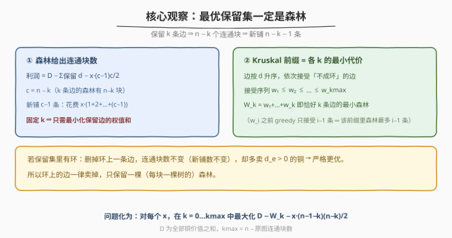
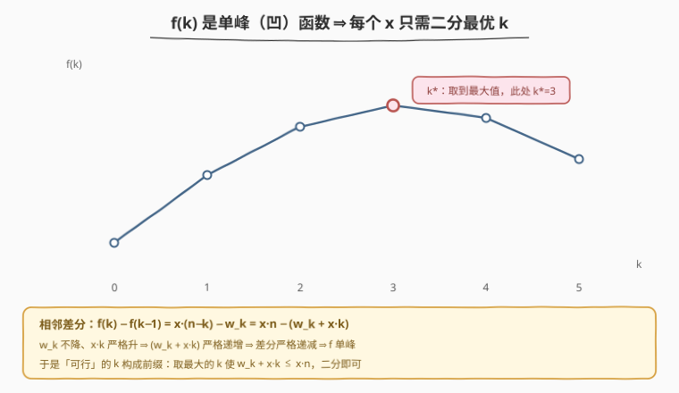
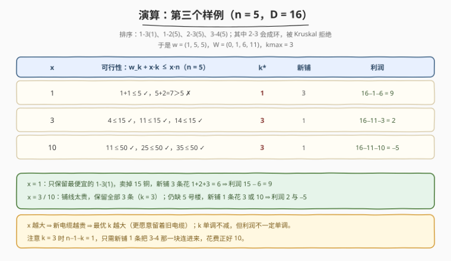

# Codeforces 2275G 变卖铜缆 题解

## 1. 题目概述

- **标题 / 题号**：变卖铜缆（Codeforces 2275G，英文名 Copper Squander）
- **链接**：https://codeforces.com/problemset/problem/2275/G
- **来源**：Codeforces Round 1125 (Div. 3) · Problem G
- **难度**：1900
- **限制**：时间 2 s / 内存 256 MB
- **标签**：二分查找，数据结构，并查集，图论，贪心，数学，排序，单峰函数/三分（官方 tag：binary search、data structures、dsu、graphs、greedy、math、sortings、ternary search）

**题意**：$n$ 栋楼、$m$ 条双向电缆，第 $i$ 条连接 $u_i,v_i$，铜价值 $d_i$。必须**严格按顺序**改造：① 任选子集拆掉，拆掉的第 $i$ 条立刻卖铜得 $d_i$；② 再新铺任意多条电缆（可连任意两栋不同的楼，允许重边），第 1 条花 $x$、第 2 条花 $2x$、第 3 条花 $3x$……；③ 改造后整张图必须**连通**（初始图可以是不连通的）。利润 = 卖铜收入 − 铺线花费。给定 $q$ 个场景（单价增量 $x_j$），分别求最大利润。

多测格式：第一行 $t$；每组先读 $n,m,q$，随后 $m$ 行 $u_i,v_i,d_i$，最后一行 $q$ 个 $x_j$，输出一行 $q$ 个整数（按输入顺序，可为负）。

**约束**：

- $2 \le n \le 10^5$，$0 \le m \le 2\times10^5$，$1 \le q \le 2\times10^5$，$1 \le t \le 10^4$
- $1 \le d_i, x_j \le 5\times10^8$；无自环、无重边（但**新铺**的电缆允许重边）
- 所有测试的 $\sum n \le 10^5$、$\sum m \le 2\times10^5$、$\sum q \le 2\times10^5$
- 答案绝对值上界约 $2.5\times10^{18}$，必须用 64 位整数

> 💡 拆边**赚钱**、铺线**花钱**，且越铺越贵。每拆一条边都要问：它换来的铜，够不够付「因此多铺的那条线」？

## 2. 示例与观察
官方样例（输入 / 输出原样）：

```text
输入：
3
4 4 1
1 2 1
2 3 1
3 4 1
1 4 10
1
5 4 1
1 2 5
1 3 5
1 4 5
1 5 5
1
5 4 3
1 2 5
2 3 5
3 4 5
1 3 1
1 3 10

输出：
10
10
9 2 -5
```

- 第 1 组：三条权 $1$ 的边成链，$1\text{-}4(10)$ 是「多余跳线」。$x=1$ 时三条 $1$ 全留（$k=3$），卖 $10$，图已连通 ⇒ 利润 $10$。
- 第 2 组：以 $1$ 为中心的星，四边各值 $5$，$D=20$。$x=1$ 时拆光再铺：卖 $20$，铺 $4$ 条花 $1+2+3+4=10$ ⇒ 利润 $10$。

再补一组自造样例：$n=4$，边 $1\text{-}2(3),2\text{-}3(3),3\text{-}4(3),1\text{-}4(50)$，询问 $x=1,2,3$，答案 $53,51,50$（最优 $k$ 依次取 $1,2,3$）。校验：$D=59$，$w=(3,3,3)$，$W=(0,3,6,9)$；$x=1$ 时 $w_2+2x=5>4$ 故 $k=1$，利润 $59-3-1\cdot6=53$；$x=3$ 时三个判定全过，$k=3$，利润 $59-9-0=50$。

## 3. 解题思路

### 3.1 暴力思路

枚举「保留哪些电缆」（$2^m$ 种），对每个 $x$ 用并查集数连通块 $c$，利润为 $\sum_{\text{删掉}} d_e - x\cdot\frac{(c-1)c}{2}$，复杂度 $O(2^m q)$，完全不可行。即使只按保留条数 $k$ 枚举，也要在「所有 $k$ 条边的森林」里挑权值最小者——连通性约束不是逐边独立的，不能简单背包。

### 3.2 核心观察：最优保留集是森林，Kruskal 前缀给出各 $k$ 的最小代价



**观察 1（去环）**：若保留集 $\mathcal{F}$ 含环，删掉环上一条边 $e$：连通块数**不变**（新铺条数、铺线花费都不变），却多卖 $d_e>0$ 的铜。故任何含环方案都能严格改进，**最优保留集必是森林**。

**观察 2（连通块数）**：$n$ 点 $k$ 条边的森林恰有 $c=n-k$ 块；并成一块只需且必须新铺 $c-1=n-1-k$ 条（新电缆可连任意两栋楼、可重边，任意两块总能直连）。铺 $K=c-1$ 条的花费

$$x\cdot(1+2+\cdots+K)=x\cdot\frac{K(K+1)}{2}=x\cdot\frac{(n-1-k)(n-k)}{2}$$

于是固定 $k$ 时利润为 $\Pi(k)=D-W(k)-x\cdot\frac{(n-1-k)(n-k)}{2}$，其中 $D=\sum_e d_e$，$W(k)$ 是「恰好 $k$ 条边的森林」的最小权值和（$D-W(k)$ 即卖铜收入）。

**观察 3（各 $k$ 的最小森林）**：边按 $d$ 升序跑 Kruskal，只记录「连接两个不同连通块」的边，得 $w_1\le\cdots\le w_{k_{\max}}$，则 $W(k)=w_1+\cdots+w_k$ 就是恰好 $k$ 条边的最小权值和。依据是图拟阵贪心：处理到 $w_i$ 前贪心已接受 $i-1$ 条，故排在 $w_i$ 之前的边里任何森林至多 $i-1$ 条边，第 $i$ 小的边不可能比 $w_i$ 更便宜（§5 引理 3）。此处 $k_{\max}=n-c_0$，$c_0$ 为原图连通块数。

### 3.3 算法流程：$\Pi(k)$ 单峰，二分最优 $k$



相邻差分 $\Pi(k)-\Pi(k-1)=x(n-k)-w_k=xn-(w_k+xk)$。$w_k$ 不降、$xk$ 严格增 ⇒ $w_k+xk$ 严格递增 ⇒ 差分严格递减 ⇒ $\Pi(k)$ **单峰（凹）**。于是

$$\Pi(k)\ge\Pi(k-1)\iff w_k+x\cdot k\le x\cdot n$$

满足该式的 $k$ 构成**前缀**。把判据化成阈值：记 $t_k=\left\lceil\frac{w_k}{n-k}\right\rceil$、$P_k=\max_{j\le k}t_j$，则 $k$ 可行 $\iff x\ge P_k$，而 $P$ 单调不减。整体流程：边按 $(d,u,v)$ 升序、并查集跑 Kruskal 得 $w$ 与 $D$，再求前缀和 $W$ 与阈值表 $P$，之后每个询问只需一次 `upper_bound` 就能定出 $k$。也可三分（单峰正是官方 tag `ternary search` 的来源），但二分无需处理整数三分的平台期。

### 3.4 示例演算



以官方第 3 组（$n=5$，$D=16$）为例。排序后边为 $1\text{-}3(1),1\text{-}2(5),2\text{-}3(5),3\text{-}4(5)$；处理 $2\text{-}3$ 时 $1,2,3$ 已连通，**成环被拒**，故 $w=(1,5,5)$，$W=(0,1,6,11)$，$k_{\max}=3$。

| $x$ | 判定 $w_k+xk\le 5x$ | 最优 $k$ | 新铺 $n-1-k$ | 利润 |
|-----|---------------------|----------|--------------|------|
| $1$ | $1+1\le5$ ✓；$5+2=7>5$ ✗ | $1$ | $3$ | $16-1-1\cdot6=9$ |
| $3$ | $4\le15$ ✓；$11\le15$ ✓；$14\le15$ ✓ | $3$ | $1$ | $16-11-3=2$ |
| $10$ | $11\le50$ ✓；$25\le50$ ✓；$35\le50$ ✓ | $3$ | $1$ | $16-11-10=-5$ |

$k=1$ 时只留最便宜的 $1\text{-}3$：卖 $15$，$4$ 块要铺 $3$ 条花 $1+2+3=6$，利润 $9$。$k=3$ 时留 $1\text{-}3,1\text{-}2,3\text{-}4$，$\{1,2,3,4\}$ 与 $\{5\}$ 两块，铺 $1$ 条接上 $5$ 号楼花 $x$。$x$ 越大越舍不得拆线，最优 $k$ 随之变大，与单峰性一致。

## 4. 算法细节

1. **只记被接受的边**：Kruskal 中「成环」的边（如样例 1 的 $1\text{-}4$ 权 $10$）永不会被保留，直接丢弃；$k_{\max}=n-c_0$，**不一定**等于 $n-1$。按 $(d,u,v)$ 排序保证全序，同权互换不影响前缀和。
2. **判据化成阈值表**：$t_k=\lceil w_k/(n-k)\rceil$ 最大约 $5\times10^8$，$P_k$ 取前缀最大后单调不减，故 `upper_bound(P, x) - 1` 直接给出最优 $k$，全程 `long long`。
3. **花费项先算 $T(k)$ 再乘 $x$**：$T(k)=\frac{(n-1-k)(n-k)}{2}\le5\times10^9$，乘 $x$ 后 $\le2.5\times10^{18}$，仍在 `long long`（约 $9.22\times10^{18}$）内。
4. **多测按需分配**：总和受限，每测试重建 `vector`、重初始并查集 $O(n)$ 安全；不要用全局数组把 $10^5$ 清 $10^4$ 次。
5. **I/O 与输出格式**：总数约 $8\times10^5$，`scanf/printf` 足够（改 `cin/cout` 需 `sync_with_stdio(false)`）；每个测试输出一行、$q$ 个整数单空格分隔，可为负。

## 5. 正确性证明

**引理 1（森林化）**：若保留集 $\mathcal{F}$ 含环，则存在保留集使利润严格更大。

**证明**：取环上一条边 $e$，令 $\mathcal{F}'=\mathcal{F}\setminus\{e\}$。删环上一条边不改变任何两点可达性，故 $c(\mathcal{F}')=c(\mathcal{F})$，新铺条数与花费不变，而收入增加 $d_e>0$，利润严格增大。∎

**引理 2（利润公式）**：对 $k$ 条边的森林，$\Pi=D-\sum_{e\in\mathcal{F}}d_e-x\cdot\frac{(n-1-k)(n-k)}{2}$。

**证明**：森林有 $c=n-k$ 块。把 $c$ 块并成一块需且只需 $c-1$ 条新电缆（允许重边，故 $c-1$ 条总能连通；少于 $c-1$ 条必有至少两块未连）。铺 $K=c-1=n-1-k$ 条花 $xK(K+1)/2$，代入即得。∎

**引理 3（Kruskal 前缀最优）**：对每个 $0\le k\le k_{\max}$，$W(k)=\sum_{i\le k}w_i$ 等于恰好 $k$ 条边的森林的最小权值和。

**证明**：设排序序列为 $e_1,\dots,e_m$，$w_i$ 是第 $i$ 个被保留边的权值。任取 $k$ 条边的森林 $\mathcal{B}$，把它的边按排序序数从小到大记为 $b_1,\dots,b_k$。断言：每个 $b_i$ 在排序中不早于 $w_i$。反设 $b_i$ 早于 $w_i$，记 $E_i$ 为严格排在 $w_i$ 之前的边集：贪心处理完 $E_i$ 时恰保留 $i-1$ 条，且 $E_i$ 中未被保留的边均与已保留者成环，故这 $i-1$ 条是 $E_i$ 的极大无环子集，$E_i$ 的秩为 $i-1$。而 $\mathcal{B}$ 中最小的 $i$ 条边都不晚于 $b_i$（从而早于 $w_i$），构成 $E_i$ 内一个 $i$ 条边的森林，与秩为 $i-1$ 矛盾。断言成立 ⇒ $\sum_{e\in\mathcal{B}}d_e=\sum_i d_{b_i}\ge\sum_i w_i=W(k)$，且贪心前 $k$ 条边本身达到该下界。∎

**引理 4（单峰）**：$\Pi(k)$ 在 $[0,k_{\max}]$ 单峰，且 $\Pi(k)-\Pi(k-1)=xn-(w_k+xk)$ 关于 $k$ 严格递减。

**证明**：由引理 2，$W(k)-W(k-1)=w_k$，且 $T(k)-T(k-1)=\frac{(n-1-k)(n-k)-(n-k)(n-k+1)}{2}=-(n-k)$，故 $\Pi(k)-\Pi(k-1)=xn-(w_k+xk)$；$w_k+xk$ 严格递增 ⇒ 差分严格递减 ⇒ 单峰。∎

**定理**：对每个询问 $x$，算法输出最大可能利润。

**证明**：引理 1 说明最优方案可取森林；引理 2 说明其利润只由 $k$ 与森林权值和决定；引理 3 说明固定 $k$ 时取 $W(k)$ 最优，故最大利润为 $\max_{0\le k\le k_{\max}}\Pi(k)$。由引理 4，$\Pi$ 单峰且 $\Pi(k)\ge\Pi(k-1)\iff w_k+xk\le xn$，可行 $k$ 是前缀，二分取得最大的 $k^*$ 时 $\Pi$ 取到全局最大（$k=0$ 恒可行，保证下界有效）。∎

## 6. 复杂度分析

- **时间**：排序 $O(m\log m)$，Kruskal $O(m\,\alpha(n))$，前缀和 $O(n)$，每个询问二分 $O(\log n)$，合计 $O(m\log m+q\log n)$。代入 $\sum m=\sum q=2\times10^5$，约 $2\times10^5\times18$ 次比较，2 s 余量极大（C++ 实测最大数据约 0.1 s，Python 约 0.7 s，建议用 PyPy 提交）。
- **空间**：$O(n+m)$（边表、并查集、$w$ 与前缀和），远低于 256 MB。

## 7. 参考代码

### C++17

```cpp
#include <cstdio>
#include <vector>
#include <array>
#include <algorithm>
using namespace std;
typedef long long ll;

static int fa[100005];
int fnd(int x) { while (fa[x] != x) { fa[x] = fa[fa[x]]; x = fa[x]; } return x; }

int main() {
    int T; if (scanf("%d", &T) != 1) return 0;
    while (T--) {
        int n, m, q; scanf("%d %d %d", &n, &m, &q);
        vector<array<int, 3>> es(m);                // {d, u, v}
        ll D = 0;
        for (auto &e : es) {
            int u, v, d; scanf("%d %d %d", &u, &v, &d);
            e = {d, u, v}; D += d;
        }
        sort(es.begin(), es.end());
        for (int i = 1; i <= n; i++) fa[i] = i;
        vector<ll> w(1, 0);                        // w[1..kmax]：Kruskal 接受的边权（升序）
        for (auto &e : es) {
            int a = fnd(e[1]), b = fnd(e[2]);
            if (a != b) { fa[a] = b; w.push_back(e[0]); }
        }
        int kmax = (int)w.size() - 1;
        vector<ll> S(kmax + 1, 0), P(kmax + 1, 0);  // S: W(k) 前缀和；P: 阈值前缀最大
        for (int i = 1; i <= kmax; i++) {
            S[i] = S[i - 1] + w[i];
            P[i] = max(P[i - 1], (w[i] + (n - i) - 1) / (n - i));
        }
        while (q--) {
            ll x;
            scanf("%lld", &x);
            int k = (int)(upper_bound(P.begin(), P.end(), x) - P.begin()) - 1;
            ll cost = (ll)(n - 1 - k) * (n - k) / 2;
            printf("%lld", D - S[k] - x * cost);
            putchar(q ? ' ' : '\n');
        }
    }
    return 0;
}
```

### Python3

```python
import sys
from bisect import bisect_right


def main():
    data = sys.stdin.buffer.read().split()
    p = 0
    t = int(data[p]); p += 1
    out = []
    for _ in range(t):
        n, m, q = int(data[p]), int(data[p + 1]), int(data[p + 2]); p += 3
        es, D = [], 0
        for _ in range(m):
            u, v, d = int(data[p]), int(data[p + 1]), int(data[p + 2]); p += 3
            es.append((d, u, v)); D += d
        es.sort()
        par = list(range(n + 1))
        def find(a):
            while par[a] != a:
                par[a] = par[par[a]]; a = par[a]
            return a
        w = [0]                       # w[1..kmax]：Kruskal 接受的边权（升序）
        for d, u, v in es:
            ru, rv = find(u), find(v)
            if ru != rv:
                par[ru] = rv; w.append(d)
        kmax = len(w) - 1
        S = [0] * (kmax + 1)
        P = [0] * (kmax + 1)          # P[k] = max_{j<=k} ceil(w[j] / (n-j))
        for i in range(1, kmax + 1):
            S[i] = S[i - 1] + w[i]
            P[i] = max(P[i - 1], -(-w[i] // (n - i)))
        xs = data[p:p + q]; p += q
        res = []
        for s in xs:
            x = int(s); k = bisect_right(P, x) - 1     # 最大的 k 使 P[k] <= x
            cost = (n - 1 - k) * (n - k) // 2
            res.append(str(D - S[k] - x * cost))
        out.append(' '.join(res))
    sys.stdout.write('\n'.join(out) + '\n')


main()
```

## 8. 边界情况与易错点

1. **$m=0$**：$k_{\max}=0$，只能全买线，答案 $=-x\cdot n(n-1)/2$，最坏约 $-2.5\times10^{18}$；用 `int` 直接错。
2. **答案为负**：不能与 $0$ 取 `max`——题目只要求连通，不保证正利润，样例第 3 组就是 $-5$。
3. **$k$ 的上界不是 $n-1$**：原图不连通时 $k_{\max}=n-c_0<n-1$，阈值表只建到 $k_{\max}$；原图连通时 $k=n-1$，$T(n-1)=0$，无需特判。
4. **铺线公式**：$K$ 条共花 $xK(K+1)/2$，不是 $xK$。写成 $xK$ 答案会系统性偏大。
5. **重边不是障碍**：新电缆连任意两栋楼、允许多条连同一对楼，故 $c-1$ 条总能连通；不要误以为要按块大小或几何距离铺线。
6. **多测清零**：并查集每组重初始，$w,S$ 重新分配；总和受限，总代价仍线性。
7. **$k=0$ 必须可行**（全拆光再全买永远合法）：$P_0=0\le x$ 保证 `upper_bound` 至少返回 $1$、即 $k\ge0$；漏建 $P_0$ 会在 $k_{\max}=0$ 时越界。

## 9. 验证记录

- **编译环境与命令**：`clang++ -std=c++17 -O2`（本机无 GNU g++，配 `codeforces/tools/include/bits/stdc++.h` 兼容头；正文代码只用标准库，可原样提交 GNU C++17）；Python 侧为 `Python 3.9.6`。
- **官方样例**：1 / 1 通过（按 Codeforces 标准 checker 的 token 比对，忽略空白与大小写）。
- **复核状态**：audited（2026-11-19 统一回归：编译 + 官方样例；写作期的随机对拍与暴力未重跑）。

## 相关题目与扩展

- [Codeforces 160D Edges in MST](https://codeforces.com/problemset/problem/160/D)：用 Kruskal 的接受/拒绝给边分类，与本题 $w$ 序列同源。
- [Codeforces 609E Minimum spanning tree for each edge](https://codeforces.com/problemset/problem/609/E)：MST 加边的增量，练「树 + 倍增」。
- [LeetCode 1584. 连接所有点的最小费用](https://leetcode.cn/problems/min-cost-to-connect-all-points/)：最小生成树入门，熟悉 Kruskal 模板。

**延伸思考**：

1. **把等差涨价换成任意非降序列** $g_1\le g_2\le\cdots$（本题 $g_i=ix$）：差分变成 $g_{n-k}-w_k$，$k$ 增大时 $g_{n-k}$ 不增、$w_k$ 不减 ⇒ 仍单峰，判据改为 $w_k\le g_{n-k}$。可见关键在「单调涨价」，等差只是特例。
2. **询问离线**：$k^*(x)$ 关于 $x$ 单调不减，把询问按 $x$ 升序排序后用指针从 $0$ 扫到 $k_{\max}$，可做到 $O(m\log m+q\log q)$，常数更小。
