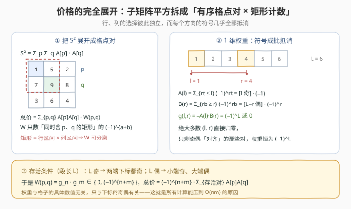
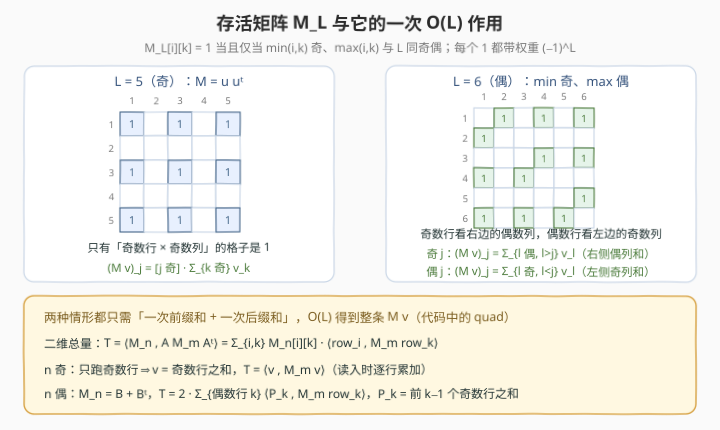
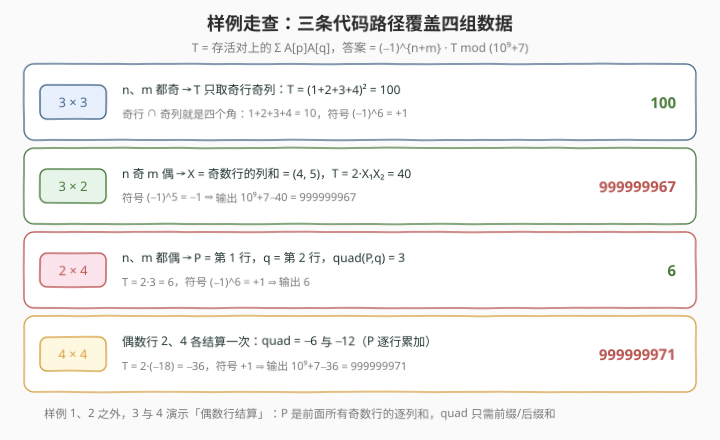

# Codeforces 2275H 一道眉毛热身题 题解

## 1. 题目概述

- **标题 / 题号**：一道眉毛热身题（Codeforces 2275H，英文名 A Problem to Warm Up the Eyebrows）
- **链接**：https://codeforces.com/problemset/problem/2275/H
- **来源**：Codeforces Round 1125 (Div. 3) · Problem H
- **难度**：$\ast 2400$
- **限制**：时间 1.5 s / 内存 256 MB
- **标签**：组合数学，数学，前缀和（官方标签 combinatorics / dp / math）

**题意**：给定 $n\times m$ 的整数矩阵 $A$。对每个非空子矩阵（由首行、尾行、首列、尾列确定），若它占 $a$ 行 $b$ 列、内部元素和为 $S$，定义它的价格为

$$(-1)^{a+b}\,S^{2}.$$

求所有子矩阵价格之和，模 $10^9+7$ 输出。有多测：$t$ 组数据，每组给 $n,m$ 与矩阵。答案可能为负，要求输出落在 $[0,10^9+6]$ 的余数。

**约束**：

- $1\le t\le 10^4$；
- $1\le n,m$，$n\cdot m\le 10^6$（单组），且所有组 $\sum n\cdot m\le 10^6$；
- $|A_{i,j}|\le 10^9$，故 $S^2$ 可达 $10^{30}$ 量级，必须全程取模；
- 时限 1.5 s：$10^6$ 个格子，需要 $O(nm)$ 且常数很小的做法。

## 2. 示例

```text
输入
4
3 3
1 5 2
7 9 8
3 6 4
2 4
1 -1 -2 2
-2 2 1 -1
3 2
4 5
8 2
0 0
4 4
1 1 1 1
-1 -1 -1 -1
1 1 1 1
-1 -1 -1 -1

输出
100
6
999999967
999999971
```

- 第 1 组 $3\times 3$：正负块成对抵消后，$T$ 只剩奇行奇列的四个角，$T=(1+2+3+4)^2=100$。
- 第 2 组 $2\times 4$：带负数的混合，结果为 $6$。
- 第 3 组 $3\times 2$：$T=2\cdot 4\cdot 5=40$，但 $n+m$ 为奇，输出 $-40\bmod p=999999967$。
- 第 4 组 $4\times 4$ 正负交替：$T=-36$，输出 $-36\bmod p=999999971$。

## 3. 解题思路

### 3.1 暴力思路

按定义枚举子矩阵：$O(n^2)$ 种行区间、$O(m^2)$ 种列区间，用二维前缀和 $O(1)$ 取 $S$，总复杂度 $O(n^2m^2)$。$n=m=1000$ 时约 $2.5\times 10^{11}$ 个子矩阵，不可能过。必须把"四元组枚举"降维：突破口是把 $S^2$ 拆成**格点对**——一旦拆开，行与列的选择就各自独立了。

### 3.2 核心观察：平方拆成格点对，权重只由奇偶决定



设格子 $p=(i_1,j_1)$、$q=(i_2,j_2)$（允许相同）。因为子矩阵的和满足 $S=\sum_{p\in R}A_p$，所以

$$S^{2}=\sum_{p\in R}\sum_{q\in R}A_pA_q\ \Longrightarrow\ \text{总价}=\sum_{p,q}A_pA_q\cdot W(p,q),\qquad W(p,q)=\sum_{R\supseteq\{p,q\}}(-1)^{a+b},$$

其中 $R$ 跑遍所有同时包含 $p,q$ 的子矩阵（有序对，$p=q$ 也计入）。$W(p,q)$ 与格子的**数值无关**，只和下标有关，这是全部优化的来源。

**一维引理**：在长度 $L$ 的一维格线上，$1\le l\le r\le L$，则

$$g(l,r)=\sum_{rt\le l}\ \sum_{rb\ge r}(-1)^{\,rb-rt+1}=
\begin{cases}(-1)^{L}, & l\ \text{奇且}\ L-r\ \text{偶},\\ 0, & \text{否则}.\end{cases}$$

原因很朴素：$(-1)^{rb-rt+1}=-(-1)^{rt}(-1)^{rb}$，于是两重求和分离成 $\sum_{rt\le l}(-1)^{rt}\in\{-1,0\}$ 与 $\sum_{rb\ge r}(-1)^{rb}\in\{0,\pm1\}$，各自都是正负成对的几何和，几乎全军覆没。

矩形由行区间与列区间拼成，故

$$W(p,q)=g_n\bigl(\min(i_1,i_2),\max(i_1,i_2)\bigr)\cdot g_m\bigl(\min(j_1,j_2),\max(j_1,j_2)\bigr),$$

两个因子只能取 $0$ 或 $(-1)^n$、$(-1)^m$。于是

$$\boxed{\ \text{答案}=(-1)^{n+m}\cdot T\ },\qquad T=\sum_{\text{两者都「存活」的 }(p,q)}A_pA_q,$$

其中 $(p,q)$ 存活指：$\min(i_1,i_2)$ 奇且 $n-\max(i_1,i_2)$ 偶，对列同理。

### 3.3 算法流程：存活矩阵 $M_L$ 与它的 $O(L)$ 作用



记 $M_L[i][k]=1$ 当且仅当 $\min(i,k)$ 奇、$L-\max(i,k)$ 偶，则 $T=\langle M_n,\ A M_mA^{\mathsf T}\rangle$，即

$$T=\sum_{i_1,i_2}\sum_{j_1,j_2}M_n[i_1][i_2]\,M_m[j_1][j_2]\,A_{i_1j_1}A_{i_2j_2}.$$

$M_L$ 的形状非常简单：

- $L$ **奇**：条件等价于"两端都奇"，故 $M_L=uu^{\mathsf T}$（$u$ 为奇数位置指示向量）；
- $L$ **偶**：条件等价于"小端奇、大端偶"。

关键是把 $M_L$ 看成线性算子——它作用在向量 $v$ 上只需一次前缀和 + 一次后缀和：

$$(M_Lv)_j=\begin{cases}[\,j\ \text{奇}\,]\sum_{k\ \text{奇}}v_k, & L\ \text{奇},\\ [\,j\ \text{奇}\,]\sum_{l>j,\ l\ \text{偶}}v_l+[\,j\ \text{偶}\,]\sum_{l<j,\ l\ \text{奇}}v_l, & L\ \text{偶}.\end{cases}$$

于是整条 $M_Lv$ 是 $O(L)$ 的，代码里就是 `quad(p, q) = ⟨p, M_m q⟩`。

$T$ 剩下按 $n$ 的奇偶组合：

- $n$ **奇**：$M_n=uu^{\mathsf T}$，$T=\Bigl\langle\sum_{i\ \text{奇}}\mathrm{row}_i,\ M_m\sum_{k\ \text{奇}}\mathrm{row}_k\Bigr\rangle=\langle v,M_m\,v\rangle$，只需奇数行的逐列和 $v$；
- $n$ **偶**：$M_n=B+B^{\mathsf T}$，其中 $B[i][k]=[i\ \text{奇}][k\ \text{偶}][i<k]$，故
  $$T=2\sum_{k\ \text{偶}}\bigl\langle P_k,\ M_m\,\mathrm{row}_k\bigr\rangle,\qquad P_k=\sum_{i\ \text{奇},\ i<k}\mathrm{row}_i .$$

于是算法只需**逐行读入**：维护 `acc`（迄今为止的奇数行逐列和）；$n$ 奇时读完后算一次 `quad(acc, acc)`，$n$ 偶时每读到一个偶数行 $k$ 就结算 $2\cdot$`quad(acc, row)`，最后乘上符号 $(-1)^{n+m}$。

顺手可以得到四条封闭形式（用于手算与对拍，代码不必分支）：

| 奇偶型 | $T$ |
| --- | --- |
| $n,m$ 都奇 | $\bigl(\sum_{i,j\ \text{奇}}A_{ij}\bigr)^{2}$ |
| $n$ 奇、$m$ 偶 | $2\sum_{c_1<c_2,\ c_1\ \text{奇},\ c_2\ \text{偶}}X_{c_1}X_{c_2}$，$X_c=\sum_{i\ \text{奇}}A_{ic}$ |
| $n$ 偶、$m$ 奇 | $2\sum_{r_1<r_2,\ r_1\ \text{奇},\ r_2\ \text{偶}}Y_{r_1}Y_{r_2}$，$Y_r=\sum_{j\ \text{奇}}A_{rj}$ |
| $n,m$ 都偶 | 无简单闭式，用逐行结算 |

（它们分别由 $M=uu^{\mathsf T}$ 与 $Mv$ 的偶长度公式 $2\sum_{o<e}v_ov_e$ 展开得到。）

### 3.4 示例演算



- 第 1 组 $3\times3$（$n,m$ 都奇）：$T$ 只取奇行奇列，即四个角 $1+2+3+4=10$，$T=100$，符号 $(-1)^6=+1$。
- 第 3 组 $3\times2$（$n$ 奇 $m$ 偶）：$X=(4+0,\ 5+0)=(4,5)$，$T=2X_1X_2=40$，符号 $(-1)^5=-1$，输出 $p-40$。
- 第 2 组 $2\times4$（都偶）：$P=\mathrm{row}_1=(1,-1,-2,2)$，$q=\mathrm{row}_2=(-2,2,1,-1)$，偶列和 $se=q_2+q_4=1$，于是
  $t=0$：$P_1(se-0)+P_2q_1=1\cdot1+(-1)\cdot(-2)=3$；$t=1$：$P_3(se-q_2)+P_4(q_1+q_3)=(-2)(1-2)+2(-1)=-2+2=0$；
  合计 $\langle P,M_4q\rangle=3$，$T=2\cdot3=6$。
- 第 4 组 $4\times4$（都偶）：偶数行 2、4 各结算一次，得 $-6$ 与 $-12$（$P$ 逐行累加后翻倍），$T=2\cdot(-18)=-36$。

## 4. 算法细节

1. **符号最后再乘**：全程只算 $T\bmod p$，最后若 $(n+m)$ 为奇就取 $p-T\bmod p$。注意 $T=0$ 时 `p - 0` 必须再取模一次，否则输出 $p$ 而不是 $0$。
2. **取模时机**：`acc` 逐列累加时取模；`quad` 里每乘一次就取模，避免 $10^6$ 项乘积累加溢出 `long long`。
3. **1-indexed 实现**：$M_L$ 的奇偶是下标本质属性，代码里统一用 $1$ 到 $m$ 的下标，`pre[1]=0`、`suf[m]=0` 是自然边界。
4. **$m$ 奇时 `quad` 特化**：只需两个奇数位之和相乘，$O(m/2)$，比走通用路径快一倍。
5. **$n$ 奇时只累加奇数行**：偶数行完全不参与（权重为 $0$），可以省掉一半加法。
6. **$n$ 偶时的配对**：读到第 $k$ 行（偶）时 `acc` 恰好是 $P_k=\sum_{i\ \text{奇}<k}\mathrm{row}_i$，因为奇数行总在它之前被累加；这个顺序正确性依赖"先累加、后结算"。
7. **多测清空**：`pre/suf` 用 `assign(m+2, 0)` 重置，`acc/row` 重新构造；不要用全局数组残留上一组数据。
8. **输入规模**：$10^6$ 个整数，`cin` 关闭同步后足够；Python 用 `sys.stdin.buffer.read().split()` 整块读。
9. **负数的模**：C++ 中 `-10^9 % MOD` 为负，必须先 `%` 再补 `+MOD`；Python 的 `%` 天然非负，无需处理。

## 5. 正确性证明

**引理 1（一维抵消）**：对长度 $L$ 的格线与 $1\le l\le r\le L$，
$$g(l,r)=\sum_{rt=1}^{l}\sum_{rb=r}^{L}(-1)^{rb-rt+1}=(-1)^{L}\,[\,l\ \text{奇}\,][\,L-r\ \text{偶}\,].$$

**证明**：由 $(-1)^{rb-rt+1}=-(-1)^{rt}(-1)^{rb}$ 得 $g=-A(l)B(r)$，其中 $A(l)=\sum_{rt\le l}(-1)^{rt}$、$B(r)=\sum_{rb\ge r}(-1)^{rb}$。前者在 $l$ 奇时为 $-1$，否则为 $0$；后者是 $L-r+1$ 项的交错和，在 $L-r$ 为奇时为 $0$，为偶时等于 $(-1)^r=(-1)^L$（$r\equiv L$）。故非零时 $g=-(-1)(-1)^{L}=(-1)^{L}$。又因 $rt\le l\le r\le rb$，每个 $(rt,rb)$ 唯一对应一个包含 $[l,r]$ 的区间，无重复计数。∎

**引理 2（权重分离）**：$W(p,q)=g_n(\min i,\max i)\cdot g_m(\min j,\max j)$。

**证明**：包含 $\{p,q\}$ 的矩形由行区间 $[rt,rb]$ 与列区间 $[cl,cr]$ 独立选取，且 $a=rb-rt+1,\ b=cr-cl+1$，故 $(-1)^{a+b}=(-1)^a(-1)^b$，求和分离为两个一维和的乘积。∎

**引理 3（$M_L$ 的算子形式）**：$L$ 奇时 $M_L=uu^{\mathsf T}$，$(M_Lv)_j=[j\ \text{奇}]\sum_{k\ \text{奇}}v_k$；$L$ 偶时 $(M_Lv)_j=[j\ \text{奇}]\sum_{l>j,l\ \text{偶}}v_l+[j\ \text{偶}]\sum_{l<j,l\ \text{奇}}v_l$。

**证明**：$L$ 奇时，条件"$L-\max$ 偶"即 $\max$ 奇，配合 $\min$ 奇得两端都奇；$L$ 偶时要求 $\max$ 偶、$\min$ 奇，即 $j$ 奇时伙伴须是更大的偶数，$j$ 偶时伙伴须是更小的奇数。按行写出 $\sum_l M_L[j][l]v_l$ 即得。∎

**引理 4（$T$ 的两种组合）**：$n$ 奇时 $T=\langle v,M_m\,v\rangle$（$v$ 为奇数行逐列和）；$n$ 偶时 $T=2\sum_{k\ \text{偶}}\langle P_k,M_m\,\mathrm{row}_k\rangle$。

**证明**：$n$ 奇由引理 3 的 $M_n=uu^{\mathsf T}$ 与双线性得到。$n$ 偶时记 $c_{ik}=\langle \mathrm{row}_i,M_m\,\mathrm{row}_k\rangle$，由 $M_m$ 对称有 $c_{ik}=\mathrm{row}_i^{\mathsf T}M_m\,\mathrm{row}_k=\mathrm{row}_k^{\mathsf T}M_m\,\mathrm{row}_i=c_{ki}$，故
$$T=\sum_{i,k}(B+B^{\mathsf T})_{ik}c_{ik}=2\sum_{i\ \text{奇}<k\ \text{偶}}c_{ik}=2\sum_{k\ \text{偶}}\Bigl\langle\sum_{i\ \text{奇}<k}\mathrm{row}_i,\ M_m\,\mathrm{row}_k\Bigr\rangle.$$
其中第一步用 $M_n=B+B^{\mathsf T}$ 与 $c_{ik}=c_{ki}$，第二步把同一个偶数行 $k$ 的项归并。∎

**定理**：算法输出等于表格价格模 $10^9+7$。

**证明**：价格 $=\sum_R(-1)^{a+b}S^2=\sum_{p,q}A_pA_qW(p,q)$（引理 2 前的展开），由引理 1、2 得 $W(p,q)=(-1)^{n+m}M_n[i_1][i_2]M_m[j_1][j_2]$，故价格 $=(-1)^{n+m}T$；再由引理 3 的 $M_m$ 作用与引理 4 的组合方式，算法算出的正是 $T$，最后一步按 $(n+m)$ 的奇偶补符号。∎

## 6. 复杂度分析

- **时间**：每个测试点为 $O(nm)$。读入 $O(nm)$；奇数行累加 $O(nm/2)$；`quad` 每次 $O(m)$，调用次数为 $n/2$（$n$ 偶）或 $1$（$n$ 奇），合计 $O(nm)$。总时间 $O(\sum n\cdot m)$，即 $10^6$ 量级的初等运算。
- **空间**：$O(m)$（`acc`、`row`、`pre`、`suf`），不存整个矩阵。
- **实测**：$10^6$ 格子时，若把读入换成 `fread` 快读，核心计算仅约 $20$ ms；`cin` 关闭同步后在 g++/libstdc++ 上读 $10^6$ 个整数约 $0.05$ s，总耗时约 $0.1$ s，对 1.5 s 有十倍以上余量。（注意：本机 Apple clang 的 libc++ 中 `cin` 慢一个数量级、约 $1.5$ s，属实现差异，评测机为 g++。）
- **Python**：CPython 实测最坏形状（$500000\times2$）约 $0.6$ s，$1000\times1000$ 约 $0.3$ s，可以过；若机器较慢建议 PyPy。

## 7. 参考代码

### C++17

```cpp
#include <bits/stdc++.h>
using namespace std;

const long long MOD = 1000000007LL;

int M;                          // 当前测试点的列数
vector<long long> pre, suf;     // 计算 M_m 对向量作用时的前缀 / 后缀和

// 返回 <p, M_M q> mod MOD：M_M[j][l] = 1 当且仅当 min(j,l) 奇、max(j,l) 与 M 同奇偶
long long quad(const vector<long long>& p, const vector<long long>& q) {
    if (M & 1) {                                    // M 奇：M = u u^T
        long long a = 0, b = 0;
        for (int j = 1; j <= M; j += 2) {
            a += p[j]; if (a >= MOD) a -= MOD;
            b += q[j]; if (b >= MOD) b -= MOD;
        }
        return a * b % MOD;
    }
    long long s = 0;                                // suf[j] = sum_{l 偶, l > j} q[l]
    for (int j = M; j >= 1; --j) {
        suf[j] = s;
        if (!(j & 1)) { s += q[j]; if (s >= MOD) s -= MOD; }
    }
    s = 0;                                          // pre[j] = sum_{l 奇, l < j} q[l]
    for (int j = 1; j <= M; ++j) {
        pre[j] = s;
        if (j & 1) { s += q[j]; if (s >= MOD) s -= MOD; }
    }
    long long r = 0;                                // M 偶：左端奇、右端偶
    for (int j = 1; j <= M; ++j)
        r = (r + p[j] * ((j & 1) ? suf[j] : pre[j])) % MOD;
    return r;
}

int main() {
    ios::sync_with_stdio(false);
    cin.tie(nullptr);
    int t;
    cin >> t;
    while (t--) {
        int n, m;
        cin >> n >> m;
        M = m;
        pre.assign(m + 2, 0);
        suf.assign(m + 2, 0);
        vector<long long> acc(m + 1, 0), row(m + 1, 0);
        long long ans = 0;
        for (int i = 1; i <= n; ++i) {
            for (int j = 1; j <= m; ++j) {
                long long x;
                cin >> x;
                x %= MOD; if (x < 0) x += MOD;
                row[j] = x;
            }
            if (n & 1) {                            // n 奇：只累加奇数行
                if (i & 1)
                    for (int j = 1; j <= m; ++j) { acc[j] += row[j]; if (acc[j] >= MOD) acc[j] -= MOD; }
            } else {                                // n 偶：偶数行与之前所有奇数行结算
                if (i & 1)
                    for (int j = 1; j <= m; ++j) { acc[j] += row[j]; if (acc[j] >= MOD) acc[j] -= MOD; }
                else
                    ans = (ans + 2 * quad(acc, row)) % MOD;
            }
        }
        if (n & 1) ans = quad(acc, acc);
        if ((n + m) & 1) ans = (MOD - ans) % MOD;   // 乘上 (-1)^(n+m)
        cout << ans << '\n';
    }
    return 0;
}
```

### Python3

```python
import sys
from itertools import accumulate

MOD = 10 ** 9 + 7


def quad(p, q, m):
    """<p, M_m q> mod MOD；p[0] 是第 1 个位置（下标按 1 起算的奇偶）。"""
    if m & 1:                                    # m 奇：M = u u^T
        return (sum(p[0::2]) % MOD) * (sum(q[0::2]) % MOD) % MOD
    se = sum(q[1::2])                            # 1 起算的偶数位之和
    ev = list(accumulate(q[1::2], initial=0))    # ev[t] = q_2 + q_4 + ... + q_{2t}
    od = list(accumulate(q[0::2]))               # od[t] = q_1 + q_3 + ... + q_{2t+1}
    s = 0
    for t in range(m >> 1):
        s += p[2 * t] * (se - ev[t]) + p[2 * t + 1] * od[t]
    return s % MOD


def main():
    data = sys.stdin.buffer.read().split()
    if not data:
        return
    t = int(data[0])
    pos = 1
    out = []
    for _ in range(t):
        n, m = int(data[pos]), int(data[pos + 1])
        pos += 2
        cnt = n * m
        a = list(map(int, data[pos:pos + cnt]))
        pos += cnt
        acc = [0] * m
        ans = 0
        if n & 1:                                # n 奇：只累加奇数行
            for i in range(0, n, 2):
                base = i * m
                for j in range(m):
                    acc[j] += a[base + j]
            ans = quad(acc, acc, m)
        else:                                    # n 偶：偶数行逐行结算
            for i in range(n):
                base = i * m
                row = a[base:base + m]
                if (i + 1) & 1:
                    for j in range(m):
                        acc[j] = (acc[j] + row[j]) % MOD
                else:
                    ans += 2 * quad(acc, row, m)
            ans %= MOD
        if (n + m) & 1:
            ans = (MOD - ans) % MOD              # 乘上 (-1)^(n+m)
        out.append(ans % MOD)
    sys.stdout.write('\n'.join(map(str, out)) + '\n')


main()
```

## 8. 边界情况与易错点

1. **$1\times1$**：$n=m=1$ 都奇，$T=(A_{11})^2$、符号 $+1$，答案 $A_{11}^2\bmod p$；注意先对 $A_{11}$ 取模再平方。
2. **负数取模**：$A_{i,j}$ 可为 $-10^9$，C++ 里 `x % MOD` 仍是负数，必须 `if (x < 0) x += MOD`。
3. **$T=0$ 时的符号**：`(MOD - ans) % MOD` 而不是 `MOD - ans`，否则输出 $10^9+7$ 而不是 $0$。
4. **$n$ 奇、$m$ 偶**：代码走 `quad(acc, acc)`，此时 `acc` 只累加了奇数行；若误把偶数行也加进去，答案立刻改变。
5. **$n$ 偶的"先累加后结算"顺序**：读到偶数行时必须保证 `acc` 里是**严格更小**的奇数行，循环里先判断奇偶、再累加/结算，不能把当前行加进 `acc` 后再自乘。
6. **下标奇偶的基准**：题目是 1-indexed，Python 里 `q[0::2]` 对应"1 起算的奇数位"，这一转换极易错位；写 `q[1::2]` 前务必先确认 `se`/`ev`/`od` 三者的含义。
7. **多测清空**：$t$ 可达 $10^4$，`pre/suf` 必须按当前 $m$ 重新 `assign`，`acc/row` 每组重建；总代价 $O(\sum m)$ 可以接受。
8. **$m=1$ 与 $n=1$**：$m=1$ 时走 $M$ 奇分支，`suf/pre` 用不到但也要按 $m+2$ 分配，避免越界；$n=1$ 时只累加第 1 行。
9. **Python 的 `initial=0`**：`accumulate(..., initial=0)` 让 `ev` 比 `od` 多一项，正是 `ev[t]` 与 `od[t]` 差一位的来源；漏掉它会整体错位一格。

## 相关题目与扩展

- [Codeforces 2275G Copper Squander](https://codeforces.com/problemset/problem/2275/G)：同场 G 题，同样需要"把整体统计拆成独立贡献"。
- [LeetCode 304. 二维区域和检索 - 矩阵不可变](https://leetcode.cn/problems/range-sum-query-2d-immutable/)：本题暴力做法依赖的二维前缀和模板。
- [LeetCode 1504. 统计全 1 子矩形](https://leetcode.cn/problems/count-submatrices-with-all-ones/)：子矩形计数的单调栈做法，可对照"矩形计数"的另一种降维思路。

**延伸思考**：

1. **没有符号会怎样？** 若价格为 $S^2$（去掉 $(-1)^{a+b}$），则 $W(p,q)=\min(i_1,i_2)(n-\max(i_1,i_2)+1)\cdot\min(j_1,j_2)(m-\max(j_1,j_2)+1)$ 是两个正因子之积，四重求和不再「几乎全灭」，同样的分解只能做到 $O(n^2m)$（枚举行对后每对 $O(m)$）。符号的意义正是把权重压成 $0$ 或常数 $(-1)^{n+m}$。
2. **换成 $S^3$ 呢？** $S^3=\sum_{p,q,r}A_pA_qA_r$，而"同时含三个格子"的矩形只需覆盖三者的最左/最右下标，一维权重仍是 $g(\min,\max)$ 的同一个函数；于是三重求和依旧能用前缀和按块归并，复杂度仍是 $O(nm)$，只是分类讨论与常数都会变大。
3. **把 $S^2$ 换成 $S$ 呢？** 价格变成元素的线性组合：$\sum_R(-1)^{a+b}S=\sum_p A_p\cdot(\text{含 }p\text{ 的带符号矩形数})$。由引理 1（取 $l=r=i$）该系数 $=(-1)^{n+m}[i\ \text{奇}][n-i\ \text{偶}][j\ \text{奇}][m-j\ \text{偶}]$，于是答案只是一小片稀疏格子的和——这也从另一个角度印证了"存活条件"就是 $M_n$ 的对角元。
4. **把 $A_{ij}$ 换成向量或多项式**：整套推导只用到"和的双线性"，因此把每个格子换成向量内积/多项式系数，权重结构完全不变，可作为高维版本练习。
