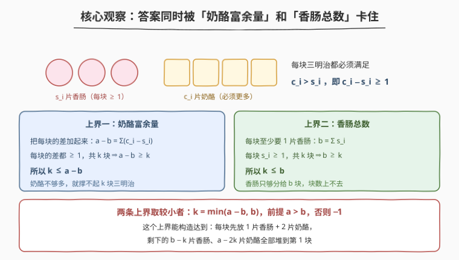
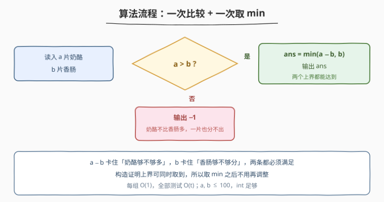
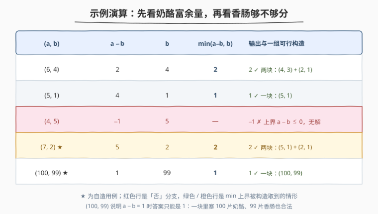

# Codeforces 2276A 完美三明治 题解

## 1. 题目概述

- **标题 / 题号**：完美三明治（Codeforces 2276A，英文名 Perfect Sandwiches）
- **链接**：https://codeforces.com/problemset/problem/2276/A
- **来源**：Educational Codeforces Round 195 (Rated for Div. 2) · Problem A
- **难度**：800（Div. 2 签到题）
- **限制**：时间 1 s / 内存 512 MB
- **标签**：贪心，数学

**题意**：Monocarp 有 $a$ 片奶酪和 $b$ 片香肠，想用它们给朋友做尽可能多的三明治。他非常节俭，所以必须把 $a$ 片奶酪和 $b$ 片香肠**全部用完、一片不剩**。做三明治的规则是：

1. 每块三明治至少含 1 片奶酪、至少 1 片香肠；
2. 每一片奶酪、每一片香肠都**恰好**放在某一块三明治上（不能重复使用，也不能丢弃）；
3. 对每块三明治，其中的**奶酪片数严格大于香肠片数**。

求最多能做多少块三明治；如果无法按上述规则把全部材料分配完，输出 `-1`。

多组数据：第一行一个整数 $t$，接下来 $t$ 行每行两个整数 $a,b$，逐组输出一个整数（答案或 `-1`），每组占一行。

**约束**：

- $1 \le t \le 10^4$
- $1 \le a, b \le 100$
- 必须用完所有材料：$\sum c_i = a$，$\sum s_i = b$（$c_i,s_i$ 为第 $i$ 块的奶酪、香肠片数）
- 每块：$c_i \ge 1$，$s_i \ge 1$，$c_i > s_i$
- 无解时输出 `-1`

## 2. 示例

官方样例（输入 / 输出原样）：

```text
输入：
3
6 4
5 1
4 5

输出：
2
1
-1
```

逐组说明：

- 第 1 组 $a=6,b=4$：可以做 2 块，官方给的方案是每块 $3$ 片奶酪配 $2$ 片香肠（$3>2$ 且总数刚好用完）；本解法给出的另一组合法方案是 $(4,3)$ 与 $(2,1)$。
- 第 2 组 $a=5,b=1$：只能做 1 块，一块里放全部 $5$ 片奶酪与 $1$ 片香肠。
- 第 3 组 $a=4,b=5$：奶酪比香肠还少，而每块都要求奶酪严格多于香肠，故无解，输出 `-1`。

补充一组自造样例（用极端值压边界，标注为自造）：

```text
输入（自造）：
3
7 2
100 99
1 100

输出（自造）：
2
1
-1
```

第 1 组是「奶酪富余量大、香肠很少」——被香肠卡住只能做 2 块；第 2 组是「富余量只有 1」——把 $100$ 片奶酪和 $99$ 片香肠全塞进一块即可，答案 1；第 3 组 $a<b$，无解。

## 3. 解题思路

### 3.1 暴力思路

先枚举块数 $k$，再枚举「每块放几片香肠、几片奶酪」，本质是整数划分的枚举：把 $b$ 拆成 $k$ 个正整数、把 $a$ 拆成 $k$ 个正整数，再检查逐块是否满足 $c_i > s_i$。方案数是 $\binom{a-1}{k-1}\binom{b-1}{k-1}$ 量级，即使 $a,b \le 100$ 也完全不可行（$k$ 取中间值时是天文数字）。

更笨一点的想法是「一层层往上堆」的贪心模拟，但每块该分多少并没有直观依据。正确的做法是**只找必要条件**：如果这些条件恰好也是充分条件，答案就有闭式，根本不需要搜索。

### 3.2 核心观察：每块三明治贡献两条上界



设一共做了 $k$ 块，第 $i$ 块放 $c_i$ 片奶酪、$s_i$ 片香肠。规则 3 说 $c_i > s_i$，而两边都是整数，于是对每一块都有

$$c_i - s_i \ge 1$$

**上界一（奶酪富余量）**：把 $k$ 个不等式相加，左边恰好是奶酪总数减香肠总数：

$$a - b = \sum_{i=1}^{k}(c_i - s_i) \ge \sum_{i=1}^{k} 1 = k .$$

所以 **$k \le a - b$**。直观地说，$a-b$ 是「每块至少要多吃的奶酪片数」之和，奶酪富余量不够就撑不起这么多块；当 $a \le b$ 时 $a-b \le 0$，而 $k \ge 1$，立刻推出无解。

**上界二（香肠总数）**：规则 1 说每块至少 1 片香肠，即 $s_i \ge 1$，求和得

$$b = \sum_{i=1}^{k} s_i \ge k ,$$

所以 **$k \le b$**。香肠总共只有 $b$ 片，一块至少要吃掉 1 片，块数自然上不去。

两条上界必须**同时**满足，于是

$$k \le \min(a-b,\; b).$$

关键在于：这个上界不但必要，而且**可以构造达到**。取 $k^{*} = \min(a-b,b)$，先给每块「$1$ 片香肠 $+$ $2$ 片奶酪」（共 $k^{*}$ 片香肠、$2k^{*}$ 片奶酪），再把剩下的 $b-k^{*}$ 片香肠、$a-2k^{*}$ 片奶酪**全部堆到第 1 块**。这样

$$c_1 - s_1 = (a-2k^{*}+2)-(b-k^{*}+1) = (a-b)-k^{*}+1 \ge 1 \iff a-b \ge k^{*},$$

而 $a-b \ge k^{*}$ 正是 $k^{*}=\min(a-b,b)$ 的直接推论，故第 1 块也严格满足；其余 $k^{*}-1$ 块是 $(2,1)$，同样满足严格大于。于是答案就是 $\min(a-b,b)$（要求 $a>b$），否则 `-1`。

### 3.3 算法流程



1. 读入 $a,b$。
2. 若 $a \le b$，输出 `-1`，本组结束。
3. 否则输出 $\min(a-b,\;b)$。

代码里只有一次比较和一次取 $\min$，单组 $O(1)$。注意第 3 步不需要真的模拟分配过程——构造只用来证明上界可达，输出一个整数即可。

### 3.4 示例演算



以官方第 1 组 $a=6,b=4$ 为例：$a-b=2$，$b=4$，故 $k=\min(2,4)=2$。按构造，先给两块各 $1$ 片香肠 $+$ $2$ 片奶酪（用掉 $2$ 片香肠、$4$ 片奶酪），剩下 $4-2=2$ 片香肠、$6-4=2$ 片奶酪全堆到第 1 块，得到 $(4,3)$ 与 $(2,1)$：两块都满足奶酪多于香肠，总数也正好用完。

官方第 2 组 $a=5,b=1$：$a-b=4$，$b=1$，$k=\min(4,1)=1$，被香肠数卡住。构造出 $c_1=5-2+2=5$、$s_1=1-1+1=1$，即一块 $(5,1)$。

官方第 3 组 $a=4,b=5$：$a-b=-1<1$，走 `-1` 分支——注意此时连 $\min$ 都不必算，负数没有意义。

自造 $(7,2)$：$k=\min(5,2)=2$，剩下 $0$ 片香肠、$3$ 片奶酪给第 1 块，得 $(5,1)$ 与 $(2,1)$。自造 $(100,99)$：$k=\min(1,99)=1$，一块里塞 $100$ 片奶酪、$99$ 片香肠，合法但只能做一块。

## 4. 算法细节

1. **无解的判据是 $a \le b$，不是 $a < b$**：$a=b$ 时 $a-b=0<1$，而任何一块都要求奶酪比香肠至少多 1 片，全用完必然凑不出来，必须输出 `-1`。写成 `a == b` 单独判断很容易漏掉 $a < b$ 的分支。
2. **两条上界都要取，不能只取一条**：只看 $a-b$ 会在 $(100,2)$ 上错答 $98$（实际 $2$）；只用 $b$ 当答案则在 $(6,4)$ 上会答 $4$（实际 $2$）、在 $(100,1)$ 上会答 $1$（碰巧正确），说明两条缺一不可，必须取 $\min$。
3. **构造的正确性依赖 $a \ge 2k$**：先给每块 2 片奶酪要求 $a-2k \ge 0$。由 $a = b + (a-b) \ge k + k = 2k$ 恒成立，所以这个前提自动满足，不需要额外特判。
4. **不用真的执行分配**：题目只要求输出块数，构造只出现在证明里。把构造写进代码只会增加出错面（例如误在无解分支里做减法得负数）。
5. **数据类型**：$a,b \le 100$，答案最大为 $50$（$a=100,b=50$），`int` 足够，不需要 `long long`。
6. **多测无全局状态**：每组只读两个整数、算一次输出，没有任何需要清空的数组或变量；不要为了「保险」加多余的重置逻辑。
7. **I/O 开销是主要成本**：$t \le 10^4$ 时读入 $2\times10^4$ 个整数，C++ 用 `std::ios::sync_with_stdio(false)` 加 `cin.tie(nullptr)`，Python 用 `sys.stdin.buffer.read().split()` 一次性解析，避免 $10^4$ 次 `input()` 的函数调用开销。
8. **输出格式**：每组一行、只输出一个整数，`-1` 与原答案走同一条输出路径即可。

## 5. 正确性证明

**引理 1（奶酪富余量上界）**：若存在把 $a$ 片奶酪、$b$ 片香肠全部分配到 $k$ 块三明治的合法方案，则 $a-b \ge k$。

**证明**：由规则 3，每块满足 $c_i > s_i$，两边为整数故 $c_i - s_i \ge 1$。对 $k$ 块求和：

$$a - b = \sum_{i=1}^{k} c_i - \sum_{i=1}^{k} s_i = \sum_{i=1}^{k}(c_i - s_i) \ge \sum_{i=1}^{k} 1 = k .$$

第一个等号用了规则 2（全部材料恰好用在这些块上）。∎

**引理 2（香肠总数上界）**：同一前提下必有 $b \ge k$。

**证明**：由规则 1，每块 $s_i \ge 1$，求和得 $b = \sum_{i=1}^{k} s_i \ge k$。∎

**引理 3（无解判定）**：若 $a \le b$，则不存在任何合法的 $k \ge 1$。

**证明**：由引理 1 得 $k \le a-b \le 0$，与 $k \ge 1$ 矛盾。∎

**引理 4（上界可达）**：若 $a > b$，令 $k^{*} = \min(a-b,\,b)$，则存在 $k^{*}$ 块的合法方案。

**证明**：构造如下。第 $1$ 块取

$$s_1 = b - k^{*} + 1, \qquad c_1 = a - 2k^{*} + 2 ;$$

其余 $k^{*}-1$ 块各取 $s_i = 1$、$c_i = 2$。逐条核对：

- 总和：$\sum s_i = (b-k^{*}+1) + (k^{*}-1) = b$；$\sum c_i = (a-2k^{*}+2) + 2(k^{*}-1) = a$，全部材料用完。
- 非负与下界：由 $k^{*} \le b$ 得 $s_1 \ge 1$；由 $a = b + (a-b) \ge k^{*} + k^{*} = 2k^{*}$ 得 $c_1 \ge 2$，其余块 $c_i = 2 \ge 1$、$s_i = 1 \ge 1$。
- 严格大于：其余块有 $2 > 1$；第 $1$ 块因 $k^{*} \le a-b$ 即 $a-b \ge k^{*} > k^{*}-1$，得
  $$c_1 - s_1 = (a-2k^{*}+2)-(b-k^{*}+1) = (a-b)-k^{*}+1 \ge 1 .$$

故构造合法。∎

**定理**：算法输出即为最多能做的三明治块数。

**证明**：若 $a \le b$，由引理 3 无解，输出 `-1` 正确。若 $a > b$，引理 1、2 给出任意合法方案的块数 $k \le \min(a-b,b) = k^{*}$，即 $k^{*}$ 是上界；引理 4 又构造出 $k^{*}$ 块的合法方案，故上界可达，最大值恰为 $k^{*}$，与算法输出一致。∎

## 6. 复杂度分析

- **时间**：单组 $O(1)$——一次比较、一次减法、一次取 $\min$；$t$ 组合计 $O(t)$。瓶颈在读写：$t = 10^4$ 时输入仅 $2\times10^4$ 个整数，整体是常数级。实测 C++17（`-O2`，含进程启动）在 $t=10^4$、$a=100$ 的极值数据上约 $10\sim20$ ms，Python3 约 $20\sim30$ ms（主要是解释器启动），相对 1 s 时限有 $30$ 倍以上余量。
- **空间**：$O(1)$。只用到两个 `int` 变量与常数长度的输入 / 输出缓冲；若用 Python 一次性 `read().split()`，缓冲为 $O(t)$ 个 token，约几 MB 以内，远低于 512 MB。

## 7. 参考代码

### C++17

```cpp
#include <bits/stdc++.h>
using namespace std;

int main() {
    ios::sync_with_stdio(false);
    cin.tie(nullptr);

    int t;
    if (!(cin >> t)) return 0;              // 空输入防护
    while (t--) {
        int a, b;
        cin >> a >> b;
        if (a <= b) {                       // 奶酪富余量 <= 0，无解
            cout << -1 << "\n";
            continue;
        }
        cout << min(a - b, b) << "\n";      // 两条上界取较小者
    }
    return 0;
}
```

### Python3

```python
import sys


def main() -> None:
    data = sys.stdin.buffer.read().split()
    if not data:                            # 空输入防护
        return
    t = int(data[0])
    out = []
    p = 1
    for _ in range(t):
        a = int(data[p]); b = int(data[p + 1]); p += 2
        out.append("-1" if a <= b else str(min(a - b, b)))
    sys.stdout.write("\n".join(out) + "\n")


main()
```

## 8. 边界情况与易错点

1. **$a = b$ 必须输出 `-1`**：直觉上「一样多做不出」但容易误写成输出 $a$ 或 $0$。判据是 $a \le b$，因为 $a-b=0$ 时连一块都凑不出严格大于。
2. **$a < b$ 时不能对 $\min(a-b,b)$ 直接取结果**：$a-b < 0$ 会输出负数，与题目要求的 `-1` 语义完全不同，必须先判可行性再算 $\min$。
3. **$b = 1$ 时答案恒为 1**（$a > 1$）：例如 $(100,1)$ 输出 $1$ 而不是 $a-b=99$；反之 $(5,1)$ 输出 $1$ 而非 $4$，说明香肠上界确实会卡死人。
4. **$b$ 很大而 $a-b$ 很小**：$(100,99)$ 输出 $1$。这块三明治里有 $100$ 片奶酪、$99$ 片香肠，看起来「很厚」但完全合法——规则只限制每块内部的相对大小，不限制片数上限。
5. **$a-b$ 很大而 $b$ 很小**：$(100,2)$ 输出 $2$；$(7,2)$ 输出 $2$，都受 $b$ 限制，别只盯着 $a-b$。
6. **多测输出不要串行**：每组单独一行，`-1` 与其他答案走同一路径；用 Python 时务必把结果先收集到列表再一次性 `write`，避免 $10^4$ 次 `print` 的刷新开销。
7. **不要在代码里模拟分配**：模拟过程中若把「剩余材料」减成负数，或忘了把多余的香肠也塞进第 1 块，就会在 $(100,99)$ 这类用例上得到错误结论。

## 相关题目与扩展

- [Codeforces 1849A Morning Sandwich](https://codeforces.com/problemset/problem/1849A)：也是「三明治」——$b$ 片面包、$c$ 片奶酪、$h$ 片火腿，面包必须夹在两端，答案由「面包数」与「馅料数」两个量取小后换算（$2\min(b-1,c+h)+1$），和本题的「两条上界取 $\min$」完全同构。
- [LeetCode 1953. 你可以工作的最大周数](https://leetcode.cn/problems/maximum-number-of-weeks-for-which-you-can-work/)：答案 $\min(\text{sum},\,2(\text{sum}-\max)+1)$，同样是「总量界」与「单类最大值界」两条上界取较小者，可作为本题思路的直接迁移。
- [LeetCode 2335. 装满杯子需要的最短总时长](https://leetcode.cn/problems/minimum-amount-of-time-to-fill-cups/)：对偶形式——答案是 $\max(\max_i a_i,\ \lceil \text{sum}/2\rceil)$，即两条**下界**取较大者；与本题对照可以看出「上界取 min / 下界取 max」的通用套路。
- [LeetCode 2141. 同时运行 N 台电脑的最长时间](https://leetcode.cn/problems/maximum-running-time-of-n-computers/)：把「富余」的电池电量堆给其他机器，用二分判定可行性；这里的「堆给第 1 块」正是同一思想的离散版本。

**延伸思考**：

1. **不要求用完全部材料**：此时只需凑出尽可能多的三明治，不必满足 $\sum c_i = a$。每块至少 $2$ 片奶酪（$c_i \ge s_i+1 \ge 2$）、$1$ 片香肠，故 $k \le \min(\lfloor a/2 \rfloor, b)$；取每块 $(2,1)$ 即可达到，答案变成 $\min(\lfloor a/2 \rfloor, b)$。可见「必须用完」这一条把答案结构彻底改变了——本题的 $a-b$ 项正是「用完」带来的。
2. **把规则反过来**（每块香肠严格多于奶酪）：完全对称，答案为 $b-a$ 与 $a$ 取小（要求 $b>a$），否则 `-1`。
3. **把差值要求改成 $c_i \ge s_i + 2$**：此时 $\sum(c_i - s_i) \ge 2k$ 给出 $k \le \lfloor (a-b)/2 \rfloor$，仍需 $k \le b$；构造「每块 $3$ 片奶酪 $1$ 片香肠，余量全堆第 1 块」可验证两个上界同时可达（需要 $a \ge 3k$，由 $a \ge b + 2k \ge 3k$ 自动成立），答案是 $\min(\lfloor (a-b)/2 \rfloor, b)$。推而广之，要求 $c_i \ge s_i + d$ 时答案为 $\min(\lfloor (a-b)/d \rfloor, b)$。
4. **多种材料、每块要求一个偏序**：设第 $j$ 种材料总数为 $n_j$，每块要求 $c^{(1)}_i > c^{(2)}_i > \cdots$，问题变成一个小型整数规划；判定「能否做 $k$ 块」可写成线性不等式组，用贪心先给每块最小配比、余量堆到某一块，与本题构造同型，但最优块数不再有单个闭式，需要二分 $k$。
