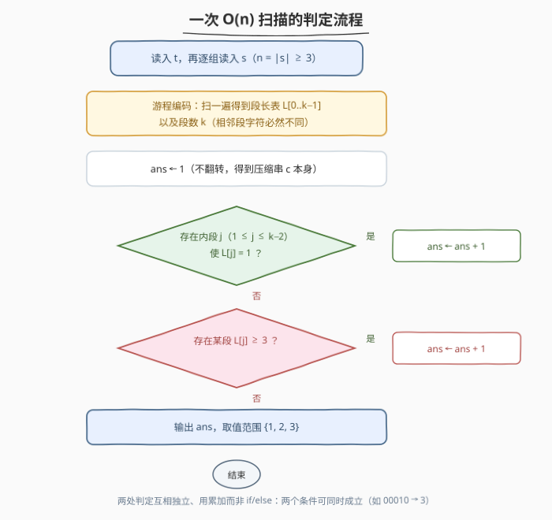
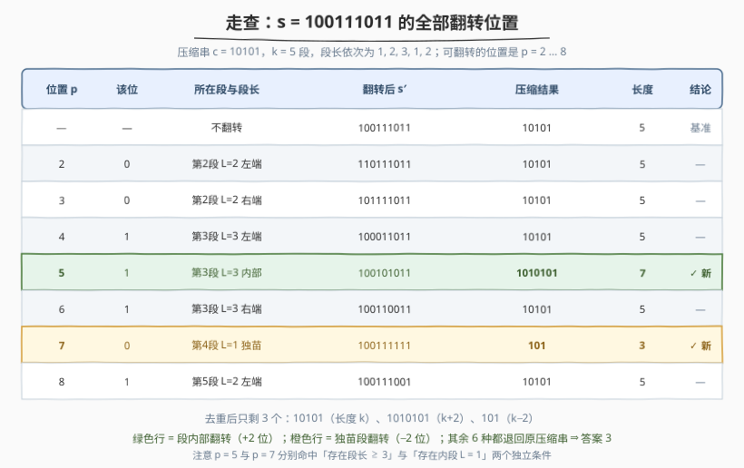

# Codeforces 2276B 替换与压缩 题解

## 1. 题目概述

- **标题 / 题号**：替换与压缩（Codeforces 2276B，英文名 Replace and Compress）
- **链接**：https://codeforces.com/problemset/problem/2276/B
- **来源**：Educational Codeforces Round 195 (Rated for Div. 2) · Problem B（UTC 2026-10-14）
- **难度**：1000
- **限制**：时间 2 s / 内存 512 MB
- **标签**：实现，字符串

**题意**：给定只含 `0` / `1`、长度为 $n$ 的串 $s$，必须执行**恰好一次**、由两步组成的操作：

1. 在下标 $2 \sim n-1$（1-indexed）中**至多**选一个字符翻成相反字符（也可以一个都不选）；首字符与末字符永远不能改；
2. 把每个**极大同色连续段**压缩成一个该字符。例如 `100111011` 压缩后为 `10101`。

问操作结束后能得到多少种**不同**的字符串。多测：首行 $t$，随后 $t$ 行每行一个串，逐组输出种数。

**约束**：

- $1 \le t \le 10^4$，$3 \le \lvert s \rvert \le 3 \times 10^5$，所有串长之和 $\le 3 \times 10^5$
- $s$ 只含 `0` 与 `1`

## 2. 示例与观察
官方样例（输入 / 输出原样）：

```text
输入：
7
001
000
010
00010
100111011
001011010
1111

输出：
1
2
2
3
3
2
2
```

逐组说明（$k$ 为游程段数，见 3.2）：

- `001`（段 `00|1`，$k=2$）：唯一可翻位置翻出的 `1` 并入末段，压缩串仍是 `01` ⇒ 1。
- `000`、`1111`（$k=1$）：`0` 与 `010`、`1` 与 `101` ⇒ 2。
- `010`（$k=3$，中间是独苗）：`010` 与 `0` ⇒ 2；`00010`（段长 $3,1,1$）：`010`、`0`、`01010` ⇒ 3。
- `100111011`（段长 $1,2,3,1,2$）：`10101`、`101`、`1010101` ⇒ 3，正是题面 note 里那三种；`001011010`（段长 $2,1,1,2,1,1,1$，没有长度 $\ge 3$ 的段）：`0101010` 与 `01010` ⇒ 2。

补充自造用例（标注为自造，各压一个边界）：`0100` ⇒ 2（段长 $1,1,2$，内段是独苗）；`0110` ⇒ 1（段长 $1,2,1$，内段长 2 且无长段）；`0001` ⇒ 2（长段在首位）；`01010` ⇒ 2（全为独苗，无长段）。

## 3. 解题思路

### 3.1 暴力思路

不翻转，或者翻转 $p \in [2, n-1]$，共 $n-1$ 种改法；每种都重跑一遍压缩（$O(n)$）并丢进 `set` 去重。单组 $O(n^2)$，最坏 $n = 3 \times 10^5$ 时约 $9 \times 10^{10}$ 次字符操作，必然超时。而样例已提示**答案最大只有 3**：绝大多数改法是重复的，关键是弄清一次翻转对压缩串能造成哪几种改变。

### 3.2 核心观察：三种翻转位置，三种长度


先做**游程编码**，把 $s$ 写成 $c_1^{L_1} c_2^{L_2} \cdots c_k^{L_k}$，其中 $c = c_1 c_2 \cdots c_k$ 是**不翻转时**的压缩串，$k$ 是段数，$L_j$ 是第 $j$ 段长度。因为字母表只有 `0` / `1`，相邻段必然异色，所以 $c$ 一定是**交替串**，且 $c_1 = s_1$（首字符永不被改）。

设翻转位置 $p \in [2, n-1]$ 落在第 $j$ 段。$p$ 不是首尾，故若该段是独苗（$L_j = 1$）则必有 $2 \le j \le k-1$。三种情况穷尽了所有 $p$：

| 情形 | 条件 | 压缩串怎么变 | 结果长度 |
|------|------|--------------|----------|
| (a) 翻在段端 | $L_j \ge 2$ 且 $p$ 在段首 / 段末 | 该段仍非空，翻出的字符并入相邻段（相邻段本是反色），段序列一字不变 | $k$ |
| (b) 翻独苗段 | $L_j = 1$（$2 \le j \le k-1$） | 该段整段消失，左右两段同为反色而合并 | $k-2$ |
| (c) 翻在段内部 | $L_j \ge 3$ 且 $p$ 非段首非段末 | 段被劈成两半，中间夹一个**孤立**反色字符 | $k+2$ |

三种结果都仍是**以 $c_1$ 开头的交替串**，而交替串由「首字符 + 长度」唯一确定，于是

- (b) 的所有翻转给出同一个串：长度 $k-2$ 的交替串，即 $c$ **砍掉末两位**；
- (c) 的所有翻转给出同一个串：长度 $k+2$ 的交替串，即 $c$ **末尾再接两位**；
- (a) 以及不翻转给出 $c$ 本身，长度 $k$。

三种长度 $k-2 < k < k+2$ 两两不同，故必互不相等。得到闭式

$$\text{答案} = 1 + [\,\exists\, j \in [2, k-1]: L_j = 1\,] + [\,\exists\, j: L_j \ge 3\,].$$

第二条（存在长度 $\ge 3$ 的段）**无需**限制 $j$ 是内段：段长 $\ge 3$ 时内部位置总落在 $[2, n-1]$（首段取 $p=2$、末段取 $p=n-1$，$k=1$ 时 $n \ge 3$ 也成立）；第一条则必须限制内段——独苗段若在首 / 末位，其唯一位置就是 1 或 $n$，禁止翻转。

### 3.3 算法流程



1. 对每组 $s$ 做一遍游程编码，得到 0-indexed 的段长数组 $L_0, \dots, L_{k-1}$ 与段数 $k$；
2. $ans \leftarrow 1$（不翻转，得到 $c$）；
3. 若存在 $j \in [1, k-2]$（1-indexed 的第 $2 \sim k-1$ 段）使 $L_j = 1$，则 $ans$ 加一；
4. 若存在 $j$ 使 $L_j \ge 3$，则 $ans$ 加一；
5. 输出 $ans \in \{1,2,3\}$。两个判定互相独立、用两次累加（不能写成 `if / else`），如 `00010` 两者同时成立。

### 3.4 示例演算



官方第 5 组 $s = 100111011$：段为 `1|00|111|0|11`，段长 $1,2,3,1,2$，$k=5$，$c=10101$。把每个可翻位置都试一遍：

| $p$ | 位置性质 | 翻转后 $s'$ | 压缩结果 | 长度 |
|-----|----------|-------------|----------|------|
| — | 不翻转 | `100111011` | `10101` | 5 |
| 2 | 第 2 段左端（段端） | `110111011` | `10101` | 5 |
| 3 | 第 2 段右端（段端） | `101111011` | `10101` | 5 |
| 4 | 第 3 段左端（段端） | `100011011` | `10101` | 5 |
| 5 | 第 3 段内部 | `100101011` | `1010101` | 7 |
| 6 | 第 3 段右端（段端） | `100110011` | `10101` | 5 |
| 7 | 第 4 段是独苗 | `100111111` | `101` | 3 |
| 8 | 第 5 段左端（段端） | `100111001` | `10101` | 5 |

去重后只有 `10101`、`1010101`、`101`，正是 $k$、$k+2$、$k-2$ 三种长度；本例第 3 段长 3、第 4 段是内段独苗，两个条件各命中一次，故答案为 3。

## 4. 算法细节

1. **只需段长**：二进制串相邻段必然异色，段 $j$ 的字符由 $s_0$ 与 $j$ 的奇偶决定，故段长数组足够，空间 $O(k)$。
2. **内段下标区间**是 0-indexed 的 $[1, k-2]$。$k \le 2$ 时区间为空、循环自然不执行；误写成 $j \le k-1$ 会把末段（位置 $n$，禁止翻转）当成可翻独苗。
3. **两个条件独立累加**，不能 `if / else`：`00010` 同时命中，答案是 3，互斥分支会输出 2。
4. **长度 $\ge 3$ 的段首尾都算**：`0001` 的首段长 3，$p=2$ 是段内部位置，合法；漏掉 $j=0$ 或 $j=k-1$ 是本题最常见的 WA。
5. **多测重建**：段长数组在每组内新建（C++ 放循环体内，Python 用 `lens = []`），不要复用上一组残留。
6. **整体只与 $\sum n$ 有关**：$\sum \lvert s \rvert \le 3 \times 10^5$，游程编码用双指针 `while` 写即可，不要用 `find` / `replace` 这类会额外拷贝的做法。
7. **I/O**：$t$ 可达 $10^4$，C++ 用 `sync_with_stdio(false)` + `cin.tie(nullptr)`；Python 用 `sys.stdin.buffer.read().split()` 一次读完，并按 `bytes` 处理（`s[j]` 取出即 `int`，比较更快）。
8. **不要真的改串去重**：真构造 + 压缩 + `set` 会退化成 $O(n^2)$ 且需要额外内存；本题答案只有 3，`int` 足够，不存在溢出问题。

## 5. 正确性证明

**引理 1（压缩串是交替串）**：设 $c = c_1 c_2 \cdots c_k$ 是 $s$ 的压缩串，则 $c_1 = s_1$、$c_k = s_n$，且对任意 $1 \le i < k$ 有 $c_i \ne c_{i+1}$；因此 $c$ 是由「首字符 + 长度」唯一确定的交替串。

**证明**：极大段定义保证相邻段异色（否则两段可合并），二进制下即 $c_{i+1}$ 是 $c_i$ 的反色。首段字符就是 $s_1$、末段就是 $s_n$（翻转位置限于 $[2,n-1]$，两端永不变）。交替串通项为「首字符、反色、首字符……」，由 $(c_1, k)$ 唯一确定。∎

**引理 2（三类结果，且分类完备）**：设翻转位置 $p \in [2, n-1]$ 属于第 $j$ 段，则操作后的压缩串必为下列之一：(i) $c$，长度 $k$；(ii) 以 $c_1$ 开头、长度 $k-2$ 的交替串；(iii) 以 $c_1$ 开头、长度 $k+2$ 的交替串。

**证明**：$L_j = 1$ 时 $p$ 是该段唯一字符；$L_j \ge 2$ 时 $p$ 要么是段端，要么在段内部（$L_j = 2$ 时两个位置都是段端），故三种情况穷尽所有 $p$。

- $L_j = 1$：翻转后第 $j$ 段消失。因 $c_{j-1} = c_{j+1} = \overline{c_j}$，原本被它隔开的左右两段同色相接而合并，等价于删去连续两个字符 $c_j c_{j+1}$，新压缩串为 $c_1 \cdots c_{j-1} c_{j+2} \cdots c_k$，长度 $k-2$；又 $p \in [2,n-1]$ 且该段是独苗，必有 $2 \le j \le k-1$，删除不越界。由引理 1 它是情形 (ii)。
- $L_j \ge 2$ 且 $p$ 在段端：该段还剩 $L_j - 1 \ge 1$ 个字符（非空），翻出的字符与相邻段同色而并入，段的数量、顺序、字符全不变，压缩串仍是 $c$，即情形 (i)。
- $L_j \ge 3$ 且 $p$ 在段内部：第 $j$ 段被切成左右两个非空部分，$p$ 处是孤立反色字符，段序列由 $\cdots c_{j-1} c_j c_{j+1} \cdots$ 变为 $\cdots c_{j-1}\, c_j\, \overline{c_j}\, c_j\, c_{j+1} \cdots$，段数加 2、长度变为 $k+2$；它以 $c_1$ 开头且由引理 1 是交替串，即情形 (iii)。∎

**引理 3（同类结果唯一，三类互异）**：所有情形 (ii) 的翻转给出同一个串，所有情形 (iii) 的翻转给出同一个串，且三类结果两两不同。

**证明**：情形 (ii) 是以 $c_1$ 开头、长度 $k-2$ 的交替串，由引理 1 唯一，恰为 $c$ 的前 $k-2$ 位；情形 (iii) 同理是以 $c_1$ 开头、长度 $k+2$ 的交替串，而 $c$ 是它的前缀（长 $k$），故等于 $c$ 末尾再接两位（$\overline{c_k}$、$c_k$）。三者长度为 $k-2$、$k$、$k+2$，互不相等，故字符串互不相等。∎

**引理 4（条件成立即可达）**：(1) 若内段 $j$（$2 \le j \le k-1$）满足 $L_j = 1$，则该段唯一位置 $p \in [2,n-1]$，翻转它得到情形 (ii)；(2) 若某段 $L_j \ge 3$，则存在段内部位置 $p \in [2,n-1]$，翻转它得到情形 (iii)。

**证明**：(1) $j \ge 2$ 说明前面还有段，故 $p \ge 2$；$j \le k-1$ 说明后面还有段，故 $p \le n-1$。(2) 若 $1 < j < k$，取段内任一非端点位置即有 $2 \le p \le n-1$；若 $j = 1$，取 $p = 2$，由 $L_1 \ge 3$ 知它严格在段内，且 $L_1 \le n$ 给出 $2 \le n-1$（$n \ge 3$）；若 $j = k$，对称取 $p = n-1$，由 $L_k \ge 3$ 知它在段内且 $n-1 \ge 2$。∎

**定理**：算法输出 $1 + [\exists j \in [2,k-1]: L_j = 1] + [\exists j: L_j \ge 3]$ 恰为可得到的不同字符串种数。

**证明**：由引理 2，任何一次操作（含不翻转）的结果都落在三种情形中；由引理 3，三种情形互不相等、各最多贡献 1 种，而情形 (i) 恒可达（不翻转），故种数不超过 $1 + [\text{条件一}] + [\text{条件二}]$。反过来引理 4 表明每个成立的条件都能真正构造出对应串，上界可达。合并即得结论。∎

## 6. 复杂度分析

- **时间**：单组 $O(n)$——双指针游程编码把每个字符恰好访问一次，之后两趟 $O(k)$ 扫描（$k \le n$）；合计 $O(\sum \lvert s \rvert) \le 3 \times 10^5$ 次操作，外加同阶读入。
- **空间**：$O(k) \le O(n)$ 的段长数组，峰值不超过最长那组的段数（最坏 $3 \times 10^5$ 个 `int`，约 1.2 MB），远低于 512 MB。
- **实测**：C++17（`-O2`）在 $t=1,n=3\times10^5$ 的随机串 / 全交替串 / 全同色串上均约 **20 ms**（含进程启动），$t=10^4$、每组 30 字符时同样 20 ms；Python3 为 **0.04 ~ 0.10 s**（主要是解释器启动）。相对 2 s 有 20 倍以上余量。

## 7. 参考代码

### C++17

```cpp
#include <bits/stdc++.h>
using namespace std;

int main() {
    ios::sync_with_stdio(false);
    cin.tie(nullptr);

    int t;
    if (!(cin >> t)) return 0;                  // 空输入防护
    while (t--) {
        string s;
        cin >> s;
        int n = (int)s.size();

        vector<int> len;                        // 段长表，每组重建
        len.reserve(n);
        for (int i = 0; i < n; ) {
            int j = i;
            while (j < n && s[j] == s[i]) ++j;
            len.push_back(j - i);
            i = j;
        }
        int k = (int)len.size();

        int ans = 1;                            // 不翻转 -> 压缩串 c，长度 k
        for (int j = 1; j <= k - 2; ++j)        // 内段且独苗 -> 长度 k-2
            if (len[j] == 1) { ++ans; break; }
        for (int j = 0; j < k; ++j)             // 某段长度 >= 3 -> 长度 k+2
            if (len[j] >= 3) { ++ans; break; }

        cout << ans << '\n';
    }
    return 0;
}
```

### Python3

```python
import sys


def main() -> None:
    data = sys.stdin.buffer.read().split()
    if not data:                                   # 空输入防护
        return
    t = int(data[0])
    out = []
    p = 1
    for _ in range(t):
        s = data[p]                                # 按 bytes 处理，s[j] 是 int
        p += 1
        n = len(s)

        lens = []                                  # 段长表，每组重建
        i = 0
        while i < n:
            j = i
            while j < n and s[j] == s[i]:
                j += 1
            lens.append(j - i)
            i = j
        k = len(lens)

        ans = 1                                    # 不翻转 -> 压缩串 c
        if any(lens[j] == 1 for j in range(1, k - 1)):   # 内段独苗 -> k-2
            ans += 1
        if any(x >= 3 for x in lens):                    # 某段长 >= 3 -> k+2
            ans += 1
        out.append(str(ans))

    sys.stdout.write("\n".join(out) + "\n")


main()
```

## 8. 边界情况与易错点

1. **$k = 1$（整串同色）**：答案恒为 2（如 `000`、`1111`）。条件二必然成立（$L_1 = n \ge 3$，$p=2$ 即段内部），条件一不成立（没有内段）；不要因"没有相邻段"就特判成 1。
2. **$k = 2$**：不存在内段，条件一恒假，答案只看是否有段长 $\ge 3$：`001` 答 1，`0001` 答 2。别以为"总能翻一次"就答 2。
3. **$n = 3$ 且 $k = 3$**（`010`、`101`）：唯一可翻的是中间独苗，得到单字符串，答案 2——既不是 1（漏翻转）也不是 3（误以为还能被延长）。
4. **独苗段在首位 / 末位不算条件一**：`0110`（段长 $1,2,1$）答案是 1，因为首段那个独苗位置是 1、末段的在 $n$，都禁止翻转；必须用 $2 \le j \le k-1$ 限定。
5. **条件二不要求内段**：`0001` 的首段长 3，取 $p=2$ 就合法；漏掉首 / 末段会把 2 错算成 1。
6. **两条件独立**：`00010` 同时命中两条，答 3；写成 `if / else if` 会少算 1。
7. **$k = 3$ 时情形 (ii) 只有一个字符**（就是 $c_1$），注意别在下标 $k-2$ 上越界或把长度算错。
8. **多测务必重置**：段长数组与条件标记每组重来；否则上一组的残留会把后面的组全部带偏。

## 9. 验证记录

- **编译环境与命令**：`clang++ -std=c++17 -O2`（本机无 GNU g++，配 `codeforces/tools/include/bits/stdc++.h` 兼容头；正文代码只用标准库，可原样提交 GNU C++17）；Python 侧为 `Python 3.9.6`。
- **官方样例**：1 / 1 通过（按 Codeforces 标准 checker 的 token 比对，忽略空白与大小写）。
- **复核状态**：audited（2026-11-19 统一回归：编译 + 官方样例；写作期的随机对拍与暴力未重跑）。

## 相关题目与扩展

- [Codeforces 2276A Perfect Sandwiches](https://codeforces.com/problemset/problem/2276/A)：同场 A，同样是"找必要上界 + 证明可达"的短推导结构。
- [Codeforces 1104B Game with string](https://codeforces.com/problemset/problem/1104B)：消除相邻相同字符，本质是维护段的合并关系，用栈即可。
- [LeetCode 443. 压缩字符串](https://leetcode.cn/problems/string-compression/)：游程编码本体，可作本题求 $L_j$ 与 $k$ 的练手。
- [LeetCode 1446. 连续字符](https://leetcode.cn/problems/consecutive-characters/)：最长同色段，正是"段长 $\ge 3$"判定的最小版本。

**延伸思考**：

1. **允许恰好翻两次**：候选长度扩展到 $k-4 \sim k+4$，但能否取到某长度不再只取决于"是否存在长度 1 / $\ge 3$ 的段"，还与段长的具体分布有关（例如两个独苗相邻时删掉的位数会互相影响）。
2. **字母表扩大到 $\ge 3$ 种字符**：翻转段内部时，中间那个反色字符与左右邻居未必同色，压缩串不再是简单交替串，"不同 $j$ 结果相同"也随之失效，只能哈希去重，答案上界从 3 变成 $O(k)$。
3. **改成"必须恰好翻一次"**：此时 $c$ 本身只在存在长度 $\ge 2$ 的段时可达（从段端翻，段才不会消失）；例如 `0101` 强制翻转后只剩长度 $k-2$ 的那一种，答案从 2 变成 1。
