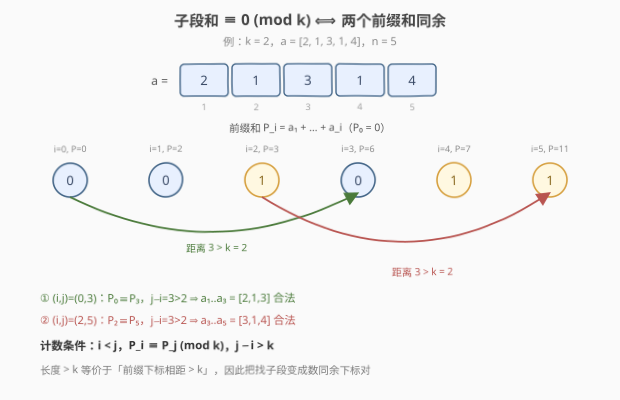
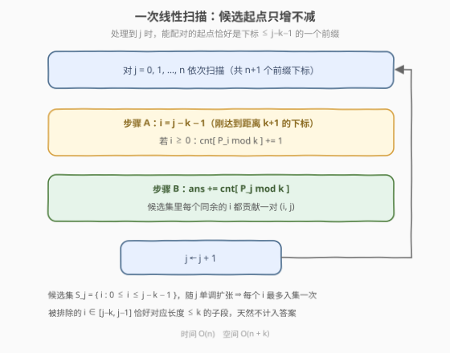
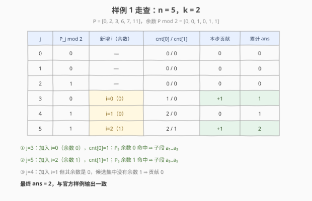

# Codeforces 2276C 子数组 题解

## 1. 题目概述

- **标题 / 题号**：子数组（Codeforces 2276C，英文名 Subarrays）
- **链接**：https://codeforces.com/problemset/problem/2276/C
- **来源**：Educational Codeforces Round 195 (Rated for Div. 2) · Problem C（UTC 2026-10-14）
- **难度**：1100
- **限制**：时间 2 s / 内存 512 MB
- **标签**：数学，数论

**题意**：给定 $n$ 个正整数构成的数组 $a$ 与整数 $k$（$k < n$）。若连续子段 $a_l, a_{l+1}, \dots, a_r$（$1 \le l \le r \le n$）同时满足

1. 元素之和能被 $k$ 整除；
2. 长度严格大于 $k$，即 $r - l + 1 > k$，

则称它为 **$k$-平衡** 的。求 $k$-平衡子段的总数。多测：首行 $t$，每组给出 $n, k$ 与数组 $a$，逐组输出一个整数。

**约束**：

- $1 \le t \le 10^4$，$1 \le k < n \le 2 \times 10^5$
- $1 \le a_i \le 10^9$
- 所有测试的 $n$ 之和 $\le 2 \times 10^5$

单组 $O(n^2)$ 枚举端点，在 $n = 2 \times 10^5$ 时约 $4 \times 10^{10}$ 次判定，因此必须做到 $O(n)$ 或 $O(n \log n)$；$\sum n \le 2 \times 10^5$ 又说明线性做法可以放心做满。

## 2. 示例与观察
官方样例（输入 / 输出原样）：

```text
输入：
3
5 2
2 1 3 1 4
9 3
1 1 1 1 1 1 1 1 1
4 3
2 8 5 7

输出：
2
5
0
```

- 第 1 组：只有 $[2,1,3]$（和 6）与 $[3,1,4]$（和 8）合格，长度都是 3 $> 2$。
- 第 2 组：全 1 时子段和等于长度，能被 3 整除的长度只有 6 和 9；长度 6 有 4 段、长度 9 有 1 段，答案 $4 + 1 = 5$。
- 第 3 组：长度 $> 3$ 的子段只有整段，和 $22$ 不被 3 整除，答案 0。

补充自造样例（标注为自造，各压一个边界）：

```text
输入：
2
6 2
1 1 1 1 1 1
2 1
1 2

输出：
4
1
```

- 自造 1：$n=6,k=2$ 全 1 时合格的只有长度 4 的 3 段与长度 6 的 1 段，答案 4，用来检查「长度恰好等于 $k$」必须被排除；自造 2：$n=2,k=1$ 的最小规模，唯一长度 $>1$ 的子段是整段，和为 3 可被 1 整除，答案 1。

## 3. 解题思路

### 3.1 暴力思路

枚举所有 $l \le r$，用前缀和 $O(1)$ 得到段和，再 $O(1)$ 判整除与长度：单组 $O(n^2)$，$\sum n$ 取满时约 $2 \times 10^{10}$ 次判定，远超 2 s。问题出在「对所有端点对逐一检查」，但可除性其实只依赖两个前缀和 $P_r$ 与 $P_{l-1}$ 的**余数是否相同**，长度条件只依赖**下标差**——这两类信息都能放进桶里做增量统计，于是成对枚举可以被压成一次线性扫描。

### 3.2 核心观察：前缀和同余 + 下标距离



令 $P_0 = 0$，$P_i = a_1 + \cdots + a_i$。子段 $[l, r]$ 的和是 $P_r - P_{l-1}$，因此

$$k \mid (P_r - P_{l-1}) \iff P_r \equiv P_{l-1} \pmod k$$

再看长度条件：代入 $i = l-1$、$j = r$，有 $r - l + 1 = j - i$，条件变成 $j - i > k$，且 $0 \le i < j \le n$。于是

$$\text{答案} = \#\{\, (i, j) : 0 \le i < j \le n,\ P_i \equiv P_j \pmod k,\ j - i > k \,\}.$$

「子段」被彻底翻译成「前缀下标对」：一个条件只管余数，一个只管距离，二者互不干扰。这正是可以用桶 `cnt[余数]` 边扫边统计的形状——每扫到一个 $j$，只要知道有多少个「距离已经足够远」的 $i$ 与它同余即可。

### 3.3 算法流程：候选起点集合单调扩张



固定右端点 $j$，能与之配对的起点集合为

$$S_j = \{\, i : 0 \le i \le j - k - 1 \,\},$$

它随 $j$ 增大**只增不减**：从 $S_j$ 到 $S_{j+1}$ 只多出下标 $j - k$ 这一个元素。因此不需要双指针那套「进一个、出一个」，更不需要删除任何下标：

1. 维护 `cnt[r]`，含义是当前 $S_j$ 中满足 $P_i \bmod k = r$ 的下标个数；
2. $j$ 从 $0$ 扫到 $n$：**先**把 $i = j - k - 1$ 入桶（若 $i \ge 0$），**再**把 `cnt[P_j mod k]` 累加进答案；
3. 顺序不能颠倒：先入桶才能保证刚达到 $j - i = k+1$ 的那一批 $i$ 被算进来。

> 💡 **为什么复杂度是线性的**：$S_j$ 是下标区间的一个前缀，每个下标最多入桶一次、出桶零次，所以总操作数是 $O(n)$；被挡在桶外的 $i \in [j-k, j-1]$ 恰好对应长度 $\le k$ 的那些子段，天然被排除，无需任何扣减。

### 3.4 示例演算



以官方第 1 组为例：$n = 5$，$k = 2$，$a = [2, 1, 3, 1, 4]$，于是 $P = [0, 2, 3, 6, 7, 11]$、$P \bmod 2 = [0, 0, 1, 0, 1, 1]$。

| $j$ | $P_j \bmod 2$ | 新增 $i$（余数） | `cnt[0]` / `cnt[1]` | 本步贡献 | $ans$ |
|-----|---------------|------------------|---------------------|----------|-------|
| 0 | 0 | — | 0 / 0 | 0 | 0 |
| 1 | 0 | — | 0 / 0 | 0 | 0 |
| 2 | 1 | — | 0 / 0 | 0 | 0 |
| 3 | 0 | $i=0$（0） | 1 / 0 | +1 | 1 |
| 4 | 1 | $i=1$（0） | 2 / 0 | 0 | 1 |
| 5 | 1 | $i=2$（1） | 2 / 1 | +1 | 2 |

$j=3$ 的命中对应子段 $[1,3] = [2,1,3]$；$j=5$ 的命中对应子段 $[3,5] = [3,1,4]$；$j=4$ 时虽然 $P_4$ 余数为 1，但候选集里还没有余数 1 的下标，贡献 0。答案 2，与样例输出一致。

## 4. 算法细节

1. **下标定义域是 $0 \sim n$ 共 $n+1$ 个**：$P_0$ 必须参与计数，循环写成 `for (j = 0; j <= n; ++j)`；漏掉 $j=0$ 会丢掉以首个元素开头的候选，漏掉 $j=n$ 会丢掉所有以末元素结尾的子段。
2. **先入桶、后统计**：每轮先执行 $i = j-k-1$ 的入桶，再累加 `cnt[P_j % k]`。顺序写反会漏掉距离恰为 $k+1$ 的那一批下标对（样例 1 会输出 0 而不是 2）。
3. **答案用 `long long`**：当所有 $a_i$ 都能被 $k$ 整除（$k=1$ 时必然）时，答案为 $\frac{(n-k)(n-k+1)}{2}$，取 $n = 2\times10^5, k=1$ 得 $19999900000 \approx 2 \times 10^{10}$，超过 `int`。
4. **前缀和用滚动取模**：`cur = (cur + a[i]) % k`，避免真实前缀和达到 $2 \times 10^{14}$ 量级；读入的 $a_i$ 用 `long long` 接，杜绝「先加后模」时的任何越界嫌疑。
5. **桶的大小恰为 $k$**：`vector<int> cnt(k, 0)` 比 `unordered_map` 快一个常数，且 $k < n \le 2\times10^5$ 时内存可忽略；因为每组 $k$ 不同，桶必须在循环体内重新声明。
6. **I/O 与多测**：$t$ 可达 $10^4$，C++ 关同步并 `cin.tie(nullptr)`；Python 用 `sys.stdin.buffer.read().split()` 一次读完，避免 $10^4$ 次 `input()` 的调用开销。
7. **不用特判 $k \ge n$**：题面保证 $k < n$，至少整段满足长度条件，答案可以为 0，但循环逻辑无需针对 $n$ 做任何分支。

## 5. 正确性证明

**引理 1（整除的等价刻画）**：对 $1 \le l \le r \le n$，有 $k \mid \sum_{x=l}^{r} a_x \iff P_r \equiv P_{l-1} \pmod k$。

**证明**：$\sum_{x=l}^{r} a_x = P_r - P_{l-1}$。$k$ 整除它当且仅当 $P_r$ 与 $P_{l-1}$ 之差是 $k$ 的倍数，即二者模 $k$ 同余。∎

**引理 2（端点参数化是双射）**：$(l, r) \mapsto (i, j) = (l-1, r)$ 是集合 $\{(l,r) : 1 \le l \le r \le n\}$ 到 $\{(i,j) : 0 \le i < j \le n\}$ 的双射，并且在此映射下 $r - l + 1 > k \iff j - i > k$。

**证明**：$i = l-1 \ge 0$，$j = r \le n$，$l \le r \iff i < j$，故像落在目标集合内；逆映射 $l = i+1, r = j$ 定义良好且互逆，故为双射。又 $j - i = r - (l-1) = r - l + 1$，长度不等式等价。∎

**引理 3（循环不变式）**：第 $j$ 轮执行完步骤 A 后，`cnt[r]` 恰等于集合 $\{\, P_t \bmod k : 0 \le t \le j-k-1 \,\}$ 中余数 $r$ 的出现次数。

**证明**：对 $j$ 归纳。当 $j \le k$ 时 $j-k-1 < 0$，步骤 A 不加入任何下标，集合为空，各桶为 0，成立。设第 $j$ 轮结束后不变式成立，则第 $j+1$ 轮的步骤 A 只把下标 $j+1-k-1 = j-k$ 的余数加一，得到的集合正好是 $\{t : 0 \le t \le (j+1)-k-1\}$，其余下标计数未变，不变式保持。∎

**定理**：算法输出的 $ans$ 等于数组中 $k$-平衡子段的个数。

**证明**：由引理 3，第 $j$ 轮步骤 B 累加的 `cnt[P_j mod k]` 正是满足 $0 \le i \le j-k-1$ 且 $P_i \equiv P_j \pmod k$ 的 $i$ 的个数，也就是满足引理 1、2 中全部条件的下标对 $(i, j)$ 的个数。再看计数是否恰好一次：下标 $i$ 在第 $i+k+1$ 轮（若 $\le n$）入桶，此后一直留在桶中；$j$ 从 $0$ 到 $n$ 恰好取每个值一次，所以每个下标对 $(i,j)$ 只在「$j$ 作为右端点」的那一轮被统计，既不重复也不遗漏。结合引理 2 的双射，累加值即为所求子段数。∎

## 6. 复杂度分析

- **时间**：每组 $O(n)$。求前缀余数一遍 $O(n)$；扫描 $j$ 一遍 $O(n)$，每轮只有一次桶自增与一次桶查询，均为 $O(1)$。总计 $O(\sum n) \le 2 \times 10^5$ 次基本操作。
- **空间**：$O(n + k)$。余数数组 $n+1$ 个 `int`，桶 `cnt` 有 $k$ 个 `int`；$k < n \le 2 \times 10^5$，峰值约 $1.6$ MB，远低于 512 MB。
- **与时限对比**：实测 C++17（`g++ -O2`）在最坏数据上整程序约 **0.30 s**，其中约 0.29 s 花在 `cin` 解析 $2\times10^5$ 个十位数（本机 Xcode libc++ 的 iostream 偏慢），算法主体与建桶合计 **不足 1 ms**；Python3 全程约 **0.09 s**。即便按 0.30 s 计，相对 2 s 仍有 6 倍以上余量，时限非常宽松。

## 7. 参考代码

### C++17

```cpp
#include <bits/stdc++.h>
using namespace std;

int main() {
    ios::sync_with_stdio(false);
    cin.tie(nullptr);

    int t;
    if (!(cin >> t)) return 0;              // 空输入防护
    while (t--) {
        int n;
        long long k;
        cin >> n >> k;

        vector<int> res(n + 1, 0);          // res[i] = (a1+...+ai) mod k
        long long cur = 0;
        for (int i = 1; i <= n; ++i) {
            long long x;
            cin >> x;
            cur = (cur + x) % k;            // 滚动取模，避免 1e14 级前缀和
            res[i] = (int)cur;
        }

        vector<int> cnt((size_t)k, 0);      // 余数桶，每组重建
        long long ans = 0;
        for (int j = 0; j <= n; ++j) {
            int i = j - (int)k - 1;         // 刚刚满足 j - i > k 的下标
            if (i >= 0) ++cnt[res[i]];      // 先入桶
            ans += cnt[res[j]];             // 再统计（顺序不可颠倒）
        }
        cout << ans << '\n';
    }
    return 0;
}
```

### Python3

```python
import sys


def main() -> None:
    data = sys.stdin.buffer.read().split()
    if not data:                                   # 空输入防护
        return
    t = int(data[0])
    p = 1
    out = []
    for _ in range(t):
        n = int(data[p])
        k = int(data[p + 1])
        p += 2

        pref = [0] * (n + 1)                       # pref[i] = 前缀和 mod k
        cur = 0
        for i in range(1, n + 1):
            cur = (cur + int(data[p])) % k
            p += 1
            pref[i] = cur

        cnt = [0] * k                              # 余数桶，每组重建
        ans = 0
        for j in range(n + 1):
            i = j - k - 1
            if i >= 0:
                cnt[pref[i]] += 1                  # 先入桶
            ans += cnt[pref[j]]                    # 再统计
        out.append(str(ans))

    sys.stdout.write("\n".join(out) + "\n")


main()
```

## 8. 边界情况与易错点

1. **$k = 1$**：所有前缀余数都是 0，桶只有一格，答案是长度 $>1$ 的全部子段数 $\frac{(n-1)n}{2}$，最大约 $2\times10^{10}$，必须用 `long long`；桶的大小是 $k$ 而不是 $n$，开小了或写死成常量都会越界。
2. **$n = k+1$（最小规模）**：唯一可能合格的是整段，只有 $j = n$ 那一轮会加入 $i = 0$，答案只能是 0 或 1。用这条可快速自检下标边界。
3. **$j$ 的上界**：必须扫到 $j = n$（含）。写成 `j < n` 会让所有以末元素结尾的子段全部漏掉，样例 1 从 2 变成 1。
4. **先统计后入桶**：只是把两个语句换序，就会漏掉距离恰为 $k+1$ 的下标对，样例 1 从 2 变成 0，是本题最隐蔽的 WA。
5. **长度条件写成 $\ge k$**：入桶下标若写成 $j-k$，会把长度恰好为 $k$ 的子段算进来，样例 1 从 2 变成 4。
6. **多测未清空**：$k$ 逐组变化，桶与余数数组必须在循环体内重新分配；沿用上一组的数组会读到脏计数甚至越界。
7. **溢出**：`cur + x` 是 `long long` 运算；答案累加器不能声明成 `int`；Python 的整数无溢出问题，但不要在中途把答案转成 32 位整数。

## 9. 验证记录

- **编译环境与命令**：`clang++ -std=c++17 -O2`（本机无 GNU g++，配 `codeforces/tools/include/bits/stdc++.h` 兼容头；正文代码只用标准库，可原样提交 GNU C++17）；Python 侧为 `Python 3.9.6`。
- **官方样例**：1 / 1 通过（按 Codeforces 标准 checker 的 token 比对，忽略空白与大小写）。
- **复核状态**：audited（2026-11-19 统一回归：编译 + 官方样例；写作期的随机对拍与暴力未重跑）。

## 相关题目与扩展

- [Codeforces 2276B Replace and Compress](https://codeforces.com/problemset/problem/2276/B)：同场 B 题，同样靠「先找不变量、再一次性计数」把 $O(n^2)$ 压到线性。
- [LeetCode 974. 和可被 K 整除的子数组](https://leetcode.cn/problems/subarray-sums-divisible-by-k/)：本题去掉长度条件后的版本，直接用余数桶统计即可，可作为本题的第一层练习。
- [LeetCode 560. 和为 K 的子数组](https://leetcode.cn/problems/subarray-sum-equals-k/)：把「同余」换成「差值恰为 $k$」，桶里存出现次数，思想完全一致。
- [LeetCode 1590. 使数组和能被 P 整除](https://leetcode.cn/problems/make-sum-divisible-by-p/)：前缀余数 + 最短删除段，考察「同余位置之间距离」的另一类用法。
- [Codeforces 1398C Good Subarrays](https://codeforces.com/problemset/problem/1398/C)：把「和等于长度」转化为前缀差为 0 的同余计数，是同一模板的变体。

**延伸思考**：

1. **允许 $a_i$ 为负或零**：引理 1 的推导不依赖正数，同余仍然等价于整除；只需把滚动取模写成 `((cur + x) % k + k) % k` 保证非负，复杂度不变。
2. **把长度条件改成「长度是 $k$ 的倍数」**：$j - i \equiv 0 \pmod k$ 会破坏候选集的单调性，此时要按 $j \bmod k$ 分成 $k$ 个独立桶，再在每个桶内按余数统计，仍是 $O(n)$，但常数翻倍。
3. **把条件改成「和 $\equiv 0$ 且长度落在 $[L, R]$」**：候选集变成两个前缀之差，需要「加入 $j-R-1$、删除 $j-L$」的滑动窗口；删除时桶计数减少是安全的（只减自己贡献的那部分），依然是 $O(n)$。
4. **把「和」换成「异或」**：异或同样满足前缀差形式，此时条件变成前缀异或相等，仍可用桶；但「整除」换成「异或为 0」后长度约束的处理方式完全不变，是一个很好的模板迁移练习。
