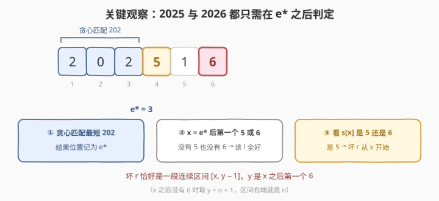
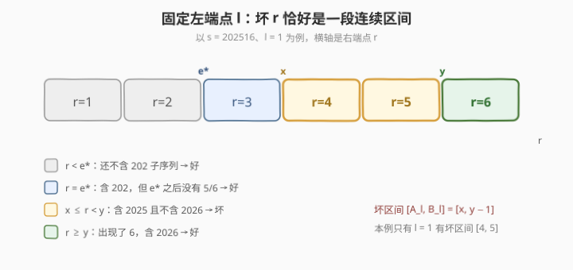
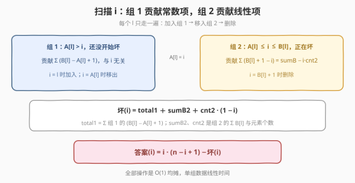
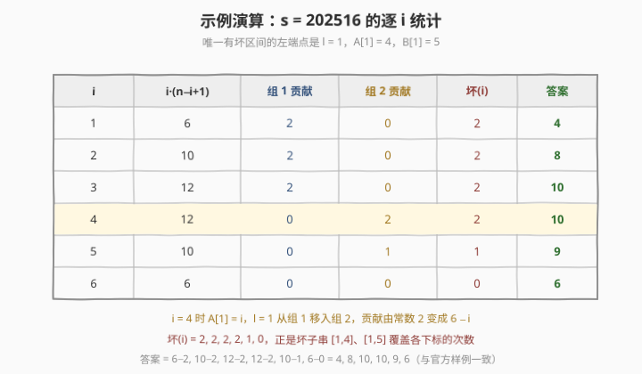

# Codeforces 2276E 好子串 题解

## 1. 题目概述

- **标题 / 题号**：好子串（Codeforces 2276E，英文名 Good Substrings）
- **链接**：https://codeforces.com/problemset/problem/2276/E
- **来源**：Educational Codeforces Round 195 (Rated for Div. 2) · Problem E
- **难度**：1800（Div. 2 E）
- **限制**：时间 2 s / 内存 512 MB
- **标签**：组合数学，数据结构，动态规划，贪心，字符串

**题意**：给定长度为 $n$ 的数字串 $s$。称子串 $s_{l..r}$ 是**坏的**，当且仅当它含有子序列 `2025` 且**不含**子序列 `2026`；否则称它是**好的**。对每个下标 $i$ 输出包含 $i$ 的好子串个数，即满足 $1\le l\le i\le r\le n$ 且 $s_{l..r}$ 好的二元组 $(l,r)$ 数量。

两个关键点是"**子序列**"而不是子串（例如 `72707275` 是坏的，四个字符不必连续），以及"按位置输出"（同一个子串会对它覆盖的每个下标各贡献 1）。

输入输出格式：第一行 $t$；每组先给一个整数 $n$，再给一行长度为 $n$ 的数字串；对该组在一行内输出 $n$ 个整数（空格分隔）。

**约束**：

- $1 \le t \le 10^4$，$\sum n \le 3\times 10^5$
- $1 \le n \le 3\times 10^5$
- $s$ 只由数字 `0`–`9` 组成
- 答案上界为 $\max_i i(n-i+1) \approx 2.25\times10^{10}$，超过 32 位整数

## 2. 示例

官方样例（输入 / 输出原样）：

```text
输入：
2
6
202516
5
20265

输出：
4 8 10 10 9 6
5 8 9 8 5
```

第 1 组 `202516`：坏子串只有 `2025`（$s_{1..4}$）和 `20251`（$s_{1..5}$），它们分别覆盖下标 $1..4$、$1..5$，所以下标 1–4 各被扣 2 次、下标 5 被扣 1 次、下标 6 不被扣。包含下标 $i$ 的子串总数为 $i(n-i+1)$，相减即得 $4,8,10,10,9,6$。

第 2 组 `20265`：最短 `202` 的后面紧跟的就是 `6`，于是任何含 `2025` 的子串必然同时含 `2026`，所有子串都是好的（题面同样把 `20256`、`2026` 列为好串），答案退化为 $i(n-i+1)$。

补充一组自造样例，用来压边界：

```text
输入（自造）：
4
4
2026
9
202520252
7
6666222
10
2025202625

输出（自造）：
4 6 6 4
3 8 11 12 12 12 10 6 4
7 12 15 16 15 12 7
6 14 20 24 27 28 27 24 18 10
```

`2026` 与 `6666222` 全是好串（前者含 `2026`，后者没有 `202`），答案就是 $i(n-i+1)$；`202520252` 反复出现 `2025`，坏子串密集；最后一组把 `5` 与 `6` 交织在一起。

## 3. 解题思路

### 3.1 暴力思路

枚举全部 $O(n^2)$ 个子串，每个子串用双指针判断 `2025` 与 `2026` 是否为其子序列，单次 $O(n)$，总 $O(n^3)$；即使对每个固定左端点递推匹配状态，也要 $O(n^2)$ 时间与 $O(n^2)$ 空间去维护"每个子串覆盖了哪些下标"。$n=3\times10^5$ 时 $O(n^2)=9\times10^{10}$，完全不可行。必须找到**线性**做法，并且要避免"枚举子串"这一层。

### 3.2 核心观察：两个模式的判定压到同一个 e*

对子串 $T$，记 $e(T)$ 为 $T$ 中**最短**的 `202` 子序列的结束位置（不存在则为 $+\infty$）。`2025` 与 `2026` 共享前缀 `202`，所以"后面有没有 5/6"这一判定可以统一挂到 $e(T)$ 之后。



**引理 1**：$T$ 含 `2025` 子序列 $\iff$ $e(T)$ 有限且 $e(T)$ 之后存在字符 `5`；把 `5` 换成 `6` 对 `2026` 同样成立。

于是对固定左端点 $l$：令 $e^*=e(s_{l..n})$，$x_5$、$x_6$ 分别为 $e^*$ 之后第一个 `5`、第一个 `6` 的位置（不存在取 $+\infty$），则对 $r\ge e^*$ 有

$$s_{l..r}\text{ 坏} \iff r\ge x_5 \ \wedge\ r < x_6$$

也就是说，**固定 $l$ 时坏的 $r$ 恰好是一段连续区间**：

$$[A_l,\ B_l] = [x_5,\ x_6-1]$$

$x_5=+\infty$（$e^*$ 之后既无 5 也无 6 时更不必说）则区间为空。实现上取 $x=\min(x_5,x_6)$：若 $s_x=6$ 则 $x_6<x_5$，区间必空；若 $s_x=5$ 则 $A_l=x$，$B_l=y-1$，其中 $y$ 是 $x$ 之后第一个 `6`（不存在取 $n+1$）。



这一步把"$O(n^2)$ 个子串的判定"压缩成"$O(n)$ 个区间的端点"，问题转化为：对每个 $i$，统计有多少个 $l\le i$ 的区间 $[A_l,B_l]$ 满足 $A_l\le r\le B_l$ 且 $r\ge i$，即

$$\text{坏}(i)=\sum_{l\le i}\Big(B_l-\max(A_l,i)+1\Big)\cdot\big[B_l\ge i\big]$$

### 3.3 算法流程



1. **预处理 next 数组**：倒序扫一遍，得到 `nxt2[i]`、`nxt0[i]`、`nxt5[i]`、`nxt6[i]`，表示 $i$ 之后（含 $i$）第一个对应数字的位置，空为 $+\infty=n+1$。
2. **求每个 $l$ 的区间**：$p_1=$`nxt2[l]`，$p_2=$`nxt0[p1+1]`，$e^*=$`nxt2[p2+1]`，任一步为空就说明该 $l$ 没有 `202`；再取 $x_5,x_6$ 与 $y$ 得到 $[A_l,B_l]$，把 $l$ 放进桶 `startAt[A_l]` 与 `endAt[B_l]`。
3. **对 $i=1..n$ 扫描**，维护两个集合：
   - **组 1**（$A_l>i$，区间还没开始）：贡献 $B_l-A_l+1$，与 $i$ 无关，用 `total1` 汇总；
   - **组 2**（$A_l\le i\le B_l$，正处在区间内）：贡献 $B_l-i+1$，用 `cnt2 = |组2|` 与 `sumB2 = Σ B_l` 汇总，合计 $sumB2+cnt2(1-i)$。
   每步先删除 $B_l=i-1$ 的元素，再把 $l=i$ 加入组 1（必有 $A_i>i$），最后把 $A_l=i$ 的元素从组 1 移入组 2。
4. **输出** $i(n-i+1)-\text{坏}(i)$。

### 3.4 示例演算



以 $s=$`202516` 为例，$n=6$。逐 $l$ 求区间：

| $l$ | 贪心 `202` 结尾 $e^*$ | $e^*$ 后第一个 5/6 | 区间 $[A_l,B_l]$ |
|-----|----------------------|--------------------|------------------|
| 1 | 3（位置 1,2,3） | 位置 4 是 `5`，其后第一个 `6` 在 6 | $[4,5]$ |
| 2 | 不存在（位置 2 是 `0`，后面无 `0`） | — | 空 |
| 3–6 | 不存在 | — | 空 |

于是坏子串只有 $s_{1..4}=$`2025` 与 $s_{1..5}=$`20251`。扫描时 $i=1,2,3$ 该元素还在组 1（贡献常数 $5-4+1=2$），$i=4,5$ 已在组 2（贡献 $6-i$），$i=6$ 因 $B_1=5$ 过期，坏计数为 $2,2,2,2,1,0$，与总子串数 $6,10,12,12,10,6$ 相减得到 $4,8,10,10,9,6$，与官方输出一致。

## 4. 算法细节

1. **next 数组的边界**：数组开到 $n+2$ 并令 `nxt[n+1] = n+1`（即 $+\infty$）。查询 `nxt[e+1]` 时 $e$ 可能等于 $n$，所以 $n+1$ 这个下标必须存在；同理 `nxt[x+1]` 中 $x\le n$。
2. **$e^*$ 的 $O(1)$ 求法**：`nxt2[l]` → `nxt0[...+1]` → `nxt2[...+1]` 三次查表就是贪心匹配最短 `202`，无需双指针，也天然处理了"某个数字完全不存在"的情况。
3. **$A_l>l$ 恒成立**：因为 $A_l>x>e^*\ge l$。这条性质保证"第 $i$ 步只把 $l=i$ 塞进组 1"不会漏掉任何应当立即进入组 2 的元素。
4. **用桶代替排序**：区间端点都在 $[1,n+1]$，开 `startAt[x]`、`endAt[b]` 两个 `vector` 桶即可，扫描时直接遍历；注意 $i=1$ 会访问 `endAt[0]`，所以桶数组大小取 $n+2$ 并从 0 开始。
5. **全部用 64 位**：`sumB2` 可达 $O(n^2)$，`cnt2*(1-i)` 在 $n=3\times10^5$ 时约 $-9\times10^{10}$（负数），答案 $i(n-i+1)$ 最大 $2.25\times10^{10}$——这三个量都必须 `long long`，且要写 `1LL - i` 避免 `int` 提升前的截断。
6. **多测与输出**：每组重建 `vector` 不复用残留（$\sum n$ 有限，总分配量仍是线性）；把每组的 $n$ 个数先拼进 `string` 再一次性 `cout`，Python 用 `' '.join`，避免 $3\times10^5$ 次小 IO。

## 5. 正确性证明

**引理 1（2025 的判定）**：对任意子串 $T$，$T$ 含 `2025` 子序列 $\iff$ $e(T)$ 有限且 $e(T)$ 之后存在 `5`。

**证明**：($\Leftarrow$) 把 `202` 匹配到以 $e(T)$ 结尾的三元组，再接上该 `5`，得到 `2025`。($\Rightarrow$) 设 $p_1<p_2<p_3<j$ 给出 `2025`，则 $p_3$ 是某个 `202` 匹配的结束位置，由 $e(T)$ 的最小性 $e(T)\le p_3<j$，故 $j$ 在 $e(T)$ 之后。∎

**引理 2（2026 的判定）**：把引理 1 的 `5` 全部换成 `6` 后结论仍成立。

**证明**：与引理 1 完全对称，只需注意 `2026` 的前缀同样是 `202`。∎

**引理 3（坏区间形状）**：固定 $l$，令 $e^*=e(s_{l..n})$，$x_5,x_6$ 为 $e^*$ 之后第一个 `5`/`6` 的位置（缺省 $+\infty$）。则 $\{r: s_{l..r}\text{ 坏}\}=[x_5,\ x_6-1]$。

**证明**：若 $r<e^*$，则由 $e^*$ 的最小性 $e(s_{l..r})=+\infty$，$s_{l..r}$ 不含 `202`，由引理 1、2 它既不含 `2025` 也不含 `2026`，是好的。若 $r\ge e^*$，最短 `202` 的匹配整体落在 $[l,e^*]\subseteq[l,r]$ 内，且 $[l,r]\subseteq[l,n]$，故 $e(s_{l..r})=e^*$；由引理 1、2，含 `2025` $\iff r\ge x_5$，含 `2026` $\iff r\ge x_6$，两者相减即得坏 $\iff x_5\le r<x_6$。$x_5=+\infty$ 时该集合为空，与约定一致。∎

**推论**：取 $x=\min(x_5,x_6)$，若 $s_x=5$ 则 $x_5=x$、$x_6=y$（$x$ 后第一个 `6`），区间为 $[x,y-1]$；若 $s_x=6$ 则 $x_6<x_5$，区间为空；$x$ 不存在时空。这正是代码的分支。

**引理 4（扫描不变量）**：第 $i$ 步三类操作完成后，组 1 $=\{l\le i:A_l>i\}$，组 2 $=\{l:A_l\le i\le B_l\}$，且 `total1` $=\sum_{l\in\text{组1}}(B_l-A_l+1)$，`cnt2`、`sumB2` 与组 2 一致。

**证明**：对 $i$ 归纳。$i=1$ 之前两组皆空。第 $i$ 步：(a) 删除 $B_l=i-1$ 的元素——它们满足 $A_l\le B_l=i-1<i$，故在第 $i-1$ 步之前已移入组 2，是组 2 中唯一可能失效的一批；(b) 加入 $l=i$，由 $A_i>i$ 归入组 1；(c) 把 $A_l=i$ 的元素移入组 2，它们在 $i-1$ 步后仍在组 1（$A_l=i>i-1$）。三步后两条等式成立。∎

**定理**：算法输出的第 $i$ 个数等于包含 $i$ 的好子串个数。

**证明**：包含 $i$ 的子串共 $i(n-i+1)$ 个，且按定义非好即坏。对固定的 $l\le i$，由引理 3 坏的 $r$ 是 $[A_l,B_l]$，其中满足 $r\ge i$ 的 $r$ 有 $\big(B_l-\max(A_l,i)+1\big)$ 个（当 $B_l\ge i$）。按 $A_l>i$ 与 $A_l\le i$ 分类求和：前者贡献 $B_l-A_l+1$（此时必有 $B_l\ge A_l>i$），后者贡献 $B_l-i+1$。由引理 4，两类之和恰为 `total1 + sumB2 + cnt2(1-i)`，即算法算出的 $\text{坏}(i)$。因此 $i(n-i+1)-\text{坏}(i)$ 就是好子串数。∎

## 6. 复杂度分析

- **时间**：每个测试点 $O(n)$。next 数组倒序 $O(n)$；每个 $l$ 的区间端点 $O(1)$ 查表，共 $O(n)$；扫描 $i$ 时每个 $l$ 只会经历"加入组 1 → 移入组 2 → 删除"各一次，桶遍历总量 $O(n)$。总计 $O(\sum n)\le 3\times10^5$ 次基本操作，常数极小（无排序、无树状数组）。
- **空间**：$O(n)$。四个 next 数组、两个桶数组、答案数组均为 $O(n)$；最大测试点约 $4\times3\times10^5$ 个 `int` + 少量 `long long`，远小于 512 MB。
- **可行性**：$2$ s 时限下，实测 C++17 处理 $n=3\times10^5$ 仅约 $0.04$ s，Python3 约 $0.5$ s，余量充足。

## 7. 参考代码

### C++17

```cpp
#include <bits/stdc++.h>
using namespace std;

int main() {
    ios::sync_with_stdio(false);
    cin.tie(nullptr);
    int T;
    if (!(cin >> T)) return 0;
    while (T--) {
        int n;
        string s;
        cin >> n >> s;
        const int INF = n + 1;                       // 表示“不存在”
        vector<int> nxt2(n + 2, INF), nxt0(n + 2, INF), nxt5(n + 2, INF), nxt6(n + 2, INF);
        for (int i = n; i >= 1; --i) {               // 倒推 next 出现位置
            nxt2[i] = nxt2[i + 1];
            nxt0[i] = nxt0[i + 1];
            nxt5[i] = nxt5[i + 1];
            nxt6[i] = nxt6[i + 1];
            char c = s[i - 1];
            if (c == '2') nxt2[i] = i;
            else if (c == '0') nxt0[i] = i;
            else if (c == '5') nxt5[i] = i;
            else if (c == '6') nxt6[i] = i;
        }

        // 对每个左端点 l，坏的 r 恰为区间 [A[l], B[l]]；A[l] = INF 表示没有坏 r
        vector<int> A(n + 1, INF), B(n + 1, 0);
        vector<vector<int>> startAt(n + 2), endAt(n + 2);
        for (int l = 1; l <= n; ++l) {
            int p1 = nxt2[l];
            if (p1 == INF) continue;
            int p2 = nxt0[p1 + 1];
            if (p2 == INF) continue;
            int e = nxt2[p2 + 1];                    // 最短 "202" 子序列的结束位置 e*
            if (e == INF) continue;
            int x = min(nxt5[e + 1], nxt6[e + 1]);   // e* 之后第一个 5 或 6
            if (x == INF) continue;                  // 既无 5 也无 6
            if (s[x - 1] != '5') continue;           // 第一个就是 6：必然含 2026
            int y = nxt6[x + 1];                     // x 之后第一个 6
            A[l] = x;
            B[l] = (y == INF ? n : y - 1);
            startAt[A[l]].push_back(l);
            endAt[B[l]].push_back(l);
        }

        long long total1 = 0, cnt2 = 0, sumB2 = 0;
        string out;
        out.reserve((size_t)n * 8);
        for (int i = 1; i <= n; ++i) {
            for (int l : endAt[i - 1]) {             // B[l] = i-1，区间已过期
                --cnt2;
                sumB2 -= B[l];
            }
            if (A[i] != INF) total1 += (long long)B[i] + 1 - A[i];   // l = i 进入组 1
            for (int l : startAt[i]) {               // A[l] = i，移入组 2
                total1 -= (long long)B[l] + 1 - A[l];
                ++cnt2;
                sumB2 += B[l];
            }
            long long bad = total1 + sumB2 + cnt2 * (1LL - i);
            out += to_string(1LL * i * (n - i + 1) - bad);
            out += (i == n ? '\n' : ' ');
        }
        cout << out;
    }
    return 0;
}
```

### Python3

```python
import sys


def solve(n, s):
    INF = n + 1
    nxt2 = [INF] * (n + 2)
    nxt0 = [INF] * (n + 2)
    nxt5 = [INF] * (n + 2)
    nxt6 = [INF] * (n + 2)
    for i in range(n, 0, -1):
        nxt2[i] = nxt2[i + 1]
        nxt0[i] = nxt0[i + 1]
        nxt5[i] = nxt5[i + 1]
        nxt6[i] = nxt6[i + 1]
        c = s[i - 1]
        if c == '2':
            nxt2[i] = i
        elif c == '0':
            nxt0[i] = i
        elif c == '5':
            nxt5[i] = i
        elif c == '6':
            nxt6[i] = i

    A = [INF] * (n + 1)
    B = [0] * (n + 1)
    startAt = [[] for _ in range(n + 2)]
    endAt = [[] for _ in range(n + 2)]
    for l in range(1, n + 1):
        p1 = nxt2[l]
        if p1 == INF:
            continue
        p2 = nxt0[p1 + 1]
        if p2 == INF:
            continue
        e = nxt2[p2 + 1]                      # 最短 "202" 子序列的结束位置
        if e == INF:
            continue
        x = nxt5[e + 1]
        if nxt6[e + 1] < x:
            x = nxt6[e + 1]                   # e* 之后第一个 5 或 6
        if x == INF:
            continue
        if s[x - 1] != '5':
            continue                          # 第一个就是 6
        y = nxt6[x + 1]
        A[l] = x
        B[l] = n if y == INF else y - 1
        startAt[A[l]].append(l)
        endAt[B[l]].append(l)

    total1 = cnt2 = sumB2 = 0
    res = [0] * (n + 1)
    for i in range(1, n + 1):
        for l in endAt[i - 1]:
            cnt2 -= 1
            sumB2 -= B[l]
        if A[i] != INF:
            total1 += B[i] + 1 - A[i]
        for l in startAt[i]:
            total1 -= B[l] + 1 - A[l]
            cnt2 += 1
            sumB2 += B[l]
        bad = total1 + sumB2 + cnt2 * (1 - i)
        res[i] = i * (n - i + 1) - bad
    return res[1:]


def main():
    data = sys.stdin.buffer.read().split()
    t = int(data[0])
    pos = 1
    out = []
    for _ in range(t):
        n = int(data[pos]); pos += 1
        s = data[pos].decode(); pos += 1
        out.append(' '.join(map(str, solve(n, s))))
    sys.stdout.write('\n'.join(out) + '\n')


main()
```

## 8. 边界情况与易错点

1. **$n<4$ 或串中没有 `202`**：$e^*$ 为 $+\infty$，所有区间为空，$\text{坏}(i)\equiv 0$，答案直接是 $i(n-i+1)$；不要给这种情形写特判，靠 $+\infty$ 的自然传递即可。
2. **`nxt` 的下标越界**：$e^*$ 可能等于 $n$，于是要查 `nxt[e+1] = nxt[n+1]`；数组必须开到 $n+2$ 且 `nxt[n+1] = n+1`，否则越界读。
3. **桶的下标 0**：$i=1$ 时访问 `endAt[0]`，虽然 $B_l\ge A_l\ge 1$ 使该桶恒空，但数组必须存在这一槽位，否则越界。
4. **加入组 1 的时机**：代码在 $i=l$ 时就把 $l$ 放进组 1，这依赖 $A_l\ge e^*+1>l$。若把模式换成不共享前缀的两个串，"最短公共前缀的结尾"就不再唯一决定边界，必须先重新推导加入时机。
5. **负数与溢出**：`sumB2 + cnt2*(1-i)` 中 `cnt2*(1-i)` 约为 $-9\times10^{10}$，`int` 会立刻溢出；单点答案最大 $2.25\times10^{10}$ 同样超出 32 位。C++ 用 `long long`（写 `1LL - i`），Python 原生大整数无此问题。
6. **多测复用**：`startAt`/`endAt`/`A`/`B` 必须每组重建或清空；只清 `n` 个元素而漏掉 `n+1` 槽位，会残留上一组数据。
7. **没有 `2025` 只有 `2026`**：例如 `2026`，$x=6$ 时直接跳过，坏计数为 0；注意不要写成"$x$ 存在就一定有坏区间"。
8. **读入格式**：每组的 $n$ 与串分两行，用 `cin >> n >> s` 或 `split()` 读即可，不要逐字符 `getchar`（换行符处理更易出错）。

## 相关题目与扩展

- [CF 271D Good Substrings](https://codeforces.com/problemset/problem/271/D)：同名题，统计"坏字符数不超过 $k$"的子串个数，做法是滑动窗口 + 字典树/哈希去重，可与本题的"区间端点"视角对照。
- [LeetCode 1358. 包含所有三种字符的子串数目](https://leetcode.cn/problems/number-of-substrings-containing-all-three-characters/)：同样是"对每个左端点求出最短可行右端点，再累加区间长度"，与本文 $[A_l,B_l]$ 的计数完全同构。
- [CF 1730C Minimum Notation](https://codeforces.com/problemset/problem/1730/C)：同样利用"数字只有 0–9、可以贪心地找下一个出现位置"的 next 出现表技巧，适合作为本题预处理部分的练手。
- [LeetCode 828. 统计子串中的唯一字符](https://leetcode.cn/problems/count-unique-characters-of-all-substrings-of-a-given-string/)：按下标贡献拆分子串计数的经典题，和"每个子串给覆盖位置各 +1"的转化思路一致。

**延伸思考**：

- 若把 `2025`/`2026` 换成任意两个模式 $P,Q$：只要二者共享一个前缀（本题共享 `202`），"最短公共前缀的结束位置 + 之后第一个分叉字符"的框架仍然成立；若前缀不共享，就需要对匹配状态做 DP（这正是本题标签里 dp 的来源），状态数随模式长度增长。
- 若要求"恰好含有三个模式中的某一个"，坏的 $r$ 集合不再是一段区间而是若干区间的并，扫描时需用差分/线段树维护，复杂度升到 $O(n\log n)$。
- 若只问坏子串**总数**，直接 $\sum_l\max(0,B_l-A_l+1)$，不需要任何扫描；本题的难点完全在"按位置输出"这一步。
